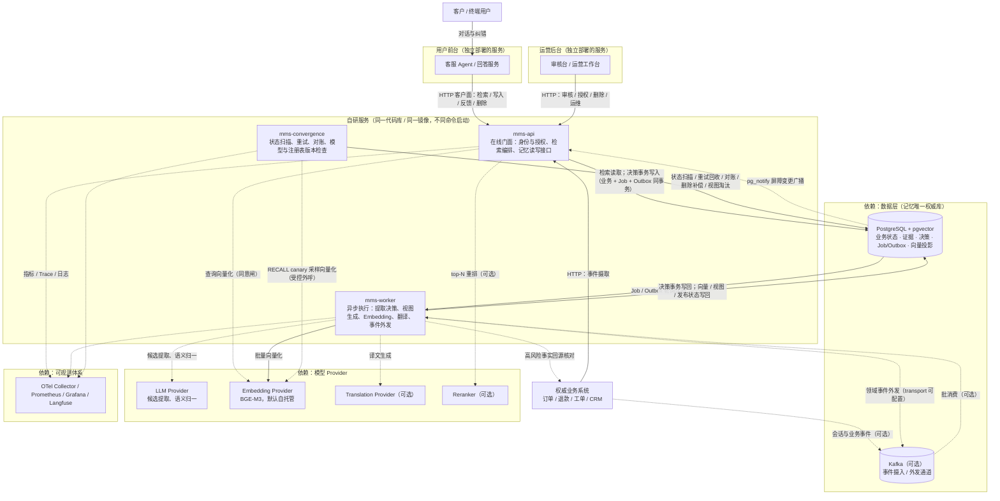
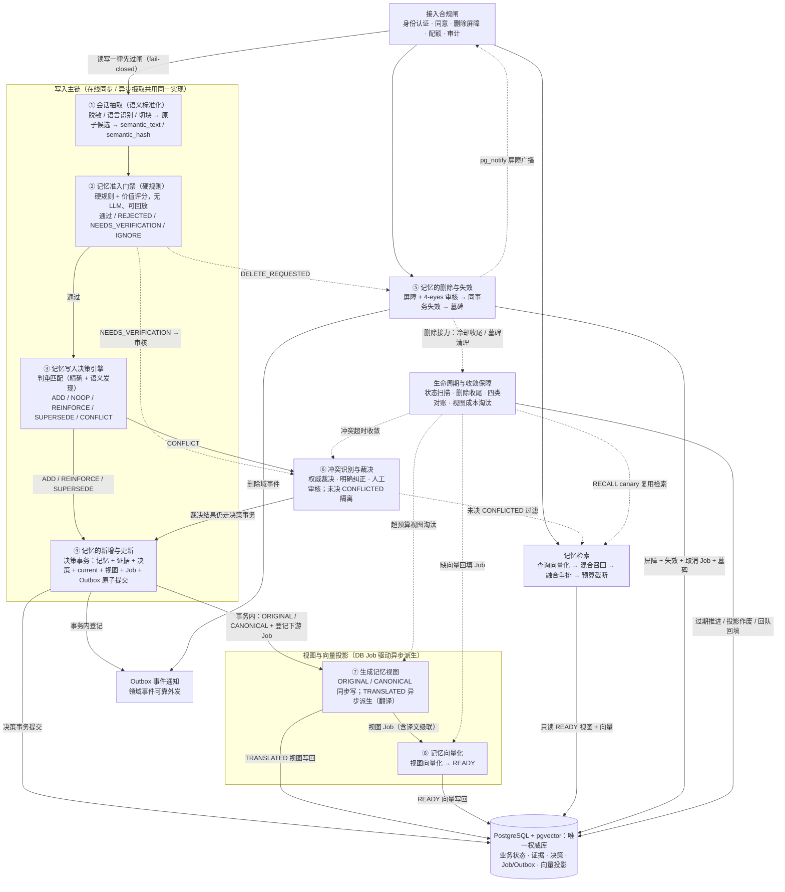
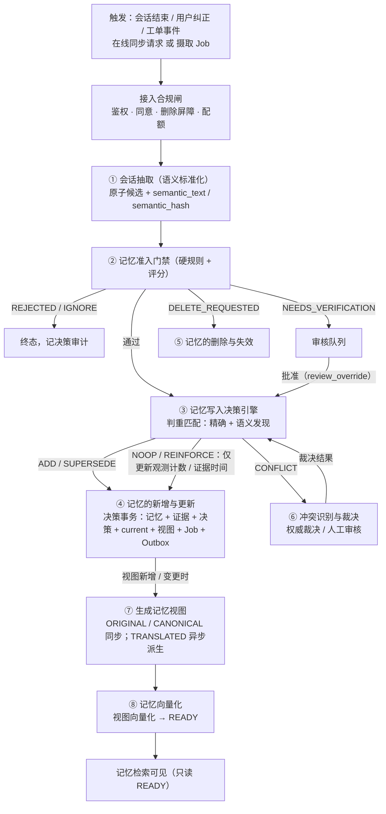

# 2. 总体架构与流程

## 2.1 架构图

架构图分两张：**部署架构图**以部署单元（自研服务）为粒度，回答"服务之间如何通信、数据如何流转"；**逻辑架构图**以逻辑组件为粒度，回答"组件之间如何协作"。同一套代码、同一个镜像，按不同命令启动为不同部署单元（见 2.1.1 部署组件清单）。

### 2.1.1 部署架构图（部署单元粒度）

自研服务只有 `mms-api`、`mms-worker`、`mms-convergence` 三个部署单元；PostgreSQL、Kafka、模型 Provider 与可观测体系均为开源组件/外部服务依赖。用户前台与运营后台是两个独立部署的上游服务，经不同认证面接入 MMS。

MVP 可在单一 Python 代码库中用不同进程/命令启动 `api`、`worker`、`convergence`，不必过早拆成多个微服务。部署组件：

- `mms-api`：无状态，可水平扩容；负责在线检索、记忆查询、删除/审核接口。
- `mms-worker`：Kafka consumer group（可选）+ DB Job Worker；负责提取、决策、语义标准化、视图生成、Embedding、翻译调度、生命周期。
- `mms-convergence`：生命周期扫描、Embedding/翻译重试、对账、策略版本检查、模型升级。
- `postgres`：业务状态 + pgvector + Job；主库 + 只读副本（检索可走副本，但删除/写入走主库）。
- `embedding-provider`：BGE-M3 dense 1024（ADR-002，自托管/私有化端点）；托管 API 仅作影子挑战；无状态；内网/mTLS。
- `translation-provider`（可选）：把 `ORIGINAL` 视图翻译为目标语言 `TRANSLATED` 视图；默认自托管，外部/跨境需 `CROSS_BORDER_TRANSLATION` 同意；只返回译文，不持有记忆正文。
- `reranker`（可选）：多语言 cross-encoder/LLM；只处理 top-N。
- `kafka`（可选）：复用现有集群，独立 topic/ACL；v1 可先只用 Outbox + DB Job。
- `prometheus/grafana/otel`：指标、追踪、告警。

### 2.1.2 逻辑架构图（逻辑组件粒度）

不看进程边界，只看功能组件如何协作。组件划分与 `docs/2-详细设计` 系列对齐（04 抽取 / 05 准入 / 06 决策 / 07 写入更新 / 08 删除失效 / 09 多语言 / 10 冲突 / 11 生命周期 / 12 检索）；①–⑧ 为核心组件，其余为配套组件。核心协作约定：**在线同步写与异步摄取共用同一写入主链；准入与决策分工；异步投影由数据依赖驱动，没有中心编排**。

**关键协作关系（文字补充）**：

- **闸前置**：所有读写先过合规闸，fail-closed；屏障变更经 `pg_notify` 广播，闸缓存即时失效。
- **确定性写入主链**：抽取 → 准入 → 决策 → 事务。准入只回答"能不能记、值多少分"（硬规则 + 评分，不读已有记忆）；决策回答"与已有记忆重复/冲突时怎么办"；在线同步与异步摄取共用同一实现，行为不漂移。
- **冲突闭环**：决策产出 CONFLICT → 权威裁决 / 明确纠正 / 人工审核，裁决结果仍走决策事务；未决 CONFLICTED 检索隔离，超时由生命周期收敛。
- **事务即入队**：决策事务把业务数据与视图、下游 Job/Outbox 原子提交——业务写成功 = 任务一定入队；视图 → 向量化按数据依赖推进（翻译完成后级联译文向量），无中心编排。
- **读写解耦**：检索只读 READY 投影；异步失败只影响新鲜度，不阻塞在线读写。
- **删除只有一条路**：删除意图/请求 → 屏障 → 4-eyes 审核同事务失效 → 收敛收尾（冷却、墓碑清理）；删除域事件必须外发，旧任务被代际围栏作废。
- **收敛闭环**：生命周期把过期状态推到终态，对账把卡住的任务回队、回填缺向量，视图成本淘汰超预算视图（与回填互相制衡）；RECALL canary 复用检索做召回体检。

## 2.2 记忆入库主流程

以 2.1.2 的逻辑组件为单位描述记忆入库主干；在线同步写与异步摄取共用同一主链，差异只在触发方式与提取方。组件内部不展开细步，完整规则见 `docs/2-详细设计` 对应章节。

**主流程说明（按组件）**：

1. **受理过闸**：事件经在线同步请求或摄取 Job 进入，先过接入合规闸（鉴权、同意、删除屏障、配额），fail-closed。
2. **① 会话抽取**：脱敏、语言识别、切块，提取原子候选并完成语义标准化（semantic_text / semantic_hash）。
3. **② 记忆准入**：硬规则 + 价值评分确定性判定——REJECTED / IGNORE 终态记审计；NEEDS_VERIFICATION 进审核队列，批准后回 ③ 重新决策；DELETE_REQUESTED 转 ⑤ 删除链路。
4. **③ 写入决策**：与已有记忆判重匹配（精确 + 语义发现），产出 ADD / NOOP / REINFORCE / SUPERSEDE / CONFLICT。
5. **④ 新增与更新**：ADD / SUPERSEDE 在决策事务内原子提交记忆、证据、决策、current、视图与下游 Job/Outbox；NOOP / REINFORCE 仅更新观测计数 / 证据时间。
6. **⑥ 冲突裁决**：CONFLICT 等待权威裁决或人工审核，裁决结果仍回决策事务；未决记忆检索隔离，超时由生命周期收敛。
7. **⑦⑧ 投影生效**：ORIGINAL / CANONICAL 视图随事务生效，TRANSLATED 异步派生（翻译完成后级联译文向量）；向量化完成置 READY 后才对检索可见。