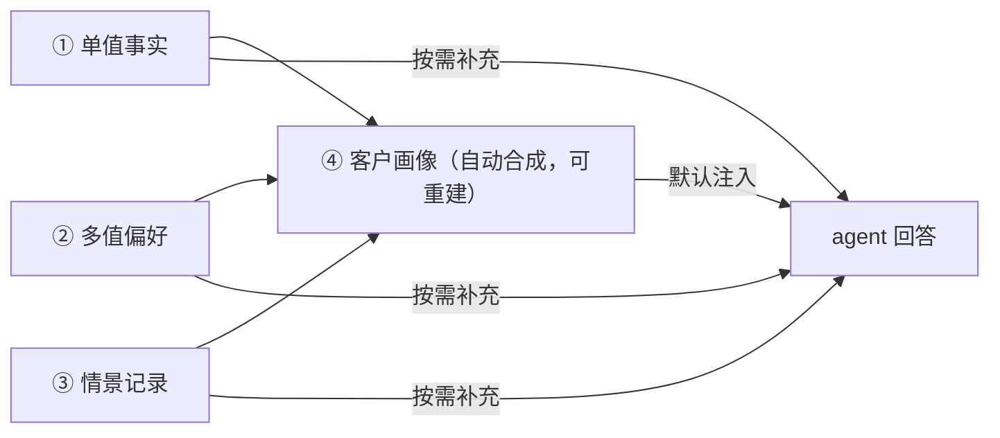
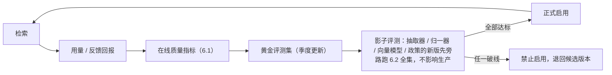

# 0. 需求与规模假设

- 本文是全部需求与假设的**唯一出处**，自包含、不依赖其他文档：先回答"做什么、多大、什么算好"；"怎么建"由后续设计承接，且不得偏离本文。
- 所有数字分两类：**约束**（产品/合规硬上限，必须满足）与 **假设**（规划估算，上线后须用实测校准，见第八章）。
- SLO 分两类：**管道 SLO**（数据流转的延迟/新鲜度，第五章）与**记忆质量 SLO**（记什么、召回有没有用，第六章）——后者才是记忆服务的护城河，二者独立度量、独立告警。
- 文中通用记号：**SLO** = 服务目标，即对外承诺的达标线；**P95 / P99** = 95% / 99% 的样本快于（或少于）该值；**QPS** = 每秒请求数；**DAU** = 日活跃用户数。

---

## 一、产品定位与边界

语言无关、业务无关的 **agent 通用记忆服务**：为多个 agent 主服务提供客户级长期记忆的写入、检索、纠错、删除与审计。

| 是 | 不是 |
|---|---|
| 客户级长期记忆（跨会话沉淀、按需查找） | 会话存储 / 聊天记录库（原文留在上游会话系统，本系统只持引用与脱敏摘录） |
| 记忆的权威库（事实 + 证据 + 决策可追溯） | 业务权威系统（订单/退款状态以业务系统为准，本系统存的是副本，高风险事实要回业务系统核对） |
| 跨语言查找（中文提问能找到英文记忆） | 文档问答知识库（不做文档切块入库） |
| 合规可证明（同意、删除、审计） | 会话内的临时上下文（agent 自己维护当前对话） |

**调用方与认证（本文定义，两套完全独立、凭证不混用）**：

| 调用方 | 认证方式 | 规则 |
|---|---|---|
| agent 主服务（可多个） | API 密钥，一个 agent 一把、可动态配置 | 客户号随请求传入，必须校验在该密钥的授权范围内；终端用户身份不进入本系统 |
| 运营后台（C 端运营页面） | 登录凭证（JWT），由登录服务签发 | 本系统只校验凭证，不做登录 |

---

## 二、记忆类型

**通用记忆系统不能把所有内容都当成同一种"事实"来记。** 四种记忆回答四个不同的问题，各有各的变化方式。硬塞成一种会出两类事故：把"客户换了偏好"误判成"数据前后矛盾"，以及把海量小变化全堆到人工审核台上。

### 2.1 四种记忆分别是什么

| 种类 | 回答的问题 | 例子 | 条数占比★ |
|---|---|---|---|
| ① 单值事实 | "现在是什么？" | 收货地址、退款状态、对客户的承诺 | 40% |
| ② 多值偏好 | "他喜欢什么？" | 偏好邮件联系、喜欢简短回复 | 25% |
| ③ 情景记录 | "发生过什么？" | 上周为订单 X 投诉过，已安抚 | 30% |
| ④ 客户画像 | "几句话概括这是个什么客户？" | "老客户，价格敏感，有一笔退款未解决" | 5% |

**① 单值事实——同一时刻只有一个正确答案**

- 记什么：地址、状态、承诺这类"当前值"信息。
- 怎么变：只有两种情况允许换新值——权威业务系统来了新事件，或客户明确说"我改地址了"。**系统不猜、不推断**。
- 新旧不一致：旧值留作历史、随时可查，当前值换成新的；两边都有依据、判不了谁对时，挂起并进人工审核。
- 检索怎么用：直接取当前值，最准、最省。

**② 多值偏好——没有对错，只有强弱**

- 记什么：习惯与喜好。可以同时存在多条："喜欢邮件"和"喜欢电话"可能都成立。
- 怎么变：每次交互都是一次观察。**越近、出现次数越多的偏好越可信**；长期不再出现的自动淡化退场。
- 新旧不一致：不判"矛盾"——按新旧和出现次数自动取舍，**不进人工审核**。
- 检索怎么用：随画像一起注入，或按话题找出相关偏好。

**③ 情景记录——只追加、不改写的时间线**

- 记什么：值得跨会话记住的事件。每条带两个时间：**事情发生的时间**和**系统知道的时间**（业务系统可能晚报送，两者不一定相同）。
- 怎么变：只加新条目，永不覆盖旧条目。
- 新旧不一致：不存在矛盾——"3 月说 A、5 月说 B"是两件事，都保留，回答时看时间线。
- 检索怎么用：按时间和相关性找出；太久远的归档，不再参与日常回答。

**④ 客户画像——自动合成的"几句话总结"**

- 记什么：由前三种记忆自动合成的一段或几段滚动摘要。
- 怎么变：**不手工录入、不允许直接修改**；来源记忆变了就异步重新生成。坏了随时可以从源头重建，所以可以放心地淘汰、重算。
- 为什么需要：agent 回答时先读这份总结——"一份画像"比"二十条零散记忆"喂给大模型的内容更少、更省钱，也更不容易答偏。

### 2.2 新旧记忆不一致时，谁说了算（两种方式）

| 方式 | 适用对象 | 规则 | 为什么这样分 |
|---|---|---|---|
| **看来源，判不了找人** | 高风险单值事实：金额、承诺、合规相关 | 权威业务系统的数据说了算，其次是客户明确纠正；两者都定不了 → 人工审核 | 记错的代价大，宁可慢、不可错 |
| **看新旧，机器自动定** | 偏好、低危事实（情景记录不需要判） | 越近、观察次数越多的说法算数；旧说法淡化、归档 | 记错的代价小、量又大，走人工会把审核台压垮 |

---

## 三、两条硬原则

第二章回答了"四种记忆怎么存、谁说了算"。本章回答两个决定成败的问题：**审核台会不会被量压垮、agent 拿到的东西好不好用**。每条按"规则 → 不这么做会怎样 → 怎么落地 → 怎么检验"展开。

### 3.1 原则一：进不进人工，看"记错的代价"，不看"机器判不判得了"

规则一句话：只有高风险事实和抽检样本进人工；低危记忆机器判不了也自动定，错了靠用户反馈纠正。

不这么做会怎样（按第四章的数字算账）：

- 每天 45 万次写入决策，若"机器判不了"的按 1% 全进人工 = 4500 条/日；
- 每条审 3 分钟 ≈ 225 人时/日 ≈ **28 个全职审核员★**；
- 写入量随业务涨，人手不可能跟着涨 → 审核积压 → 新记忆长期卡在"待处理"：客户改了地址，系统还在用旧地址回答。

怎么落地：

| 情况 | 处理 |
|---|---|
| 高风险事实（金额/承诺/合规），权威数据和客户纠正都定不了 | 进人工审核；挂起期间这条记忆不参与日常回答，但**不阻塞**该客户其他记忆的读写 |
| 低危事实/偏好，机器判不了 | 按"越近、出现次数越多越可信"自动定，不进人工；记错了走纠正链路（用户纠正 → 30s 内可见，见 5.2） |
| 质量抽检 | 每周固定抽样人工标注（见 6.2）——目的是校准机器，不是处理业务 |

怎么检验：审核台积压 ≤200 条★（每日新增预算同为 200 条，见 4.2），超了触发告警 MMSReviewQueueOverflow（第七章）；超限时的动作是**收紧"高风险"的定义或接入更多权威数据源，而不是加人**。

### 3.2 原则二：agent 拿到的是"一份画像 + 几条证据"，不是一堆碎片

规则一句话：检索响应固定两部分——一份客户画像（有则必带）+ 与本次问题直接相关的明细条目（预算内截断）。

不这么做会怎样（反例）：客户问"我的退款到哪了？"，按相似度返回 20 条零散记忆——3 条地址变更、2 条联系偏好、5 条历史投诉——agent 得自己拼出"这是个什么客户"：喂给大模型的内容又多又贵、容易答偏，而且每一轮对话都要重拼一遍。

怎么落地：

- 画像是**提前合成好的**，不是检索时临时拼：在线 300ms 预算装不下一次大模型总结；合成走异步，来源记忆变了就重算，坏了从源头重建（见 2.1④）。
- 明细按"与本次问题的相关性"截取：事实取当前值、情景取相关时间线、偏好取最强的几条，总量控制在注入预算内。
- **v1 没有画像，但接口形状不变**：画像字段返回空、只回明细；v1.5 上线画像合成后填上这个字段，调用方不用改代码。这才是"v1 先交付①②③、④放 v1.5"的真实含义——先留位、后补齐，不是砍需求。

怎么检验：记忆采纳率 ≥25%★（见 6.1）——agent 拿到的东西不好用，采纳率会最先掉下来；注入预算与截断规则由检索设计定义，本章只约束响应形状。

---

## 四、规模假设与架构推论

### 4.1 规模基线

| 维度 | 数值 | 类型 |
|---|---|---|
| 注册客户数 | 1,000,000 | 约束 |
| 每客户记忆上限 | 1,000 条（产品硬上限，在用记忆数配额按此执行） | 约束 |
| 每客户平均存量 / P95 | 100 / 500 条（长尾分布：少数重度客户占大头，符合内容型产品规律） | ★假设 |
| 记忆总存量 | ~1 亿条（上限 10 亿） | 推算 |
| DAU | 10%（10 万）。通用助理类产品日活率常见 10%–30%，纯客服场景更低（客户有问题才来）——取 10% 作规划值 | ★假设 |
| 会话数 / 日 | 15 万（DAU × 1.5） | ★假设 |
| 每会话轮次 / 检索次数 | 5（行业聊天类产品常见 3–10 轮，每轮查一次记忆） | ★假设 |
| 检索量 | 75 万/日 ≈ 均值 10 QPS；峰值按均值 ×10 = 100 QPS（行业昼夜峰谷通常 3–5 倍，取 10 倍留余量） | 推算 |
| 每会话产出候选 | 3 条（大模型从一段对话提炼要点，行业常见 1–5 条） | ★假设 |
| 写入决策量 | 45 万/日 ≈ 均值 5/s，峰值 50/s | 推算 |
| 向量行数 | 每条记忆存 2 份检索文本（原文 + 规范句，即统一措辞后的句子；不存译文），各转成 1 条向量（供语义查找用的数字串）→ 2 亿行 | 推算 |
| 向量存储 | 每条向量 = 1024 个数字 × 4 字节 = 4KB；2 亿行 ≈ 820GB，加表存储开销约 1TB。当前规模逐条比对即可、无需近似索引（见 4.2）；未来若加近似索引，另增 50%–100% | 推算 |
| 任务队列吞吐 | 算向量、摄取、事件外发三类任务合计 ~200 万行/日 | 推算 |

### 4.2 规模对架构的强制要求（后续设计必须满足）

| 规模事实 | 强制要求 |
|---|---|
| 每客户 <1000 条 × 4KB ≈ 4MB | **单客户内逐条比对就够了**：毫秒级算完，不需要建全局"近似索引"（为海量数据提速的专用结构）；前提是查询必须先定位到该客户的数据分块，绝不跨客户扫描 |
| 向量总量 ~1TB | 单个数据库（本文选型假设：PostgreSQL）必须**按客户分块存放**（分区表），或只给规范句算向量、总量减半——两者必须选一个并在架构设计中明确 |
| 1 亿记忆存量 | 后台收敛程序每 60s 扫全库**不可行**；必须改为只查"到期索引"（给到期时间字段建索引，每次只取到点的行），且各类清理独立提交，一类失败不拖垮其他 |
| 队列 200 万行/日 | "数据库当任务队列"的做法成立，但队列表要频繁回收空间 + 给未完成任务建专用索引；**迁移警报线**：最老未处理任务 >5min 持续 10min，或队列表空间膨胀 >20%，启动"队列搬出数据库"预案 |
| 45 万决策/日 | 若 1% 进人工 = 4500 条/日，审核台不可持续；低危自动定之后，人工审核**每日新增 ≤200 条★**（高风险事实 + 抽检） |
| 100w 客户 × 7 类同意 | 同意记录表 ~700 万行，每次读写都按客户号直查主库（主键点查，毫秒级），无需缓存；查不到就拒绝——宁可错拒、不可错放 |

---

## 五、管道 SLO：延迟与新鲜度

### 5.1 在线延迟（请求 → 响应）

| 端点类别 | P95 | P99 | 说明 |
|---|---|---|---|
| 检索默认档（日常问答查记忆） | ≤300ms | ≤800ms | — |
| 检索扩展档（精细排序 / 历史查询） | ≤500ms | ≤1500ms | — |
| 同步决策（单条候选写入、用户纠正、审核批准） | ≤500ms | ≤1500ms | 预算 = 问题转向量 150 + 查重查找 150 + 决策写库 100 + 合规检查与打包 100；**不含大模型调用**——候选必须已带规范句，没带就转异步 |
| 异步受理（会话提取请求、业务事件摄取） | ≤100ms | ≤300ms | 只做合规检查 + 记一条任务就返回 |
| 反馈（非纠正）/ 删除受理 / 状态查询 | ≤200ms | ≤500ms | — |
| 管理面列表 / 溯源查询 / 审计读 | ≤1s | ≤3s | — |
| 查询可用性 | 99.9% / 30d | — | — |

**硬要求**：问题转向量的外部调用超时 **150ms**；超时立即改用"只按关键词匹配"的降级模式并计入降级率，不重试、不等待。秒级超时（如 10s）与 300ms 总预算不相容，禁止。

### 5.2 异步新鲜度（事件发生 → 效果可见）

| 链路 | P95 | P99 / 上限 | 说明 |
|---|---|---|---|
| 同步写入 → 能被查到 | ≤10s | ≤60s | — |
| 用户纠正 → 能被查到 | ≤30s | ≤120s | 摄取任务必须支持插队：用户纠正排在批量摄取之前 |
| 会话结束 → 提取入库能被查到 | ≤5min | ≤15min | — |
| 领域事件发出 → 下游收到 | ≤30s | ≤120s | — |
| 删除生效 → 所有服务实例都停读停写该客户 | ≤5s | — | 数据库广播通知 + 各实例缓存最长 5s 过期兜底 |
| 删除批准 → 执行完成、出删除证明 | — | ≤7 天 | 用户自助删除自动批准，不等待人工 |
| 删除后冷却期 / 删除凭证保留期 | — | 30 天 / 400 天 | 凭证保留期须大于备份保留与恢复窗口 |
| 换向量模型 → 全部旧记忆重算完成 | — | ≤7 天★ | 重算以最低优先级排队，给在线任务让路 |

---

## 六、记忆质量 SLO

### 6.1 在线质量（持续采集，周度评审）

| 指标 | 定义（分子 / 分母） | 目标★ | 采集来源 |
|---|---|---|---|
| 记忆采纳率 | agent 回报"实际用了"的记忆次数 / 有结果的检索次数 | ≥25%（首季建基线后修订） | 用量回报接口 × 检索链路记录 |
| 负反馈率 | "内容错误 + 已过时"的反馈数 / 被采纳数 | ≤2% | 反馈接口 |
| 有害错误率 | 人工确认为高风险事实错误的被采纳记忆 / 被采纳数 | ≤0.5%，破线立即电话值班 | 反馈 + 人工复核 |
| 零结果率 | 空手而归的检索 / 全部检索（剔除入库 <24h 的新客户） | ≤10% | 检索服务计数 |
| 陈旧残留率 | 抽样中"该被替换或过期、却还在用"的记忆 / 抽样的在用记忆 | ≤2% | 后台一致性体检抽样 + 人工标注 |
| 跨客户命中 | A 的检索出现 B 的记忆 | =0，出现即最高级事故 | 检索服务计数 + 抽样审计 |

### 6.2 离线评测（评测集 + 版本门禁）

| 指标 | 定义 | 目标★ | 评测方法 |
|---|---|---|---|
| 抽取精确率 | 抽样候选中人工判定"值得记且内容正确"的占比 | ≥90% | 每周抽样 200 条★人工标注 |
| 抽取召回率 | 标注会话中"应记的要点"被候选覆盖的比例 | ≥80% | 100 段★标注会话回放 |
| 决策准确率 | 五种选择（新增 / 不变 / 加强 / 替换 / 矛盾）对照人工标注判对的比例 | ≥95% | 用固定规则版本重跑历史决策，对照标注集 |
| 换说法命中率（前 10 条） | 问题换成口语化说法后，该找到的记忆出现在前 10 条结果里的比例 | ≥85% | 500 条★黄金问题集 |
| 跨语言命中率（前 10 条） | 问题与记忆语言不同时，前 10 条命中的比例 | ≥80% | 黄金集跨语言子集；**不建文档侧翻译链路（已决）**：跨语言召回由多语言向量模型承担；此指标不达标时以查询侧翻译兜底（只翻查询、不存译文） |
| 自检探针 | 用记忆原文当问题去查，应命中它自己 | ≥99% | 后台定期抽样执行；**只证明管道没坏，不证明语义质量，不计入质量 SLO** |

### 6.3 质量闭环与门禁

- **版本门禁**：任何影响记忆语义的新版本（抽取器、归一器、向量模型、决策政策）启用前必须通过 6.2 全部指标；影子评测覆盖整条决策链，不只挑战向量模型。
- **评测集治理**：黄金集来自真实问题的脱敏采样 + 人工标注，季度轮换 20%★防止"背题"；评测集本身按审计口径管理，不进生产检索。

---

## 七、告警清单（告警名为本文定义，实现须采用）

级别说明：**page** = 立即通知值班处理；**ticket** = 生成工单限期跟进。

| SLO | 告警名 | 级别 |
|---|---|---|
| 有害错误率 >0.5% | MMSHarmfulMemoryRate | page |
| 负反馈率 >2%（7 天窗口） | MMSNegativeFeedbackHigh | ticket |
| 采纳率周环比跌 >30% | MMSAdoptionDrop | ticket |
| 换说法/跨语言评测破线 | MMSEvalGateBreach | 阻断启用（非运行时告警） |
| 同步写入可见 P99 >60s | MMSWriteFreshnessSLOBreach | ticket |
| 纠正可见 P99 >120s | MMSCorrectionFreshnessSLOBreach | page（用户在场承诺） |
| 删除执行 >7 天未完成 | MMSDeletionDeadlineBreach | page（合规时限） |
| 审核队列积压 >200 条 | MMSReviewQueueOverflow | ticket |

---

## 八、待验证假设清单（上线前后必须校准）

| # | 假设 | 校准方式 | 影响 |
|---|---|---|---|
| 1 | 平均存量 100 条/客户 | 上线 30 天实测分布 | 分块数量、存储规划、逐条比对的延迟 |
| 2 | DAU 10%、会话 1.5/人/日 | 网关实测 | 队列吞吐与峰值 QPS 全部推算 |
| 3 | 跨语言命中率 ≥80%（多语言向量模型，暂定 BGE-M3，不存译文） | **上线前一周实验**：黄金集跨语言子集 | 验证跨语言召回质量；不达标则启用查询侧翻译兜底（不建文档侧翻译） |
| 4 | 每会话 3 候选、抽取精确率 ≥90% | 抽样标注 | 审核量、存储增速 |
| 5 | 采纳率 ≥25% | 首季基线 | 质量 SLO 修订；低于基线优先修排序而非扩容量 |
| 6 | 单个 PostgreSQL 分块可承载 2 亿向量 | 压测：按客户分块定位 + 单客户逐条比对的 P95 | 是否只给规范句算向量，或把向量搬去专用存储 |
