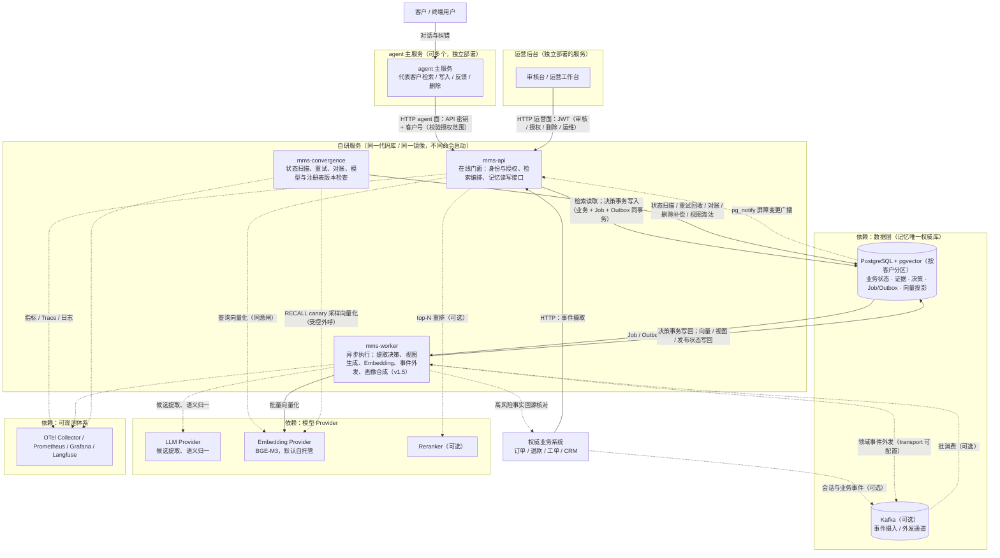
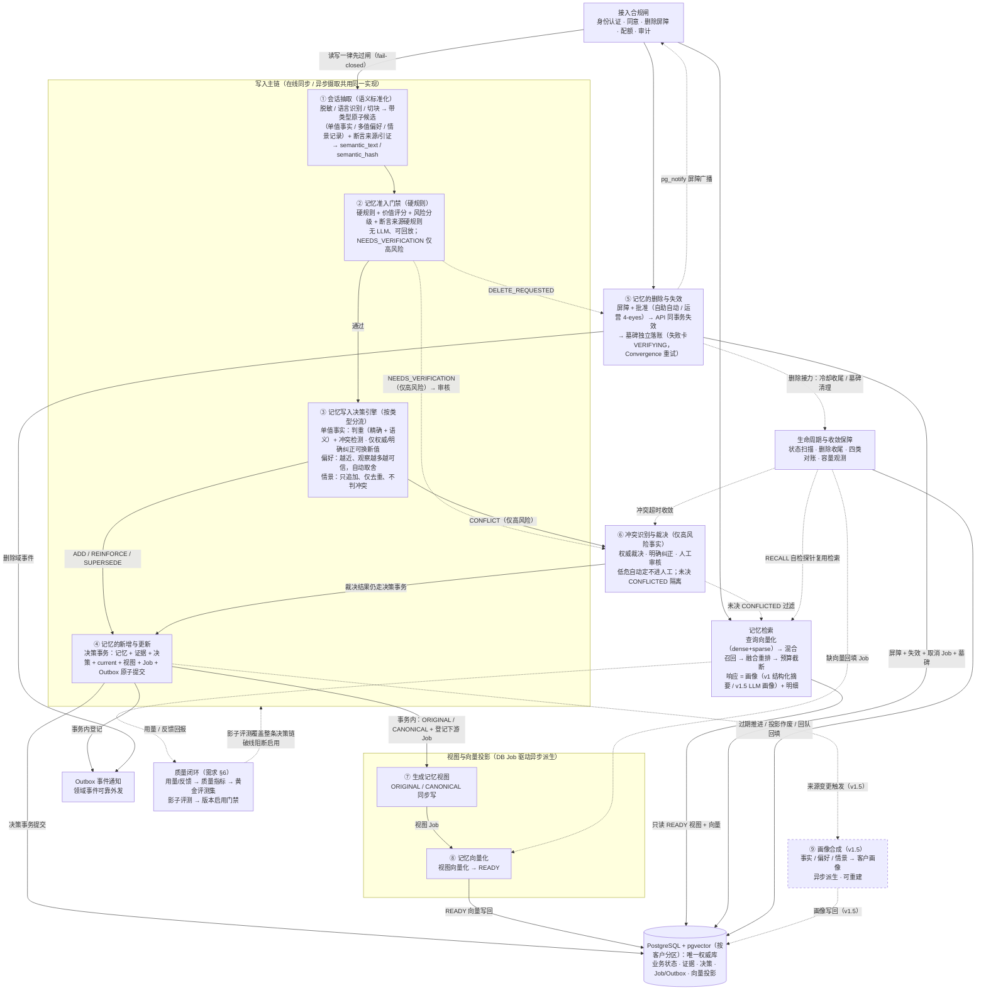
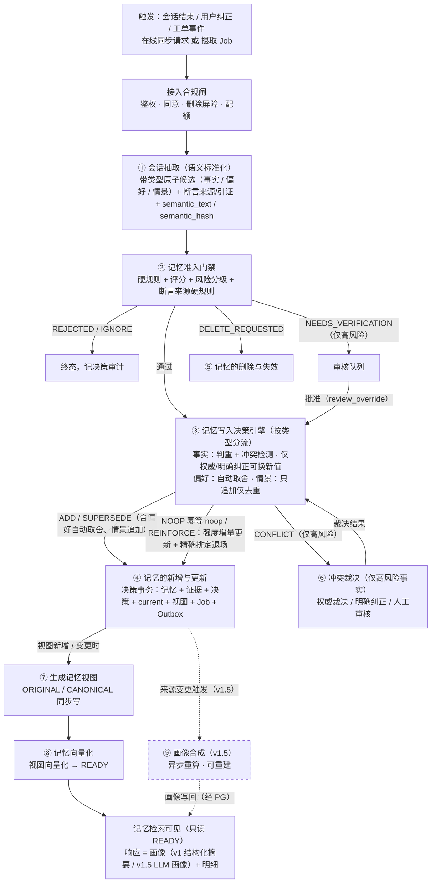

# 1. 总体架构与流程

## 1.1 架构图

架构图分两张：**部署架构图**以部署单元（自研服务）为粒度，回答"服务之间如何通信、数据如何流转"；**逻辑架构图**以逻辑组件为粒度，回答"组件之间如何协作"。同一套代码、同一个镜像，按不同命令启动为不同部署单元（见 1.1.1 部署组件清单）。

### 1.1.1 部署架构图（部署单元粒度）

自研服务只有 `mms-api`、`mms-worker`、`mms-convergence` 三个部署单元；PostgreSQL、Kafka、模型 Provider 与可观测体系均为开源组件/外部服务依赖。agent 主服务（可多个）与运营后台是独立部署的上游服务，经**两个完全独立的认证面**接入 MMS（《0-需求与规模假设》§一）：agent 面用 API 密钥（一 agent 一把、可动态配置；客户号随请求传入并校验在密钥授权范围内，终端用户身份不进入 MMS）；运营面用登录凭证 JWT（登录服务签发，MMS 只校验）。

MVP 可在单一 Python 代码库中用不同进程/命令启动 `api`、`worker`、`convergence`，不必过早拆成多个微服务。部署组件：

- `mms-api`：无状态，可水平扩容；负责在线检索、记忆查询、删除/审核接口。
- `mms-worker`：Kafka consumer group（可选）+ DB Job Worker；负责提取、决策、语义标准化、视图生成、Embedding、生命周期、画像合成（v1.5）。
- `mms-convergence`：生命周期扫描、Embedding 重试、对账、策略版本检查、模型升级。
- `postgres`：业务状态 + pgvector + Job；主库 + **流复制备库（HA 必需，自动故障转移，见 1.3）** + 只读副本（可选，检索可走副本，但删除/写入走主库）。**存储决策（需求 §4.2 二选一，已定）：按客户 hash 分区 + 双视图向量**——记忆/证据/向量等大表按 `customer_id` 分区；每条记忆的主证据语言原文与规范句各生成一条向量（视图预算 2/记忆，约 2 亿行 / 1TB）；一切检索必须先裁剪到客户分块、单客户内逐条比对，绝不跨客户扫描，不建全局近似索引。
  - **分区与索引（检索落地契约，需求 §4.2）**：大表按 `customer_id` hash 分区，**分区数 64**（规划值≈1.6 万客户/分区、310 万向量行/分区≈12.5GB，上线压测校准，需求 §8#6）；每分区建 `(customer_id, lifecycle_status)` btree，向量表叠加 `status='READY'` 部分索引。检索 SQL 形状：`WHERE customer_id=? AND lifecycle_status∈目的映射态` 先分区裁剪 + btree 定位单客户行集，再对 ≤2000 条 READY 向量逐条余弦比对取 top-N；单客户扫描预算 ~8MB（1000 条 × 2 视图 × 4KB），P95 毫秒级为压测验收线。对账 `recon_shard_count=16` 是逻辑轮转片，与物理分区数解耦。**向量保留集 = ACTIVE**（配额 1000 条 × 2 视图 → 每客户 ≤2000 条 READY 向量为硬不变量）；CONFLICTED 隔离期与历史态不保留向量，历史查询走结构化过滤 + 词法（时间窗有界，API 7.1）。2 亿行/1TB 推算按在用存量口径成立（需求 §4.1）。每视图向量行同时携带 dense + sparse 双输出（同一次外呼）；词法通道 = sparse 内积，降级模式 = sparse 单通道（dense 超时不再退化为 trigram 关键词）。
- `embedding-provider`：BGE-M3 dense 1024 + **sparse 词法输出（同一次前向传播，v1 启用，替代 trigram：一并解决跨语言词法与中文分词）**（ADR-002，自托管/私有化端点）；托管 API 仅作影子挑战；无状态；内网/mTLS。
- **存储压测对照组（上线前，需求 §8#6）**：float32 vs halfvec（2KB/条）、无条件双视图 vs 条件双视图（仅原文语言≠规范句语言时生成 ORIGINAL）；P95 + 召回质量（需求 §6.2 门禁）双验收，过门禁后经注册表/政策切换（REBUILD 回填），未过保持现行口径。
- `query-translator`（可选，默认关闭）：跨语言召回不达标时的兜底——只把查询短文本翻成目标语言再检索，**不翻译、不存储记忆译文**；外部/跨境需 `CROSS_BORDER_TRANSLATION` 同意。
- `reranker`（可选）：多语言 cross-encoder/LLM；只处理 top-N。
- `kafka`（可选）：复用现有集群，独立 topic/ACL；v1 可先只用 Outbox + DB Job。
- `prometheus/grafana/otel`：指标、追踪、告警。

### 1.1.2 逻辑架构图（逻辑组件粒度）

不看进程边界，只看功能组件如何协作。组件划分与 `docs/2-详细设计` 系列对齐（04 抽取 / 05 语义标准化 / 06 准入 / 07 决策 / 08 写入更新 / 09 删除失效 / 10 冲突 / 11 检索 / 12 状态机）；①–⑧ 为核心组件，⑨ 画像合成（v1.5）与其余为配套组件。核心协作约定：**在线同步写与异步摄取共用同一写入主链；准入与决策分工；异步投影由数据依赖驱动，没有中心编排**。

**关键协作关系（文字补充）**：

- **闸前置**：所有读写先过合规闸，fail-closed；屏障变更经 `pg_notify` 广播，闸缓存即时失效。
- **四种记忆各走各的更新语义**：单值事实只由权威事件或客户明确纠正换新值——**候选契约带断言来源分级（权威事件 / 明确陈述 / 推断）与引证，推断出的"事实"不进事实槽（转情景或忽略），来源层级与跨 agent 信任层级进决策政策**（"系统不猜"的执行机制）；多值偏好按"越近、观察次数越多越可信"自动强弱；情景记录只追加、不改写、不判冲突；客户画像由前三者异步合成、可重建（v1.5，检索响应先留空位）。
- **确定性写入主链**：抽取 → 准入 → 决策 → 事务。准入回答"能不能记、值多少分、风险多高"（硬规则 + 评分 + 风险分级 + 断言来源硬规则，不读已有记忆）；决策按记忆类型分流，回答"与已有记忆重复/冲突时怎么办"；**语义标准化分两层：结构化事实由 MMS 确定性模板生成规范句（同步内联、版本化），自由文本 LLM 归一走异步**；在线同步与异步摄取共用同一实现，行为不漂移；fact_key 为封闭注册表（提案→审核→激活 + 别名映射，管理面治理，未注册键转异步并生成提案建议）。
- **冲突闭环（仅高风险事实进人工）**：高风险 CONFLICT → 权威裁决 / 明确纠正 / 人工审核，裁决结果仍走决策事务；低危冲突按新旧与观察强度自动定，不进人工，错了走纠正链路；未决 CONFLICTED 检索隔离，超时由生命周期收敛。人工审核量与写入总量解耦（每日新增 ≤200 条，需求 §3.1）。
- **高风险事实按需核对**：检索命中到期高风险事实时由 API 短事务登记核对任务（主路径），Convergence #17 低频兜底扫描休眠事实（登记后 +90 天★），共用每日核对预算闸；Worker 回源取权威值走同一决策链（架构图 Worker→业务系统核对箭头的落地）；与 BUSINESS 对账抽样共同收敛陈旧残留率 ≤2%（需求 §6.1）。
- **事务即入队**：决策事务把业务数据与视图、下游 Job/Outbox 原子提交——业务写成功 = 任务一定入队；视图 → 向量化按数据依赖推进，无中心编排。跨语言召回由多语言向量模型承担，不存译文。
- **读写解耦**：检索只读 READY 投影；异步失败只影响新鲜度，不阻塞在线读写。检索必须先裁剪到客户分块、单客户内逐条比对，绝不跨客户扫描（需求 §4.2）。**唯一例外：命中到期高风险事实时的核对登记，为独立短事务、可失败、不影响响应**（API 7.1 / Convergence #17）。
- **删除只有一条路、一个执行实现**：删除意图/请求 → 屏障 → 批准（客户自助与同意撤回自动批准；运营发起 4-eyes）→ **删除执行事务**同事务失效（记忆 DELETE_PENDING、取消活动 Job、撤 current）→ 墓碑 WORM **独立短事务**落账（写失败不回落失效，请求卡 VERIFYING，由 Convergence 8.1 幂等重试）→ 收敛收尾（冷却、墓碑清理），批准 → 完成 ≤7 天（需求 §5.2）。触发点枚举：API（自助受理 / 运营审核批准 / 同意撤回事件）与 Convergence 8.2（保留同意到期扫描），**共用同一执行实现**；删除域事件必须外发，旧任务被代际围栏作废。
- **收敛闭环**：生命周期把过期状态推到终态，对账把卡住的任务回队、回填缺向量（受视图预算登记闸约束），容量观测随对账导出；RECALL 自检探针复用检索验证管道健康（原文自召回，不计质量 SLO）。
- **质量闭环（需求 §6）**：用量/反馈回报持续计算采纳率、负反馈率、有害错误率等在线质量指标；黄金评测集季度更新，抽取器/归一器/向量模型/决策政策新版必须先过影子评测（覆盖整条决策链）才能启用，任一指标破线阻断启用。

## 1.2 记忆入库主流程

以 1.1.2 的逻辑组件为单位描述记忆入库主干；在线同步写与异步摄取共用同一主链，差异只在触发方式与提取方。组件内部不展开细步，完整规则见 `docs/2-详细设计` 对应章节。

**主流程说明（按组件）**：

1. **受理过闸**：事件经在线同步请求或摄取 Job 进入，先过接入合规闸（鉴权、同意、删除屏障、配额），fail-closed。
2. **① 会话抽取**：脱敏、语言识别、切块，提取**带类型**的原子候选（单值事实 / 多值偏好 / 情景记录），**FACT 候选附断言来源分级与引证**，并完成语义标准化（**结构化事实由 MMS 确定性模板渲染，自由文本 LLM 归一**；semantic_text / semantic_hash）。
3. **② 记忆准入**：硬规则 + 价值评分 + 风险分级确定性判定——REJECTED / IGNORE 终态记审计；NEEDS_VERIFICATION（仅高风险）进审核队列，批准后回 ③ 重新决策；DELETE_REQUESTED 转 ⑤ 删除链路。
4. **③ 写入决策（按类型分流）**：单值事实判重匹配（精确 + 语义发现），产出 ADD / NOOP / REINFORCE / SUPERSEDE / CONFLICT，**SUPERSEDE 仅接受权威事件/客户明确纠正；来源层级优先，同层级按新旧与观察强度**；多值偏好按新旧与观察强度自动取舍，不进人工；情景记录只追加、仅去重、不判冲突。
5. **④ 新增与更新**：ADD / SUPERSEDE 在决策事务内原子提交记忆、证据、决策、current、视图与下游 Job/Outbox，证据按 `evidence_max_per_memory` 封顶采样压缩；NOOP 为同指纹重复投递、幂等 noop；REINFORCE 在事务内 O(1) 增量更新偏好强度（strength / last_observed_at / observation_count）并把退场检查排到精确预测时刻，无周期复查。
6. **⑥ 冲突裁决（仅高风险事实）**：高风险 CONFLICT 等待权威裁决或人工审核，裁决结果仍回决策事务；低危冲突自动定，错了走纠正链路；未决记忆检索隔离，超时由生命周期收敛。
7. **⑦⑧ 投影生效**：ORIGINAL / CANONICAL 视图随事务生效；向量化完成置 READY 后才对检索可见。跨语言召回由多语言向量模型承担，不存译文。
8. **⑨ 画像（v1 结构化摘要 / v1.5 LLM 合成）**：v1 画像字段 = 确定性结构化摘要（当前事实集 + 最强偏好模板拼装，决策事务内增量维护、可重建、无 LLM）；v1.5 事实/偏好/情景变更触发异步 LLM 重算滚动画像替换字段内容，调用方无需改代码。检索响应固定"画像 + 明细"两段形状。

## 1.3 高可用与故障转移

查询可用性 99.9%/30d（需求 §5.1）= 每月 ≤43 分钟停机预算，**必须自动故障转移**：

| 项 | 契约 |
|---|---|
| 拓扑 | PG 主库 + 流复制备库（HA 必需，Patroni/托管 PG 自动 failover）；只读副本可选（默认关），只承载召回 SQL，不承担 failover |
| RPO / RTO | ≤5 分钟★ / ≤5 分钟★（异步流复制最坏丢失窗 / 自动切换）；上线前演练校准 |
| 自愈 | API：LISTEN 重连 + 屏障缓存 5s TTL 兜底；Worker：超租约 Job 由 JOB 对账回收；Convergence：advisory lock 随旧会话释放、备实例接管；同意/屏障永远走主库 |
| 演练 | 季度 failover 演练验证 RTO，记录纳入运维审计 |
| 告警 | `MMSFailoverOccurred`（page）；切换期间写入短暂失败由调用方重试/异步 RETRY 吸收 |