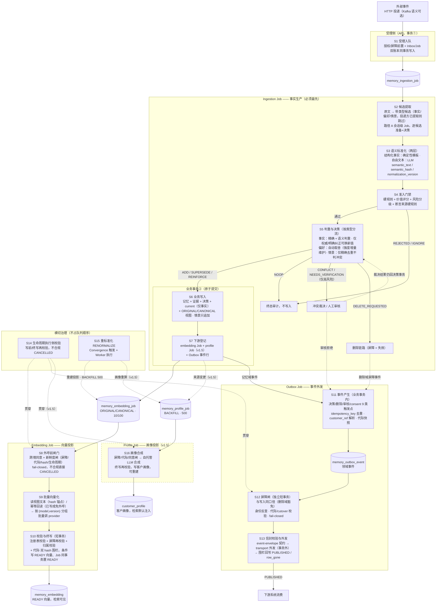
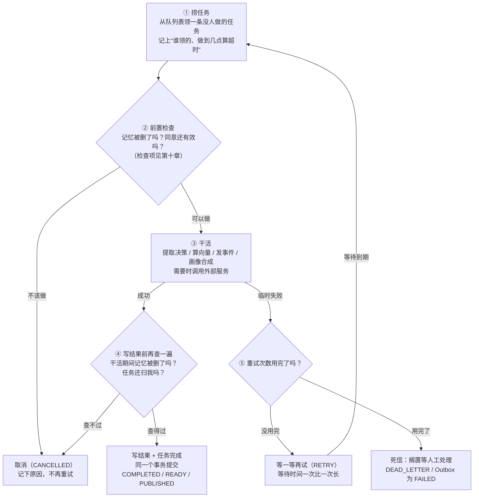
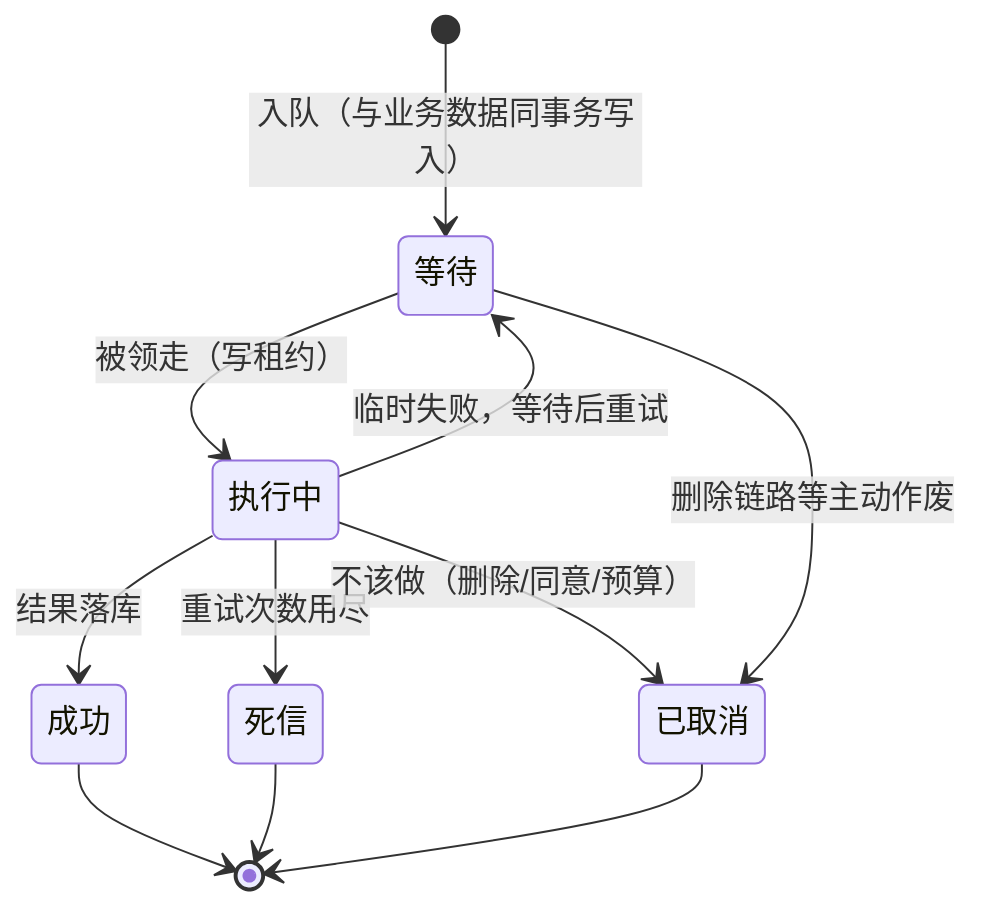

# Worker（mms-worker）组件设计

## 一、一句话认识 Worker

系统里所有"耗时且不能阻塞在线主流程"的工作——把事件转成记忆、给记忆算向量、把领域事件发出去、合成客户画像（v1.5）——都**不在 API 请求里同步做完**，而是先在 PostgreSQL 里落一行任务记录（DB Job / Outbox），再由后台 Worker 进程异步取走执行。

[《1-总体架构》](1-总体架构.md)的官方定义：

> `mms-worker`：Kafka consumer group（可选）+ DB Job Worker；负责**提取、决策、语义标准化、视图生成、Embedding、生命周期、画像合成（v1.5）**。

### 1.1 部署形态：物理部署单元，默认单进程四 Job（Profile 为 v1.5）

`mms-worker` 是一个**物理部署单元**：默认**一个进程**内含**四个 Job**，分别消费四张不同的队列表（v1 实际运行前三个，Profile Job 于 v1.5 启用）。**可按命令拆分为 `worker-ingest`（Ingestion，LLM 密集）与 `worker-project`（Embedding/Outbox/Profile）两个部署单元独立扩容**——同一镜像、同一队列底座，拆分不改变语义：

| Job | 队列表 | 职责 |
|---|---|---|
| Ingestion Job | `memory_ingestion_job` | 把外部事件/候选转化为记忆（提取、决策、语义标准化、视图生成） |
| Embedding Job | `memory_embedding_job` | 为记忆视图生成向量 |
| Outbox Job | `memory_outbox_event` | 领域事件可靠外发 |
| Profile Job（v1.5） | `memory_profile_job` | 由事实/偏好/情景合成客户画像（派生投影，可重建） |

- 与 `mms-api`、`mms-convergence` 同一代码库、同一镜像，按不同命令启动为不同部署单元（见[《1-总体架构》](1-总体架构.md) 1.1.1）；
- **水平扩容 = 部署多个实例**：实例间靠 `FOR UPDATE SKIP LOCKED` 行级互斥，天然并行、不重复消费（见 4.2）；默认单进程共享资源，LLM 密集摄取与毫秒级投影的资源画像分化时按 worker-ingest / worker-project 拆分独立扩容（见 4.7）；
- 四个 Job 共享同一套队列底座（第二章）与共性执行骨架（第四章），各自的差异在第五~八章独立阐述；
- **不建文档侧翻译链路（需求 §6.2 已决）**：跨语言召回由多语言向量模型承担，不翻译、不存储记忆译文；跨语言命中率不达标时以查询侧翻译兜底（检索编排内的可选步骤，见 API/总体架构，不属于 Worker 队列）。

---

## 二、为什么用"DB Job"而不是消息队列

这是"去掉中间件、一个库一个事务边界"架构决策（见[《1-总体架构》](1-总体架构.md)）的延续，四个 Job 共享同一套队列底座：

1. **一个事务边界**：Job 记录和业务数据在**同一个 PostgreSQL 事务**里写。业务写成功 = 任务一定入队，绝不会出现"记忆写进去了但向量任务丢了"的半成功（外部队列无法参与 PG 本地事务）。
2. **少一套基础设施**：v1 只用 Outbox + DB Job，不强制上 Kafka；配置、鉴权、备份、删除面都收敛到 PG 一处。
3. **删除只有一条路**：Job 行随记忆取消/物理删除，天然落在同一个删除屏障内，不会残留在外部 broker 里成为"删不掉的副本"。
4. **代价自己扛**：claim、租约、重试退避、死信、对账全部自研（成熟 MQ 本免费提供）；轮询有固有延迟（`worker_poll_seconds`），实时性弱于 push 模型。

一句话：**用事务一致性换运维复杂度**，把可靠性做进数据库，而不是做进中间件。

---

## 三、能力全景与执行顺序

### 3.1 能力矩阵（关键步骤 → 承载 Job）

异步链路的全部关键步骤如下（S1–S16 编号与 3.2 执行顺序图一一对应）：

| 阶段 | 步骤 | 关键步骤 | 承载 Job | 执行机制 | 细节文档 |
|---|---|---|---|---|---|
| 受理 | S1 | 事件受理入队 | API 受理侧 → Ingestion Job | 授权/屏障前置闸；Inbox/Job 双账本同事务写入（事务①，返回 202）；入站统一 HTTP，Kafka 语义（topic/partition/offset/consumer_group，可选）由投递方作为信封元数据传入，消费幂等由 Inbox 账本承担 | [Ingestion Job设计](../1-核心流程/1-Ingestion%20Job设计.md) §五 |
| 摄取主链 | S2 | 候选提取 | Ingestion Job | 会话/工单/CRM 原文 → **带类型**原子候选（单值事实 / 多值偏好 / 情景记录；LLM 提取；投递方已提取则跳过本步），**FACT 候选附断言来源分级（权威事件 / 客户明确陈述 / 推断）与引证**；路径 A 为会话级 Job，逐候选准备+决策 | [Ingestion Job设计](../1-核心流程/1-Ingestion%20Job设计.md) §六、§二十二、[《04-从会话抽取候选记忆》](../2-详细设计/04-记忆抽取.md) |
| 摄取主链 | S3 | 语义标准化 | Ingestion Job / API 同步路径 | **两层归一**：结构化事实（已注册 fact_key + 槽位）由 **MMS 确定性模板渲染**规范句（纯规则、<1ms、同步路径内联，版本=注册表 normalization_version）；自由文本由 LLM 归一（异步）。产出 `object_json / semantic_text / semantic_hash / normalization_version` 与候选指纹；调用方自带的 FACT semantic_text 忽略，以 MMS 版本为准；fact_key 经注册表解析（别名→规范键），未注册键转异步并生成键提案建议（DRAFT） | [Ingestion Job设计](../1-核心流程/1-Ingestion%20Job设计.md) §七 |
| 摄取主链 | S4 | 准入门禁 | Ingestion Job | 硬规则 + 价值评分 + **风险分级（高风险 / 低危）** + **断言来源硬规则（FACT+CUSTOMER_EXPLICIT 缺引证降级 INFERRED；FACT+INFERRED 不进事实槽，转 EPISODIC 或 IGNORE）**；REJECTED/IGNORE 终态记审计，NEEDS_VERIFICATION **仅高风险**转审核 | [《06-记忆准入判定》](../2-详细设计/06-记忆准入判定.md) |
| 摄取主链 | S5 | 判重与决策 | Ingestion Job | **按类型分流**：单值事实走精确 + 语义判重，两段式决策（发现阶段事务外 + 权威判定业务事务内，含 consent 权威判定与提交前复核）→ ADD/NOOP/REINFORCE/SUPERSEDE/CONFLICT，**事实 SUPERSEDE 仅接受权威事件/客户明确纠正（断言来源门控，见 5.1）**；偏好强度**增量维护**：REINFORCE 时 `strength ← strength·exp(-Δt/τ)+1`（τ 默认 30 天★，与 Σ 定义等价）、刷新 last_observed_at/observation_count，并把 `decay_check_at` 排到**预测退场时刻** `t + max(τ·ln(strength/θ), exit_idle_days)`，无周期复查（退场见 Convergence #16）；NOOP 为同指纹重复投递，幂等 noop；情景仅按候选指纹精确去重、不做语义判重、不判冲突；**仅高风险** CONFLICT/NEEDS_VERIFICATION 转人工，低危自动定；与在线同步写路径共用同一实现 | [Ingestion Job设计](../1-核心流程/1-Ingestion%20Job设计.md) §九 |
| 摄取主链 | S6 | 业务写入（视图生成） | Ingestion Job | 事务②：记忆 + 证据 + 决策 + current（仅单值事实）+ ORIGINAL/CANONICAL 视图原子提交；**证据追加受 `evidence_max_per_memory`（默认 32★）封顶：超限同事务压缩（保留首条 + 最近 K/2 + 中段等距抽样），观察总数累计在记忆行 observation_count，逐次审计由决策表承担**；情景只追加、无 current；高风险 CONFLICT 转裁决、DELETE_REQUESTED 转删除链路 | [Ingestion Job设计](../1-核心流程/1-Ingestion%20Job设计.md) §十、[《08-记忆新增与更新》](../2-详细设计/08-记忆新增与更新.md) |
| 摄取主链 | S7 | 下游任务登记 | Ingestion Job | 事务②内：embedding Job（ORIGINAL/CANONICAL，10/100；**仅目标态为 ACTIVE 的记忆登记——CONFLICTED 隔离期不算向量，裁决转 ACTIVE 时再登记**）+ profile Job（来源变更触发，v1.5，500）+ Outbox 事件行 | [Ingestion Job设计](../1-核心流程/1-Ingestion%20Job设计.md) §十一 |
| 向量投影 | S8 | 外呼前闸门 | Embedding Job | 同意闸（`CROSS_BORDER_EMBEDDING`，按注册表 provider 判定跨境，缺行 fail-closed 视为外部）+ 新鲜度闸（屏障/代际/hash/生命周期），fail-closed；不合规直接 CANCELLED，不烧重试次数 | [Embedding Job设计](../1-核心流程/2-Embedding%20Job设计.md) §五、本文第十章 |
| 向量投影 | S9 | 批量向量化 | Embedding Job | 读视图文本（`view_text_hash` + READY 锚点）+ 产物幂等回读（已写成免外呼）→ 按 `(model, version)` 分组批量调 provider，一组一次外呼；**一次外呼产出 dense + sparse 双输出，写入同一向量行**（词法通道用 sparse，替代 trigram） | [Embedding Job设计](../1-核心流程/2-Embedding%20Job设计.md) §六 |
| 向量投影 | S10 | 向量校验与终写 | Embedding Job | 注册表校验（维度/有限性/L2 范数），非法向量绝不落库；终写短事务：屏障再校验 + 归属校验 + 代际·双 hash 围栏，条件写入 READY 向量、Job 同事务置 READY | [Embedding Job设计](../1-核心流程/2-Embedding%20Job设计.md) §七 |
| 事件外发 | S11 | 事件产生（Outbox 写入协议） | 业务事务（决策/删除/审核/consent）→ Outbox Job | 业务事务内 9 类触发点写 PENDING 事件行：身份解析生成 customer_ref、`idempotency_key` 去重、`barrier_generation` 快照、`event_id` 生成；与业务表原子提交 | [OutboxEvent机制设计](../1-核心流程/4-OutboxEvent机制设计.md) §4.1 |
| 事件外发 | S12 | 屏障闸 | Outbox Job | 独立短事务，与写入同口径：删除域事件豁免（屏障通知本身必须发出去）、身份反查、代际/cutover 校验，fail-closed；阻塞 → RETRY 延迟 30s，旧代际/未知身份 → FAILED | [OutboxEvent机制设计](../1-核心流程/4-OutboxEvent机制设计.md) §4.3、本文 10.2 |
| 事件外发 | S13 | 信封校验与外发（含完成态回写） | Outbox Job | 统一事件契约（event-envelope）校验 → transport（HTTP/本地日志，Kafka 可选）事务外外发 → `locked_by` 围栏回写 PUBLISHED（row_gone 不计成功）；异常退避 RETRY，试满 5 次 FAILED | [OutboxEvent机制设计](../1-核心流程/4-OutboxEvent机制设计.md) §4.3–4.5 |
| 横切治理 | S14 | 生命周期执行侧校验 | 各 Job + 删除/决策事务 | 屏障/代际/生命周期状态写前校验，不合规任务 CANCELLED；扫描收敛归 Convergence | 各 Job 文档"删除协同"节、本文第十一章 |
| 横切治理 | S15 | 重标准化（RENORMALIZE） | Convergence 触发 + Worker 执行 | normalizer 版本升级时原地重算规范化列、置 STALE 重建 CANONICAL 视图；不新建版本、不写决策，重建向量以 BACKFILL 优先级执行；源文本变化同时触发画像重算（v1.5） | [《05-记忆语义标准化》](../2-详细设计/05-记忆语义标准化.md) |
| 画像投影 | S16 | 画像合成（v1.5） | Profile Job | 来源记忆（事实/偏好/情景）变更在业务事务内登记；外呼前过屏障/代际/同意闸 → 自托管 LLM 合成滚动摘要 → 终写短事务写客户画像；BACKFILL 优先级；可重建、绝不回写事实 | 本文第八章 |

> 上述每一步都被共性执行骨架"**捞任务 → 前置检查 → 干活 → 复查并写结果 → 失败等待重试**"包裹（第四章）；失败重试、死信重放、对账回收等共性机制见第四、十、十一章，矩阵不再重复。

### 3.2 数据依赖驱动的执行顺序

四类任务的先后**不是中心调度编排出来的，而是数据依赖自然涌现**。下图按 3.1 的步骤编号描述前后顺序与协作关系（实线 = 执行/数据流，虚线 = 级联/治理横切；队列节点即四张队列表）：



**顺序与协作关系（对应图中步骤编号）**：

- **串行主链**：S1 → S2 → S3 → S4 → S5 → S6 → S7；Ingestion 必须最先执行——它是下游任务的生产者；
- **事务②是唯一扇出点**：S6/S7 同事务原子提交，业务写成功 = 下游队列一定入队（embedding、outbox；v1.5 加 profile）；此后无中心编排，各队列按数据依赖各自推进；
- **多路并行**：embedding（S8–S10）、outbox（S11–S13，其中 S11 在业务事务内完成）、profile（S16，v1.5）互不依赖，都只依赖业务事务已提交；
- **治理横切**：S14 贯穿各 Job 的外呼前闸门（S8/S12/S16）与每次终写（S6/S10/S16），外呼期间发生的删除/撤回同样生效；S15 与对账回填以 BACKFILL（500）执行，不饿死在线链路；
- **失败不阻塞主链**：任一步瞬时失败按第四章退避重试；投影失败只降级新鲜度，不影响事实生效。

---

## 四、共性执行骨架

四个 Job 干的活不同，但干活的套路完全一样：**捞任务 → 前置检查 → 干活（可能调外部服务）→ 复查并写结果 → 失败就等一等再试**。本章用图表讲清这套共性流程；各 Job 的状态名、批量大小、防重键等个性细节见第五~八章。

### 4.1 一个任务的一生（总流程）



| 步骤 | 大白话解释 |
|---|---|
| ① 捞任务 | 多个实例同时从一张表领任务，靠数据库行锁保证不领重（见 4.2） |
| ② 前置检查 | 不该做的任务（记忆已删、同意已撤回、预算用完）直接取消，不浪费外部调用 |
| ③ 干活 | 真正耗时的一步；调外部服务前后都要过合规检查（见第十章） |
| ④ 复查并写结果 | 外呼期间世界可能变了（比如用户点了删除），所以写库前再查一遍；结果和"任务完成"在同一个事务里写，要么都成功要么都不写 |
| ⑤ 失败重试 | 临时失败等一等再试；次数用尽进死信（见 4.4） |

### 4.2 捞任务：多个实例怎么不领重

多个 `mms-worker` 实例同时捞任务，靠两样东西保证不领重、不怕实例崩溃：

```sql
SELECT ... FROM <队列表>
WHERE (状态 IN (<待办态>) AND available_at <= now())        -- 到点该做的
   OR (状态 = <执行态> AND lease_expires_at <= now())       -- 超时没人做完的（接手）
ORDER BY <优先级,> available_at, created_at
FOR UPDATE SKIP LOCKED LIMIT <n>                            -- 锁住领到的行，别人锁了的跳过
```

领到后随手更新任务行：记下谁领的（`locked_by`）、做到几点算超时（`lease_expires_at`）、尝试次数 +1（`attempts`）。

| 机制 | 大白话解释 |
|---|---|
| 行锁 + 跳过已锁行（`FOR UPDATE SKIP LOCKED`） | 领任务时顺手锁住这一行；别的实例看到锁就跳过、领下一条——天然不领重，**不需要全局开关**，加实例就能扩容 |
| 租约（`lease_expires_at`） | 领任务时写一个"到期时间"，相当于承诺"这点时间内做完"；到期还没做完，就当领它的实例可能崩溃了，允许别人接手 |
| 超时接手 + 对账兜底 | 超时的任务可被重新领取；Convergence 的对账还会再扫一遍，把卡住的任务放回队列（见第十一章） |

### 4.3 任务状态：五种去向

各队列的状态名不同（见各 Job 章节），但去向完全一样：



| 状态类别 | 大白话含义 | 各队列的实际状态名 |
|---|---|---|
| 等待 | 排队等领走；"等一等再试"也算等待 | `RECEIVED` / `PENDING` / `RETRY` |
| 执行中 | 正被某个实例处理 | `PROCESSING` / `RUNNING`（Outbox 不改状态，用锁标记代替） |
| 成功 | 结果已落库 | `COMPLETED` / `READY` / `PUBLISHED` |
| 死信 | 失败次数用尽，搁置等人工重放或对账处理 | `DEAD_LETTER`（Outbox 为 `FAILED`） |
| 已取消 | 不该做（记忆已删、同意撤回、预算用完），不烧重试次数、不进死信（原因码见 10.3） | `CANCELLED`（Outbox 无此状态，被屏障挡住时改为延迟重试） |

### 4.4 失败重试：越等越久，不齐刷刷

| 情况 | 怎么办 |
|---|---|
| 临时失败（网络抖动、外部服务超时），次数没用完 | 置 RETRY：等待时间每次翻倍（最长 300 秒），再加一段随机偏移——避免故障恢复后所有任务同一瞬间重试，把外部服务再次打垮 |
| 重试次数用尽（各队列 5 或 8 次，见各 Job 章节） | 置死信（`DEAD_LETTER` / Outbox `FAILED`），等人工重放（见 10.4）或对账回收（见第十一章） |
| 结果不明（比如调用超时，不知道成没成） | 重试前先查库里产物是否已存在（如 READY 向量）：其实成功了就不重复调外部服务 |
| 治理类取消（删除/同意/预算） | 直接置 CANCELLED，不烧重试次数（原因码见 10.3） |

> 写结果前的"再查一遍"（4.1 步骤④）查的是：屏障代际、任务归属（还是我领的且租约未过期）、记忆/视图状态——任何一项不符即取消，绝不写旧数据（详见第十章）。

### 4.5 优先级：急事先做

向量/画像/摄取队列带优先级列，**数字越小越先被领走**；发事件队列没有优先级，先到先得。优先级枚举：

| 优先级 | 值 | 大白话含义 |
|---|---|---|
| CORRECTION | 10 | 用户明确纠正的记忆，最急（向量与摄取队列通用，纠正插队，需求 §5.2） |
| DEFAULT | 100 | 日常新写入（ORIGINAL/CANONICAL 向量） |
| BACKFILL | 500 | 补历史欠账/模型升级重建/画像合成与重算（v1.5），最不急，给在线任务让路 |

设计意图：**新写入与用户纠正优先，回填/重建/画像垫底**——回填永远不饿死在线链路。删除不靠优先级，而是直接把相关任务取消。

### 4.6 共性配置

配置统一经环境变量注入（前缀 `MMS_`）；跨 Job 共用的参数：

| 参数 | 值 | 说明 |
|---|---|---|
| `worker_poll_seconds` | 1.0 | 四个 Job 共用的空闲轮询间隔 |
| `ingestion_llm_timeout_seconds` | 30 | 提取 LLM 外呼超时（租约 60s ≥ 2× 此值，见 4.7） |
| `max_views_per_memory` | 2 | 每记忆视图预算：ORIGINAL（主证据语言）+ CANONICAL 各 1，与需求 §4.1 双视图推算（2 亿行/1TB）一致；不建译文视图、不为次要证据语言另建视图（见 10.5） |

各 Job 专属参数见其章节的"配置与观测"节。**租约时长必须明显大于单个任务的最长处理时间**（含外部调用），否则还在干活的任务会被误判成"实例崩溃"而被别人接手，造成重复处理。

**队列维护与迁移警报线（需求 §4.2）**：队列表要频繁回收空间（autovacuum 调优）+ 给未完成任务建专用部分索引；**最老未处理任务 >5min 持续 10min，或队列表空间膨胀 >20%**，触发"队列搬出数据库"预案。

### 4.7 并发模型与容量核算

- **asyncio 事件循环 + 每 Job 并发信号量**：Ingestion 默认 8 路/实例（LLM 密集）、Embedding 4 批/实例、Outbox 8 路/实例、Profile 2 路/实例（v1.5）；外呼全部异步，不阻塞事件循环；
- **租约 ≥ 2×P99 单任务处理时间**：Ingestion 租约 60s 对应提取 LLM 超时 30s（`ingestion_llm_timeout_seconds`）；Embedding 租约 60s 对应向量化超时 10s；Profile 租约 120s 对应合成超时 60s——租约必须覆盖"超时 + 幂等回读 + 终写"，否则还在干活的任务会被误接手；
- **容量核算（峰值口径）**：峰值 ~17 会话/s（15 万会话/日 × 10 峰谷比）× 提取 ~3s ≈ 51 路并发 → 按 8 路/实例需 ≥7 个摄取实例（或等量拆分部署）；Embedding 峰值 ~50 决策/s × 2 视图 ÷ 批 16 ≈ 7 批/s，单实例 4 批并发留余量即可，BACKFILL 重建另核（见 6.4）。实例数为规划值，上线前压测校准。

---

## 五、Ingestion Job（`memory_ingestion_job`）

把外部事件/候选转化为记忆——**它是下游任务的生产者，必须最先执行**。完整细节见 [Ingestion Job设计](../1-核心流程/1-Ingestion%20Job设计.md)。

### 5.1 职责与流程

- **接收侧（API 受理）**：屏障前置 + Inbox/Job 双账本同事务写入（投递幂等）；
- **消费侧**：提取（带类型候选）→ 语义标准化 → 准入门禁（硬规则 + 价值评分 + 风险分级）→ 按类型分流决策（事实：判重 + 冲突检测；偏好：自动取舍；情景：仅精确去重）→ 视图生成 → 写库 → 同事务登记下游 Job 与 Outbox；
- **风险分级（需求 §2.2/§3.1）**：只有高风险事实（金额/承诺/合规）产生 NEEDS_VERIFICATION 或将 CONFLICT 转人工；低危按"越近、观察次数越多越可信"自动定，错了走纠正链路——人工审核量与写入总量解耦（每日新增 ≤200 条）；
- **断言来源门控（需求 §2.1①）**：事实换新值只接受权威事件或客户明确纠正（带引证）；推断出的"事实"转情景或 IGNORE；来源层级 权威 > 明确纠正 > 推断，同层级按新旧/观察强度，跨来源系统按 policy 信任层级——低信任 agent 的抽取不能覆盖高信任来源的当前值；
- **同意快照缺失分账**：候选决策时快照缺失/不可用 → RETRY 有界退避（TTL 24h★，等快照同步到达），超 TTL 才终态 REJECTED（CONSENT_MISSING_TIMEOUT）；明确 DENIED/WITHDRAWN → 终态 REJECTED 不进 DLQ——fail-closed 不变，但新客户首会话不因同步竞态被永久烧掉（见 API 第八章）；
- **偏好强度与证据治理**：强度在决策事务内 O(1) 增量维护（与 Σ exp(-Δt/τ) 定义等价），读取/排序时现算有效强度；退场时刻在观察时精确预测，Convergence 只做一次到点判定；证据按 K 封顶采样压缩，只作引证不参与强度计算（见 Convergence #16）；
- **配额感知淘汰**：存量接近上限（≥95%）时在决策事务内淘汰最弱偏好（**按现算有效强度 `strength·exp(-(now−last_observed_at)/τ)` 排序**）/最老情景（事实当前值永不淘汰），与在线同步写共用同一实现（见 API 6.3）；
- **回源核对（高风险事实）**：触发以**检索命中到期为主**（API 7.1 读路径登记）、Convergence #17 低频兜底扫描为辅（登记后刷新 +90 天★），共用每日核对预算闸（`fact_verify_daily_budget`，默认 20 万★）；Worker 以对业务系统的服务身份回源取权威值，作为权威候选（assertion_source=AUTHORITATIVE_EVENT）走同一决策链（SUPERSEDE/NOOP/CONFLICT）——把核对量对准"在用事实"，收敛陈旧残留率（需求 §6.1）；
- **两段式决策**：发现阶段（事务外）+ 权威判定（业务事务内），与在线同步写路径共用同一实现；
- **语义标准化（两层）**：结构化事实由确定性模板内联渲染（同步/异步同一实现、同一版本），自由文本 LLM 归一产出 `object_json / semantic_text / semantic_hash / normalization_version`（规范句语言=客户主语言）；模板版本升级由 RENORMALIZE 确定性重渲染存量，无需 LLM；
- **视图生成**：业务事务内写 ORIGINAL/CANONICAL（不建译文视图，跨语言召回由多语言向量模型承担）；来源记忆变更同事务登记 profile Job（v1.5，见第八章）；
- **入站 transport（v1 统一 HTTP）**：Kafka 语义（topic/partition/offset/consumer_group）仅由投递方作为信封元数据传入（供幂等与追溯），v1 不运行 Kafka consumer；Kafka 直连消费为可选演进（见总体架构部署图），消费幂等由 Inbox 账本承担。

### 5.2 状态机与执行特性

**状态枚举**（接收/完成语义：受理即 RECEIVED，消费完成 COMPLETED）：

`RECEIVED` / `PROCESSING` / `COMPLETED` / `RETRY` / `DEAD_LETTER` / `CANCELLED`

| 维度 | 取值 |
|---|---|
| 优先级 | CORRECTION 10 / DEFAULT 100（纠正插队，需求 §5.2） |
| 认领批量 | 单条（LIMIT 1） |
| 租约机制 | `lease_expires_at` |
| 最大尝试 | 5 |
| 失败终态 | DEAD_LETTER / CANCELLED |

### 5.3 幂等与协同

- **投递幂等**：`memory_inbox_event` 幂等账本主键；请求级 `operation_id` 幂等键贯穿重放链路；
- 永久失败 CANCELLED、瞬时失败退避重试、死信可审计重放（统一入口见 10.4）；
- **Inbox 清理**：COMPLETED 超保留期的幂等账本行由 Convergence 生命周期扫描删除（见第十一章）。

### 5.4 配置与观测

| 参数 | 值 | 说明 |
|---|---|---|
| `ingestion_lease_seconds` / `ingestion_max_attempts` | 60 / 5 | 摄取租约与重试上限 |
| `inbox_stale_seconds` / `inbox_retention_days` | 360 / 7 | Inbox 陈旧阈值（退避上限+一个租约）与保留期 |

**核心指标**：`mms_ingestion_jobs_total{status}`、`mms_inbox_duplicate_total`、`mms_inbox_stale_total`、`mms_ingestion_job_oldest_age_seconds`、`mms_evidence_compacted_total`（证据压缩行数）。

**新鲜度 SLO / 告警**：纠正 → 可被查 P95 ≤30s / P99 ≤120s（`MMSCorrectionFreshnessSLOBreach`，page）；会话提取 → 可被查 P95 ≤5min / P99 ≤15min（需求 §5.2）；最老任务 >300s 持续 10m → `MMSIngestionQueueAge`；Inbox 异常 → `MMSInboxAnomaly` / `MMSInboxStale`。

---

## 六、Embedding Job（`memory_embedding_job`）

为记忆视图生成向量，写 READY 向量——**产物落库即 READY**。完整细节见 [Embedding Job设计](../1-核心流程/2-Embedding%20Job设计.md)。

### 6.1 职责与流程

消费 3.1 的 S8–S10 三步（关键步骤表与 [Embedding Job设计](../1-核心流程/2-Embedding%20Job设计.md) §三同步）：

- **S8 外呼前闸门**：调 provider 前过同意闸（`CROSS_BORDER_EMBEDDING`）与新鲜度闸（屏障/代际/hash/生命周期），fail-closed，见第十章；
- **S9 批量向量化**：读视图文本（`view_text_hash` + READY 锚点）+ 产物幂等回读（已写成免外呼），按 `(model, version)` 分组批量调 provider；
- **S10 校验与终写**：向量校验（维度/有限性/L2 范数）以**模型注册表**为准，非法向量绝不落库；每条 Job 独立短事务条件写向量；未知结果先回读不盲目重放。

### 6.2 状态机与执行特性

**状态枚举**（生产/就绪语义）：

`PENDING` / `RUNNING` / `READY` / `RETRY` / `DEAD_LETTER` / `CANCELLED`

| 维度 | 取值 |
|---|---|
| 优先级 | 10/100/500 升序认领（见 4.5） |
| 认领批量 | 批 16，按 (model,version) 合并外呼 |
| 租约机制 | `lease_expires_at` |
| 最大尝试 | 8 |
| 失败终态 | DEAD_LETTER / CANCELLED |

### 6.3 幂等与并发

- **活动唯一键不含文本 hash**：按 `(memory_id, model, version, view_kind, view_language, operation)` 仅对活动态唯一。文本变化时**就地改写**那条活动 Job（`generation+1`、重置 attempts、取更高优先级），不并存两条——否则旧向量可能覆盖新向量；
- **终写代际 + 双 hash 围栏**：终写要求 Job 携带的 `generation` 与视图当前代际一致，并叠加 `content_hash`/`view_text_hash` 双 hash 匹配（共性屏障围栏见第九章，完整推导见 [Embedding Job设计](../1-核心流程/2-Embedding%20Job设计.md) §十三）。
- **登记条件**：Embedding Job 只为 ACTIVE（或即将 ACTIVE）的记忆登记；CONFLICTED/历史态不登记，对账亦不回填（向量保留集 = ACTIVE，见 Convergence 9.2）。

**向量操作（operation）枚举**：

| operation | 含义 | 触发方 |
|---|---|---|
| `UPSERT` | 为新写入/变更的视图生成或更新向量 | 决策事务 |
| `DELETE` | 删除向量投影 | 删除链路（物理清除） |
| `REBUILD` | 模型升级后按新模型/版本重建向量 | 管理面重建入口、对账回填（BACKFILL 优先级） |

### 6.4 配置与观测

| 参数 | 值 | 说明 |
|---|---|---|
| `embedding_batch_size` / `embedding_lease_seconds` / `embedding_max_attempts` | 16 / 60 / 8 | 向量批量、租约与重试上限 |

provider 外呼超时 10s（见 10.5）。

**核心指标**：`mms_embedding_jobs_total{status,model,version}`、`mms_embedding_failures_total`、`mms_embedding_invalid_vector_total`、`mms_embedding_job_lease_expired_total`、`mms_embedding_job_oldest_age_seconds{priority_band}`、`mms_embedding_ready_age_seconds`、`mms_embedding_cross_border_blocked_total`。

**新鲜度 SLO / 告警**：同步写入 → 可被查 P95 ≤10s / P99 ≤60s（`MMSWriteFreshnessSLOBreach`，ticket，需求 §5.2/§7）；最老 PENDING >5min 告警；租约回收增长 → `MMSEmbeddingLeaseExpiryGrowing`；模型升级 → 全量重建完成 ≤7 天★（BACKFILL 优先级，需求 §5.2；容量核算：2 亿向量 ÷ 7 天 ≈ 333 向量/s 持续吞吐，BACKFILL 让路下须预留对应 GPU 批量能力，上线前压测校准）。

---

## 七、Outbox Job（`memory_outbox_event`）

把领域事件可靠外发——入站 Inbox 的出站镜像。完整细节见 [OutboxEvent机制设计](../1-核心流程/4-OutboxEvent机制设计.md)。

### 7.1 职责与流程

对应 3.1 能力矩阵 S11–S13（事件产生 → 屏障闸 → 校验与外发）：

- **S11 事件产生**：业务事务内写 `memory_outbox_event`（决策/删除/审核/consent 共 9 类触发点），`idempotency_key` 去重 + customer_ref 解析 + 代际快照，**发布与业务写入解耦**（Kafka 不可用不阻塞 DB 队列）；
- **S12 屏障闸**：发布前过**与写入同口径的屏障闸**（删除域事件豁免——屏障通知本身必须发出去，见 10.2）；
- **S13 信封校验与外发**：信封经**统一事件契约（event-envelope）**校验；transport 可配置（HTTP/本地日志，Kafka 为可选扩展），事务外外发，完成态带 `locked_by` 围栏回写（row_gone 不计成功）。

### 7.2 状态机与执行特性

**状态枚举**（发布语义：外发成功 PUBLISHED，重试耗尽 FAILED）：

`PENDING` / `PUBLISHED` / `RETRY` / `FAILED`

| 维度 | 取值 |
|---|---|
| 优先级 | 无，FIFO |
| 认领批量 | 单条（LIMIT 1） |
| 租约机制 | `locked_at` + 锁超时判定（等价租约语义） |
| 最大尝试 | 5 |
| 失败终态 | **FAILED**（屏障阻塞走 RETRY 延迟 30s） |

### 7.3 幂等与协同

- **`idempotency_key` 唯一**，同一事件不重复外发；
- 死信重放走统一入口（见 10.4），**重放前过屏障闸**。

### 7.4 配置与观测

| 参数 | 值 | 说明 |
|---|---|---|
| `outbox_lease_seconds` / `outbox_max_attempts` / `outbox_barrier_retry_seconds` | 60 / 5 / 30 | Outbox 锁超时、重试上限、屏障阻塞延迟 |

**核心指标**：`mms_outbox_publish_total{result}`、`mms_outbox_pending_total`、`mms_outbox_oldest_age_seconds`、`mms_outbox_failed_total`。

**新鲜度 SLO / 告警**：事件外发 → 下游收到 P95 ≤30s / P99 ≤120s（需求 §5.2）；最老事件 >120s 持续 5m → `MMSOutboxBacklog`；FAILED 存量 → `MMSOutboxFailed`。

### 7.5 下游消费者契约（送达侧）

- **消费者注册**：下游经管理面 `GET/POST /admin/outbox-consumers` 注册（endpoint + 服务凭证 + 订阅事件类型）；未注册的消费者不接收事件；
- **送达语义**：transport=HTTP 推送至注册 endpoint，**至少一次投递 + 下游按 `idempotency_key` 去重**；消费者不可达按退避重试，试满 FAILED 入 DLQ；
- **transport 边界**："本地日志"仅限开发/审计兜底，不作为生产送达通道；≤30s 送达 SLO 仅对 HTTP/Kafka transport 承诺（需求 §5.2）。
- **顺序契约**：同客户事件**不保序**（重试与并行外发会乱序），跨客户无序；下游按信封 `barrier_generation` 单调判新旧（旧代际事件丢弃），配合 `idempotency_key` 去重——至少一次 + 代际判新，不依赖到达顺序。

---

## 八、Profile Job（`memory_profile_job`，v1.5）

把事实/偏好/情景记忆异步合成为客户画像——**画像是派生投影：不手工录入、不允许直接修改、随时可从源头重建**。v1 不建此队列：画像字段由**确定性结构化摘要**填充（决策事务内维护，见 API 文档 7.1），不经本队列；v1.5 本队列上线 LLM 画像替换字段内容，调用方无需改代码。

### 8.1 职责与流程

- **触发（实质性变更）**：事实 SUPERSEDE / 偏好强度越阈 / 新情景入库时在业务事务内登记（与 embedding Job 登记同口径，见 S7）；NOOP/REINFORCE 不触发；每客户最小重算间隔 `profile_min_interval_hours`（默认 6★）内合并（活动唯一键就地改写天然削峰）；Convergence 对账回填缺失/落后的画像（见第十一章）；
- **外呼前闸门**：屏障/代际/记忆状态/同意，fail-closed（口径同第十章）；**合成仅使用自托管 LLM（文本不出境）**，不新增跨境同意通道（需求固定 7 类同意）；
- **合成（增量 + 输出契约）**：旧画像 + 变更增量 → 新画像（全量重建仅用于修复/回填）；读客户当前事实 + 最强偏好 + 近期情景（输入 ≤`profile_max_chars`）；输出结构化三段（身份概况 / 稳定偏好 / 未决事项），≤`profile_max_output_chars`（默认 500★），**每条论断挂来源 memory_id**；
- **忠实性门禁**：论断必须可由来源记忆推出；上线前过忠实性评测（纳入需求 §6.2 评测集扩展，受 §6.3 门禁）——画像幻觉会注入每次回答，属系统性有害错误风险；
- **终写短事务**：屏障/归属/代际再校验 + 条件写画像 + Job 置 READY，原子提交；**画像绝不回写事实或证据**。

### 8.2 状态机与执行特性

**状态枚举**（同 Embedding 的生产/就绪语义，产物为客户画像）：

`PENDING` / `RUNNING` / `READY` / `RETRY` / `DEAD_LETTER` / `CANCELLED`

| 维度 | 取值 |
|---|---|
| 优先级 | 固定 500（BACKFILL，给在线任务让路） |
| 认领批量 | 单条（LIMIT 1，一客户一次合成） |
| 租约机制 | `lease_expires_at` |
| 最大尝试 | 5 |
| 失败终态 | DEAD_LETTER / CANCELLED |

### 8.3 幂等与并发

- **活动唯一键按客户**：`(customer_id, operation)` 仅对活动态唯一。合成期间来源再次变更时**就地改写**那条活动 Job（`generation+1`、重置 attempts），不并存两条——否则旧画像可能覆盖新画像（与 Embedding Job 6.3 同一手法）；
- **终写代际围栏**：Job 携带的 `generation` 与画像当前代际一致才写入，不符即取消；
- 合成失败只影响画像新鲜度，**不阻塞事实生效与明细检索**（检索响应的画像字段降级为空）。

### 8.4 配置与观测

| 参数 | 值 | 说明 |
|---|---|---|
| `profile_lease_seconds` / `profile_max_attempts` | 120 / 5 | 合成租约（LLM 外呼较慢，须明显大于最长处理时间）与重试上限 |
| `profile_max_chars` | 8000 | 喂给合成的来源文本长度上限 |
| `profile_min_interval_hours` | 6★ | 每客户最小重算间隔（间隔内合并，实质性变更才触发） |
| `profile_max_output_chars` | 500★ | 画像输出长度上限（结构化三段，论断挂来源 memory_id） |

**核心指标**：`mms_profile_jobs_total{status}`、`mms_profile_failures_total`、`mms_profile_ready_age_seconds`、`mms_profile_job_oldest_age_seconds`。

**新鲜度**：需求未对画像设硬 SLO；v1.5 上线时以"来源变更 → 画像重算完成"的 P95 延迟建立基线，纳入质量评审后再定承诺值。

---

## 九、并发与幂等：generation 围栏与删除屏障

这是 DB Job 正确性最精妙的部分，解决"同一视图的新旧任务并发写"与"删除后旧任务复活"两类竞态（完整推导见各 Job 独立文档）：

1. **barrier_generation 代际围栏**：每条 Job 携带入队时刻的屏障代际；删除屏障每发生一次升一代。屏障活动态、代际不符、任务早于 `cutover_at` → CANCELLED。**删除之后绝不会有旧任务"复活"出向量/画像/事件**。
2. **写库围栏**：Worker 终写以 `content_hash` + `view_text_hash` 双 hash 与视图当前值匹配，任何一项不匹配即取消，不写旧向量。
3. **多层幂等**：投递层 Inbox 主键 → 任务层唯一键 → 决策层候选指纹 → 事实层 advisory lock + 乐观版本，层层兜底；请求级 `operation_id` 幂等键贯穿重放链路（详见 [Ingestion Job设计](../1-核心流程/1-Ingestion%20Job设计.md) §十六）。各 Job 任务层唯一键的具体形态见其章节。

---

## 十、安全合规闸与预算控制

Worker 没有在线入口，不承担接口鉴权与入口限流（那是 API 的职责，见[《2-API组件设计》](2-API组件设计.md)第五、六章）；但它是**唯一真正向外部 provider 发送客户文本的组件**，合规闸与预算控制必须做在每一次外呼之前。本章阐述四个 Job 共用的闸门与预算框架，各 Job 实际经过的闸门在其章节标注。

### 10.1 同意闸（跨境 fail-closed）

- 跨境用途（`CROSS_BORDER_EMBEDDING`）同意未授权（缺行/DENIED/WITHDRAWN/过期）则不发起外部调用——**文本绝不离开系统**；
- 本地 provider（文本不出进程）不判跨境同意；画像合成仅用自托管 LLM，不涉及跨境；查询侧翻译（可选兜底）在 API 检索编排内执行，受 `CROSS_BORDER_TRANSLATION` 同意约束，不属于 Worker；
- 同意在**外呼前与终写前各查一次**：外呼期间撤回同样生效。

### 10.2 新鲜度闸（屏障/代际/状态）

- 取客户级屏障 advisory lock（与删除链路同一把锁），**直读主表**屏障快照（不走读路径缓存）；
- 校验 `barrier_generation` 与当前代际一致、任务不早于 `cutover_at`、记忆未删除/过期、`content_hash` 未变——不匹配即取消任务；
- **终写再校验一次**：外呼期间删除可能已经发生，禁止把外呼前的检查当作最终校验；
- Outbox 的屏障闸（S12）同理：发布是对外部世界的写入（删除域事件豁免——屏障通知本身必须发出去；tombstone 走 WORM 账本独立链路，不经 Outbox）。Profile Job 的外呼前与终写闸（S16，v1.5）同理。

> 设计意图：校验放在 provider 调用**之前**而非仅在写库前，避免"把已删除用户的内容发给外部模型"这类合规事故。

### 10.3 取消原因码枚举

治理类取消是终态 CANCELLED，不烧重试次数、不进 DLQ：

| 原因码 | 含义 |
|---|---|
| `BARRIER_ACTIVE` / `BARRIER_COOLING_DOWN` / `BARRIER_COMPLETED` | 屏障活动态（外呼前闸门按状态细分） |
| `BARRIER_BLOCKED` | 终写屏障再校验命中（统一原因码） |
| `STALE_GENERATION` | 代际不符 / 记忆失效 / hash 已变 |
| `CONSENT_UNAVAILABLE` | 跨境同意无效 |
| `VIEW_BUDGET_EXCEEDED` | 视图预算耗尽 |
| `DELETE_REQUESTED` | 删除链路取消 |
| `LIFECYCLE_CLOSED` | 生命周期扫描取消（记忆已关闭） |

### 10.4 出站凭证与重放审计

- provider 外呼携带共享出站凭证（服务间 token），provider 端点内网/mTLS 可达；
- 死信重放统一走 API 管理端点 `POST /admin/dlq/replay`：管理面凭证，**审计与重入队同事务**，写失败重放不生效；
- 重放不跳过治理：重新走完整的屏障/代际/同意/预算校验，条件仍不满足则再次取消。

### 10.5 预算与节流

Worker 的吞吐由**认领批量 + 轮询间隔 + 租约**自然节流，无入口限流；业务预算闸如下：

| 预算 | 口径 | 行为 |
|---|---|---|
| 视图预算 | 每记忆视图数上限 `min(进程配置, 策略上限)`（默认 2）；ORIGINAL（主证据语言）+ CANONICAL，不建译文视图、次要证据语言不另建视图（原文留在证据表可审计） | 超额视图不登记；终写再查一次，耗尽即取消 |
| 客户级配额 | WRITE/EXTRACTION/EMBEDDING/存量（见 API 文档第六章） | 在 API 决策事务内判定；Worker 不重复扣减，只受屏障与新鲜度约束 |
| provider 超时 | 向量化 10s、画像合成 60s（v1.5，自托管 LLM） | 超时按瞬时失败退避重试，不阻塞其他任务 |

---

## 十一、Worker 与 Convergence 的边界

| 维度 | Worker（本文） | Convergence（姊妹篇） |
|---|---|---|
| 实例 | 多实例并行（`SKIP LOCKED`） | 单实例（advisory lock 主备） |
| 触发 | 任务驱动（轮询队列） | 定时轮询到期状态（到期索引 + 分片轮转） |
| 是否调外部 provider | 是：提取/向量/事件外发/画像合成（v1.5）的实际外呼 | 基本不调（自检探针是唯一受控例外） |
| 典型产物 | 业务记忆、READY 向量、已发布事件、客户画像（v1.5） | 状态推进、RETRY/PENDING 回队、删除补偿、视图淘汰 |
| 关系 | **把任务消费掉** | **把卡住的任务放回队列 / 作废任务** |

衔接点（细节见[《4-Convergence组件设计》](4-Convergence组件设计.md)）：

- **超租约回收**：JOB 对账把各队列（v1.5 含 profile）的超租行打回 RETRY，等 Worker 重新认领；
- **缺向量回填**：VECTOR 对账以 BACKFILL 优先级（500）补登记，由 Embedding Job 消费；
- **生命周期取消**：记忆关闭时 embedding/profile Job 置 CANCELLED（`LIFECYCLE_CLOSED`），Worker 不再为已关闭记忆算向量；
- **重标准化接力**：Convergence 扫描落后于 ACTIVE normalizer 版本的记忆触发 RENORMALIZE，重建投影的向量任务由 Worker 以 BACKFILL 优先级消费；
- **死信运维队列**：各队列表 DEAD_LETTER + Outbox FAILED 存量由对账上报，人工经统一 DLQ 重放入口处置；
- **Inbox 清理**：COMPLETED 超 7 天的幂等账本行由生命周期扫描删除；
- **画像回填（v1.5）**：Convergence 对账发现画像缺失/落后时补登记 profile Job（BACKFILL 优先级），由 Profile Job 消费（见第八章）。

---

## 十二、可观测性共性要求

- **老化指标必须由 Worker 进程导出**（不能只靠 API 进程），确保积压能被及时发现；各队列的核心指标与告警见第五~八章各 Job 的"配置与观测"节；
- **新鲜度 SLI 数据源**：决策事务写 `registered_at`（路径标签 sync/correction/extraction），Embedding 终写同事务写 `ready_at`；本进程导出 `ready_at - registered_at` 直方图（按路径分桶），供写入/纠正/提取三条新鲜度 SLI（见 API 文档第十章）。
- **provider 外呼观测**：`mms_llm_requests_total{provider,model,operation,status}`、`mms_llm_request_duration_seconds`、`mms_llm_tokens_total` 统一覆盖提取/向量化/画像合成外呼；输入文本不落日志正文。

---

## 十三、设计权衡

**得到的**：事务一致性（业务与任务同生共死）、无额外中间件、删除可证明（代际围栏让异步链路也遵守"删除只有一条路"）、整单元水平扩容（多实例 `SKIP LOCKED` 并行）。

**代价**：
- 自研 claim/lease/退避/DLQ/对账；队列表与业务同库，积压竞争同一 PG 资源（靠 `SKIP LOCKED` + 部分索引 + 优先级缓解）；轮询固有延迟。
- 默认四 Job 同进程共享资源（部署与运维简单）；资源画像分化时可按 worker-ingest / worker-project 拆分独立扩容（见 1.1/4.7），拆分不改变队列语义。
- 合规闸与预算校验在每次外呼前后重复执行，换来的是"文本出境前一刻仍然合法"的强保证——这是刻意付出的成本。

**不建翻译链路的取舍（需求 §6.2 已决）**：跨语言召回交给多语言向量模型，省掉一整类翻译任务及其门控/预算/淘汰/对账机制；词法通道用模型 sparse 输出、天然跨语言（无需按语言配置），小语种召回质量依赖模型对齐——由跨语言命中率评测持续验证，不达标时以查询侧翻译兜底（只翻查询、不存译文）。

**版本升级先过评测门禁（需求 §6.3）**：抽取器/归一器/向量模型/决策政策新版启用前，必须通过黄金评测集全部指标（影子评测覆盖整条决策链，不只挑战向量模型）；任一破线阻断启用（`MMSEvalGateBreach`，门禁执行见 API 文档 7.7）。**版本升级只影响投影、不改变事实**：embedding 模型升级走 `REBUILD` 回填、normalizer 升级走 `RENORMALIZE` 重标准化，均以 BACKFILL 优先级执行，不饿死在线链路；事实替代（SUPERSEDE）只由权威事件或用户明确纠正触发（见[《05-记忆语义标准化》](../2-详细设计/05-记忆语义标准化.md)、[《08-记忆新增与更新》](../2-详细设计/08-记忆新增与更新.md)）。

---
