# Convergence（mms-convergence）设计

> 归纳自[《1-总体架构》](1-总体架构.md) 1.1.1（部署架构图与部署组件定义）、[《09-记忆删除与失效》](../2-详细设计/09-记忆删除与失效.md)（过期清理 / 端到端删除）、[《12-状态机》](../2-详细设计/12-状态机.md)、[《11-记忆检索》](../2-详细设计/11-记忆检索.md)（对账与一致性）。
> 姊妹篇见 [2-API组件设计.md](2-API组件设计.md) 与 [3-Worker组件设计.md](3-Worker组件设计.md)（同为部署单元层级总结：API 是"在线门面"，Worker 是"干活的手"，Convergence 是"兜底与收敛的大脑"）。本文按"由浅入深"：先讲定位与为什么，再讲部署形态与共性骨架，然后讲五个职责的顺序与协作，最后逐项展开职责与权衡。

---

## 一、一句话认识 Convergence

如果说 Worker 是"干活的手"，Convergence 就是**"兜底与收敛的大脑"**：它不处理任何单条业务事件，而是**定时按到期索引取出"到点该变的状态"**（绝不扫全库），把"该往前却没往前"的一切推进到终态——过期的让它过期，卡住的让它重来，不一致的让它对齐，该删的把它删干净。

总体架构 1.1.1 的官方定义：

> `mms-convergence`：生命周期扫描、Embedding 重试、对账、策略版本检查、模型升级。

部署架构图概括为：**状态扫描、重试、对账、模型与注册表版本检查**。

---

## 二、为什么需要它（它解决的本质问题）

DB Job 模型（异步 + 租约 + 重试）本身有几个"自己收不了尾"的缺口，必须有一个单实例的后台角色补上：

1. **状态不会自己过期**：候选 SLA、记忆 `valid_to/expires_at`、冲突最长存活期——这些是"到点必须变状态"的时间语义，没有请求触发时谁来改？→ 靠到期索引定时取行。
2. **Worker 会崩**：一个 Job 被认领成执行态后 Worker 进程挂了，任务会永远卡在执行态。→ 靠租约到期回收。
3. **异步链路会漂移**：向量删了视图没删、Job 标了 READY 但向量丢了、current 指针与记忆不一致……跨表一致性无法靠单事务长期保证。→ 靠对账自愈。
4. **删除必须"只有一条路"且可证明**：WORM 账本写失败会让删除卡在 `VERIFYING`；屏障冷却到期要收尾；墓碑要到期清除。→ 靠删除补偿。
5. **成本会失控**：视图/向量可能超预算堆积。→ 靠登记闸拦截 + 容量观测（职责四，并入对账）。

一句话：**凡是"没有天然触发时机"或"跨进程/跨表会失配"的收敛工作，都归 Convergence。**

---

## 三、部署形态：单实例 + advisory lock

Convergence 与 API/Worker 同镜像同库，用不同命令启动。它**必须单实例运行**（否则同一批状态会被重复推进、删除重试会打架）。实现方式是 PostgreSQL advisory lock：

```sql
-- 非阻塞抢占：抢到才跑，抢不到就空转轮询（主备语义）
SELECT pg_try_advisory_lock(hashtextextended('<锁名>', 0));
```

设计上有**一把调度锁**，覆盖全部调度职责：

| 锁名 | 覆盖职责 | 节奏 |
|---|---|---|
| `mms:scheduler:lifecycle` | 职责一（生命周期扫描）+ 职责二（删除补偿）+ 职责三（定时对账）+ 职责四（容量观测，随对账）+ 职责五（版本检查） | 每 60s 一轮；其中对账每 300s 一次 |

> 设计意图：备实例不断轮询抢锁，主实例挂了锁释放，备实例顶上——**用一把 DB 锁实现主备切换，不引入额外选主组件**。主库故障转移后，advisory lock 随旧会话释放，备实例自然接管，无需额外处理。

**部署入口**：`mms-convergence` 部署单元由单实例进程承载，持一把调度锁：

| 命令 | 覆盖职责 | 说明 |
|---|---|---|
| `mms-lifecycle` | 职责一 + 二 + 三 + 四（容量观测，随对账）+ 五 | 生命周期扫描 + 删除补偿 + 定时对账 + 容量观测 + 版本检查；额外配 `MMS_DELETION_DATABASE_URL`（删除专用账号，供墓碑清理与内容擦除提权） |

> 注意区分：Outbox 发布是 **Worker 部署单元内的 Outbox Job**（四 Job 之一，见 Worker 文档第七章），不是独立部署单元；JOB 对账只回收其超租约行，不代它发布事件。

---

## 四、共性执行骨架（五个职责的共性）

五个职责干的活不同，但干活的套路完全一样：**定时唤醒 → 抢单实例锁 → 扫描发现漂移 → 能修则幂等修复、修不了只上报 → 留痕打点 → 释放锁休眠**。本章集中讲共性；各职责的判据、数据来源与个性细节见第七~十一章。

### 4.1 共性骨架

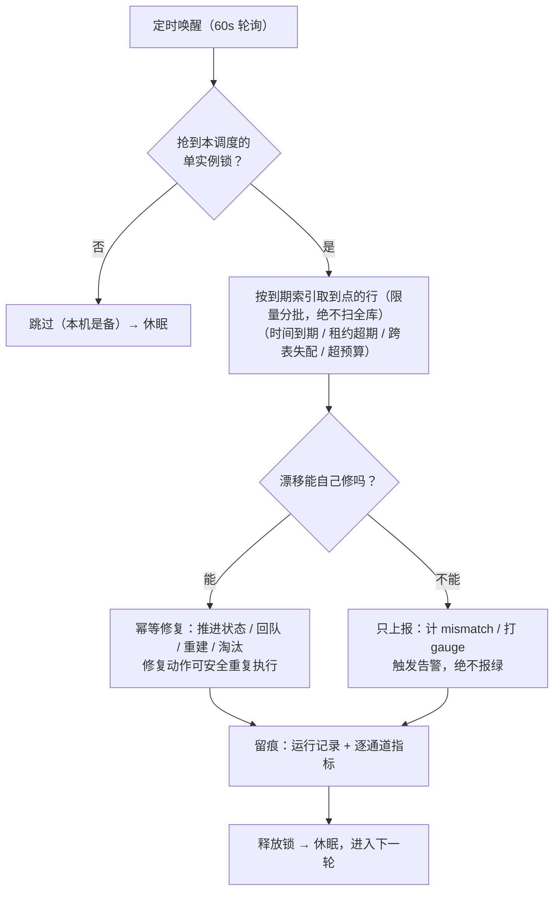

### 4.2 五个职责的共性清单

| 共性 | 说明 |
|---|---|
| 定时触发，不依赖流量 | 全部由调度循环周期性唤醒，没有新请求、没有新事件时照样收敛——这是它与 API/Worker 的根本区别 |
| 索引驱动、限量分批 | 各状态表按到期字段建部分索引，每轮只取到点的行、限量分批；对账与容量观测按客户分区分片轮转（见第九、十章）——1 亿记忆规模下全库扫描不可行（需求 §4.2） |
| 单实例主备 | 每类调度一把 advisory lock，抢到才干活；备实例轮询等位，不引入额外选主组件 |
| 工作对象是"状态漂移" | 管的都是"该往前却没往前"：时间到期未变状态、租约超期未回收、跨表投影失配、预算超额未回收、版本漂移未重建 |
| 幂等可重放 | 所有修复动作按当前状态判定、可安全重复执行；本轮修不完/修失败，下一轮接着修，不需要人工介入 |
| 只调度、不消费队列 | 只把任务**放回队列**（RETRY/PENDING）或**作废任务**（CANCELLED），从不消费队列任务、从不代 Worker 调 provider 算向量/合成画像；**状态推进与投影修复是其本职**（到期推进、指针修复、视图重建、删除补偿）；自检探针是唯一受控外呼例外（带同意闸，见 9.3） |
| 修复与上报分离 | 能自己修的计入 fixed；修不了的（死信存量、缺证据/缺决策等）只上报，导致对账 PARTIAL 并告警——**绝不把"修不了"报成"没问题"** |
| 异常隔离 | 单个通道/单类对账失败只记日志与运行记录，绝不杀死调度循环；一批收敛动作的原子性与各补偿子任务的独立性分开设计（见 4.3） |
| 合规与预算前置 | 涉及删除、外呼、成本的动作一律先过权限分离、同意闸与节奏控制（删除审核门控见 8.2，跨境同意闸见 9.2/9.3，重试限流见 8.1，视图预算见第十章） |
| 全程可观测 | 每个收敛通道打计数指标，每类对账落运行记录；Convergence 是系统最重要的"收敛是否在动"指标生产者（见第十三章） |

### 4.3 调度循环与事务边界

Convergence 是**单实例调度进程** `mms-lifecycle`，持一把锁、按 60s 唤醒，覆盖全部职责。事务边界遵循一条原则：**"分通道独立事务（通道内原子），补偿与外呼用独立事务/短连接"**——同一通道的状态收敛要么全生效要么全不生效；通道之间互不牵连，一个通道失败不拖垮其他；每个补偿子任务独立失败。

**生命周期调度：一轮的全貌（每 60s）**

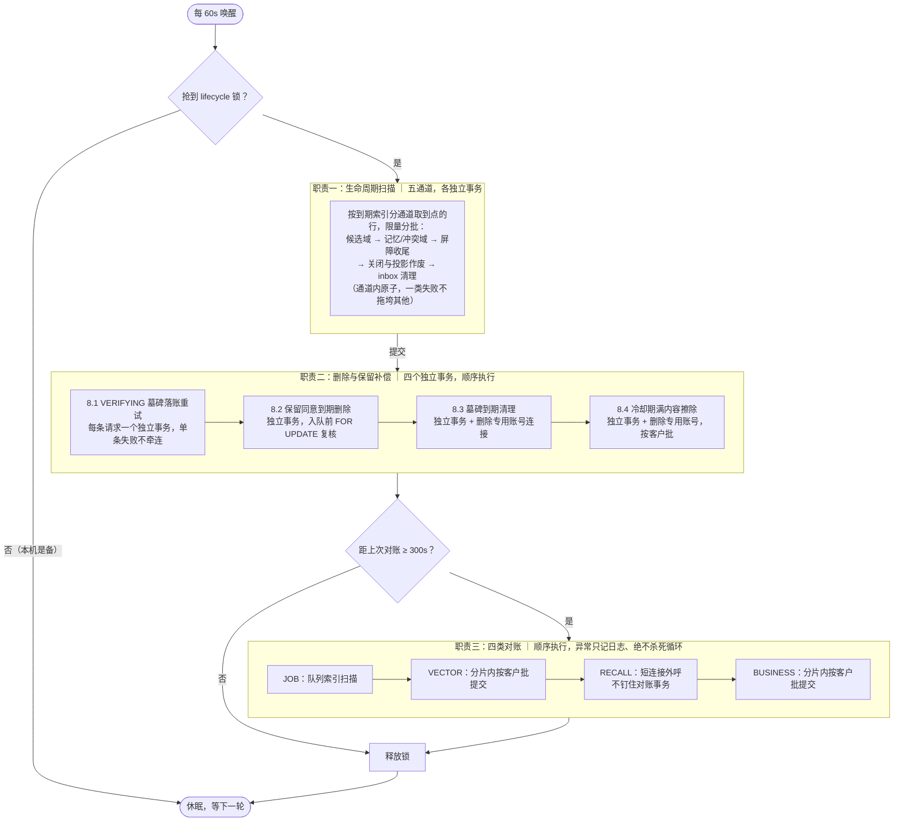

**事务边界为什么这样划**

| 动作 | 事务边界 | 理由 |
|---|---|---|
| 职责一：17 项状态收敛 | **分通道独立事务**（五通道，通道内原子） | "记忆关闭 → 投影作废"的因果整体在**同一通道内按客户批原子**，不留"记忆已关闭但向量还活着"的中间态；通道间互不牵连，一类失败不拖垮其他；1 亿规模下跨全部通道的大单事务不可行（需求 §4.2） |
| 8.1 墓碑落账重试 | **逐条独立事务** | 每条墓碑落账幂等可重放；单条失败留在 VERIFYING 下轮再试，不牵连其他重试 |
| 8.2 保留同意到期删除 | 独立事务 | 复核与受理原子完成；失败只影响本子任务 |
| 8.3 墓碑清理 | 独立事务 + **删除专用账号** | 业务账号对墓碑无 DELETE 权限，必须换连接；失败独立暴露，不中断整批收敛 |
| 8.4 冷却期满内容擦除 | 独立事务 + **删除专用账号** | 与 8.3 同账号不同事务；按客户批幂等（erased_at 标记），单客户失败不牵连其他 |
| JOB / VECTOR / BUSINESS 对账 | JOB 队列索引扫描单事务；VECTOR/BUSINESS **分片内按客户批提交**（单客户原子） | 避免长事务钉住 vacuum 水位；运行结果按分片落 `recon_run` |
| RECALL canary | **短连接**，不开长事务 | provider 外呼耗时不可控，不能钉住对账事务与连接 |

**三个容易忽略的细节**
1. **锁只在干活期间持有**：从抢锁到释放就是一轮工作；备实例轮询等位，主实例崩溃即可接管。
2. **对账异常被捕获并记录**：provider/DB 抖动只让该类对账记 FAILED，绝不拖垮生命周期调度循环。
3. **pg_notify 广播**：屏障由 `COOLING_DOWN` 转 `COMPLETED` 时发 `mms_barrier_changed` 通知，让检索层缓存及时失效。

---

## 五、职责全景、先后顺序与协作关系

### 5.1 全景：一条主干 + 四种配套

五个职责不是并列的五件事，而是**"一条主干 + 四种配套"**：职责一负责状态随时间正确演进（日常新陈代谢），职责二保证删除链路一定走到终点（专项收尾），职责三保证走歪了能修回来（兜底体检），职责四保证容量可见（观测并入对账），职责五保证规则换了存量数据能跟上（版本演进）。

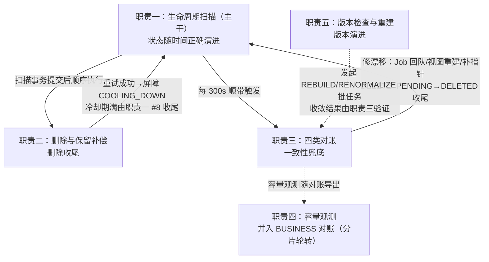

> 实线 = 调用与接力关系；虚线 = 制衡与验证关系。职责一↔二、一↔三都是双向闭环：二把删除推到 COOLING_DOWN 交给一收尾；一把状态推进后遗留的投影交给三收尾。

**部署归属**：

| 职责 | 归属 | 节奏 | 单实例锁 |
|---|---|---|---|
| 一 + 二 | **同进程、同轮次**（上半场分通道独立事务扫描 + 下半场独立事务补偿） | `mms-lifecycle`，每 60s | `mms:scheduler:lifecycle` |
| 三 | **同进程顺带**（每 300s 跑一轮四类对账） | 同上，共用同一把锁 | 同上 |
| 四 | **并入职责三**（容量观测随 BUSINESS 对账分片轮转） | 同 lifecycle 节奏 | 复用 lifecycle 锁 |
| 五 | **低频版本检查**（设计口径：随生命周期调度顺带检查注册表/策略 ACTIVE 版本） | 批任务由 Worker 消费，结果由职责三验证 | 复用 lifecycle 锁 |

### 5.2 一轮调度内的先后顺序

生命周期调度每一轮（60s）内部是**严格顺序**的，顺序本身是设计的一部分：

| 步骤 | 执行内容 | 为什么排在这里 |
|---|---|---|
| ① | **职责一**：17 项状态收敛按五通道执行，各通道独立事务、到期索引取行、限量分批（候选域 → 记忆/冲突域 → 屏障收尾 → 关闭与投影作废 → inbox 清理） | 先把"到点必须变"的状态推进到位，给本轮后续动作一个**正确的状态基线**；先收敛记忆状态，再在**同一通道内**作废其投影与任务，避免为已关闭记忆白算向量 |
| ② | **职责二**：扫描事务提交后，顺序执行 8.1 墓碑落账重试 → 8.2 保留同意到期删除 → 8.3 墓碑清理（各自独立事务） | 删除补偿依赖①建立的状态基线（如屏障状态）；独立事务保证权限不足/单条失败不中断整批收敛；墓碑清理放最后，确保本轮新写墓碑不会被误清 |
| ③ | **职责三**：距上次对账 ≥300s 时，依次跑 JOB → VECTOR → RECALL → BUSINESS | 对账放在扫描与补偿**之后**，避免把正在推进的中间态误判成漂移；四类内部先修任务队列（JOB），再修数据投影（VECTOR），然后体检召回效果（RECALL），最后核对业务不变量（BUSINESS）——**先保证"任务在动"，再保证"数据对齐"，最后验证"效果正确"** |
| ④ | 释放锁、休眠 | 锁只在干活期间持有，备实例随时可接管 |

**职责四**缩为容量观测，并入职责三 BUSINESS 对账（分片轮转），无独立调度。**超额视图淘汰机制删除**：预算 2 视图且 CANONICAL 与主 ORIGINAL 均为基线，v1 永远无可淘汰对象；超额视图由登记闸拦截（Worker 10.5），不需要事后淘汰。

**职责五**是低频的版本演进编排：检查注册表/策略 ACTIVE 版本 → 发现漂移 → 发起 REBUILD/RENORMALIZE 批任务（BACKFILL 优先级，给在线任务让路）→ Worker 异步消费 → 职责三在后续轮次验证收敛结果。它不与①②③抢执行窗口，批任务天然削峰。

### 5.3 两两协作关系

| 协作对 | 关系 | 具体接力 |
|---|---|---|
| 一 ↔ 二 | **双向闭环**（时间语义 ↔ 删除收尾） | 二 8.1 重试成功 → 屏障转 `COOLING_DOWN` → 一 #8 在冷却期满后收尾 `COMPLETED`；一 #11–13 负责记忆关闭后的投影作废，二负责把删除请求本身推到终点 |
| 一 ↔ 三 | **互补**（时间推进 ↔ 漂移修复） | 一 #13 取消已关闭记忆的 Job，三 9.1 回收 Worker 崩溃留下的超租约 Job；一 #10 只**删**无效 current 指针，三 9.4 双向修（删无效 + **补**缺失）；一 #11/#12 删向量、视图置 DELETED，三 9.2 反过来**重建**缺失视图、回填缺向量 |
| 二 → 三 | **删除投影收尾** | 二把屏障推到 COMPLETED 后，遗留的 `DELETE_PENDING` 记忆由三 9.4 推进为 `DELETED`；无活跃屏障的 DELETE_PENDING 只上报 |
| 三（含四） | 观测 ↔ 预算 | 容量观测（VECTORS_PER_CUSTOMER 分布、超软限客户数）随 BUSINESS 对账分片轮转；回填（9.2 加法）受视图预算登记闸约束，无独立淘汰进程 |
| 五 → 三 | **发起 ↔ 验证** | 五发起 REBUILD/RENORMALIZE 批任务，Worker 消费后的收敛结果由三验证：VECTOR 对账删退役模型向量、回填 ACTIVE 模型缺向量（被动兜底），BUSINESS 对账以 `RENORM_LAG_RATIO` 观测规范化滞后是否归零 |
| 三/四 → Worker | **回队 ↔ 消费** | 三把卡住的任务打回 RETRY/PENDING、四把超额视图的 Job 置 CANCELLED，实际消费永远由 Worker 完成——Convergence 绝不越界干活 |

### 5.4 一次删除的完整接力（端到端示例）

1. **受理**：用户自助（API）/ 同意撤回（API 同意同步事件，见 API 7.6）/ 运营发起（API）/ 保留同意到期（Convergence 8.2 到期索引）→ 创建删除请求 `RECEIVED`、建屏障 `ACTIVE`；自助、同意撤回与到期自动批准 `APPROVED`，运营发起受 4-eyes 门控；
2. **删除执行事务**（API 与 Convergence 8.2 共用同一实现）：同事务失效（记忆 `DELETE_PENDING`、取消活动 Job、撤 current）→ 请求 `VERIFYING`；随后独立短事务写 WORM 墓碑，成功 → 请求 `COMPLETED`、屏障转 `COOLING_DOWN`、`pg_notify` + 删除域事件；
3. **职责二 8.1**：墓碑写失败卡 `VERIFYING` → 按 request+scope 幂等键限流重试直至成功（不做首次执行）；批准 → 完成 ≤7 天，超时触发 `MMSDeletionDeadlineBreach`（需求 §5.2）；
4. **职责一 #11–13**：`DELETE_PENDING` 记忆进入关闭通道 → 物理删向量、视图置 DELETED、待办 Job 置 CANCELLED（不待屏障 COMPLETED）；
5. **职责一 #8**：冷却期（30 天）满 → 屏障 `COMPLETED` + `pg_notify` 广播；
6. **职责三 9.4**：屏障 COMPLETED 后把遗留 `DELETE_PENDING` 记忆推进 `DELETED`；
7. **职责二 8.3**：墓碑保留期（400 天）满 → 删除专用账号物理清除墓碑。

各职责的详细判据与数据来源见第七~十一章。

---

## 六、状态与枚举速查

本节内联定义本文涉及的枚举（只列本文用到的取值；完整状态机见[《12-状态机》](../2-详细设计/12-状态机.md)与[《3-Worker组件设计》](3-Worker组件设计.md)各 Job 章节）。

**记忆生命周期（`customer_memory.lifecycle_status`）**：

| 状态 | 含义 |
|---|---|
| `ACTIVE` | 生效中，可被检索 |
| `CONFLICTED` | 存在未决冲突，与日常回答隔离（响应仅带条数提示，见 API 7.1） |
| `RESOLVED` | 时效到期自然解决（历史态，可被 HISTORY_DEBUG 召回） |
| `SUPERSEDED` | 被新记忆取代（历史态） |
| `EXPIRED` | 过期失效（历史态） |
| `DELETE_PENDING` | 删除进行中，等待屏障收尾 |
| `DELETED` | 已删除（终态，投影全部作废） |

**候选（`memory_candidate.candidate_status`）**：`RECEIVED`（已受理）/ `VALIDATED`（已校验）/ `PENDING_REVIEW`（待审核）/ `EXPIRED`（SLA 或 TTL 过期，内容字段清空）。

**冲突（`memory_conflict.status`）**：`OPEN`（未决）/ `IN_REVIEW`（审核中）/ `RESOLVED`（已解决）/ `DISMISSED`（已驳回）。解决原因：`RESOLVED_BY_EVENT`（目标记忆已解决联动）/ `CONFLICT_TIMEOUT_EXPIRED`（超时强制解决，禁止永久 CONFLICTED）。

**审核任务（`memory_review_task.status`）**：`PENDING`（待处理）/ `IN_REVIEW`（处理中）/ `EXPIRED`（关联对象过期/关闭而连带关闭）。

**删除请求（`memory_deletion_request.status`）**：`RECEIVED`（已受理，屏障 ACTIVE；运营发起待审核门控）/ `APPROVED`（已批准：自助与同意撤回自动批准，运营 4-eyes 批准）/ `VERIFYING`（API 执行事务已提交失效，WORM 墓碑待写成功）/ `COMPLETED`（删除完成，墓碑已落账，屏障 COOLING_DOWN）；分支终态 `REJECTED` / `CANCELLED`（仅失效执行前可撤销）。与 API 文档 7.5 同一口径；**失效执行共用同一实现：API 承接受理/审核/同意事件，Convergence 8.2 承接同意到期；8.1 只做 VERIFYING 墓碑重试**。

**删除屏障（`customer_deletion_barrier.status`）**：`ACTIVE`（删除进行中，挡新写入）/ `COOLING_DOWN`（删除完成，冷却期中）/ `COMPLETED`（冷却期满，终态）/ `CANCELLED`（重新授权撤销或审核驳回，仅失效执行前）。

**Job 状态**（与 Worker 文档同口径）：

| 队列 | 状态枚举 |
|---|---|
| embedding / profile（v1.5） | `PENDING` / `RUNNING` / `READY` / `RETRY` / `DEAD_LETTER` / `CANCELLED` |
| ingestion | `RECEIVED` / `PROCESSING` / `COMPLETED` / `RETRY` / `DEAD_LETTER` / `CANCELLED` |
| outbox | `PENDING` / `RETRY` / `PUBLISHED` / `FAILED`（无 CANCELLED，被屏障挡住时延迟重试） |

**Job 取消原因码**：`LIFECYCLE_CLOSED`（记忆已关闭，职责一 #13）。

**向量操作（`memory_embedding_job.operation`）**：`UPSERT`（生成/更新向量）/ `DELETE`（删除向量投影）/ `REBUILD`（模型/维度升级后重建，由职责五发起，BACKFILL 优先级）。另有投影重算批任务 `RENORMALIZE`（规范句/投影片段按新版本重算，职责五发起，见第十一章）。

**视图（`memory_search_document`）**：view_kind = `ORIGINAL`（主证据语言原文，每记忆至多 1 条）/ `CANONICAL`（规范句，und=不定语言锚点；规范句语言=客户主语言，由归一器产出，跨语言召回由多语言向量模型承担）；**每记忆视图预算 2**（与需求 §4.1 推算、`exact_scan_soft_limit=2000` 一致）；不建 TRANSLATED 译文视图（需求 §6.2 已决，跨语言召回由多语言向量模型承担），次要证据语言不另建视图（原文留在证据表可审计）；status = `READY`（可检索，**仅 ACTIVE 记忆保留 READY 向量**；每视图向量行携带 dense + sparse 双输出）/ `DELETED`（已作废）。

**对账类型（recon_type）**：`JOB`（任务队列健康）/ `VECTOR`（视图/向量一致性）/ `RECALL`（自检探针：原文自召回，管道健康，不计质量 SLO）/ `BUSINESS`（业务不变量）。

**对账运行记录（`recon_run`）**：status = `RUNNING` / `COMPLETED`（mismatch 全部修复）/ `PARTIAL`（存在只上报项，触发告警）/ `FAILED`（执行异常）；triggered_by = `scheduler`（定时）/ `manual`（内部接口或命令行手动）。

**同意（`customer_memory_consent`）**：status = `GRANTED`（已授权）/ `DENIED`（已拒绝）/ `WITHDRAWN`（已撤回）；本文涉及的 purpose = `MEMORY_RETENTION`（记忆保留）/ `CROSS_BORDER_EMBEDDING`（跨境向量化）。

**模型注册表（`embedding_model_registry.status`）**：`ACTIVE`（生产在用）/ `SHADOW`（影子评估）/ `RETIRED`（已退役，其向量应被清除）。

**其他**：时效记忆类型 = `SERVICE_HISTORY` / `ACTIVE_ISSUE` / `COMMITMENT`（到期自动 RESOLVED）；基数 cardinality = `SINGLE_VALUE`（单值槽，需 current 指针唯一）；记忆种类 memory_kind = `FACT`（单值事实）/ `PREFERENCE`（多值偏好，强度衰减与淡化退场，见第七章 #16）/ `EPISODIC`（情景记录，到期归档，见第七章 #15）；客户画像为派生投影（v1.5，见[《3-Worker组件设计》](3-Worker组件设计.md)第八章）。

---

## 七、职责一：生命周期状态扫描与收敛

生命周期扫描按**到期索引**取到点的行，分五个通道执行，各通道独立事务（通道内原子、限量分批、本轮修不完下轮接着修），**每条状态都必须有出口、不依赖人工点击**（状态机设计见[《12-状态机》](../2-详细设计/12-状态机.md)）。全表谓词扫描在 1 亿记忆规模下不可行（需求 §4.2）。逐项：

| # | 动作 | 触发判据 | 效果 |
|---|---|---|---|
| 1 | 候选 SLA 过期（按风险分层） | `RECEIVED/VALIDATED/PENDING_REVIEW` 超 SLA：高风险 `review_sla_hours`（默认 72★）、低危 `review_sla_days`（默认 30） | 置 `EXPIRED`、清 `content_redacted/semantic_text/source_refs`，计 `CANDIDATE_EXPIRED_BY_SLA` 并告警审核队列 owner；**高风险超时升级告警（值班介入），不得静默过期** |
| 2 | 候选 TTL 过期 | `expires_at<=now()` | 置 `EXPIRED` |
| 3 | 候选审核任务过期 | 关联候选已 EXPIRED | 审核任务 `EXPIRED` |
| 4 | 时效记忆到期 | `valid_to<=now()` 且类型∈SERVICE_HISTORY/ACTIVE_ISSUE/COMMITMENT | 记忆 `RESOLVED`、撤 current |
| 5 | 冲突事件解决 | 目标记忆已 RESOLVED | 冲突 `RESOLVED`（`RESOLVED_BY_EVENT`） |
| 6 | 冲突超时过期 | 超 `conflict_max_age_days`（默认 90） | `RESOLVED`（`CONFLICT_TIMEOUT_EXPIRED`），**禁止永久 CONFLICTED**；超时裁决语义：保留当前 ACTIVE 旧值，新值经 #9 置 EXPIRED 关闭，并生成复盘工单（高风险事实不得静默丢弃） |
| 7 | 冲突审核关闭 | 冲突已 RESOLVED/DISMISSED | 关联审核任务 `EXPIRED` |
| 8 | 屏障收尾 | `COOLING_DOWN` 超 `deletion_cooldown_days`(30) | 转 `COMPLETED` + `pg_notify` |
| 9 | 记忆过期 | `expires_at<=now()` 或 冲突超时 | 置 `EXPIRED`、撤 current |
| 10 | current 指针清理 | 非 current / 非活动态 | 删 `customer_memory_current` |
| 11 | 向量失效 | 记忆∈**RESOLVED**/SUPERSEDED/EXPIRED/**CONFLICTED**/DELETE_PENDING/DELETED（**向量保留集 = ACTIVE**） | **物理删除** `memory_embedding` |
| 12 | 视图失效 | 同上（含 RESOLVED/CONFLICTED） | `memory_search_document` 置 `DELETED` |
| 13 | Job 取消 | 同上且活动态 | embedding/profile Job 置 `CANCELLED`（`LIFECYCLE_CLOSED`） |
| 14 | inbox 清理 | `COMPLETED` 且超 `inbox_retention_days`(7) | 删除幂等账本行 |
| 15 | 情景归档 | 情景记录超 `episode_archive_days`（策略，默认 365★） | 置 `EXPIRED`（归档语义），不再参与日常回答，历史查询仍可召回 |
| 16 | 偏好退场判定（到点一次，无周期复查） | `decay_check_at<=now()`（观察时按公式精确预测：`last_observed_at + max(τ·ln(strength/θ), exit_idle_days)`，见 Worker S5） | **O(1) 判定，不读证据**：现算 `S_eff = strength·exp(-(now−last_observed_at)/τ)`；`S_eff < preference_exit_threshold`（默认 0.1★）且空闲超 `preference_exit_idle_days`（默认 90★）→ 置 `EXPIRED`（淡化退场，历史查询仍可召回），计 `PREFERENCE_FADED`；不满足（仅策略参数变更后才可能）→ 按新参数重排 `decay_check_at` 一次 |
| 17 | 高风险事实核对**兜底**扫描（低频） | `next_verify_at<=now()`（高风险 FACT；**主路径为检索命中到期登记，见 API 7.1**） | 受每日核对预算闸约束登记核对任务（ingestion Job，`memory.verification.requested.v1`，BACKFILL）；刷新 `next_verify_at = now()+fact_sweep_interval_days`（默认 90★，读驱动登记刷新为 +7★）；超预算顺延不刷新；计 `FACT_VERIFY_REGISTERED{trigger=sweep}` |

**通道划分与到期索引**（每通道独立事务；所有取数必须走部分索引，禁止全表扫描）：

| 通道 | 覆盖项 | 到期索引（部分索引，只覆盖活动态） |
|---|---|---|
| 候选域 | #1–3 | `memory_candidate(created_at)` / `(expires_at)`，仅待处理状态 |
| 记忆/冲突域 | #4–7、#15–17 | `customer_memory(valid_to)`、`(expires_at)`，仅活动态；`(decay_check_at)`，仅 PREFERENCE+ACTIVE；`(next_verify_at)`，仅高风险 FACT+ACTIVE；`memory_conflict(opened_at)`，仅未决 |
| 屏障收尾 | #8 | `customer_deletion_barrier(completed_at)`，仅 COOLING_DOWN |
| 关闭与投影作废 | #9–13 | `customer_memory(expires_at)` 活动态；投影作废由"本轮关闭的记忆"驱动（**关闭 = 进入 RESOLVED/SUPERSEDED/EXPIRED/CONFLICTED/DELETE_PENDING/DELETED，含 #4 时效到期产生的 RESOLVED**），**按客户批同一事务**（删向量 → 视图作废 → 取消 Job），不留"记忆已关闭但向量还活着"的中间态 |
| inbox 清理 | #14 | `memory_inbox_event(updated_at)`，仅 COMPLETED |

每通道每轮 LIMIT `lifecycle_batch_size`（默认 500★）；通道失败只记日志与运行记录并告警，不影响其他通道。

每项计数都打点 `LIFECYCLE_TRANSITIONS{transition=...}`，便于观测各收敛通道是否在动。

**要点**：第 11–13 项正是"删除/过期只有一条路"在异步侧的落地——记忆一旦关闭，向量、视图、待办任务被同步作废，**绝不为已关闭的记忆继续算向量**。

**大致流程**（粗粒度，分通道独立事务、到期索引取行）：

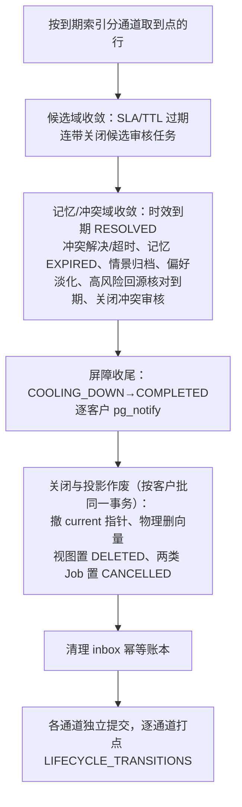

**数据来源与输出**（表级口径，编号对应上表；**下列过滤条件一律经到期部分索引实现，禁止全表扫描**；所有写回同时刷新 `updated_at`，各通道计数统一打点 `LIFECYCLE_TRANSITIONS{transition}`）：

| # | 数据来源（表 · 字段） | 过滤条件 | 输出（写回 / 指标） |
|---|---|---|---|
| 1 | `memory_candidate`（candidate_status, risk_level, created_at, policy_version）+ `memory_policy`（按 name@version=policy_version 关联，取 config->>'review_sla_hours' / 'review_sla_days'） | candidate_status∈{RECEIVED,VALIDATED,PENDING_REVIEW} 且超分层 SLA（高风险 review_sla_hours 缺省 72★ / 低危 review_sla_days 缺省 30） | 置 EXPIRED，清 content_redacted/semantic_text/source_refs；高风险超时升级告警；`CANDIDATE_EXPIRED_BY_SLA` |
| 2 | `memory_candidate`（candidate_status, expires_at） | candidate_status∈{RECEIVED,VALIDATED} 且 expires_at<=now() | 同上：置 EXPIRED + 清三字段 |
| 3 | `memory_review_task` t + `memory_candidate` c（按 candidate_id 关联） | c.candidate_status='EXPIRED' 且 t.status∈{PENDING,IN_REVIEW} | t.status=EXPIRED、resolved_at=now() |
| 4 | `customer_memory`（lifecycle_status, valid_to, memory_type） | lifecycle_status∈{ACTIVE,CONFLICTED} 且 valid_to<=now() 且 memory_type∈{SERVICE_HISTORY,ACTIVE_ISSUE,COMMITMENT} | lifecycle_status=RESOLVED、current_flag=false |
| 5 | `memory_conflict` c + `customer_memory` m（按 m.id=c.current_memory_id 关联） | m.lifecycle_status='RESOLVED' 且 c.status∈{OPEN,IN_REVIEW} | c.status=RESOLVED（RESOLVED_BY_EVENT）、resolved_at=now() |
| 6 | `memory_conflict`（status, opened_at）+ `memory_policy`（全局 ACTIVE：status='ACTIVE' 且 memory_type IS NULL，按 effective_from 取最新，config->>'conflict_max_age_days'） | status∈{OPEN,IN_REVIEW} 且 opened_at 超 conflict_max_age_days（缺省 90 天） | status=RESOLVED（CONFLICT_TIMEOUT_EXPIRED）；保留旧值、新值经 #9 关闭、生成复盘工单；`CONFLICT_TIMEOUT_EXPIRED` |
| 7 | `memory_review_task` t + `memory_conflict` c（按 c.id=t.conflict_id 关联） | c.status∈{RESOLVED,DISMISSED} 且 t.status∈{PENDING,IN_REVIEW} | t.status=EXPIRED、resolved_at=now() |
| 8 | `customer_deletion_barrier`（status, completed_at, updated_at, customer_id） | status='COOLING_DOWN' 且 COALESCE(completed_at,updated_at) 超 deletion_cooldown_days（30 天） | status=COMPLETED；逐客户 `pg_notify('mms_barrier_changed')` |
| 9 | `customer_memory`（expires_at, lifecycle_status）+ EXISTS `memory_conflict`（current_memory_id+customer_id 匹配、未决且 opened_at 超时） | expires_at<=now() 且 lifecycle_status∈{ACTIVE,CONFLICTED,RESOLVED,SUPERSEDED}；或 CONFLICTED 且冲突超 conflict_max_age_days | lifecycle_status=EXPIRED、current_flag=false |
| 10 | `customer_memory_current` c + `customer_memory` m（按 memory_id+customer_id 关联） | NOT m.current_flag 或 m.lifecycle_status∉{ACTIVE,CONFLICTED} | 物理删除指针行 |
| 11 | `memory_embedding` e + `customer_memory` m（按 memory_id+customer_id 关联） | m.lifecycle_status∈{SUPERSEDED,EXPIRED,DELETE_PENDING,DELETED} | 物理删除向量行 |
| 12 | `memory_search_document` d + `customer_memory` m（同上关联） | 同 #11 且 d.status<>'DELETED' | d.status=DELETED |
| 13 | `memory_embedding_job` / `memory_profile_job`（v1.5） j + `customer_memory` m（同上关联） | 记忆已关闭（同 #11）且 j.status∈{PENDING,RUNNING,RETRY} | j.status=CANCELLED（LIFECYCLE_CLOSED），清 locked_by/locked_at/lease_expires_at |
| 14 | `memory_inbox_event`（status, updated_at） | status='COMPLETED' 且 updated_at 超 inbox_retention_days（7 天） | 物理删除幂等账本行 |
| 15 | `customer_memory`（memory_kind, created_at, lifecycle_status） | memory_kind='EPISODIC' 且 lifecycle_status='ACTIVE' 且 created_at 超 episode_archive_days（缺省 365★） | lifecycle_status=EXPIRED（归档）；`EPISODE_ARCHIVED` |
| 16 | `customer_memory`（memory_kind, lifecycle_status, decay_check_at, strength, last_observed_at）——**不连接证据表** | memory_kind='PREFERENCE' 且 lifecycle_status='ACTIVE' 且 decay_check_at<=now() | 现算 S_eff（O(1)）；满足退场 → lifecycle_status=EXPIRED，`PREFERENCE_FADED`；否则按当前策略参数重排 decay_check_at 一次 |
| 17 | `customer_memory`（memory_kind, risk_level, lifecycle_status, next_verify_at, fact_key） | memory_kind='FACT' 且 risk_level='HIGH' 且 lifecycle_status='ACTIVE' 且 next_verify_at<=now()；当日登记数 < fact_verify_daily_budget | 登记 ingestion Job（event_type=memory.verification.requested.v1，BACKFILL）；next_verify_at=now()+fact_sweep_interval_days（缺省 90★）；超预算顺延；`FACT_VERIFY_REGISTERED{trigger=sweep}` / `FACT_VERIFY_DEFERRED` |

---

## 八、职责二：删除与保留补偿

紧接扫描事务提交之后，在**独立事务**里顺序执行四个补偿子任务（事务边界见 4.3）：

### 8.1 VERIFYING 墓碑落账重试
失效由删除执行事务完成（API 与 Convergence 8.2 共用同一实现，见 API 文档 7.5）；WORM 墓碑账本写失败会让删除请求卡在 `VERIFYING`、屏障停在 `ACTIVE`，客户一直"拿不到删除证明"。Convergence 按 `deletion_retry_seconds`(300) 限流，**批量随积压弹性伸缩**：基础每轮最老 10 条；当 VERIFYING 存量 >100 或最老等待 >24h 时放大至 `deletion_retry_batch_max`（默认 100）条/轮，按距 7 天时限的紧迫度排序——确保积压下"批准 → 完成 ≤7 天"仍可达（需求 §5.2）。重试只重放墓碑落账（不做首次失效执行；墓碑 key 按 request+scope 幂等，可安全重试），成功 → 请求 `COMPLETED`、屏障转 `COOLING_DOWN`、`pg_notify` + 删除域事件。同时导出 `DELETION_VERIFYING`（存量）与 `TOMBSTONE_LEDGER_LAG`（最老等待时长）供 `MMSTombstoneLedgerFailure` 告警。**删除时限观测（需求 §5.2/§7）**：请求批准 → 完成 >7 天 → `MMSDeletionDeadlineBreach`（page）。

### 8.2 保留同意到期删除（事件驱动 + 到期索引）
`MEMORY_RETENTION` 判定点，**两条触发路径，绝不扫描记忆表**：
- **事件驱动（主路径，在 API）**：`DENIED`/`WITHDRAWN` 由 API 同意同步端点在**同一事务**内创建删除请求 + 屏障 + 自动批准 + 执行失效（见 API 7.6）——同意状态变更是事件，不是时间到期，不进扫描循环；
- **到期索引（时间路径，本职责）**：`GRANTED` 且 `expires_at<=now()` 的客户失去持有合法基础，按 `customer_memory_consent(purpose, expires_at)` 部分索引（仅 `MEMORY_RETENTION` + `GRANTED`，700 万行表只取到点行，需求 §4.2）创建/复用删除请求，以同一执行实现完成失效（**同意撤回与到期均视同自助删除自动批准**，需求 §5.2；运营发起的删除才受审核门控）。
- **关键保守设计**：**仅"快照缺失"不批量建屏障，只告警**——否则一次同意服务同步中断会被放大成全量停摆。
- 入队前在事务内以 `FOR UPDATE` 复核，期间已重新 `GRANTED` 的跳过。

### 8.3 墓碑到期清理
`retain_until<=now()` 的 `deletion_tombstone` 物理清除。
- **权限使然必须独立于扫描事务**：扫描以业务账号跑，对 `deletion_tombstone` 无 DELETE 权限；用删除专用账号独立连接在扫描之后单独执行，既避免权限不足中断整批过期收敛，也让清理失败能独立暴露。

**大致流程**（粗粒度，三个子任务各自独立事务、顺序执行）：

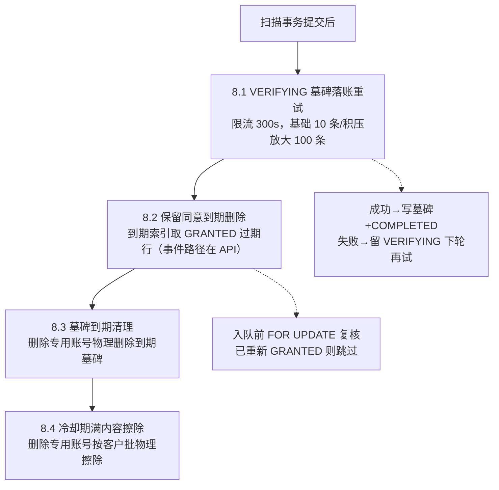

**数据来源与输出**（表级口径）：

| 子任务 | 数据来源（表 · 字段） | 过滤条件 | 输出（写回 / 指标） |
|---|---|---|---|
| 8.1 VERIFYING 墓碑落账重试 | `memory_deletion_request` r（id, customer_id, approved_by, status, updated_at）+ `customer_deletion_barrier` b（按 customer_id 关联且 b.status='ACTIVE'）；另统计全量 VERIFYING 的 count 与 min(updated_at) | r.status='VERIFYING' 且 r.updated_at < now()-deletion_retry_seconds（300s），按距 7 天时限紧迫度排序，LIMIT 基础 10（积压 >100 或最老等待 >24h 时放大至 deletion_retry_batch_max=100） | 逐条独立事务重放墓碑落账（幂等键 request+scope，不做首次失效执行）：写 `deletion_tombstone` 与 `memory_deletion_item`(VERIFIED)，成功→请求 COMPLETED、屏障转 COOLING_DOWN（由职责一 #8 收尾）、pg_notify + 删除域事件；失败→保持 VERIFYING；指标 `DELETION_VERIFYING`、`TOMBSTONE_LEDGER_LAG`、`DELETION_RETRY{result}` |
| 8.2 保留同意到期删除 | `customer_memory_consent` k（purpose='MEMORY_RETENTION'，status, version, expires_at），**部分索引 (purpose, expires_at) 仅 GRANTED**；不连接记忆表 | k.status='GRANTED' 且 k.expires_at<=now()（DENIED/WITHDRAWN 走 API 事件路径，不在此扫描）；快照缺失不入选只告警；入队前事务内 FOR UPDATE 复核 | 删除请求受理：`memory_deletion_request` 新增 RECEIVED（幂等键 retention-consent:{customer}:{version}，source=SYSTEM/CONSENT_EXPIRED）+ `customer_deletion_barrier` 置 ACTIVE + `memory_outbox_event` barrier.changed 事件 + 自动批准 + 同一执行实现失效（→VERIFYING→墓碑）；指标 retention_consent_deletions |
| 8.3 墓碑清理 | `deletion_tombstone`（retain_until） | retain_until<=now() | 物理删除到期墓碑（删除专用账号独立连接，`trg_tombstone_purge_guard` 拒绝未到期删除）；指标 tombstones_purged |
| 8.4 冷却期满内容擦除 | `customer_deletion_barrier`（status='COMPLETED'，erased_at IS NULL，completed_at 超 deletion_cooldown_days） | 冷却期满且未擦除 | 删除专用账号按客户批物理擦除 memory/evidence 内容与行；屏障 erased_at=now()；指标 `CONTENT_ERASED`；失败独立暴露下轮重试 |

### 8.4 冷却期满内容擦除
屏障 `COMPLETED`（冷却期满，职责一 #8）且未擦除的客户：以**删除专用账号**独立连接、按客户批独立事务，物理擦除 `customer_memory`/`memory_evidence` 内容列并删除行（幂等：擦除标记 `erased_at` 落屏障行；单客户失败不牵连其他）。投影已在 T0/关闭通道销毁，此处只清业务行。指标 `CONTENT_ERASED`。擦除与墓碑清理（8.3）共用删除专用账号，但各自独立事务、独立暴露失败。擦除矩阵全貌见 API 文档 7.5（R7）：T0 停读停写 + 销毁投影 + scrubber 擦决策快照 → 冷却期内容保留但屏障挡读写 → 冷却期满物理擦除 → 墓碑 400 天 > 备份 35 天。

---

## 九、职责三：对账自愈（每 300s，四类 recon）

**执行方式（需求 §4.2：禁止全库扫描）**：JOB 对账只查队列表的活动态部分索引（队列活动行天然少）；VECTOR/BUSINESS 对账**按客户分区分片轮转**——每轮只扫 1/N 个分片（`recon_shard_count`，默认 16★），N 轮覆盖全量，**分片内按客户批提交**（`recon_customer_batch`，默认 500★；单客户修复原子，批失败下轮接着修，避免长事务钉住 vacuum 水位）；RECALL 采样不变。下文各"数据来源与输出"表均为**单分片内**的逻辑口径。

每类对账每次运行先写一行 `recon_run(triggered_by='scheduler')`，结束按 `mismatch==fixed` 判定 `COMPLETED/PARTIAL/FAILED`。核心区分两类操作（共性口径见 4.2）：
- **修复（fix）**：MMS 能自己修的（计入 fixed）。
- **上报（observe）**：MMS 修不了、只能上报的（导致 PARTIAL 并触发对账告警，而非报绿）。

四类对账各管一片，通用执行骨架如下：

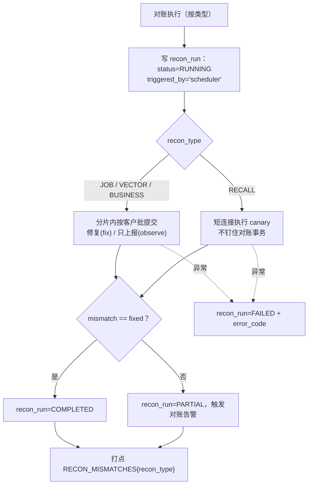

### 9.1 JOB —— 任务队列健康
- **超租约回收**：embedding/profile（v1.5）的 `RUNNING`、ingestion 的 `PROCESSING` 且 `lease_expires_at<=now()` → 打回 `RETRY`、清锁，等待 Worker 重新认领（**这就是总体架构说的"Embedding 重试"——Convergence 不直接调 provider，只把卡住的任务放回队列**）。
- **Outbox 租约**：`PENDING/RETRY` 且锁超期 → 回 `RETRY`。
- **READY 缺向量**：Job 标 `READY` 但实际无 READY 向量、而记忆与视图仍有效 → 打回 `PENDING`、`attempts=0` 重算。
- **死信存量上报**：三表 `DEAD_LETTER` + Outbox `FAILED` 存量（运维队列，配告警）。

**大致流程**：

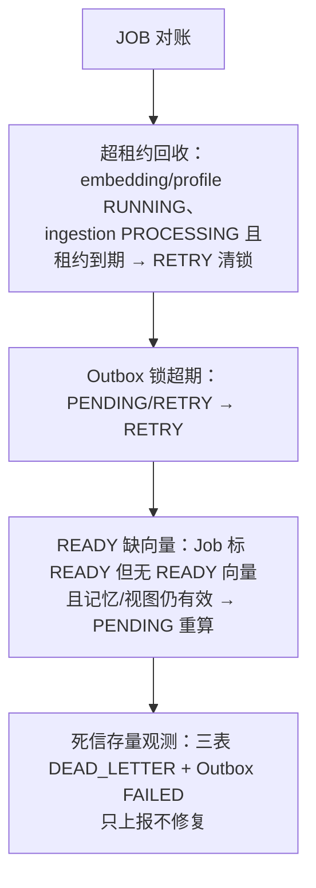

**数据来源与输出**：

| 检查项 | 数据来源（表 · 字段） | 过滤条件 | 输出（写回 / 指标） |
|---|---|---|---|
| embedding 租约 | `memory_embedding_job`（status, lease_expires_at） | status='RUNNING' 且 lease_expires_at<=now() | status=RETRY，清 locked_by/locked_at（fix） |
| ingestion 租约 | `memory_ingestion_job`（status, lease_expires_at） | status='PROCESSING' 且 lease_expires_at<=now() | 同上（fix） |
| profile 租约（v1.5） | `memory_profile_job`（status, lease_expires_at） | status='RUNNING' 且 lease_expires_at<=now() | 同上（fix） |
| outbox 租约 | `memory_outbox_event`（status, locked_at） | status∈{PENDING,RETRY} 且 locked_at < now()-outbox_lease_seconds（60s） | status=RETRY，清 locked_by/locked_at（fix） |
| READY 缺向量 | `memory_embedding_job` j + NOT EXISTS `memory_embedding` e（同 customer/memory/model/version/视图键，e.status='READY'）+ EXISTS `customer_memory` m（可索引态）+ EXISTS `memory_search_document` d（同视图键+view_text_hash，d.status='READY'） | j.status='READY' | j.status=PENDING、attempts=0、available_at=now()、清锁（fix） |
| 死信存量 | `memory_embedding_job` / `memory_ingestion_job` / `memory_profile_job`（v1.5）（status='DEAD_LETTER'）+ `memory_outbox_event`（status='FAILED'） | 各者计数求和 | observe dead_letter_stock：计 mismatch 不 fix，导致 PARTIAL |

### 9.2 VECTOR —— 视图/向量一致性

按客户分区分片轮转执行（见第九章开头）；下表为单分片口径。**向量保留集 = ACTIVE**：本节"可索引"一律指 `lifecycle_status='ACTIVE'`；CONFLICTED 隔离期不算向量、历史态不回填；CONFLICTED 记忆裁决转 ACTIVE 时由决策事务登记 Embedding Job（Worker S7）。

- 观测各 `view_kind/language` 缺失的 READY 向量（`VIEW_MISSING`）；
- 重建缺失的 ORIGINAL/CANONICAL 文档，回填缺向量（补发 UPSERT Job，由 Worker 消费）；
- 删孤儿 ORIGINAL 视图（无对应主证据语言）、hash/状态不符的旧向量、视图丢失/非 READY 的向量、不可索引文档、**退役模型的向量**。

**大致流程**：

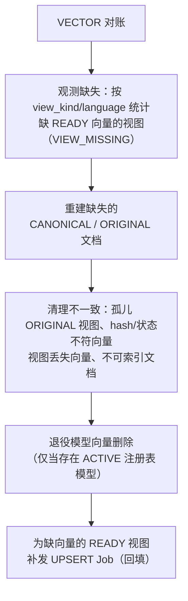

**数据来源与输出**（缺失观测计 mismatch；重建/回填数量记 `recon_run.details`，不计 fixed）：

| 检查项 | 数据来源（表 · 字段） | 过滤条件 | 输出（写回 / 指标） |
|---|---|---|---|
| 缺失观测 | `customer_memory` m + `memory_search_document` d JOIN `memory_embedding` em（同视图键+view_text_hash，em.status='READY'）；ORIGINAL 按主证据语言核对（每记忆至多 1 条 ORIGINAL） | m.lifecycle_status='ACTIVE'（**向量保留集 = ACTIVE；CONFLICTED 隔离期不算向量、历史态不回填**）且无对应 READY 视图+向量 | `VIEW_MISSING{view_kind,language}` gauge；计 mismatch |
| 重建视图 | `customer_memory`（semantic_text, content, content_hash, content_language）+ `memory_evidence`（content_language, evidence_excerpt_redacted, observed_at） | 可索引态且缺 CANONICAL/und 或 ORIGINAL/主证据语言 的 READY 文档 | `memory_search_document` UPSERT 为 READY（CANONICAL 用 semantic_text；ORIGINAL 用主证据语言 content）；数量记 details.repaired_views |
| 孤儿 ORIGINAL 视图 | `memory_search_document` d + NOT EXISTS `memory_evidence`（同 memory_id+customer_id 且 content_language=d.view_language 为主证据语言） | d.status='READY' 且 d.view_kind='ORIGINAL' | d.status=DELETED（fix） |
| hash/状态不符向量 | `memory_embedding` e + `customer_memory` m | m.content_hash<>e.content_hash 或 m.lifecycle_status<>'ACTIVE' | 物理删除 e（fix） |
| 视图丢失/非 READY 向量 | `memory_embedding` e + NOT EXISTS `memory_search_document` d（同视图键+view_text_hash，d.status='READY'） | — | 物理删除 e（fix） |
| 不可索引文档 | `memory_search_document` d + `customer_memory` m | d.status='READY' 且（m.content_hash<>d.content_hash 或记忆不可索引） | d.status=DELETED（fix） |
| 退役模型向量 | `memory_embedding` e + `embedding_model_registry` r（按 model_id+version 关联） | 存在 ACTIVE 模型才执行；r.status='RETIRED' 或 r.status∉{ACTIVE,SHADOW} | 物理删除 e（fix） |
| 回填缺向量 | `memory_search_document` d + `customer_memory` m + LEFT JOIN `customer_deletion_barrier` b；模型取 `embedding_model_registry` 的 ACTIVE 行 | d.status='READY'、记忆可索引、无 ACTIVE/COOLING_DOWN/COMPLETED 屏障、ORIGINAL 需主证据语言、（外部 provider 时）需 CROSS_BORDER_EMBEDDING 同意、无同模型 READY 向量、无活动 UPSERT Job | 新增 `memory_embedding_job`（UPSERT/PENDING，ACTIVE 模型）；数量记 details.enqueued_missing_vectors |

### 9.3 RECALL —— 自检探针（管道健康）

**定位（需求 §6.2）**：用记忆原文当问题去查、应命中自身——**只证明管道没坏，不证明语义质量，不计入质量 SLO**；语义质量（换说法/跨语言命中率）由离线评测门禁承担（API 管理域）。目标命中率 ≥99%，miss 率 >1% 触发管道告警。

- 按**每种有 READY 向量的语言**采样（`max(1, recon_batch_size//10)` 条/语言，按 `updated_at DESC` 取最近更新的），针对 **ACTIVE 注册表模型**（而非进程设置，避免换模型期误报）；
- **跨境同意闸在采样连接上先判**（stage='canary'）：未授权客户的样本直接跳过（含敏感样本另判 SENSITIVE_MEMORY，未授权同样跳过），且跳过数 `skipped_cross_border_customers` 可见（防止"同意通道关闭"被误读成"该语言无样本"）；
- 对每条样本做查询向量化后走检索（`HISTORY_DEBUG`、top-10、含敏感），若自身 `memory_id` 未被召回则计一次 miss；
- 用**短连接**执行 provider 调用，不钉住对账事务；结果落 `recon_run.details.semantic_canary`（model/version/per_language/scanned_total/skipped_cross_border_customers）。

**大致流程**：

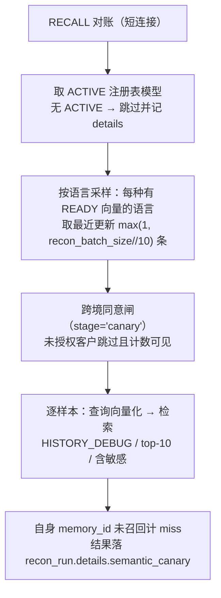

**数据来源与输出**（只读业务表 + 受控外呼，不写任何业务表；唯一写回是 `recon_run`）：

| 检查项 | 数据来源（表 · 字段） | 过滤条件 | 输出（写回 / 指标） |
|---|---|---|---|
| 模型锚定 | `embedding_model_registry`（model_id, version, status, activated_at） | status='ACTIVE'，ORDER BY activated_at DESC LIMIT 1 | 无 ACTIVE → details.semantic_canary.skipped='no_active_model'，本轮结束 |
| 样本采样 | `memory_search_document` d + `customer_memory` m + `memory_embedding` e（同视图键+view_text_hash+content_hash，e.status='READY'） | d.status='READY'、d.view_kind∈{ORIGINAL,CANONICAL}、m.lifecycle_status='ACTIVE'；row_number() 按 view_language 分区、updated_at DESC，取 rn<=max(1, recon_batch_size//10) | 每语言样本集（customer_id, memory_id, content, view_kind, view_language） |
| 跨境同意闸 | `embedding_model_registry.provider` + `customer_memory_consent`（purpose='CROSS_BORDER_EMBEDDING' / 'SENSITIVE_MEMORY'，status, expires_at） | provider≠'self-hosted' 时要求 CROSS_BORDER_EMBEDDING GRANTED 且未过期；含敏感样本另需 SENSITIVE_MEMORY GRANTED，否则跳过该样本 | 被阻客户跳过；`EMBEDDING_CROSS_BORDER_BLOCKED{stage='canary'}`；skipped_cross_border_customers 计数 |
| 召回判定 | 查询向量化（ACTIVE 模型）→ 检索（读 `memory_embedding`/`memory_search_document`/`customer_memory`） | HISTORY_DEBUG、top-10、include_sensitive=True | 自身 memory_id 未召回计 miss；details.semantic_canary{model, version, per_language{scanned,misses}, scanned_total, skipped_cross_border_customers}；scanned/mismatch 汇总入 recon_run |

### 9.4 BUSINESS —— 业务不变量

按客户分区分片轮转执行（见第九章开头）；下表为单分片口径。

- **决策安全观测**（gauge，不计入 mismatch）：重复 current 槽 `CURRENT_DUPLICATE`、未决冲突 `CURRENT_CONFLICTS`、规范化滞后 `RENORM_LAG_RATIO`；
- **current 指针修复**（fix）：删无效指针 `invalid_current_pointer`、补缺失指针 `missing_current_pointer`（`customer_memory_current`）；
- **完整性观测**（observe）：ACTIVE/CONFLICTED/RESOLVED 记忆缺证据 `memory_without_evidence`、缺决策 `memory_without_decision`；
- **删除投影收尾**：屏障 `COMPLETED` 后把遗留 `DELETE_PENDING` 推进为 `DELETED`（fix `delete_pending_after_completed_barrier`）；无活跃屏障的 `DELETE_PENDING` 上报（observe `delete_pending_without_barrier`）；
- **画像滞后观测与回填（v1.5）**：观测画像缺失或落后（来源记忆 `updated_at` 新于画像）的客户，补登记 profile Job（BACKFILL 优先级，由 Worker 消费，见[《3-Worker组件设计》](3-Worker组件设计.md)第八章）；gauge `PROFILE_LAG`；
- **陈旧残留抽样（需求 §6.1）**：抽样 ACTIVE 记忆核对"该被替换或过期、却还在用"（对照权威事件与更新证据），计 `STALE_RESIDUE_RATIO`（目标 ≤2%）；机器判不了的样本转人工标注校准——只上报，不自动改状态。
- **容量观测（职责四并入）**：每客户 READY 向量分布与超软限客户数（见第十章），随本对账分片轮转导出。

**大致流程**：

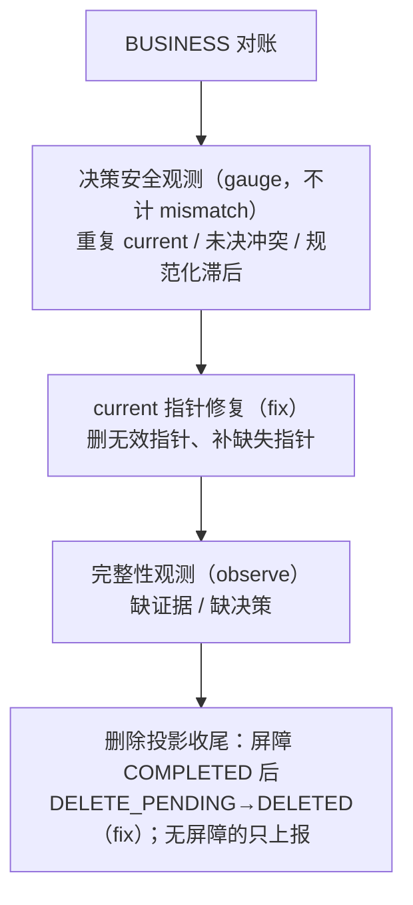

**数据来源与输出**：

| 检查项 | 数据来源（表 · 字段） | 过滤条件 | 输出（写回 / 指标） |
|---|---|---|---|
| 重复 current 槽 | `customer_memory`（customer_id, fact_key, entity_type, entity_ref, current_flag, cardinality, lifecycle_status） | current_flag 且 cardinality='SINGLE_VALUE' 且∈{ACTIVE,CONFLICTED}，GROUP BY 四元组 HAVING count(*)>1 | gauge `CURRENT_DUPLICATE`（不计 mismatch） |
| 未决冲突 | `memory_conflict`（status） | status∈{OPEN,IN_REVIEW} | gauge `CURRENT_CONFLICTS` |
| 规范化滞后 | `customer_memory` m + LATERAL `fact_key_registry` r（同 fact_key、status='ACTIVE'、最高 version） | m.lifecycle_status∈{ACTIVE,CONFLICTED} | gauge `RENORM_LAG_RATIO` = normalization_version 不一致行数/总数 |
| 无效指针 | `customer_memory_current` c + NOT EXISTS `customer_memory` m（同 id/customer/fact_key/entity_type/entity_ref，SINGLE_VALUE+current_flag+∈{ACTIVE,CONFLICTED}） | — | 物理删除指针（fix invalid_current_pointer） |
| 缺失指针 | `customer_memory` m + NOT EXISTS `customer_memory_current`（同四元组） | m.cardinality='SINGLE_VALUE' 且 current_flag 且 lifecycle_status∈{ACTIVE,CONFLICTED} | INSERT 指针（ON CONFLICT 更新 memory_id/generation）（fix missing_current_pointer） |
| 缺证据 | `customer_memory` m + NOT EXISTS `memory_evidence` e（memory_id+customer_id） | m.lifecycle_status∈{ACTIVE,CONFLICTED,RESOLVED} | observe memory_without_evidence |
| 缺决策 | `customer_memory` m + NOT EXISTS `memory_decision` d（customer_id+new_memory_id=m.id） | 同上 | observe memory_without_decision |
| 删除投影收尾 | `customer_memory` m + EXISTS `customer_deletion_barrier` b（同 customer_id，b.status='COMPLETED'） | m.lifecycle_status='DELETE_PENDING' | m.lifecycle_status=DELETED（fix） |
| 无屏障 DELETE_PENDING | `customer_memory` m + NOT EXISTS `customer_deletion_barrier`（status∈{ACTIVE,COOLING_DOWN}） | m.lifecycle_status='DELETE_PENDING' | observe delete_pending_without_barrier |
| 向量保留集不变量 | `memory_embedding` e + `customer_memory` m | e.status='READY' 且 m.lifecycle_status<>'ACTIVE' | 物理删除 e（fix `vector_outside_active_set`）；每客户 READY 向量数 >2000 → observe 告警（理论恒 0，配额保证） |
| 摘要一致性（v1） | `customer_digest` d + 来源指纹（当前事实集 + top-K 偏好） | 摘要缺失或来源指纹失配 | 确定性重算改写（fix `digest_rebuilt`，模板拼装、无外呼）；指标 `DIGEST_REBUILT` |

> 对账除被生命周期调度每 300s 触发外，还可经 `POST /internal/reconciliation/{recon_type}` 手动触发（内部面鉴权见 API 组件设计第五章），或经命令行入口一键跑全部四类。

---

## 十、职责四：容量观测（并入职责三；淘汰机制已删除）

**淘汰机制删除的理由**：视图预算 2（CANONICAL + 主 ORIGINAL）且两者均为基线不淘汰——v1 永远无可淘汰对象；为它养独立进程、成本键排序与级联机制是译文视图方案被砍后的遗迹。超额视图由**登记闸**拦截（每记忆视图数上限 `min(进程配置, 策略上限)`，超额不登记，Worker 10.5），不需要事后淘汰。

**保留容量观测**，随 BUSINESS 对账按客户分区分片轮转执行（每轮 1/N 分片，禁止全库 GROUP BY）：导出每客户 READY 向量分布（`VECTORS_PER_CUSTOMER` 直方图 p50/p95/p99、`VECTORS_PER_CUSTOMER_MAX`、超软限客户数 `CUSTOMERS_OVER_EXACT_SOFT_LIMIT`——>2000 为不变量违例告警），喂给容量评审。

**数据来源与输出**：

| 子任务 | 数据来源（表 · 字段） | 过滤条件 | 输出（写回 / 指标） |
|---|---|---|---|
| 容量观测 | `memory_embedding`（customer_id, status） | status='READY'，GROUP BY customer_id（单分片内） | `VECTORS_PER_CUSTOMER` 直方图（p50/p95/p99）、`VECTORS_PER_CUSTOMER_MAX`、`CUSTOMERS_OVER_EXACT_SOFT_LIMIT`（>exact_scan_soft_limit=2000，即产品上限 1000 条 × 2 视图） |

---

## 十一、职责五：策略/模型版本检查与重建

总体架构把"策略版本检查、模型升级"列为 Convergence 职责。设计口径：**规则换了，存量数据必须能跟上**——版本演进由 Convergence 主动编排，而不是等检索报错才发现。**版本切换本身受评测门禁约束**（需求 §6.3，门禁执行见 API 文档 7.7）：Convergence 只为已正式启用的版本编排回填，不自行启用任何新版。

- **REBUILD 由 Convergence 发起**：模型/维度/视图升级时的向量重建（`memory_embedding_job.operation='REBUILD'`，枚举见第六章）不由普通决策触发；批任务以 BACKFILL 优先级入队，给在线任务让路。
- **RENORMALIZE 由版本对照驱动**：对照 `fact_key_registry` / `memory_policy` 的 ACTIVE 版本，发现规范化版本/策略漂移时发起 `RENORMALIZE` 批任务，重算规范句与投影；源文本变化同时触发画像重算（v1.5，profile Job，BACKFILL 优先级）。
- **偏好调度重排**：τ/退场阈值/空闲期等策略参数激活时，已排定的 `decay_check_at` 失效；发起一次性批任务按分片轮转重排 ACTIVE 偏好的退场时刻（低频、BACKFILL，不是周期扫描）。
- **键治理收敛**：别名激活/键弃用触发受影响存量的 RENORMALIZE（别名重映射 + 按新模板重渲染）；键冲突检测为低频批任务（ACTIVE 键规范句模板向量相似度聚类），**只产出合并/别名建议（DRAFT），不自动合并**，由管理面审核。
- **canary 锚定 ACTIVE 模型**（见 9.3）：模型切换期以注册表为准，而非进程设置，避免换模型期误报。
- **被动收敛兜底**：VECTOR 对账删除退役模型向量、回填 ACTIVE 模型缺向量（9.2），BUSINESS 对账以 `RENORM_LAG_RATIO` 观测规范化滞后（9.4）——主动编排未覆盖或批任务失败的漂移，最终仍会被对账收敛。

**大致流程**：

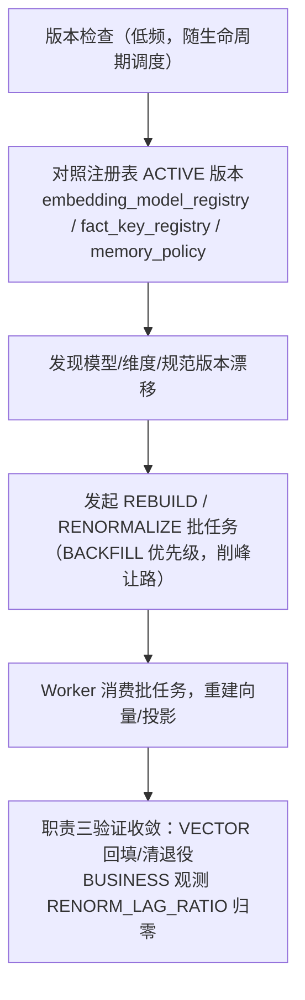

**数据来源与输出**：

| 检查项 | 数据来源（表 · 字段 · 过滤） | 输出 |
|---|---|---|
| 模型/维度升级 | `embedding_model_registry`（status='ACTIVE' 的 model_id/version/dimension），与存量向量的 model/version/dimension 对照 | `memory_embedding_job.operation='REBUILD'` 批任务（BACKFILL 优先级）；收敛结果由 VECTOR 对账验证（9.2） |
| 规范/策略版本 | `fact_key_registry`（同 fact_key 的 ACTIVE 最高 version、normalization_version）、`memory_policy`（ACTIVE config），与存量记忆的 normalization_version/policy_version 对照 | `RENORMALIZE` 批任务重算规范句/投影；滞后程度由 `RENORM_LAG_RATIO` 观测（9.4） |

---

## 十二、关键配置参数（默认值）

配置统一经环境变量注入（前缀 `MMS_`）；策略类参数来自 `memory_policy.config`，按 name@version 关联：

| 参数 | 值 | 用途 |
|---|---|---|
| `lifecycle_poll_seconds` | 60 | 两个调度循环的轮询间隔 |
| 对账触发间隔 | 300 | 生命周期调度顺带跑对账的频率 |
| `recon_batch_size` | 100 | 对账批量基准；canary 每语言采样 `//10` |
| `recon_shard_count` | 16 | VECTOR/BUSINESS/容量观测按客户分区分片轮转的分片数（N 轮覆盖全量） |
| `recon_customer_batch` | 500★ | VECTOR/BUSINESS 对账分片内每事务客户数（单客户原子，避免长事务） |
| `lifecycle_batch_size` | 500 | 生命周期扫描每通道每轮取行上限 |
| `review_sla_days`（策略，缺省 30） | — | 低危候选 SLA 过期 |
| `review_sla_hours`（策略，缺省 72★） | — | 高风险候选 SLA（超时升级告警，不静默过期） |
| `fact_verify_interval_days`（策略，缺省 7★） | — | 高风险事实**读驱动**核对新鲜度（检索命中到期登记后刷新） |
| `conflict_max_age_days`（策略，缺省 90） | — | 冲突超时过期 |
| `episode_archive_days`（策略，缺省 365★） | — | 情景记录归档期 |
| `preference_decay_tau_days`（策略，缺省 30★） | — | 偏好强度衰减时间常数 τ（增量维护 strength ← strength·exp(-Δt/τ)+1，读取时现算有效强度） |
| `preference_exit_threshold`（策略，缺省 0.1★） | — | 偏好淡化退场强度阈值 |
| `preference_exit_idle_days`（策略，缺省 90★） | — | 偏好淡化退场无新观察空闲期 |
| `evidence_max_per_memory`（策略，缺省 32★） | — | 每记忆证据行数上限；超限在决策事务内压缩（首条 + 最近 K/2 + 中段等距抽样），观察总数累计在记忆行 |
| `fact_sweep_interval_days`（策略，缺省 90★） | — | 兜底扫描登记后的下次核对间隔（休眠事实周期） |
| `fact_verify_daily_budget`（策略，缺省 200000★） | — | 全系统每日核对登记上限（读驱动 + 兜底共用），超预算顺延 |
| `deletion_cooldown_days` | 30 | 屏障 COOLING_DOWN→COMPLETED |
| `deletion_retry_seconds` | 300 | VERIFYING 墓碑落账重试限流 |
| `deletion_retry_batch_max` | 100 | 积压时墓碑落账重试批量上限（基础 10，按 7 天时限紧迫度排序） |
| `inbox_retention_days` | 7 | 幂等账本清理 |
| `tombstone_retention_days` | 400 | 墓碑保留期（须 > 备份保留+恢复窗口） |
| `backup_retention_days` | 35 | 备份保留期 |
| `max_views_per_memory` | 2 | 每记忆视图预算：ORIGINAL（主证据语言）+ CANONICAL（与策略上限取较小值，需求 §4.1 双视图推算） |
| `outbox_lease_seconds` | 60 | Outbox 锁超期判定 |
| `exact_scan_soft_limit` | 2000 | 每客户 READY 向量软限（产品上限 1000 条 × 2 视图，需求 §4.1） |

---

## 十三、可观测性与告警（Convergence 是重要指标生产者）

- **生命周期**：`LIFECYCLE_TRANSITIONS{transition}`（每通道推进量）、`CANDIDATE_EXPIRED_BY_SLA`、`CONFLICT_TIMEOUT_EXPIRED`、`EPISODE_ARCHIVED`、`PREFERENCE_FADED`、`FACT_VERIFY_REGISTERED{trigger=on_read|sweep}`、`FACT_VERIFY_DEFERRED`。
- **删除补偿**：`DELETION_VERIFYING`、`TOMBSTONE_LEDGER_LAG`、`DELETION_RETRY{result}`、`CONTENT_ERASED`、`MMSDeletionDeadlineBreach`（批准 → 完成 >7 天，page）。
- **审核预算（需求 §3.1/§7）**：审核队列积压 >200 条 → `MMSReviewQueueOverflow`（ticket）；每日新增人工审核预算 ≤200 条（高风险事实 + 抽检），超限动作是收紧"高风险"定义或接入更多权威数据源，不是加人；**流入先行指标**：`mms_review_inflow_daily{source}`（高风险冲突 / NEEDS_VERIFICATION / 抽检），7 日均值 >160 条/日（预算 80%）→ `MMSReviewInflowHigh`（ticket）——先于积压破线动作；流入模型 ≈ 45 万 × 40% × h × (c+v) + 抽检，h/c/v 见需求 §8 #7/#10/#11。
- **对账**：`RECON_MISMATCHES{recon_type}`、`VIEW_MISSING{view_kind,language}`、`CURRENT_DUPLICATE`、`CURRENT_CONFLICTS`、`RENORM_LAG_RATIO`、`PROFILE_LAG`（v1.5）、`STALE_RESIDUE_RATIO`（陈旧残留抽样，目标 ≤2%，需求 §6.1）、`DIGEST_REBUILT`（v1 摘要失配重算）。
- **成本/容量**：`VIEW_COUNT`、`VECTORS_PER_CUSTOMER(_MAX)`、`CUSTOMERS_OVER_EXACT_SOFT_LIMIT`（每客户 READY 向量 >2000 为**不变量违例告警**，理论恒 0，配额保证）。
- **运行记录**：每次对账落 `recon_run`（type/status/scanned/mismatch/fixed/error/details），PARTIAL/FAILED 即对账告警来源。

---

## 十四、Convergence 与 Worker 的边界

| 维度 | Convergence | Worker |
|---|---|---|
| 实例 | 单实例（advisory lock 主备） | 多实例并行（`SKIP LOCKED`） |
| 触发 | 定时轮询到期状态（到期索引 + 分片轮转，绝不扫全库） | 事件/任务驱动 |
| 是否调外部 provider | 基本不调（自检探针是唯一受控例外，且带同意闸） | 是：提取/向量/画像合成（v1.5）的实际外呼 |
| 典型产物 | 状态推进、RETRY/PENDING 回队、删除补偿、视图淘汰 | READY 向量、业务记忆、客户画像（v1.5） |
| 关系 | **把任务放回队列 / 作废任务** | **把任务消费掉** |

一句话：**Convergence 负责"让系统在没有新流量时也能自己收敛到正确状态"**，可靠性、一致性、合规删除的最后一公里几乎都压在这里。