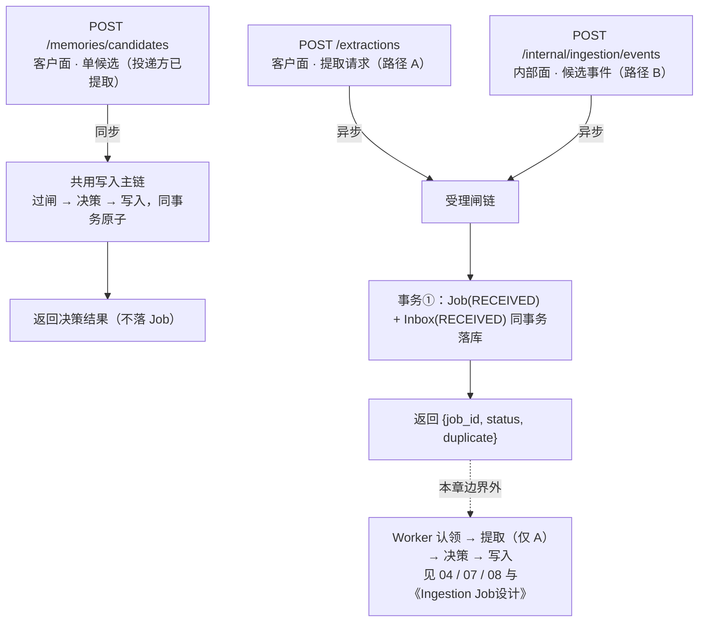
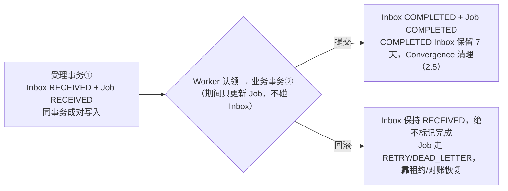

# 事件受理机制设计

**本章覆盖 从 `收到记忆事件` 到 `memory_inbox_event` 与`memory_ingestion_job`"。** 同步决策入口（`candidates`）只描述流程定位；

## 2.1 执行过程

口径源自[《1-API组件设计》](../0-概要设计/1-API组件设计.md) 7.2 写入域：**两类异步摄取统一入队、Ingestion Worker 统一消费，仅差提取方**（A 本系统 / B 投递方）；用户在场的同步入口保留同步决策。



| 入口 | 认证面 | 方式 | 是否落 Job | 返回 |
|---|---|---|---|---|
| `POST /memories/candidates` | 客户面 | 同步决策 | 否 | 决策结果 |
| `POST /extractions` | 客户面 | 异步受理 | 会话级 Job；先扣 EXTRACTION 配额 | `{job_id, status, duplicate}` |
| `POST /internal/ingestion/events` | 内部面 | 异步受理 | 一事件一候选一 Job；先扣 WRITE 配额 | `{job_id, status, duplicate}` |
| `GET /internal/ingestion/jobs/{id}` | 内部面 | 同步查询 | — | status / attempts / last_error_code |

响应码与错误模型统一见[《13-接口设计》](../4-接口与契约/13-接口设计.md) 13.9，本章只描述响应体语义。

| 口径 | 说明 |
|---|---|
| candidates 为何保持同步 | 用户在场要即时结果；摄取队列 FIFO 无纠正优先级，纠正入队会排在批量摄取之后（纠正的"优先"体现在其 embedding Job priority=10） |
| 统一写入主链 | 同步与异步共用同一决策/写入实现；异步受理只做"过闸 + 落 Job"，重计算全部后台化 |
| feedback / review | 同为用户在场同步入口，不经摄取队列（《1-API组件设计》7.3 / 7.4） |

路径 A"受理落 Job"为目标形态，当前实现差异见 2.6。


## 2.2 幂等防重设计

### 2.2.1 解决什么问题

上游重复投递不可避免（超时重试、消息重投等）。不去重，同一事件会被重复处理，产生重复记忆。

**Inbox 是投递事件的"纯签收簿"**：每个事件一行，只回答"这个投递事件收到过没有"。**行存在即重复**——同一事件再次送达时直接 ack，不再派新任务。簿子只有两个状态：`RECEIVED`（已签收）/ `COMPLETED`（已应用，含拒绝）。"收到过"不等于"办完了"，但**崩溃恢复不归签收簿管**：任务执行到哪一步、处理者是否失联，全部由 Job 状态机 + 租约 + JOB 对账回答（《Ingestion Job设计》第十三/十八章），重投不是复活触发器。

### 2.2.2 双账本分工

| 账本 | 回答的问题 | 存什么 |
|---|---|---|
| `memory_inbox_event`（Inbox） | 投递事件收到过没有、应用完没有 | 只存坐标不存正文（结构见 2.3） |
| `memory_ingestion_job`（Job） | 任务执行到哪一步 | 候选全文（payload_ref） |



**两账本必须同事务成对写入，不能各做一半**（14.3.1，P0-4）——否则"事件已签收"与"任务存在"对不上。Inbox 不镜像 Job 的中间态，只有两个配对点：

Job 状态机全集见《Ingestion Job设计》第十三章，本章只涉及入队（RECEIVED）。

### 2.2.3 两分支判定

先 `INSERT ... ON CONFLICT (consumer_group, event_id) DO NOTHING`：

| 结果 | 含义 | 动作 |
|---|---|---|
| 插入成功 | 新事件，簿子上没有 | 直接 Job upsert（2.2.4） |
| 插入失败 | 簿子已有 = 重复投递 | 回读已存行，返回 `{status: 已存状态, duplicate: true}`，**不做任何写入** |

| 簿子记录 | 大白话 | 动作 |
|---|---|---|
| `COMPLETED` | 早办完了 | ack，不再派一份 |
| `RECEIVED` | 签收过，任务还在队列里或在跑 | 同样 ack；执行进度查 Job，不查 Inbox |

**行存在即 ack，无租约判定、无复活分支**。崩溃恢复完全在 Job 侧闭合：PROCESSING 超租约由 Worker 换主认领或 JOB 对账打回 RETRY；DEAD_LETTER 由管理员 replay 复活。代价是重投不再加速恢复——恢复时延取决于对账周期与人工介入，队列积压由 `MMSIngestionQueueAge` 监控兜底（2.5）。

两类 ack 均计 `mms_inbox_duplicate_total`（2.5）。

## 2.3 双账本数据模型

`memory_inbox_event`关键字段：

| 字段 | 语义 |
|---|---|
| `consumer_group / event_id` | 复合主键：投递事件幂等键（消费组 + 事件 UUID）；**行存在即重复**（2.2.3） |
| `topic / partition / offset` | Kafka 语义坐标，投递方作为信封元数据传入 |
| `status` | `RECEIVED / COMPLETED`（默认 RECEIVED）：已签收 / 已应用（含拒绝）；不镜像 Job 中间态（2.2.2） |
| `processed_at` | 仅 COMPLETED 时写入（CHECK 强制） |
| `updated_at` | COMPLETED 保留期清理依据（2.5） |

纯签收簿**无 attempts / last_error_code / 租约字段**——尝试与失败信息只记在 Job 上。

约束：**只存坐标、不存正文、无 `customer_id`**——不是个人数据留存点，COMPLETED 行独立保留 7 天、由 Convergence 清理（2.5）；客户删除时随 Job 行物理删除（2.4）。

| 索引 | 用途 |
|---|---|
| Job `(available_at, created_at) WHERE status IN ('RECEIVED','RETRY')` | FIFO 认领 |
| Job `(customer_id, created_at DESC)` | 按客户排查/删除定位 |
| Job `(lease_expires_at) WHERE status='PROCESSING'` | 对账找超租 |
| Inbox `(status, updated_at) WHERE status='COMPLETED'` | 保留期清理（Convergence） |


`memory_ingestion_job`关键字段：

| 字段 | 语义 |
|---|---|
| `id` | uuid PK，接收时生成（即返回的 job_id） |
| `customer_id / source_system / source_event_id` | 唯一键：同一源事件至多一行 Job |
| `event_type` | `memory.extraction.requested.v1` / `memory.candidate.v1` |
| `payload_ref` | jsonb：候选全文 + inbox 坐标（见下） |
| `status / attempts / available_at` | 状态机 / 尝试次数（claim 时自增）/ 最早可执行时间 |
| `locked_by / locked_at / lease_expires_at` | 认领持有者与租约（消费侧写入） |
| `last_error_code` | 最后失败/取消原因码 |
| `barrier_generation` | **接收时刻**捕获的删除屏障代际 |
| `created_at / updated_at` | 老化监控、carrier 时钟 |

约束：**无 priority 列**（FIFO 按 `available_at, created_at` 认领）；**无外键指向记忆**（Job 先于记忆存在，删除时显式取消/物理删除）。

`payload_ref` 结构示例：

```json
{
  "candidate": {
    "customer_id": "c_8f2a...",
    "source_system": "contact-center",
    "source_event_id": "evt_01J...",
    "memory_type": "CUSTOMER_PROFILE",
    "fact_key": "communication.language",
    "object_json": { "language": "zh-CN" },
    "content": "以后请跟我用中文交流",
    "content_language": "zh-CN",
    "source_kind": "USER_EXPLICIT",
    "observed_at": "2026-11-01T09:00:00Z",
    "policy_version": "policy-2026-10-26",
    "source_refs": [{ "ref_type": "message", "ref_id": "msg_1", "span": "0-12" }],
    "sensitivity": "LOW",
    "confidence": 0.95,
    "explicit_correction": false
  },
  "inbox": {
    "consumer_group": "mms-ingestion",
    "event_id": "3f2c9a1e-...",
    "topic": "memory-candidates",
    "partition": 0,
    "offset": 12345
  }
}
```


## 2.5 可观测

| 指标 | 语义 |
|---|---|
| `mms_inbox_duplicate_total{result}` | 重复投递被 ack 次数（completed/received） |
| `mms_ingestion_jobs_total{status}` | 状态迁移计数（含 RECEIVED） |
| `mms_ingestion_job_oldest_age_seconds` | 最老可执行任务年龄 |


| 告警 | 条件 | 级别 |
|---|---|---|
| `MMSInboxAnomaly` | 5m 内重复投递 >0 | critical |
| `MMSIngestionQueueAge` | 最老任务 >300s 持续 10m | critical |


## 2.6 实现边界与文档口径

| 方面 | 已落地 | 待补（目标形态） |
|---|---|---|
| 路径 B | `/internal/ingestion/events` 已走 Inbox/Job 双账本异步链路（14.3.1 实现复核） | — |
| 路径 A | `/extractions` 当前为**同步**提取→决策，直接接收 `content`（≤20,000 字符） | 受理落 Job（返回 job_id）、会话级 Job 协议、只传引用取数 |
| 同步入口 | `candidates` 同步处理（共用 `process_candidate`，不落 Job） | 保持同步决策不变 |
| Inbox 形态 | 现实现为受理即 `PROCESSING`（默认）、`COMPLETED`、`FAILED`，带 attempts/last_error_code，重投可复活超租/死信任务，另有 stale 监控 | 纯签收簿：仅 `RECEIVED / COMPLETED`，行存在即 ack，无复活分支；删 attempts/last_error_code 与 stale 监控；恢复全靠 Job 租约 + JOB 对账 + 管理员 replay（2.2 / 2.3） |

与[《04-记忆抽取》](04-记忆抽取.md) 4.7 同源；为实现补齐项，不改变本章契约。

、
