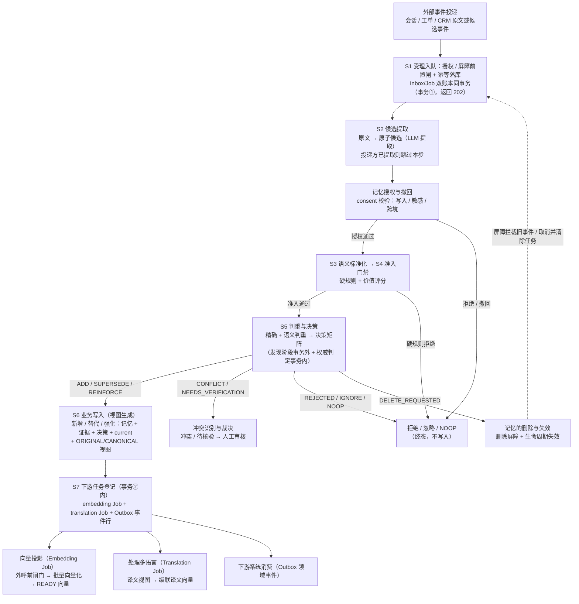
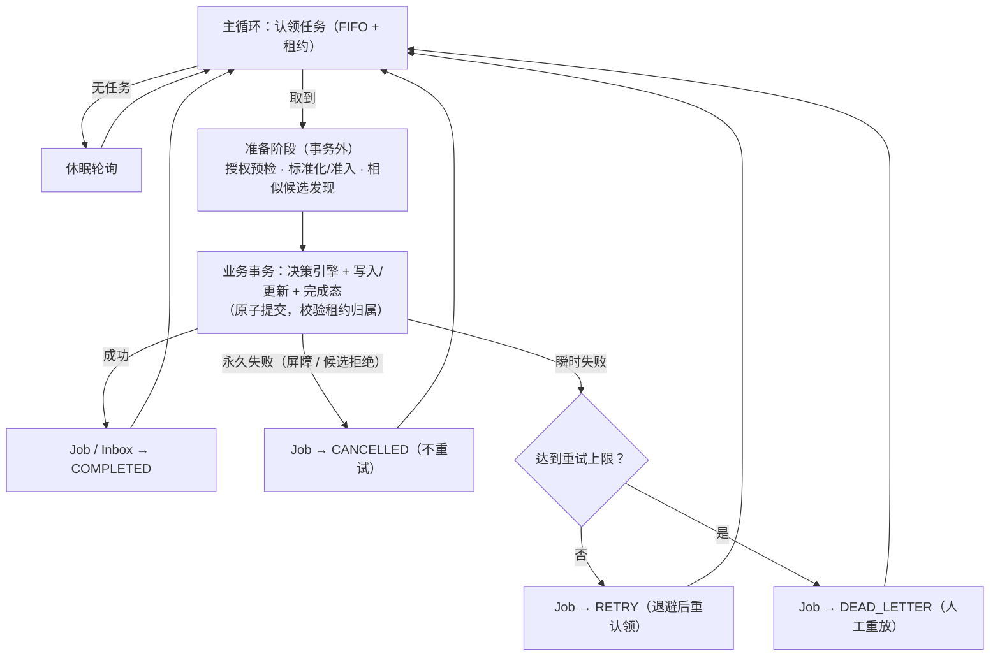
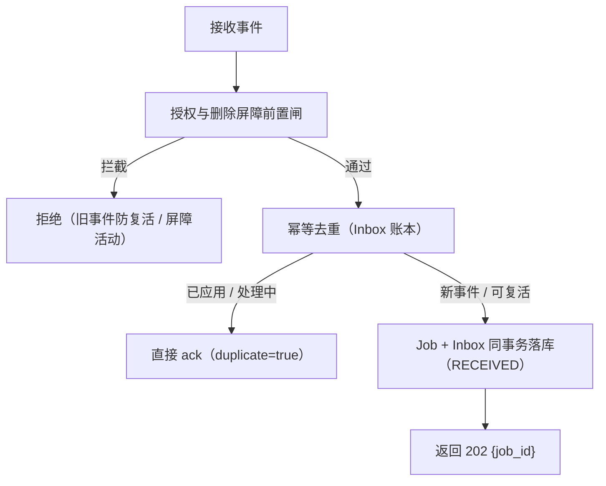
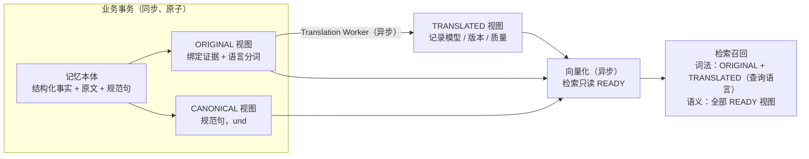
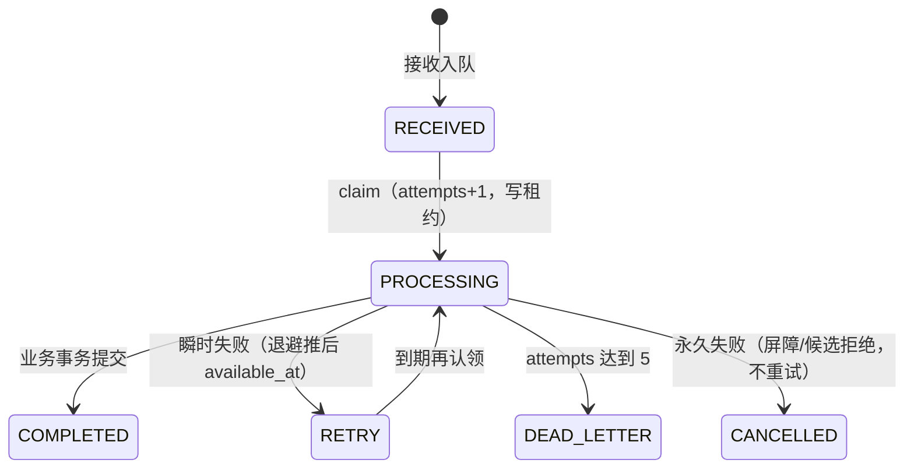
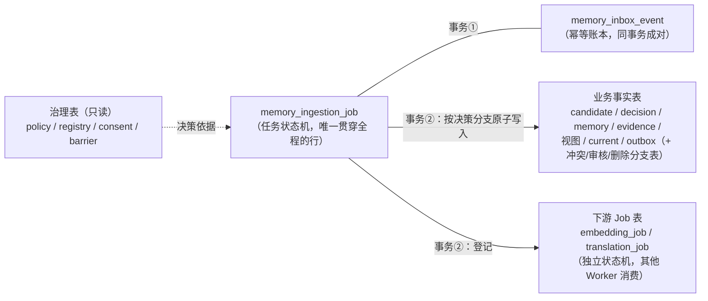
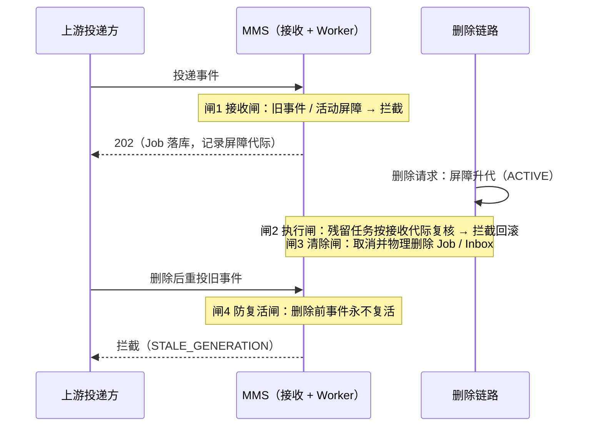

# Ingestion Job 设计（事件摄取任务）


## 一、一句话认识 Ingestion Job

外部系统投递的"记忆候选事件"（会话结束、工单变更、CRM 事实更新等）**不在接收请求里同步处理完**，而是先在一个 PostgreSQL 事务里落成一行任务记录（`memory_ingestion_job`，状态 `RECEIVED`），再由独立的 **Ingestion Worker** 进程异步取走，完成"提取 → 语义标准化 → 准入 → 判重 → 决策 → 视图生成 → 写库 → 登记下游任务"的全链路。

它在三类 DB Job 中的位置：

| Job 类型 | 表名 | 职责 | 消费进程 |
|---|---|---|---|
| **摄取任务（本文）** | `memory_ingestion_job` | 把外部事件/候选转化为记忆 | Ingestion Worker（`mms-ingestion`） |
| 向量任务 | `memory_embedding_job` | 为记忆视图生成向量 | Embedding Worker（`mms-worker`） |
| 翻译任务 | `memory_translation_job` | 生成 TRANSLATED 视图 | Translation Worker（`mms-translation`） |

**Ingestion Job 是另外两类 Job 的生产者**：只有它先执行完，业务事务里才会登记 embedding/translation 任务。执行顺序由数据依赖自然驱动，无中心化编排。

配套还有一张**幂等账本** `memory_inbox_event`：Job 表是"待办队列（durable queue）"，Inbox 表是"已应用事件账本"，两者必须同事务成对写入，不能各做一半（方案 14.3.1，P0-4）。

---

## 二、为什么需要独立的摄取队列

### 2.1 与同步写路径的分工

系统有两条写入路径，**只有异步事件摄取走 Ingestion Job**：

| 入口 | 路径 | 是否经过 ingestion_job |
|---|---|---|
| `POST /memories/candidates` | 同步：候选接收 → 决策，请求内直接返回决策（投递方已完成提取） | 否 |
| `POST /extractions` | **异步：受理落提取请求 Job（202 返回），Worker 取数→提取→决策** | **是** |
| `POST /internal/ingestion/events` | **异步：先落候选 Job（202 返回），Worker 后台处理** | **是** |

> 两条异步路径**统一入队、Worker 统一消费、仅差提取方**（A 本系统提取 / B 投递方提取），见第二十二节；candidates/feedback/review 三个同步入口保留同步决策（22.3）。

### 2.2 设计收益

1. **削峰解耦**：接收侧只做一次轻量 PG 事务即返回 202；耗时的语义标准化、embedding 查询向量、决策计算全部移到后台，上游投递不被 MMS 的处理延迟拖住。
2. **持久化不丢**：Job 落库即"任务一定存在"，进程崩溃、重启、发布都不丢事件；不依赖内存队列或 Kafka 重放。
3. **事务一致性**：Job 与 Inbox 同事务写入；业务结果与 Job 完成态同事务提交——不存在"记忆写进去了但任务状态没更新"或"任务完成了但记忆没写"的半成功。
4. **删除面收敛**：任务行与记忆同库，删除屏障可以取消/物理删除 Job 行，不会像外部 broker 那样残留"删不掉的副本"。
5. **去掉中间件**：延续"用 PG 表当 durable queue"的架构决策。方案 14 章的 Kafka consumer 是**可选扩展**，入站统一走 HTTP，Kafka 语义（consumer_group/topic/partition/offset）由外部投递方作为信封元数据传入。

**代价**：claim/租约/退避/死信/对账全部自研；轮询有固有延迟（`worker_poll_seconds`）。

---

## 三、端到端全景



两个事务边界是理解全链路的关键：**事务①只保证"事件已持久化"，事务②才产生业务事实**。事务②失败回滚时，Job 回到 RETRY，Inbox 绝不标记完成。

**关键步骤（S1–S7）**：编号与 [《Worker组件设计》](../0-概要设计/3-Worker组件设计.md) 3.1 能力矩阵、3.2 执行顺序图一一对应；S8 起由 Embedding / Translation / Outbox Job 与横切治理承载，见对应设计文档。

| 步骤 | 关键步骤 | 说明 | 详见 |
|---|---|---|---|
| S1 | 事件受理入队 | API 受理侧：授权/屏障前置闸；Inbox/Job 双账本同事务写入（事务①，返回 202）；入站统一 HTTP，Kafka 语义（topic/partition/offset/consumer_group，可选）由投递方作为信封元数据传入，消费幂等由 Inbox 账本承担 | 第五节 |
| S2 | 候选提取 | 会话/工单/CRM 原文 → 原子候选（LLM 提取；投递方已提取则跳过本步）；路径 A 为会话级 Job，逐候选准备+决策 | 第六节 / 第二十二节 |
| S3 | 语义标准化 | 归一化产出 `object_json / semantic_text / semantic_hash / normalization_version` 与候选指纹 | 第七节 |
| S4 | 准入门禁 | 硬规则 + 价值评分；REJECTED/IGNORE 终态记审计，NEEDS_VERIFICATION 转审核 | 第八节 |
| S5 | 判重与决策 | 精确 + 语义判重；发现阶段（事务外）+ 权威判定（业务事务内，含 consent 权威判定与提交前复核）两段式决策矩阵 → ADD/NOOP/REINFORCE/SUPERSEDE/CONFLICT/NEEDS_VERIFICATION/DELETE_REQUESTED；与在线同步写路径共用同一实现 | 第九节 |
| S6 | 业务写入（视图生成） | 事务②：记忆 + 证据 + 决策 + current + ORIGINAL/CANONICAL 视图原子提交；CONFLICT 转裁决、DELETE_REQUESTED 转删除链路 | 第十节 |
| S7 | 下游任务登记（翻译调度） | 事务②内：embedding Job（ORIGINAL/CANONICAL，10/100）+ translation Job（七重门控 × 目标语言，120）+ Outbox 事件行 | 第十一节 / [Translation Job设计](3-Translation%20Job设计.md) / [OutboxEvent机制设计](4-OutboxEvent机制设计.md) |

**本文结构**：第四~十一章按关键步骤逐一展开——第四章是 S2–S7 共用的消费执行骨架（部署/主循环/认领），第五~十一章分别对应 S1–S7；第十二~十四章是数据模型、状态机与链路表全景；第十五章起是失败处理、幂等并发、删除协同等横切机制。

---

## 四、消费执行骨架（S2–S7 共性）

S1 受理在 API 侧完成（第五节）；任务落库后，S2–S7 全部由 Ingestion Worker 按同一套执行骨架消费。单条任务的执行与失败路由如下图（粗粒度；退避公式等细节见第十五章）：



### 4.1 部署形态与主循环

- 命令 `mms-ingestion`，独立部署服务；进程启动时统一初始化可观测性。
- **可水平扩容**：多实例靠 `SKIP LOCKED` + 租约天然并行，不需要 ConvergenceLock（那是 lifecycle/view-cost 的单实例锁）。
- 主循环：单条处理 → 每 5s 刷新队列信号（20.2）→ 无任务时休眠 `worker_poll_seconds`（默认 1s）。
- **单条处理**：claim `LIMIT 1`，与 Embedding Worker 的批量（16）不同——摄取每条都含独立业务事务与 provider I/O，批量收益低。

### 4.2 认领（claim）—— FIFO + 租约

```sql
SELECT * FROM memory_ingestion_job
WHERE (status IN ('RECEIVED','RETRY') AND available_at <= now())
   OR (status = 'PROCESSING' AND lease_expires_at <= now())   -- 超租约一并回收
ORDER BY available_at, created_at
FOR UPDATE SKIP LOCKED LIMIT 1
```

随后 `UPDATE` 置 `PROCESSING`、`locked_by=worker_id`、`lease_expires_at=now()+ingestion_lease_seconds`（默认 60s）、**`attempts+1`**。认领在独立短事务中提交，业务处理不占认领锁。

---

## 五、S1 事件受理入队

### 5.1 HTTP 入口与请求契约

`POST /internal/ingestion/events`（返回 **202**）：

1. **内部服务身份**鉴权；
2. **topic 白名单**：`payload.topic ∈ MMS_INGESTION_TOPICS`（默认 `["memory-candidates"]`），否则 `422 VALIDATION_FAILED`——HTTP 下 topic 是网关元数据，不是自由客户端输入；
3. **WRITE 配额**：先耗 WRITE 配额（独立连接，先于接收事务）；
4. 在一个 PG 事务内完成接收（5.2）。

请求体（禁止未知字段）：

| 字段 | 约束 | 说明 |
|---|---|---|
| `consumer_group` | 默认 `mms-ingestion`，1–128 字符 | 投递方消费组 |
| `event_id` | UUID | 投递事件唯一 ID |
| `topic` | 1–128 字符，白名单校验 | 逻辑 topic |
| `partition` / `offset` | ≥0 | Kafka 语义坐标 |
| `candidate` | 候选输入结构（12.2） | 候选全文 |

### 5.2 接收事务步骤分解



### 5.3 Inbox 三分支（投递层幂等）

先 `INSERT ... ON CONFLICT (consumer_group,event_id) DO NOTHING`；未插入（已存在）则 `FOR UPDATE` 锁行后判定：

| 已存状态 | 判定 | 动作 |
|---|---|---|
| `COMPLETED` | 事件已应用 | 直接返回 `{status: COMPLETED, duplicate: true}`，计 `mms_inbox_duplicate_total{result=completed}` |
| `PROCESSING` 且 `updated_at > now() - lease` | 有活着的 Worker 在处理 | 直接返回 `{status: PROCESSING, duplicate: true}`，计 `mms_inbox_duplicate_total{result=processing}` |
| `PROCESSING` 超租约，或 `FAILED` | 处理者失联/曾死信 | **复活**：置 PROCESSING、`attempts+1`、清错误码，继续走 Job upsert |

**只有 COMPLETED 是"跳过"的充分条件**；PROCESSING 未超租约也 ack（避免重复入队），超租约才允许重试。

### 5.4 Job upsert 与复活规则

```sql
INSERT INTO memory_ingestion_job (..., status, barrier_generation)
VALUES (..., 'RECEIVED', :generation)
ON CONFLICT (customer_id, source_system, source_event_id) DO UPDATE SET
  payload_ref=EXCLUDED.payload_ref, status='RECEIVED', available_at=now(),
  locked_by=NULL, locked_at=NULL, lease_expires_at=NULL,
  last_error_code=NULL, barrier_generation=EXCLUDED.barrier_generation, updated_at=now()
WHERE memory_ingestion_job.status IN ('RECEIVED','RETRY','DEAD_LETTER','CANCELLED')
```

- **可复活状态集**：`RECEIVED/RETRY/DEAD_LETTER/CANCELLED`。`PROCESSING`（有人在跑）与 `COMPLETED`（已应用）**绝不覆盖**——防止重投把正在处理/已完成的任务打回重来。
- 复活会**刷新 payload 与屏障代际**，但**不重置 attempts**（只有管理员 replay 才清零）。
- 若 `RETURNING` 为空（冲突且不可复活）：回读已存行；若是 `COMPLETED`，顺手把 Inbox 补成 COMPLETED（收敛两账本）。

### 5.5 返回值

`{job_id, status, duplicate}`。投递方可用 `GET /internal/ingestion/jobs/{job_id}` 轮询 `status/attempts/last_error_code/available_at`。

---

## 六、S2 候选提取

路径 A（`/extractions`）由本系统提取：Worker 认领提取请求 Job 后执行"取数 → 切块 → 提取 → 逐候选准备+决策"；路径 B（`/internal/ingestion/events`）投递方已完成提取，**跳过本步**直接进入准备+决策（第九节起）。两条路径的统一入队架构见第二十二节。

### 6.1 event_type 分派

- `event_type` 枚举：`memory.candidate.v1`（候选事件）、`memory.extraction.requested.v1`（提取请求）；提取请求的 payload 携带原文引用（或受控正文，见 6.3）。
- Worker 按 `event_type` 分派：提取请求 → 取数 → 切块 → 提取 → 逐候选准备+决策；候选事件 → 准备+决策（第九、十章）。

### 6.2 会话级 Job 协议

- Job 唯一键 `(customer_id, source_system, source_event_id)` 是“一事件一 Job”（12.1 / 5.4）；一次会话提取产出 N 个候选，逐候选入队会同键冲突、互相覆盖。
- A 路径为**会话级 Job**——一行 Job 对应一次会话提取，payload 带候选数组（Worker 提取后逐候选决策）或原文引用；候选级幂等由候选指纹 `(customer_id, source_system, source_event_id, candidate_fingerprint)` 承担（第十六章），单候选失败不影响同批其他候选（方案 4.2.5）。B 路径维持一事件一候选一 Job。
- 接收协议扩展：接收会话级 payload；Inbox 三分支（5.3）与复活规则（5.4）不变。

### 6.3 取数适配器

- **方案口径**（方案 4.2.1）：事件只传引用（`message_ids`），不传正文；提取时由 MMS 用服务身份从会话存储取数，并校验会话/消息归属（归属不符按安全事件处理，不提取）。
- Worker 侧取数适配层：服务身份 + 归属校验 + 超时退避；取数失败属运行失败可重试（方案 4.2.5）。
- 若允许传正文：Job 行成为新的正文留存点，必须短期保留、随删除屏障物理清除（第十七章）、不进长期日志/Trace——与方案 4.2.1“只传引用”原则的偏差要显式记录。

### 6.4 提取器版本与失败分账

- 提取器版本随运行写入（`extractor_version`），模型/规则变更跑回归（方案 4.2.3/4.6）；决策回放不重新调用提取模型（方案 4.2.5）。
- **失败分账**：提取失败（含取数失败）属运行失败，走退避重试/死信（第十五章）；候选拒绝属业务终态，不重试（15.2）。

---

## 七、S3 语义标准化

**定位**：把措辞各异、语言不同的候选归一化为可比较、可判重的语义表示。准备阶段在事务外完成（第九节），决策事务内复用或重算（9.2）；产出同时供硬门（第八节）、判重（第九节）与视图生成（第十节）使用。

### 7.1 标准化产出与候选指纹

- 归一化产出 `object_json / semantic_text / semantic_hash / normalization_version` 与候选指纹；硬门失败返回空准备结果（第八节）。
- `semantic_text` 是语义判重与查询向量的输入；跨境同意未授权时只保留 semantic_text，不外呼 provider（9.1）。

### 7.2 规范句的确定性生成

CANONICAL 视图的规范句由结构化事实按注册表模板**确定性生成**（非译文、非模型改写）；同一事实无论原话何种语言/措辞，规范句相同。规范句作为重建源数据随记忆本体保存（视图体系见 10.3）。

### 7.3 版本升级与重标准化（RENORMALIZE）

normalizer 版本升级时，由 Convergence 扫描落后于 ACTIVE 版本的记忆触发 RENORMALIZE，Worker 执行：原地重算规范化列、置 STALE 重建 CANONICAL/TRANSLATED 视图；**不新建版本、不写决策**，重建向量以 BACKFILL 优先级（500）执行（见 [《Worker组件设计》](../0-概要设计/3-Worker组件设计.md) 3.1 S18、[Convergence组件设计](../0-概要设计/4-Convergence组件设计.md)）。

---

## 八、S4 准入门禁

**定位**：在判重与决策之前过滤"不该写、不值得写"的候选——硬规则决定能不能写，价值评分决定值不值得写。

### 8.1 策略与注册表加载

加载 `memory_policy` 与 `fact_key_registry`；**注册表敏感度下限覆盖提交方声称的敏感度**——治理口径以注册表为准，不信任提交方自述。

### 8.2 硬规则门

- 准备阶段硬门失败返回空准备结果（只用于阻断外发）；终态拒绝仍由事务内权威判定产生（9.2）。
- 硬门失败走拒绝分支：只存脱敏摘录 + 规则化原因码 R001–R007/R030；`DELETE_REQUESTED` 转入删除工作流（第十七章）。

### 8.3 价值评分与准入结果

- 价值评分与硬规则共同构成准入门禁；评分明细（`score_breakdown`）随决策审计落库（10.2）。
- 准入结果去向：**REJECTED/IGNORE 终态记审计**（只留脱敏候选 + 决策审计，不重试不进 DLQ，15.2）；**NEEDS_VERIFICATION 转人工审核**（10.2）。

---

## 九、S5 判重与决策

两段式：**发现阶段（事务外）+ 权威判定（业务事务内）**，与在线同步写路径共用同一实现。

### 9.1 发现阶段——事务外的准备

**所有网络 I/O 与重计算都在业务事务和 advisory lock 之外**（方案 4.2.5），否则外部 provider 的延迟会把该客户的每次写入都钉死在锁后：

1. **接收侧预检**（只读、fail-closed、不抛错）：屏障 → `MEMORY_WRITE` →（中/高敏）`SENSITIVE_MEMORY`；任一不过返回空准备结果——**预检只用于阻断外发**，终态 REJECTED 决策仍由事务内权威判定产生（consent 拒绝禁止进 DLQ）；
2. **跨境同意判定**：`CROSS_BORDER_EMBEDDING` 未授权 → 不调 provider，只保留 semantic_text，发现阶段退化为纯精确匹配；
3. 查询向量（带缓存）→ 语义相似候选；**provider 不可用只降级**（记录降级日志 `candidate_embedding_unavailable`），不失败写入。

策略/注册表加载与语义标准化、硬门见第七、八节（同属事务外准备）。

### 9.2 权威判定——业务事务内的顺序

Worker 把准备结果连同 **carrier 上下文**传入：`carrier_created_at=job.created_at`、`carrier_barrier_generation=job.barrier_generation`（接收时刻的快照，**不重新读取**，否则代际比较变成恒真）。事务内顺序：

1. 屏障锁 + 屏障校验：屏障活动态 → 屏障拦截；代际不符或 carrier 早于 cutover → STALE_GENERATION；
2. 写入同意校验 `MEMORY_WRITE`（**FOR UPDATE 锁快照行**）：DENIED/WITHDRAWN/不可用 → 终态 `REJECTED` 决策（R005，原因码 CONSENT_*，只存脱敏摘录，**不重试不进 DLQ**）；中/高敏追加 `SENSITIVE_MEMORY` 同口径；
3. 事实锁：事实槽 advisory lock，串行化同一事实的并发决策；
4. 语义标准化（复用/重算，第七节）；硬门失败走拒绝分支（脱敏摘录 + 规则化原因码 R001–R007/R030；`DELETE_REQUESTED` 会转入删除工作流，第八节）；
5. 候选登记：**候选指纹幂等**——指纹已存在则直接回放既有决策，不重复决策；
6. 精确匹配 + 语义候选（复用准备结果，排除精确命中）；
7. 决策矩阵产出 outcome 并落库（10.2）；
8. 提交前**再复核一次写入同意**，保证"检查与提交之间状态未变"。

---

## 十、S6 业务写入（视图生成）

### 10.1 完成提交与租约围栏

业务事务内、决策完成之后：

```sql
UPDATE memory_ingestion_job SET status='COMPLETED', locked_by=NULL, ...
WHERE id=%s AND locked_by=%s AND status='PROCESSING' AND lease_expires_at > now()
```

- **归属校验失败（租约已丢/被重分配）→ 抛 `INGESTION_LEASE_LOST`，整个业务事务回滚**，让新持有者处理；后续重试写入同样被 `locked_by` 围栏，不会覆盖新主。
- 同事务把 Inbox 置 `COMPLETED`（写 `processed_at`）。**业务回滚则 Inbox 绝不完成**，Job 走 RETRY。
- 计 `mms_ingestion_jobs_total{status=COMPLETED}`。

### 10.2 业务写入分支（outcome → 落库动作）

| outcome | 记忆/证据 | 视图 | 下游 Job | Outbox 事件 | 候选终态 |
|---|---|---|---|---|---|
| `ADD` / `ADD_TEMPORAL_VERSION` | 新建记忆（version_no 接续历史最大值）+ 证据 | ORIGINAL + CANONICAL | embedding×2 + translation×目标语言 | `memory.created.v1` | ACCEPTED |
| `SUPERSEDE` | 旧版 SUPERSEDED + 新版（**乐观版本校验**，不符 → 409 CONCURRENT_MODIFICATION 回滚重试） | ORIGINAL + CANONICAL | 同上 | `memory.superseded.v1` | ACCEPTED |
| `REINFORCE` | 仅追加证据 | 仅新增语言的 ORIGINAL（脱敏，触发器强制与证据摘录一致） | 仅新语言 ORIGINAL 的 embedding | `memory.reinforced.v1` | ACCEPTED |
| `NOOP` | 不写 | 不写 | 无 | 无 | PROCESSED |
| `CONFLICT` / `NEEDS_VERIFICATION` | 不写事实，建冲突/审核任务 | — | — | — | PENDING_REVIEW |
| `REJECTED` / `IGNORE` | 只留候选（脱敏）+ 决策审计 | — | — | — | REJECTED / IGNORED |
| `DELETE_REQUESTED` | 转删除工作流（客户级屏障） | — | — | — | PENDING_REVIEW |

写入分支还包含：存储/Embedding 配额闸门（拒绝即整体回滚）、SINGLE_VALUE 的 current 指针移动（仅 ADD/SUPERSEDE）、决策审计（`context_snapshot`、`rule_trace`、`score_breakdown`）。**写记忆、写视图、写决策、写 Outbox、登记下游 Job、Job/Inbox 完成态全在同一事务**。下游登记规则见第十一节，视图体系的设计逻辑见 10.3。

### 10.3 视图体系：记忆的三种检索投影

**定位**：事实存于记忆本体（`customer_memory`），视图是它的**检索投影**，统一存于视图表（`memory_search_document`），以 `view_kind` 区分。**事实只有一份，投影可以有多份；投影可随时失效重建，事实绝不被投影改写。**

**三种视图总览：**

| 视图 | 内容 | 语言 | 每条记忆的数量 | 用途 | 权威性 |
|---|---|---|---|---|---|
| ORIGINAL | 原话（其他语言为对应证据摘录） | 真实语言（zh-CN / en-US …） | 每个证据语言一条，至少一条 | 展示与证据、该语言词法检索、语义召回 | 原文权威 |
| CANONICAL | 标准化生成的语义规范句 | 固定 `und`（语言中立） | 恰好一条 | 跨语言语义锚点、重排基准；不展示 | 派生，可整体重建 |
| TRANSLATED | 机器译文 | 目标语言 | 按目标语言异步生成，受视图预算约束 | 仅召回信号，绝不作为原文返回 | 派生，可淘汰 |

> 视图预算：每条记忆默认最多 6 个视图——CANONICAL 固定占 1 席，证据语言 ORIGINAL 不可被翻译挤掉，TRANSLATED 超额时按成本淘汰（见 Convergence组件设计）。

**视图表结构（`memory_search_document`，按客户 HASH 分区）：**

| 字段 | 类型 | 语义 |
|---|---|---|
| `customer_id` + `memory_id` + `view_kind` + `view_language` | 复合主键 | 一条记忆的一类视图的一种语言一行；`memory_id` 外键随本体级联删除 |
| `view_kind` | text | ORIGINAL / CANONICAL / TRANSLATED |
| `view_language` | text | 视图语言（按种类约束，见下表） |
| `content` | text | 视图文本 |
| `source_evidence_id` | uuid | 证据锚点：仅 ORIGINAL 必填，其余两类禁止 |
| `content_hash` | char(64) | **所属本体的内容指纹**（所有视图共享，防投影挂错版本） |
| `view_text_hash` | char(64) | **本视图文本的指纹**（与向量连接的键） |
| `translation_model` / `translation_version` | text | 翻译模型与版本：仅 TRANSLATED 必填 |
| `translation_quality` | real | 翻译质量 0–1：仅 TRANSLATED |
| `source_view_hash` | char(64) | 源视图指纹：仅 TRANSLATED 必填，重译时向下游传导失效 |
| `search_vector` | tsvector | 词法检索向量：ORIGINAL / TRANSLATED 按各自语言分词生成，CANONICAL 不生成 |
| `analyzer_version` | text | 分析器版本 |
| `status` | text | READY / STALE / DELETED |
| `created_at` / `updated_at` | timestamptz | 创建 / 更新时间 |

索引：每个分区建 GIN（`search_vector`）与三元组（`content`）两条词法索引，另有（客户, 语言, 状态）B-tree；缺任一分区索引会退化为全分区顺序扫描。

**三种视图的行数据差异（同一字段在不同视图中的取值）：**

| 字段 | ORIGINAL | CANONICAL | TRANSLATED |
|---|---|---|---|
| `view_language` | 真实语言，禁 `und` | 固定 `und` | 目标语言，禁 `und` |
| `content` | 主视图 = 本体原文；其他语言 = 证据脱敏摘录 | 语义规范句 | 译文 |
| `source_evidence_id` | 必填（锚定证据行） | 必须 NULL | 必须 NULL |
| `content_hash` | = 本体指纹 | = 本体指纹 | = 本体指纹 |
| `view_text_hash` | 主视图 = 本体指纹；其他语言独立计算 | ≠ 本体指纹 | ≠ 本体指纹 |
| `translation_model` / `version` | NULL | NULL | 必填 |
| `translation_quality` | NULL | NULL | 0–1 |
| `source_view_hash` | NULL | NULL | 必填（源 ORIGINAL 的指纹） |
| `search_vector` | ✅ 按该语言分词 | ❌ NULL | ✅ 按目标语言分词 |
| `status` | READY / STALE / DELETED | 同左 | 同左 |

检索分工由此而定：**词法**扫查询语言的 ORIGINAL + TRANSLATED（同分 ORIGINAL 优先），CANONICAL 不参与；**语义**扫全部 READY 视图（TRANSLATED 仅查询语言），同分优先级 ORIGINAL > CANONICAL > TRANSLATED。

**产生与消费：**



| 要点 | 说明 |
|---|---|
| 同事务强制 | 提交时 CANONICAL 与主 ORIGINAL 必须已存在，无半成功 |
| 分支差异 | 见 10.2：REINFORCE 只追加新语言 ORIGINAL（事实未变，不新建 CANONICAL） |
| 向量是视图的异步投影 | 以“视图文本指纹 + 本体内容指纹”双重连接，文本变过的旧向量永远连不上 |
| 规范句的来源 | 由结构化事实按注册表模板**确定性生成**（非译文、非模型改写）；同一事实无论原话何种语言/措辞，规范句相同（7.2） |

**记忆本体 vs ORIGINAL 视图：**

主 ORIGINAL 的文本与本体原文相同——这是数据库强制的**一致性约束**，不是合并两者的理由：

| 维度 | 记忆本体 | ORIGINAL 视图 |
|---|---|---|
| 回答的问题 | 事实是什么、哪个版本有效、何时失效 | 能被哪些语言检索到、原话证据在哪 |
| 结构化事实 | ✅ 事实键 / 实体 / 结构化值 | ❌ 只有文本 |
| 版本与生命周期 | ✅ 版本链、current 指针、生命周期状态 | ❌ 仅 READY / STALE / DELETED |
| 有效期与治理 | ✅ 有效期、敏感度、来源可信度 | ❌ |
| 检索设施 | ❌ | ✅ 语言分词、三元组索引、向量连接 |
| 数量 | 一个事实版本一行 | 一条记忆多条（每证据语言一条） |
| 可重建性 | 源头，不可再生 | 可从本体 + 证据删后重建 |

一致性约束（数据库强制）：

| 约束 | 内容 |
|---|---|
| 主 ORIGINAL | 文本 = 本体原文 |
| 其他语言 ORIGINAL | 文本 = 对应证据的脱敏摘录（逐字节一致） |
| 指纹对齐 | 视图内容指纹必须与本体一致，防投影挂错版本 |
| 原文不可变 | 本体原文接纳后禁改；改原文 = 新版本，旧版视图随之失效 |

**为什么要冗余存储（不直接检索本体）：**

| 动机 | 说明 |
|---|---|
| 多语言 | 一个事实需要多份多语言检索文本，一行放不下多语言分词 |
| 独立失效 | 重译 / 标准化升级 / 删除只动视图，不碰事实 |
| 性能隔离 | 视图表按客户分区并建检索索引，与权威表的决策事务分离 |
| 可重建 | 视图层可整体从本体 + 证据重建，反之不行 |

**三个场景看两者如何分道扬镳：**

| 场景 | 记忆本体 | ORIGINAL 视图 |
|---|---|---|
| SUPERSEDE | 新版本行，旧行 SUPERSEDED | 新版建新视图，旧视图 DELETED |
| REINFORCE（新语言） | 不动，不新建版本 | 追加新语言 ORIGINAL（文本 = 该语言证据摘录，≠ 本体原文） |
| 删除 | DELETE_PENDING → DELETED，留删除证明 | 先失效立即不可检索，再随本体物理删除 |

**案例：一条语言偏好事实在三个视图中的数据形式**

客户在会话中说“以后请跟我用中文交流”，抽取为语言偏好事实（`communication.language = zh-CN`），决策 ADD：

| 行 | 类型 | 语言 | 数据形式 | 关键属性 |
|---|---|---|---|---|
| 记忆本体 | 事实 | zh-CN | 结构化：communication.language = zh-CN；原文“以后请跟我用中文交流” | 版本 1、ACTIVE、有效期；规范句作为重建源数据保存 |
| 视图 1 | ORIGINAL | zh-CN | 以后请跟我用中文交流 | 绑定证据行，中文分词索引 |
| 视图 2 | CANONICAL | und | communication.language = zh-CN; valid_from = 2026-11-01 | 注册表模板确定性生成，不绑证据 |
| 视图 3 | TRANSLATED | en-US | Please communicate with me in Chinese from now on. | 异步翻译，英文分词索引；记录模型 / 版本 / 质量 / 源视图指纹 |

三个视图行的完整行数据（仅展示有差异的字段；`customer_id` / `memory_id` / `content_hash` / `status` 三行相同，均为同一客户、同一记忆、本体内容指纹、READY，故略）：

| 字段 | 视图 1：ORIGINAL | 视图 2：CANONICAL | 视图 3：TRANSLATED |
|---|---|---|---|
| `view_kind` | ORIGINAL | CANONICAL | TRANSLATED |
| `view_language` | zh-CN | und | en-US |
| `content` | 以后请跟我用中文交流 | communication.language = zh-CN; valid_from = 2026-11-01 | Please communicate with me in Chinese from now on. |
| `source_evidence_id` | 本事务写入的证据行 ID | NULL | NULL |
| `view_text_hash` | H原文（= 本体 content_hash） | H规范句 | H译文 |
| `translation_model` | NULL | NULL | http-translator（示例） |
| `translation_version` | NULL | NULL | 1（示例） |
| `translation_quality` | NULL | NULL | 0.92（示例） |
| `source_view_hash` | NULL | NULL | H原文（源 ORIGINAL 的视图文本指纹） |
| `search_vector` | 中文分词 tsvector | NULL | 英文分词 tsvector |
| `analyzer_version` | phase1-2026-10-26 | phase1-2026-10-26 | phase2-2026-10-26 |

> 指纹记法：H原文 = sha256(“以后请跟我用中文交流”)，H规范句 = sha256(规范句文本)，H译文 = sha256(译文文本)。翻译模型 / 版本 / 质量为示例值；确定性翻译兜底时质量记 0.75。TRANSLATED 的 `source_view_hash` 与源 ORIGINAL 的 `view_text_hash` 相等——原文变更产生新指纹时，旧译文据此被识别失效。

召回效果：

| 查询 | 命中路径 |
|---|---|
| 中文关键词“中文” | 词法 → ORIGINAL（zh-CN）的分词索引 |
| 英文关键词 “Chinese” | 词法 → TRANSLATED（en-US）的分词索引 |
| 英文 “preferred language” | 语义 → CANONICAL / TRANSLATED 向量（跨语言） |
| 任何命中 | 返回的永远是本体原文；译文与规范句只提供召回信号 |

---

## 十一、S7 下游任务登记（翻译调度）

**登记时机**：业务事务②内，与记忆/视图/决策/Outbox/Job/Inbox 完成态**原子提交**——业务写成功 = 下游任务一定入队，不存在半成功（10.2）。各 outcome 登记哪些下游任务见 10.2 表；本节给出登记规则。

### 11.1 Embedding Job 登记

| outcome | 登记内容 | 优先级 |
|---|---|---|
| ADD / ADD_TEMPORAL_VERSION / SUPERSEDE | ORIGINAL + CANONICAL 各一条（embedding×2） | 用户纠正 10 / 日常新写入 100 |
| REINFORCE | 仅新增语言 ORIGINAL 一条 | 同上 |

- 摄取队列本身 FIFO 无优先级；用户纠正的"优先"体现在其产生的 embedding Job（priority=10），而非摄取队列（第二十一章）。
- TRANSLATED 视图的向量**不在本步登记**：由 Translation Worker 译文终写时级联登记（120），译文视图必须先于译文向量（见 [Translation Job设计](3-Translation%20Job设计.md)）。

### 11.2 Translation Job 登记（七重门控 × 目标语言）

按目标语言逐一登记，每个目标语言须通过七重门控：

1. 通道开启（目标语言配置非空）；
2. 敏感度：HIGH 一律不翻译；
3. 类型白名单；
4. 策略开关；
5. 源视图就绪（仅主 ORIGINAL）；
6. 视图预算（每记忆默认最多 6 个视图，10.3）；
7. 跨境同意（`CROSS_BORDER_TRANSLATION`）。

- 目标语言规范化、去重、排除源语言后按配置顺序截取容量；容量截取先于同意判定，被同意跳过的语言不递补。
- 固定优先级 120；未通过门控的语言不登记，不阻塞事实生效。

### 11.3 Outbox 事件行

按 outcome 登记领域事件（`memory.created.v1` / `memory.superseded.v1` / `memory.reinforced.v1`，见 10.2），由 Outbox Job 异步外发（屏障闸 + 信封校验，见 [OutboxEvent机制设计](4-OutboxEvent机制设计.md)）；NOOP/拒绝/审核类 outcome 不产生事件。

### 11.4 数据依赖驱动的执行顺序

三类下游任务是**三张独立的 Job 表、三套独立状态机**（生产/就绪语义），由各自 Worker 消费；执行顺序由数据依赖自然驱动，无中心化编排（第十四章）。投影失败只降级新鲜度，不影响事实生效。

---

## 十二、数据模型

### 12.1 `memory_ingestion_job`（任务队列）

表结构定义如下：

| 字段 | 类型 | 语义 |
|---|---|---|
| `id` | uuid PK | 任务 ID（接收时生成） |
| `customer_id` | text | 客户主体 |
| `source_system` | text | 来源系统（幂等键成分） |
| `source_event_id` | text | 源事件 ID（幂等键成分） |
| `event_type` | text | `memory.candidate.v1`（候选事件）/ `memory.extraction.requested.v1`（提取请求，6.1） |
| `payload_ref` | jsonb | **候选全文 + 事件坐标**（见 12.2），不关联其他表 |
| `status` | text | 状态机（见第十三章） |
| `attempts` | int，默认 0 | 已尝试次数，**claim 时自增** |
| `available_at` | timestamptz，默认 now() | 最早可执行时间；重试退避把它推后 |
| `locked_by` / `locked_at` | text / timestamptz | 持有者与抢占时间（`ingestion-{uuid}`） |
| `lease_expires_at` | timestamptz | 租约到期（默认 claim 后 60s） |
| `last_error_code` | text | 最后失败/取消原因码 |
| `barrier_generation` | bigint，默认 0 | **接收时刻**捕获的删除屏障代际 |
| `created_at` / `updated_at` | timestamptz | 创建/更新时间（老化监控、carrier 时钟） |

约束与要点：

- **唯一键 `(customer_id, source_system, source_event_id)`**：同一源事件至多一行 Job，这是任务层幂等的根基。
- **没有 `priority` 列**：与 embedding/translation 不同，摄取按 `available_at, created_at` **FIFO** 认领，不参与优先级调度。
- **没有外键指向记忆**：Job 先于记忆存在；删除时由删除链路显式取消/物理删除（见第十七章）。

### 12.2 `payload_ref` 结构

事件正文**直接存在 Job 行内**（JSONB），Worker 无需回查其他表：

```json
{
  "candidate": { "...候选输入结构完整序列化..." },
  "inbox": {
    "consumer_group": "mms-ingestion",
    "event_id": "uuid",
    "topic": "memory-candidates",
    "partition": 0,
    "offset": 12345
  }
}
```

- `candidate` 即候选输入结构（字段定义如下，禁止未知字段）：`content`（≤4000 字符）、`fact_key`、`memory_type`、`entity_type/entity_ref/value_slot`、`object`、`source_kind`、`source_refs`、`sensitivity`、`explicit_correction`、`observed_at`（必填）、`valid_from/valid_to`、`content_language` 等。
- 提取请求 Job（`memory.extraction.requested.v1`）的 payload 携带原文引用（或受控正文）与提取参数，会话级协议见 6.2/6.3。
- `inbox` 只存事件坐标，用于完成时回写账本，以及删除时按坐标关联清除 Inbox 行。
- 与 Kafka envelope"payload 只放引用"的原则不同：**HTTP 摄取把候选正文放进 PG**——删除时随 Job 行物理 DELETE，删除面仍在同一个库内闭合。

### 12.3 `memory_inbox_event`（消费幂等账本）

表结构定义：

| 字段 | 语义 |
|---|---|
| `consumer_group` + `event_id` | **复合主键**（投递层幂等） |
| `topic` / `partition` / `offset` | 事件坐标（Kafka 语义元数据） |
| `status` | `PROCESSING` / `COMPLETED` / `FAILED`，默认 PROCESSING |
| `attempts` | 接收/重放次数 |
| `last_error_code` | 失败原因码 |
| `processed_at` | 仅 COMPLETED 时写入（CHECK 约束强制） |
| `updated_at` | 用于"PROCESSING 超租约"判定 |

**Inbox 只存坐标，不存候选正文**；正文在 Job 的 `payload_ref`。两表职责分离：Inbox 回答"这个投递事件应用过没有"，Job 回答"这个任务执行到哪一步"。

### 12.4 索引清单

| 索引 | 定义 | 用途 |
|---|---|---|
| `ix_ingestion_job_ready` | `(available_at, created_at) WHERE status IN ('RECEIVED','RETRY')` | Worker FIFO 认领 |
| `ix_ingestion_job_customer` | `(customer_id, created_at DESC)` | 按客户排查/删除定位 |
| `ix_ingestion_job_lease` | `(lease_expires_at) WHERE status='PROCESSING'` | 对账快速找超租任务 |
| `ix_inbox_stale` | `(status, updated_at) WHERE status='PROCESSING'` | 陈旧 Inbox 监控 |

---

## 十三、状态机（接收/完成语义）

**先立两个心智模型，状态机就不绕了：**

1. **状态记录的是"这个事件处理到哪一步"，不是"记忆写没写成"**。决策为 REJECTED/NOOP、consent 拒绝，任务照样 COMPLETED——"处理完了"就算完成；记忆写没写由决策 outcome 决定（10.2）。
2. **六个状态分三类**：**等待**（RECEIVED/RETRY）、**执行中**（PROCESSING）、**终态**（COMPLETED/CANCELLED/DEAD_LETTER）。Worker 只推进前两类；进了终态，就只有事件重投、管理员重放或删除链路能再改动它。

**状态总览：**

| 状态 | 类别 | 大白话含义 |
|---|---|---|
| `RECEIVED` | 等待 | 已入队，等 Worker 认领 |
| `PROCESSING` | 执行中 | 某个 Worker 正持有租约在处理 |
| `RETRY` | 等待 | 瞬时失败，退避时间（`available_at`）到了再认领 |
| `COMPLETED` | 终态 | 处理完成（**含业务拒绝**） |
| `CANCELLED` | 终态 | 被主动作废：不可能成功，不必再试 |
| `DEAD_LETTER` | 终态 | 试满 5 次仍失败，等人工介入 |

**主干路径（正常世界）：**



一句话故事：**接收入队 → 认领执行 → 成功提交；瞬时失败退避重试、试满 5 次进死信；永久失败直接作废**。至此 PROCESSING 的四个出口（COMPLETED/RETRY/DEAD_LETTER/CANCELLED）已齐；其余转移都是边缘路径，见下面两张表。

**三个终态：到底算哪种"结束"？**

| 终态 | 为什么结束 | 记忆写了吗 | 还能"复活"吗 |
|---|---|---|---|
| `COMPLETED` | 业务事务已提交（ADD/SUPERSEDE/… 与 REJECTED/NOOP 都算） | **不一定**，看决策 outcome | 不需要：重投直接 ack；即使强行 replay，指纹幂等也回放旧决策 |
| `CANCELLED` | 屏障 / 永久拒绝 / 删除取消 | 否 | 屏障解除后**事件重投**复活（attempts 保留） |
| `DEAD_LETTER` | 瞬时失败试满 5 次 | 否 | **管理员 replay**（attempts 清零） |

> 与 Inbox 账本的配对：Job COMPLETED → Inbox COMPLETED；Job CANCELLED → Inbox **也是 COMPLETED**（事件已"应用"，应用结果就是拒绝）；Job RETRY → Inbox 保持 PROCESSING；Job DEAD_LETTER → Inbox FAILED。

**边缘路径：还有谁能改动状态？**

| 触发方 | 转移 | 说明 |
|---|---|---|
| 删除链路 | `RECEIVED/PROCESSING/RETRY → CANCELLED` | 删除请求置删除待决，原因码 `DELETE_REQUESTED`；随后随客户数据物理删除（第十七章） |
| 事件重投（接收） | `RECEIVED/RETRY/DEAD_LETTER/CANCELLED → RECEIVED` | 复活/刷新：更新 payload 与屏障代际，**attempts 保留**；`PROCESSING/COMPLETED` 绝不覆盖（5.4） |
| 管理员 replay | `DEAD_LETTER → RECEIVED` | `attempts=0`；不限当前状态（第二十一章），由指纹幂等兜底 |
| Worker claim | `PROCESSING（超租约）→ PROCESSING` | 换主：租约到期视原 Worker 已死，直接重新认领，attempts+1 |
| JOB 对账 | `PROCESSING（超租约）→ RETRY` | 兜底打回队列（第十八章），与 claim 双保险 |

两个易混点：

- **超租约不是失败态**：`PROCESSING` 超租约只说明"Worker 可能挂了"，任务本身没失败——要么被直接重新认领（仍是 PROCESSING），要么被对账置回 RETRY，两条路都会继续执行。
- **两种"复活"不一样**：事件重投保留 attempts（防止靠重投无限重试）；管理员 replay 清零 attempts（给一次重新来过的机会）。

**与 embedding/translation 的对比**：后两者是"生产/就绪"语义（PENDING→RUNNING→READY），因为产出是投影（向量/译文视图）；摄取的产出是业务事实，所以用"接收/完成"语义。

---

## 十四、链路表全景：一行 Job 驱动多表协同

整条链路**围绕**同一行 `memory_ingestion_job` 推进任务状态，但**操作**的是一组表：Job 表只回答“任务执行到哪一步”，不存任何业务结果；业务事实、幂等账本、下游任务各有其表。

**各阶段读写的表**：

| 阶段 | 读写的表 | 说明 |
|---|---|---|
| 接收（事务①） | `memory_ingestion_job` + `memory_inbox_event` | 唯一的一对：Job 落 RECEIVED，Inbox 同事务成对写入（5.2） |
| 认领/重试/死信/重放 | `memory_ingestion_job`（+ Inbox 状态回写） | 只改任务行自身的状态/租约/attempts（第四、十五章） |
| 发现与决策（只读） | `memory_policy`、`fact_key_registry`、`customer_memory_consent`、`customer_deletion_barrier` | 策略/注册表/同意快照/屏障快照；摄取链路只读不写（consent 为 FOR UPDATE 读锁，9.2） |
| 配额闸门 | `customer_quota_usage`（WRITE/EMBEDDING 桶）；存储配额按 `customer_memory` 行数统计 | 接收先耗 WRITE；写入前存储/Embedding 闸门，拒绝即整体回滚（10.2） |
| 业务写入（事务②） | `memory_candidate`、`memory_decision`、`customer_memory`、`memory_evidence`、`memory_search_document`、`customer_memory_current`、`memory_outbox_event` | 候选指纹/决策审计/记忆+证据/视图/current 指针/领域事件——**链路的业务产出** |
| 事务②分支表 | `memory_conflict` + `memory_conflict_item` + `memory_review_task`（CONFLICT/NEEDS_VERIFICATION）；`memory_deletion_request` + `customer_deletion_barrier`（DELETE_REQUESTED） | 按决策 outcome 走不同分支（10.2） |
| 登记下游任务（事务②内） | `memory_embedding_job`、`memory_translation_job` | **另外两张独立的 Job 表**，由 Embedding/Translation Worker 消费，最终写 `memory_embedding` 向量（第十一节） |
| 删除协同 | `memory_ingestion_job`（取消→物理 DELETE）+ `memory_inbox_event`（按坐标 DELETE） | Job 行随删除消失，业务表由删除链路另行清除（第十七章） |



**四个要点：**

1. **两个事务边界各管一组表**：事务①只写 Job + Inbox（“事件已持久化”）；事务②按决策 outcome 原子写入相应业务表 + 下游 Job + Job/Inbox 完成态（“业务事实与任务完成态原子”）。
2. **Job 表与记忆无外键**：Job 先于记忆存在（表定义只有 PK + 唯一键），靠 `customer_id/source_event_id` 与 `payload_ref` 的事件坐标关联；候选全文存在 Job 行的 `payload_ref` 里，而非单独的表（12.2）。
3. **三类 Job = 三张表、三套状态机**：摄取用“接收/完成”语义（第十三章），embedding/translation 用“生产/就绪”语义（PENDING→RUNNING→READY）。Ingestion Job 是后两者的**生产者**——事务②提交后下游表里出现新任务行，执行顺序由数据依赖驱动，而非同一张表流转。
4. **对账/自愈也分表**：JOB 对账回收三张 Job 表各自的超租行；Inbox 保留清理只动 `memory_inbox_event`（第十八章）。

---

## 十五、失败处理

### 15.1 失败分类总览

| 类别 | 触发 | Job 去向 | Inbox 去向 | 是否重试 |
|---|---|---|---|---|
| 永久失败 | 屏障拦截 / 候选级拒绝 | `CANCELLED` + 原因码 | `COMPLETED` + 原因码 | 否 |
| consent 拒绝 | 快照 DENIED/WITHDRAWN/不可用 | **COMPLETED**（业务决策为终态 REJECTED） | COMPLETED | 否 |
| 瞬时失败 | provider/DB 异常等 | `RETRY`（退避）或 `DEAD_LETTER` | PROCESSING / FAILED | 是 |
| 租约丢失 | 完成态 UPDATE 未命中 | 业务回滚，交新持有者 | 不动 | 由新主 |
| Worker 崩溃 | PROCESSING 超租约 | 被重新认领 / 对账置 RETRY | 保持 PROCESSING | 是 |

### 15.2 永久失败：终止（CANCELLED）

删除屏障意味着"该客户不能再写任何数据"，候选级拒绝重试也不可能成功——**直接终态 CANCELLED，不烧重试次数、不进 DLQ**。Inbox 置 COMPLETED 并保留原因码（事件已"应用"，应用结果就是拒绝）。

### 15.3 瞬时失败：重试与死信

- `attempts >= ingestion_max_attempts`（默认 5，claim 时已自增，判定不再 +1）→ `DEAD_LETTER`，否则 `RETRY`；
- 退避：`available_at = now() + jittered(min(300, 2^(attempts-1)))` 秒；`jittered` 在 `[0.5×base, base]` 均匀取值，避免共享故障恢复时齐刷刷重试打爆下游。四类队列（ingestion/embedding/translation/outbox）统一本公式（方案 14.7）；
- `last_error_code` 记异常类名；Inbox 死信置 `FAILED`、否则保持 `PROCESSING`；
- 所有状态更新都带 `WHERE status='PROCESSING' AND locked_by=self` 围栏。

### 15.4 死信重放（replay）

`POST /admin/dlq/replay`（`job_type=INGESTION`，DLQ 专用鉴权）：

- `FOR UPDATE` 锁 Job → 置 `RECEIVED`、**`attempts=0`**、`available_at=now()`、清锁与错误码；Inbox 置 PROCESSING、`attempts+1`；
- **审计与重入队同事务**（`admin_access_audit`，action=REPLAY）；
- 重放不跳过治理：重新走完整的屏障/consent/指纹判定；即使重放已 COMPLETED 的 Job，候选指纹幂等也会回放既有决策，不产生重复写入。

---

## 十六、幂等与并发控制（多层防线）

| 层 | 键/机制 | 防什么 |
|---|---|---|
| 投递层 | Inbox PK `(consumer_group, event_id)` | 同一投递事件重复接收 |
| 任务层 | Job 唯一键 `(customer_id, source_system, source_event_id)` + 复活状态集 | 同一源事件重复建任务/覆盖在跑任务 |
| 决策层 | 候选指纹唯一键 `(customer_id, source_system, source_event_id, candidate_fingerprint)`；指纹 = `sha256(canonical_json({source_system, source_event_id, stable_candidate_ref}))`（ADR-014：`evidence_hash` 不再参与，证据身份由 `stable_candidate_ref.evidence_locators` 表达） | 重抽取/重标准化改变幂等身份；重复决策 |
| 决策回放 | 指纹命中直接返回历史决策 | 重放产生第二份决策 |
| 事实层 | 事实槽 advisory lock + SUPERSEDE 乐观版本校验 + SINGLE_VALUE 活动唯一索引 | 同一事实并发写、旧版本覆盖新版本 |
| 执行层 | `FOR UPDATE SKIP LOCKED` + 租约 + `locked_by` 围栏 | 多 Worker 互抢、崩溃残留、旧主回写 |
| 跨删除 | `barrier_generation`（接收时快照）+ carrier `created_at` vs `cutover_at` | 删除后旧事件复活 |

**注意**：`stable_candidate_ref` 固定包含 `fact_key/entity_type/entity_ref/value_slot`，`source_refs` 提供时附加稳定证据定位子集——保证同一源消息里的两个不同事实不会被合并丢弃。

---

## 十七、与删除屏障的协同（四道闸）

1. **接收闸**（第五节）：`observed_at < cutover_at` 的旧事件直接屏障拒绝——**即使屏障已 CANCELLED（客户重新同意）也不复活删除前的事件**；活动屏障（ACTIVE/COOLING_DOWN/COMPLETED）经屏障校验拒绝入队。
2. **执行闸**（9.2）：用 Job 携带的 `barrier_generation` 与 `created_at` 复核；代际不符 → STALE_GENERATION，Job CANCELLED。删除可能在"接收后、执行前"发生，这道闸兜住时间窗。
3. **清除闸**（删除执行）：
   - 删除请求置删除待决：`RECEIVED/PROCESSING/RETRY` 的摄取 Job 全部 `CANCELLED`（原因码 `DELETE_REQUESTED`）；
   - 删除执行：**物理 DELETE** 该客户全部 `memory_ingestion_job` 行（候选正文随之消失），并按 `payload_ref->'inbox'` 坐标关联 **DELETE 对应 Inbox 行**；删除证明分别记 `INGESTION_JOB` 与 `INBOX` 项。
4. **防复活闸**：删除完成后重投的旧事件仍被第 1 道闸拦截；DLQ 重放同样走完整屏障校验，禁止绕过治理直接写库。

四道闸在时间轴上的协同如下图（粗粒度；逐闸判据见上文）：



---

## 十八、调度与自愈

Ingestion Worker 自身不做周期扫描，兜底由 Convergence 侧承担（由 `mms-lifecycle` 进程驱动，见 [Convergence组件设计.md](../0-概要设计/4-Convergence组件设计.md)）：

- **超租约回收**（JOB 对账 / `ingestion_lease` 修复项）：`PROCESSING` 且 `lease_expires_at<=now()` → 置 `RETRY`、清锁。claim 语句也能直接回收超租行，对账是双保险。
- **死信存量上报**：`dead_letter_stock` 合并统计三表 DEAD_LETTER + Outbox FAILED，作为运维队列配告警。
- **Inbox 保留清理**（生命周期扫描）：`COMPLETED` 且 `updated_at` 早于 `inbox_retention_days`（默认 7 天）的 Inbox 行物理删除——账本只保留近期幂等窗口，历史幂等由 Job 唯一键与候选指纹继续承担。
- 对账每 300s 依次触发 `JOB/VECTOR/RECALL/BUSINESS`，各写一行 `recon_run`；也可 `POST /internal/reconciliation/JOB` 手动触发。

---

## 十九、配置参数（env 前缀 `MMS_`）

| 参数 | 默认 | 说明 |
|---|---|---|
| `worker_poll_seconds` | 1.0 | 空闲轮询间隔 |
| `ingestion_lease_seconds` | 60 | 任务租约；也是 Inbox"PROCESSING 是否超租约"的窗口 |
| `ingestion_max_attempts` | 5 | 最大尝试次数（含首次） |
| `ingestion_topics` | `["memory-candidates"]` | HTTP 摄取 topic 白名单 |
| `inbox_stale_seconds` | 360 | Inbox 陈旧阈值 = 退避上限 300 + 一个租约 60；超过即"背后没有活着的 Worker" |
| `inbox_retention_days` | 7 | COMPLETED Inbox 保留期 |

租约必须**明显大于**单任务最长处理时间（含 prepare 的 provider 调用），否则会误判崩溃导致重复处理。

---

## 二十、可观测性

### 20.1 指标

| 指标 | 类型 | 标签 | 语义 |
|---|---|---|---|
| `mms_ingestion_jobs_total` | Counter | `status` | 状态迁移计数（RECEIVED/COMPLETED/RETRY/DEAD_LETTER/CANCELLED） |
| `mms_inbox_duplicate_total` | Counter | `result=completed/processing` | 重复投递被 ack 的次数 |
| `mms_inbox_stale_total` | Gauge | — | 停在 PROCESSING 且超 `inbox_stale_seconds` 的 Inbox 行数 |
| `mms_ingestion_job_oldest_age_seconds` | Gauge | — | 最老可执行（RECEIVED/RETRY 且到期）任务的年龄 |

### 20.2 队列信号由 Worker 进程导出

每 5s 刷新两个 Gauge——**必须在摄取进程导出，不能只靠 API 进程**，否则积压无人发现。

### 20.3 告警

| 告警 | 表达式 | 持续 | 级别 | runbook |
|---|---|---|---|---|
| `MMSInboxAnomaly` | `increase(mms_inbox_duplicate_total[5m]) > 0 or mms_inbox_stale_total > 0` | 即时 | critical | mms-inbox-recovery |
| `MMSInboxStale` | `mms_inbox_stale_total > 0` | 5m | page | mms-inbox-stale |
| `MMSIngestionQueueAge` | `mms_ingestion_job_oldest_age_seconds > 300` | 10m | critical | mms-ingestion-freshness |

新鲜度 SLO：**最老待处理摄取任务 ≤5 分钟**。

---


