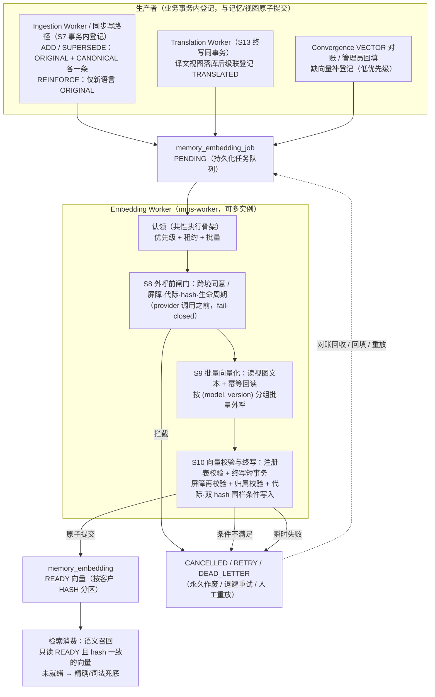
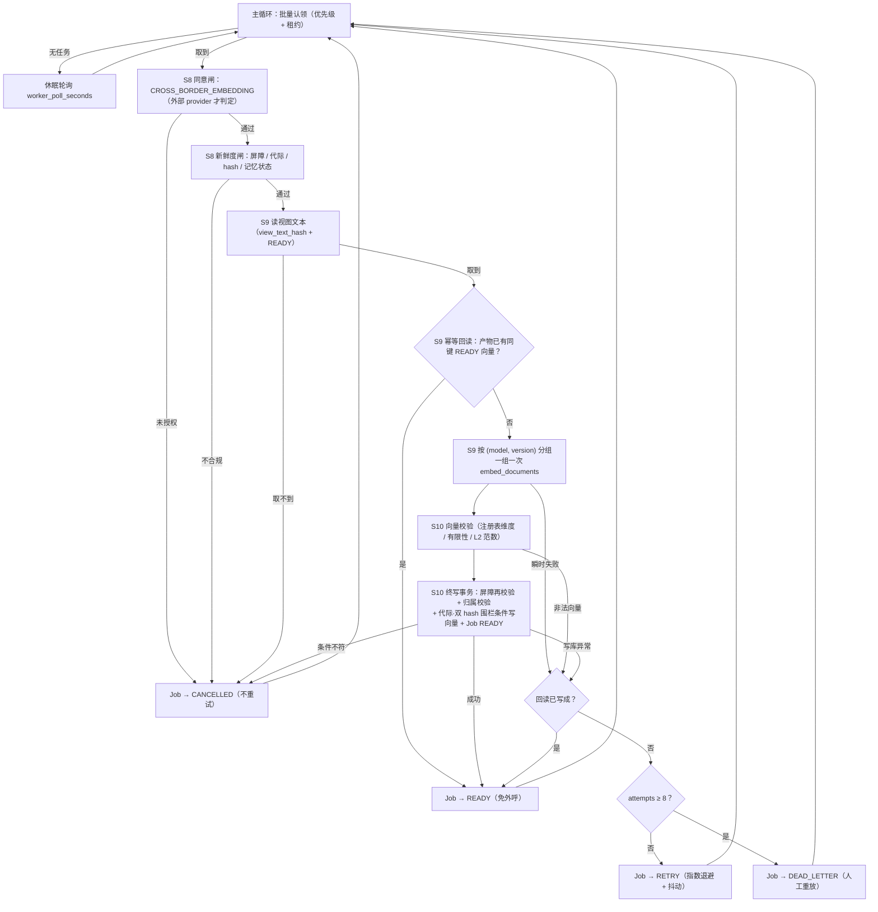
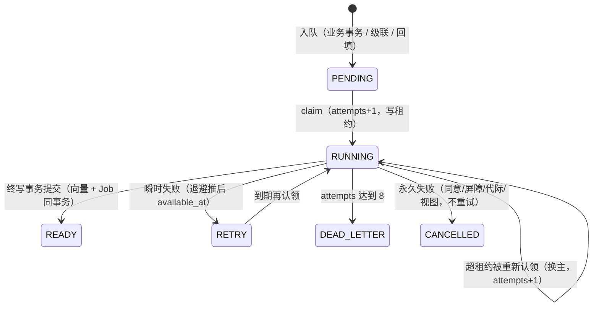
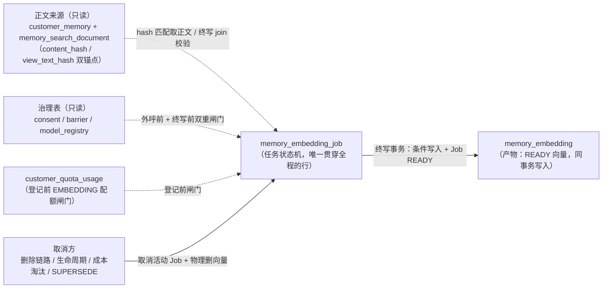
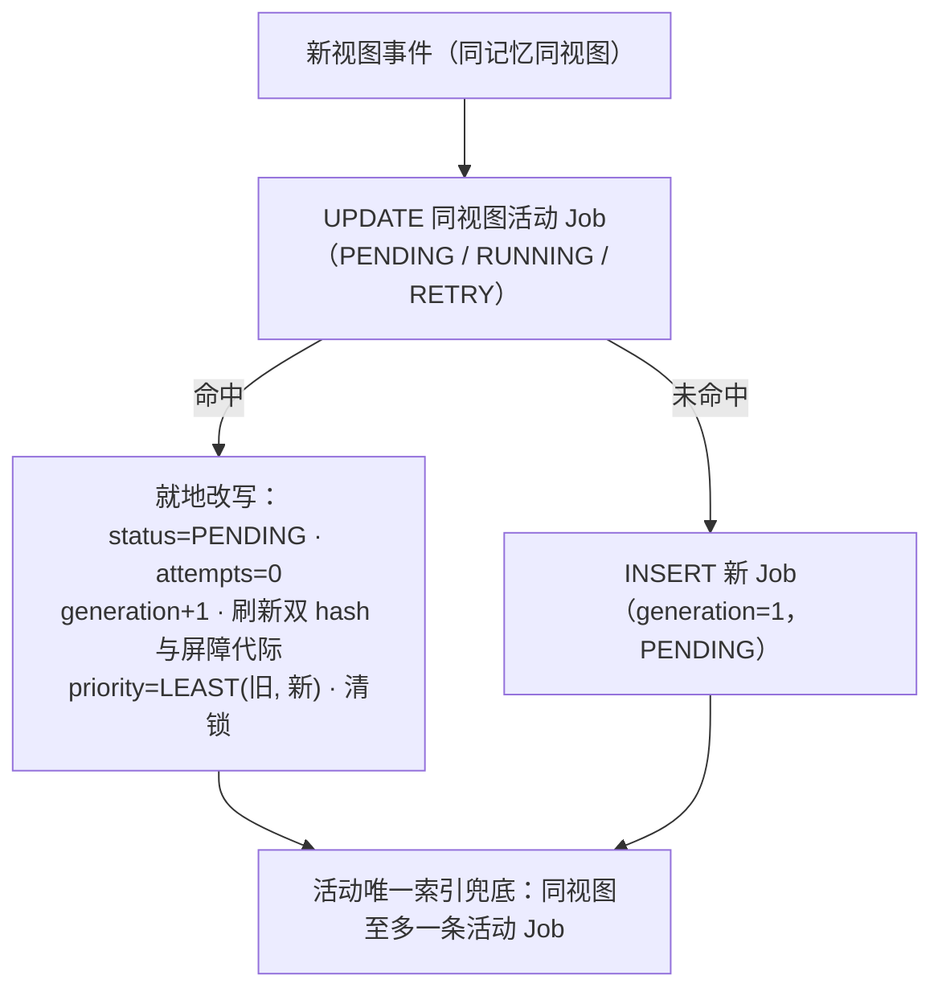
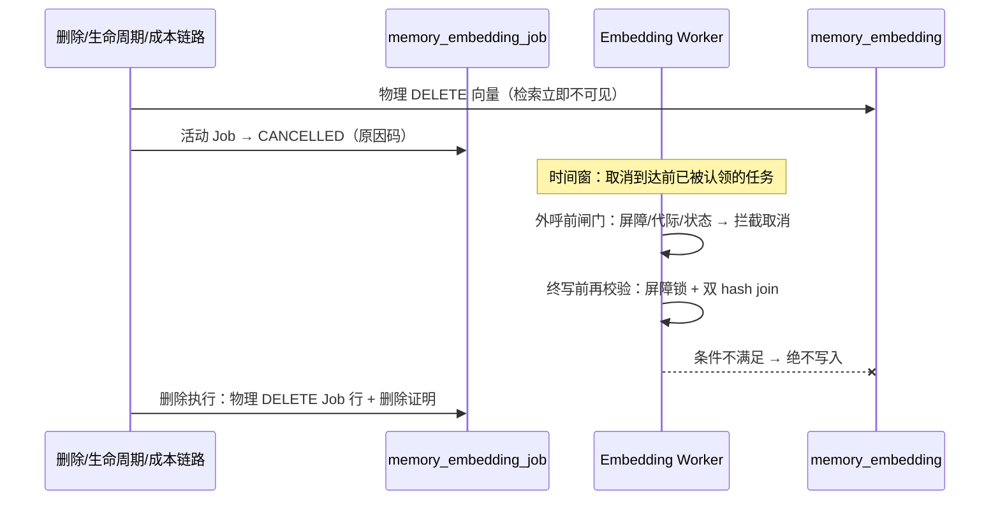

# Embedding Job 设计（向量生成任务）

---

## 一、一句话认识 Embedding Job

每条记忆视图（ORIGINAL / CANONICAL / TRANSLATED）要获得语义召回能力，都需要一个向量。但**调 Embedding Provider 是网络 I/O，不能放进业务写入事务**——于是业务事务只登记一行 `memory_embedding_job`（状态 `PENDING`），由独立的 **Embedding Worker** 进程（`mms-worker`）异步取走，完成"闸门校验 → 读视图文本 → 批量调 provider → 向量校验 → 条件写库"的全链路，产物落入 `memory_embedding`（`READY`），Job 同事务置 `READY`。

它在三类 DB Job 中的位置：

| Job 类型 | 表名 | 职责 | 消费进程 |
|---|---|---|---|
| 摄取任务 | `memory_ingestion_job` | 把外部事件/候选转化为记忆 | Ingestion Worker（`mms-ingestion`） |
| **向量任务（本文）** | `memory_embedding_job` | 为记忆视图生成向量 | Embedding Worker（`mms-worker`） |
| 翻译任务 | `memory_translation_job` | 生成 TRANSLATED 视图 | Translation Worker（`mms-translation`） |

**Embedding Job 是下游消费者，也是被级联的生产者**：Ingestion Worker / 同步写路径的业务事务登记 ORIGINAL/CANONICAL 任务；Translation Worker 产出译文视图后再级联登记 TRANSLATED 任务。执行顺序由数据依赖自然驱动，无中心化编排。

**消费侧契约**：检索只读 `status='READY'` 且与记忆/视图 hash 一致的向量；向量未就绪时精确/词法召回仍然可用——**向量是召回信号，不是事实生效的前提**。

---

## 二、为什么向量必须异步

1. **热路径隔离**：provider 超时/抖动不能阻塞"记忆写入"这个业务事实的提交；写事务内只做轻量登记（方案 12.4：写入事务只做权威事实和视图骨架，不调翻译/embedding provider）。
2. **事务一致性**：Job 与记忆/视图/决策/Outbox 同事务提交——记忆写成功 = 向量任务一定存在，不会"事实生效了但永远没人给它算向量"。
3. **降级有底**：provider 不可用、跨境未授权时，只是该视图暂时没有语义召回（精确/词法仍在），不阻塞任何业务；策略性关闭不算可用性故障（`degraded=false`）。
4. **批量降本**：Worker 按 `(model, version)` 分组合并外呼，一组一次 `embed_documents`，减少 provider 往返。
5. **删除面收敛**：任务行与记忆同库，删除/生命周期/成本淘汰可以直接取消 Job、物理删除向量，不会像外部 broker 那样残留"删不掉的副本"。

**代价**：claim/租约/退避/死信/对账全部自研；轮询有固有延迟（`worker_poll_seconds`）；向量就绪前语义召回缺失。

---

## 三、端到端全景



理解全链路的关键是**两个事务边界**：

- **登记事务**（上游业务事务）：记忆 + 视图 + 决策 + Outbox + Embedding Job 一起提交——"事实生效"与"任务存在"原子；
- **终写事务**（Worker 每条 Job 一个短事务）：屏障再校验 + 归属校验 + 条件写向量 + Job 置 READY 一起提交——"向量可见"与"任务完成"原子。provider 调用发生在两个事务**之间**，不持有任何长事务锁。

**关键步骤（S8–S10）**：编号与 [《Worker组件设计》](../0-概要设计/2-Worker组件设计.md) 3.1 能力矩阵、3.2 执行顺序图一一对应；S1–S7 由 Ingestion Job 承载（见 [Ingestion Job设计](1-Ingestion%20Job设计.md)），S11–S16 由 Translation / Outbox Job 承载，S17–S18 为横切治理。认领、退避重试、死信重放等共性机制由共性执行骨架包裹（《Worker组件设计》第四章），不单列为步骤。

| 步骤 | 关键步骤 | 说明 | 详见 |
|---|---|---|---|
| S8 | 外呼前闸门 | 同意闸（`CROSS_BORDER_EMBEDDING`，按注册表 provider 判定跨境，缺行 fail-closed 视为外部）+ 新鲜度闸（屏障/代际/hash/生命周期），fail-closed；不合规直接 CANCELLED，不烧重试次数 | 第五节 |
| S9 | 批量向量化 | 读视图文本（`view_text_hash` + READY 锚点）+ 产物幂等回读（已写成免外呼）→ 按 `(model, version)` 分组批量调 provider，一组一次外呼 | 第六节 |
| S10 | 向量校验与终写 | 注册表校验（维度/有限性/L2 范数），非法向量绝不落库；终写短事务：屏障再校验 + 归属校验 + 代际·双 hash 围栏，条件写入 READY 向量、Job 同事务置 READY | 第七节 |


---

## 四、消费执行骨架（S8–S10 共性）

任务落库后，S8–S10 全部由 Embedding Worker 按同一套执行骨架消费。单批任务的执行与失败路由如下图（粗粒度；各步骤细节见第五~七节，退避公式等见第十二、十三节）：



### 4.1 部署形态与主循环

- 命令 `mms-worker`，独立部署服务；进程启动时统一初始化可观测性。
- **可水平扩容**：多实例靠 `SKIP LOCKED` + 租约天然并行，不需要 ConvergenceLock（那是 lifecycle/view-cost 的单实例锁）。
- 主循环：批量处理 → 每 5s 刷新老化指标（17.2）→ 无任务时休眠 `worker_poll_seconds`（默认 1s）。
- **批量处理**：claim `LIMIT embedding_batch_size`（默认 16），与摄取 Worker 的单条（LIMIT 1）不同——embedding 外呼可按模型合并，批量收益高。认领在独立短事务提交；每条 Job 的终写各自一个短事务；整批一个 `embedding.job` trace span。

### 4.2 认领（claim）—— 批量 + 优先级 + 租约

```sql
SELECT id, status FROM memory_embedding_job
WHERE (status IN ('PENDING','RETRY') AND available_at <= now())
   OR (status = 'RUNNING' AND lease_expires_at <= now())   -- 超租约一并回收
ORDER BY priority, available_at, created_at
FOR UPDATE SKIP LOCKED LIMIT :embedding_batch_size
```

随后 `UPDATE` 置 `RUNNING`、`locked_by=worker_id`、`locked_at=now()`、`lease_expires_at=now()+embedding_lease_seconds`（默认 60s）、**`attempts+1`**。

**回收超租行计数 `mms_embedding_job_lease_expired_total`**（告警 `MMSEmbeddingLeaseExpiryGrowing`）——超租意味着某个 Worker 死在了任务中途，回收增长要可见。

---

## 五、S8 外呼前闸门

对每条 Job 顺序执行两道闸门（**在 provider 调用之前**，避免把已删除/未授权客户的内容外发），fail-closed；不合规直接 CANCELLED，不烧重试次数（原因码见 12.2）。

### 5.1 同意闸（跨境 fail-closed）

先按注册表判定是否跨境（判定规则见 8.3）；需要跨境时查 `CROSS_BORDER_EMBEDDING` 同意。跨境同意判定是全链路统一规则（候选发现、检索查询向量、决策回放、语义 canary 共用同一判定，防止规则漂移）；未授权 → CANCELLED（原因码 `CROSS_BORDER_CONSENT_DENIED` / `CROSS_BORDER_CONSENT_UNAVAILABLE`），只保留精确/词法召回，计 `mms_embedding_cross_border_blocked_total{stage="worker"}`——策略性关闭与 provider 故障分开计数。

### 5.2 新鲜度闸（屏障/代际/hash/生命周期）

独立事务，持屏障锁：

- 屏障锁（客户级 advisory lock `mms_barrier:{customer_id}`）→ 读屏障快照；
- 屏障活动态（ACTIVE/COOLING_DOWN/COMPLETED）→ `BARRIER_{status}` 取消；
- `barrier_generation` 与当前代际不符，或 Job `created_at` 早于 `cutover_at` → `STALE_GENERATION` 取消；
- 记忆不存在、`content_hash` 已变、或生命周期不在 ACTIVE/RESOLVED/CONFLICTED → `STALE_GENERATION` 取消。

---

## 六、S9 批量向量化

### 6.1 读正文 + 幂等回读

- 按 `(customer_id, memory_id, view_kind, view_language, view_text_hash, status='READY')` 回 `memory_search_document` 取正文；取不到 → `VIEW_NOT_READY` 取消（视图已被改写/失效，任务失去意义）；
- **未知结果先回读，不盲目重放**（方案 12.4 第 10 步）：查产物表是否已有同键（含 `view_text_hash`）READY 向量，有则直接把 Job 置 READY——"其实写成功但回执丢了"不会导致重复外呼。回读在两处发生：外呼前（省一次 provider 调用）与任何异常后的重试入口（省一次重试）；回读置 READY 同样要求归属与租约有效（`RUNNING AND locked_by=self AND lease_expires_at>now()`）。

### 6.2 批量外呼

- 按 `(model, version)` 分组，一组一次 `provider.embed_documents`；返回数量与输入不符 → `EMBEDDING_COUNT_MISMATCH`，**整组**走重试；
- provider 两种形态：`deterministic`（本地确定性 hash 向量，开发/测试用）与 `http`（POST `{base_url}/embed`，超时 `embedding_timeout_ms`，e5 系模型自动加 query/passage 前缀，计 `mms_embedding_provider_requests_total` / `mms_embedding_provider_latency_seconds`）。

---

## 七、S10 向量校验与终写

### 7.1 向量校验

向量校验以**模型注册表**为准（批前一次性加载注册表规格，8.3）：

1. 维度必须等于 `spec.dimension`（注册表缺行时退回进程设置 `embedding_dimension`）；
2. 所有分量有限（无 NaN/Infinity）；
3. `config.normalize`（默认 true）时 L2 范数落在 `config.norm_l2_range`（默认 `[0.99, 1.01]`）。

非法向量计 `mms_embedding_invalid_vector_total{reason=dimension/non_finite/norm_l2_range}` 并走重试，**绝不落库**（告警 `MMSInvalidVector`）。

### 7.2 终写 —— 再校验 + 原子落库

每条 Job 一个短事务，依次：

1. **屏障锁 + 再查一次**：`pg_advisory_xact_lock(mms_barrier:{customer_id})`（与删除链路同一把锁），直接读 `customer_deletion_barrier` 主表；活动态 → `BARRIER_*` 取消，代际不符/早于 cutover → `STALE_GENERATION` 取消。**禁止把第五节（S8）的前置检查当作最终校验**——外呼期间删除可能已经发生；
2. **Job 归属权校验**：`RUNNING AND locked_by=self AND lease_expires_at>now()` `FOR UPDATE`；被抢占（租约已丢/换主）则**静默放弃**，不改状态，让新持有者处理；
3. **条件写入**：`INSERT ... SELECT ... ON CONFLICT DO UPDATE`——从 `customer_memory`（`content_hash` 一致、生命周期有效）+ `memory_search_document`（同 hash 视图 READY、代际一致）双表校验，通过才写向量；冲突时覆盖同键产物（重放幂等）；
4. SELECT 无行（记忆/视图已删除、替代或文本变化）→ `STALE_GENERATION` 取消，**绝不写旧向量**；
5. 写入成功 → 同事务 `UPDATE Job SET status='READY', lease_expires_at=NULL WHERE id=… AND locked_by=self`，提交。

成功计 `mms_embedding_jobs_total{status=READY}` 并观测 `mms_embedding_ready_age_seconds`（记忆创建到向量就绪的时长，按 view_kind/model 分标签）。DB 触发器（8.2）在提交时再做一次跨表一致性兜底。

---

## 八、数据模型

### 8.1 `memory_embedding_job`（任务队列）

表结构定义如下：

| 字段 | 类型 | 语义 |
|---|---|---|
| `id` | uuid PK | 任务 ID（入队时生成） |
| `memory_id` / `customer_id` | uuid / text | 目标记忆；复合外键 `(memory_id, customer_id) → customer_memory` **ON DELETE CASCADE** |
| `operation` | text | `UPSERT / DELETE / REBUILD`：UPSERT 生成/更新向量；DELETE 失效向量（删除/失效链路用）；REBUILD 模型升级全量重建（第十五节） |
| `embedding_model` / `embedding_version` | text / int | 目标模型与版本（入队时确定）；外键 + 触发器强制必须在注册表登记 |
| `content_hash` | char(64) | 所属记忆的 content_hash（所有视图共享） |
| `view_kind` / `view_language` | text | 目标视图：ORIGINAL / CANONICAL / TRANSLATED |
| `view_text_hash` | char(64) | **本视图文本**的 hash（失效判定锚点，终写 join 条件） |
| `generation` | bigint | 视图内容代际计数：就地改写时 +1；终写代际围栏的锚点之一（第十三节） |
| `barrier_generation` | bigint，默认 0 | **入队时刻**捕获的删除屏障代际 |
| `status` | text | 状态机（见第九节） |
| `priority` | smallint，默认 100 | 10 / 100 / 120 / 500，越小越优先（11.4） |
| `attempts` | int，默认 0 | 已尝试次数，**claim 时自增** |
| `available_at` | timestamptz，默认 now() | 最早可执行时间；重试退避把它推后 |
| `locked_by` / `locked_at` | text / timestamptz | 持有者与抢占时间（`worker-{uuid}`） |
| `lease_expires_at` | timestamptz | 租约到期（默认 claim 后 60s） |
| `last_error_code` | text | 最后失败/取消原因码 |
| `created_at` / `updated_at` | timestamptz | 创建/更新时间（老化监控、`cutover_at` 比较基准） |

约束与要点：

- **Job 行不存正文**：只存 hash 与元数据；正文执行时按 `view_text_hash` 回 `memory_search_document` 取（6.1）。
- **与摄取 Job 不同，这里有外键指向记忆**：Job 在记忆写入事务内登记，记忆先于/同于 Job 存在；记忆行被物理删除时 Job 行级联消失（删除链路仍会显式先取消/清除，见第十四节）。
- **有 `priority` 列**：参与 10/100/120/500 优先级调度（摄取 Job 无此列，FIFO）。

### 8.2 产物表 `memory_embedding`

表结构要点：

| 要点 | 说明 |
|---|---|
| 主键 | `(customer_id, memory_id, embedding_model, embedding_version, view_kind, view_language)`——同一视图同一模型版本至多一行 |
| 分区 | 按 `customer_id` HASH 分区（生产 64/256，示例 p0） |
| 向量列 | `embedding vector(1024)`，`CHECK (embedding_dim = 1024)` |
| READY 约束 | `status='READY'` 必须非空向量且有 `generated_at`（CHECK 强制） |
| 视图语言约束 | CANONICAL 恒为 `und`；ORIGINAL 不得为 `und`；TRANSLATED 不得为 `und`/空 |
| 状态 | `READY / STALE / DELETED`；**运行期失效一律物理 DELETE**，不依赖状态位 |
| 外键 | `(memory_id, customer_id) → customer_memory` ON DELETE CASCADE；`(model, version) → embedding_model_registry` |
| 检索索引 | B-tree `(customer_id, status, embedding_model, embedding_version, view_kind, view_language)`——按客户裁剪后精确算距离，**不建 HNSW** |
| 写权限 | `REVOKE INSERT, UPDATE ON memory_embedding FROM mms_app`：**API 账号不能写向量，只有 Worker 能写**；失效与擦除走物理 DELETE |

**DB 层兜底触发器**：`trg_embedding_registry` / `trg_embedding_dim_registry` 强制模型已注册且维度与注册表一致；`trg_embedding_view_invariant` 在每行写入时校验——`content_hash` 与母记忆一致、ORIGINAL 语言有证据支撑、TRANSLATED 存在同 hash 的 READY 检索文档、READY 只允许记忆处于 ACTIVE/RESOLVED/CONFLICTED。即使应用层校验与提交之间出现快照竞态，DB 也会二次拒绝。

**检索消费契约**（方案 12.6）：只读 `e.status='READY'` 且 `embedding_model/version` 等于注册表当前 ACTIVE 行，并 join `customer_memory`（`content_hash` 一致）与 `memory_search_document`（`view_text_hash` 一致且 READY）——**旧 hash 的残留向量即使没被及时清理也召不回**。

### 8.3 模型注册表 `embedding_model_registry`

表结构：`(model_id, version)` 为主键，含 `provider / dimension / distance_metric / languages / max_tokens / config / status(ACTIVE/SHADOW/RETIRED)`；部分唯一索引 `ux_embedding_model_single_active` 保证**至多一个 ACTIVE 版本**。种子行：`BAAI/bge-m3@1`，`self-hosted`，1024 维，cosine，`config={"normalize":true,...}`。

注册表是三个判定的**唯一权威**，进程设置只是缺省兜底：

1. **向量校验**：维度必须等于 `spec.dimension`；`config.normalize`（默认 true）时 L2 范数落在 `config.norm_l2_range`（默认 `[0.99, 1.01]`）；
2. **跨境判定**：`provider != 'self-hosted'`（含注册表缺行，fail-closed 视为外部）→ 需要 `CROSS_BORDER_EMBEDDING` 同意；
3. **回填/对账模型选择**：回填入队与语义 canary 都取当前 ACTIVE 行，无 ACTIVE 直接跳过。

### 8.4 正文来源 `memory_search_document`（只读）

表结构要点：语言视图 + 词法投影，主键 `(customer_id, memory_id, view_kind, view_language)`，同样按客户 HASH 分区。Embedding 链路**只读不写**：

- Worker 按 `(customer_id, memory_id, view_kind, view_language, view_text_hash, status='READY')` 取 `content` 作为 provider 输入；
- 终写事务再次 join 该表确认视图仍 READY 且 hash 未变；
- 两个 hash 的分工：`content_hash` 是母记忆的（所有视图共享），`view_text_hash` 才是本视图文本的——**视图级失效看后者**。

### 8.5 索引清单

| 索引 | 定义 | 用途 |
|---|---|---|
| `ux_embedding_job_active` | **唯一** `(memory_id, model, version, view_kind, view_language, operation) WHERE status IN ('PENDING','RUNNING','RETRY')` | 同一视图至多一个活动 Job |
| `ix_embedding_job_claim` | `(priority, available_at) WHERE PENDING/RETRY` | 优先级认领 |
| `ix_embedding_job_ready` | `(available_at, created_at) WHERE PENDING/RETRY` | 到期任务 |
| `ix_embedding_job_lease` | `(lease_expires_at) WHERE RUNNING` | 对账快速找超租 |
| `ix_embedding_job_view` | `(memory_id, view_kind, view_language) WHERE 活动态` | 按视图定位/取消（生命周期、成本淘汰） |

**活动唯一键为什么不含 `view_text_hash`**：若含 hash，同一视图的"旧文本任务"和"新文本任务"会同时活动、并发写同一产物主键，可能**旧向量覆盖新向量**。排除 hash 后，文本变化走"就地改写活动 Job + hash 围栏"（11.1 / 第十三节）。

---

## 九、状态机（生产/就绪语义）

**先立两个心智模型，状态机就不绕了：**

1. **状态记录的是"这个视图的向量生产到哪一步"，不是"记忆写没写成"**。记忆事实在上游业务事务里已经生效；Embedding Job 只负责投影（向量）。投影失败不影响事实，只影响语义召回。
2. **六个状态分三类**：**等待**（PENDING/RETRY）、**执行中**（RUNNING）、**终态**（READY/CANCELLED/DEAD_LETTER）。Worker 只推进前两类；进了终态，就只有就地改写、对账、管理员重放或删除链路能再改动它。

**状态总览：**

| 状态 | 类别 | 大白话含义 |
|---|---|---|
| `PENDING` | 等待 | 已入队，等 Worker 认领 |
| `RUNNING` | 执行中 | 某个 Worker 正持有租约在处理 |
| `RETRY` | 等待 | 瞬时失败，退避时间（`available_at`）到了再认领 |
| `READY` | 终态 | 向量已写入产物表（或回读确认已存在） |
| `CANCELLED` | 终态 | 被主动作废：不可能/不必再成功（同意、屏障、代际、视图、删除、生命周期、成本淘汰） |
| `DEAD_LETTER` | 终态 | 试满 8 次仍失败，等人工介入 |

**主干路径（正常世界）：**



一句话故事：**入队 → 认领执行 → 向量落库即就绪；瞬时失败退避重试、试满 8 次进死信；永久失败直接作废**。至此 RUNNING 的四个出口（READY/RETRY/DEAD_LETTER/CANCELLED）已齐；其余转移都是边缘路径，见下面两张表。

**三个终态：到底算哪种"结束"？**

| 终态 | 为什么结束 | 向量写了吗 | 还能"复活"吗 |
|---|---|---|---|
| `READY` | 终写事务已提交，或幂等回读确认产物已存在 | **是**（同键 READY 向量） | 不需要：同内容重嵌入由就地改写承接；缺向量由对账打回 |
| `CANCELLED` | 同意/屏障/代际/视图不合规，或删除/生命周期/成本淘汰主动作废 | 否 | 条件恢复后由**新事件入队 / 回填补登记**产生新任务；旧行不复活 |
| `DEAD_LETTER` | 瞬时失败试满 8 次 | 否 | **管理员 replay**（attempts 清零，12.4） |

**边缘路径：还有谁能改动状态？**

| 触发方 | 转移 | 说明 |
|---|---|---|
| 就地改写（新视图事件） | `PENDING/RUNNING/RETRY → PENDING` | 同视图活动 Job 被新文本改写：`generation+1`、`attempts=0`、刷新 hash 与屏障代际、`LEAST` 取更高优先级（11.1） |
| 删除链路 | `PENDING/RUNNING/RETRY → CANCELLED` | 删除请求置删除待决，原因码 `DELETE_REQUESTED`；随后随客户数据物理删除（第十四节） |
| SUPERSEDE | `PENDING/RUNNING/RETRY → CANCELLED` | 替代清理取消旧记忆活动 Job（**不写原因码**），旧向量物理删除 |
| 生命周期扫描 | `PENDING/RUNNING/RETRY → CANCELLED` | 记忆转 SUPERSEDED/EXPIRED/DELETE_PENDING/DELETED，原因码 `LIFECYCLE_CLOSED` |
| 视图成本淘汰 | `PENDING/RUNNING/RETRY → CANCELLED` | 超额 TRANSLATED 视图被淘汰，原因码 `VIEW_EVICTED` |
| 管理员 replay | `DEAD_LETTER → PENDING` | `attempts=0`、清锁与错误码；**仅限 DEAD_LETTER**（与摄取 replay 不限状态不同） |
| Worker claim | `RUNNING（超租约）→ RUNNING` | 换主：租约到期视原 Worker 已死，直接重新认领，attempts+1，计 `mms_embedding_job_lease_expired_total` |
| JOB 对账 | `RUNNING（超租约）→ RETRY` | 兜底打回队列（第十五节），与 claim 双保险 |
| JOB 对账 | `READY → PENDING` | READY 但缺 READY 向量且记忆/视图仍有效：`attempts=0` 重算（第十五节） |

两个易混点：

- **超租约不是失败态**：`RUNNING` 超租约只说明"Worker 可能挂了"，任务本身没失败——要么被直接重新认领（仍是 RUNNING），要么被对账置回 RETRY，两条路都会继续执行。
- **READY 不等于"永远有向量"**：向量可能被删除/生命周期/对账物理清除；JOB 对账发现"READY Job 缺 READY 向量"会打回 PENDING 重算，VECTOR 对账也会重新补登记。

**与 ingestion 的对比**：摄取是"接收/完成"语义（RECEIVED→PROCESSING→COMPLETED），产出是业务事实，拒绝也算完成；embedding/translation 是"生产/就绪"语义（PENDING→RUNNING→READY），产出是投影，**只有产物真的存在才算 READY**。

---

## 十、链路表全景：一行 Job 驱动多表协同

整条链路**围绕**同一行 `memory_embedding_job` 推进任务状态，但**操作**的是一组表：Job 表只回答"向量生产到哪一步"，不存正文也不存向量；正文、产物、治理依据各有其表。

**各阶段读写的表**：

| 阶段 | 读写的表 | 说明 |
|---|---|---|
| 登记（上游业务事务内） | 写 `memory_embedding_job`；同事务还有 `customer_memory`、`memory_search_document`、`memory_evidence`、`memory_decision`、`memory_outbox_event` 等 | Job 与记忆/视图原子提交；配额闸门先查 `customer_quota_usage`（EMBEDDING 桶）与存储配额（11.1） |
| 译文级联登记 | 写 `memory_embedding_job`；同事务写 `memory_search_document`（TRANSLATED）+ `memory_translation_job` 完成态 | Translation Worker 终写事务内级联（11.2） |
| 回填补登记 | 读 `memory_search_document` + `customer_memory` + `customer_deletion_barrier` + `memory_evidence` + `customer_memory_consent` + `memory_embedding` + 活动 Job；写 `memory_embedding_job` | `INSERT ... SELECT` 多重过滤（11.3） |
| 认领/重试/死信/重放 | 仅 `memory_embedding_job` | 只改任务行自身的状态/租约/attempts（第四、十二节） |
| 闸门校验（只读治理表） | `customer_memory_consent`、`customer_deletion_barrier`、`customer_memory`、`embedding_model_registry` | 同意快照/屏障快照/记忆状态/模型规格；Worker 只读不写（第五节） |
| 读正文 + 幂等回读 | 读 `memory_search_document`（正文）、`memory_embedding`（是否已写成） | 均只读（6.1） |
| 终写（Worker 短事务） | 读 `customer_deletion_barrier` + `customer_memory` + `memory_search_document` + Job 自身；写 `memory_embedding` + `memory_embedding_job` READY | 条件写入，产物与完成态原子（7.2） |
| 删除/生命周期/成本协同 | `memory_embedding_job`（取消→物理 DELETE）+ `memory_embedding`（物理 DELETE）+ `memory_search_document`（置 DELETED 或物理 DELETE） | 第十四节 |
| 对账自愈 | JOB：`memory_embedding_job`；VECTOR：`memory_embedding` + `memory_search_document` + 补登记 Job | 第十五节 |



**四个要点：**

1. **两个事务边界各管一组表**（见第三节）：登记事务归上游负责，终写事务归 Worker 负责；provider 调用在事务外，失败不会留下半成功的产物。
2. **Job 表与记忆有外键，与产物无外键**：Job 靠 `(memory_id, customer_id)` 级联于记忆；Job 与产物靠**业务键 + hash**（model/version/view_kind/view_language/view_text_hash）关联，对账按同一组键核对。
3. **链路的末端投影**：Embedding Job 不再登记其他 Job；上游生产者（ingestion 的 ORIGINAL/CANONICAL 与 translation 的 TRANSLATED）见第一、十一节。
4. **对账/自愈分表**：JOB 对账只动 Job 行（超租回收、READY 缺向量打回）；VECTOR 对账动产物与视图（删不一致向量、补视图、补登记），各有修复项与计数（第十五节）。

---

## 十一、入队：谁写、何时写

入队是 S8–S10 的上游生产者：路径 A 对应 S7（Ingestion 业务事务内登记），路径 B 对应 S13（Translation 终写级联），路径 C 是 Convergence 对账 / 管理员回填。

### 11.1 路径 A：业务事务内同步登记

在决策持久化的写入事务内，按决策 outcome 登记：

| outcome | 登记的视图 | 优先级 |
|---|---|---|
| `ADD` / `ADD_TEMPORAL_VERSION` | ORIGINAL + CANONICAL 各一条 | `explicit_correction` → 10，否则 100 |
| `SUPERSEDE` | 新记忆的 ORIGINAL + CANONICAL 各一条（旧记忆活动 Job 同事务被取消） | 同上 |
| `REINFORCE` | **仅新增语言的 ORIGINAL**（来自 `decision.view_actions`，不登记 CANONICAL） | 同上 |
| 其余（NOOP/REJECTED/CONFLICT/…） | 不登记 | — |

登记前还有**配额闸门**：存储配额检查 + EMBEDDING 配额检查与计量——每个被接受的写入决策计一次 EMBEDDING 配额（默认 `quota_embedding_per_day=20000`），拒绝即整体回滚，不留半接受的事实。

**就地改写 + 代际递增**（"先 UPDATE 再 INSERT"双步）：



```sql
-- 先 UPDATE 命中同视图活动 Job：
UPDATE memory_embedding_job SET status='PENDING', attempts=0, available_at=now(),
  content_hash=…, view_text_hash=…, generation=generation+1, barrier_generation=…,
  priority=LEAST(priority, :new), locked_by=NULL, locked_at=NULL, lease_expires_at=NULL, …
WHERE memory_id=… AND embedding_model=… AND embedding_version=…
  AND view_kind=… AND view_language=… AND operation='UPSERT'
  AND status IN ('PENDING','RUNNING','RETRY')
-- 未命中再 INSERT（generation=1，status='PENDING'）
```

要点：

- 文本变了**不新增第二条**，而是改写那条活动 Job——代际 +1、重置 attempts、`LEAST` 取更高优先级（纠正可以"插队"到已在排队的普通任务前面）；
- 正在 RUNNING 的旧任务被改写后，归属校验与代际·双 hash 围栏保证写不出旧文本的向量（竞态推导见第十三节）；
- 历史 READY/CANCELLED/DEAD_LETTER 行不在活动集内，不阻塞同内容重嵌入；
- 模型/版本取进程设置（`embedding_model/embedding_version`），注册表触发器保证已登记。

### 11.2 路径 B：Translation Worker 级联登记

译文视图写入 `memory_search_document`（TRANSLATED，READY）后，**同一事务**内补登记一条 TRANSLATED 向量任务，`priority=120`，携带翻译 Job 的 `barrier_generation`。翻译失败/取消则不产生译文视图，也不会有 TRANSLATED 向量任务——级联同样由数据依赖驱动。

### 11.3 路径 C：回填 / 对账补登记

`INSERT ... SELECT` 扫描 `memory_search_document` 中 READY 但缺对应 READY 向量的视图，批量补登记，`ON CONFLICT DO NOTHING` 兜底。多重过滤：

- 模型取注册表当前 **ACTIVE** 版本（无 ACTIVE 直接返回 0）；
- 记忆生命周期 ∈ ACTIVE/RESOLVED/CONFLICTED，且 `content_hash` 与视图一致；
- 屏障活动态（ACTIVE/COOLING_DOWN/COMPLETED）的客户跳过；指定 `customer_id` 时先单独检查一次屏障；
- ORIGINAL 视图必须有对应语言的证据；TRANSLATED 只回填配置的目标语言（`translation_target_languages`）；
- 外部 provider 场景（按注册表判定，8.3）下 TRANSLATED 回填要求 `CROSS_BORDER_EMBEDDING` 同意（GRANTED 且未过期）；
- 已有同 hash READY 向量、或已有同视图活动 Job 的，不重复登记；
- 优先级：TRANSLATED=120，其余=**500（回填不饿死在线链路）**；
- 支持 `customer_id` / `memory_id` 限定范围（管理员回填用）。

触发方：Convergence 的 VECTOR 对账（第十五节）、管理员手动回填 `POST /admin/embeddings/rebuild`（**必须给定 customer_id 或 memory_id 之一**以限定重建范围，admin 鉴权，审计 action=REBUILD 与入队同事务，返回 202 + 入队数）。

### 11.4 优先级体系（四档）

| priority | 场景 | 来源 |
|---|---|---|
| 10 | 用户显式纠正（`explicit_correction`） | 业务事务登记 |
| 100 | 普通 ORIGINAL / CANONICAL UPSERT | 业务事务登记 |
| 120 | TRANSLATED 视图 | 翻译级联 / 回填 |
| 500 | 对账回填 / 重建 | 回填补登记 |

认领按 `priority, available_at, created_at` 排序（4.2），纠正最先、回填只吃剩余容量；就地改写时 `LEAST` 保证优先级只升不降。老化监控也按这三段分带（primary ≤100 / translation ≤120 / backfill，17.1）。

---

## 十二、失败处理

### 12.1 失败分类总览

| 类别 | 触发 | Job 去向 | 是否重试 |
|---|---|---|---|
| 永久失败 | 同意未授权 / 屏障活动 / 代际不符 / 记忆失效 / 视图不 READY | `CANCELLED` + 原因码 | 否 |
| 瞬时失败 | provider 异常、返回数量不符、非法向量、写库异常 | 先回读产物：已写成 → READY；否则 `RETRY`（退避）或 `DEAD_LETTER` | 是 |
| 租约丢失 | 终写归属校验未命中 | 静默放弃，交新持有者 | 由新主 |
| Worker 崩溃 | RUNNING 超租约 | 被重新认领（claim）/ 对账置 RETRY | 是 |

### 12.2 永久失败：取消（CANCELLED）

同意、屏障、代际、视图类失败重试也不可能成功——**直接终态 CANCELLED，不烧重试次数、不进 DLQ**。原因码全集：

| 原因码 | 触发点 |
|---|---|
| `CROSS_BORDER_CONSENT_DENIED` / `CROSS_BORDER_CONSENT_UNAVAILABLE` | 同意闸（第五节） |
| `BARRIER_ACTIVE` / `BARRIER_COOLING_DOWN` / `BARRIER_COMPLETED` | 新鲜度闸 / 终写再校验 |
| `STALE_GENERATION` | 代际不符 / 早于 cutover / 记忆 hash 或状态变化 / 终写条件无行 |
| `VIEW_NOT_READY` | 按 hash 取不到 READY 视图 |
| `DELETE_REQUESTED` | 删除链路取消（第十四节） |
| `LIFECYCLE_CLOSED` | 生命周期扫描取消（第十四节） |
| `VIEW_EVICTED` | 视图成本淘汰取消（第十四节） |

所有取消（无论外呼前还是终写事务内）都计 `mms_embedding_jobs_total{status=CANCELLED}`，并保留 `last_error_code` 供排障。

### 12.3 瞬时失败：重试与死信

- 入口先回读产物（6.1），已写成则直接 READY，不计失败；
- 计 `mms_embedding_failures_total{model,version,error=异常类名}`；
- `attempts >= embedding_max_attempts`（默认 8，claim 时已自增，**判定不再 +1**，避免提前烧掉一次重试）→ `DEAD_LETTER`（`available_at=now()`），否则 `RETRY`；
- 退避公式：`available_at = now() + jittered(min(300, 2^(attempts-1)))` 秒，**带抖动**（`[0.5×base, base]` 均匀取值），避免共享故障恢复时齐刷刷重试打爆 provider。四类队列（ingestion/embedding/translation/outbox）统一本公式（方案 14.7）；
- 所有状态更新都带 `WHERE status='RUNNING' AND locked_by=self` 围栏，清锁三件套（locked_by/locked_at/lease_expires_at）。

### 12.4 死信重放（replay）

`POST /admin/dlq/replay`（`job_type=EMBEDDING`，DLQ 专用鉴权：内部服务令牌或管理面凭据）：

- **仅当 `status='DEAD_LETTER'`** 时置 `PENDING`、`attempts=0`、`available_at=now()`、清锁与错误码；未命中返回 404（与摄取 replay 不限当前状态不同，这里更严格）；
- **审计与重入队同事务**（`admin_access_audit`，action=REPLAY，scope 含 job_type/job_id）；
- 重放不跳过治理：重新走完整的同意/屏障/代际/视图校验；即使产物已存在，幂等回读也会直接 READY，不重复外呼。

---

## 十三、幂等与并发控制（多层防线）

| 层 | 键/机制 | 防什么 |
|---|---|---|
| 任务层 | 活动唯一索引 `ux_embedding_job_active` + "先 UPDATE 再 INSERT" | 同视图重复建任务；新旧文本任务并发写同一产物主键 |
| 内容围栏 | `content_hash`（记忆级）+ `view_text_hash`（视图级）双 hash：终写 `INSERT...SELECT` join 校验 | 旧任务写旧向量；记忆改写/视图重译后旧投影复活 |
| 代际计数 | `generation`：就地改写 +1，终写要求代际一致 | 旧代际任务写旧向量 |
| 跨删除 | `barrier_generation`（入队时快照）+ `created_at` vs `cutover_at`，外呼前/终写前各查一次 | 删除后旧任务复活出向量 |
| 执行层 | `FOR UPDATE SKIP LOCKED` + 租约 + `locked_by` 围栏（终写前校验归属） | 多 Worker 互抢、崩溃残留、旧主回写 |
| 产物幂等 | 同键 READY 回读 + `ON CONFLICT DO UPDATE` | 重放/重试产生重复向量或重复外呼 |
| DB 兜底 | 注册表 FK/触发器 + `trg_embedding_view_invariant` + 权限基线（API 禁写向量） | 应用层校验与提交之间的快照竞态；越权写入 |

**代际围栏**（方案 7.2.4/12.4）：终写要求 Job 携带的 `generation` 与视图当前代际一致，并叠加**双 hash 匹配**——记忆 `content_hash` 或视图 `view_text_hash` 任一不符即取消。就地改写使代际 +1 并刷新双 hash，旧代际任务在任何一道围栏上都写不进旧向量。

**竞态时序示例**（旧任务为何写不进旧向量）：

1. Job A（文本 v1）RUNNING，正在外呼；
2. 新候选到达，业务事务把同视图活动 Job 就地改写为文本 v2（`view_text_hash` 更新，generation+1，**status 重置 PENDING、清锁**）——注意此时 Job A 就是被改写的那一行；
3. Job A 的外呼返回，进入终写：归属校验要求 `RUNNING AND locked_by=self`，而行已是 PENDING 无主 → **静默放弃，不写不改**；
4. 代际 + 双 hash join 是第二道防线：即使归属校验通过，终写要求视图 `view_text_hash = v1` 且代际一致，而视图已是 v2 → SELECT 无行 → CANCELLED（`STALE_GENERATION`），仍写不进旧向量；
5. 改写后的 Job（PENDING，v2）被重新认领，产出 v2 向量。

---

## 十四、与删除 / 生命周期 / 成本的协同

向量是"可再生投影"，协同原则是：**失效立即物理删向量（检索马上看不到），活动 Job 同步取消（不再浪费外呼），Worker 双闸门兜住时间窗**。

| 协同方 | Job 动作 | 产物动作 | 视图动作 |
|---|---|---|---|
| 删除请求（置删除待决） | 活动 Job → CANCELLED（`DELETE_REQUESTED`） | **先**物理 DELETE 全部向量 | 置 DELETED |
| 删除执行 | 物理 DELETE 全部 Job 行，删除证明记 `memory_embedding_job` 项 | 物理 DELETE（证明取两次计数的较大值） | 物理 DELETE |
| SUPERSEDE 替代清理 | 旧记忆活动 Job → CANCELLED（无原因码） | 旧记忆向量物理 DELETE | 旧视图置 DELETED |
| 生命周期扫描 | 关闭态记忆的活动 Job → CANCELLED（`LIFECYCLE_CLOSED`） | 关闭态记忆向量物理 DELETE | 置 DELETED |
| 视图成本淘汰 | 该 TRANSLATED 视图活动 Job → CANCELLED（`VIEW_EVICTED`） | 该视图向量物理 DELETE | 该视图行物理 DELETE |
| Worker 兜底 | 外呼前/终写前屏障与状态校验 → CANCELLED | 条件写入不命中 → 不写 | — |

细节：

- **删除顺序有讲究**：删除请求先删向量再置视图 DELETED——译文视图的触发器需要 READY 文档在场；整个失效与屏障/删除请求同事务，审批失败一起回滚。
- **生命周期关闭态**：SUPERSEDED / EXPIRED / DELETE_PENDING / DELETED。RESOLVED 保留向量（HISTORY_DEBUG 仍可语义召回）。
- **成本淘汰排序**：view-cost 按 `(使用次数, 语言优先级, 翻译质量, 最近使用)` 升序淘汰超额 TRANSLATED 视图（预算 = min(进程设置, policy `max_views_per_memory`)），级联取消 embedding/translation 两类 Job。
- **删除证明**：Job 行随客户数据物理消失，`memory_deletion_request.proof.counts` 记录各表清除数量；重入删除保留原始计数。

时间轴上的协同如下图（粗粒度；逐条判据见上文）：



---

## 十五、调度与自愈

Embedding Worker 自身不做周期扫描，兜底由 Convergence 侧承担（由 `mms-lifecycle` 进程驱动，每 300s 依次触发 `JOB/VECTOR/RECALL/BUSINESS` 对账，各写一行 `recon_run`；也可 `POST /internal/reconciliation/{type}` 手动触发。见 [Convergence组件设计.md](../0-概要设计/3-Convergence组件设计.md)）。

**JOB 对账**：

| 修复项 | 动作 |
|---|---|
| `embedding_lease` | RUNNING 且 `lease_expires_at<=now()` → RETRY、清锁（claim 也能直接回收，双保险） |
| `ready_job_missing_vector` | READY 但缺同键 READY 向量，且记忆生命周期有效、同 hash 视图仍 READY → 打回 PENDING、`attempts=0` 重算 |
| `dead_letter_stock` | 合并统计三张 Job 表 DEAD_LETTER + Outbox FAILED，作为运维队列配告警 |

**VECTOR 对账**：

| 修复项 | 动作 |
|---|---|
| `missing_ready_views`（观测） | 按视图/语言统计缺 READY 向量的记忆数，导出 `VIEW_MISSING`（ORIGINAL/CANONICAL 缺失告警 `MMSRequiredViewMissing`） |
| `repaired_views` | 重建缺失的 CANONICAL/主 ORIGINAL/证据语言 ORIGINAL 视图文档 |
| `orphan_original_view` | 无对应语言证据的 ORIGINAL 视图置 DELETED |
| `memory_hash_or_state` | 物理删除 hash 不符或记忆已关闭的向量 |
| `missing_or_stale_view` | 物理删除视图丢失/hash 不符的向量 |
| `unindexable_document` | hash 不符或记忆已关闭的视图置 DELETED |
| `retired_embedding_model` | 物理删除 RETIRED（或不在 ACTIVE/SHADOW）模型的向量（仅当存在 ACTIVE 模型时执行） |
| `enqueued_missing_vectors` | 回填补登记（priority=500/120，11.3） |

**RECALL 对账**：语义 canary 按语言抽样，用注册表 ACTIVE 模型跑 Recall@10 基线比对——向量质量劣化（模型漂移/维度变化）的线上探针。

**模型升级（REBUILD，方案 21.9/23.6）**：新模型版本在注册表登记并转 ACTIVE 后，由 Convergence 发起全量重建：为有效记忆按视图登记 `operation=REBUILD` 任务（低优先级，不饿死在线链路）；新向量 READY 后，VECTOR 对账删除旧模型（RETIRED）向量收敛。切换窗口内业务入队用进程设置模型、回填/检索用注册表 ACTIVE 模型，两者短暂不一致由对账删旧补新兜底。

**重标准化（RENORMALIZE，方案 9.2.5）**：normalizer 升版后，由 Convergence 批量重建受影响的 CANONICAL 规范句与 TRANSLATED 投影（源文本指纹变化传导失效），级联刷新向量；重建期间旧投影仍可召回，新投影 READY 后原子切换。

---

## 十六、配置参数（env 前缀 `MMS_`）

| 参数 | 默认 | 说明 |
|---|---|---|
| `embedding_batch_size` | 16 | 单次认领批量 |
| `embedding_lease_seconds` | 60 | 任务租约；须**明显大于**单批最长处理时间（含 provider 调用），否则误判崩溃导致重复处理 |
| `embedding_max_attempts` | 8 | 最大尝试次数（含首次，claim 时自增） |
| `embedding_model` / `embedding_version` | BAAI/bge-m3 / 1 | 进程默认模型；入队用它，校验/回填以注册表为准 |
| `embedding_dimension` | 1024 | 注册表缺行时的维度兜底 |
| `embedding_provider` | deterministic | `deterministic`（本地）/ `http`（外部） |
| `embedding_provider_url` | — | http provider 必填（启动校验） |
| `embedding_timeout_ms` | 10000 | http provider 单次调用超时 |
| `worker_poll_seconds` | 1.0 | 空闲轮询间隔 |
| `quota_embedding_per_day` | 20000 | 每客户每日 EMBEDDING 配额（登记前闸门） |

---

## 十七、可观测性

### 17.1 指标

| 指标 | 类型 | 标签 | 语义 |
|---|---|---|---|
| `mms_embedding_jobs_total` | Counter | `status,model,version` | 状态迁移计数（READY/CANCELLED/RETRY/DEAD_LETTER 全计数） |
| `mms_embedding_failures_total` | Counter | `model,version,error` | 瞬时失败计数（回读已写成的不计） |
| `mms_embedding_invalid_vector_total` | Counter | `reason` | 非法向量（dimension/non_finite/norm_l2_range） |
| `mms_embedding_cross_border_blocked_total` | Counter | `stage` | 跨境同意闸关闭通道次数（worker/discovery/retrieval/replay/canary 分阶段） |
| `mms_embedding_job_lease_expired_total` | Counter | — | claim 回收超租 RUNNING 行的次数 |
| `mms_embedding_job_oldest_age_seconds` | Gauge | `priority_band` | 最老 PENDING/RETRY 任务年龄（按 created_at，含退避中的 RETRY），分 primary(≤100)/translation(≤120)/backfill 三档 |
| `mms_embedding_ready_age_seconds` | Histogram | `view_kind,model` | 记忆创建 → 向量就绪时长 |
| `mms_embedding_provider_requests_total` | Counter | `status` | http provider 请求（success/error） |
| `mms_embedding_provider_latency_seconds` | Histogram | — | http provider 调用时延 |

### 17.2 老化指标由 Worker 进程导出

每 5s 刷新三档 Gauge——**必须在 Embedding Worker 进程导出，不能只靠 API 进程**，否则积压无人发现。

### 17.3 告警

| 告警 | 表达式 | 持续 | 级别 | runbook |
|---|---|---|---|---|
| `MMSEmbeddingPendingTooOld` | `mms_embedding_job_oldest_age_seconds > 300` | 5m | critical | mms-embedding-backlog |
| `MMSEmbeddingFreshnessSLOBreach` | `mms:embedding_ready_age_seconds:p95 > 30 or …:p99 > 120` | 10m | critical | mms-embedding-freshness |
| `MMSEmbeddingProviderFailures` | provider error/timeout 占比 > 1% | 10m | warning | mms-embedding-provider |
| `MMSEmbeddingLeaseExpiryGrowing` | `increase(mms_embedding_job_lease_expired_total[15m]) > 0` | 即时 | warning | mms-embedding-worker |
| `MMSInvalidVector` | `increase(mms_embedding_invalid_vector_total[5m]) > 0` | 即时 | critical | mms-embedding-invalid-vector |

新鲜度 SLO（方案 12.4）：**ORIGINAL/CANONICAL READY P95 ≤30s、P99 ≤2min**（recording rule 只统计这两类视图）；TRANSLATED READY P95 ≤2min；PENDING 最老 >5min 告警。

---

