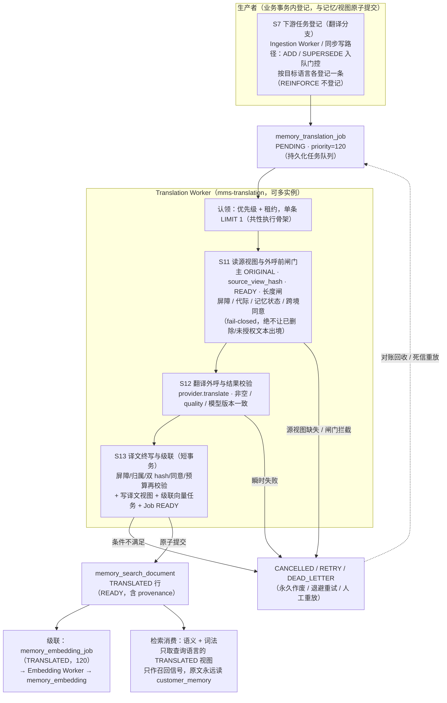
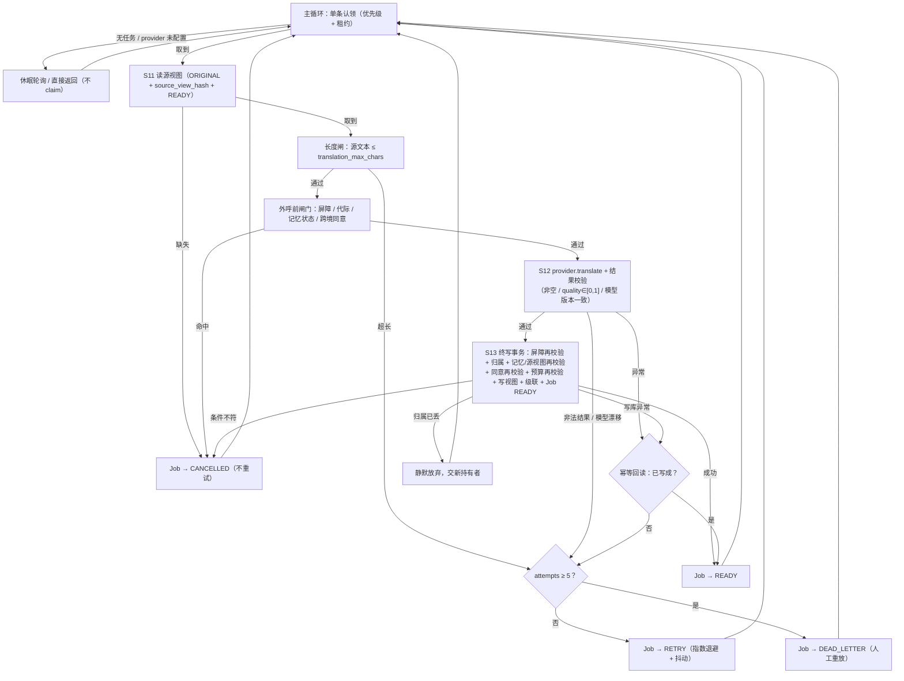
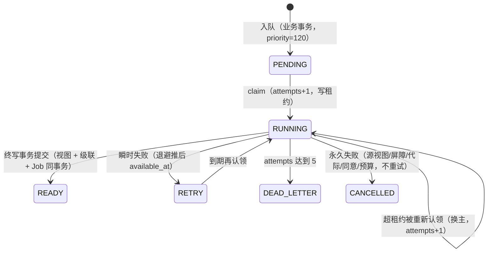
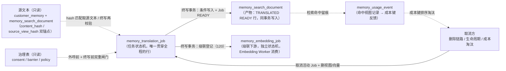
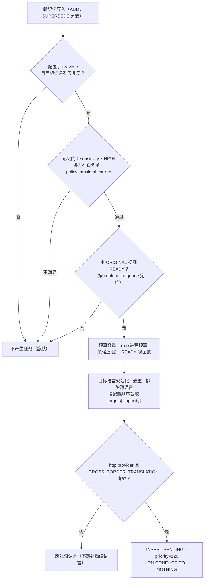
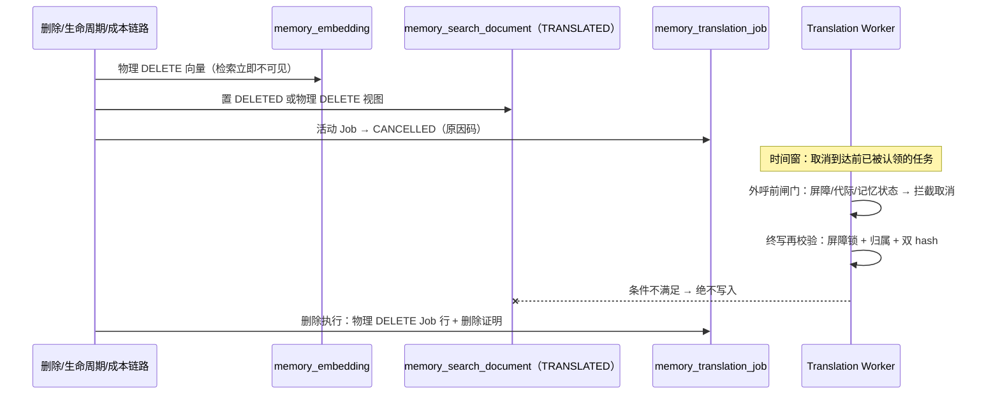

# Translation Job 设计（多语言翻译任务）

## 一、一句话认识 Translation Job

一条记忆写入后，为了让其他语言的查询也能召回它，需要把**主 ORIGINAL 视图**翻译成目标语言的 `TRANSLATED` 视图。翻译是外部 provider 调用，**不在业务事务里同步做**——业务事务只登记一行 `memory_translation_job`（状态 `PENDING`，`priority=120`），由独立的 **Translation Worker** 进程（`mms-translation`）异步取走，完成"读源视图 → 外呼前闸门 → 调 provider → 结果校验 → 条件终写"的全链路：产物落入 `memory_search_document` 的 TRANSLATED 行（`READY`），**同事务级联登记该视图的 Embedding Job**（`priority=120`），Job 同事务置 `READY`。

它在三类 DB Job 中的位置：

| Job 类型 | 表名 | 职责 | 消费进程 |
|---|---|---|---|
| 摄取任务 | `memory_ingestion_job` | 把外部事件/候选转化为记忆 | Ingestion Worker（`mms-ingestion`） |
| 向量任务 | `memory_embedding_job` | 为记忆视图生成向量 | Embedding Worker（`mms-worker`） |
| **翻译任务（本文）** | `memory_translation_job` | 生成 TRANSLATED 视图 | Translation Worker（`mms-translation`） |

**Translation Job 是中间级联者**：生产者是 Ingestion Worker / 同步写路径的业务事务（仅 ADD/ADD_TEMPORAL_VERSION/SUPERSEDE 分支）；它产出译文视图后再级联登记 TRANSLATED 向量任务，由 Embedding Worker 消费。执行顺序由数据依赖自然驱动：ingestion 最先，embedding(原文) 与 translation 并行互不依赖，translation 完成后才有 embedding(译文)，无中心化编排。

**消费侧契约**：TRANSLATED 视图**只参与查询语言的召回**（语义 + 词法），且**只是召回信号，绝不作为原文返回**——返回正文永远读 `customer_memory.content`；译文未就绪时 ORIGINAL + CANONICAL 兜底（跨语言语义靠多语言向量模型），翻译失败不阻塞事实生效与回答。

---

## 二、为什么翻译异步且"只是派生投影"

1. **不阻塞事实生效**：provider 超时/抖动不能阻塞"记忆写入"这个业务事实的提交（方案 12.4：写入事务只做权威事实和视图骨架，不调翻译/embedding provider）。翻译失败只降级该语言视图，记忆照常 ACTIVE，检索返回 `degraded_reason=translation_unavailable` 仅作内部诊断。
2. **译文不是事实**：方案 9.1 三层模型——原文层（权威证据）、语义标准化层（权威事实）、检索视图层（派生投影）。翻译只发生在视图层，**绝不参与写入决策**；任何视图都不得回写原文或事实值，原文不可变（DB 触发器强制），译文可淘汰、可覆盖。
3. **合规通道独立**：外部翻译会把原文送出 MMS，必须单独持有 `CROSS_BORDER_TRANSLATION` 同意（独立 purpose，与 `CROSS_BORDER_EMBEDDING` 分开）；未授权只关闭该通道，不影响写入与其他语言检索。本地 deterministic provider 不出进程，不判跨境。
4. **成本受控**：译文视图占视图预算（`min(max_views_per_memory, 策略上限)`，默认 6），入队与终写两处都检查预算，超额由 view-cost 调度按成本键淘汰；翻译与其级联向量登记不额外消耗配额桶。
5. **事务一致性**：Job 与记忆/视图/决策/Outbox 同事务提交——记忆写成功 = 翻译任务一定存在；终写事务里视图、级联任务、Job 完成态原子提交，不存在"译文写进去了但任务没完成"的半成功。
6. **删除面收敛**：任务行与记忆同库，删除/生命周期/成本淘汰可以直接取消 Job、物理删除视图与向量，不会像外部 broker 那样残留"删不掉的副本"。

**代价**：claim/租约/退避/死信/对账全部自研；轮询有固有延迟（`worker_poll_seconds`）；译文就绪前该语言的语义与词法召回缺失。

---

## 三、端到端全景



理解全链路的关键是**两个事务边界**：

- **登记事务**（上游业务事务）：记忆 + ORIGINAL/CANONICAL 视图 + 决策 + Outbox + Translation Job 一起提交——"事实生效"与"任务存在"原子；
- **终写事务**（Worker 每条 Job 一个短事务）：屏障再校验 + 归属校验 + 预算再校验 + 写译文视图 + 级联登记向量任务 + Job 置 READY 一起提交——"译文可见"与"任务完成"原子。provider 调用发生在两个事务**之间**，不持有任何长事务锁。

**关键步骤（S11–S13）**：编号与 [《Worker组件设计》](../0-概要设计/3-Worker组件设计.md) 3.1 能力矩阵、3.2 执行顺序图一一对应；登记由 S7 承载（Ingestion Job / 同步写路径的业务事务，见第十一节），认领/重试/死信/对账等由共性执行骨架与 Convergence 承载（第四、十二、十五节），不占步骤编号。

| 步骤 | 关键步骤 | 说明 | 详见 |
|---|---|---|---|
| S11 | 读源视图与外呼前闸门 | 读主 ORIGINAL（`source_view_hash` 锚点 + READY），源文本超长走重试；外呼前闸门：屏障/代际/记忆状态/跨境同意（fail-closed，绝不让已删除/未授权文本出境） | 第五节 |
| S12 | 翻译外呼与结果校验 | 调 provider.translate（deterministic 本地 / http 外部）；译文非空 / quality∈[0,1] / 模型版本与 Job 登记一致校验 | 第六节 |
| S13 | 译文终写与级联 | 终写短事务：屏障/归属/双 hash/同意/视图预算再校验 + 写 TRANSLATED 视图 + 级联登记译文 Embedding Job（120）+ Job 置 READY，原子提交；译文绝不回写原文或事实值 | 第七节 |

**本文结构**：第四~七章按关键步骤逐一展开——第四章是 S11–S13 共用的消费执行骨架（部署/主循环/认领），第五~七章分别对应 S11–S13；第八~十章是数据模型、状态机与链路表全景；第十一章是入队门控；第十二章起是失败处理、幂等并发、删除协同等横切机制。

---

## 四、消费执行骨架（S11–S13 共性）

任务落库后，S11–S13 全部由 Translation Worker 按同一套执行骨架消费（4.1–4.2）。单条任务的执行与失败路由如下图（粗粒度；退避/围栏等细节见第十二、十三节）：



### 4.1 部署形态与主循环

- 命令 `mms-translation`，独立部署服务（`mms_worker` 数据库账号，指标端口 9105，Prometheus job `mms-translation-worker`）；进程启动时统一初始化可观测性。
- **可水平扩容**：多实例靠 `SKIP LOCKED` + 租约天然并行，不需要 ConvergenceLock（那是 lifecycle/view-cost 的单实例锁）。
- 主循环：每轮至多执行 `translation_batch_size`（默认 16）次单条处理（**每次 claim 一条**），任一次返回 False 即结束本轮；整轮处理 0 条才休眠 `worker_poll_seconds`（默认 1s）。
- **单条认领**（LIMIT 1，与 embedding 的批量认领 16 不同）：翻译是单文本外呼，无按模型合并的批量收益；`batch_size` 只限制每轮处理条数。单条处理对"取消/失败"也返回 True（消耗了一个处理名额），仅"无任务/provider 未配置"返回 False。
- **provider 未配置时直接返回，不 claim**——否则认领后放弃的任务会卡在 RUNNING 直到租约到期、被反复认领。
- **队列信号**：每 5s 刷新 oldest-age 积压 Gauge（17.2）。

### 4.2 认领（claim）—— 优先级 + 租约

```sql
SELECT * FROM memory_translation_job
WHERE (status IN ('PENDING','RETRY') AND available_at <= now())
   OR (status = 'RUNNING' AND lease_expires_at <= now())   -- 超租约一并回收
ORDER BY priority, available_at, created_at
FOR UPDATE SKIP LOCKED LIMIT 1
```

随后 `UPDATE` 置 `RUNNING`、`locked_by=worker_id`、`locked_at=now()`、`lease_expires_at=now()+translation_lease_seconds`（默认 60s）、**`attempts+1`**。认领在独立短事务中提交，业务处理不占认领锁。回收超租行计 `mms_translation_job_lease_expired_total`（与 embedding 对称，回收增长要可见）。

---

## 五、S11 读源视图与外呼前闸门

### 5.1 读源视图与长度闸

- 按 `(customer_id, memory_id, ORIGINAL, source_language, view_text_hash=source_view_hash, status='READY')` 回 `memory_search_document` 取 `content`；取不到 → `SOURCE_VIEW_NOT_READY` 取消（源视图已失效/被改写/删除，任务失去意义）；
- 源文本长度超过 `translation_max_chars`（默认 4000）→ `TRANSLATION_SOURCE_TOO_LARGE`，走**重试**路径（原因码落库，见 12.3）。

### 5.2 外呼前闸门（fail-closed）

独立事务内顺序执行（**在 provider 调用之前**，避免把已删除/未授权客户的内容外发）：

1. 屏障锁（客户级 advisory lock `mms_barrier:{customer_id}`，与删除链路同一把锁）→ 屏障快照**直读主表**（不走读路径缓存）；
2. 屏障活动态（ACTIVE/COOLING_DOWN/COMPLETED）→ `BARRIER_{status}` 取消；
3. `barrier_generation` 与当前代际不符，或 Job `created_at` 早于 `cutover_at` → `STALE_GENERATION` 取消；
4. 记忆不存在、`content_hash` 已变、或生命周期不在 ACTIVE/RESOLVED/CONFLICTED → `STALE_GENERATION` 取消；
5. http provider 且 `CROSS_BORDER_TRANSLATION` 同意无效（缺行/DENIED/WITHDRAWN/过期）→ `CONSENT_UNAVAILABLE` 取消。

任一命中即 CANCELLED，**绝不让已删除/未授权客户的文本出境**。deterministic 本地 provider 不判第 5 条（文本不出进程）。

---

## 六、S12 翻译外呼与结果校验

`provider.translate(text, source_language, target_language)` 返回翻译结果结构 `(content, model, version, quality)`。两种形态：

| 形态 | 说明 |
|---|---|
| `deterministic` | 内置短语映射表（4 条中英互译），未命中回退 `[target] text`；quality 命中 0.99 / 回退 0.75；model=`deterministic-translator`、version=`1`；用于开发/测试 |
| `http` | `POST {base_url}/translate`，请求体 `text/source_language/target_language/model`，可选 `canonical_hint`（CANONICAL 规范句作术语/上下文提示，方案 12.4）；超时 `translation_timeout_ms`（默认 1500ms）；携带共享出站凭证（`outbound_token`）；响应 `translated_text/model/version/quality`（model/version 缺省回退自身配置）；`GET /health` 探活（3s 超时） |

- 两者都经统一 LLM 观测包装：`mms_llm_requests_total` / `mms_llm_request_duration_seconds` / `mms_llm_tokens_total` 指标 + Langfuse observation（`translation.{provider}`，metadata 记源/目标语言，**输入文本不落日志正文**）；
- **结果校验**：译文非空且 `quality ∈ [0,1]`，否则 `INVALID_TRANSLATION_RESULT`；返回的 model/version 必须与 Job 登记一致，否则 `TRANSLATION_MODEL_CHANGED`（防止 provider 侧偷换模型，保证 provenance 真实）——两者均走重试路径，原因码落库；
- **质量阈值不是硬闸**：`translation_quality_threshold`（0.75）不拦截入队/落库，低质量译文仍可索引，只在检索 rerank 时降权（17.4）。

---

## 七、S13 译文终写与级联

每条 Job 一个短事务，依次：

1. **屏障锁 + 再查一次**：活动态、代际不符、早于 cutover 任一命中 → `BARRIER_BLOCKED` 取消（终写统一用这一个原因码，不再细分 `BARRIER_*`/`STALE_GENERATION`，与外呼前闸门不同）。**禁止把 5.2 的前置检查当作最终校验**——外呼期间删除可能已经发生；
2. **Job 归属权校验**：`RUNNING AND locked_by=self AND lease_expires_at>now()` `FOR UPDATE`；被抢占（租约已丢/换主）则**静默放弃**，不改状态，让新持有者处理；
3. **记忆与源视图再查一次**：记忆 `content_hash` 一致且生命周期有效（JOIN policy），源 ORIGINAL 仍 READY 且 hash 未变；任一不符 → `STALE_GENERATION` 取消；
4. **http 同意再查一次**：失效 → `CONSENT_UNAVAILABLE` 取消；
5. **视图预算再查**：统计 READY 视图数，并查目标语言是否已有 TRANSLATED 行（**不过滤 status**，DELETED 行也算"已存在"）；不存在且 READY 数已达预算 → 计 `mms_view_budget_exhausted_total` + `VIEW_BUDGET_EXCEEDED` 取消；
6. **写译文视图**：`INSERT ... ON CONFLICT (customer_id,memory_id,view_kind,view_language) DO UPDATE`——content、双 hash、model/version/quality、`source_view_hash`、`search_vector`（按 `ts_config_map` 选目标语言分析器，无则 NULL）、`status='READY'`；`analyzer_version` 仅插入时写入，覆盖不刷新；观测 `mms_view_count_per_memory`；
7. **级联登记该视图的 embedding Job**：TRANSLATED、target_language、view_hash=sha256(译文)、同一 barrier_generation、priority=120——embedding 侧"先 UPDATE 活动行再 INSERT"双步逻辑；
8. **Job 置 READY**：`UPDATE ... WHERE id AND locked_by=self`，清锁三件套（归属已在同事务第 2 步 FOR UPDATE 校验）。

视图写入、级联入队、Job 完成态**同事务**提交；`trg_search_doc_invariant` 在写入时兜底 hash 一致性，后续 Embedding Worker 终写时 `trg_embedding_view_invariant` 要求这份 READY 译文文档在场（8.2）。成功计 `mms_translation_jobs_total{status=READY}`，观测 `mms_translation_ready_age_seconds`（Job `created_at` → 就绪）与 `mms_translation_latency_seconds`（按 `target_language` 分标签）。

---

## 八、数据模型

### 8.1 `memory_translation_job`（任务队列）

表结构定义（方案 23.13 / ADR-013）：

| 字段 | 类型 | 语义 |
|---|---|---|
| `id` | uuid PK | 任务 ID（入队时生成） |
| `memory_id` / `customer_id` | uuid / text | 目标记忆；复合外键 `(memory_id, customer_id) → customer_memory` **ON DELETE CASCADE** |
| `source_language` | text | 源语言 = 记忆的 `content_language`（主原文语言） |
| `target_language` | text | 目标语言（规范化后的 BCP-47） |
| `source_view_hash` | char(64) | **主 ORIGINAL 视图**的 `view_text_hash`（源文本锚点，失效判定依据） |
| `content_hash` | char(64) | 母记忆的 `content_hash` |
| `translation_model` / `translation_version` | text | 翻译模型与版本（入队时取 `provider.model/version`） |
| `barrier_generation` | bigint，默认 0 | **入队时刻**捕获的删除屏障代际（从业务事务传入） |
| `status` | text | 状态机（见第九章） |
| `priority` | smallint，默认 120，CHECK ≥0 | **固定 120** |
| `attempts` | int，默认 0 | 已尝试次数，**claim 时自增** |
| `available_at` | timestamptz，默认 now() | 最早可执行时间；重试退避把它推后 |
| `locked_by` / `locked_at` | text / timestamptz | 持有者与抢占时间（`translation-{uuid}`） |
| `lease_expires_at` | timestamptz | 租约到期（默认 claim 后 60s） |
| `last_error_code` | text | 最后失败/取消原因码 |
| `created_at` / `updated_at` | timestamptz | 创建/更新时间（READY_AGE 与 `cutover_at` 比较基准） |

约束与要点：

- **幂等唯一键 `(customer_id, memory_id, target_language, source_view_hash, translation_model, translation_version)` 是全表唯一约束（不是部分索引）**，入队 `ON CONFLICT DO NOTHING`：同一键**终身至多一行**，无论该行处于什么状态；翻译不改写旧行，新键才产生新行（与 embedding 的对比见 11.4）。
- **没有 `generation` / `operation` 列**：翻译没有"就地改写代际"机制；失效防护靠 `source_view_hash` + `content_hash` 双 hash 校验（第十三节）。
- **Job 行不存正文**：源文本执行时按 `source_view_hash` 回 `memory_search_document` 取；译文只存在于 provider 响应与产物视图中。
- **有外键指向记忆**：Job 在记忆写入事务内登记，记忆先于/同于 Job 存在；记忆行被物理删除时 Job 行级联消失（删除链路仍会显式先取消/清除，见第十四节）。
- **`priority` 列存在但恒为 120**：认领按 `priority, available_at, created_at` 排序，队列内部实际是 FIFO；120 的意义体现在与 embedding 队列共享的 10/100/120/500 优先级体系（纠正 10 最先、默认 100、译文 120、回填 500）。

### 8.2 产物表 `memory_search_document` 的 TRANSLATED 行

表结构要点：语言视图 + 词法投影，主键 `(customer_id, memory_id, view_kind, view_language)`，按 `customer_id` HASH 分区。TRANSLATED 行的专属约束（CHECK 强制）：

| 要点 | 说明 |
|---|---|
| 语言 | `view_language` 不得为 `und`/空（目标语言）；CANONICAL 恒 `und`、ORIGINAL 不得 `und` |
| provenance | `translation_model / translation_version / source_view_hash` 三者 NOT NULL——译文必须可溯源到模型版本与源视图 |
| 质量 | `translation_quality ∈ [0,1]`（provider 返回，留痕供 rerank 降权与成本淘汰排序） |
| 证据 | `source_evidence_id` 必须为 NULL（**译文不挂证据**；只有 ORIGINAL 挂证据） |
| 双 hash | `content_hash` = 母记忆 hash（所有视图共享）；`view_text_hash` = sha256(译文)（本视图失效锚点） |
| 词法 | `search_vector` 按目标语言分析器（`ts_config_map`）生成；无可用分词器时为 NULL，trgm/语义仍可用 |
| 版本 | `analyzer_version='phase2-2026-10-26'`（插入时写入，覆盖更新时不刷新） |
| 状态 | `READY / STALE / DELETED`；成本淘汰走**物理 DELETE**，删除/生命周期置 DELETED 后再物理清除 |

**DB 层兜底触发器**：`trg_search_doc_invariant` 在每行写入时校验 `content_hash` 与母记忆一致（ORIGINAL 另有证据/文本一致性约束）；译文视图的下游向量还受 `trg_embedding_view_invariant` 保护——**写 TRANSLATED 向量时必须存在同 hash 的 READY 译文文档**。这决定了两处顺序：终写必须**先写视图再级联向量任务**；删除必须**先删向量再置视图 DELETED**。

**写权限**：与 `memory_embedding`（API 账号禁写）不同，视图表对 `mms_app`/`mms_worker` 均可写——业务事务本身就要写 ORIGINAL/CANONICAL 视图；Translation Worker 以 `mms_worker` 账号写 TRANSLATED 行。

### 8.3 索引清单

| 索引 | 定义 | 用途 |
|---|---|---|
| `ix_translation_job_claim` | `(priority, available_at, created_at) WHERE status IN ('PENDING','RETRY')` | 优先级认领 |
| `ix_translation_job_lease` | `(lease_expires_at) WHERE status='RUNNING'` | 对账快速找超租任务 |
| `ix_translation_job_customer` | `(customer_id, target_language, status)` | 按客户/语言排查、取消与检索降级信号查询 |

**没有"活动唯一索引"**（对比 embedding 的 `ux_embedding_job_active`）：同记忆同目标语言的不同键任务（如模型升级前后）可以同时活动，正确性靠 hash 围栏与产物 upsert，而非活动行唯一（11.4 / 第十三节）。

---

## 九、状态机（生产/就绪语义）

**先立两个心智模型，状态机就不绕了：**

1. **状态记录的是"这个目标语言的译文生产到哪一步"，不是"记忆写没写成"**。记忆事实在上游业务事务里已经生效；Translation Job 只负责投影（译文视图）。投影失败不影响事实，只影响该语言召回。
2. **六个状态分三类**：**等待**（PENDING/RETRY）、**执行中**（RUNNING）、**终态**（READY/CANCELLED/DEAD_LETTER）。Worker 只推进前两类；进了终态，就只有管理员重放或删除链路能再改动它（**没有就地改写，也没有 READY 打回**）。

**状态总览：**

| 状态 | 类别 | 大白话含义 |
|---|---|---|
| `PENDING` | 等待 | 已入队，等 Worker 认领 |
| `RUNNING` | 执行中 | 某个 Worker 正持有租约在处理 |
| `RETRY` | 等待 | 瞬时失败，退避时间（`available_at`）到了再认领 |
| `READY` | 终态 | 译文视图已写入产物表（级联向量任务已登记） |
| `CANCELLED` | 终态 | 被主动作废：不可能/不必再成功（源视图、屏障、代际、同意、预算、删除、生命周期、成本淘汰） |
| `DEAD_LETTER` | 终态 | 试满 5 次仍失败，等人工介入 |

**主干路径（正常世界）：**



一句话故事：**入队 → 认领执行 → 译文落库即就绪；瞬时失败退避重试、试满 5 次进死信；永久失败直接作废**。至此 RUNNING 的四个出口（READY/RETRY/DEAD_LETTER/CANCELLED）已齐；其余转移都是边缘路径，见下面两张表。

**三个终态：到底算哪种"结束"？**

| 终态 | 为什么结束 | 译文写了吗 | 还能"复活"吗 |
|---|---|---|---|
| `READY` | 终写事务已提交 | **是**（同键 READY 视图 + 级联向量任务） | 不需要：同键永不重入队（DO NOTHING）；视图被淘汰后**不会自动重建**（设计边界，见十八） |
| `CANCELLED` | 源视图/屏障/代际/同意/预算不合规，或删除/生命周期/成本淘汰主动作废 | 否 | 同键被唯一约束占位，**不自动重入队**；需新记忆写入或模型版本升级产生新键；DEAD_LETTER 才可 replay |
| `DEAD_LETTER` | 瞬时失败试满 5 次 | 否 | **管理员 replay**（attempts 清零，仅限 DEAD_LETTER，12.4） |

**边缘路径：还有谁能改动状态？**

| 触发方 | 转移 | 说明 |
|---|---|---|
| 删除链路 | `PENDING/RUNNING/RETRY → CANCELLED` | 删除请求置删除待决，原因码 `DELETE_REQUESTED`；随后随客户数据物理删除（第十四节） |
| 生命周期扫描 | `PENDING/RUNNING/RETRY → CANCELLED` | 记忆转 SUPERSEDED/EXPIRED/DELETE_PENDING/DELETED，原因码 `LIFECYCLE_CLOSED` |
| 视图成本淘汰 | `PENDING/RUNNING/RETRY → CANCELLED` | 该目标语言超额 TRANSLATED 视图被淘汰，原因码 `VIEW_EVICTED` |
| SUPERSEDE | **不直接取消** | 替代清理只取消 embedding Job；旧记忆的翻译 Job 由 Worker 闸门（`STALE_GENERATION`）或生命周期扫描兜底（第十四节） |
| 管理员 replay | `DEAD_LETTER → PENDING` | `attempts=0`、清锁与错误码；**仅限 DEAD_LETTER**（与摄取 replay 不限状态不同） |
| Worker claim | `RUNNING（超租约）→ RUNNING` | 换主：租约到期视原 Worker 已死，直接重新认领，attempts+1，计 `mms_translation_job_lease_expired_total` |
| JOB 对账 | `RUNNING（超租约）→ RETRY` | 兜底打回队列（第十五节），与 claim 双保险 |

两个易混点：

- **超租约不是失败态**：`RUNNING` 超租约只说明"Worker 可能挂了"，任务本身没失败——要么被直接重新认领（仍是 RUNNING），要么被对账置回 RETRY，两条路都会继续执行。
- **READY 不等于"译文视图永远存在"**：视图可能被成本淘汰物理删除；但与 embedding 不同，**JOB 对账没有"READY 缺产物打回"修复项**，淘汰后该键的翻译不会自动重算（第十五节 / 十八）。

**与 ingestion 的对比**：摄取是"接收/完成"语义（RECEIVED→PROCESSING→COMPLETED），产出是业务事实，拒绝也算完成；translation 与 embedding 同为"生产/就绪"语义（PENDING→RUNNING→READY），产出是投影，**只有产物真的存在才算 READY**。与 embedding 的两处骨架差异：无就地改写（新键新行）、无 READY 打回对账；幂等回读两者同样具备（12.3）。

---

## 十、链路表全景：一行 Job 驱动多表协同

整条链路**围绕**同一行 `memory_translation_job` 推进任务状态，但**操作**的是一组表：Job 表只回答"译文生产到哪一步"，不存正文也不存译文；源文本、产物、治理依据、下游任务各有其表。

**各阶段读写的表**：

| 阶段 | 读写的表 | 说明 |
|---|---|---|
| 登记（上游业务事务内） | 写 `memory_translation_job`；读 `customer_memory` + `memory_policy` + `memory_search_document`（主 ORIGINAL / READY 计数）+ `customer_memory_consent`（http） | 同事务还写 `customer_memory`、`memory_evidence`、`memory_search_document`（ORIGINAL+CANONICAL）、`memory_decision`、`memory_outbox_event`、`memory_embedding_job` 等（第十一节） |
| 认领/重试/死信/重放 | 仅 `memory_translation_job` | 只改任务行自身的状态/租约/attempts（第四、十二节） |
| 读源文本 | 读 `memory_search_document`（ORIGINAL + `source_view_hash` + READY） | 只读（5.1） |
| 外呼前闸门（只读治理表） | `customer_deletion_barrier`（advisory 锁 + 快照）、`customer_memory`、`customer_memory_consent` | Worker 只读不写（5.2） |
| 终写（Worker 短事务） | 读 `customer_deletion_barrier` + Job 自身（FOR UPDATE）+ `customer_memory` + `memory_policy` + `memory_search_document` + `customer_memory_consent`；写 `memory_search_document`（TRANSLATED upsert）+ `memory_embedding_job`（级联）+ `memory_translation_job` READY | 条件写入，产物、级联与完成态原子（第七章） |
| 检索消费（只读） | `memory_embedding` + `memory_search_document` + `customer_memory`；`memory_translation_job`（RETRY/DEAD_LETTER → 降级信号）；`memory_usage_event`（`matched_views` 记录命中视图） | 译文只作召回信号；命中记录反哺成本淘汰（17.4 / 第十四节） |
| 删除/生命周期/成本协同 | `memory_translation_job`（取消→物理 DELETE）+ `memory_search_document`（DELETED 或物理 DELETE）+ `memory_embedding`（物理 DELETE） | 第十四节 |
| 对账自愈 | JOB：`memory_translation_job`（`translation_lease` / `dead_letter_stock`） | 第十五节 |



**四个要点：**

1. **两个事务边界各管一组表**：登记事务归上游、终写事务归 Worker（原子性语义见第三节）；provider 调用在事务外，失败不会留下半成功的产物。
2. **Job 表与记忆有外键，与产物无外键**：Job 靠 `(memory_id, customer_id)` 级联于记忆；Job 与产物靠**业务键 + hash**（memory_id/target_language/source_view_hash/model/version）关联。
3. **三类 Job = 三张表、三套状态机**：上游是 ingestion/同步写路径（业务事实），下游是 embedding（译文向量）；终写事务提交后下游表里出现新任务行，执行顺序由数据依赖驱动（中间级联者定位见第一节）。
4. **对账/自愈分表且不对称**：JOB 对账只回收翻译超租行、统计死信存量；**没有**翻译产物缺失的修复项（对比 embedding 的 `ready_job_missing_vector` 与 VECTOR 对账回填），缺失译文不自动补齐（第十五节）。

---

## 十一、入队门控

### 11.1 调用点与门控总览

在决策持久化的写入事务内调用（ADD/ADD_TEMPORAL_VERSION、SUPERSEDE 分支；**REINFORCE 不登记翻译**）。**任一门控不满足就不产生任务**，且全部静默返回（不报错、不阻塞事实写入）：



### 11.2 七重门控明细

| # | 门控 | 判据 | 不满足的后果 |
|---|---|---|---|
| 1 | 通道开启 | `provider` 已配置且 `translation_target_languages` 非空 | 整体不翻译（默认关闭） |
| 2 | 敏感度 | `sensitivity != HIGH`；HIGH 仅当策略与授权（consent）均明确允许时才放行（方案 12.4） | 高敏感记忆默认不翻译 |
| 3 | 类型白名单 | `memory_type ∈ translation_memory_types`（默认五类，除 EPHEMERAL_CONTEXT） | 短暂上下文不翻译 |
| 4 | 策略开关 | 记忆所属 policy `config.translatable = true`（默认策略为 true） | 策略关闭不翻译 |
| 5 | 源视图就绪 | 主 ORIGINAL（`view_language = content_language`）存在且 READY | 无源可译；**翻译源永远是且仅是主 ORIGINAL，CANONICAL 不翻译**（方案 12.4） |
| 6 | 视图预算 | `budget = min(max_views_per_memory, 策略 max_views_per_memory)`（默认均 6）；`capacity = max(0, budget − 当前 READY 视图数)`；目标语言按配置顺序截取 `targets[:capacity]` | 超额语言不登记（ORIGINAL/CANONICAL 恒占 2 席，不可被翻译挤掉） |
| 7 | 跨境同意 | http provider 需 `CROSS_BORDER_TRANSLATION` 同意 GRANTED 且未过期 | 跳过该语言；deterministic 本地 provider 不判 |

### 11.3 语言规范化与容量顺序

- 目标语言先经语言规范化（`zh→zh-CN`、`en→en-US`、`es→es-ES`，BCP-47 script/region 大小写修正），**去重、排除源语言**，无效标签（规范化后为空）丢弃；
- **容量截取在同意判定之前**：先 `targets[:capacity]`，再逐语言判同意——被同意跳过的语言**不会递补**后续语言（容量已截断）；
- 同意判定虽在循环内逐语言执行，但结论是客户级的（同一客户同一 purpose），实际要么全过要么全跳过；
- 入队携带：`source_language=content_language`、`source_view_hash=主 ORIGINAL.view_text_hash`、`content_hash`、`translation_model/version=provider.model/version`、`barrier_generation`（业务事务传入的快照），`status='PENDING'`、`priority=120`。

### 11.4 幂等键：全表唯一与"新任务"语义

唯一键 `(customer_id, memory_id, target_language, source_view_hash, translation_model, translation_version)` 覆盖**所有状态**的行，`ON CONFLICT DO NOTHING`。结合"原文不可变"不变量（`trg_memory_original_immutable` + 主 ORIGINAL 文本必须等于 `customer_memory.content`），可以推出：

- **同一记忆的主 ORIGINAL hash 永不变化**——同记忆同语言同模型版本的翻译任务终身只有一行；
- **"新任务"实际来自**：① 新记忆写入（ADD/SUPERSEDE 产生新 `memory_id`）；② 翻译模型/版本升级（新 model/version 键）；
- **同键一旦 CANCELLED/READY 即永久占位**：同意补授、预算释放、视图淘汰后，同键**不会自动重新入队**（DO NOTHING 被旧行挡住）——这是"无自动回填通道"的根因（第十五节 / 十八）；
- 与 embedding 的对比：embedding 用"活动唯一索引 + 就地改写"承接文本变化；翻译用"全表唯一 + 新键新行"，旧键活动行不被改写，靠执行期 hash 围栏自行取消（第十三节）。

---

## 十二、失败处理

### 12.1 失败分类总览

| 类别 | 触发 | Job 去向 | 是否重试 |
|---|---|---|---|
| 永久失败 | 源视图缺失 / 屏障活动 / 代际不符 / 记忆失效 / 同意缺失 / 预算耗尽 | `CANCELLED` + 原因码 | 否 |
| 瞬时失败 | provider 异常、源文本超长、非法结果、模型漂移、写库异常 | `RETRY`（退避）或 `DEAD_LETTER` | 是 |
| 租约丢失 | 终写归属校验未命中 | 静默放弃，交新持有者 | 由新主 |
| Worker 崩溃 | RUNNING 超租约 | 被重新认领（claim）/ 对账置 RETRY | 是 |

### 12.2 永久失败：取消（CANCELLED）

源视图、屏障、代际、同意、预算类失败重试也不可能成功——**直接终态 CANCELLED，不烧重试次数、不进 DLQ**。原因码全集：

| 原因码 | 触发点 |
|---|---|
| `SOURCE_VIEW_NOT_READY` | 按 hash 取不到 READY 源视图（5.1） |
| `BARRIER_ACTIVE` / `BARRIER_COOLING_DOWN` / `BARRIER_COMPLETED` | 外呼前闸门（5.2） |
| `STALE_GENERATION` | 外呼前闸门代际/记忆失效；终写记忆/源视图再校验不符（5.2 / 第七章） |
| `BARRIER_BLOCKED` | 终写屏障再校验（统一原因码，第七章） |
| `CONSENT_UNAVAILABLE` | 外呼前/终写 http 跨境同意无效（5.2 / 第七章） |
| `VIEW_BUDGET_EXCEEDED` | 终写视图预算耗尽（第七章） |
| `DELETE_REQUESTED` | 删除链路取消（第十四节） |
| `LIFECYCLE_CLOSED` | 生命周期扫描取消（第十四节） |
| `VIEW_EVICTED` | 视图成本淘汰取消（第十四节） |

取消的 UPDATE 带 `WHERE status='RUNNING' AND locked_by=self` 围栏并清锁三件套；**无论终写内还是外呼前取消，状态迁移成功都计 `mms_translation_jobs_total{status=CANCELLED}`**。

### 12.3 瞬时失败：重试与死信

- 计 `mms_translation_failures_total{target_language,error=原因码或异常类名}`；`mms_translation_latency_seconds` 在异常路径同样观测；
- `attempts >= translation_max_attempts`（默认 5，claim 时已自增，**判定不再 +1**）→ `DEAD_LETTER`（`available_at=now()`，可立即重放），否则 `RETRY`；
- 退避公式：`available_at = now() + jittered(min(300, 2^(attempts-1)))` 秒，**带抖动**（`[0.5×base, base]` 均匀取值），避免共享故障恢复时齐刷刷重试打爆 provider。四类队列（ingestion/embedding/translation/outbox）统一本公式（方案 14.7）；
- **`last_error_code` 记具体原因码**：`TRANSLATION_SOURCE_TOO_LARGE` / `INVALID_TRANSLATION_RESULT` / `TRANSLATION_MODEL_CHANGED` 原样落库，指标标签同原因码；provider HTTP 异常记异常类名；
- 所有状态更新都带 `WHERE status='RUNNING' AND locked_by=self` 围栏，清锁三件套；计 `mms_translation_jobs_total{status=RETRY/DEAD_LETTER}`；
- **幂等回读**（方案 12.4 第 10 步，与 embedding 对称）：重试入口先回读产物——同键同 `view_text_hash` 的 READY 译文视图已存在则直接置 READY，不计失败、不重复外呼（覆盖"provider 成功但终写失败/结果未知"场景）；产物侧靠视图主键 `ON CONFLICT DO UPDATE` 保证不产生重复行。

### 12.4 死信重放（replay）

`POST /admin/dlq/replay`（`job_type=TRANSLATION`，DLQ 专用鉴权：内部服务令牌或管理面凭据）：

- **仅当 `status='DEAD_LETTER'`** 时置 `PENDING`、`attempts=0`、`available_at=now()`、清锁与错误码；未命中返回 404（与摄取 replay 不限当前状态不同，这里更严格）；
- **审计与重入队同事务**（`admin_access_audit`，action=REPLAY，scope 含 plane=DLQ/job_type/job_id，客户 keyed hash）；
- 重放不跳过治理：重新走完整的源视图/屏障/代际/同意/预算校验；源视图仍缺失则再次取消。

---

## 十三、幂等与并发控制（多层防线）

| 层 | 键/机制 | 防什么 |
|---|---|---|
| 任务层 | 全表唯一键 + `ON CONFLICT DO NOTHING` | 同源文本、同目标语言、同模型版本重复建任务 |
| 内容围栏 | `source_view_hash`（源视图级）+ `content_hash`（记忆级）双 hash：外呼前校验记忆 hash，终写再校验记忆 + 源视图 | 旧任务为失效源文本写译文；记忆替代后旧投影复活 |
| 跨删除 | `barrier_generation`（入队时快照）+ `created_at` vs `cutover_at`，外呼前/终写前各查一次 | 删除后旧任务复活出译文 |
| 执行层 | `FOR UPDATE SKIP LOCKED` + 租约 + `locked_by` 围栏（终写前 FOR UPDATE 校验归属） | 多 Worker 互抢、崩溃残留、旧主回写 |
| 产物幂等 | 视图主键 `(customer_id, memory_id, view_kind, view_language)` + `ON CONFLICT DO UPDATE` | 重放/重试产生重复视图行 |
| 模型一致性 | 结果 model/version 必须与 Job 登记一致 | provider 侧偷换模型污染 provenance |
| DB 兜底 | `trg_search_doc_invariant`（hash 一致）+ `trg_embedding_view_invariant`（译文向量需 READY 文档）+ FK CASCADE | 应用层校验与提交之间的快照竞态；跨表孤儿投影 |

**竞态时序示例：**

1. **SUPERSEDE（源记忆被替代）**：旧记忆转 SUPERSEDED → 旧翻译 Job 的外呼前闸门/终写记忆状态校验命中 → `STALE_GENERATION` 取消；新记忆在业务事务里登记新键任务。注意 SUPERSEDE 替代清理本身不取消翻译 Job（只取消 embedding Job），时间窗由 Worker 闸门与生命周期扫描兜住（第十四节）。
2. **旧主回写**：Job A 租约到期被新主重新认领 → A 的外呼返回进入终写，归属校验要求 `RUNNING AND locked_by=self`，行已换主 → **静默放弃，不写不改**。
3. **删除时间窗**：取消动作到达前任务已被认领 → 外呼前闸门/终写屏障再校验拦截，绝不把已删除客户文本外发或写入。
4. **模型升级（新旧键并存）**：provider 升级后新写入登记 v2 键任务，旧 v1 键活动行**不被改写**；v1 任务执行时 provider 返回 v2 → 模型一致性校验失败（`TRANSLATION_MODEL_CHANGED`）→ 重试直至死信。不同键任务之间**没有模型先后围栏**，若都能成功则视图 last-writer-wins（provenance 记录实际写入者，见十八）。

---

## 十四、与删除 / 生命周期 / 成本的协同

译文是"可再生投影"，协同原则是：**失效立即移除视图与向量（检索马上看不到），活动 Job 同步取消（不再浪费外呼），Worker 双闸门兜住时间窗**。但"可再生"有边界：同键任务不自动重入队（11.4），淘汰后不自动重建。

| 协同方 | Job 动作 | 视图动作 | 向量动作 |
|---|---|---|---|
| 删除请求（置删除待决） | 活动 Job → CANCELLED（`DELETE_REQUESTED`） | 置 DELETED | **先**物理 DELETE（译文向量触发器需 READY 文档在场） |
| 删除执行 | 物理 DELETE 全部 Job 行（FK CASCADE 亦兜底） | 物理 DELETE | 物理 DELETE |
| SUPERSEDE 替代清理 | **不直接取消翻译 Job**（只取消 embedding Job）；靠 Worker 闸门 + 生命周期扫描 | 旧视图置 DELETED | 旧向量物理 DELETE |
| 生命周期扫描 | 关闭态记忆的活动 Job → CANCELLED（`LIFECYCLE_CLOSED`） | 置 DELETED | 物理 DELETE |
| 视图成本淘汰 | 该目标语言活动 Job → CANCELLED（`VIEW_EVICTED`），级联取消 embedding Job | 该视图行**物理 DELETE** | 该视图向量物理 DELETE |
| Worker 兜底 | 外呼前/终写前屏障与状态校验 → CANCELLED | 条件不满足 → 不写 | — |

细节：

- **删除顺序有讲究**：先删向量再置视图 DELETED——译文向量的触发器需要 READY 文档在场；整个失效与屏障/删除请求同事务，审批失败一起回滚。
- **删除证明**：Job 行随客户数据物理消失，`memory_deletion_request.proof.counts` 记录清除数量（重入删除保留原始计数，取较大值）；`memory_translation_job` 的删除项 `target_type` 记为 `TRANSLATION_JOB`（各 Job 表独立标签）。
- **生命周期关闭态**：SUPERSEDED / EXPIRED / DELETE_PENDING / DELETED；取消计数进生命周期迁移指标（`transition=translation_jobs_cancelled`）。
- **成本淘汰排序**：view-cost 进程（`mms-view-cost`，ConvergenceLock 单实例，周期 `lifecycle_poll_seconds`；也可 `POST /internal/view-cost/run` 手动触发）扫描 READY 视图数超预算的记忆，对 TRANSLATED 视图按成本键 **`(命中数, 语言优先级索引, 翻译质量, 最近使用时间)` 升序**淘汰至预算内：
  - 命中数/最近使用来自 `memory_usage_event.matched_views`（该记忆该语言的 TRANSLATED 命中）；
  - 语言优先级取 `translation_language_priority`（缺省回退 `translation_target_languages`）中的下标，不在列表记为最大值；
  - 质量取 `translation_quality`（NULL 记 0）；
  - **只淘汰 TRANSLATED**，ORIGINAL/CANONICAL 永不淘汰；淘汰计 `mms_view_evicted_total{language}`。
- **淘汰后不自动重建**：同键 READY/CANCELLED 行占位，`DO NOTHING` 挡住重入队；只有新记忆写入或模型升级才产生新翻译任务——预算机制防震荡的代价是该文本版本的译文永久缺失（十八）。

时间轴上的协同如下图（粗粒度；逐条判据见上文）：



---

## 十五、调度与自愈

Translation Worker 自身不做周期扫描，兜底由 Convergence 侧承担（JOB 对账由 `mms-lifecycle` 进程驱动，成本淘汰由 `mms-view-cost` 进程驱动，见 [Convergence组件设计.md](../0-概要设计/4-Convergence组件设计.md)）：

- **超租约回收**（JOB 对账 / `translation_lease` 修复项）：`RUNNING` 且 `lease_expires_at<=now()` → 置 `RETRY`、清锁。claim 语句也能直接回收超租行，对账是双保险。
- **死信存量上报**：`dead_letter_stock` 合并统计三张 Job 表 DEAD_LETTER + Outbox FAILED，作为运维队列配告警。
- **没有翻译专属的产物修复项**：对比 embedding 的 `ready_job_missing_vector`（READY 缺向量打回 PENDING），翻译**没有 READY 打回**；VECTOR 对账只为**已存在的 TRANSLATED 视图**补向量，**不产生翻译任务**。缺失译文依赖下次记忆写入（新键）或人工处置——这是全表唯一键防震荡的设计边界（十八）。
- 对账每 300s 依次触发 `JOB/VECTOR/RECALL/BUSINESS`，各写一行 `recon_run`；也可 `POST /internal/reconciliation/JOB` 手动触发。
- 生命周期扫描同时承担关闭态记忆的翻译 Job 取消（`LIFECYCLE_CLOSED`，第十四节）。

---

## 十六、配置参数（env 前缀 `MMS_`）

| 参数 | 默认 | 说明 |
|---|---|---|
| `translation_target_languages` | `[]`（关闭） | 目标语言列表，CSV 解析 |
| `translation_provider` | None | `deterministic`（本地）/ `http`（外部） |
| `translation_provider_url` | — | http 必填，且经安全端点校验（必须 https；http 仅回环地址或 development 环境放行） |
| `translation_model` / `translation_model_version` | None | http + 目标语言时必填（入队 provenance） |
| `translation_lease_seconds` | 60 | 任务租约；须**明显大于**单任务最长处理时间（含 provider 调用），否则误判崩溃导致重复处理 |
| `translation_max_attempts` | 5 | 最大尝试次数（含首次，claim 时自增） |
| `translation_timeout_ms` | 1500 | http provider 单次调用超时 |
| `translation_max_chars` | 4000 | 源文本长度上限（超长走重试） |
| `translation_batch_size` | 16 | 每轮循环处理条数上限（单条认领） |
| `translation_quality_threshold` | 0.75 | rerank 降权阈值（非入队/落库硬闸） |
| `translation_language_priority` | `[]` | 语言优先级（成本淘汰排序用，缺省回退目标语言列表） |
| `translation_max_target_languages` | 4 | 目标语言数上限（去重后） |
| `translation_memory_types` | 五类（除 EPHEMERAL_CONTEXT） | 可翻译类型白名单 |
| `max_views_per_memory` | 6 | 视图预算（与策略取小，必须 ≥2） |
| `worker_poll_seconds` | 1.0 | 空闲轮询间隔 |
| `ts_config_map` | `{"en-US":"english"}` | 目标语言 FTS 分析器；无映射的语言 search_vector 为 NULL（trgm/语义仍可用） |

**启动交叉校验**：设了目标语言必须配 provider；http 必须配 URL；http + 目标语言必须配 model/version；去重后目标语言数 ≤ `translation_max_target_languages`；`max_views_per_memory ≥ 2`；**目标语言数 + 2 超视图预算只告警不拒绝**（ORIGINAL+CANONICAL 恒占 2 席，挤压只限制翻译扇出）。

---

## 十七、可观测性

### 17.1 指标

| 指标 | 类型 | 标签 | 语义 |
|---|---|---|---|
| `mms_translation_jobs_total` | Counter | `status,target_language` | 状态迁移计数（READY/CANCELLED/RETRY/DEAD_LETTER 全计数） |
| `mms_translation_failures_total` | Counter | `target_language,error` | 异常路径失败计数（error=原因码或异常类名） |
| `mms_translation_latency_seconds` | Histogram | `target_language` | 单任务处理时长（**成功与异常路径**；外呼前取消不计） |
| `mms_translation_ready_age_seconds` | Histogram | `target_language` | Job 创建 → 译文就绪时长 |
| `mms_translation_job_oldest_age_seconds` | Gauge | — | 最老 PENDING/RETRY 任务年龄（按 created_at，含退避中的 RETRY） |
| `mms_translation_job_lease_expired_total` | Counter | — | claim 回收超租 RUNNING 行的次数 |
| `mms_view_budget_exhausted_total` | Counter | — | 终写预算耗尽取消次数（入队截断不计） |
| `mms_view_count_per_memory` | Histogram | — | 每记忆 READY 视图数分布（业务写入记 2 / 翻译终写 / 成本淘汰剩余三处观测） |
| `mms_view_evicted_total` | Counter | `language` | 成本淘汰译文视图次数 |
| `mms_llm_requests_total` / `mms_llm_request_duration_seconds` / `mms_llm_tokens_total` | Counter/Histogram | `provider,model,operation=translation,…` | 统一 LLM 观测（含 Langfuse observation） |

### 17.2 导出与队列信号

指标由 translation 进程导出（端口 9105，Prometheus job `mms-translation-worker`）——**必须在翻译进程导出，不能只靠 API 进程**。队列信号每 5s 刷新 oldest-age Gauge，积压直接可见；死信存量另由 JOB 对账合并上报（第十五节）。

### 17.3 告警

| 告警 | 表达式 | 持续 | 级别 | runbook |
|---|---|---|---|---|
| `MMSTranslationSLOBreach` | `mms:translation_ready_age_seconds:p95 > 120` | 10m | warning | mms-translation |
| `MMSTranslationFailureRatioHigh` | `sum(rate(mms_translation_failures_total[15m])) / sum(rate(mms_translation_latency_seconds_count[15m])) > 0.01` | 15m | warning | mms-translation |
| `MMSTranslationQueueAge` | `mms_translation_job_oldest_age_seconds > 300` | 10m | critical | mms-translation-freshness |
| `MMSTranslationLeaseExpiryGrowing` | `increase(mms_translation_job_lease_expired_total[15m]) > 0` | 即时 | warning | mms-translation-worker |
| `MMSViewBudgetExhausted` | `increase(mms_view_budget_exhausted_total[15m]) > 0` | 即时 | warning | mms-view-budget |

新鲜度 SLO（方案 12.4）：**TRANSLATED READY P95 ≤2min**（按目标语言，recording rule 5m 窗口）；对比 ORIGINAL/CANONICAL 的 P95 ≤30s；最老待处理翻译任务 >5min 告警。

### 17.4 检索侧的降级与质量信号

- **降级信号**：检索时查 `(customer_id, 查询语言)` 是否存在 RETRY/DEAD_LETTER 翻译 Job，有则 `degraded_reason=translation_unavailable`（仅诊断，不阻塞回答；ORIGINAL/CANONICAL 照常召回）；
- **低置信度查询语言**：查询语言置信度不足时关闭 TRANSLATED 参与，避免错误语言视图污染召回；
- **rerank 降权**：命中视图为 TRANSLATED 且 `translation_quality < translation_quality_threshold` 时，rerank 分数乘以 quality（否则权重 1.0）——低质量译文仍可索引，但排序被压低（方案 12.4"低于阈值仍可索引，rerank 降权并打标"）；
- **视图选择**：语义召回 TRANSLATED 只取查询语言视图，距离并列 tie-break 固定 ORIGINAL > CANONICAL > TRANSLATED；词法召回 TRANSLATED 与 ORIGINAL 同语言参与；返回正文永远读 `customer_memory.content`，译文只作 `matched_view_*` 诊断元数据。

---
