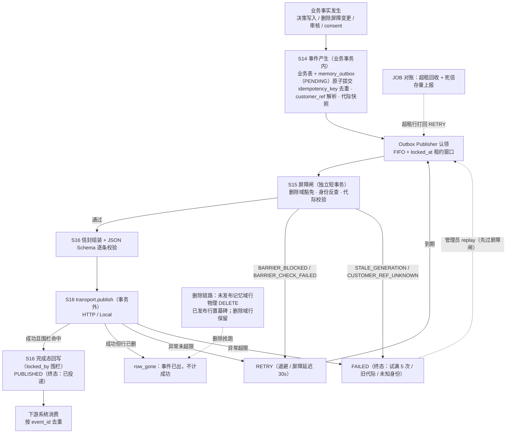
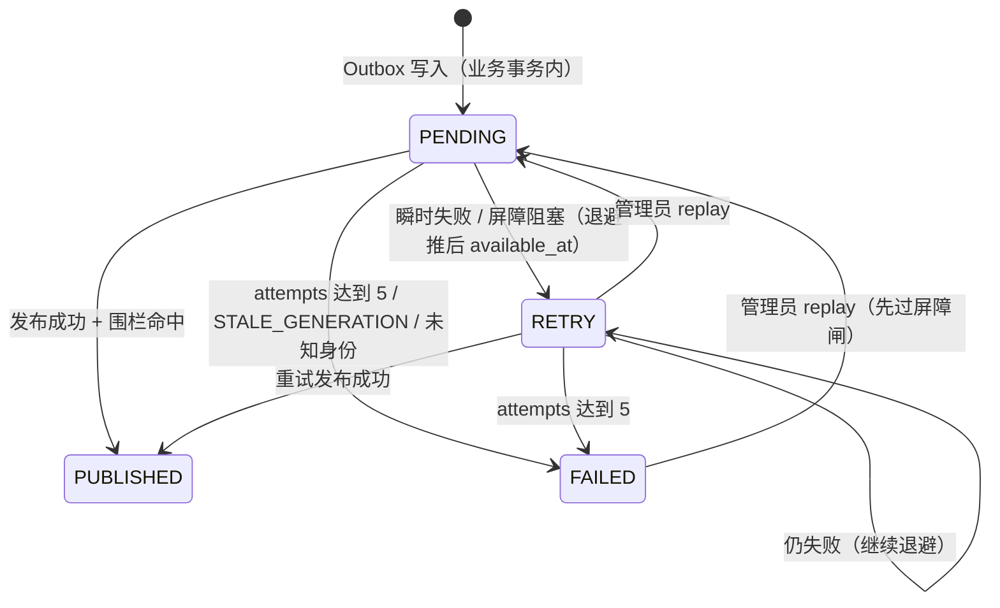
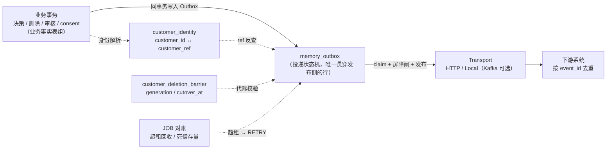
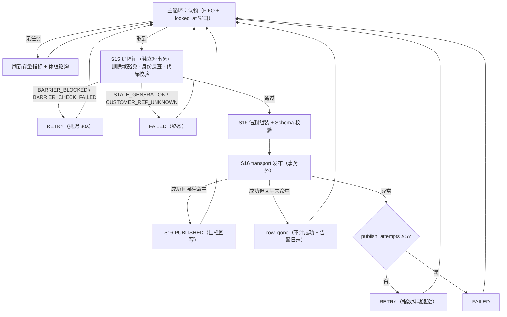
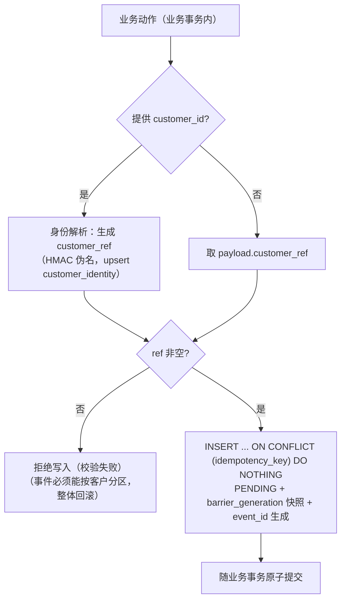
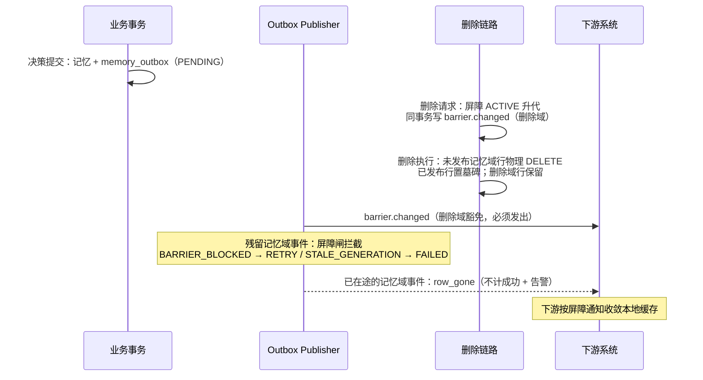

# Outbox 设计（事务性事件发布）

> 设计依据：《记忆管理-技术方案》2.4 一致性与故障边界、7.3 写入事务与提交顺序、8.3.1 删除屏障、8.3.3 删除范围矩阵、8.3.6 删除可见性、14.1 Topic 规划、14.2 事件 envelope、14.6 故障处置表、14.7 重试退避 DLQ、14.8 对账与补偿、23.10 memory_outbox。
> 本文按"由浅入深"组织：先讲清"是什么、为什么"，再展开数据模型、状态机、链路表全景、事件产生、发布流水线、失败处理、幂等并发、删除协同与运维观测。完整流程以 mermaid 绘制，粒度由粗到细：第三节为端到端全景，第五节为状态机，第六节为链路表全景，第七节为消费执行骨架，8.2 为写入协议，第九节为屏障闸与信封外发，第十二节为删除协同序列图；详细规则见各节正文。
> 上级总结：[Worker组件设计.md](../0-概要设计/2-Worker组件设计.md)（Worker 部署单元总结，含四类队列的共性骨架）；姊妹篇：[Ingestion Job设计.md](1-Ingestion%20Job设计.md)（入站方向）。本文聚焦出站事件发布的完整细节。Outbox Publisher 是独立的发布 Worker（`mms-outbox`），**不属于 Convergence**；JOB 对账只回收它的超租行，不代它发布。

---

## 一、一句话认识 Outbox

记忆发生创建/替代/强化、删除屏障发生变更时，MMS 要通知外部系统。但**业务事务里不能直接调外部投递**——于是业务事务只往 `memory_outbox` 表写一行事件（状态 `PENDING`），由独立的 **Outbox Publisher**（`mms-outbox`）异步取走，经屏障闸与信封校验后，通过可配置 transport 发布出去。

这就是经典 **Transactional Outbox** 模式：事件的"产生"与"投递"解耦，可靠性做进数据库。

它在四类队列中的位置：

| 队列 | 表名 | 职责 | 消费进程 |
|---|---|---|---|
| 摄取任务 | `memory_ingestion_job` | 把外部事件/候选转化为记忆 | Ingestion Worker（`mms-ingestion`） |
| 向量任务 | `memory_embedding_job` | 为记忆视图生成向量 | Embedding Worker（`mms-worker`） |
| 翻译任务 | `memory_translation_job` | 生成 TRANSLATED 视图 | Translation Worker（`mms-translation`） |
| **发布任务（本文）** | `memory_outbox` | 把领域事件可靠外发 | Outbox Publisher（`mms-outbox`） |

与入站方向互为镜像：Inbox（`memory_inbox_event`）是入站的"已应用事件账本"，Outbox 是出站的"待发布事件队列"；两者都用 PG 表当 durable queue，共享 claim/退避/死信/对账的同一套骨架（见 Worker组件设计）。

- **生产者**：业务事务内的 Outbox 写入协议（决策持久化、删除请求/执行、审核拒绝、consent 再授权等，共 9 类触发点，见 8.1）。
- **消费者**：Outbox Publisher，可多实例水平扩容。
- **出站 transport 可选**：HTTP / 本地日志，Kafka 为可选扩展（方案 14.1）；入站方向统一 HTTP 摄取。

**两个事件域**是理解删除协同的钥匙：

| 事件域 | event_type 前缀 | aggregate_id | 删除时的语义 |
|---|---|---|---|
| 记忆域 | `memory.*` | 记忆 ID | 随客户数据**物理删除** |
| 删除域 | `customer.deletion.*` | 删除请求 ID | **必须保留、必须发出**（屏障闸豁免） |

---

## 二、为什么需要 Outbox

### 2.1 双写问题

业务事务里直接调外部投递，两种失败模式都无解：

- **先投递后提交**：投递成功但业务回滚 → 下游收到"从未存在的记忆"的事件；
- **先提交后投递**：业务提交但投递失败/进程崩溃 → 事件永久丢失。

两个系统没有共享事务，靠重试补不齐这个缝——必须把"事件已产生"先持久化到与业务同一个库里。

### 2.2 设计收益

1. **原子性**：事件与业务数据同事务提交——"记忆写成功但通知丢了"或"通知发了但记忆回滚了"都不可能。
2. **故障隔离**：外部投递端不可用只造成 Outbox 积压，不阻塞业务写入与 DB Job 队列（方案 14.6 故障处置表："Kafka 不可用 → 本地事务写 Outbox/Job，不阻塞 DB 队列，恢复 Publisher 后续发"）。
3. **删除只有一条路**：事件行在同一个库里，删除时随记忆域事件一起物理清除；不会残留在外部 broker 成为删不掉的副本。
4. **幂等投递**：`idempotency_key` 唯一约束防重复产生；`event_id` 插入时生成、重试不变，接收方按它去重。
5. **去掉中间件**：延续"用 PG 表当 durable queue"的架构决策，v1 不强制上 Kafka。

**代价**：至少一次投递（接收方必须去重）；轮询有固有延迟（`worker_poll_seconds`）；claim/退避/死信/对账全部自研。

---

## 三、端到端全景



理解全链路的关键是**两个边界**：

1. **业务事务边界**：事件与业务事实同生共死——Outbox 写入必须在业务事务内完成，业务回滚则事件行不存在。
2. **发布动作边界**：外部 I/O 在事务之外；完成态用独立短事务回写并带 `locked_by` 围栏。**发布失败绝不回滚业务，业务回滚绝不留下事件**。

**关键步骤（S14–S16）**：编号与 [《Worker组件设计》](../0-概要设计/2-Worker组件设计.md) 3.1 能力矩阵、3.2 执行顺序图一一对应；S1–S7 由 Ingestion Job 承载（见 [Ingestion Job设计](1-Ingestion%20Job设计.md)），S8–S10 由 Embedding Job 承载，S11–S13 由 Translation Job 承载，S17–S18 为横切治理。认领、退避重试、死信重放、对账回收等共性机制由共性执行骨架（《Worker组件设计》第四章）与 Convergence 包裹（第十、十三节），不占步骤编号。

| 步骤 | 关键步骤 | 说明 | 详见 |
|---|---|---|---|
| S14 | 事件产生（Outbox 写入协议） | 业务事务内（9 类触发点：决策提交 / 删除请求与执行 / 冷却收尾 / 审核拒绝 / consent 再授权）：身份解析生成 customer_ref、`idempotency_key` 去重、`barrier_generation` 快照、`event_id` 生成；PENDING 事件行与业务表原子提交 | 第八节 |
| S15 | 屏障闸 | 独立短事务，与候选接收/决策提交同口径：删除域事件豁免（屏障通知本身必须发出）、`customer_identity` 反查、代际/cutover 校验（advisory lock + 主库读），fail-closed；BARRIER_BLOCKED/BARRIER_CHECK_FAILED → RETRY 延迟 30s，STALE_GENERATION/CUSTOMER_REF_UNKNOWN → FAILED | 第九节 9.1 |
| S16 | 信封校验与外发（含完成态回写） | 信封组装 + 统一事件契约（event-envelope）JSON Schema 逐条校验 → transport（HTTP/本地日志，Kafka 可选）事务外发布 → 独立短事务 `locked_by` 围栏回写 PUBLISHED（row_gone 不计成功）；发布异常退避 RETRY，试满 5 次 FAILED | 第九节 9.2–9.4 / 第十节 |

---

## 四、数据模型

### 4.1 `memory_outbox`（发布队列）

表结构定义如下：

| 字段 | 类型 | 语义 |
|---|---|---|
| `id` | uuid PK | Outbox 行 ID（插入时生成） |
| `aggregate_id` | uuid | 聚合根 ID：记忆域事件=记忆 ID；删除域事件=删除请求 ID |
| `event_type` | text | 事件类型（见 8.3） |
| `payload_json` | jsonb | 事件负载（**只放 ID/引用，不放正文**） |
| `idempotency_key` | text，**UNIQUE** | 业务级幂等键（如 `memory-created:{memory_id}`） |
| `event_id` | uuid | 对外事件 ID（插入时生成，**重试不变**，接收方去重键） |
| `partition_key` | text | **customer_ref**（HMAC 伪名）；不承载 raw customer_id |
| `aggregate_version` | bigint，默认 0 | 聚合版本（SUPERSEDE=旧版本+1；写入默认 1） |
| `barrier_generation` | bigint，默认 0 | **写入时刻**的屏障代际快照 |
| `status` | text | `PENDING / PUBLISHED / RETRY / FAILED`（CHECK 约束，见第五节） |
| `available_at` | timestamptz，默认 now() | 最早可发布时间；退避把它推后 |
| `locked_by` / `locked_at` | text / timestamptz | 持有者（`outbox-{uuid}`）与抢占时间 |
| `publish_attempts` | int，默认 0 | 发布尝试次数，**claim 时自增** |
| `created_at` | timestamptz | 事件产生时间（= 信封 `occurred_at`；老化监控基准） |
| `published_at` | timestamptz | 发布成功时间 |
| `last_error` | text | 最后失败/拒绝原因码或异常类名 |

约束与要点：

- **没有 `customer_id` 列**：客户维度完全由 `partition_key`（customer_ref）承载，经 `customer_identity` 双向映射（产生时身份解析，屏障闸反查，见第六节）。
- **没有外键**：`aggregate_id` 不引用 `customer_memory`（删除域事件指向删除请求）；删除靠显式 DELETE（第十二节）。
- **没有 `lease_expires_at` 列**：租约用 `locked_at + outbox_lease_seconds` 超时窗口判定——这是与三张 Job 表最大的结构差异。
- **没有 `updated_at` 列**：老化监控直接用 `created_at`。

### 4.2 索引清单

| 索引 | 定义 | 用途 |
|---|---|---|
| `ix_outbox_ready` | `(available_at, created_at) WHERE status IN ('PENDING','RETRY')` | Publisher FIFO 认领 |
| `ix_outbox_lease` | `(locked_at) WHERE status IN ('PENDING','RETRY')` | 对账快速找超租行 |

### 4.3 事件信封（发布时组装）

发布前把行组装成事件信封（envelope），按事件信封 JSON Schema（Draft 2020-12，约束见本节末）**逐条校验**后才发布：

```json
{
  "event_id": "uuid", "event_type": "memory.created.v1", "event_version": 1,
  "occurred_at": "行 created_at（ISO 格式）", "customer_ref": "64 位 hex 伪名",
  "source_system": "mms", "trace_id": "...",
  "payload": { "memory_id": "uuid" },
  "barrier_generation": 0
}
```

字段来源：

| 信封字段 | 来源 |
|---|---|
| `event_id` / `event_type` / `barrier_generation` | 行同名列 |
| `event_version` | 固定 1 |
| `occurred_at` | 行 `created_at`（**事件产生时间，不是发布时间**） |
| `customer_ref` | 行 `partition_key`（为空时回退 payload 里的 `customer_ref`） |
| `source_system` | payload 提升（默认 `mms`） |
| `trace_id` | payload 提升（默认 `event_id`） |
| `payload` | 提升后剩余字段（只含 ID/引用） |

校验要点：`additionalProperties=false`；`customer_ref` 必须匹配 `^[0-9a-f]{64}$`；`event_type` 必须匹配 `^[a-z0-9_.-]+\.v[0-9]+$`；`trace_id` 长度 8–128；`barrier_generation` 可选但 ≥0。**校验失败按发布异常处理**（走 RETRY→FAILED 分支，见 9.3），毒事件不会无限循环。

---

## 五、状态机（发布/投递语义）

**先立两个心智模型，状态机就不绕了：**

1. **状态记录的是"这条事件投递到哪一步"，不是"业务事实存不存在"**。业务事实早在业务事务里提交了；事件就算 FAILED，记忆照样有效，只是通知没发出去。
2. **四个状态分两类**：**可认领**（PENDING/RETRY）、**终态**（PUBLISHED/FAILED）。**没有执行态**——claim 不改 status，互斥靠 `locked_at` 超时窗口，这是与摄取 `PROCESSING` 的最大区别。

**状态总览：**

| 状态 | 类别 | 大白话含义 |
|---|---|---|
| `PENDING` | 可认领 | 已入队，等 Publisher 认领（被认领时也保持此态） |
| `RETRY` | 可认领 | 瞬时失败/屏障阻塞，退避时间（`available_at`）到了再认领 |
| `PUBLISHED` | 终态 | 已成功投递 |
| `FAILED` | 终态 | 试满 5 次 / 旧代际 / 未知身份，等人工介入（死信） |

**主干路径（正常世界）：**



一句话故事：**业务事务入队 → 认领发布 → 成功投递；瞬时失败退避重试、试满 5 次进死信；旧代际/未知身份直接判死；死信经屏障闸复核后可重放**。

**两个终态：到底算哪种"结束"？**

| 终态 | 为什么结束 | 还能"复活"吗 |
|---|---|---|
| `PUBLISHED` | transport 确认投递成功 | 不需要：replay 只接受 FAILED/RETRY，已投递事件不可重放 |
| `FAILED` | 重试耗尽 / STALE_GENERATION / CUSTOMER_REF_UNKNOWN | **管理员 replay**（先过屏障闸；`publish_attempts` 清零，见 10.3） |

**边缘路径：还有谁能改动状态？**

| 触发方 | 转移 | 说明 |
|---|---|---|
| Publisher claim | `PENDING/RETRY → 原状态` | **不改 status**，只写 `locked_by/locked_at`、`publish_attempts+1`（7.2） |
| 超租约回收 | `PENDING/RETRY → 原状态`（被直接重新认领）或 `→ RETRY`（JOB 对账清锁） | 双保险（第十三节）；对账不改 `available_at`、不加 attempts |
| 管理员 replay | `FAILED/RETRY → PENDING` | 先过屏障闸，拒绝语义与审计见 10.3 |
| 删除链路 | 未发布行**物理 DELETE**，已发布行置墓碑 | 不是状态转移：记忆域未发布行随客户数据消失，已发布行留墓碑；删除域行保留（第十二节） |

易混点：

- **两种"延迟"不一样**：发布失败用指数抖动退避（上限 300s）；屏障阻塞用固定 30s（`outbox_barrier_retry_seconds`）——阻塞是延迟不是丢弃，屏障解除后继续发。

**与三类 Job 的对比**：Job 表有执行态（PROCESSING/RUNNING）与取消态（CANCELLED），死信叫 DEAD_LETTER；Outbox 没有执行态（锁窗口即租约）、没有取消态（删除直接物理删行），死信叫 **FAILED**。

---

## 六、链路表全景：一行 Outbox 驱动多表协同

整条链路**围绕**同一行 `memory_outbox` 推进投递状态，但**操作**的是一组表：Outbox 表只回答"事件投递到哪一步"，不存任何业务事实；业务事实在各业务表里，客户身份与屏障各有其表。

**各阶段读写的表**：

| 阶段 | 读写的表 | 说明 |
|---|---|---|
| 产生（业务事务内） | `memory_outbox` + 业务表 + `customer_identity` | 决策路径：candidate/decision/memory/evidence/视图/current/embedding_job/translation_job；删除路径：deletion_request/barrier/review_task；consent 路径：consent/barrier。身份解析生成 customer_ref（8.1） |
| 认领/退避/死信 | `memory_outbox` | 只改事件行自身的状态/锁/attempts（第七、九、十节） |
| 屏障闸（只读） | `customer_identity`（ref→customer_id 反查）、`customer_deletion_barrier`（代际/cutover 校验，advisory lock） | 与候选接收/决策提交同口径（9.1） |
| 发布 | 无表写入（外部 transport I/O）；完成态回写 `memory_outbox` | 网络调用在事务外（9.3） |
| 重放 | `memory_outbox` + `admin_access_audit` | 审计与重入队同事务；Outbox 无 customer_id，审计用固定标记 `__dlq_outbox__`（10.3） |
| 删除协同 | `memory_outbox`（未发布记忆域行物理 DELETE，已发布行置墓碑，子查询 `customer_memory`） | 删除域行保留；先处理 Outbox 再删记忆（第十二节） |
| 对账/自愈 | `memory_outbox`（超租→RETRY）+ `recon_run`；`dead_letter_stock` 合并四表 | JOB 对账回收超租行，死信存量只观测不自动修（第十三节） |



**四个要点：**

1. **产生侧"一事多表"**：Outbox 写入永远与业务表同事务——事件行是业务事实的"通知凭证"，不是独立写入。
2. **发布侧"读二写一"**：只读 `customer_identity` + `customer_deletion_barrier`，只写 `memory_outbox` 自身状态；外部 I/O 不碰任何表。
3. **身份表是唯一的客户桥梁**：Outbox 无 customer_id 列，产生时正向解析 customer_ref，屏障闸靠它反查；删除后身份行 RETIRED 但保留，删除域事件因豁免无需反查。
4. **MMS 内部的屏障缓存失效不走 Outbox**：走 `pg_notify('mms_barrier_changed')` + 各 API 副本的 LISTEN 循环 + TTL 5s 兜底；Outbox 的 `barrier.changed` 事件是给**外部下游**失效缓存用的（方案 8.3.6 的分工）。

---

## 七、消费执行骨架（S15–S16 共性）

S14 事件产生在业务事务内完成（第八节）；事件行落库后，S15–S16 全部由 Outbox Publisher 按同一套执行骨架消费（7.1–7.2）。单条事件的执行与失败路由如下图（粗粒度；屏障闸/围栏/退避公式等细节见第九、十节）：



### 7.1 部署形态与主循环

- 命令 `mms-outbox`，独立部署服务（服务名 `mms-outbox-worker`）；进程启动时统一初始化可观测性。
- **可水平扩容**：多实例靠 `SKIP LOCKED` + `locked_at` 窗口天然并行，不需要 ConvergenceLock（那是 lifecycle/view-cost 的单实例锁）。
- 主循环：单条处理 → 无任务时休眠 `worker_poll_seconds`（默认 1s）；**每轮（含空闲轮）刷新存量指标**（15.2）。
- **单条处理**：claim `LIMIT 1`；`worker_id = outbox-{uuid4}`。

### 7.2 认领（claim）—— FIFO + locked_at 租约窗口

```sql
SELECT * FROM memory_outbox
WHERE status IN ('PENDING','RETRY') AND available_at <= now()
  AND (locked_at IS NULL OR locked_at < now() - :outbox_lease_seconds)
ORDER BY available_at, created_at FOR UPDATE SKIP LOCKED LIMIT 1
```

随后 `UPDATE` 置 `locked_by=worker_id`、`locked_at=now()`、**`publish_attempts+1`**，**status 保持不变**（PENDING/RETRY 兼任"等待"与"执行中"）。认领在独立短事务中提交，发布 I/O 不占认领锁。

为什么不需要执行态：窗口内 claim 的 WHERE 条件天然排除被锁行；窗口外视为持有者已死，可直接重新认领。超租行同时由 JOB 对账打回 RETRY 清锁（双保险，第十三节）。代价是旧主超租后仍可能完成一次发布——**至少一次**，由接收方按 `event_id` 去重兜底（第十一节）。

---

## 八、S14 事件产生（Outbox 写入协议）

写入协议**必须在业务事务内执行**。

### 8.1 生产者全景（9 类触发点）

| 触发入口 | event_type | 幂等键 |
|---|---|---|
| ADD / ADD_TEMPORAL_VERSION 决策提交 | `memory.created.v1` | `memory-created:{memory_id}` |
| SUPERSEDE 决策提交 | `memory.superseded.v1` | `memory-superseded:{memory_id}`（新记忆 ID） |
| REINFORCE 决策提交 | `memory.reinforced.v1` | `memory-reinforced:{memory_id}:{candidate_id}` |
| 删除请求（用户删除 / consent 撤回 / retention 扫描） | `customer.deletion.barrier.changed.v1`（激活，payload 无 status） | `barrier:{customer_id}:{generation}` |
| 直接执行删除（无前置请求） | 同上（激活） | 同上 |
| 删除完成进入冷却 | `customer.deletion.barrier.changed.v1`（status=COOLING_DOWN） | `barrier:{customer_id}:{generation}:cooling` |
| 冷却收尾（COOLING_DOWN→COMPLETED） | `customer.deletion.barrier.changed.v1`（status=COMPLETED） | `barrier:{customer_id}:{generation}:completed` |
| 审核拒绝删除（屏障取消，generation+1） | `customer.deletion.barrier.changed.v1`（status=CANCELLED） | `barrier:{customer_id}:{generation}:cancelled` |
| 删除后再授权（GRANTED 翻转屏障，generation+1） | 同上（status=CANCELLED） | 同上 |

补充口径：

- 审核**通过** CONFLICT/NEEDS_VERIFICATION 会经决策提交间接产生记忆域事件；生命周期的 retention consent 扫描经删除请求产生屏障激活事件。
- **屏障每次状态变更都同事务发布 `barrier.changed`**（方案 8.3.6）：激活、进入冷却、冷却收尾、取消四类；冷却收尾由生命周期扫描完成，同样写 Outbox 事件，外部下游可感知删除全流程。MMS 内部缓存失效另走 NOTIFY 快路径（第六节）。
- 幂等键里的 raw `customer_id` 只存在于库内，**不进信封**（信封只含 customer_ref）。

### 8.2 写入规则



- `customer_id` 提供时解析/生成 `customer_ref` 作为 partition_key；缺失且 payload 无 ref 直接拒绝——**事件必须能按客户分区**。
- `ON CONFLICT (idempotency_key) DO NOTHING`：同一业务动作重复执行不产生第二条事件。
- 携带写入时刻的 `barrier_generation`，供发布前屏障闸比对；carrier 时间取本行 `created_at`（方案 8.3.1 ③ 明确列出 `memory_outbox.created_at`）。
- `event_id = uuid4()` 插入时生成，重试/重放都不变——这是接收方去重的稳定键。

### 8.3 事件类型与 payload

| event_type | 触发 | 发布后 payload | aggregate_version |
|---|---|---|---|
| `memory.created.v1` | ADD / ADD_TEMPORAL_VERSION | `{memory_id}` | 1 |
| `memory.superseded.v1` | SUPERSEDE | `{memory_id, old_memory_id}` | 旧版本+1 |
| `memory.reinforced.v1` | REINFORCE | `{memory_id}` | 决策期望版本（默认 1） |
| `customer.deletion.barrier.changed.v1` | 屏障激活/进入冷却/冷却收尾/取消 | `{generation}` 或 `{generation, status}` | 1 |

`source_system`（记忆域）与 `customer_ref`（删除域）在发布时提升到信封层（4.3）。方案 14.1 还规划了 `mms.memory.lifecycle.v1` 等 topic 作为扩展预留；tombstone 走 WORM 账本独立链路（第十二节），不经 Outbox。

---

## 九、S15–S16 屏障闸与信封外发

认领（7.2）之后，每条事件依次经过 S15 屏障闸、S16 信封校验与外发；失败分类、退避公式与死信重放见第十节。

### 9.1 屏障闸（发布 = 对外部世界的写入）

屏障闸与候选接收/决策提交**同口径**（方案 8.3.1 判定算法 ①②③），在独立短事务内执行，校验完即释放 advisory lock，网络 I/O 不持锁：

1. **删除域事件豁免**（`event_type` 以 `customer.deletion.` 开头）——屏障通知本身必须发出去；
2. `partition_key` 查 `customer_identity` 反查客户；**未知 ref 不猜测**，`CUSTOMER_REF_UNKNOWN` 判死交运维；
3. 屏障校验（入队代际快照 + 行 `created_at`）：客户级 advisory lock + 主库读屏障——
   - 活动屏障（ACTIVE/COOLING_DOWN/COMPLETED）→ `BARRIER_BLOCKED`，**RETRY 延迟 30s**（阻塞是延迟不是丢弃）；
   - 代际不符，或行 `created_at` 早于 `cutover_at` → `STALE_GENERATION`，**FAILED 终态**（旧代际事件永久不再外发）；
   - 活动屏障且行 `created_at` **晚于** cutover：说明有"屏障升起后仍落库的写入"，计 `mms_barrier_post_commit_writes_total` 供告警（一致性异常信号）；
4. 校验本身异常 → **fail-closed**：`BARRIER_CHECK_FAILED` 走 RETRY，绝不带疑发布。

### 9.2 信封组装与校验

按 4.3 的映射组装信封，逐条执行 JSON Schema 校验。校验失败（如 customer_ref 格式非法）按发布异常处理，进入 9.3 的异常分支。

### 9.3 发布与结果处置

- transport 发布在**事务外**执行；成功后独立短事务回写：

```sql
UPDATE memory_outbox SET status='PUBLISHED', published_at=now(),
  locked_by=NULL, locked_at=NULL, last_error=NULL
WHERE id=%s AND locked_by=%s
```

- **围栏命中** → 计 `mms_outbox_publish_total{result=published}`；
- **row_gone**：回写未命中——典型场景是删除抢跑物理删掉了行（租约丢失换主也落此分支）。事件已出，但**不计成功**，计 `mms_outbox_publish_total{result=row_gone}` 并写告警日志；
- **发布异常**：`publish_attempts >= outbox_max_attempts`（5，claim 时已自增，判定不再 +1）→ **FAILED 终态**，否则 RETRY（退避公式见 10.2）；`last_error` 记异常类名；回写同样带 `locked_by` 围栏。

### 9.4 Transport 形态

| transport | 说明 |
|---|---|
| 本地日志（Local） | 未配 endpoint 时的默认：只记日志（开发/测试） |
| HTTP | `POST outbox_endpoint`，10s 超时，`Authorization: Bearer` 共享出站凭证；端点经安全校验强制 TLS（生产必须 https，http 仅限 loopback 或 development） |
| Kafka | 可选扩展（方案 14.1）：`partition_key` 提供"同客户同分区"语义，面向高吞吐下游 |

---

## 十、失败处理与重放

### 10.1 失败分类总览

| 场景 | 去向 | 延迟 | 指标 result | 是否重试 |
|---|---|---|---|---|
| 发布异常未超限 | RETRY | 指数抖动退避（上限 300s） | `retry` | 是 |
| 发布异常超限（5 次） | **FAILED** | — | `failed` | 否（人工 replay） |
| 信封校验失败 | 同发布异常 | 同上 | `retry` / `failed` | 是（毒事件最终判死） |
| STALE_GENERATION | **FAILED** | 0 | `stale_generation` | 否（旧代际永久不外发） |
| BARRIER_BLOCKED | RETRY | 固定 30s | `barrier_blocked` | 是（屏障解除后继续） |
| CUSTOMER_REF_UNKNOWN | **FAILED** | 0 | `customer_ref_unknown` | 否（运维修复身份后 replay） |
| BARRIER_CHECK_FAILED | RETRY | 固定 30s | `barrier_check_failed` | 是（fail-closed） |
| row_gone | 行已不在，无状态可改 | — | `row_gone` | — |
| Publisher 崩溃 | 超租行被重新认领 / 对账置 RETRY | — | — | 是 |

### 10.2 退避公式

`available_at = now() + jittered(min(300, 2^(attempts-1)))` 秒；`jittered` 在 `[0.5×base, base]` 均匀取值，避免共享故障恢复时齐刷刷重试打爆下游。四类队列（ingestion/embedding/translation/outbox）统一本公式（attempts 均在 claim 时自增，方案 14.7）。

### 10.3 死信重放（replay）

`POST /api/v1/admin/dlq/replay`（`job_type=OUTBOX`，DLQ 专用鉴权：服务令牌或管理面凭据）：

- `FOR UPDATE` 锁行；**只接受 FAILED/RETRY**，其余状态拒绝；
- **重放前先过屏障闸**：STALE_GENERATION → `410`，其余拒绝（BARRIER_BLOCKED/CUSTOMER_REF_UNKNOWN）→ `409`；校验异常 fail-closed 回滚——禁止绕过治理直接外发；
- 通过才置 `PENDING`、`available_at=now()`、清锁与错误码；
- **`publish_attempts` 清零**：重放获得完整重试预算（与三类 Job 的 replay 语义一致）；
- **审计与重入队同事务**（`admin_access_audit`，action=REPLAY）；Outbox 行无 customer_id，审计用固定标记 `__dlq_outbox__`。

---

## 十一、幂等与并发控制（多层防线）

| 层 | 键/机制 | 防什么 |
|---|---|---|
| 产生层 | `idempotency_key` UNIQUE + `ON CONFLICT DO NOTHING` | 同一业务动作重复执行产生第二条事件 |
| 投递层 | `event_id` 插入时生成、重试不变；接收方按它去重 | 至少一次语义下的重复投递 |
| 执行层 | `FOR UPDATE SKIP LOCKED` + `locked_at` 超时窗口 + `locked_by` 围栏 | 多 Publisher 互抢、崩溃残留、旧主回写 |
| 跨删除 | `barrier_generation`（写入时快照）+ `created_at` vs `cutover_at` | 删除后旧代际事件外发 |
| 重放层 | replay 前置屏障闸 | DLQ 绕过治理直接发布 |

**没有执行态为何还能防双发**：窗口内 claim 排除被锁行；窗口外旧主可能仍在发布——这被显式接受为**至少一次**，正确性由接收方 `event_id` 去重保证；旧主的完成回写被 `locked_by` 围栏挡住（未命中即 row_gone 分支），不会覆盖新主的状态。

---

## 十二、与删除的协同（全链路）

1. **删除请求**：屏障升代（ACTIVE，generation+1），**同事务**写 `barrier.changed`（删除域）——下游从这条事件得知"该客户正在被删除"，失效本地缓存。
2. **删除执行**：
   - **未发布的记忆域事件行物理 DELETE**（PENDING/RETRY/FAILED，`aggregate_id IN (SELECT id FROM customer_memory WHERE customer_id=...)`；必须在删 `customer_memory` 之前执行，子查询依赖记忆行还在）；
   - **已发布（PUBLISHED）的记忆域行置墓碑**（方案 8.3.3）：清空 payload 中的业务引用，仅保留事件坐标（event_id/event_type/aggregate_id）与墓碑标记，供审计与下游对账；墓碑行不可重放，随定期归档清理（第十三节）；
   - **删除域事件保留**（aggregate_id=请求 ID，如屏障激活/冷却通知），否则 Publisher 会吞掉必须外发的死亡事件；
   - 身份行置 RETIRED 但保留（删除证明记 `OUTBOX` 项计数）。
3. **发布前闸**：即使记忆域事件行漏删，屏障闸也会拦住外发（BARRIER_BLOCKED→RETRY / STALE_GENERATION→FAILED）；删除域豁免，必须发出。
4. **在途竞态（row_gone）**：发布成功但行已被删除——事件已出、不计成功、告警日志；下游靠屏障通知收敛。**tombstone 走 WORM 账本（独立链路），不走 Outbox**。

四个阶段在时间轴上的协同如下图（粗粒度；逐阶段判据见上文）：



---

## 十三、调度与自愈

Publisher 自身不做周期扫描，兜底由 Convergence 侧承担（由 `mms-lifecycle` 进程驱动，见 [Convergence组件设计.md](../0-概要设计/3-Convergence组件设计.md)）：

- **超租约回收**（JOB 对账 / `outbox_lease` 修复项）：`PENDING/RETRY` 且 `locked_at` 超 `outbox_lease_seconds` → 置 `RETRY`、清锁（不改 `available_at`、不加 attempts）。claim 语句也能直接回收超租行，对账是双保险。
- **死信存量上报**：`dead_letter_stock` 合并统计三张 Job 表 DEAD_LETTER + Outbox FAILED——**FAILED 对 pending gauge 不可见，必须单独上报**；只观测不自动修，计入 `mms_recon_mismatches_total`，使该轮对账报 PARTIAL 触发告警。
- 对账每 300s 依次触发 `JOB/VECTOR/RECALL/BUSINESS`，各写一行 `recon_run`；也可 `POST /internal/reconciliation/JOB` 手动触发。
- **保留与归档**（方案 23.10/23.12）：PUBLISHED 与墓碑行定期归档清理（按月），在线表只保留近期窗口；删除链路按客户清除未发布行、已发布行置墓碑（第十二节）。

---

## 十四、配置参数（env 前缀 `MMS_`）

| 参数 | 默认 | 说明 |
|---|---|---|
| `outbox_endpoint` | None | 未配则 Local transport（只记日志） |
| `outbox_lease_seconds` | 60 | `locked_at` 超时窗口（租约） |
| `outbox_max_attempts` | 5 | 发布尝试上限（含首次） |
| `outbox_barrier_retry_seconds` | 30 | 屏障阻塞/校验失败的 RETRY 延迟 |
| `outbound_token` | None | 出站共享凭证（Bearer，TLS only） |
| `worker_poll_seconds` | 1.0 | 空闲轮询间隔 |
| `kafka_ref_key` / `kafka_ref_key_version` | dev 默认 / 1 | customer_ref 的 HMAC 密钥与版本（身份映射） |
| `deployment_environment` | development | TLS 强制判定（production 必须 https） |

租约必须**明显大于**单条事件最长发布时间（含 HTTP 10s 超时），否则会误判崩溃导致重复投递。

---

## 十五、可观测性

### 15.1 指标

| 指标 | 类型 | 标签 | 语义 |
|---|---|---|---|
| `mms_outbox_publish_total` | Counter | `result` | 发布结果计数：published / retry / failed / row_gone / barrier_blocked / stale_generation / customer_ref_unknown / barrier_check_failed |
| `mms_outbox_pending_total` | Gauge | — | PENDING+RETRY 存量 |
| `mms_outbox_oldest_age_seconds` | Gauge | — | 最老待发布事件年龄（PENDING/RETRY 的 min `created_at`） |
| `mms_outbox_failed_total` | Gauge | — | FAILED 终态存量（死信可见性） |
| `mms_barrier_post_commit_writes_total` | Counter | — | 屏障升起后仍落库的写入（一致性异常信号） |
| `mms_barrier_write_blocked_total` | Counter | `status` | 屏障拦截计数（与写路径共用，含 STALE_GENERATION） |

### 15.2 指标由 Publisher 进程导出

每轮处理（含空闲轮）刷新三个 Gauge——**必须在 mms-outbox 进程导出，不能只靠 API 进程**，否则积压与死信无人发现。

注意 `oldest_age` 按 `created_at` 而非 `available_at` 计算：被屏障阻塞而延迟的行同样计入老化——长期屏障阻塞会触发 `MMSOutboxBacklog`，这是有意设计（阻塞造成的积压必须可见）。

### 15.3 告警

| 告警 | 表达式 | 持续 | 级别 | runbook |
|---|---|---|---|---|
| `MMSOutboxBacklog` | `mms_outbox_oldest_age_seconds > 300` | 5m | critical | mms-outbox |
| `MMSOutboxFailed` | `mms_outbox_failed_total > 0` | 15m | page | mms-outbox-dlq |
| `MMSBarrierPostCommitWrite` | `increase(mms_barrier_post_commit_writes_total[1m]) > 0` | 即时 | page | mms-barrier-write |

新鲜度 SLO：**最老待发布事件 ≤5 分钟**。

---

## 十六、设计权衡与已知边界

**得到的**：业务与通知原子解耦；投递端故障不阻塞写入；删除面闭合；幂等可重放；无外部中间件。

**代价与边界**：

- **至少一次投递**：超租换主、row_gone 都意味着事件可能重复或"已出但行不在"，接收方必须按 `event_id` 去重。
- **轮询延迟**：实时性弱于 push 模型（`worker_poll_seconds`）；队列表与业务同库，积压竞争同一 PG 资源。
- **无客户内严格顺序保证**：FIFO 认领 + 多实例并行，同一客户的两个事件可能乱序发布；`partition_key` 只为可选 Kafka 提供"同客户同分区"语义，HTTP transport 无顺序保证。下游应按 `aggregate_version`/`barrier_generation` 收敛，而非依赖到达顺序。
- **FAILED 需人工介入**：replay 前必须先过屏障闸；CUSTOMER_REF_UNKNOWN 须先修复身份映射。
- **row_gone 场景**：下游可能收到"已删除客户"的记忆域事件，靠下游屏障通知收敛；MMS 侧以告警日志 + 指标暴露。
- **PUBLISHED 归档窗口**：在线表保留近期已发布/墓碑行，按月归档；归档任务停摆会导致在线表膨胀，需监控。
- **屏障阻塞计入老化**：长期 BARRIER_BLOCKED 会触发 MMSOutboxBacklog——属预期行为，处置时先确认屏障状态再怀疑 Publisher。
- **信封校验失败消耗重试预算**：毒事件（如非法 customer_ref）最终进 FAILED，不会无限循环，但会占用 5 次尝试。

---

## 十七、测试与验收

验收场景（必须覆盖）：

- 发布/失败/重放全链路：瞬时失败退避重试、试满进 FAILED、屏障闸复核后重放；
- 屏障闸：BARRIER_BLOCKED 拦截与 replay 拒绝、删除域豁免必发、旧代际判死；
- FAILED 死信存量在独立 Gauge 上可见；
- 发布成功但行已被删除（row_gone）不计成功；
- 退避抖动区间、出站端点 TLS 强制、出站凭证可选；
- 方案验收口径：8.3.4 删除竞态（删除 vs 并发写入/Worker/DLQ 重放）必须测试；14.6 故障处置表"Kafka 不可用 → 不阻塞 DB 队列，恢复 Publisher 后续发"。