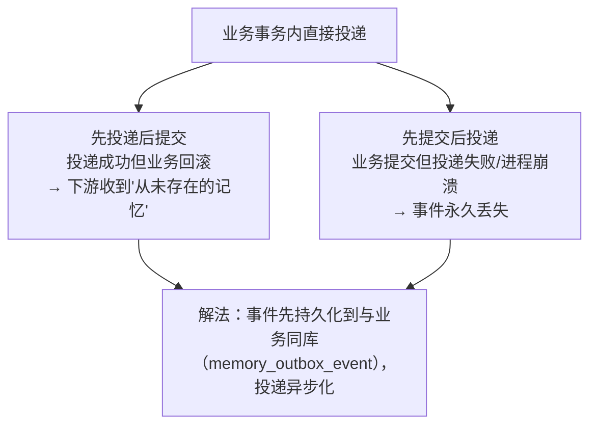
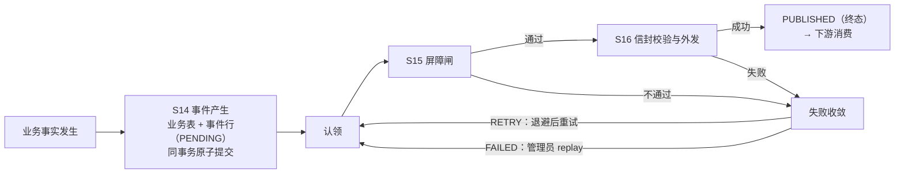
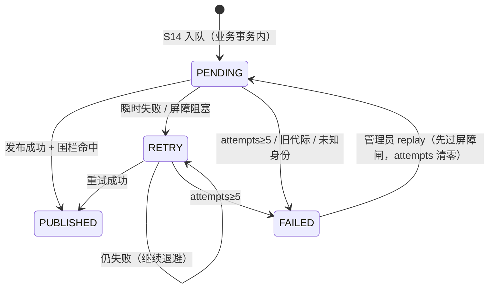
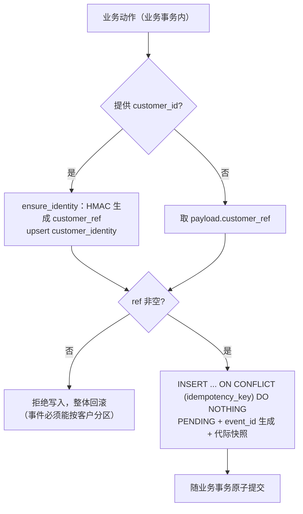
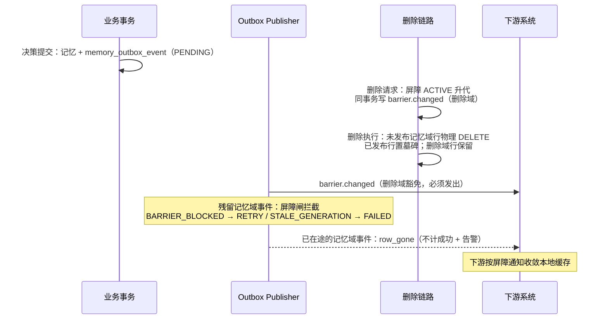
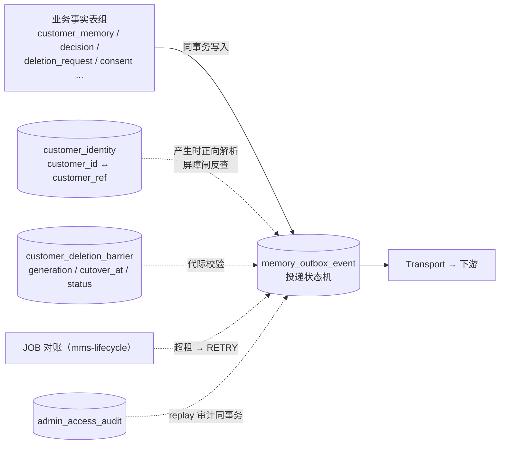
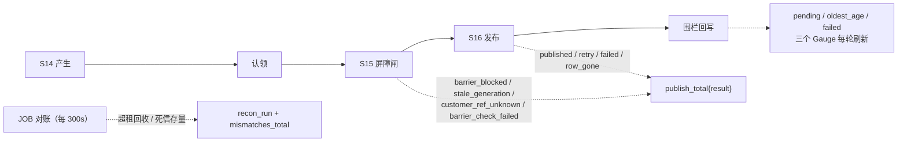

# OutboxEvent 机制设计

## 1. 什么是 OutboxEvent 机制

**OutboxEvent = MMS 在业务事实变更后，主动通知外部系统的领域事件**，及其可靠外发机制。

采用 **Transactional Outbox** 模式：业务事务只同事务写一行 `memory_outbox_event`，由独立的 **Outbox Publisher**（`mms-outbox`，可水平扩容）异步认领，经屏障闸与信封校验后通过 transport 发布。事件的"产生"与"投递"解耦，可靠性做进数据库。


## 2. 为什么要有 OutboxEvent 机制

**双写问题**：业务事务里直接调外部投递，两种失败模式都无解——



**设计收益与代价：**

| 收益 | 说明 |
|---|---|
| 原子性 | 事件与业务数据同事务提交："记忆写成功但通知丢了"或"通知发了但记忆回滚了"都不可能 |
| 故障隔离 | 投递端不可用只造成积压，不阻塞业务写入 |
| 删除只有一条路 | 事件行在同一个库里，删除时随客户数据清除，不残留外部 broker 副本 |
| 幂等投递 | `idempotency_key` 防重复产生；`event_id` 重试不变，接收方去重 |
| 去掉中间件 | PG 表当 durable queue，v1 不强制 Kafka |

| 代价 | 应对 |
|---|---|
| 至少一次投递 | 接收方按 `event_id` 去重 |
| 轮询延迟（`worker_poll_seconds`） | 新鲜度 SLO ≤5min（第 8 章） |
| 无客户内严格顺序 | 下游按版本号收敛 |
| claim/退避/死信/对账自研 | 与三类 Job 共享同一套骨架（Worker组件设计） |

## 3. 整体流程

一条事件经过 **S14 产生 → 认领 → S15 屏障闸 → S16 信封校验与外发**；编号与 Worker组件设计能力矩阵对应。各步骤的失败分支与去向见第 4 章，删除协同见 4.6，对账兜底见 8.3。



**关键步骤一览：**

| 步骤 | 职责 | 详解 |
|---|---|---|
| S14 事件产生 | 业务事务内写 PENDING 事件行（身份解析、幂等去重、代际快照） | 4.1 |
| 认领 | Publisher 取行加锁，多实例并行 | 4.2 |
| S15 屏障闸 | 发布 = 对外部世界的写入，与候选接收/决策提交同口径校验 | 4.3 |
| S16 校验与外发 | 信封校验 → transport 发布 → 围栏回写完成态 | 4.4 |
| 失败/重放 | 退避重试、死信、管理员 replay | 4.5 |
| 删除协同 | 事件行随客户数据清除，屏障闸兜底 | 4.6 |

## 状态机
- claim 不改 status，互斥靠租约窗口；
- PENDING/RETRY 可认领，PUBLISHED/FAILED 终态：



**两个边界**：事件与业务事实同事务——业务回滚绝不留下事件；外部 I/O 在事务外——发布失败绝不回滚业务。

## 4. 关键步骤说明

### 4.1 S14 事件产生（Outbox 写入协议）

写入**必须在业务事务内**执行；触发入口与事件类型见第 7 章。



| 规则 | 说明 |
|---|---|
| 幂等产生 | `idempotency_key` UNIQUE + `ON CONFLICT DO NOTHING`，同一业务动作不产生第二条事件 |
| 稳定去重键 | `event_id = uuid4()` 插入时生成，重试/重放不变 |
| 代际快照 | `barrier_generation` 取写入时刻，供发布前比对；carrier 时间取本行 `created_at` |
| 隐私 | 幂等键中的 raw `customer_id` 只存在于库内，不进信封 |

### 4.2 认领（FIFO + 租约窗口）

```sql
SELECT * FROM memory_outbox_event
WHERE status IN ('PENDING','RETRY') AND available_at <= now()
  AND (locked_at IS NULL OR locked_at < now() - :outbox_lease_seconds)
ORDER BY available_at, created_at FOR UPDATE SKIP LOCKED LIMIT 1
```

随后 `UPDATE` 置 `locked_by/locked_at`、`publish_attempts+1`，**status 不变**；认领在独立短事务提交，发布 I/O 不占认领锁。窗口内 WHERE 条件排除被锁行，窗口外视为持有者已死可重新认领——代价是旧主超租后仍可能完成一次发布（**至少一次**，接收方去重兜底）。超租行同时由 JOB 对账打回 RETRY（双保险）。

### 4.3 S15 屏障闸（发布前治理）

独立短事务（只读校验），校验完即释放 advisory lock，网络 I/O 不持锁；与候选接收/决策提交同口径：

| 序 | 校验 | 不通过的去向 |
|---|---|---|
| 1 | 删除域事件（`customer.deletion.*`）**豁免**——屏障通知本身必须发出 | — |
| 2 | `partition_key` 查 `customer_identity` 反查客户，未知 ref 不猜测 | `CUSTOMER_REF_UNKNOWN` → FAILED |
| 3 | 客户级 advisory lock + 主库读屏障：活动屏障（ACTIVE/COOLING_DOWN/COMPLETED） | `BARRIER_BLOCKED` → RETRY 延迟 30s |
| 3 | 代际不符，或行 `created_at` 早于 `cutover_at` | `STALE_GENERATION` → FAILED（旧代际永久不外发） |
| 3 | 活动屏障且行 `created_at` 晚于 cutover：屏障升起后仍落库的写入 | 计 `mms_barrier_post_commit_writes_total` 告警 |
| 4 | 校验本身异常 → **fail-closed**，绝不带疑发布 | `BARRIER_CHECK_FAILED` → RETRY |

### 4.4 S16 信封校验与外发

1. **组装信封**：按第 7.2 节的映射与 JSON Schema 逐条校验；校验失败按发布异常处理（毒事件最终判死，不无限循环）；
2. **transport 发布**（事务外）：

| transport | 形态 |
|---|---|
| HTTP（生产） | `POST outbox_endpoint`，body = 信封，`Authorization: Bearer outbound_token`，10s 超时；强制 TLS（生产必须 https） |
| Local（未配 endpoint 的默认） | 只记日志（开发/测试） |
| Kafka（可选扩展） | topic + `partition_key=customer_ref`，面向高吞吐下游 |

3. **围栏回写**（独立短事务）：

```sql
UPDATE memory_outbox_event SET status='PUBLISHED', published_at=now(),
  locked_by=NULL, locked_at=NULL, last_error=NULL
WHERE id=%s AND locked_by=%s
```

- 围栏命中 → 计 `publish_total{result=published}`；
- **row_gone**（回写未命中，典型为删除抢跑删行）：事件已出但**不计成功**，计 `row_gone` + 告警日志；
- 发布异常：`publish_attempts >= 5` → FAILED，否则 RETRY（退避见 4.5）；`last_error` 记异常类名。

### 4.5 失败处理与重放

**失败路由：**

| 结果 | 去向 | 延迟 | 后续 |
|---|---|---|---|
| 发布异常未超限 / 信封校验失败 | RETRY | `jittered(min(300, 2^(attempts-1)))` 秒（jitter 在 `[0.5×base, base]`） | 自动重试 |
| 发布异常超限（5 次） | FAILED | — | 死信存量由 JOB 对账上报（8.3），人工 replay |
| BARRIER_BLOCKED / BARRIER_CHECK_FAILED | RETRY | 固定 30s（`outbox_barrier_retry_seconds`） | 屏障解除后继续发 |
| STALE_GENERATION / CUSTOMER_REF_UNKNOWN | FAILED | — | 旧代际永久不外发；身份修复后 replay |
| row_gone | 无状态可改 | — | 不计成功，指标 + 告警日志 |
| Publisher 崩溃 | 超租行被重新认领 / 对账置 RETRY | — | 至少一次，下游去重兜底 |

**死信重放**（`POST /admin/dlq/replay`，`job_type=OUTBOX`，DLQ 专用鉴权）：

- `FOR UPDATE` 锁行，只接受 FAILED/RETRY；
- **重放前先过屏障闸**：STALE_GENERATION → `410`，其余拒绝 → `409`，校验异常 fail-closed 回滚；
- 通过才置 PENDING、`available_at=now()`、清锁与错误码、**attempts 清零**（完整重试预算）；
- 审计（`admin_access_audit`，action=REPLAY，固定标记 `__dlq_outbox__`）与重入队同事务。

### 4.6 与删除的协同

| 阶段 | 动作 |
|---|---|
| 删除请求 | 屏障升代（ACTIVE，generation+1），同事务写 `barrier.changed`（删除域），下游据此失效缓存 |
| 删除执行 | 未发布记忆域行**物理 DELETE**（须在删 `customer_memory` 之前，子查询依赖记忆行还在）；已发布行**置墓碑**（清业务引用，留事件坐标，不可重放，按月归档）；删除域行保留；身份行 RETIRED 但保留 |
| 发布前闸 | 漏删的记忆域行也被屏障闸拦截；删除域豁免必发 |
| 在途竞态 | 发布成功但行已删 → row_gone，下游靠屏障通知收敛 |



### 4.7 幂等与并发（多层防线）

| 层 | 键/机制 | 防什么 |
|---|---|---|
| 产生层 | `idempotency_key` UNIQUE + `ON CONFLICT DO NOTHING` | 同一业务动作重复产生事件 |
| 投递层 | `event_id` 重试不变，接收方去重 | 至少一次下的重复投递 |
| 执行层 | `FOR UPDATE SKIP LOCKED` + `locked_at` 窗口 + `locked_by` 围栏 | 多 Publisher 互抢、崩溃残留、旧主回写 |
| 跨删除 | `barrier_generation` 快照 + `created_at` vs `cutover_at` | 删除后旧代际事件外发 |
| 重放层 | replay 前置屏障闸 | DLQ 绕过治理直接发布 |

## 5. 数据模型



**`memory_outbox_event` 字段**（完整定义见数据表设计 23.10）：

| 字段 | 语义 |
|---|---|
| `id` / `event_id` | 行 ID / 对外事件 ID（插入时生成，重试不变，接收方去重键） |
| `aggregate_id` / `aggregate_version` | 聚合根（记忆 ID 或删除请求 ID）与版本（SUPERSEDE=旧版本+1，写入默认 1） |
| `event_type` / `payload_json` | 事件类型 / 负载（只放 ID 与引用） |
| `idempotency_key` | UNIQUE，防同一业务动作重复产生事件 |
| `partition_key` | customer_ref（**表内无 customer_id 列**，客户维度全靠身份表映射） |
| `barrier_generation` | 写入时刻的屏障代际快照 |
| `status` | PENDING / RETRY（可认领）· PUBLISHED / FAILED（终态） |
| `available_at` / `locked_by` / `locked_at` | 退避时间 / 持有者（`outbox-{uuid}`）/ 认领时间（租约 = `locked_at + outbox_lease_seconds`） |
| `publish_attempts` | claim 时自增 |
| `created_at` / `published_at` / `last_error` | 产生时间（= 信封 `occurred_at`，老化基准）/ 成功时间 / 最后失败原因 |

**索引**：`ix_outbox_ready (available_at, created_at) WHERE status IN ('PENDING','RETRY')` 供 FIFO 认领；`ix_outbox_lease (locked_at) WHERE ...` 供对账找超租行。

**与三类 Job 表的结构差异**：无外键（删除靠显式 DELETE）；无 `lease_expires_at`（租约用 `locked_at` 窗口判定）；无 `updated_at`（老化用 `created_at`）；无执行态/取消态（死信叫 FAILED，删除直接物理删行）。

**各阶段读写的表**：产生侧"一事多表"（事件行永远与业务表同事务）；发布侧"读二写一"（只读 `customer_identity` + `customer_deletion_barrier`，只写 outbox 自身状态，外部 I/O 不碰表）；重放写 outbox + 审计；对账写 outbox + `recon_run`。

## 6. 相关配置

env 前缀 `MMS_`：

| 参数 | 默认 | 说明 |
|---|---|---|
| `outbox_endpoint` | None | 未配则 Local transport（只记日志） |
| `outbox_lease_seconds` | 60 | `locked_at` 超时窗口（租约），必须明显大于单条最长发布时间（含 HTTP 10s 超时），否则误判崩溃导致重复投递 |
| `outbox_max_attempts` | 5 | 发布尝试上限（含首次） |
| `outbox_barrier_retry_seconds` | 30 | 屏障阻塞/校验失败的 RETRY 延迟 |
| `outbound_token` | None | 出站共享凭证（Bearer，TLS only） |
| `worker_poll_seconds` | 1.0 | 空闲轮询间隔 |
| `kafka_ref_key` / `kafka_ref_key_version` | dev 默认 / 1 | customer_ref 的 HMAC 密钥与版本（KMS 托管、按版本共享，轮换期旧 ref 仍可解析） |
| `deployment_environment` | development | TLS 强制判定（production 必须 https，http 仅限 loopback/development） |

## 7. 系统已规划事件

### 7.1 事件域与事件清单

**两个事件域**（决定删除时的处置）：

| 事件域 | event_type 前缀 | aggregate_id | 客户删除时 |
|---|---|---|---|
| 记忆域 | `memory.*` | 记忆 ID | 未发布行物理删除，已发布行置墓碑 |
| 删除域 | `customer.deletion.*` | 删除请求 ID | 保留且必须发出（屏障闸豁免） |

**当前共 4 种事件类型：**

| event_type | 触发 | 发布后 payload | 幂等键 | aggregate_version |
|---|---|---|---|---|
| `memory.created.v1` | ADD / ADD_TEMPORAL_VERSION 决策提交 | `{memory_id}` | `memory-created:{memory_id}` | 1 |
| `memory.superseded.v1` | SUPERSEDE 决策提交 | `{memory_id, old_memory_id}` | `memory-superseded:{memory_id}`（新记忆 ID） | 旧版本+1 |
| `memory.reinforced.v1` | REINFORCE 决策提交 | `{memory_id}` | `memory-reinforced:{memory_id}:{candidate_id}` | 决策期望版本（默认 1） |
| `customer.deletion.barrier.changed.v1` | 屏障状态变更（见下表） | `{generation}` 或 `{generation, status}` | `barrier:{customer_id}:{generation}[:后缀]` | 1 |

`source_system`（记忆域）与 `customer_ref`（删除域）在发布时提升到信封层，不留在 payload。审核**通过** CONFLICT/NEEDS_VERIFICATION 经决策提交间接产生记忆域事件；NOOP/拒绝类 outcome 不产生事件。

**屏障变更的 4 类触发：**

| 变更 | payload.status | 触发入口 | 幂等键后缀 |
|---|---|---|---|
| 激活（generation+1） | 无 | 删除请求（用户删除 / consent 撤回 / retention 扫描）、直接执行删除 | 无 |
| 删除执行完成、进入冷却 | `COOLING_DOWN` | 删除执行事务 | `:completed` |
| 审核拒绝删除（generation+1） | `CANCELLED` | 审核拒绝 | `:cancelled` |
| 删除后再授权（generation+1） | `CANCELLED` | consent GRANTED 翻转屏障 | `:cancelled` |

> **已知边界**：冷却收尾（`COOLING_DOWN→COMPLETED`，生命周期扫描）目前只触发内部 NOTIFY，不产生出站事件（`lifecycle.py`）；下游如需感知"删除彻底完成"，需补发对应事件。

**预留扩展（未实现）**：Kafka transport 及 `mms.memory.lifecycle.v1`、`mms.review.required.v1` 等 topic。若启用 Kafka：`partition_key=customer_ref` 保证同客户同分区；携带 customer_ref 的 topic 必须遵循删除证明同源配置（`compact,delete`、retention ≤24h、tombstone 不早于数据段过期），删除/consent/barrier 类 consumer group 监控 lag。Embedding 由 DB 队列驱动，不设 index sync topic。

### 7.2 输入与输出

**产生侧输入（S14）：**

| 触发入口 | 输入 |
|---|---|
| 决策提交（ADD / SUPERSEDE / REINFORCE） | candidate（customer_id、source_system）、decision（outcome、expected_versions）、memory_id、barrier_generation |
| 删除请求 / 直接执行 | customer_id、request_id、新 generation |
| 删除执行完成（进入冷却） | request_id、generation、入口捕获的 customer_ref（身份行已 RETIRED，不复活） |
| 审核拒绝 / consent 再授权 | 被翻转的屏障（request_id、generation） |

**输出 = 事件信封**（唯一对外契约，发布前经 `contracts/event-envelope.schema.json` Draft 2020-12 逐条校验）：

```json
{
  "event_id": "uuid",
  "event_type": "memory.created.v1",
  "event_version": 1,
  "occurred_at": "2026-11-14T09:00:00+00:00",
  "customer_ref": "64 位 hex 伪名",
  "source_system": "mms",
  "trace_id": "...",
  "payload": { "memory_id": "uuid" },
  "barrier_generation": 0
}
```

| 信封字段 | 来源 |
|---|---|
| `event_id` / `event_type` / `barrier_generation` | 行同名列 |
| `event_version` | 固定 1 |
| `occurred_at` | 行 `created_at`（**事件产生时间，不是发布时间**） |
| `customer_ref` | 行 `partition_key`（为空时回退 payload） |
| `source_system` / `trace_id` | payload 提升（默认 `mms` / `event_id`） |
| `payload` | 提升后剩余字段（只含 ID/引用） |

校验要点：`additionalProperties=false`；`customer_ref` 匹配 `^[0-9a-f]{64}$`；`event_type` 匹配 `^[a-z0-9_.-]+\.v[0-9]+$`；`trace_id` 长度 8–128；`barrier_generation` ≥0。

### 7.3 下游消费契约

- 按 `event_id` 去重（至少一次语义）；
- 按 `aggregate_version` / `barrier_generation` 收敛，不依赖到达顺序；
- 收到 `customer.deletion.barrier.changed.v1` 即失效该客户本地缓存；删除全流程以屏障事件为准。

## 8. 持续观测点设计

观测点沿链路分布，指标全部由 **mms-outbox 进程**每轮（含空闲轮）刷新导出，不依赖 API 进程：



### 8.1 指标

| 指标 | 类型 | 观测点 | 语义 |
|---|---|---|---|
| `mms_outbox_publish_total{result}` | Counter | S15/S16 各分支 | published / retry / failed / row_gone / barrier_blocked / stale_generation / customer_ref_unknown / barrier_check_failed |
| `mms_outbox_pending_total` | Gauge | 每轮刷新 | PENDING+RETRY 存量 |
| `mms_outbox_oldest_age_seconds` | Gauge | 每轮刷新 | 最老待发布事件年龄（按 `created_at`；屏障阻塞行同样计入，积压必须可见） |
| `mms_outbox_failed_total` | Gauge | 每轮刷新 | FAILED 死信存量（对 pending gauge 不可见，必须独立上报） |
| `mms_barrier_post_commit_writes_total` | Counter | 屏障闸 | 屏障升起后仍落库的写入（一致性异常信号） |
| `mms_barrier_write_blocked_total{status}` | Counter | 与写路径共用 | 屏障拦截计数（含 STALE_GENERATION） |

### 8.2 告警与 SLO

| 告警 | 表达式 | 持续 | 级别 |
|---|---|---|---|
| `MMSOutboxBacklog` | `mms_outbox_oldest_age_seconds > 300` | 5m | critical |
| `MMSOutboxFailed` | `mms_outbox_failed_total > 0` | 15m | page |
| `MMSBarrierPostCommitWrite` | `increase(mms_barrier_post_commit_writes_total[1m]) > 0` | 即时 | page |

**新鲜度 SLO：最老待发布事件 ≤5 分钟。**

### 8.3 对账观测点（mms-lifecycle，每 300s，各写一行 `recon_run`）

| 观测点 | 动作 |
|---|---|
| 超租约回收 | PENDING/RETRY 且 `locked_at` 超租约 → 置 RETRY 清锁（不改 available_at、不加 attempts）；与 claim 直接回收互为双保险 |
| 死信存量 | `dead_letter_stock` 合并三张 Job 表 DEAD_LETTER + Outbox FAILED；只观测不自动修，计入 `mms_recon_mismatches_total` 使该轮报 PARTIAL 触发告警 |
| 归档窗口 | PUBLISHED 与墓碑行按月归档清理；归档停摆会导致在线表膨胀，需监控 |

**处置提示**：长期屏障阻塞触发 Backlog 属预期行为，先确认屏障状态再怀疑 Publisher；FAILED 重放必须先过屏障闸，CUSTOMER_REF_UNKNOWN 须先修复身份映射。