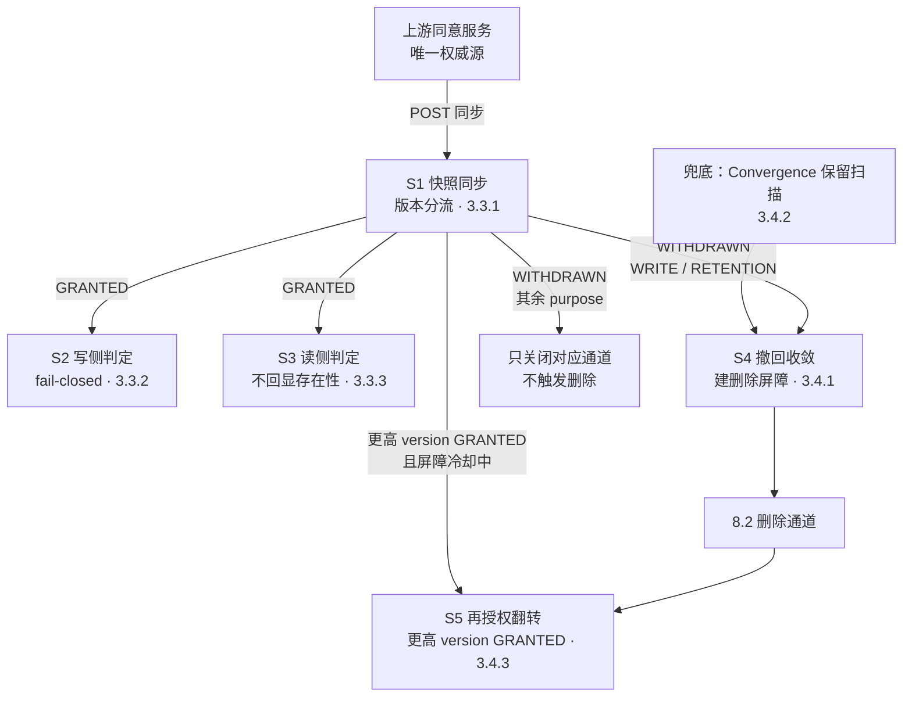
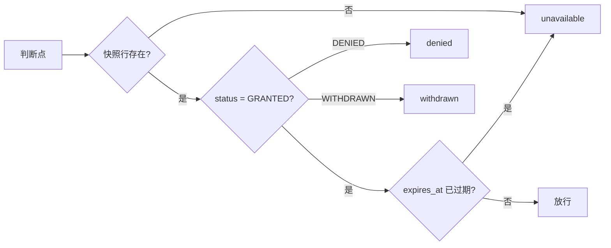
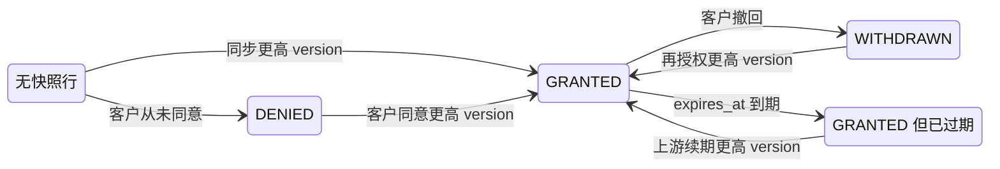
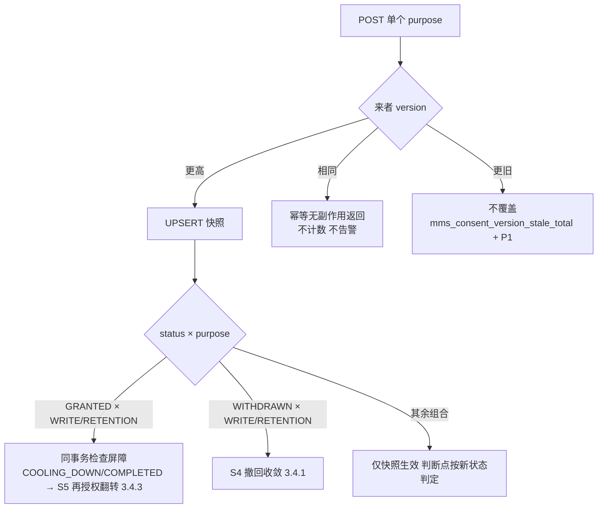
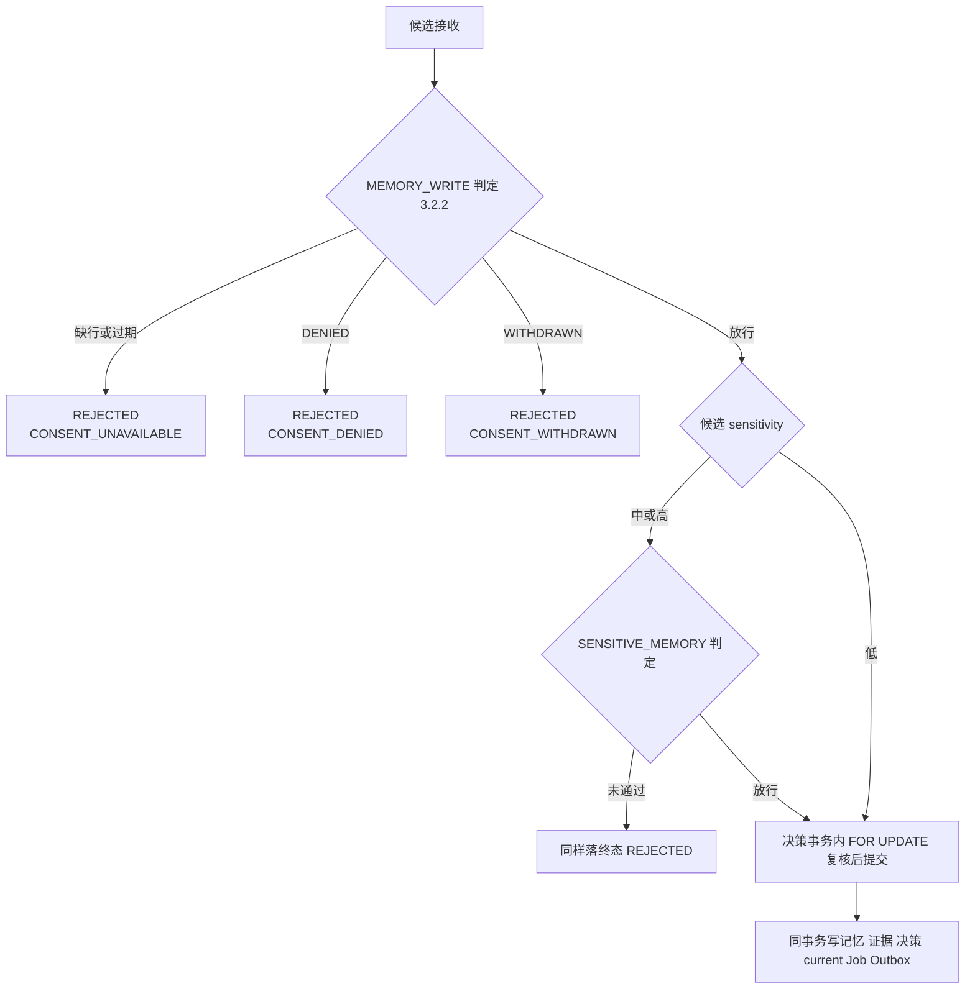
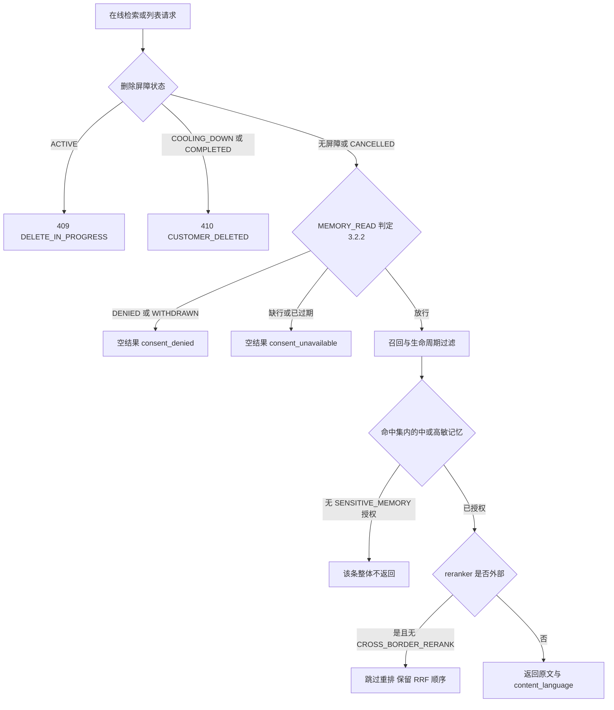
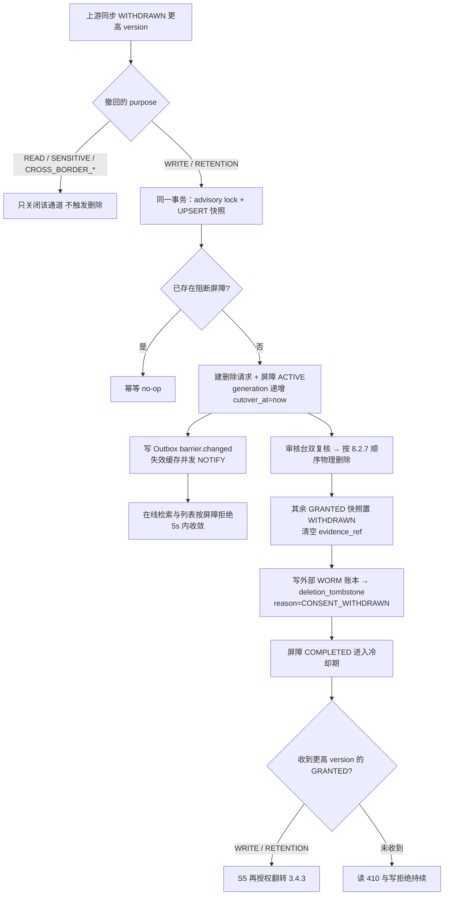
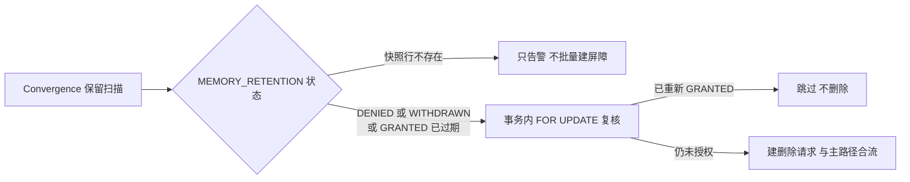

# 记忆授权

## 3.1 定位与整体执行过程

授权回答的不是"这个事实值不值得存"，而是"这个客户是否允许 MMS 保存、读取、外发他的事实"。它是隐私硬门：必须能在 MMS 内部离线判定，fail-closed，且合法基础消失时能把已存数据收敛掉。

全章只有三个核心对象，其余细节都是它们的展开：

| 核心对象 | 载体 | 一句话语义 |
|---|---|---|
| 快照 | `customer_memory_consent` | 上游同意状态的本地投影，每个 `(customer_id, purpose)` 一行当前状态 |
| 判定 | 有行 + `GRANTED` + 未过期 | 唯一放行条件，所有判断点共用同一算法（3.2.2） |
| 收敛 | `customer_deletion_barrier` | `MEMORY_WRITE`/`MEMORY_RETENTION` 撤回视同删除请求，合流 8.2 删除通道 |

### 整体执行过程（关键步骤）

| 步骤 | 触发 | 职责 | 未授权/失败后果 | 详见 |
|---|---|---|---|---|
| S1 快照同步 | 上游 POST 单个 purpose | 版本比较 + UPSERT 快照 | 旧版本不覆盖，计数 + P1 告警 | 3.3.1 |
| S2 写侧判定 | 候选接收与决策事务 | 固定顺序链式判定 | 终态 `REJECTED`，不重试、不进 DLQ | 3.3.2 |
| S3 读侧判定 | 在线检索与列表 API | 屏障 → 读授权 → 敏感 → 跨境 | 空结果，不回显是否存在记忆 | 3.3.3 |
| S4 撤回收敛 | WRITE/RETENTION 被撤回 | 同事务建/复用删除屏障 | 客户级停写、不可见、物理删除 | 3.4.1 |
| S5 再授权翻转 | 更高 version 的 GRANTED | 屏障 `CANCELLED`、generation+1 | 旧记忆不复活，新记忆新 generation | 3.4.3 |

边界（本章不做的事）：

- 不按 `effective_at` 做时间旅行判定；
- 不为撤回保留旧版本快照；
- 不因读侧或跨境通道撤回触发物理删除；
- 不在检索中回调上游同意服务。

## 3.2 数据模型

### 3.2.1 同意快照 `customer_memory_consent`

权威源在 MMS 之外（身份/授权服务或账户中心同意管理模块），本表只是可离线判定的本地快照；历史由上游与 `version` 承担。DDL 见 23.13。

| 列 | 语义 | 备注 |
|---|---|---|
| `customer_id` | 客户主体 | 只由内部服务身份与 path 交叉校验注入（15.1） |
| `purpose` | 7 值枚举（3.2.3） | 与判断点一一对应 |
| `status` | `GRANTED` / `DENIED` / `WITHDRAWN` | 判定只看状态与过期 |
| `version` | 大于 0 且单调 | 只在同步入口比较；判断点不读 |
| `effective_at` | 生效时间，上游给出 | 仅留痕，判断点不做时间旅行 |
| `expires_at` | 可空 | 到期即等同快照不可用 |
| `source` | 来源标识 | 撤回时作为删除请求 `requested_by` 落库 |
| `evidence_ref` | 上游同意凭证引用 | 物理删除时置空 |

### 3.2.2 统一判定算法

所有判断点共用这一个算法，输入只有 `(customer_id, purpose)`：

`DENIED` 与 `WITHDRAWN` 写侧是两种原因码（`CONSENT_DENIED` / `CONSENT_WITHDRAWN`），读侧合并为 `consent_denied`；缺行与过期统一为 `CONSENT_UNAVAILABLE` / `consent_unavailable`。

### 3.2.3 purpose 与判断点映射

不得出现"有判断点无 purpose"或"有 purpose 无判断点"：

| purpose | 唯一判断点 | 未授权或快照不可用时的行为 |
|---|---|---|
| `MEMORY_WRITE` | 候选接收/写入授权（6.1 S1–S2）+ 决策事务提交前复核（6.2.5） | 终态 `REJECTED`，原因码见 3.3.2；不进 DLQ |
| `MEMORY_READ` | 在线检索与所有列表 API 返回前（13.4 第 1 步） | 空结果 + `consent_denied` 或 `consent_unavailable` |
| `MEMORY_RETENTION` | Convergence 生命周期与保留扫描（8.2.3）、备份保留期计算、`RENORMALIZE` 取数（9.2.5） | 跳过保留并进入删除队列（3.4） |
| `SENSITIVE_MEMORY` | 写侧候选 `sensitivity` 中/高时；读侧每条中/高敏记忆离开 MMS 前逐条 | 写侧同 `MEMORY_WRITE`；读侧该条不返回 |
| `CROSS_BORDER_EMBEDDING` | 任何把记忆正文/规范文本/查询文本交给 embedding provider 前：候选发现查询向量（6.2.1）、Embedding Worker（12.4）、检索查询向量（12.5）、决策重放（13.1）、语义 canary（12.10） | 不生成向量，只保留精确与词法召回；计入 `mms_embedding_cross_border_blocked_total{stage}` |
| `CROSS_BORDER_TRANSLATION` | Translation Worker 生成/更新 `TRANSLATED` 视图前（12.4） | 不生成译文视图，跨语言只靠 `CANONICAL` |
| `CROSS_BORDER_RERANK` | 外部 reranker 调用前（12.8） | 跳过重排，保留 RRF 顺序 |

是否跨境只看 `embedding_model_registry.provider`（registry 无行按外部处理）；自托管不触发跨境 purpose，但必须在 registry 上可判定，禁止运行时猜测。外部 reranker 同理。

### 3.2.4 快照状态机

### 3.2.5 合流的其他表

结构定义不在本节，避免双源：

| 表/列 | 与授权的关系 | 定义处 |
|---|---|---|
| `customer_deletion_barrier` | 撤回触发的停写与不可见由同一张屏障承载 | 8.2.5、23.13 |
| `memory_deletion_request.request_source` | 撤回入口写 `CONSENT_WITHDRAWN`，与 `USER`、`COMPLIANCE`、`ADMIN`、`SYSTEM`、`DELETE_REQUESTED` 并列 | 23.13 |
| `deletion_tombstone.reason_code` | 撤回墓碑记 `CONSENT_WITHDRAWN`，普通删除记 `USER_DELETE`；审计口径不同、表结构相同 | 8.2.8 |
| `memory_decision.reason_codes` 与 `context_snapshot` | 被拒候选的 consent 原因码与判定上下文 | 6.5、6.2.4、23.4 |
| `memory_policy.sensitive_policy` | 决定是否要求 `SENSITIVE_MEMORY` 同意 | 6.3.4 |
| `embedding_model_registry.provider` | 决定 embedding 调用是否算跨境通道 | 12.3、23.7 |

## 3.3 授权：关键步骤说明

### 3.3.1 S1 快照同步

只有两个内部接口（均只接受内部服务身份；path 中的 `customer_id` 是请求目标而非授权凭据，15.1）：

| 接口 | 作用 | 约束 |
|---|---|---|
| `GET /internal/customers/{customer_id}/memory-consent` | 读回该客户全部 purpose 快照 | — |
| `POST /internal/customers/{customer_id}/memory-consent` | 同步单个 purpose | 字段白名单（`purpose`、`status`、`version`、`effective_at`、`expires_at`、`source`、`evidence_ref`），未知字段拒绝，`version > 0`；幂等按 `(customer_id, purpose, version)` |

版本比较只发生在同步入口，按来者版本分流：

版本回退告警是 MMS 唯一能本地发现上游重放的位置。

### 3.3.2 S2 写侧判定（fail-closed）

预检与权威判定分工固定：

| | 接收侧预检 | 决策事务权威判定 |
|---|---|---|
| 目的 | 只用于阻断外发 | 产生终态决策 |
| 加锁/落库 | 不加锁、不落库、不抛错 | `FOR UPDATE` 锁快照行，提交前按同一顺序复核 |
| 未通过 | 返回空预取 | 终态 `REJECTED` + `context_snapshot.consent`，只留脱敏摘录，不重试、不进 DLQ |

两条链顺序一致：**屏障 → `MEMORY_WRITE` → `SENSITIVE_MEMORY`（中/高敏）→ `CROSS_BORDER_EMBEDDING` → provider 调用**。

异步通道（外部 embedding/翻译/rerank）在各自 Worker 内独立判定对应 `CROSS_BORDER_*`，未授权只降级该通道（后果见 3.2.3），不阻塞事实生效。

### 3.3.3 S3 读侧判定（不回显存在性）

consent 判定直查主库不走缓存，读侧无陈旧窗口；屏障缓存 TTL 5s + 主库回读（3.4.4）。

## 3.4 撤回：关键步骤说明

`WITHDRAWN` 是"合法基础消失"，视同删除请求：授权类 purpose 的撤回必须创建或复用 `customer_deletion_barrier`，走 8.2 删除通道，不得只停新写入。

### 3.4.1 S4 撤回收敛

撤回的 purpose 决定后果范围：

| 撤回的 purpose | 立即生效 | 是否触发删除 |
|---|---|---|
| `MEMORY_WRITE` | 新候选一律终态拒绝 | 是，客户级 |
| `MEMORY_RETENTION` | 保留与生命周期扫描不再续期 | 是，客户级 |
| `MEMORY_READ` | 检索与列表返回空结果 | 否，只关可见性通道 |
| `SENSITIVE_MEMORY` | 中/高敏记忆不写入、不返回 | 否，只关敏感内容通道 |
| `CROSS_BORDER_*` | 对应外部通道降级 | 否，只关出境通道 |

两个入口，一条收敛路径：

| 入口 | 触发 | 关键行为 |
|---|---|---|
| 同步入口（主路径） | 上游把 `MEMORY_WRITE`/`MEMORY_RETENTION` 同步为 `WITHDRAWN` | 同一事务取客户级 advisory lock 后创建/复用屏障；`request_source=CONSENT_WITHDRAWN`；幂等键 `consent-withdrawn:{customer_id}:{purpose}:{version}`；已存在阻断屏障时 no-op |
| 扫描兜底（3.4.2） | Convergence 保留扫描发现 `MEMORY_RETENTION` 明确 `DENIED`/`WITHDRAWN` 或 `GRANTED` 已过期 | 入队前事务内 `FOR UPDATE` 复核，期间已重新 `GRANTED` 的跳过 |

撤回与普通删除的异同：

| 维度 | 用户要求删除 | 授权撤回 |
|---|---|---|
| 触发主体 | 数据主体、合规、管理员 | 上游同意状态变化 |
| 语义 | 行使删除权 | 合法基础消失 |
| 屏障 | `customer_deletion_barrier` | 复用同一张、同一判定算法（8.2.5） |
| `request_source` | `USER`、`COMPLIANCE`、`ADMIN`、`SYSTEM` | `CONSENT_WITHDRAWN` |
| 墓碑 `reason_code` | `USER_DELETE` | `CONSENT_WITHDRAWN` |
| 部分范围 | 可按 `memory_type`/`fact_key` 选择，屏障仍客户级 | 不按范围撤回；purpose 决定关通道还是整客户删除 |
| 恢复路径 | 只能重新采集 | 更高 `version` 的 `GRANTED` 可解除屏障 |
| 冷却期表现 | 读 410、写拒绝 | 相同 |

### 3.4.2 兜底扫描

**快照缺失只告警、不批量建屏障**，避免同步中断被放大成全量停摆：

### 3.4.3 S5 再授权翻转

| 要素 | 口径 |
|---|---|
| 前提 | 屏障处于 `COOLING_DOWN`/`COMPLETED`，且收到更高 `version` 的 `GRANTED`（`MEMORY_WRITE`/`MEMORY_RETENTION`）；`ACTIVE`（删除未完成）不翻转 |
| 动作 | 屏障置 `CANCELLED`、`generation` 加 1、发布 `customer.deletion.barrier.changed.v1`、失效读缓存并发 NOTIFY |
| 不复活 | 已物理删除的旧记忆不复活 |
| 旧载体 | 此后写路径按 8.2.5 唯一算法判定，携带旧 generation 的载体一律 `STALE_GENERATION` 拒绝 |

### 3.4.4 竞态口径

| 竞态点 | 互斥/收敛机制 |
|---|---|
| 撤回同步 vs 在途决策事务 | 快照行 `FOR UPDATE` 互斥，无"检查通过但状态已变"窗口 |
| 屏障创建 vs 在途写入 | 同一把 `pg_advisory_xact_lock('mms_barrier:' \|\| customer_id)`，拿锁即保证在途写入已全部提交或全部被拒 |
| 读路径状态收敛 | 屏障缓存 TTL 5s + 主库回读；consent 判定直查主库不走缓存，读侧无陈旧窗口 |

## 3.5 持续观测设计

### 3.5.1 指标与告警

| 指标 | 语义 | 告警 |
|---|---|---|
| `mms_consent_check_total{result}` | 判定结果分布：`granted` / `denied` / `withdrawn` / `unavailable` | `MMSConsentCheckUnavailable`：`unavailable` 增长即时 critical |
| `mms_consent_version_stale_total` | 来者版本低于已存快照的次数（等版本重放不计） | `MMSConsentVersionStale`：大于 0 即时 critical |
| `mms_consent_withdrawal_total` | 撤回触发删除请求的次数 | 复用 8.6 barrier 告警口径 |
| `mms_consent_event_lag_seconds{topic}` | consent 事件发布到缓存失效的延迟 | — |
| `mms_embedding_cross_border_blocked_total{stage}` | 未授予 `CROSS_BORDER_EMBEDDING` 而跳过的 provider 调用数；`stage` 取 `discovery` / `worker` / `retrieval` / `replay` / `canary` | 不设告警：策略结果，用于解释语义召回覆盖下滑 |
| `mms_retrieval_blocked_by_barrier_total{status}`、`mms_barrier_write_check_failures_total` | 撤回后的收敛与写屏障校验 | 复用 8.6 barrier 告警口径 |

### 3.5.2 上线门禁（与 20.1 同源）

| 门禁 | 验收口径 |
|---|---|
| 未授权零写入 | `DENIED`/`WITHDRAWN` 写入数 = 0 |
| 撤回可见性收敛 | 撤回后检索命中 = 0，且 P95 收敛 ≤5s |
| 撤回零新增 | 撤回后新增 `ACTIVE` 记忆 = 0（屏障提交与并发写入交叉测试，须覆盖"屏障行尚不存在的首次撤回"） |
| 版本不回退 | consent 版本回退 = 0 |
| 端到端恢复 | 撤回 → 物理删除 → 再授权：屏障转 `CANCELLED`、旧记忆不复活、新记忆携带新 generation 正常写入 |
| 拒绝可审计 | 被拒候选可在 `memory_decision` 查到 `REJECTED` 与对应原因码，且 `context_snapshot.consent` 记录 purpose 与错误码 |