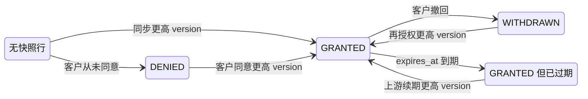
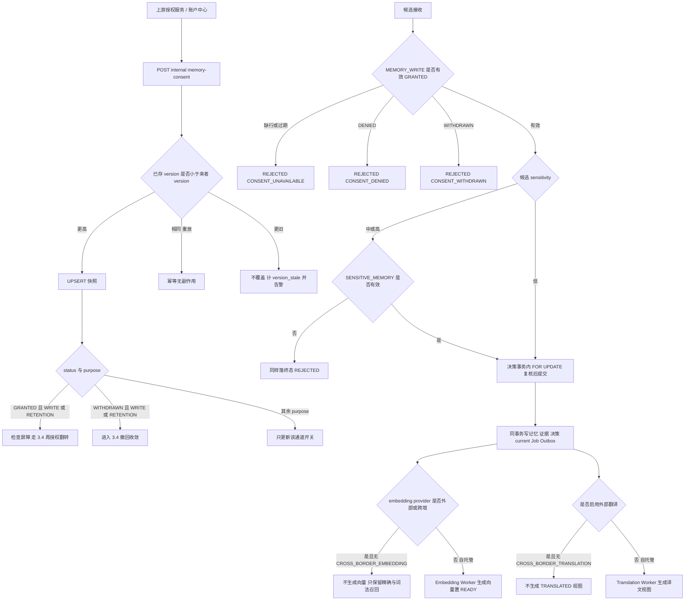
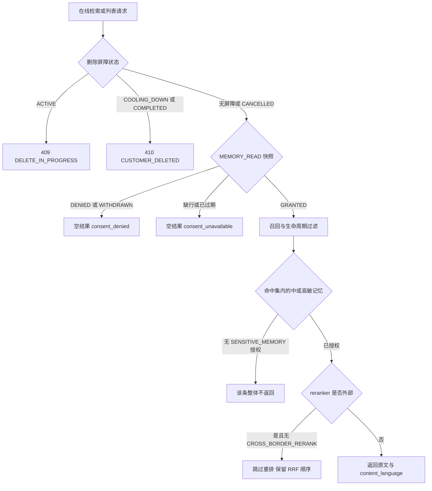
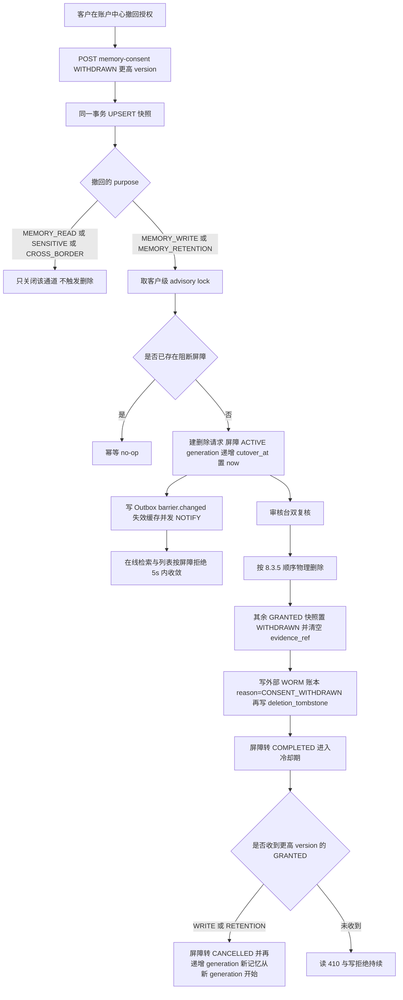
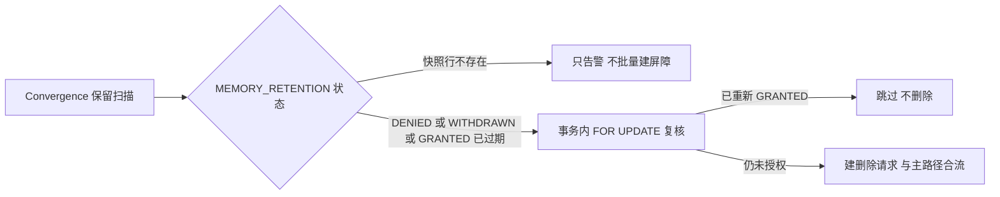

# 3. 记忆授权与撤回

## 3.1 为什么需要独立的授权层

**结论：授权不是请求上的一个布尔字段，而是"这条记忆能否被保存、能否被读出、能否离开 MMS"的合法性基础。它必须能在 MMS 内部离线判定，并且能在基础消失时把已存数据收敛掉。**

抽取、准入、决策、检索各环回答的都是"这个事实值不值得存"，没有任何一环回答"这个客户是否允许我保存和读取他的事实"。缺这一层时，链路会正确地把不该保存的记忆写进权威库并长期召回。

四条设计理由：

1. **合法基础会中途消失，而判定在热路径上。** consent 判断点分布在决策事务（6.6）、检索返回前（13.4）、Embedding/Translation Worker 写库前（12.4）、外部 reranker 调用前（12.8）、Convergence 保留扫描（8.2）。每次同步调用上游同意服务，等于把上游的可用性和延迟变成 MMS 的；因此 MMS 持有本地快照，用版本化同步收敛。
2. **一次同意不等于所有用途。** 写入、读取、保留、敏感正文可见性、三条跨境通道（embedding、翻译、rerank）的法律基础和风险各不相同。做成全局开关，客户撤回一项就失去全部客服能力；做成一个布尔值，跨境外发无法单独控制。因此以 `purpose` 为粒度，且 purpose 与判断点一一对应。
3. **撤回与删除语义不同，但必须落到同一条收敛路径。** 删除是数据主体行使删除权；撤回是合法基础消失。若撤回只"停止新写入"，已存记忆继续被召回——这正是本层要防的首要失效。因此撤回复用删除屏障（8.3），差异只体现在审计原因和恢复路径。
4. **判定必须可证明、可回放。** 同意状态是隐私硬门：被拒候选要留下终态决策与上下文快照，而不是静默丢弃或反复重试到 DLQ。

没有这一层时会出现的失效模式：

| 失效模式 | 触发条件 | 本层的拦截 |
|---|---|---|
| 撤回后旧记忆仍可召回 | 只停新写入、不清旧数据 | `WITHDRAWN` 视同删除请求，复用屏障（3.4） |
| 无同意时静默放行写入 | 快照查不到就当作允许 | 写入与批处理侧失败关闭（3.3） |
| 拒绝造成存在性泄露 | 未授权时返回错误或提示 | 读取与列表侧只返回空结果加标志位（3.3） |
| 旧同意事件回滚当前状态 | 上游重放或乱序投递 | `version` 单调，只接受更高版本（3.2） |
| 未授权正文出境 | 外部 embedding、翻译、rerank 收到文本 | 三条 `CROSS_BORDER_*` purpose 独立判定（3.3） |
| 快照过期无人处置 | `expires_at` 已过但状态仍是 `GRANTED` | 判定即视为不可用；保留扫描额外入删除队列（3.4） |

三条不可让的口径（任何实现变更须新 ADR）：

- 写入与批处理侧 **fail-closed**：读不到有效快照就拒绝，不降级放行；
- 读取与列表侧 **不回显存在性**：`consent_denied` 与 `consent_unavailable` 只区分原因，都返回空结果；
- 撤回 **必须收敛到删除屏障**：不得只关写入而保留旧记忆召回。

> 设计取舍：不为每次请求同步调用同意服务（热路径延迟/可用性不可控）；用本地快照 + 版本化事件收敛。快照的权威性由上游签名/服务身份保证。

## 3.2 数据模型

**权威源在 MMS 之外**：身份/授权服务或 C 端账户中心的同意管理模块。`customer_memory_consent` 只是 MMS 侧的可离线判断快照，不承担同意书原文与撤销留痕；快照行也不是事件流——每个 `(customer_id, purpose)` 只有当前状态一行，历史由上游权威源与 `version` 承担。DDL 见 23.13。

| 列 | 语义 | 写入方 | 读取方 |
|---|---|---|---|
| `customer_id` | 客户主体；只由内部服务身份与 path 交叉校验注入（15.1） | 同步入口（3.3） | 全部判断点 |
| `purpose` | 7 值枚举，见下表 | 同上 | 全部判断点 |
| `status` | `GRANTED`、`DENIED`、`WITHDRAWN` | 同上 | 全部判断点 |
| `version` | 大于 0 且单调；同步只在更高版本时生效 | 同上 | 只同步入口比较；判断点不读版本 |
| `effective_at` | 生效时间，由上游给出 | 同上 | 判断点不比较生效时刻，只作上游留痕 |
| `expires_at` | 可空；到期即等同于快照不可用 | 同上 | 判断点与保留扫描 |
| `source` | 来源标识；撤回时作为删除请求的 `requested_by` 落库 | 同上 | 审计 |
| `evidence_ref` | 上游同意凭证引用；物理删除时置空 | 同上 | 删除证明 |

purpose 与判断点一一对应，不得出现"有判断点无 purpose"或"有 purpose 无判断点"：

| purpose | 唯一判断点 | 未授权或快照不可用时的行为 |
|---|---|---|
| `MEMORY_WRITE` | 候选接收/写入授权（6.3 第 1–2 步）加决策事务提交前复核（6.6） | 终态 `REJECTED`，原因码见 3.5；不进 DLQ |
| `MEMORY_READ` | 在线检索与所有列表 API 返回前（13.4 第 1 步） | 空结果 + `consent_denied` 或 `consent_unavailable` |
| `MEMORY_RETENTION` | Convergence 生命周期与保留扫描（8.2）、备份保留期计算、`RENORMALIZE` 取数（9.2） | 跳过保留并进入删除队列（3.4） |
| `SENSITIVE_MEMORY` | 写侧候选 `sensitivity` 为中/高时；读侧每条中/高敏记忆离开 MMS 前逐条 | 写侧同上；读侧该条不返回 |
| `CROSS_BORDER_EMBEDDING` | 任何把记忆正文、规范文本或查询文本交给 embedding provider 的动作前：候选发现的查询向量（6.3 阶段 1）、Embedding Worker 生成向量（12.4）、在线检索的查询向量（12.5）、决策重放（13.1）、语义 canary 采样（12.10）；是否算跨境只看 `embedding_model_registry.provider`，registry 无行按外部处理 | 不生成向量，只保留精确与词法召回；每次关闭计入 `mms_embedding_cross_border_blocked_total{stage}` |
| `CROSS_BORDER_TRANSLATION` | Translation Worker 生成或更新 `TRANSLATED` 视图前（12.4） | 不生成译文视图，跨语言只靠 `CANONICAL` |
| `CROSS_BORDER_RERANK` | 外部 reranker 调用前（12.8） | 跳过重排，保留 RRF 顺序 |

自托管 embedding 不触发 `CROSS_BORDER_EMBEDDING`，但必须在 `embedding_model_registry.provider` 上可判定，禁止靠运行时猜测；外部 reranker 同理。

状态与同步语义：

判定处只看两件事：**有没有行、状态是否 `GRANTED` 且未过期**。`DENIED` 与 `WITHDRAWN` 在写侧是两种原因码、在读侧合并为 `consent_denied`，不区分"从未同意"和"撤回"。

与本节合流的其他表（结构定义不在本节，避免双源）：

| 表/列 | 与授权的关系 | 定义处 |
|---|---|---|
| `customer_deletion_barrier` | 撤回触发的停写与不可见由同一张屏障承载 | 8.3.1、23.13 |
| `memory_deletion_request.request_source` | 撤回入口写 `CONSENT_WITHDRAWN`，与 `USER`、`COMPLIANCE`、`ADMIN`、`SYSTEM`、`DELETE_REQUESTED` 并列 | 23.13 |
| `deletion_tombstone.reason_code` | 撤回来源的墓碑记 `CONSENT_WITHDRAWN`，普通删除记 `USER_DELETE`；两者审计口径不同、表结构相同 | 8.3.3 |
| `memory_decision.reason_codes` 与 `context_snapshot` | 被拒候选的 consent 原因码与判定上下文 | 6.2、6.7、23.4 |
| `memory_policy.sensitive_policy` | 决定是否要求 `SENSITIVE_MEMORY` 同意 | 6.8 |
| `embedding_model_registry.provider` | 决定 embedding 调用是否算跨境通道 | 12.3、23.7 |

接口契约（快照只有这两个入口，Kafka `customer.consent.changed.v1` 目前只是建议 topic）：

- `GET /internal/customers/{customer_id}/memory-consent`：读回该客户全部 purpose 快照；内部服务身份；
- `POST /internal/customers/{customer_id}/memory-consent`：同步单个 purpose，字段白名单（`purpose`、`status`、`version`、`effective_at`、`expires_at`、`source`、`evidence_ref`），未知字段拒绝，`version > 0`；幂等按 `(customer_id, purpose, version)`；
- 两个接口都只接受内部服务身份，path 里的 `customer_id` 是请求目标而非授权凭据（15.1）。

## 3.3 授权：快照同步与放行判定

**同步侧三条规则：**

1. 只有更高 `version` 能改写快照；同版本重放是无副作用的幂等返回，不计数、不告警；
2. 来者版本低于已存快照时不覆盖，计入 `mms_consent_version_stale_total` 并触发 P1 告警——这是 MMS 唯一能本地发现"上游状态被重放"的位置，判断点本身不比较版本；
3. 同步事务内 `GRANTED` 且 purpose 属于 `MEMORY_WRITE` 或 `MEMORY_RETENTION` 时，先检查删除屏障是否处于 `COOLING_DOWN`/`COMPLETED`，是则执行 3.4 的再授权翻转。

**写入侧判定链（fail-closed）：** 候选接收时先取客户级屏障与 `MEMORY_WRITE` 快照，再以 `FOR UPDATE` 锁住快照行；被拒候选落终态 `REJECTED` 决策（含 `context_snapshot.consent`），只保留脱敏摘录，不重试、不进 DLQ。`sensitivity` 为中/高时追加 `SENSITIVE_MEMORY` 同口径判定；决策事务提交前按同一顺序复核一次，保证"检查与提交之间状态未变"。异步通道各自独立判定：外部 embedding、外部翻译、外部 rerank 未授权时只降级该通道，不阻塞事实生效。 预检与权威判定的分工固定为：接收侧预检只用于阻断外发——不加锁、不落库、不抛错，未通过就返回空预取；终态决策仍由决策事务内的 `FOR UPDATE` 判定产生。两条链的先后都是屏障 → `MEMORY_WRITE` → `SENSITIVE_MEMORY`（中/高敏）→ `CROSS_BORDER_EMBEDDING` → provider 调用。

**读取侧判定链（不回显存在性）：** 顺序是先屏障、后 `MEMORY_READ`、再逐条 `SENSITIVE_MEMORY`、最后是跨境通道开关。屏障命中返回状态码（409/410，见 8.3.6）；`MEMORY_READ` 未授权或快照不可用则返回空结果加标志位，既不返回正文也不说明是否存在记忆；中/高敏记忆在无 `SENSITIVE_MEMORY` 授权时整条不返回。

同步与写入放行：

读取放行：

**本节不做的事：** 不在判断点做时间旅行（不按 `effective_at` 判定某个历史时刻是否已授权）；不为撤回保留旧版本快照；不因读侧或跨境通道的撤回触发物理删除；不在同一次检索里回调上游同意服务。

## 3.4 撤回：与删除屏障合流

**结论：`WITHDRAWN` 是"合法基础消失"，视同删除请求。** 授权类 purpose 的撤回必须创建或复用 `customer_deletion_barrier`，走 8.3 的端到端删除；不得只停止新写入而保留旧记忆召回。

两个入口，一条收敛路径：

- **同步入口（主路径）**：上游把 `MEMORY_WRITE` 或 `MEMORY_RETENTION` 同步为 `WITHDRAWN`，同一事务内取客户级 advisory lock 后创建或复用屏障，`request_source=CONSENT_WITHDRAWN`，幂等键 `consent-withdrawn:{customer_id}:{purpose}:{version}`；已存在阻断屏障时是 no-op（终态已满足，不重复建请求）；
- **扫描兜底**：Convergence 在保留扫描里把明确 `DENIED`、`WITHDRAWN` 或已过期 `GRANTED` 的 `MEMORY_RETENTION` 客户送入删除队列；**只有快照缺失时不批量建屏障**，只告警——否则一次同意同步中断会把同步滞后放大成全量停摆。入队前在事务内以 `FOR UPDATE` 复核，期间已重新 `GRANTED` 的跳过。

撤回的 purpose 决定后果范围：

| 撤回的 purpose | 立即生效 | 是否触发删除 |
|---|---|---|
| `MEMORY_WRITE` | 新候选一律终态拒绝 | 是，客户级 |
| `MEMORY_RETENTION` | 保留与生命周期扫描不再为其续期 | 是，客户级 |
| `MEMORY_READ` | 检索与列表返回空结果 | 否，只关可见性通道 |
| `SENSITIVE_MEMORY` | 中/高敏记忆不写入、不返回 | 否，只关敏感内容通道 |
| `CROSS_BORDER_*` | 对应外部通道降级 | 否，只关出境通道 |

撤回与普通删除的异同：

| 维度 | 用户要求删除 | 授权撤回 |
|---|---|---|
| 触发主体 | 数据主体、合规、管理员 | 上游同意状态变化 |
| 语义 | 行使删除权 | 合法基础消失 |
| 屏障 | `customer_deletion_barrier` | 复用同一张、同一判定算法（8.3.1） |
| `request_source` | `USER`、`COMPLIANCE`、`ADMIN`、`SYSTEM` | `CONSENT_WITHDRAWN` |
| 墓碑 `reason_code` | `USER_DELETE` | `CONSENT_WITHDRAWN` |
| 部分范围 | 可按 `memory_type`/`fact_key` 选择，但屏障仍是客户级 | 不按范围撤回；purpose 决定是关通道还是整客户删除 |
| 恢复路径 | 只能重新采集 | 更高 `version` 的 `GRANTED` 可解除屏障 |
| 冷却期表现 | 读 410、写拒绝 | 相同 |

**再授权出口：** 已物理删除的旧记忆不会复活；更高 `version` 的 `GRANTED`（`MEMORY_WRITE` 或 `MEMORY_RETENTION`）把处于 `COOLING_DOWN`/`COMPLETED` 的屏障置 `CANCELLED`、`generation` 加 1、发布 `customer.deletion.barrier.changed.v1`、失效读缓存并发 NOTIFY。屏障处于 `ACTIVE`（删除尚未完成）时不翻转。此后写路径按 8.3.1 的唯一算法判定：携带旧 generation 的载体一律 `STALE_GENERATION` 拒绝。

**竞态口径：**

- 撤回同步与在途决策事务在快照行上互斥（决策事务 `FOR UPDATE`），不存在"检查通过但状态已变"的窗口；
- 屏障创建与在途写入取同一把 `pg_advisory_xact_lock('mms_barrier:' || customer_id)`，拿到锁即保证在途写入已全部提交或全部被拒；
- 读路径经屏障缓存（TTL 5s）与主库回读收敛；consent 判定直查主库、不走缓存，因此读侧没有陈旧窗口。

## 3.5 观测、告警与门禁

| 指标 | 语义 | 告警 |
|---|---|---|
| `mms_consent_check_total{result}` | 判定结果分布，`result` 取 `granted`、`denied`、`withdrawn`、`unavailable` | `MMSConsentCheckUnavailable`：`unavailable` 增长即时 critical |
| `mms_consent_version_stale_total` | 同步到来者版本低于已存快照的次数（等版本重放不计） | `MMSConsentVersionStale`：大于 0 即时 critical |
| `mms_consent_withdrawal_total` | 撤回触发删除请求的次数 | 未注册前按 `memory_deletion_request.request_source='CONSENT_WITHDRAWN'` 计数 |
| `mms_consent_event_lag_seconds{topic}` | consent 事件发布到缓存失效的延迟 | 当前无生产者（Kafka 未接入） |
| `mms_embedding_cross_border_blocked_total{stage}` | 因未授予 `CROSS_BORDER_EMBEDDING` 而跳过的 provider 调用数；`stage` 取 `discovery`、`worker`、`retrieval`、`replay`、`canary` | 不设告警：这是策略结果，只用于解释语义召回覆盖下滑 |
| `mms_retrieval_blocked_by_barrier_total{status}`、`mms_barrier_write_check_failures_total` | 撤回后的收敛与写屏障校验 | 复用 8.3.6 的 barrier 告警口径 |

门禁（与 20.1 同源）：

- `DENIED`/`WITHDRAWN` 写入数 = 0；
- 撤回后检索命中 = 0，且 P95 收敛 ≤5s；
- 撤回后新增 `ACTIVE` 记忆 = 0（屏障提交与并发写入交叉测试，必须覆盖"屏障行尚不存在的首次撤回"）；
- consent 版本回退 = 0；
- 撤回 → 物理删除 → 再授权端到端：屏障转 `CANCELLED`、旧记忆不复活、新记忆可正常写入且携带新 generation；
- 被拒候选必须能在 `memory_decision` 查到 `REJECTED` 与对应原因码，且 `context_snapshot.consent` 记录 purpose 与错误码。
