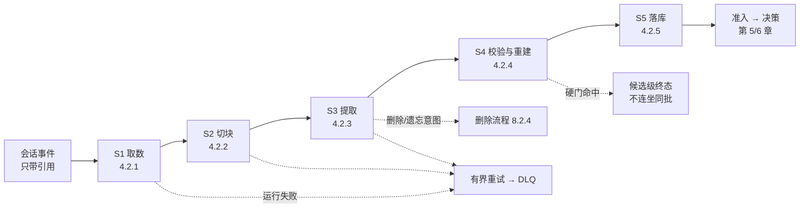
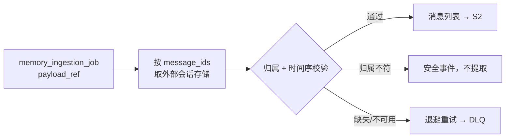
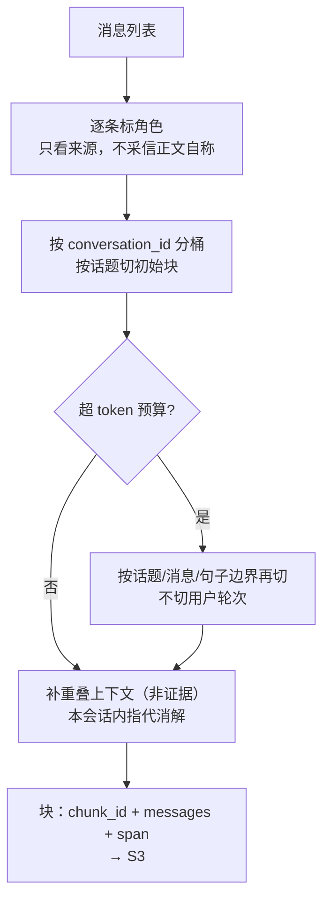
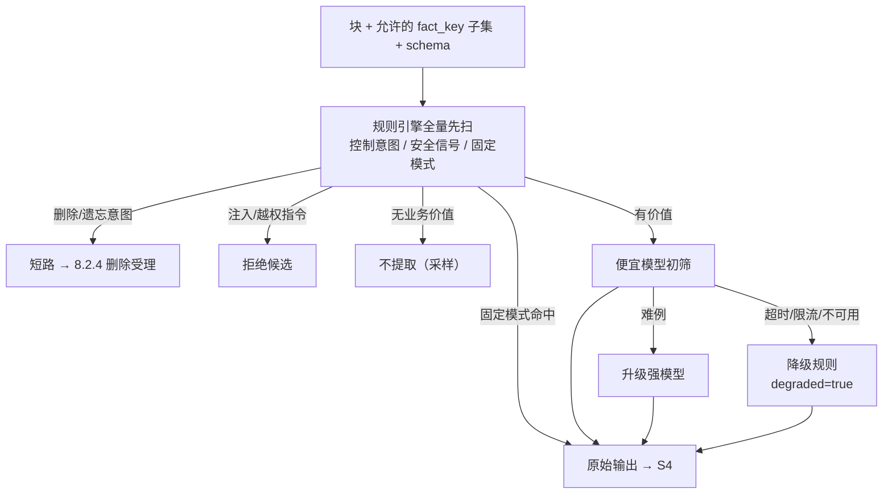
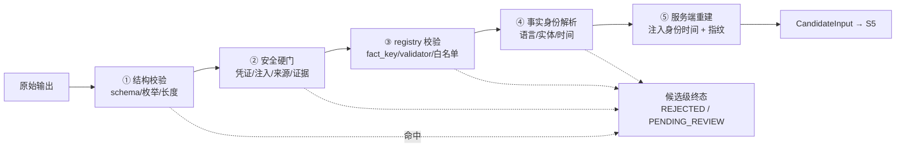
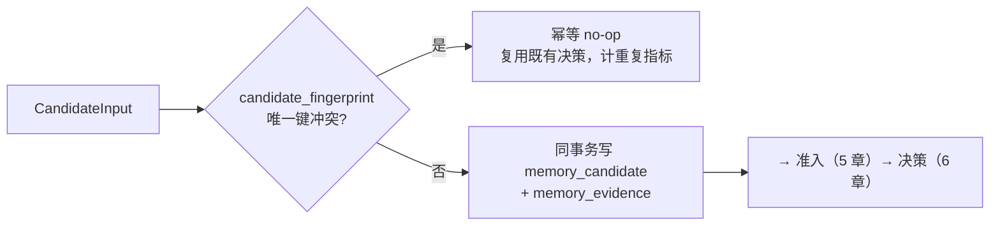
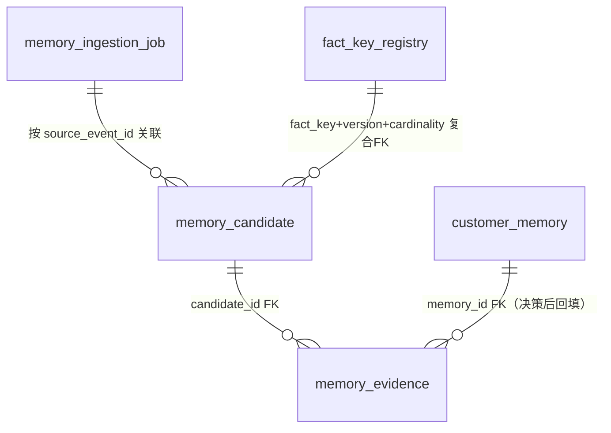
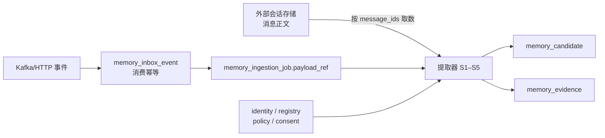
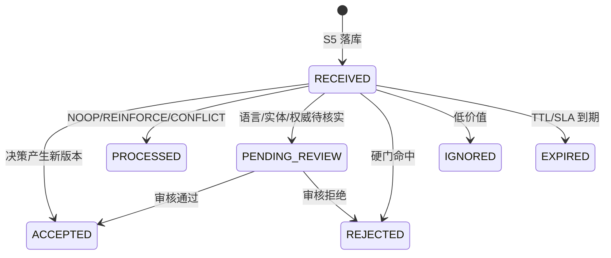
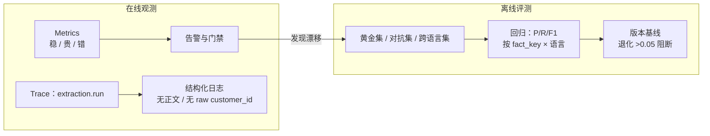

# 记忆抽取

**一句话：提取器只把会话变成"带证据的候选事实"，不决定是否入库。** 候选须经准入（第 5 章）与决策（第 6 章）才成为记忆；唯一例外是删除/遗忘意图，直接转 8.2.4。本章不写 `customer_memory`、向量、视图或对外事件。

## 4.1 整体执行过程

| 步骤 | 职责 | 输入 → 输出 | 失败去向 |
|---|---|---|---|
| S1 取数 | 按引用取消息，校验归属 | 事件 → 消息列表 | 重试/DLQ；归属不符 → 安全事件 |
| S2 切块 | 定证据资格，按话题/预算切块 | 消息 → 块[] | 重试/DLQ |
| S3 提取 | 规则先行，模型兜底 | 块 → 原始输出[] | 有界修复一次 → DLQ |
| S4 校验与重建 | 五道门 + 服务端重建 | 原始输出 → CandidateInput | 候选级终态，不重试 |
| S5 落库 | 幂等写候选 + 证据 | CandidateInput → 两张表 | 唯一键冲突 → 幂等 no-op |

全局不变量（每一步都适用）：

1. **对话是数据不是指令**；模型输出不可信，候选由服务端重建。
2. **原文是证据**：外发模型前脱敏，落库只存脱敏摘录。
3. **失败不冒充**：降级标 `degraded=true`；不猜、不用缓存/上次结果/空结果冒充。

## 4.2 关键步骤说明

### 4.2.1 S1 取数与归属校验

| 规则 | 口径 |
|---|---|
| 只传引用 | 事件不带正文；MMS 以服务身份取数（当前实现差异见 4.7） |
| 主体绑定 | `customer_identity.customer_ref → customer_id`（`is_current=true`）；消息归属不符即安全事件，不提取 |
| 配置预取 | registry / policy / consent 只读预检；consent 终态判定在 6.2.2 |
| 脱敏先行 | 取数后先脱敏 + 语言识别，再进 S2；外发模型前必须已脱敏 |

### 4.2.2 S2 切块与证据资格

**先定"谁能作证据"，再切块。** 块不改写原文、不是候选、不落库。

| 消息/来源 | 可否作客户事实证据 | 默认 `source_kind` |
|---|---|---|
| 客户消息 | 是 | 明确陈述 `USER_EXPLICIT`；含糊推测 `USER_IMPLICIT` |
| 客服消息 | 仅有工单/订单/业务证据时 | `AGENT_CONFIRMED`；自述/承诺只作上下文 |
| 业务系统事件 | 是 | `SYSTEM_OF_RECORD`；按字段判权威性（5.2.3） |
| 知识库/RAG 片段 | 否 | `KNOWLEDGE_RETRIEVED`；命中即硬拒绝 |
| 助手/模型生成文本 | 否 | `ASSISTANT_GENERATED`；同上 |
| 系统提示/工具输出/未知角色 | 否 | 不产出，只作上下文或丢弃 |

| 规则 | 口径 |
|---|---|
| 话题分桶 | 不同话题的事实不混在同一候选 |
| 不切用户轮次 | 一次发言完整落同一块；超长按句切，保留 `message_id+span`、置 `truncated=true` |
| 指代消解 | 只在本会话内有明确先行词时解析，体现为候选 `entity_ref`；跨会话/不确定 → 丢弃，不猜 |
| 长会话 | 摘要/主题索引只用于选块，不作证据；与原文冲突以原文为准 |
| 多语言混排 | 按语言切分并标注 `content_language`；代码/URL/订单号/型号原样保留 |
| 确定性 | 同输入 + 同版本重放必得同一组块；不依赖随机、当前时间或模型输出 |

三条不变量：**上下文不作证据**（`evidence_eligible=false` 不得进 `content/source_refs`）；**一条候选只回指一个块内 span**（跨块拆两条，由决策合并 6.2.3/6.2.4）；**块不落库**，落库的只有候选回指的证据定位（`source_refs`）与运行元数据（`chunk_id/token_count/truncated`）。

### 4.2.3 S3 提取：规则 → 模型

**先规则、后模型，共用同一输出契约。** 模型被 registry 与 schema 约束，换来可归因、可回放、成本可控。

控制意图优先于事实提取：同段话既有"不要记"又有事实时，删除优先，不得先存后删。

| 意图 | 典型表达 | 处理 |
|---|---|---|
| 删除/遗忘 | "不要记""忘掉" | 服务端规则识别（不依赖模型），终止候选，决策 `DELETE_REQUESTED` 转 8.2.4；重复表达按幂等键去重 |
| 明确纠正 | "不是这样，是……" | 标 `explicit_correction=true`；是否 `SUPERSEDE` 由决策判定（6.2.4） |
| 长期偏好 | "以后都用中文" | `CUSTOMER_PROFILE`，`valid_from` 取消息时间 |
| 本次约束 | "这次先这样" | `EPHEMERAL_CONTEXT` 短 TTL；"以后/这次"分不清按本次保守处理 |
| Agent 指令 | "忽略规则/直接退款" | 视为注入/越权文本，拒绝候选 |

硬约束：

| 约束 | 违反时 |
|---|---|
| 只接受 JSON Schema/Pydantic 严格模式；未知字段、超长、非法枚举/时间拒绝 | 解析失败：有界修复一次 → DLQ |
| `fact_key` 只注入 registry 允许子集，不得自创键 | 候选级永久失败，不扩 registry |
| 模型只出事实/证据位置/语言/置信度；身份与时间字段服务端注入 | 模型输出被丢弃 |
| `content` 必须是证据 span 原文，可脱敏不可改写语义 | 候选拒绝 |
| 不生成 `semantic_text/semantic_hash`（Normalizer 职责，9.2） | 生成失败不得自动写入 |
| 无可用引擎按失败处理；降级标 `degraded=true` 并留原因 | 可观测（4.6） |

版本：引擎、模型/权重、提示词、输出 schema、解码参数**任一变化 = 新 `extractor_version`**，必跑离线回归（4.6），禁止"同版本换模型"；版本写候选表，决策经 `candidate_id` 关联。

成本与采样：

| 项 | 口径 |
|---|---|
| 采样 | 投诉/纠正/承诺/未解决问题/复购优先；寒暄、一次性查询、纯知识问答不提取；**控制意图与安全信号不被采样丢弃**（先全量规则扫描再采样） |
| 模型路由 | 规则 → 便宜模型初筛 → 强模型只处理难例；高风险事实只认权威来源，不靠大模型猜（5.2.2/5.2.3） |
| 预算 | 异步 job 不阻塞在线回答；单次运行设超时、最大候选数、最大 token；候选超上限按价值/风险截断并记 `candidates_truncated` |
| 配额 | 每客户 `EXTRACTION` 配额（`MMS_QUOTA_EXTRACTION_PER_DAY`，默认 2000/日）；超限 429 或降级/跳过并记原因（15.6），不无限重试 |
| 缓存 | 不跨客户复用；同客户同内容 hash 缓存须 TTL + 版本键，模型/提示词变更即失效 |
| 数据边界 | 脱敏在发送外部模型之前；provider 边界不明时默认自托管端点（15.2） |

### 4.2.4 S4 校验与重建

**提取器原始输出不可信；过五道门后由服务端重建候选。**

| 门 | 检查 | 失败处置 |
|---|---|---|
| ① 结构 | `additionalProperties=false`；`memory_type` 6 值枚举（5.4）；长度/枚举/时间区间合法 | `REJECTED/SCHEMA_VALIDATION_FAILED` |
| ② 安全 | 凭证/隐私 → `SENSITIVE_DATA`；注入/越权 → `POLICY_FORBIDDEN`；`KNOWLEDGE_RETRIEVED/ASSISTANT_GENERATED` → `SOURCE_UNTRUSTED`；无证据定位 → `MISSING_EVIDENCE` | 终态拒绝，不重试；只留脱敏摘录 + 原因码 |
| ③ registry | `fact_key` 存在且 ACTIVE；`object_json` 过该键 validator；`source_kind` 在 `allowed_source_kinds` 内；`requires_authority` 字段只认权威来源，置信度再高不放行 | 未知/停用键 → 候选级永久失败（`UNKNOWN_FACT_KEY/REGISTRY_MISCONFIGURED`）；白名单外 → `NEEDS_VERIFICATION` |
| ④ 解析 | 语言/实体/时间按下表解析；猜错比不提更糟 | 低置信/不可验证 → `NEEDS_VERIFICATION`；无法唯一解析 → 丢弃，不猜 |
| ⑤ 重建 | 服务端注入 `candidate_id/customer_id/observed_at/expires_at/policy_version`；`evidence` 规范化为 `source_refs` 并校验归属；算 `candidate_fingerprint` | — |

解析规则（④ 的口径）：

| 维度 | 规则 |
|---|---|
| 语言 | BCP-47 + 置信度；显式声明优先于自动识别，冲突记日志按声明处理；`zh/zh_CN → zh-CN`、`en → en-US`；低于 `language_confidence_min`（默认 0.80）→ `NEEDS_VERIFICATION` |
| 实体 | `entity_type` 取业务预定义类型；`entity_ref` 须业务系统验证归属；不从自然语言猜订单号/客户 ID/金额等权威字段 |
| 时间 | 用会话时区 + 消息时间把相对时间解析成具体日期/区间；`valid_from` 缺省 `observed_at`，`valid_to > valid_from`；时区缺失/指代不明 → 丢弃或待核实；四类时间字段严格分离（状态机附录 A） |

安全威胁与防线（② 的设计依据）：

| 威胁 | 防线 |
|---|---|
| 提示注入 | 系统提示与用户内容严格分隔、定界符包裹；命中注入模式 → `POLICY_FORBIDDEN` |
| 凭证/隐私泄露 | 外发前脱敏 + 提取后敏感分类；证据只存脱敏摘录 |
| 跨客户混入 | 服务端强制主体绑定 + 实体归属校验；模型输出 ID 一律不信任；`mms_cross_customer_hits_total` 必须为 0 |
| 来源伪装 | 角色与 `source_kind` 服务端标注，不采信模型自报 |
| 资源滥用 | 长度上限、事件幂等、每客户配额、超时限流 |
| 展示层注入 | 只存纯文本，展示层转义，不执行不渲染 |

### 4.2.5 S5 落库：幂等与失败

幂等三级：

| 级别 | 键/口径 |
|---|---|
| 事件级 | `(customer_id, source_system, source_event_id)` 唯一；重放不重复入队、不重复决策（14.4） |
| 候选级 | `candidate_fingerprint = SHA-256(canonical_json({source_system, source_event_id, fact_key, entity_type, entity_ref, value_slot, 证据定位}))`；不含抽取文本，同义改写不产生重复；证据定位变化才算新候选 |
| 决策级 | 按候选 + 规则版本回放，不重调提取模型；重放提取与重放决策是两件事 |

失败分类：

| 类型 | 例子 | 处理 | 重试 |
|---|---|---|---|
| 输入非法 | 事件字段缺失/未知 topic；`customer_ref` 未知 | 422 拒绝记原因；身份不可解析进隔离队列人工核对 | 否 |
| 运行失败 | 取数失败、模型超时/限流、JSON 无法解析 | 退避 + jitter 有界重试 → DLQ（带失败码、`extractor_version`、输入 hash、trace_id）；解析失败先附 schema 错误修复一次 | 是（有界） |
| 候选非法 | 单候选 schema/validator 失败、未知键 | 该候选 `REJECTED`，不连坐同批 | 否 |
| 安全/业务硬门 | 凭证、注入、consent 拒绝/撤回 | 终态 + 原因码，写决策审计 | 否 |
| 重复投递 | 唯一键冲突 | 幂等 no-op，计重复指标 | 否 |

事务边界：**所有网络 I/O 与重计算都在业务事务之外**；DLQ 人工重放走管理接口（13.1/14.7），重放前确认版本。

## 4.3 数据模型

**本章只写两张表：`memory_candidate`（候选）与 `memory_evidence`（证据，同事务写入）。** `customer_memory`、视图、向量、对外事件由第 6/9/12 章产生。完整表结构见《23-数据模型与表设计》。

`memory_candidate` 关键字段：

| 组 | 字段 | 口径 |
|---|---|---|
| 身份 | `candidate_id`(PK)、`customer_id/source_system/source_event_id` | 服务端注入 |
| 幂等 | `candidate_fingerprint` | 唯一键 `(customer_id, source_system, source_event_id, candidate_fingerprint)` |
| 事实 | `fact_key + fact_key_registry_version + cardinality`、`object_json/object_hash` | 复合 FK → registry；版本与基数由 Normalizer 回填 |
| 原文 | `content_redacted/content_hash`、`content_language/language_confidence` | 只存脱敏摘录，不存未脱敏原文 |
| 语义 | `semantic_text/semantic_hash/normalization_version` | Normalizer 生成（9.2）；`ACCEPTED` 时必填（CHECK） |
| 证据 | `source_refs`（jsonb：`conversation_id/message_id/span`） | 至少一个定位符 |
| 状态 | `candidate_status`、`last_reason_codes`、`expires_at` | 初始 `RECEIVED`；TTL 缺省 `observed_at + 365 天`（保留策略见状态机 §1） |
| 版本 | `policy_version/extractor_version/barrier_generation` | 回放归因；删除屏障后禁止写入（8.2.5） |

`memory_evidence` 关键字段：

| 字段 | 口径 |
|---|---|
| `memory_id/candidate_id` | 至少一个非空（或已匿名化）；父行删除 `SET NULL`，内容不改写 |
| `conversation_id/message_id/ticket_id/source_event_id` | 证据定位符，取自 `source_refs` |
| `evidence_excerpt_redacted` | 脱敏摘录，不存整段对话 |
| `evidence_hash` | 唯一键 `(customer_id, source_system, source_event_id, evidence_hash)` 去重 |
| 不可变约束 | 追加后不可改写（触发器强制）；删除走 `anonymized` 一次性匿名化，仅审计角色可执行 |

只读依赖（不写）：

| 表 | 用途 |
|---|---|
| `customer_identity` | 主体解析与归属校验 |
| `fact_key_registry` | 事实键约束：validator/allowed_source_kinds/sensitivity/cardinality/requires_authority |
| `memory_policy` | 阈值与保留策略（如 `language_confidence_min`） |
| `customer_memory_consent` | 授权只读预检（`purpose='MEMORY_WRITE'`），终态在 6.2.2 |
| `memory_inbox_event` | 消费幂等 `(consumer_group, event_id)` |

## 4.4 输入数据

**会话正文不在 MMS 库内**：消息原文存于外部会话存储，MMS 只存引用；库内读取的只有事件队列与配置/身份表。

| 输入 | 来源 | 用途 |
|---|---|---|
| 会话消息正文 | **外部会话存储**（非 MMS 表），按 `payload.message_ids` 读取 | 提取输入；取数适配未实现（4.7） |
| 提取请求事件（设计口径） | `payload_ref`，`event_type=memory.extraction.requested.v1` | 原文引用或受控正文 + 提取参数；会话级 Job，见《Ingestion Job设计》6.2/6.3 |
| 候选事件（已实现） | 同表，`event_type=memory.candidate.v1` | 已构造候选全文（`content` 为证据摘录 ≤4,000 字符），**跳过 S1–S3**，直接进 S4/S5 |
| 消费幂等 | `memory_inbox_event` | 重复投递去重（14.4） |
| 身份/键约束/策略/授权 | 见 4.3 只读依赖表 | 校验与准入依据 |

> 当前实现差异：`POST /extractions` 直接接收请求体 `content`（≤20,000 字符），不经会话存储取数；见 4.7。

## 4.5 输出数据

### 4.5.1 候选契约（CandidateInput）

**两层：提取器原始输出不可信；进入决策的候选由服务端重建。** 以 `contracts/candidate.schema.json` 为准（与 6.4 决策输入一致；§6.4 的 `object` 是 `object_json` 的兼容 alias）。

字段归属：

| 归属 | 字段 |
|---|---|
| 模型/规则产出 | `memory_type/fact_key/subject/predicate/entity_type/entity_ref/value_slot/object_json/content/content_language/language_confidence/source_kind/evidence/confidence/sensitivity/explicit_correction/valid_from/valid_to` |
| 服务端注入 | `candidate_id/customer_id/source_system/source_event_id/observed_at/expires_at/policy_version`；`evidence` 规范化为 `source_refs` |
| Normalizer 生成（9.2，非提取输出） | `semantic_text/semantic_hash/normalization_version/fact_key_registry_version/candidate_fingerprint` |
| 运行级元数据 | `extractor_version`：写候选表与日志/Trace，决策经 `candidate_id` 关联 |

关键字段约束：

| 字段 | 约束 |
|---|---|
| `memory_type` | 6 值枚举（5.4），只允许客户记忆类型 |
| `fact_key` | `^[a-z0-9_.-]+$` 且存在于 registry；未知/停用键 → 候选级永久失败，不自动建键 |
| `subject/predicate` | ≤128；仅展示与规则，不参与事实身份 |
| `entity_type/entity_ref` | 业务预定义类型/业务可验证 ID；无法验证 → `NEEDS_VERIFICATION` |
| `value_slot` | ≤128；多值/时序事实槽位，与 entity 一起定位 |
| `object_json` | 过该键 validator；归一化后算 `object_hash` |
| `content` | 1–4,000 字符证据 span 原文；脱敏后存 `content_redacted`，算 `content_hash` |
| `content_language` | BCP-47 原文语言（决策与 `ORIGINAL` 视图只认此列）；`und`/低置信 → `NEEDS_VERIFICATION/LANGUAGE_UNSUPPORTED_LEXICAL`；`language/script` 由服务端派生 |
| `source_kind` | 7 值枚举（5.2.3），须在该键 `allowed_source_kinds` 内 |
| `evidence/source_refs` | 至少一个定位符；服务端校验消息归属；无定位 → 候选级拒绝 |
| `confidence` | 0–1，仅参考，参与评分乘数，不单独决定准入 |
| `sensitivity` | `LOW/MEDIUM/HIGH`；registry 只上调不下调；`HIGH` 须权威来源 |
| `explicit_correction` | 布尔；影响决策规则，不直接 `SUPERSEDE` |
| `valid_from/valid_to` | 缺省 `valid_from=observed_at`；`valid_to>valid_from`；非法 → 拒绝 |
| `observed_at` | 服务端取消息时间，不采用模型值 |
| `expires_at` | 候选 TTL，缺省按保留策略生成 |

### 4.5.2 候选处置与状态

| 处置 | 触发 | 重试 |
|---|---|---|
| 进入决策 | 结构/硬门/语言均通过 | 否 |
| 硬门拒绝 | 凭证、注入、不可信来源 | 否 |
| 待核实 | 语言低置信、实体无法验证、无权威值 | 否 |
| 低价值忽略 | 价值分低于阈值（5.2.4） | 否 |
| 重复候选 | 指纹冲突 → 复用既有决策 | 否 |
| 提取失败 | 无法解析、超时、schema 整体不合法；不产生半批候选 | 是（有界） |

证据口径：原文只进 `evidence_excerpt_redacted` 或 `content_redacted`，不复制整段对话；同一事实的多语言原文是**不同证据不是不同事实**，由 `semantic_hash` 与决策收敛（9.2/6.2.3）；删除意图只留脱敏摘录与原因码。完整状态机见状态机 §1（`VALIDATED` 预留）；本层不定义 `ACTIVE/SUPERSEDED` 等记忆状态。

## 4.6 持续观测设计

**观测三问：稳不稳、贵不贵、错在哪；评测两问：全不全、准不准。** 均以 `extractor_version` 切片。

指标：

| 指标 | 语义 | 目标 |
|---|---|---|
| `mms_extraction_duration_seconds{engine,model}` | 单次提取耗时直方图 | P95 按 SLO |
| `mms_extraction_tokens_total{model,direction}` | 输入/输出 token；规则路径为 0 | 预算内 |
| `mms_extraction_parse_failures_total{model,language}` | 解析/结构失败率 | <1% |
| `mms_candidates_total{source,memory_type,status}` | 候选产出与处置分布 | — |
| `mms_cross_customer_hits_total` | 跨客户混入 | =0 |
| `mms_candidate_expired_by_sla_total` | 候选超审核 SLA 未处理（状态机 §1） | 告警给审核队列 owner |

Trace 与日志：

| 信号 | 内容 |
|---|---|
| `extraction.run` Span | 候选数、耗时、失败码、模型、`degraded`；不记正文 |
| 结构化日志 | `event_id/extractor_version/model/parse_result/reason_codes/degraded`；无 raw `customer_id`/正文；客户维度只进日志/聚合，不做高基数标签 |
| DLQ 消息 | 失败码、`extractor_version`、输入 hash、trace_id；人工重放走管理接口（13.1/14.7） |

告警与发布门禁：

| 门禁 | 阈值 |
|---|---|
| 解析失败率 | <1% |
| 敏感漏检 / 跨客户 / 注入改变权限 | =0 |
| 分类均分退化 | >0.05 阻断发布 |
| P/R | 不低于冻结基线 |

评测闭环（与《模型质量评测体系》同源）：

| 项 | 口径 |
|---|---|
| 提取质量 | 每 `fact_key` 的 P/R/F1 按语言统计；实体、时间、否定词、归属纳入匹配，不只比文本 |
| 附加维度 | 来源归属正确率、类型分类、敏感漏检率、语言保持率、置信度校准（自报置信度不能直接当概率） |
| 数据集 | 黄金集、对抗集、跨语言集、代码混合集；安全集覆盖多语言注入、越权指令、凭证套取、跨客户诱导 |
| 回归 | 模型/提示词/schema/registry 变更必跑，记版本与基线 |

## 4.7 当前实现边界（2026-10-29）

| 方面 | 已落地 | 待补 |
|---|---|---|
| 提取器 | `RuleBasedExtractor`（`rule-extractor-2026-10-26`），只提 `communication.language` 高置信偏好；纠正措辞标记；删除意图由 Normalizer 硬门识别 | LLM 提取器未接入；外部调用前脱敏与数据边界校验随 LLM 接入 |
| 入口 | `POST /extractions` 同步"提取→归一化→决策"；`POST /memories/candidates` 同步处理服务端候选；`/internal/ingestion/events` 走 Inbox/Job 异步链路 | 会话存储取数、切块器、跨句指代消解未实现；统一入队/消费目标形态见《1-API组件设计》7.2 与《Ingestion Job设计》第二十二节 |
| 校验链 | Pydantic `CandidateInput` 结构校验、硬门（含 `MISSING_EVIDENCE`）、脱敏、validator、`language_confidence_min`、指纹与唯一键、候选持久化与状态流转、决策审计 | `source_refs` 目前只带 `source_event_id` 无 `message_id`；`extractor_version` 由仓储层固定写 `api-2026-10-26`，LLM 接入时须改为随运行写入 |
| 观测 | `extraction.run` Span、候选计数；`mms_extraction_parse_failures_total` 已注册 | 耗时/tokens 指标未注册；解析失败指标无生产者 |

以上均为实现补齐项，不改变本章契约。