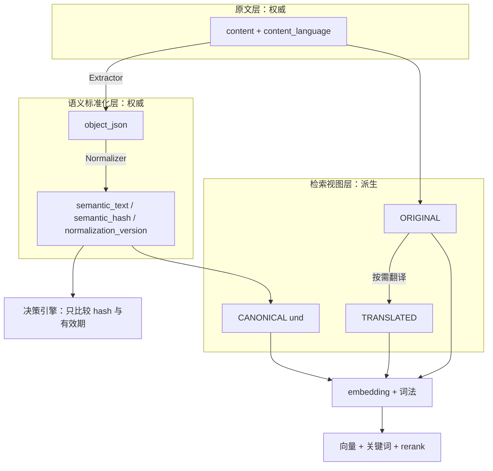
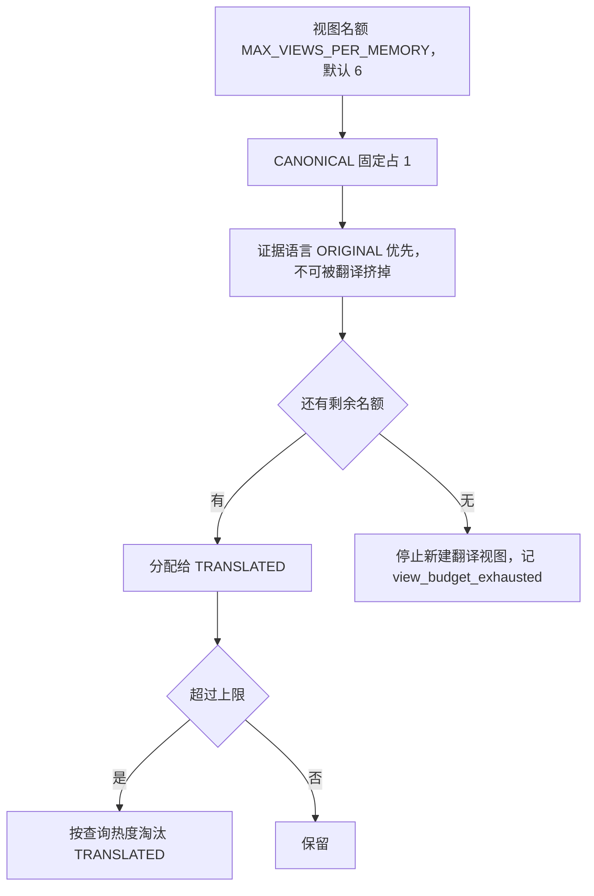
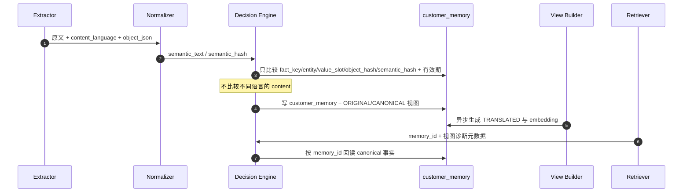
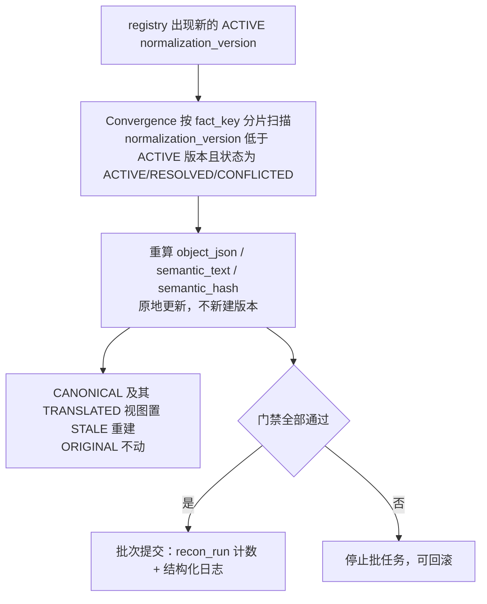
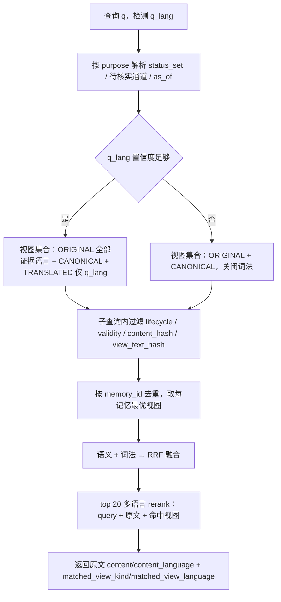
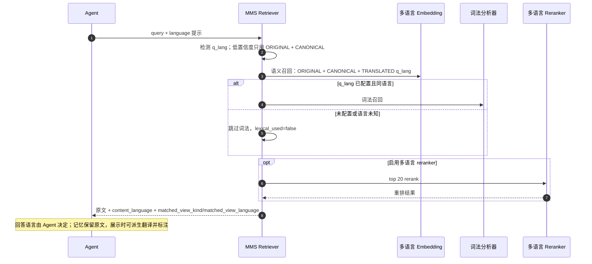

# 9. 记忆语义标准化

**结论：原文不改写，事实做语言无关标准化，检索用多语言视图。** 三层各管一件事：标准化层决定“是不是同一事实”，视图层决定“能不能被找到”，原文层始终是证据。

> 读法：9.1 建立模型与口径 → 9.2 规范化版本如何演进 → 9.3 写入与检索如何协同 → 9.4 能力承诺 → 9.5 在线链路。

## 9.1 三层模型与事实身份

### 9.1.1 分层模型

“把原文统一翻译成一种语言再比较”不可行：翻译会改金额、日期、专名、版本号与错误码；不同模型译文不同，事实身份不稳定；原文才是可审计的证据。因此分三层：

| 层 | 存什么 | 生产者 | 使用方 | 权威性 |
|---|---|---|---|---|
| 原文层 | `content`、`content_language`、`language_confidence`、证据原文 | Extractor | 客服展示、审计、证据 | 客户原话，权威 |
| 语义标准化层 | `object_json`、`semantic_text`、`semantic_hash`、`normalization_version` | Normalizer + registry | 决策引擎、事实匹配、冲突 | 规范事实，权威 |
| 检索视图层 | `ORIGINAL`/`CANONICAL`/`TRANSLATED` 视图、embedding、词法文档 | View Builder（12.4） | 检索、排序、rerank | 派生投影，不权威 |



### 9.1.2 字段口径：事实身份与投影失效

| 字段 | 层 | 定义与口径 | 事实身份 | 用途 |
|---|---|---|---|---|
| `content` | 原文 | 接纳时选定的原文片段，写入后不可变；后续证据存 `memory_evidence.evidence_excerpt_redacted`，不得回写覆盖 | 否 | 展示、证据 |
| `content_language` | 原文 | 主原文 BCP-47；决策、证据与主 `ORIGINAL` 视图只认这一列 | 否 | 语言判定 |
| `language` | 检索/策略 | `content_language` 规范化后的检索标签；用于 `TS_CONFIG_MAP`、policy 语言白名单、按语言统计 | 否 | 词法、策略 |
| `language_confidence` | 原文 | 语言识别置信度；低于 `language_confidence_min` 不自动写入（4.5） | 否 | 门禁 |
| `script` | 原文 | Latin/Cyrillic/Arabic/Han/Kana/Hangul | 否 | 词法分析器选择 |
| `object_json` | 标准化 | 语言无关的结构化事实值 | 是，经 `object_hash` | 事实比较 |
| `semantic_text` | 标准化 | registry 模板从 `fact_key + entity + object_json + 有效期` 生成的规范句，例如 `communication.language = zh-CN; valid_from = 2026-11-01`；不是译文 | 否 | `CANONICAL` 视图、rerank 锚点 |
| `semantic_hash` | 标准化 | 规范事实指纹；不含 `normalization_version` | 是 | 事实相等判断 |
| `normalization_version` | 标准化 | 独立列；normalizer + 模板版本，只用于重放、视图重算与漂移检测（9.2/12.10），不参与事实相等判断或版本决策 | 否 | 投影维护 |
| `content_hash` | 原文 | 入库 `content` 字节摘要，不做 Unicode 归一化、空白折叠或翻译 | 否 | 视图/向量失效、证据锚点 |
| `view_text_hash` | 视图 | 该视图自身文本的摘要 | 否 | 视图失效、嵌入校验 |
| `evidence_hash` | 证据 | 来源定位摘要；证据正文只进 `evidence_excerpt_redacted` | 否 | 证据去重、审计 |

```text
object_hash    = SHA-256(canonical_json(object_json))
semantic_hash  = SHA-256(canonical_json({fact_key, entity_type, entity_ref, value_slot, object_hash, valid_from, valid_to}))
content_hash   = SHA-256(content.encode('utf-8'))
view_text_hash = SHA-256(view_content.encode('utf-8'))
evidence_hash  = SHA-256(canonical_json({source_system, source_event_id, message_id|ticket_id, evidence_excerpt_hash}))
```

- `canonical_json` 的键排序只适用于 JSON；`content_hash`/`view_text_hash` 对文本字节直接取摘要，不做归一化、折叠或翻译。
- `evidence_hash` 的输入只含来源定位与 `evidence_excerpt_hash`；证据正文只落 `memory_evidence.evidence_excerpt_redacted`，除 `evidence_hash` 输入外不得出现在其他位置。
- 主 `ORIGINAL` 的 `view_text_hash` 等于 `customer_memory.content_hash`；其他证据语言的 `ORIGINAL` 按来源 evidence 文本独立计算，但 `content_hash` 仍等于母记忆；`CANONICAL`/`TRANSLATED` 均不等于母记忆 hash。
- 视图语言固定：`ORIGINAL.view_language = content_language`；`CANONICAL.view_language = 'und'`；`TRANSLATED.view_language = 目标语言`。
- `language` 只在 `:query_language → ts_config` 映射时作回退键；任何规则不得用 `language` 与 `content_language` 互相替代。

### 9.1.3 语言标签与语义标准化

| 概念 | 口径 |
|---|---|
| BCP-47 统一 | `zh`/`zh_CN`/`Chinese` → `zh-CN`；`en` → `en-US`（按客户默认） |
| 显式声明 | 用户显式声明优先于自动识别；冲突记运行日志，按显式声明处理（4.5） |
| 低置信度 | 低于 `memory_policy.language_confidence_min`（默认 0.80）→ `NEEDS_VERIFICATION`，不自动写入（4.5/R030） |
| `language` 边界 | 只服务词法分析器、策略白名单与统计；不参与事实身份，也不参与视图匹配 |

| 值类型 | 规则 | 失败处置 |
|---|---|---|
| 数字、日期、时区、货币、单位、产品版本、状态值 | 按字段字典归一化；枚举使用 registry 稳定 code | validator 拒绝 → 不自动写入 |
| 姓名、地址、电话等专名 | 保留原文，不做跨语言音译；需要匹配时走 canonical entity/embedding | 只做精确/实体匹配 |
| 自由文本值 | 必须有 registry validator；无法结构化的事实 → `NEEDS_VERIFICATION` | 不参与跨语言精确匹配 |
| 同一事实的跨语言表述 | 同一 registry/normalizer 版本下，`fact_key + entity + value_slot + 规范值 + valid time` 相同必须得到同一 `semantic_hash` | 跨版本按规范值等价 + 决策回放（9.2） |

> 设计取舍：不把某一种语言设为“事实主语言”，避免翻译成为事实单点；代价是自由文本必须逐类提供 registry validator，覆盖不到的一律转人工核实。

### 9.1.4 视图类型与预算

| 视图 | 文本 | `view_language` | 数量 | 用途 | 权威性 |
|---|---|---|---|---|---|
| `ORIGINAL` | 该语言原话 | 证据语言 | 每个证据语言一条，至少一条（主原文语言） | 展示、证据、该语言词法 | 原文权威；主原文以 `customer_memory.content` 为准 |
| `CANONICAL` | `semantic_text` | `und` | 每条记忆恰好一条 | 跨语言向量与 rerank 的稳定锚点，不直接展示 | 派生 |
| `TRANSLATED` | 译文 | 目标语言 | 按 `TRANSLATION_TARGET_LANGUAGES` 异步生成 | 仅检索 | 派生；记录 `translation_model/version/quality/source_view_hash`，不作事实权威 |



- 原文与 canonical 视图不可被翻译结果覆盖；翻译失败只影响该语言检索，不影响写入/事实。

### 9.1.5 与决策引擎的边界



- Extractor 只输出原文语言与 `object_json`；`semantic_text/semantic_hash` 只由 Normalizer 生成；翻译只发生在视图层，绝不参与写入决策。
- `content_hash` 只用于向量/视图失效与证据锚点，不是事实身份；`semantic_hash`/`object_hash` 才是事实身份。
- 同一事实的不同语言原文应命中同一 current，由标准化后的 hash 与有效期收敛（6.4）；`SUPERSEDE` 只来自权威系统事件或客户明确纠正。
- 检索层只返回 `memory_id` 与视图诊断元数据；决策必须按 `memory_id` 回读 `customer_memory`，不得把翻译视图文本当事实值。
- `memory_decision.context_snapshot` 记录参与检索的 `view_kind/view_language/view_text_hash`，仅用于回放/解释；写入事务同时失效全部视图（7.1/12.10）。

### 9.1.6 合规边界

- 翻译/embedding provider 可能看到原文；默认自托管。
- 外部或跨境翻译必须取得 `CROSS_BORDER_TRANSLATION` 同意并走 3.3 的 consent gate；敏感字段先脱敏。

## 9.2 normalizer 版本升级与重标准化（`RENORMALIZE`）

**结论：`semantic_hash` 不含 `normalization_version`，升版不是事实变更。只改投影，不产生 `SUPERSEDE`。**

### 9.2.1 触发与流程



### 9.2.2 允许与禁止

| 对象 | 允许 | 禁止或不变 |
|---|---|---|
| `object_json`、`semantic_text`、`semantic_hash`、`normalization_version` | 用新 normalizer 原地重算写回 | — |
| `version_no`、`lifecycle_status`、`valid_from/valid_to` | — | 不变 |
| `memory_decision`、版本链 | — | 不写决策、不新建版本 |
| `semantic_hash` 漂移 | 预期结果：只表示规范表示更新 | 不得单独触发 `SUPERSEDE` |
| 与同客户同 `fact_key` 的另一条 ACTIVE 事实撞键 | 进入 `memory_conflict` 人工裁决 | 禁止脚本批量替代 |
| `CANONICAL`、`TRANSLATED` 视图 | 置 `STALE` 重建；`source_view_hash` 变化必须传导 | — |
| `ORIGINAL` 视图 | — | 不动，原文未变 |
| Embedding Job | 优先级 500 | 不得饿死新记忆 |
| 回滚 | 只回滚 `normalization_version` 与视图 | 不改业务状态 |

### 9.2.3 批次、门禁与边界

- 每批默认 500 条，批间 sleep，按 `memory_id` 游标可中断续跑并记录位点。
- 只写 `recon_run(kind='renormalize')` 批次计数与结构化日志：`memory_id/old_semantic_hash/new_semantic_hash/normalization_version/trace_id`。
- 门禁三项：记忆行数与 `version_no` 分布不变；`lifecycle_status` 计数不变；抽样 1k 条重放决策 outcome 不变（6.5）。任一项不满足即停止批任务。
- 边界：只有权威系统事件或客户明确纠正才能产生 `SUPERSEDE`；normalizer、模板、翻译模型、embedding 模型的版本变化一律只影响投影。

## 9.3 视图选择与读写协同

**结论：一次检索只碰三类视图；所有过滤在子查询内完成；翻译视图只提供召回信号，绝不返回为原文。**

### 9.3.1 检索时的视图选择

固定顺序，避免“先截断后过滤”；任何视图/状态过滤都必须在子查询内完成。



- 视图集合最多 `MAX_VIEWS_PER_MEMORY` 个/记忆；跨语言只承诺语义，词法只在同语言、已配置语言启用（12.7）。
- 语义按 12.6、词法按 12.7 执行；`status_set`/`as_of` 由 purpose 映射（12.6 双通道），过滤与 `memory_id` 去重都在子查询内完成。
- `TRANSLATED` 只提供召回信号，绝不作为原文返回。

| 场景 | 语义 | 词法 | 重排/降级 |
|---|---|---|---|
| 同语言、有 `TRANSLATED` 视图 | `ORIGINAL` + `CANONICAL` + `TRANSLATED`（`q_lang`） | `q_lang` 视图 | 正常 rerank |
| 同语言、无 `TRANSLATED` 视图 | `ORIGINAL` + `CANONICAL` | `ORIGINAL`（若 `q_lang` 启用） | 正常，`view_missing` 指标 +1 |
| 跨语言、无翻译 | `ORIGINAL` + `CANONICAL` | 跳过（`lexical_used=false`） | 多语言 rerank；失败回退 RRF |
| 翻译失败/质量低 | `ORIGINAL` + `CANONICAL` | `ORIGINAL`（同语言） | 降低该视图权重，不影响事实 |
| 查询语言未知 | `ORIGINAL` + `CANONICAL` | 跳过 | `degraded=true`，仅语义/精确 |

### 9.3.2 写入与检索协同

| 环节 | 只认 | 绝不 |
|---|---|---|
| Extractor | 原文对话与证据 | 把译文作为 evidence/candidate 来源 |
| Retriever | `memory_id` + 视图诊断元数据 | 把翻译视图文本当事实值 |
| Decision Engine | `REINFORCE`/`SUPERSEDE`/`CONFLICT` 只看 `object_hash`/`semantic_hash` + 有效期 + 权威来源 | 比较不同语言的 `content` |
| 写入事务 | 提交后失效全部视图（7.1/12.10） | 让旧翻译/旧向量参与下一轮召回 |

- 同一事实的不同语言原文必须命中同一 current；`REINFORCE` 只为新证据语言追加 `ORIGINAL` 视图（R060），不新建版本（6.4）。

### 9.3.3 预算、降级与指标

| 机制 | 默认/口径 | 行为 |
|---|---|---|
| `MAX_VIEWS_PER_MEMORY` | 6；`CANONICAL` 与主 `ORIGINAL` 固定占 2 | 其余名额优先证据语言 `ORIGINAL`，再给 `TRANSLATED`；耗尽记 `mms_view_budget_exhausted_total` |
| `TRANSLATION_TARGET_LANGUAGES` | 默认空，即不翻译；启用时按客户语言分布，最多 4（16.2） | 只对这些语言生成 `TRANSLATED` |
| `TRANSLATION_TIMEOUT_MS` / `TRANSLATION_MAX_CHARS` | 1500ms / 4000 字符（16.2） | 超时或超长只影响该语言视图 |
| 翻译熔断/超时 | — | 原语言 + canonical 继续检索；`degraded_reason=translation_unavailable` 仅内部诊断，不阻塞回答 |

指标：`mms_translation_latency_seconds{target_language}`、`mms_translation_failures_total{target_language,error}`、`mms_view_missing_views{view_kind,language}`、`mms_retrieval_views_scanned`、`mms_retrieval_duplicate_views_collapsed_total`、`mms_rerank_language_mismatch_total`。

## 9.4 多语言检索矩阵

| 能力 | 实现 | 承诺 |
|---|---|---|
| 语义 | `ORIGINAL` + `CANONICAL` + 查询语言 `TRANSLATED` 视图，BGE-M3 dense 1024 | 目标语言内 + 跨语言，按语言评测；多视图按 `memory_id` 去重 |
| 词法 | `view_language` 同语言、PG FTS/`zhparser`/`pg_trgm`；FTS 用 `ts_rank_cd`，trgm 用 `similarity` | 仅同语言、已配置语言；不承诺跨语言；v2 不引入 BM25 |
| 实体 | `entity_type/entity_ref` 精确过滤 | 全语言；不依赖 NER |
| 重排 | 多语言 reranker，输入 query + 原文 + 命中视图 | 按语言评测；可关闭；翻译视图只作检索信号 |
| 提取 | MMS Extractor，保留原文语言与证据 span | 全语言；按语言评测 P/R |
| 标准化 | Normalizer + registry `semantic_template` | canonical 事实可跨语言比较；无法标准化则人工/隔离 |
| 翻译 | 异步 `TRANSLATED` 视图，记录 model/version/quality | 不作为事实权威；可关闭/降级 |
| 去重 | 同一 `memory_id` 多视图按距离取最优，再进 RRF | 不会因多语言视图重复占 top-K |

## 9.5 多语言在线检索

### 9.5.1 在线链路



### 9.5.2 承诺与降级

- 语义跨语言、词法同语言、重排多语言：词法只对同语言、已配置语言启用，否则记 `lexical_used=false`；reranker 必须是多语言模型并按语言评测，可关闭。
- 回答语言由 Agent 决定；记忆保留原文，不强行翻译；需要展示时派生翻译并标注。
- 降级：embedding 不可用 → 词法（如可用）+ 精确过滤（12.18）；翻译不可用 → 原语言 + canonical 继续，返回内部诊断 `degraded_reason=translation_unavailable`。
