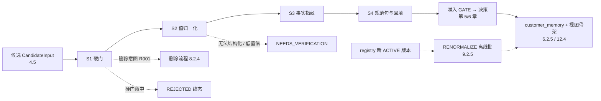
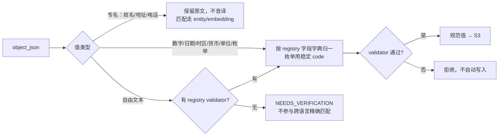
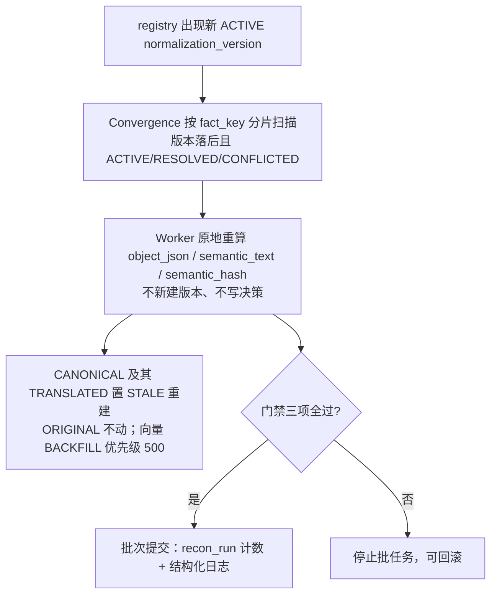
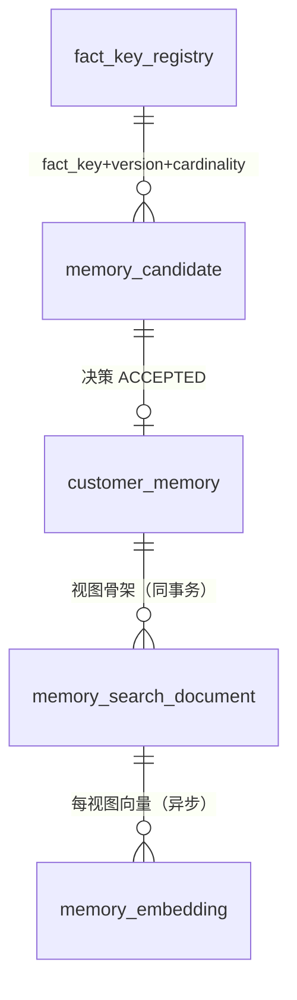
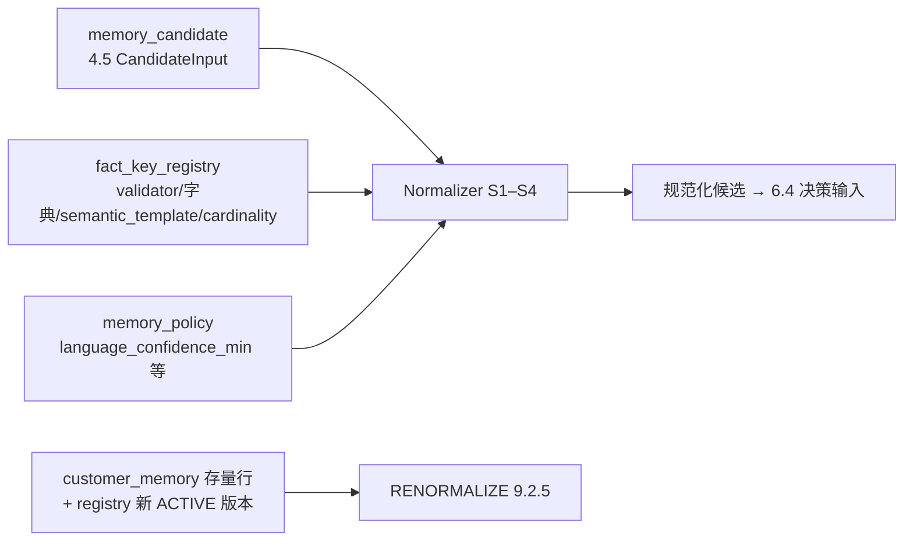
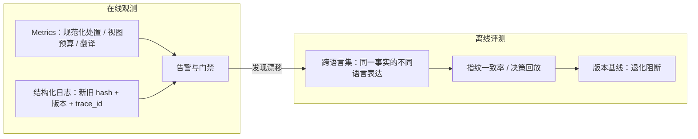

# 记忆语义标准化

**一句话：原文不改写，事实做语言无关标准化，检索用多语言视图。** Normalizer 是 `semantic_text/semantic_hash` 的唯一生产者：标准化层决定“是不是同一事实”，视图层决定“能不能被找到”，原文层始终是证据。

> 读法：9.1 整体执行过程 → 9.2 关键步骤（含 RENORMALIZE）→ 9.3 数据模型与视图契约 → 9.4/9.5 输入输出 → 9.6 观测。准入规则语义见第 5 章，决策见第 6 章，视图构建与检索执行见第 12 章。

## 9.1 整体执行过程



| 步骤 | 职责 | 输入 → 输出 | 失败去向 |
|---|---|---|---|
| S1 硬门 | 执行 R001–R007（语义见 5.5） | 候选 → 放行/拒绝 | REJECTED / NEEDS_VERIFICATION / 转 8.2.4 |
| S2 值归一化 | 按 registry 字典归一值 | `object_json` → 规范值 | validator 拒绝 → 不自动写入 |
| S3 事实指纹 | 算 `object_hash/semantic_hash` | 规范值 → 事实指纹 | — |
| S4 规范句与回填 | 生成 `semantic_text`，回填版本/基数/指纹/评分 | → 规范化候选（9.5） | 生成失败 → 不自动写入 |
| RENORMALIZE | 升版后原地重算投影（9.2.5） | 存量记忆 → 新规范列 + 视图重建 | 门禁不过停批，可回滚 |

三层模型与权威性（不做“统一翻译后比较”：翻译会改金额/日期/专名/版本号，原文才是可审计证据）：

| 层 | 存什么 | 生产者 | 权威性 |
|---|---|---|---|
| 原文层 | `content/content_language`、证据摘录 | Extractor（第 4 章） | 客户原话，权威证据 |
| 语义标准化层 | `object_json/semantic_text/semantic_hash/normalization_version` | Normalizer（本章） | 规范事实，权威 |
| 检索视图层 | ORIGINAL/CANONICAL/TRANSLATED + 向量/词法 | 决策事务 + View Builder（12.4） | 派生投影，不权威 |

三条不变量（每一步都适用）：

1. **原文不改写**：`content` 写入后不可变；翻译只发生在视图层，绝不回写原文或事实值。
2. **事实语言无关**：同一规范事实必须得到同一 `semantic_hash`；决策只比较 hash 与有效期，绝不比较不同语言的 `content`。
3. **升版只改投影**：normalizer/模板/翻译/embedding 的版本变化一律不产生 `SUPERSEDE`；只有权威系统事件或客户明确纠正才能替代事实。

## 9.2 关键步骤说明

### 9.2.1 S1 硬门

规则语义与 ID 以 5.5 为准，此处只是执行落点，不重复定义：

| 门 | 触发 | 去向 |
|---|---|---|
| R001 | 删除/遗忘意图 | `DELETE_REQUESTED` → 8.2.4 |
| R002/R003 | 注入/越权指令；凭证/机密 | `REJECTED` 终态 |
| R006/R007 | 不可信来源；无证据定位 | `REJECTED` 终态 |
| R004 | schema/validator 失败 | `REJECTED` 终态 |
| R030 | `und` 或语言置信度低于 `language_confidence_min`（默认 0.80） | `NEEDS_VERIFICATION`，不自动写入 |

### 9.2.2 S2 值归一化



语言标签只消费、不重新识别（识别与置信度在 4.2.4 完成）：

| 概念 | 口径 |
|---|---|
| BCP-47 统一 | `zh/zh_CN/Chinese → zh-CN`；`en → en-US`（按客户默认） |
| 显式声明 | 优先于自动识别；冲突记运行日志，按显式声明处理 |
| `content_language` vs `language/script` | 前者是原文语言，决策、证据与主 ORIGINAL 视图只认它；后者是派生检索标签，只用于 `TS_CONFIG_MAP`（回退键）与 policy 语言白名单，两者不得互相替代 |

> 设计取舍：不设“事实主语言”，避免翻译成为事实单点；代价是自由文本必须逐类提供 registry validator，覆盖不到的一律转人工核实。

### 9.2.3 S3 事实指纹

```text
object_hash    = SHA-256(canonical_json(object_json))
semantic_hash  = SHA-256(canonical_json({fact_key, entity_type, entity_ref, value_slot, object_hash, valid_from, valid_to}))
content_hash   = SHA-256(content.encode('utf-8'))
view_text_hash = SHA-256(view_content.encode('utf-8'))
evidence_hash  = SHA-256(canonical_json({source_system, source_event_id, message_id|ticket_id, evidence_excerpt_hash}))
```

| 口径 | 规则 |
|---|---|
| 事实身份 | `object_hash/semantic_hash` 是事实身份；`content_hash` 只是视图/向量失效与证据锚点，不是事实身份 |
| 版本隔离 | `semantic_hash` 不含 `normalization_version`；升版可漂移指纹但不改事实（9.2.5） |
| 跨语言等价 | 同一 registry/normalizer 版本下，`fact_key + entity + value_slot + 规范值 + valid time` 相同必须得到同一 `semantic_hash`；跨版本按规范值等价 + 决策回放处理 |
| 摘要输入 | `canonical_json` 键排序只适用于 JSON；文本 hash 对字节直接取摘要，不做 Unicode 归一化、空白折叠或翻译 |
| 证据正文 | 只落 `memory_evidence.evidence_excerpt_redacted`；除 `evidence_hash` 输入外不得出现在其他位置 |

### 9.2.4 S4 规范句与回填

`semantic_text` 由 registry `semantic_template` 从 `fact_key + entity + object_json + 有效期` 生成规范句（如 `communication.language = zh-CN; valid_from = 2026-11-01`）。**它不是译文**，是 `CANONICAL` 视图的唯一文本来源与 rerank 锚点。

回填字段（服务端生成，不得信任 LLM 直接输出）：

| 字段 | 口径 |
|---|---|
| `fact_key_registry_version` / `cardinality` | 取自 registry ACTIVE 行 |
| `candidate_fingerprint` | 候选幂等键（4.2.5） |
| `value_score` | 按 5.4 公式确定性计算 |

输出规范化候选（9.5）进入 6.4 决策输入；`ACCEPTED` 时语义字段必填（DB CHECK）。

### 9.2.5 RENORMALIZE 重标准化

**`semantic_hash` 不含 `normalization_version`，升版不是事实变更：只重算投影，不产生 `SUPERSEDE`。**



| 对象 | 允许 | 禁止/不变 |
|---|---|---|
| `object_json/semantic_text/semantic_hash/normalization_version` | 原地重算写回 | — |
| `version_no/lifecycle_status/valid_from/valid_to`、版本链、`memory_decision` | — | 不变；不写决策、不新建版本 |
| `CANONICAL/TRANSLATED` 视图 | 置 STALE 重建；`source_view_hash` 变化必须传导 | — |
| `ORIGINAL` 视图 | — | 不动（原文未变） |
| 与同客户同 `fact_key` 的另一条 ACTIVE 事实撞键 | 进入 `memory_conflict` 人工裁决 | 禁止脚本批量替代 |
| 回滚 | 只回滚 `normalization_version` 与视图 | 不改业务状态 |

| 批次项 | 口径 |
|---|---|
| 执行 | 每批默认 500 条，批间 sleep；按 `memory_id` 游标可中断续跑并记录位点；不得饿死新记忆 |
| 审计 | 只写 `recon_run(kind='renormalize')` 批次计数 + 结构化日志：`memory_id/old_semantic_hash/new_semantic_hash/normalization_version/trace_id` |
| 门禁三项 | ① 记忆行数与 `version_no` 分布不变；② `lifecycle_status` 计数不变；③ 抽样 1k 条重放决策 outcome 不变（6.2.4）。任一不满足即停止批任务 |

## 9.3 数据模型

**本章不新建表。** Normalizer 写 `memory_candidate` 的语义列；决策后同名字段落 `customer_memory`；视图与向量是 12.4 构建的投影。完整 DDL 见《23-数据模型与表设计》。



关键字段（按层分组）：

| 层 | 字段 | 口径 | 事实身份 |
|---|---|---|---|
| 原文 | `content` | 写入后不可变；后续证据存 `evidence_excerpt_redacted`，不得回写覆盖 | 否 |
| 原文 | `content_language` / `language_confidence` | BCP-47 原文语言；决策、证据与主 ORIGINAL 只认此列 | 否 |
| 原文 | `content_hash` | 入库 content 字节摘要 | 否（失效锚点） |
| 标准化 | `object_json` | 语言无关的规范事实值 | 是（经 `object_hash`） |
| 标准化 | `semantic_text` | 规范句，不是译文 | 否 |
| 标准化 | `semantic_hash` | 规范事实指纹，不含版本 | 是 |
| 标准化 | `normalization_version` | 独立列，只驱动 RENORMALIZE 与漂移检测（12.10） | 否 |
| 视图 | `view_kind/view_language/view_text_hash` | 视图自身文本摘要，用于失效与嵌入校验 | 否 |
| 证据 | `evidence_hash` | 来源定位摘要，证据去重 | 否 |

### 9.3.1 视图契约与预算

| 视图 | 文本 | `view_language` | 数量 | 权威性 |
|---|---|---|---|---|
| `ORIGINAL` | 该语言原话 | 证据语言（主视图 = `content_language`） | 每个证据语言一条，至少主原文一条 | 原文权威 |
| `CANONICAL` | `semantic_text` | `und` | 每条记忆恰好一条 | 派生，不直接展示 |
| `TRANSLATED` | 译文 | 目标语言 | 按 `TRANSLATION_TARGET_LANGUAGES` 异步生成；记录 model/version/quality/source_view_hash | 派生，仅检索 |

**视图选择（检索侧按 12.6–12.8 执行）**：`ORIGINAL`（全部证据语言）+ `CANONICAL` 必参与；`TRANSLATED` 只取查询语言；同一 `memory_id` 多视图按距离取最优去重，tie-break 固定 `ORIGINAL > CANONICAL > TRANSLATED`。

| 参数 | 默认 | 行为 |
|---|---|---|
| `MAX_VIEWS_PER_MEMORY` | 6 | CANONICAL 与主 ORIGINAL 固定占 2；其余名额优先证据语言 ORIGINAL，再给 TRANSLATED；超限按查询热度淘汰 TRANSLATED；耗尽记 `mms_view_budget_exhausted_total` |
| `TRANSLATION_TARGET_LANGUAGES` | 空（不翻译）；启用时最多 4（16.2） | 只对这些语言生成 TRANSLATED |
| `TRANSLATION_TIMEOUT_MS` / `TRANSLATION_MAX_CHARS` | 1500ms / 4000 字符（16.2） | 超时/超长只影响该语言视图 |

hash 关系：主 `ORIGINAL.view_text_hash = customer_memory.content_hash`；其他证据语言 ORIGINAL 按来源 evidence 文本独立计算（`content_hash` 仍等于母记忆）；`CANONICAL/TRANSLATED` 均不等于母记忆 hash。翻译失败只影响该语言检索（`degraded_reason=translation_unavailable` 仅内部诊断，不阻塞回答）；ORIGINAL/CANONICAL 不可被翻译结果覆盖。

### 9.3.2 与决策/检索的边界

| 环节 | 只认 | 绝不 |
|---|---|---|
| Extractor | 原文与证据；只输出原文语言与 `object_json` | 把译文作为 evidence/candidate 来源 |
| Normalizer | `semantic_text/semantic_hash` 的唯一生产者 | 翻译参与写入决策 |
| Decision Engine | `object_hash/semantic_hash` + 有效期 + 权威来源；按 `memory_id` 回读规范事实 | 比较不同语言的 `content` |
| Retriever | `memory_id` + 视图诊断元数据（`matched_view_*`） | 把翻译视图文本当事实值 |
| 写入事务 | 提交后失效全部视图（7.3/12.10） | 让旧翻译/旧向量参与下一轮召回 |

- 同一事实的不同语言原文必须命中同一 current，由标准化后的 hash 与有效期收敛（6.2.3）；`REINFORCE` 只为新证据语言追加 ORIGINAL 视图（R060），不新建版本；`SUPERSEDE` 只来自权威系统事件或客户明确纠正。
- `memory_decision.context_snapshot` 记录参与检索的 `view_kind/view_language/view_text_hash`，仅用于回放/解释。
- 合规：翻译/embedding provider 可能看到原文，默认自托管；外部或跨境翻译必须取得 `CROSS_BORDER_TRANSLATION` 同意并走 3.3 consent gate，敏感字段先脱敏。

## 9.4 输入数据



| 输入 | 来源 | 用途 |
|---|---|---|
| 事实字段：`fact_key/object_json/entity_type/entity_ref/value_slot/valid_from/valid_to` | 候选（4.5.1） | 归一化与指纹输入 |
| 原文字段：`content/content_language/language_confidence` | 候选 | 硬门与视图锚点；不改写 |
| 来源字段：`source_kind/source_refs` | 候选 | 硬门 R006/R007 |
| 键约束：validator、字段字典、`semantic_template`、`cardinality`、`normalization_version` | `fact_key_registry` ACTIVE 行 | S2/S4 依据 |
| 阈值：`language_confidence_min` 等 | `memory_policy` | 硬门 R030 |
| RENORMALIZE 输入 | 存量 `customer_memory` + registry 新版本 | 原地重算（9.2.5） |

## 9.5 输出数据

成功输出 = 规范化候选（即 6.4 决策输入），以下字段全部服务端生成：

| 字段 | 口径 | 消费方 |
|---|---|---|
| `object_hash` | 规范值指纹 | 决策判重 |
| `semantic_text` | 规范句 | CANONICAL 视图、rerank 锚点 |
| `semantic_hash` | 事实指纹（不含版本） | 决策相等判断/回放 |
| `normalization_version` | normalizer + 模板版本 | RENORMALIZE、漂移检测 |
| `fact_key_registry_version/cardinality` | registry 回填 | 决策与复合 FK |
| `candidate_fingerprint` | 幂等键（4.2.5） | 候选去重 |
| `value_score` | 5.4 公式 | 准入评分 |

失败输出：

| 处置 | 触发 | 落点 |
|---|---|---|
| `REJECTED` + 原因码 | 硬门命中 | 候选终态；只留脱敏摘录与原因码 |
| `NEEDS_VERIFICATION` | 语言低置信 / 无法结构化 | 转人工核实，不自动写入 |
| 生成失败 | 无法产出语义字段 | 不得自动写入（4.2.3） |

本层不写 `customer_memory`、视图、向量或对外事件，均由决策事务与 12.4 产生。RENORMALIZE 输出：原地更新四个语义列 + CANONICAL/TRANSLATED 置 STALE + `recon_run` 审计；不写决策、不新建版本。

## 9.6 持续观测设计



| 指标 | 语义 | 目标 |
|---|---|---|
| `mms_normalization_total{fact_key,outcome}` | 规范化处置分布（OK/REJECTED/NEEDS_VERIFICATION） | 失败率按 fact_key 基线 |
| `RENORM_LAG_RATIO`（Convergence） | `normalization_version` 落后记忆占比 | 趋近 0 |
| `mms_view_budget_exhausted_total` / `mms_view_count_per_memory` | 视图预算耗尽 / 每记忆视图数分布 | 告警见《Translation Job设计》 |
| `mms_view_missing_views{view_kind,language}` | 视图缺失（对账 12.10） | =0 |
| `mms_translation_latency_seconds` / `mms_translation_failures_total{target_language}` | 翻译延迟/失败（生产者 12.4） | 失败率 <1% |

离线评测与发布门禁：

| 门禁 | 阈值 |
|---|---|
| 跨语言指纹一致率 | 同版本同一事实的不同语言表达 = 100%，否则阻断 registry/normalizer 发布 |
| RENORMALIZE 门禁三项 | 行数/版本分布、状态计数、1k 决策回放 outcome 不变；任一不过停批 |
| 跨语言决策一致性 | 同一事实不同语言 → `SUPERSEDE/CONFLICT` 的数量 = 0 |
| 按语言检索质量 | Recall/rerank 按语言评测，见第 12 章 |

日志：RENORMALIZE 结构化日志含 `memory_id/old_semantic_hash/new_semantic_hash/normalization_version/trace_id`；无正文、无 raw `customer_id`。