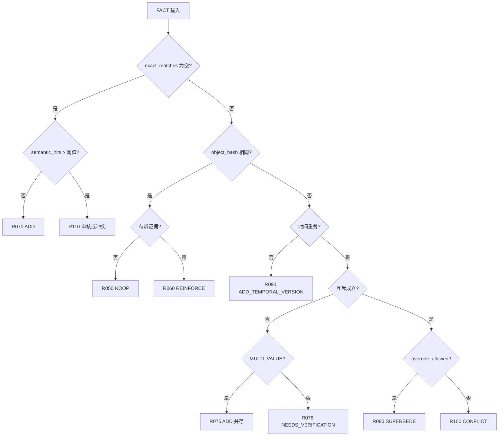
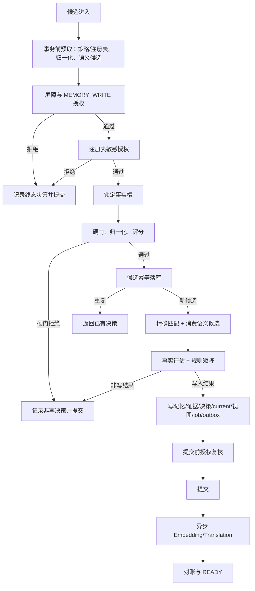
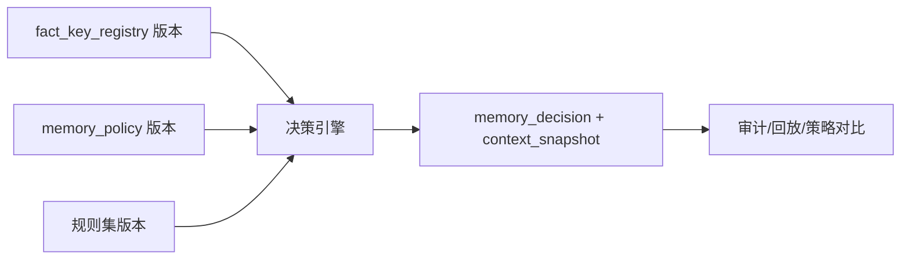
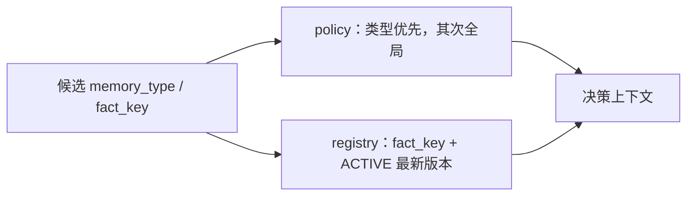

# 6. 记忆写入决策引擎

第 4–7 章是核心实现规格。必须把**提取模型、准入策略、事实匹配、操作决策、事务提交、Embedding 生成、检索可用性**拆开，避免将所有复杂性隐藏在一次 LLM 调用里。第 5 章负责“准入函数”，本章负责“流水线与事实决策”。

| 小节 | 回答的问题 |
|---|---|
| 6.1 | 引擎需要哪些输入，哪些字段不允许模型伪造 |
| 6.2 | 输出什么、如何审计与回放 |
| 6.3 | 引擎按什么顺序执行，各阶段失败如何处理 |
| 6.4 | 如何定位并比较历史事实，语义召回用到什么程度 |
| 6.5 | 用哪张有序规则表得出唯一结果 |
| 6.6 | 决策事务与异步索引如何衔接 |
| 6.7 | 原因码的最小集合 |
| 6.8 | 策略、事实键注册表如何版本化并支撑回放 |
| 6.9 | 决策与 Embedding 的边界 |

## 6.1 决策引擎输入契约

每个候选至少包含下列字段。来源引用与业务标识必须由服务端构造/校验，不允许直接信任 LLM 输出中的任意客户 ID。

```json
{
  "candidate_id": "cand_01J...",
  "customer_id": "cust_200",
  "memory_type": "CUSTOMER_PROFILE",
  "fact_key": "communication.language",
  "subject": "customer",
  "predicate": "prefers_language",
  "object": {"value": "zh-CN"},
  "content": "客户希望客服后续使用中文沟通。",
  "content_language": "zh-CN",
  "language": "zh-CN",
  "source_kind": "USER_EXPLICIT",
  "source_refs": [{"conversation_id": "conv_1001", "message_id": "msg_17"}],
  "observed_at": "2026-10-25T09:00:00Z",
  "valid_from": "2026-10-25T09:00:00Z",
  "valid_to": null,
  "confidence": 0.93,
  "sensitivity": "LOW",
  "explicit_correction": true,
  "policy_version": "memory-policy-default@1",
  "fact_key_registry_version": 1,
  "extractor_version": "extractor-2026-10-01"
}
```

说明：

- `fact_key` 是稳定属性键，例如 `communication.language`、`product.client_version`、`issue.status`；只能来自 `fact_key_registry`，不使用自然语言句子直接作为唯一键。
- `object` 是语言无关的 canonical 值，用于事实比较；`content` 是原文，用于展示/证据；`content_language` 保留原文语言，不默认翻译；
- `semantic_text/semantic_hash/normalization_version` 由服务端 Normalizer 生成，**不得信任 LLM 直接输出**；`semantic_hash` 是候选去重/决策回放的事实指纹。
- `observed_at` 是系统观察到该信息的时间；`valid_from/valid_to` 表示事实在业务世界中的有效区间；`created_at/updated_at` 是数据库记录维护时间，不能相互混用。
- `source_refs` 指向证据元数据，不在记忆文本中复制整段对话。
- 需要存储的原始消息应有单独的数据保留与访问策略；长期记忆只保存完成业务目的所必需的最小内容。

## 6.2 决策输出契约

```json
{
  "decision_id": "dec_01J...",
  "candidate_id": "cand_01J...",
  "outcome": "SUPERSEDE",
  "target_memory_id": "mem_old_123",
  "new_memory_id": "mem_new_456",
  "reason_codes": ["EXPLICIT_NEWER_USER_CORRECTION"],
  "policy_version": "memory-policy-default@1",
  "fact_key_registry_version": 1,
  "engine_version": "2026-10-30.1",
  "semantic_hash": "9a7c...",
  "normalization_version": "norm-2026-10-01",
  "requires_review": false,
  "embedding_action": "UPSERT_NEW_AND_DELETE_OLD",
  "view_actions": [
    {"view_kind": "ORIGINAL", "view_language": "zh-CN", "action": "UPSERT"},
    {"view_kind": "CANONICAL", "view_language": "und", "action": "UPSERT"}
  ],
  "index_generation": 7
}
```

决策输出必须可解释、可审计、可重放。至少保存 `outcome`、`reason_codes`、命中的规则、规则版本、候选/事实 `semantic_hash`、`normalization_version`、相关历史记忆 ID、证据 ID、操作者/模型版本、决策时间、人工覆盖记录。`view_actions` 只描述索引投影，可以是**增量**的：`REINFORCE` 只带新增语言 `ORIGINAL` 视图，不带 `CANONICAL`（其文本未变）；翻译视图由 12.4 异步生成，不参与决策。

`embedding_action` 枚举：

- `UPSERT`：为 `view_actions` 指定的视图新增/更新向量；
- `UPSERT_VIEWS`：不新建记忆版本，只为新增证据语言追加 `ORIGINAL` 视图并生成向量（`REINFORCE`）；不可用该动作覆盖主原文或既有证据；
- `DELETE`：删除/失效该记忆的全部语言视图向量（或 `view_actions` 明确列出的视图）；
- `UPSERT_NEW_AND_DELETE_OLD`：SUPERSEDE；新版本按 `view_actions` 建视图，旧版本全部视图失效；
- `NOOP`：不改变向量；
- `REBUILD`：模型/维度/视图升级时重建（由 Convergence 发起，不由普通决策发起）。

## 6.3 候选准入顺序

**结论：6.3 讲的是“引擎按什么顺序执行”，不是第二套准入规则。** 第 5 章把准入定义为一个确定性函数：单条候选 + policy/registry/授权快照 → 通过、`IGNORE`、`NEEDS_VERIFICATION` 或 `REJECTED`，并算出价值分；该函数不读已有记忆，因此无法回答“已有同一事实时是新增、强化、替代还是冲突”。6.3 负责把这些步骤串成从候选接收到索引就绪的执行链，并规定每一步的失败语义。

### 6.3.1 与第 5 章的分工

| 维度 | 第 5 章 记忆准入 | 6.3 候选准入顺序 |
|---|---|---|
| 回答的问题 | 能不能写、值多少分、自动写还是审核 | 先做什么、后做什么、失败在哪一步终止 |
| 判定对象 | 单条候选 + 三份快照 | 候选 + 已有事实 + 语义候选 + 事务上下文 |
| 是否读已有记忆 | 否 | 是：定位、比较、冲突判定 |
| 输出 | 准入结论 + `value_score` + `score_breakdown` | 阶段轨迹 + 唯一决策 + 事务/索引动作 |
| 回放 | 同输入同版本同结论 | 同 `RuleContext` + 规则集版本同结果 |

一句话：**第 5 章是“准入门”，6.3 是“流水线”；准入门只是流水线上的一个工位。** 6.3 不重复硬门内容，只引用 5.3/5.4 的判定语义。

### 6.3.2 执行阶段

| # | 阶段 | 做什么 | 失败/分支 | 依据 |
|---:|---|---|---|---|
| 1 | 入口绑定、授权预检与事务前预取 | API 校验请求头客户与请求体客户一致；候选身份字段由服务端注入。生产入口在事务外先执行屏障与写授权预检（3.3），通过后预取策略/注册表、执行一次归一化并生成查询向量与语义候选 | 入口失败返回 403/422；预检不通过则不生成查询向量，终态由阶段 2 记录；provider 失败时语义候选为空，写继续 | 3.3、4.8.2、4.12、13.7 |
| 2 | 屏障与写授权 | 取客户级 barrier advisory lock，读屏障行并校验 generation/cutover；检查 `MEMORY_WRITE` | 终态 `REJECTED`：`CONSENT_*`、`BARRIER_BLOCKED`、`STALE_GENERATION` | 3.3、8.3.1 |
| 3 | 策略/注册表与敏感授权 | 按 `memory_type` 加载策略，按 `fact_key` 加载注册表；敏感性只上调；`MEDIUM/HIGH` 再检查 `SENSITIVE_MEMORY` | `REJECTED`；未注册/未激活/配置非法 → 永久失败，不重试 | 5.1、5.3、6.8 |
| 4 | 事实锁与归一化 | 锁定事实槽（客户 + `fact_key` + 实体 + 值槽），再执行硬门、语言校验、`object_json` validator、规范值/hash 与价值评分 | 硬门 → 终态；评分结果供阶段 9 的 GATE 规则使用 | 5.3、5.4、7.2 |
| 5 | 候选幂等 | 以候选指纹写入 `memory_candidate`；同一来源事件/证据再次提交返回已有决策 | 唯一键冲突 → 查已有决策 | 4.9、14.4 |
| 6 | 事实定位 | 按事实槽查当前有效事实（`ACTIVE`/`CONFLICTED`） | 无匹配 → 进入 `R070`/`R110` 分支 | 6.4 |
| 7 | 语义候选消费 | 消费事务前预取的 top-k 语义候选（默认 20，阈值 `semantic_match_threshold`），排除精确命中 | 无候选 → 仅精确匹配 | 6.4、6.9 |
| 8 | 事实评估 | 比较 `object_hash`、时间重叠、互斥、`override_allowed`；计算新证据/新语言；解析权威事实 | 结果只作为规则条件，不改写数据 | 6.4、6.5 |
| 9 | 规则决策 | 按 GATE → FACT 阶段顺序求值规则表，首条命中，输出唯一 `outcome`、`reason_code`、`embedding_action`；GATE 可产生 `IGNORE`/`NEEDS_VERIFICATION`/`REJECTED`，FACT 产生写入/冲突/审核 | 无命中/多命中 = 规则集缺陷，失败关闭 | 6.5 |
| 10 | 事务落库与提交前复核 | 同一事务写记忆版本/证据/决策/current 指针/视图/embedding job/outbox；提交前再复核 `MEMORY_WRITE` | 任一失败回滚，重新决策 | 6.6、7.2 |
| 11 | 异步索引与对账 | Embedding/Translation Worker 生成向量与译文视图；对账 ACTIVE 记忆与 READY 向量 | 失败重试/死信；不回滚业务记忆 | 6.9、12.4、12.10 |

**实现口径：** 事务前的预取只为语义候选与耗时 I/O 服务；事务内会重新执行归一化与硬门，保证决策输入与落库一致。GATE 规则不读已有事实，与 FACT 规则同表但按阶段短路；实现把两者放在同一次矩阵调用中，结论不受求值位置影响。

**已收敛（2026-10-30）：** 事务外预取之前增加了无副作用的授权预检（屏障 → `MEMORY_WRITE` → 中/高敏的 `SENSITIVE_MEMORY` → `CROSS_BORDER_EMBEDDING`），未通过即不生成查询向量、不外发规范文本；跨境通道的 registry 判定与 Embedding Worker 共用同一实现（`MemoryRepository.cross_border_embedding_blocked`），避免两处漂移。预检不加锁、不落库、不抛错，终态决策与提交前 `FOR UPDATE` 复核仍由决策事务产生（阶段 2/3/10），所以授权终态语义不变。回归见 `tests/test_consent_discovery_gate.py`。 同一门禁已覆盖其余外发点（在线检索的查询向量、决策重放、语义 canary），关闭时统一记 `mms_embedding_cross_border_blocked_total{stage}`；检索路径的通道关闭属于策略而非故障，不进 `degraded`/`mms_retrieval_degraded_total`，避免客户行使同意选择时把可用性 SLI 拉低（18.4）。

### 6.3.3 顺序不变量

1. **授权先于外发：** 未通过屏障/授权检查的候选不得调用 embedding、翻译或外部模型；事务前预取若存在，必须晚于授权。
2. **拒绝单调：** 前序的 `REJECTED`/`DELETE_REQUESTED` 不能被后续更高分、更高相似度或审核覆盖翻案；审核只能改变 `NEEDS_VERIFICATION`/`CONFLICT` 的处理路径。
3. **归一化先行：** 评分、定位、比较都基于 `object_hash` 对应的规范值，不基于未归一化原文。
4. **定位与比较分离：** 定位键不含值 hash；先定位旧事实，再比较值。否则值变化时查不到旧事实，会把 `SUPERSEDE` 退化成 `ADD`。
5. **语义只做发现：** 精确匹配优先；向量相似度不能证明“同一事实”，不能直接触发自动替代。
6. **规则纯函数：** 规则矩阵只读冻结的 `RuleContext`，不查库、不调模型；事务和持久化在矩阵外。
7. **外部 I/O 不入事务：** embedding 查询在事务前预取，embedding/翻译生成在提交后异步执行；事务内不调用 provider。
8. **屏障锁持有到提交：** 屏障在事务入口校验并持锁；授权在提交前再复核，避免检查后被撤回。
9. **提交先于索引：** 检索只读 `READY` 向量；索引失败不回滚业务记忆。


## 6.4 事实匹配：精确优先，语义只做候选发现

**结论：事实匹配只做三件事——定位同一事实实例、比较规范值、判断两个值能否并存；它不比较原文，也不靠向量相似度裁决。** 定位键里不含值，比较键里不含文本；向量只用于发现“可能相关的记忆”，命中后仍要回到规则表处理。

### 6.4.1 两个必须分开的动作

| 动作 | 键/数据 | 回答的问题 | 不能做什么 |
|---|---|---|---|
| 定位 | `customer_id + fact_key + entity_type + entity_ref + value_slot` | 这是不是同一事实实例 | 不能把 `object_hash` 放进定位条件；值变化时会查不到旧事实，退化成 `ADD` |
| 比较 | `object_hash`：规范化 `object_json` 的 SHA-256 | 两个值是否相同 | 不能比较 `content` 或译文；不能把 `semantic_hash` 当定位键 |
| 并存判断 | `valid_from/valid_to` + `cardinality` + registry `mutual_exclusion` | 不同值能否同时有效 | 不能把“文本相似”当作互斥 |
| 发现 | embedding 相似度 + `semantic_match_threshold` | 是否有键不同但语义相近的记忆 | 不能直接 `SUPERSEDE`；只能进入 `R110` 审核/冲突 |

三个指纹的分工：

- `object_hash`：规范值的指纹，只用于判断值是否相同；
- `semantic_hash`：事实身份指纹，包含 `fact_key/entity_type/entity_ref/value_slot/object_hash/有效期`，**不含** `normalization_version`，用于审计与去重，不作为定位键；
- `content_hash`：不可变原文的指纹，只用于证据与视图失效，不参与跨语言事实相等判断。

### 6.4.2 操作步骤

1. **拿到规范化候选。** `object_hash`、`cardinality`、`valid_from/valid_to` 已由 Normalizer 生成；不在匹配阶段重新计算。
2. **精确定位。**
   - `SINGLE_VALUE`：查 `customer_memory_current`，条件为客户 + `fact_key` + `entity_type` + `entity_ref` + `value_slot`，状态限 `ACTIVE`/`CONFLICTED`；唯一索引保证最多一条。
   - `MULTI_VALUE`/`TEMPORAL`：查 `customer_memory` 的 `current_flag=true` 行，附同样的事实槽条件和 `cardinality`，状态限 `ACTIVE`/`CONFLICTED`；按 `object_hash` 是否相同、`updated_at` 倒序返回 0..n 条。
   - 输出 `exact_matches` 及每条记忆已有的 `ORIGINAL` 视图语言（`evidence_languages`）。
3. **选出比较对象 `current`。** 0 条则无当前事实；`TEMPORAL` 优先选第一条与候选区间重叠的记录，否则取第一条；其他基数优先选 `object_hash` 相同的记录，否则取第一条。其余精确命中保留在 `matched_memory_ids` 中，供审计与冲突证据使用。
4. **比较值。** `object_hash` 相同 → 同一事实同一值，再判断是否有新证据（`R050`/`R060`）；不同 → 计算时间区间是否重叠。
5. **判断并存。** 不重叠 → `R090` 时间版本；重叠 → 按 `cardinality` 与 `mutual_exclusion` 判断互斥是否成立。
6. **判断覆盖。** 互斥成立时，`override_allowed = 候选来源在 allowed_source_kinds 内，且（requires_authority=false 或候选来源等级严格高于现有记忆来源）`；为真 → `R080 SUPERSEDE`，为假 → `R100 CONFLICT`。互斥不成立时按基数走 `R075`/`R076`。
7. **语义发现。** 用 `semantic_text` 查询 `memory_embedding` 中 `READY` 的 `ACTIVE`/`CONFLICTED` 记忆，取相似度 ≥ `semantic_match_threshold` 的 top-20，按 `memory_id` 去重并排除精确命中。只有 `exact_matches` 为空时才把结果交给 `R110`；provider 不可用时结果为空，写路径继续。
8. **解析权威事实。** 当 `requires_authority=true` 时，把 `SYSTEM_OF_RECORD` 来源的候选解析为 `authoritative_fact`；当前实现由 `SystemOfRecordAuthoritativeResolver` 完成，外部 CRM/订单查询是协议扩展点。它只用于 `R080` 的 `sub_rule`，不单独决定“是否写入”；首次写入的权威硬门见 5.6 的已知缺口。
9. **冻结输入。** 把 `exact_matches`、`has_new_evidence`、`new_evidence_languages`、`semantic_candidates`、`authoritative_fact` 写入 `RuleContext`；规则阶段不再查库。

**“新证据”的判定：** 候选的 `source_event_id` 不在现有记忆的 `memory_evidence.source_event_id` 集合中，即 `has_new_evidence=true`；`new_evidence_languages` 是候选原文语言减去现有 `ORIGINAL` 视图语言后的差集。两者共同决定 `R050`/`R060` 及是否追加语言视图。

### 6.4.3 互斥与覆盖的判定口径

| 配置/条件 | 判定 | 结果 |
|---|---|---|
| `cardinality=MULTI_VALUE` | 恒视为可并存；`mutual_exclusion` 不参与 | 值不同且重叠 → `R075 ADD` |
| `cardinality=TEMPORAL` | 区间重叠本身就是互斥依据 | 不重叠 → `R090`；重叠 → `R080`/`R100` |
| `cardinality=SINGLE_VALUE` | 查 `mutual_exclusion` 互斥组 | 互斥成立 → `R080`/`R100`；不成立 → `R076` 审核 |
| `mutual_exclusion` 同组不同值 | 两个规范化值落在同一 group 的不同元素 | 互斥成立 |
| `mutual_exclusion` 含通配 `*` | 值域不受限 | 任意两个不同值互斥 |
| `mutual_exclusion` 为空/未覆盖 | 无法证明互斥 | `R076`（`SINGLE_VALUE` 的注册表缺陷） |

### 6.4.4 多语言事实身份

不同语言的原文只要 `fact_key/entity_type/entity_ref/value_slot/规范值/有效期` 相同，就是同一事实：`object_hash` 由规范值计算，跨语言相同；`semantic_hash` 不含 `normalization_version`，RENORMALIZE 可以改变指纹，但不得触发版本决策（9.2）。`content`/`content_hash` 只代表不可变主原文，翻译视图不参与事实相等判断。新语言原文作为新证据出现时，由 `R060` 追加该语言的 `ORIGINAL` 视图，不新建版本。

### 6.4.5 算例：用户把沟通语言从中文改为英文

| 步骤 | 数据 | 结果 |
|---|---|---|
| 定位 | 客户 + `communication.language` + 实体/值槽为空 | 命中当前记忆 `zh-CN` |
| 比较 | `object_hash(zh-CN)` 与 `object_hash(en-US)` | 不同 |
| 时间 | 两条记录的 `valid_to` 都为空 | 区间重叠 |
| 互斥 | registry 的 `language` 组同时包含两个值 | 互斥成立 |
| 覆盖 | 候选 `USER_EXPLICIT` 在白名单内，`requires_authority=false` | `override_allowed=true` |
| 决策 | `R080` | `SUPERSEDE`：旧记忆 `SUPERSEDED`，新版本 `ACTIVE` |

实现落点：`MemoryRepository.find_exact`、`MemoryRepository.semantic_candidates`、`MemoryService.process_candidate`、`rules.evaluate_facts`。

## 6.5 决策规则表（可执行、可回放）

**结论：决策不是散落的 if/else，而是一张按阶段和优先级排序的规则表；首条命中即返回唯一结果。** 规则只读冻结的 `RuleContext`，不查库、不调模型；同一输入快照 + 同一规则集版本必须得到同一 `outcome`、`reason_code` 和 `embedding_action`。

### 6.5.1 规则分层

| 层 | 规则 | 作用 | 是否读已有事实 |
|---|---|---|---|
| 前置 | `R001`、`R005` | 删除意图、授权缺失 | 否 |
| GATE | `R010`–`R041` | 敏感、来源、语言、价值阈值 | 否 |
| FACT | `R050`–`R110` | 重复、强化、新增、替代、冲突 | 是 |
| LIFECYCLE | `R120`、`R130` | 业务关闭、保留期到期 | 业务事件/定时任务 |

前置规则在 Normalizer/事务入口执行，不进入 `apply_decision_matrix`；保留 `rule_id` 只为审计对齐。`LIFECYCLE` 规则当前由 11.3/8.2 的生命周期任务执行，不在候选决策矩阵内。

**前置规则（矩阵外）：**

| rule_id | 触发 | 结果 | reason_code | 执行点 |
|---|---|---|---|---|
| `R001` | 用户明确要求“不要记/忘掉/删除” | `DELETE_REQUESTED`，转 8.3 | `DELETE_REQUESTED` | Normalizer 硬门 |
| `R002` | 注入/越权指令（试图改变系统提示、权限、审批或退款状态） | `REJECTED` 终态 | `POLICY_FORBIDDEN` | Normalizer 硬门 |
| `R003` | 凭证/机密（密码、验证码、令牌、API Key、私钥、完整卡号） | `REJECTED` 终态 | `SENSITIVE_DATA` | Normalizer 硬门 |
| `R004` | `object_json` 未通过该 `fact_key` 的 validator / schema 失败 | `REJECTED` 终态 | `SCHEMA_VALIDATION_FAILED` | Normalizer 硬门 |
| `R005` | `MEMORY_WRITE` 或 `SENSITIVE_MEMORY` 无有效授权 | `REJECTED` 终态 | `CONSENT_DENIED` / `CONSENT_WITHDRAWN` / `CONSENT_UNAVAILABLE` | 3.3、事务入口 |
| `R006` | `KNOWLEDGE_RETRIEVED`/`ASSISTANT_GENERATED` 被当作客户事实 | `REJECTED` 终态 | `SOURCE_UNTRUSTED` | Normalizer 硬门 |
| `R007` | 候选没有任何可验证的证据定位（`source_refs` 为空或缺少定位符） | `REJECTED` 终态 | `MISSING_EVIDENCE` | Normalizer 硬门（4.1 #3） |

**GATE 规则（不读事实）：**

| rule_id | 优先级 | 条件 | outcome | reason_code | Embedding |
|---|---:|---|---|---|---|
| `R010` | 10 | `sensitivity=HIGH` 且 `sensitive_policy.high_allowed=false` | `REJECTED` | `SENSITIVE_DATA` | `NOOP` |
| `R020` | 20 | `source_kind` 不在 registry `allowed_source_kinds` 内 | `NEEDS_VERIFICATION` | `SOURCE_UNTRUSTED` | `NOOP` |
| `R021` | 21 | `entity_ref` 非空、该 `fact_key` 声明了 `authority_source`，且来源不是 `SYSTEM_OF_RECORD`（`review_override=true` 时跳过） | `NEEDS_VERIFICATION` | `IDENTITY_UNVERIFIED` | `NOOP` |
| `R030` | 30 | `language_confidence < language_confidence_min`；`und` 由 Normalizer 以同码拦截 | `NEEDS_VERIFICATION` | `LANGUAGE_UNSUPPORTED_LEXICAL` | `NOOP` |
| `R040` | 40 | `value_score < ignore_threshold` | `IGNORE` | `LOW_MEMORY_VALUE` | `NOOP` |
| `R041` | 41 | 分数在 `[ignore_threshold, auto_accept_threshold)`，或 registry/policy 的 `auto_write=false`；`review_override=true` 时跳过 | `NEEDS_VERIFICATION` | `BELOW_AUTO_ACCEPT_THRESHOLD` / `AUTO_WRITE_DISABLED` | `NOOP` |

**GATE 前置硬门的审计映射：** Normalizer 的凭证/注入/不可信来源/schema/证据定位硬门在矩阵前直接终态，`primary_rule_id` 按原因码取 `R003`/`R002`/`R006`/`R004`/`R007`，不再一律记成 `R010`；语言不可靠记 `R030`，删除意图记 `R001`。`R010` 只保留为矩阵内的敏感兜底（`sensitivity=HIGH` 且策略未允许）。

**FACT 规则（读 6.4 的匹配结果）：**

| rule_id | 条件 | outcome | reason_code | Embedding |
|---|---|---|---|---|
| `R050` | 定位到当前事实，`object_hash` 相同，且 `has_new_evidence=false` | `NOOP` | `SAME_FACT_SAME_VALUE` | `NOOP` |
| `R060` | 定位到当前事实，`object_hash` 相同，且 `has_new_evidence=true` | `REINFORCE` | `SAME_FACT_NEW_EVIDENCE` | `UPSERT_VIEWS`（有新语言）或 `NOOP` |
| `R070` | `exact_matches` 为空，且无语义命中（或 `review_override=true`） | `ADD` | `NO_EXISTING_FACT` | `UPSERT` |
| `R075` | 定位到当前事实，值不同、区间重叠、互斥不成立，且 `cardinality=MULTI_VALUE` | `ADD` | `MULTI_VALUE_COEXIST` | `UPSERT` |
| `R076` | 定位到当前事实，值不同、区间重叠、互斥不成立，且 `cardinality=SINGLE_VALUE`（注册表未声明互斥组） | `NEEDS_VERIFICATION` | `REGISTRY_EXCLUSION_UNDECLARED` | `NOOP` |
| `R080` | 定位到当前事实，值不同、区间重叠、互斥成立，且 `override_allowed=true`（或 `review_override=true`） | `SUPERSEDE` | `AUTHORITATIVE_SOURCE_CHANGED` / `EXPLICIT_NEWER_USER_CORRECTION` | `UPSERT_NEW_AND_DELETE_OLD` |
| `R090` | 定位到当前事实，值不同，区间不重叠 | `ADD_TEMPORAL_VERSION`（`cardinality=SINGLE_VALUE` 时改为 `CONFLICT`，`sub_rule=single_value_conflict`） | `TEMPORAL_NON_OVERLAP` | `UPSERT` |
| `R100` | 定位到当前事实，值不同、区间重叠、互斥成立，且 `override_allowed=false`（非 `review_override`） | `CONFLICT` | `CONFLICTING_VALUES` / `SOURCE_NOT_AUTHORIZED_TO_OVERRIDE` | `NOOP` |
| `R110` | `exact_matches` 为空，但存在 ≥ `semantic_match_threshold` 的语义候选（非 `review_override`） | `NEEDS_VERIFICATION` 或 `CONFLICT`，由 `semantic_match_policy` 决定 | `SEMANTIC_MATCH_ONLY` | `NOOP` |

**LIFECYCLE 规则（独立入口，当前由生命周期任务执行）：**

| rule_id | 触发 | outcome | reason_code | Embedding/状态 |
|---|---|---|---|---|
| `R120` | 工单/问题已完成或关闭 | `RESOLVE` / `EXPIRE` | `BUSINESS_EVENT_CLOSED` | `DELETE` 或状态失效 |
| `R130` | 保留期到期 | `EXPIRE` | `EXPIRED_BY_POLICY` | `DELETE` 或状态失效 |

### 6.5.2 FACT 阶段判定树



判定树按**维度逐层切分**，不靠优先级掩盖重叠：先看精确命中是否存在，再看值是否相同，再看时间是否重叠，再看互斥是否成立，最后看来源是否允许覆盖。`R080` 不以 `explicit_correction` 为命中前置条件——客户直接陈述新值也必须能替代；`explicit_correction` 与权威源变更只决定 `sub_rule` 和 `reason_code`。同值文本修正属于 `R060` 的新证据，不原地改写记忆。

### 6.5.3 求值语义与不变量

| 项 | 规则 |
|---|---|
| 排序 | 候选矩阵阶段顺序 `GATE → FACT`；同阶段按 `priority`，再按 `rule_id`。`LIFECYCLE` 由独立入口执行，不参与候选矩阵 |
| 命中 | 首个命中即返回；GATE 允许条件重叠但按优先级确定；FACT 条件必须互斥，不允许双命中 |
| 输入 | `RuleContext` 冻结：`candidate`、`value_score`、`score_breakdown`、`exact_matches`、`has_new_evidence`、`new_evidence_languages`、`semantic_candidates`、`authoritative_fact`、`policy`、`registry`、`review_override` |
| 禁止 | 规则内不得查库、调 provider、读取全局状态；缺字段即启动断言失败 |
| `override_allowed` | 候选来源在 `allowed_source_kinds` 内，且（`requires_authority=false` 或候选来源等级严格高于现有记忆来源）；不新增列，按需派生 |
| 失败 | 无命中或多命中视为规则集缺陷，失败关闭，不写库 |
| 纯函数 | `apply_decision_matrix` 只做规则匹配与结果构造，不直接写库 |
| 版本 | 规则集版本写入 `engine_version`；任何规则、优先级、`sub_rule` 变更都必须提升版本并跑全量回放 diff |

**`sub_rule` 只允许以下取值：**

| rule_id | sub_rule | 条件 | outcome/Embedding |
|---|---|---|---|
| `R060` | `new_evidence_language` | `new_evidence_languages` 非空 | `REINFORCE`，`UPSERT_VIEWS` |
| `R060` | `new_evidence_same_language` | 差集为空 | `REINFORCE`，`NOOP` |
| `R110` | `policy_verify` / `policy_ignore` | 由 policy `semantic_match_policy` 决定，缺省 `verify` | 前者 `NEEDS_VERIFICATION`，后者 `CONFLICT` |
| `R080` | `authoritative_changed` / `explicit_statement` | `authoritative_fact` 存在且规范化值不同于当前值 / 其余 | 均为 `SUPERSEDE`，原因码不同 |
| `R090` | `single_value_conflict` | `cardinality=SINGLE_VALUE` 且区间不重叠——`ux_memory_single_value_active` 不允许同一槽出现第二个 `ACTIVE` 行 | `CONFLICT`，开审核 |

`R030` 没有 `sub_rule`：`und` 语言与低置信度都落 `LANGUAGE_UNSUPPORTED_LEXICAL`。同一 `(rule_id, sub_rule)` 只能有一个 outcome；未列出的 `sub_rule` 不允许存在。`rule_trace` 记录 `rule_id/priority/condition_hash/outcome/sub_rule`，不记录模型推理链。`condition_hash = SHA-256(canonical_json(condition_inputs))`，`condition_inputs` 必须覆盖所有可能翻转分支的字段。

**审核覆盖 `review_override` 的边界：**

| 位置 | 影响 |
|---|---|
| GATE | 跳过 `R041`；`R010/R020/R030` 仍生效 |
| FACT | 强制 `R080`（忽略 `override_allowed`），绕过 `R100` 与 `R110`；无精确命中时落 `R070` |
| 审核后仍不满足硬门 | 返回 `REVIEW_NOT_ACTIONABLE`（10.4） |

**规则集版本：** 当前实现为 `2026-10-30.1`，写在 `engine_version` 与 `context_snapshot.rule_set_version`；规则表变更必须提升该版本。

### 6.5.4 决策结果与生命周期状态

| outcome | 是否新建记忆版本 | 生命周期结果 | Embedding |
|---|---|---|---|
| `ADD` | 是 | 新版本 `ACTIVE` | `UPSERT` |
| `ADD_TEMPORAL_VERSION` | 是 | 新版本 `ACTIVE`；旧版本在其区间内保持 `ACTIVE` | `UPSERT` |
| `REINFORCE` | 否 | 现有记忆保持 `ACTIVE`，追加证据；新语言追加 `ORIGINAL` 视图 | `UPSERT_VIEWS` 或 `NOOP` |
| `SUPERSEDE` | 是 | 新版本 `ACTIVE`；旧版本 `SUPERSEDED` | `UPSERT_NEW_AND_DELETE_OLD` |
| `NOOP` | 否 | 无变化 | `NOOP` |
| `CONFLICT` | 否 | 目标记忆 `CONFLICTED`；创建冲突与审核任务 | `NOOP` |
| `NEEDS_VERIFICATION` | 否 | 创建候选审核任务 | `NOOP` |
| `IGNORE` / `REJECTED` | 否 | 终态；不重试 | `NOOP` |
| `DELETE_REQUESTED` | 否 | 转 8.3 删除流程 | `DELETE` |

状态/操作枚举必须区分**决策结果**和**记录生命周期状态**：`SUPERSEDE` 是决策，旧记忆的生命周期结果是 `SUPERSEDED`，新记忆是 `ACTIVE`。

### 6.5.5 测试与可观测

| 测试 | 断言 |
|---|---|
| 单规则正/反例 | 每条规则命中时 `primary_rule_id`、`reason_code` 稳定 |
| 属性测试 | 对 `exact_matches 空/同值/异值 × 新证据 × 时间重叠 × cardinality × 互斥 × requires_authority × 旧来源 × 语义候选 × review_override × 分数` 的全组合，断言恰好命中一条、outcome 确定 |
| 边界用例 | “重叠且互斥不成立”不得命中 `R080/R100`；“不重叠且 `explicit_correction=true`”必须命中 `R090`；`MULTI_VALUE` 不得因声明互斥组变成 `SUPERSEDE` |
| 回放 | 同一 `RuleContext` + `rule_set_version` 重放 100 次结果一致；规则表变更跑全量回放 diff |
| 指标 | `mms_decisions_total{outcome,rule_id,reason_code}`；规则覆盖率；出现零命中/多命中即 CI 失败 |

## 6.6 引擎执行流程

**结论：引擎分两段——事务内做“决策 + 原子落库”，事务后做“索引投影”。** 决策事务不调用 embedding/translation provider；所有外部 I/O 在事务前预取或事务后异步执行，避免外部依赖拖住写路径。

### 6.6.1 端到端流程



图为当前实现的调用顺序。设计不变量「预取晚于授权」（6.3.3）由 6.3.2 阶段 1 的接收侧预检满足：预取内部先判删除屏障与写授权，未通过就不产生任何 provider 调用；权威判定仍在阶段 2/3/10 的事务内以 `FOR UPDATE` 完成，预检本身不产生终态。

### 6.6.2 事务边界

| 区域 | 允许 | 禁止 | 原因 |
|---|---|---|---|
| 事务前 | 读策略/注册表快照；归一化；查询向量；语义召回 | 持有 barrier/fact 锁；写记忆 | embedding provider 是网络 I/O，不能占锁 |
| 事务内 | barrier 校验并持锁；授权检查；fact 锁；硬门/评分；候选幂等；精确匹配；消费语义候选；事实评估；规则矩阵；写版本/证据/决策/current/视图/job/outbox；提交前授权复核 | 调用 embedding/translation provider；同步外部权威查询（应预取） | 保证事务短、可回滚、锁序稳定 |
| 提交后 | Embedding/Translation Worker；对账；告警 | 改写已提交决策/版本 | 只能通过新决策、替代或删除修正 |

**屏障的实现口径：** 写事务在同一事务内先取客户级 `pg_advisory_xact_lock`，再读主库 barrier 行，校验 `barrier_generation` 与 `carrier.created_at >= cutover_at`；锁持有到提交，因此不需要在提交前重复读屏障。授权则在同一事务内先检查、提交前再复核 `MEMORY_WRITE`，覆盖“检查后被撤回”的窗口。

### 6.6.3 事务内写入集

| 表/对象 | 写入内容 | 作用 |
|---|---|---|
| `memory_candidate` | 状态、原因码、处理结果 | 幂等与审计 |
| `customer_memory` | 新版本或现有版本 | 事实正文、状态、版本号 |
| `memory_evidence` | 证据行 | 原文引用与来源事件 |
| `customer_memory_current` | 当前指针（`SINGLE_VALUE`） | 精确定位 |
| `memory_search_document` | `ORIGINAL`/`CANONICAL` 视图与词法投影 | 检索视图；译文视图异步生成 |
| `memory_decision` | `outcome`、原因码、`rule_trace`、`context_snapshot` | 审计与回放 |
| `memory_embedding_job` | 视图级任务 | 异步向量生成 |
| `memory_outbox` | 领域事件 | 下游通知与对账 |
| `memory_conflict` / `memory_review_task` | 冲突项与审核任务 | `CONFLICT`/`NEEDS_VERIFICATION` 的人工处理 |

`ADD`/`ADD_TEMPORAL_VERSION` 入队 `ORIGINAL` + `CANONICAL` 视图；`REINFORCE` 有新语言时只为新增语言的 `ORIGINAL` 视图入队（`UPSERT_VIEWS`）；`DELETE`/`SUPERSEDE` 同时失效旧版本全部视图；`TRANSLATED` 视图由 12.4 的 Translation Worker 异步生成：决策事务只按目标语言入队 `memory_translation_job`（`PENDING`、priority=120），事务内不调用翻译 provider。原文与事实值都不通过原地 `UPDATE` 修改。

### 6.6.4 失败语义

| 失败点 | 处理 | 是否重试 | 结果 |
|---|---|---|---|
| 语义预取/embedding provider 不可用 | 降级为仅精确匹配 | 否（本次） | 写路径继续 |
| 屏障/授权失败 | 记录终态 `REJECTED` | 否 | 不进入 DLQ |
| Normalizer 硬门 | 记录终态决策，保留脱敏摘录 | 否 | 不写记忆 |
| 未知/停用 `fact_key`、注册表配置非法 | 候选级永久失败，作业终止 | 否 | 需修注册表后重放 |
| 规则零命中/多命中 | 规则集缺陷，异常回滚 | 否 | 需修规则表并提升版本 |
| 预期版本冲突/并发修改 | 事务回滚，重新决策 | 是 | 以新快照重跑 |
| Embedding Job 失败 | 重试/死信/对账修复 | 是 | 记忆保留，标记索引未就绪 |
| Translation Job 失败 | 重试/死信 | 是 | 原文与规范视图仍可用 |

实现落点：`MemoryService.process_candidate`、`MemoryService._persist_decision`、`rules.apply_decision_matrix`、`MemoryRepository.verify_write_barrier`。

## 6.7 决策原因码（建议最小集合）

`POLICY_FORBIDDEN`、`SENSITIVE_DATA`、`IDENTITY_UNVERIFIED`、`SOURCE_UNTRUSTED`、`MISSING_EVIDENCE`、`LOW_MEMORY_VALUE`、`BELOW_AUTO_ACCEPT_THRESHOLD`、`NO_EXISTING_FACT`、`BUSINESS_EVENT_CLOSED`、`DUPLICATE_EXACT`、`SAME_FACT_SAME_VALUE`、`SAME_FACT_NEW_EVIDENCE`、`EXPLICIT_NEWER_USER_CORRECTION`、`AUTHORITATIVE_SOURCE_CHANGED`、`TEMPORAL_NON_OVERLAP`、`CONFLICTING_VALUES`、`MULTI_VALUE_COEXIST`、`REGISTRY_EXCLUSION_UNDECLARED`、`SEMANTIC_MATCH_ONLY`、`DELETE_REQUESTED`、`EXPIRED_BY_POLICY`、`EMBEDDING_PENDING`、`EMBEDDING_FAILED`、`EMBEDDING_INVALID_VECTOR`、`LANGUAGE_UNSUPPORTED_LEXICAL`、`MANUAL_APPROVAL_REQUIRED`、`CONSENT_MISSING`、`CONSENT_WITHDRAWN`、`CONSENT_VERSION_STALE`、`BARRIER_BLOCKED`、`STALE_GENERATION`、`AUTO_WRITE_DISABLED`、`SCHEMA_VALIDATION_FAILED`、`CONSENT_DENIED`、`CONSENT_UNAVAILABLE`。
**生产者状态（2026-10-30 核对）：** 本表是建议的最小集合，不等于已实现。服务端实际写入 `memory_decision.reason_codes` 的只有：`SENSITIVE_DATA`、`POLICY_FORBIDDEN`、`DELETE_REQUESTED`、`MISSING_EVIDENCE`、`IDENTITY_UNVERIFIED`、`SOURCE_UNTRUSTED`、`LANGUAGE_UNSUPPORTED_LEXICAL`、`SCHEMA_VALIDATION_FAILED`、`LOW_MEMORY_VALUE`、`BELOW_AUTO_ACCEPT_THRESHOLD`、`AUTO_WRITE_DISABLED`、`NO_EXISTING_FACT`、`MULTI_VALUE_COEXIST`、`REGISTRY_EXCLUSION_UNDECLARED`、`SAME_FACT_SAME_VALUE`、`SAME_FACT_NEW_EVIDENCE`、`EXPLICIT_NEWER_USER_CORRECTION`、`AUTHORITATIVE_SOURCE_CHANGED`、`TEMPORAL_NON_OVERLAP`、`CONFLICTING_VALUES`、`SEMANTIC_MATCH_ONLY`、`CONSENT_DENIED`、`CONSENT_WITHDRAWN`、`CONSENT_UNAVAILABLE`。`DUPLICATE_EXACT`、`SOURCE_NOT_AUTHORIZED_TO_OVERRIDE`、`BUSINESS_EVENT_CLOSED`、`EXPIRED_BY_POLICY`、`EMBEDDING_PENDING`、`EMBEDDING_FAILED`、`EMBEDDING_INVALID_VECTOR`、`MANUAL_APPROVAL_REQUIRED`、`CONSENT_MISSING`、`CONSENT_VERSION_STALE`、`BARRIER_BLOCKED` 当前无服务端生产者：`EMBEDDING_*` 是指标名而非决策原因码；`BARRIER_BLOCKED` 与 `STALE_GENERATION` 走异常路径（屏障命中发生在候选落库之前，因此不产生决策行，只有 `mms_barrier_write_blocked_total` 与作业 `last_error_code`）；`MANUAL_APPROVAL_REQUIRED` 只能由审核人自由填写；`SOURCE_NOT_AUTHORIZED_TO_OVERRIDE` 与 `DUPLICATE_EXACT` 已被当前规则输出取代（分别用 `CONFLICTING_VALUES` 与 `SAME_FACT_SAME_VALUE`）。

原因码必须稳定、可统计、可用于政策实验；不要只存一段自然语言解释。

## 6.8 策略与事实键注册表（P0-5）

**结论：决策可回放的前提不是“代码没变”，而是策略、事实键字典、规则集三者都版本化，且每次决策留下输入快照。** 注册表定义字段级规则，策略定义类型级阈值与开关，规则集定义判定顺序；三者任一变化都必须产生新版本，不能静默改写历史决策。

### 6.8.1 三个版本化对象

| 对象 | 管什么 | 版本标识 | 激活约束 | 决策记录 |
|---|---|---|---|---|
| `fact_key_registry` | 事实键字典：基数、来源白名单、敏感性、权威要求、validator、互斥组 | `(fact_key, version)` | 每个 `fact_key` 只能一个 `ACTIVE` | `fact_key_registry_version` |
| `memory_policy` | 类型级阈值、评分权重、自动写、审核、保留、视图上限 | `name@version` + `config_hash` | 每个作用域一个 `ACTIVE`；`ACTIVE` 需 4-eyes | `policy_version` + `context_snapshot.policy.config_hash` |
| 规则集 | 规则 ID、阶段、优先级、子规则 | `DECISION_RULE_SET_VERSION`（当前 `2026-10-30.1`） | 任何规则、优先级或 `sub_rule` 变更必须提升 | `engine_version` |



### 6.8.2 事实键注册表

| 字段 | 含义 | 对决策的影响 |
|---|---|---|
| `fact_key` | 稳定属性键，如 `communication.language` | 定位与注册表加载的唯一键；未知键直接拒绝 |
| `version` | 字段字典版本 | 写入每条记忆/决策；回放按该版本 |
| `cardinality` | `SINGLE_VALUE` / `MULTI_VALUE` / `TEMPORAL` | 决定定位查询与互斥分支（6.4/6.5） |
| `authority_source` | 权威业务系统名 | 审计与权威事实解析的元数据 |
| `allowed_source_kinds` | 字段允许的来源等级 | `R020`；`override_allowed` 的白名单 |
| `sensitivity` | 字段最低敏感级别 | 只上调；`HIGH` 触发 `R010` 与 `SENSITIVE_MEMORY` |
| `auto_write` | 字段是否允许自动写入 | `R041`；与 policy 的 `auto_write` 同时为真才自动写 |
| `requires_authority` | 是否要求权威来源 | `override_allowed` 的等级比较；`authoritative_fact` 解析 |
| `normalizer` | 归一化器标识 | 生成规范值与 `object_hash` |
| `validator` | `object_json` 的 JSON Schema | 归一化后校验；失败 `REJECTED` |
| `semantic_template` | canonical 文本模板 | 生成 `semantic_text`，影响语义召回 |
| `mutual_exclusion` | 互斥组声明 | 仅 `SINGLE_VALUE` 的互斥判断 |
| `normalization_version` | normalizer + 模板版本 | RENORMALIZE；只更新投影，不触发版本决策（9.2） |
| `retention_days` | 字段级保留期 | 生命周期/合规配置，不参与决策矩阵 |
| `status` | `DRAFT` / `ACTIVE` / `RETIRED` | 只有 `ACTIVE` 可被加载 |

**基数与互斥：**

| 配置 | 语义 | 判定与结果 |
|---|---|---|
| `cardinality=SINGLE_VALUE` | 同一事实槽只能有一个当前值 | 必须声明非空互斥组；值不同且重叠 → `R080`/`R100`；未声明（绕过激活校验）→ `R076` |
| `cardinality=MULTI_VALUE` | 同一事实槽可多值并存 | 恒按可并存处理 → `R075`；`mutual_exclusion` 不参与 |
| `cardinality=TEMPORAL` | 同一事实槽按时间区间成立 | 区间重叠本身即互斥 → `R080`/`R100`；不重叠 → `R090` |
| `mutual_exclusion=[{"group":"g","values":["a","b"]}]` | 同组不同值互斥 | 两个规范化值落在同一 group 的不同元素 → 互斥成立 |
| `values=["*"]` | 值域不受限 | 任意两个不同值互斥 |
| `mutual_exclusion=[]` | 未声明/空数组 | `SINGLE_VALUE` 激活拒绝；运行期 `R076`；`MULTI_VALUE`/`TEMPORAL` 忽略 |

**实现口径：** `mutual_exclusion` 在当前实现中只对 `SINGLE_VALUE` 生效；`MULTI_VALUE` 一律可并存，`TEMPORAL` 由区间重叠判定。`SINGLE_VALUE` 的激活校验只检查互斥组非空，不检查是否覆盖值域——覆盖性由配置评审保证。`requires_authority` 目前参与 `R080` 的覆盖授权与权威事实解析，尚未形成“首次写入必须有权威证据”的独立硬门（5.6）。

### 6.8.3 策略配置

**决策直接读取的键：**

| 键 | 默认 | 作用 |
|---|---|---|
| `ignore_threshold` | 50 | `R040`；必须满足 `0 <= ignore < auto_accept <= 100` |
| `auto_accept_threshold` | 70 | `R041`；达到阈值且 `auto_write` 为真才自动写 |
| `scoring_weights` | 见 5.4 | 价值评分的维度权重；`risk_penalty` 必须 ≤ 0 |
| `semantic_match_threshold` | 0.82 | `R070`/`R110` 区分“无候选”与“仅语义近似” |
| `semantic_match_policy` | `verify`（可选） | `R110` 的 `sub_rule`：`verify` → `NEEDS_VERIFICATION`；`ignore` → `CONFLICT` |
| `auto_write` | true | 与 registry 的 `auto_write` 同时为真才自动写 |
| `language_confidence_min` | 0.80 | `R030`；低于此值不自动写 |
| `sensitive_policy.high_allowed` | false（可选） | `R010`；默认拒绝 `HIGH` |
| `sensitive_policy.medium_requires_consent` / `high_requires_consent` | true | `MEDIUM/HIGH` 一律要求 `SENSITIVE_MEMORY`；当前实现比开关更严 |
| `review_rules` | 见种子策略 | 审核规则结构；`high_impact_requires_authority` 当前未被规则读取（5.6） |

**生命周期、视图与展示：**

| 键 | 默认 | 作用 |
|---|---|---|
| `retention_days` | 365 | 保留期配置 |
| `translatable` | true | 是否生成译文视图（12.4） |
| `max_views_per_memory` | 6 | 每条记忆的视图上限（12.4） |
| `customer_visible_types` | `["CUSTOMER_PROFILE"]` | `CUSTOMER_SELF_SERVICE` 可见类型（13.5） |
| `review_sla_days` | 30 | 审核任务 SLA（10.4） |
| `conflict_max_age_days` | 90 | 冲突自动过期（10.4/11.3） |

**查找顺序：** `memory_type` 精确匹配优先，其次 `memory_type IS NULL` 的全局策略；同一作用域只能有一个 `ACTIVE`。`policy_version` 存 `name@version`，`context_snapshot.policy.config_hash` 做内容校验。



### 6.8.4 加载、激活与快照

| 检查 | 规则 | 失败 |
|---|---|---|
| policy 查找 | 类型策略优先于全局；每个作用域一个 `ACTIVE` | 无可用策略 → 决策失败 |
| 阈值顺序 | `0 <= ignore_threshold < auto_accept_threshold <= 100` | 加载失败 |
| 权重符号 | 正向权重 ≥ 0；`risk_penalty` ≤ 0 | 加载失败 |
| registry 查找 | `fact_key` + `ACTIVE` + 最新 `version` | 未知/停用 → 候选级永久失败 |
| `SINGLE_VALUE` | `mutual_exclusion` 非空 | 注册表配置错误 |
| `HIGH` 敏感 | `requires_authority=true` | 注册表配置错误 |
| policy 激活 | `approved_by <> created_by` 且 `approved_at` 非空 | DB CHECK / 403 |
| 唯一 ACTIVE | registry 按 `fact_key`；policy 按作用域 | 唯一索引冲突 |

**发布流程：**

| 阶段 | 动作 | 门禁 |
|---|---|---|
| `DRAFT` | 新建策略/注册表版本 | schema、阈值、权重校验 |
| `SHADOW` | 用历史决策做回放对比 | outcome diff、误覆盖/漏写估计；不影响线上 |
| `ACTIVE` | 4-eyes 审批后灰度 | `approved_by <> created_by`；新决策使用新版本 |
| `RETIRED` | 旧版本退役 | 历史决策仍可按旧版本审计 |

**决策快照 `context_snapshot` 的最小内容：**

| 类别 | 字段 | 用途 |
|---|---|---|
| 候选 | `object_hash`、`semantic_hash`、`normalization_version` | 事实身份与条件重建 |
| 策略 | `policy.version`、`policy.config_hash` | 阈值/权重定位 |
| 注册表 | `registry_version` | 字段规则定位 |
| 匹配记忆 | `memory_id`、`version_no`、`content_hash`、`semantic_hash`、`object_hash`、`lifecycle_status`、`valid_from`、`valid_to` | 事实比较与审计 |
| 语义候选 | `memory_id`、`score` | 仅候选发现的证据 |
| 权威/审核 | `authoritative_fact`、`review_override` | 分支条件 |
| 规则 | `rule_set_version`、`condition_hash` | 回放校验 |

不存原始正文、模型私有推理链和与决策无关的 PII。决策行同时保存 `policy_version`、`fact_key_registry_version`、`engine_version`、`model_version` 与 `context_snapshot`。

**实现边界（2026-10-29）：** 当前 `context_snapshot` 已覆盖上述核心字段；视图级 `view_text_hash` 与外部权威查询 hash 尚未写入。`replay_decision` 目前会重新读取当前事实与语义候选，而不是只读快照——在事实未变化时可复现，严格意义上的“快照回放”仍是待补项。管理面当前实现 `DRAFT → ACTIVE` 的 4-eyes 激活，`SHADOW` 状态与自动影子回放尚未接入。

**未知事实键：** 直接拒绝，不允许 LLM 自由生成 `fact_key`；修注册表后重放，不能把未知键降级为 `MULTI_VALUE` 或自由文本。

## 6.9 决策与 Embedding 的边界

- 决策事务不调用 embedding provider；只在 `memory_embedding_job` 中登记任务；
- 检索只读 `memory_embedding.status='READY'`；
- 新记忆在 embedding 完成前不能被语义召回，但仍可通过精确 `fact_key/entity_ref` 查询；
- Embedding 失败不回滚业务记忆；进入重试/死信/对账；对客返回时标记 `semantic_index_pending=true`（内部诊断，不直接暴露给用户）；
- 删除/替代时先让旧向量失效，再生成新向量；不允许旧向量在新版本 ACTIVE 后继续被召回。
