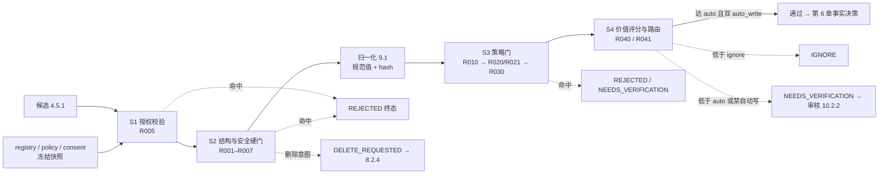
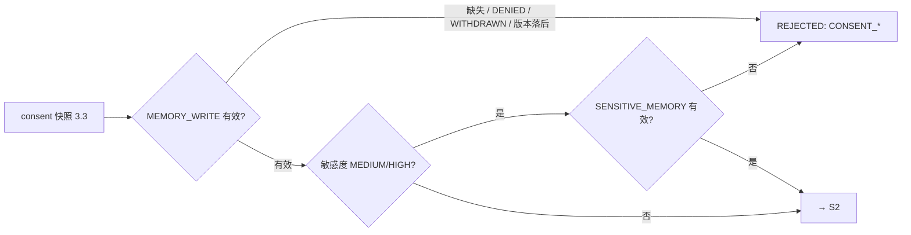
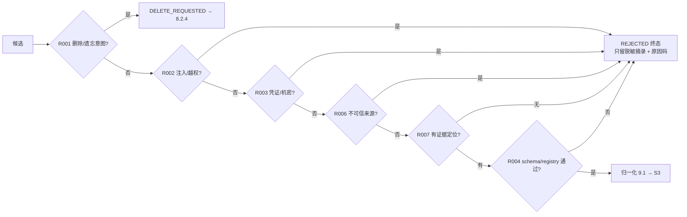
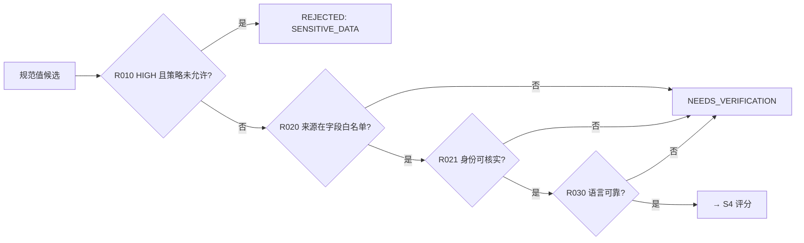
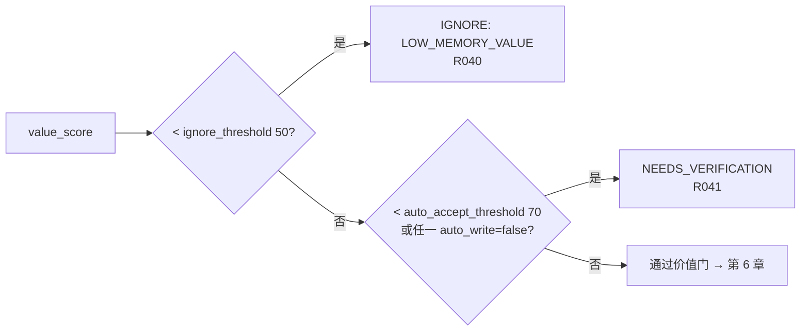
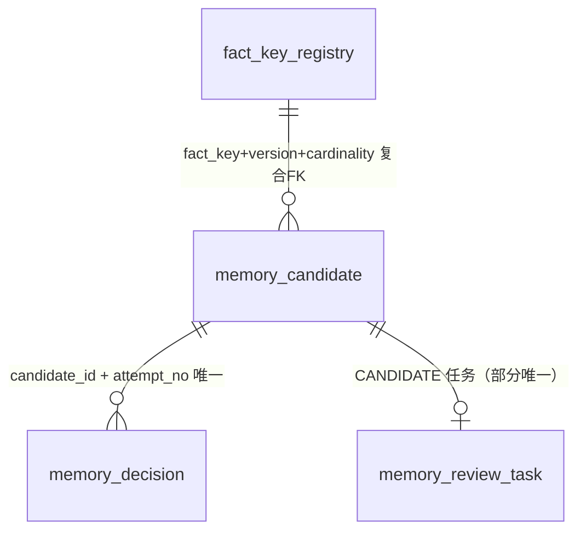
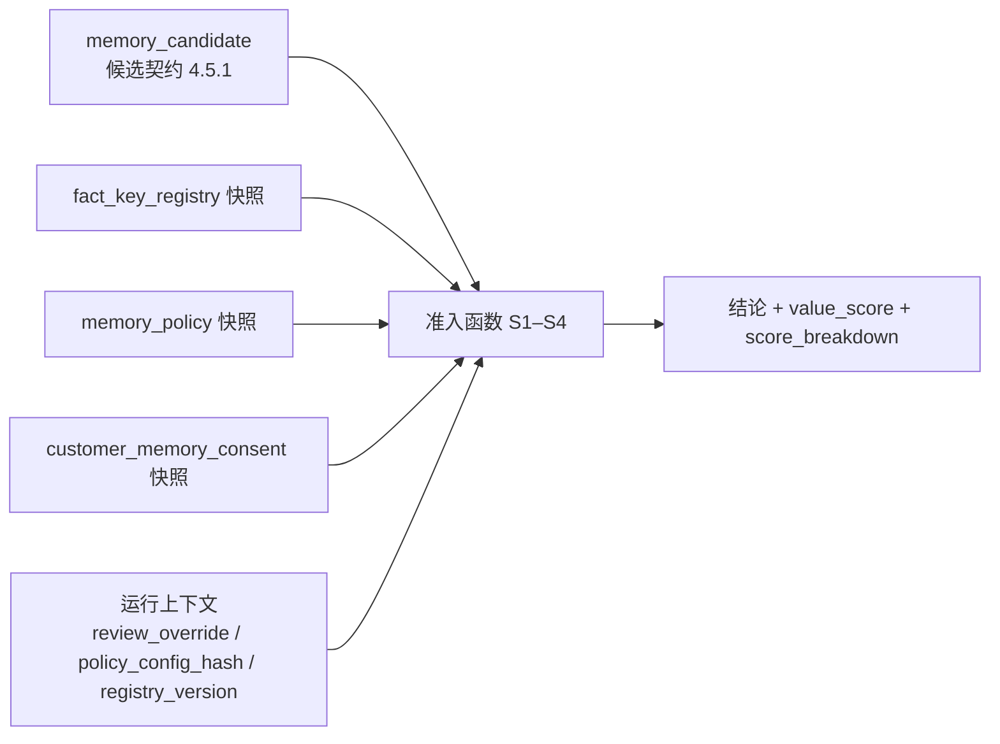
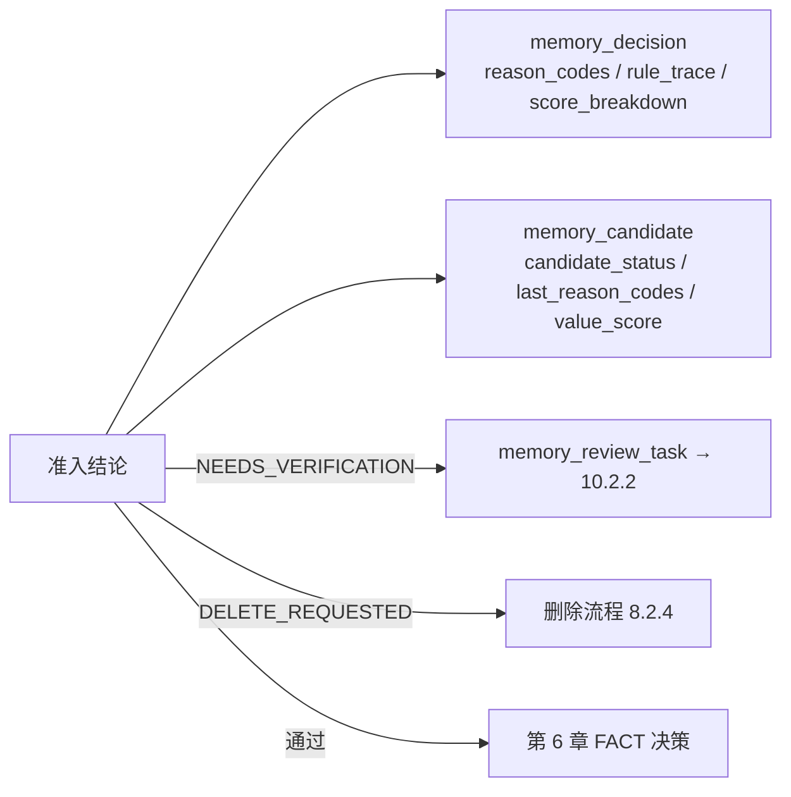
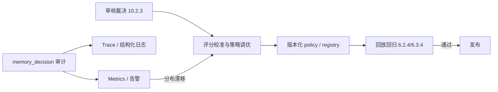

# 记忆准入判定

**一句话：准入是确定性函数，不调 LLM、不读已有记忆、可回放。** 只回答两件事：能不能保存（硬规则）、值多少分 / 自动还是审核（价值评分）；重复与冲突处理属第 6 章。

## 5.1 整体执行过程



| 步骤 | 职责 | 规则 | 失败去向 |
|---|---|---|---|
| S1 授权校验 | consent 快照一票否决 | `R005` | `REJECTED`：`CONSENT_*` |
| S2 结构与安全硬门 | 删除意图、注入、凭证、不可信来源、无证据、schema/registry | `R001–R007` | 终态拒绝，或转删除流程 |
| S3 策略门 | 敏感 → 来源白名单 → 身份 → 语言 | `R010/R020/R021/R030` | `REJECTED` 或 `NEEDS_VERIFICATION` |
| S4 价值评分与路由 | 五维正向分 − 风险惩罚，按阈值路由 | `R040/R041` | `IGNORE` / `NEEDS_VERIFICATION` / 通过 |

全局不变量：

1. **纯函数**：无模型调用、无隐式查库；同候选 + 同 `(policy_config_hash, registry_version)` 必得同结论（6.2.4/6.3.4）。
2. **硬门先于评分**：命中即终态，分数再高不能翻案；`review_override` 只跳过 `R021/R041`，其余硬门仍生效，审核通过后仍不满足硬门 → `REVIEW_NOT_ACTIONABLE`；FACT 阶段的审核裁决（强制 `R080`、绕过 `R110`）属 10.2.3 职责。
3. **先归一化后评分**：分数基于 `object_hash` 对应的规范值，不基于未归一化原文（9.1）。
4. **版本锁定**：`policy_version` 与 `fact_key_registry_version` 事务内锁定并写入候选/决策，保证回放一致。
5. **授权不重做**：本章只消费第 3 章快照；屏障锁与提交前 consent 复核由 6.2.2 负责。
6. **拒绝不留原文**：命中硬门只保留脱敏摘录与原因码（4.3/6.5）。

执行落点：硬门分两段——Normalizer 内的前置硬门（`R001–R007`）与规则矩阵 GATE 段（`R010–R041`）；本章定义判定语义与顺序，规则 ID 与实现以 6.2.4 为准。

## 5.2 关键步骤说明

### 5.2.1 S1 授权校验



| 规则 | 口径 |
|---|---|
| 一票否决 | 授权无效即终态，不可用分数或审核翻案 |
| 敏感加严 | `MEDIUM/HIGH` 一律要求 `SENSITIVE_MEMORY`，比 `sensitive_policy` 布尔开关更严 |
| 原因码 | `CONSENT_DENIED` / `CONSENT_WITHDRAWN` / `CONSENT_UNAVAILABLE` |
| 边界 | 快照同步与 fail-closed 判定见 3.3；写事务入口校验与提交前复核见 6.2.2 |

### 5.2.2 S2 结构与安全硬门（Normalizer）



| 规则 | 判定 | 结论：reason_code |
|---|---|---|
| `R001` | 用户要求不要记、忘掉、删除 | `DELETE_REQUESTED`，转 8.2.4，不落普通候选 |
| `R002` | 试图改变系统提示、权限、审批或退款状态 | `REJECTED`：`POLICY_FORBIDDEN` |
| `R003` | 密码、验证码、令牌、API Key、私钥、完整支付卡号 | `REJECTED`：`SENSITIVE_DATA`（`R010` 敏感兜底） |
| `R006` | `KNOWLEDGE_RETRIEVED`/`ASSISTANT_GENERATED` 被当作客户事实 | `REJECTED`：`SOURCE_UNTRUSTED` |
| `R007` | `source_refs` 为空或无可验证定位符 | `REJECTED`：`MISSING_EVIDENCE` |
| `R004` | schema、枚举、时间区间、validator 失败；未知/停用 `fact_key` | `REJECTED`：`SCHEMA_VALIDATION_FAILED`；未知键/registry 缺陷为候选级永久失败，作业终止（4.2.5） |

### 5.2.3 S3 策略门：敏感 → 来源 → 语言

前置：Normalizer 已产出规范值与 hash（9.1）；registry 敏感性**只上调、从不下调**。



| 规则 | 判定 | 结论：reason_code |
|---|---|---|
| `R010` | `HIGH` 且 `sensitive_policy.high_allowed=false`（默认） | `REJECTED`：`SENSITIVE_DATA`；开启须同时具备权威证据、授权与策略审批 |
| `R020` | `source_kind` 不在该 `fact_key` 的 `allowed_source_kinds` 内 | `NEEDS_VERIFICATION`：`SOURCE_UNTRUSTED` |
| `R021` | `entity_ref` 非空、该键声明 `authority_source` 且来源非 `SYSTEM_OF_RECORD` | `NEEDS_VERIFICATION`：`IDENTITY_UNVERIFIED`（审核可放行）；跨客户混入另按安全事件告警 |
| `R030` | `und` 或语言置信度低于 `language_confidence_min`（默认 0.80） | `NEEDS_VERIFICATION`：`LANGUAGE_UNSUPPORTED_LEXICAL` |

**来源信任等级**（按字段定义，不是全局排序；`source_kind` 由服务端按消息角色/来源系统标注，不采信模型自报，4.2.4）：

| 等级 | 含义 | 评分 S | 能否作客户个人事实 | 覆盖等级序 |
|---|---|---:|---|---:|
| `SYSTEM_OF_RECORD` | 该字段的权威业务系统（订单/退款/工单/CRM） | 20 | 是，仅限其权威字段 | 5 |
| `AGENT_CONFIRMED` | 客服确认且有工单/业务证据 | 17 | 是，按字段 | 4 |
| `USER_EXPLICIT` | 用户明确陈述或明确纠正 | 18 | 是 | 3 |
| `USER_IMPLICIT` | 用户含糊、间接暗示 | 10 | 仅字段允许且需核实 | 2 |
| `MODEL_INFERRED` | 模型推断 | 6 | 默认否 | 1 |
| `KNOWLEDGE_RETRIEVED` | 知识库/RAG 片段 | 0 | 否，`R006` 硬拒绝 | 0 |
| `ASSISTANT_GENERATED` | 助手先前输出 | 0 | 否，`R006` 硬拒绝 | 0 |

| 口径 | 规则 |
|---|---|
| 等级的使用点 | 硬拒绝（`R006`）、字段白名单（`R020`）、评分 S 维度（5.2.4）、覆盖授权（第 6 章 `R080`） |
| 覆盖等级序 | 仅 `requires_authority=true` 时有意义：候选来源等级须**严格高于**现有记忆来源，否则 `R100 CONFLICT` |
| 权威字段 | `authority_source` 记录字段权威系统；`requires_authority=true` 时服务端把 `SYSTEM_OF_RECORD` 事件解析为 `authoritative_fact`（第 6 章）；非权威来源分数再高也不能覆盖权威值 |
| 与敏感性无关 | 等级不改变敏感性；`HIGH` 事实必须有权威证据并满足授权/策略 |

种子 registry 示例（字段级配置决定准入后果）：

| fact_key | `allowed_source_kinds` | `auto_write` | `requires_authority` | 准入后果 |
|---|---|---:|---:|---|
| `communication.language` | `USER_EXPLICIT`、`AGENT_CONFIRMED` | true | false | 用户明确说即可；`MODEL_INFERRED` 走 `R020` 审核 |
| `product.client_version` | `SYSTEM_OF_RECORD`、`USER_EXPLICIT`、`AGENT_CONFIRMED` | true | false | 用户自报可写；模型推断需核实 |
| `issue.status` | `SYSTEM_OF_RECORD`、`AGENT_CONFIRMED` | false | true | 用户陈述走 `R020`；只有权威系统新值可覆盖，且始终人工审核 |

高影响事实（退款成功、资金到账、账号封禁、赔付批准等）：无权威系统证据不得自动写，由 `HIGH` 硬门、`auto_write=false` 与人工审核兜底；独立权威硬门的实现缺口见 5.7。

### 5.2.4 S4 价值评分与路由

**0–100 整数，五个正向维度 + 一个风险惩罚确定性计算；默认阈值 `ignore=50`、`auto_accept=70`。** 评分只用于低风险记忆的排序与门槛，不替代硬规则、白名单与权威来源要求。

```text
component_i = trunc(base_i × weight_i / default_weight_i)
raw         = P + E + F + S + A + R
score       = clamp(trunc(raw × (0.7 + 0.3 × confidence)), 0, 100)   # confidence 缺省时不乘
if len(content) < 3: score = min(score, 49)
```

| 维度 | 默认权重（上限） | 基线规则（未覆盖权重时） |
|---|---:|---|
| 持久性 P | 25 | `CUSTOMER_PROFILE`/`ACCOUNT_FACT`=25；`EPHEMERAL_CONTEXT`=5；其他=18 |
| 明确性 E | 20 | `USER_EXPLICIT`=20；否则 `explicit_correction=true`=15；否则=8 |
| 未来客服价值 F | 20 | `CUSTOMER_PROFILE`/`SERVICE_HISTORY`/`ACTIVE_ISSUE`=20；其他=12 |
| 来源可信度 S | 20 | 按 5.2.3 等级表取值 |
| 可行动性 A | 15 | `fact_key` 前缀为 `communication.`/`product.`/`issue.`=15；否则=8 |
| 风险惩罚 R | 0 至 -100 | `LOW`=0、`MEDIUM`=-20、`HIGH`=-100 |

| 计算规则 | 口径 |
|---|---|
| 权重覆盖 | `component = trunc(base × 覆盖值 / 默认满分)`，只缩放该维度族；默认 `scoring_weights` 即恒等变换 |
| 权重校验 | 正向权重 ≥ 0，`risk_penalty` ≤ 0；正数风险权重会奖励风险，启动即拒绝 |
| 置信度乘数 | 存在时 × `(0.7 + 0.3 × confidence)`（1 不衰减、0 保留 70%），缺省不乘；模型自报值须经标注集校准（4.6）；只降权，不替代来源等级或硬规则 |
| 短文本上限 | `content` 少于 3 字符 → 分数 ≤ 49，默认策略下不会自动接纳 |
| 值域 | 截断取整并夹在 `[0,100]`；数据库 `value_score` 同约束 |



| 条件 | 结论：reason_code | 规则 |
|---|---|---|
| `score < ignore_threshold` | `IGNORE`：`LOW_MEMORY_VALUE` | `R040` |
| `ignore_threshold <= score < auto_accept_threshold` | `NEEDS_VERIFICATION`：`BELOW_AUTO_ACCEPT_THRESHOLD` | `R041` |
| 达 auto 阈值但任一 `auto_write=false` | `NEEDS_VERIFICATION`：`AUTO_WRITE_DISABLED` | `R041` |
| 达 auto 阈值且 policy/registry 双 `auto_write=true` | 通过，进入第 6 章 | 无 GATE 命中 |
| `review_override=true` | 跳过 `R041`，硬门仍生效 | 审核覆盖 |

阈值约束：`0 <= ignore_threshold < auto_accept_threshold <= 100`，类型专属 policy 覆盖后仍须满足。**达到自动阈值 ≠ 一定自动写入**：还须通过全部硬门且双 `auto_write` 为真；高影响事实不受分数影响。

算例（默认权重，假设 `fact_key` 已注册、来源在白名单内且其他硬门通过）：

| 场景 | 维度得分 | 乘数 | 最终分 | 路由 |
|---|---|---|---:|---|
| 用户明确语言偏好：`CUSTOMER_PROFILE`、`USER_EXPLICIT`、`communication.language`、`LOW`、`confidence=0.92` | 25+20+20+18+15=98 | 0.976 | 95 | ≥70，进入第 6 章 |
| 客服确认的服务历史：`SERVICE_HISTORY`、`AGENT_CONFIRMED`、`service.attempted`、`LOW`、`confidence=0.8` | 18+8+20+17+8=71 | 0.94 | 66 | 50–69，转审核 |
| 中敏感工单状态：`ACTIVE_ISSUE`、`AGENT_CONFIRMED`、`issue.status`、`MEDIUM`、`confidence=0.9` | 18+8+20+17+15-20=58 | 0.97 | 56 | 转审核；该键 `auto_write=false` |

## 5.3 数据模型

**本章不写 `customer_memory`。** 准入结论由引擎事务（6.2.5）落库：更新 `memory_candidate`、写 `memory_decision` 审计，`NEEDS_VERIFICATION` 时创建 `memory_review_task`。完整表结构见《23-数据模型与表设计》。



写入表与关键字段：

| 表 | 本章写入的字段 | 口径 |
|---|---|---|
| `memory_candidate` | `candidate_status`、`last_reason_codes`、`value_score` | 状态映射见 5.5；`value_score` 0–100（CHECK）；语义字段由 Normalizer 回填（9.1） |
| `memory_decision` | `outcome`、`reason_codes`、`primary_rule_id`、`rule_trace`、`score_breakdown`、`candidate_hash/semantic_hash`、`policy_version/fact_key_registry_version/engine_version` | 每次判定一条，`(candidate_id, attempt_no)` 唯一；硬门终态的 `primary_rule_id` 按原因码取 `R001–R007/R010/R030`（6.2.4） |
| `memory_review_task` | `task_type='CANDIDATE'`、`candidate_id`、`risk_level`、`status='PENDING'`、`decision_version` | 仅 `NEEDS_VERIFICATION` 创建；部分唯一索引保证同候选只有一个未结任务；审核流程见 10.2.2 |

只读依赖（冻结快照，不写）：

| 表 | 用途 |
|---|---|
| `fact_key_registry` | 字段级硬门：`allowed_source_kinds`、`sensitivity`、`auto_write`、`requires_authority`、`validator`、`cardinality`、`mutual_exclusion`、`retention_days` |
| `memory_policy` | 阈值、权重、语言门槛、敏感策略、类型级保留策略 |
| `customer_memory_consent` | 授权快照（3.3），`MEMORY_WRITE` / `SENSITIVE_MEMORY` |

## 5.4 输入数据

**一条候选 + 三份快照 + 运行上下文；不读已有记忆、不读向量、不查权威系统**（`exact_matches`、`semantic_candidates`、`authoritative_fact` 是第 6 章的输入）。



| 输入 | 内容 | 作用 |
|---|---|---|
| 服务端候选 | 4.5.1 `CandidateInput`：主体、`fact_key`、规范值、原文、证据、`source_kind`、敏感度、时间 | 被判定对象；完整契约见 4.5.1 与 `contracts/candidate.schema.json` |
| registry 快照 | 见 5.3 只读依赖 | 字段级硬门、敏感性上调、评分与自动写入开关 |
| policy 快照 | `ignore_threshold`、`auto_accept_threshold`、`scoring_weights`、`auto_write`、`language_confidence_min`、`sensitive_policy`、`retention_days` | 阈值、权重、语言门槛、类型级保留策略 |
| 授权快照 | `MEMORY_WRITE`；`MEDIUM/HIGH` 另需 `SENSITIVE_MEMORY` | 一票否决 |
| 运行上下文 | `review_override`、`policy_config_hash`、`registry_version` | 审核覆盖与决策回放 |

字段归属：`candidate_id/customer_id/source_system/source_event_id/observed_at/policy_version` 由服务端注入；`object_hash/semantic_text/semantic_hash/candidate_fingerprint/value_score` 由 Normalizer/评分子系统生成——均不接受模型输出（4.5.1）。

**`memory_type`：提取器提出，服务端只做枚举校验与策略绑定，不调 LLM 二次分类**（再调模型破坏可回放性；类型错了修提取器与评测 4.6）。类型只影响政策/保留/评分，不影响事实身份（`fact_key + entity_type + entity_ref + value_slot`），服务端不维护 `fact_key → memory_type` 映射；类型专属策略优先于默认策略（`memory_policy.memory_type` 为空即默认）；非法枚举 → 入口 422 或 `SCHEMA_VALIDATION_FAILED`。

| 类型 | 示例 | 初始保留策略（需业务确认） | 默认自动化级别 |
|---|---|---|---|
| `CUSTOMER_PROFILE` | 语言偏好、沟通方式、产品使用偏好 | 直到被修改/撤回；定期复核 | 低风险且明确时可自动写入 |
| `SERVICE_HISTORY` | 已完成的故障排查、曾尝试的处理方法 | 30–90 天，按价值和合规策略配置 | 低/中风险可自动写入 |
| `ACTIVE_ISSUE` | 当前未解决问题、下一步排查、待补充资料 | 与工单/问题状态联动；关闭后转历史或过期 | 仅保留必要信息；优先关联工单 |
| `COMMITMENT` | 退款跟进、回访安排、客服承诺 | 按工单/承诺状态和业务保留政策决定 | 必须关联工单/订单等权威来源 |
| `EPHEMERAL_CONTEXT` | 本轮会话临时环境、短期约束 | 默认 1–7 天，通常不进入长期档案 | 仅在后续对话有用时写入 |
| `ACCOUNT_FACT`（可选） | 产品版本、客户确认的账户使用信息 | 依据账户政策；禁止复制不必要的敏感值 | 更严格的权限、字段白名单和来源校验 |

保留期限是业务策略建议值，生产环境按类型配置版本化 policy。

## 5.5 输出数据



结论语义（全章唯一定义处）：

| 结论 | 语义 | 触发 | `candidate_status` | 落点 |
|---|---|---|---|---|
| 通过 | 允许继续决策 | 全部硬门通过、分数达 auto 且双 `auto_write` | 由第 6 章决定（`ACCEPTED`/`PROCESSED`） | 进入第 6 章 FACT 规则；写/不写仍由第 6 章决定 |
| `IGNORE` | 低价值，不是违规 | 分数低于 `ignore_threshold` | `IGNORED` | 不进长期记忆，写决策审计 |
| `NEEDS_VERIFICATION` | 允许但证据不足 | 来源/语言/身份/权威证据不足，或分数 ∈ `[ignore, auto)`，或禁自动写 | `PENDING_REVIEW` | 生成审核任务（10.2.2），不自动写 |
| `REJECTED` | 禁止保存，终态不重试 | 凭证、注入、不可信来源、授权、敏感策略或 schema 失败 | `REJECTED` | 终态（4.2.5） |
| `DELETE_REQUESTED` | 删除意图，非普通拒绝 | 删除/遗忘意图 | 不落普通候选 | 转 8.2.4 |

审计载荷（不允许只存总分）：

| 字段 | 内容 |
|---|---|
| `reason_codes` / `primary_rule_id` / `rule_trace` | 命中原因与规则轨迹，支持归因与回放 |
| `value_score` + `score_breakdown` | 各维度得分；有 `confidence` 时另含 `confidence_multiplier` 与 `pre_confidence_score` |
| 版本三元组 | `policy_version`、`fact_key_registry_version`、`engine_version`，回放一致性依据 |

## 5.6 持续观测设计

**观测三问：拒得对不对、分数漂没漂、审核积不积压。** 数据源以 `memory_decision` 审计为准，指标按 `policy_version` 切片。



指标：

| 指标 | 语义 | 目标 |
|---|---|---|
| `mms_admission_total{outcome,primary_rule_id}` | 结论与命中规则分布 | 拒绝结构突变即审查 |
| `mms_admission_duration_seconds` | 单候选准入耗时直方图 | P95 按 SLO |
| `mms_admission_value_score` | 分数分布直方图 | policy 变更后漂移可解释 |
| `mms_admission_review_total{reason_code}` | 审核任务生成率 | 与审核处理能力匹配 |
| `mms_admission_replay_mismatch_total` | 同输入同版本回放结论不一致 | =0 |
| `mms_consent_check_total{result}` | 授权判定分布（复用 3.5） | `unavailable` 增长即时 critical |

Trace 与日志：

| 信号 | 内容 |
|---|---|
| `admission.run` Span | 阶段（S1–S4）、命中规则、耗时、`value_score`；不记正文 |
| 结构化日志 | `candidate_id/trace_id/policy_version/registry_version/reason_codes`；无 raw `customer_id`/正文，客户维度不做高基数标签 |
| 审计回查 | 任一拒绝可在 `memory_decision` 查到 `outcome`、原因码与 `score_breakdown`（3.5.2 同源门禁） |

告警与发布门禁：

| 门禁 | 阈值 |
|---|---|
| 未授权零写入 / 敏感漏检 | =0（与 3.5.2、20.1 同源） |
| 安全类拒绝突增 | `REJECTED{R002/R003/R006}` 异常增长 → 安全告警 |
| 审核积压 | `PENDING_REVIEW` 超 SLA（状态机 §1）→ 告警给审核队列 owner |
| 分数/结论漂移 | `IGNORE` 占比或分数分布突变 → 触发 policy 变更评审 |
| 回放一致性 | `mms_admission_replay_mismatch_total` >0 阻断发布 |
| 启动校验 | 阈值顺序 `ignore < auto`、`risk_penalty ≤ 0`，非法即拒绝启动 |

校准闭环：`score_breakdown` + 审核裁决结果 → 离线评测（《模型质量评测体系》）→ 调整权重/阈值 → 版本化 policy + 回放回归 → 发布；置信度乘数依赖标注集校准（4.6），不允许线上自报值直接当概率。

## 5.7 当前实现边界（2026-10-29）

| 项 | 已落地 | 已知缺口 |
|---|---|---|
| 评分 | `normalizer.score_candidate` 按 5.2.4 公式确定性计算；`score_breakdown` 写决策审计；`value_score` 0–100 约束 | — |
| 类型 | `RuleBasedExtractor` 固定输出 `CUSTOMER_PROFILE`（4.7）；服务端只做枚举校验与按类型加载策略 | LLM 提取器尚未接入 |
| 信任 | 规则提取器只产出 `USER_EXPLICIT`；`R006` 硬拒绝；非白名单走 `R020` 审核；`R080` 等级比较仅在 `requires_authority=true` 字段生效 | — |
| 阈值与审核 | 默认 50/70；`review_override` 只跳过 `R021/R041`；`HIGH` 默认被 `R010` 拒绝；`MEDIUM/HIGH` 一律要求 `SENSITIVE_MEMORY` | — |
| 高影响保护 | 由 `HIGH` 硬门、registry `auto_write=false` 与人工审核兜底 | `review_rules.high_impact_requires_authority` 未被规则读取；`requires_authority` 只参与 `R080` 覆盖授权与 `authoritative_fact` 解析，对无既有事实的首次写入（`R070`）没有独立的“必须有权威证据”硬门 |