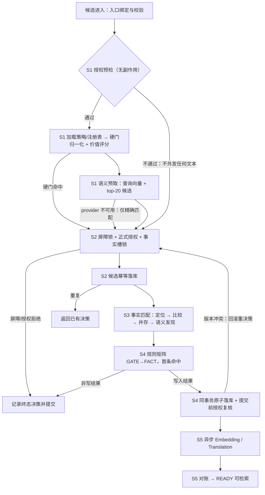
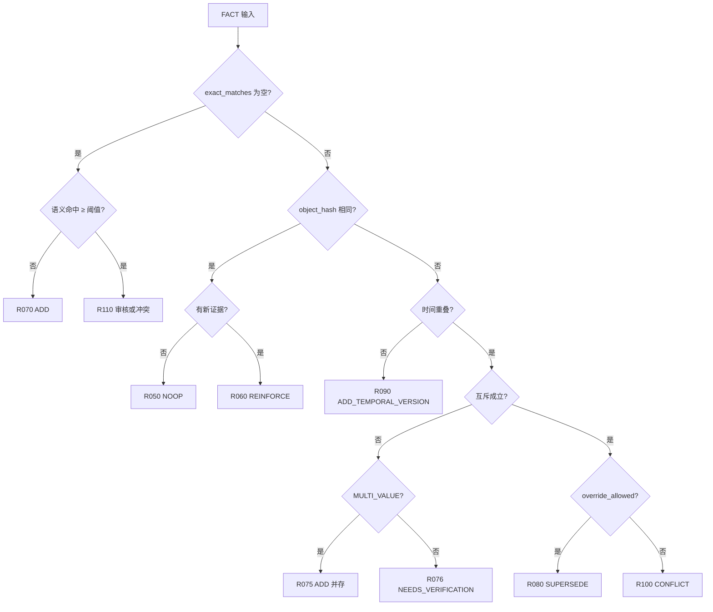
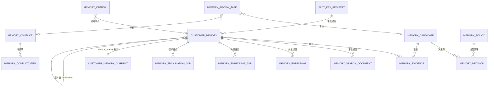
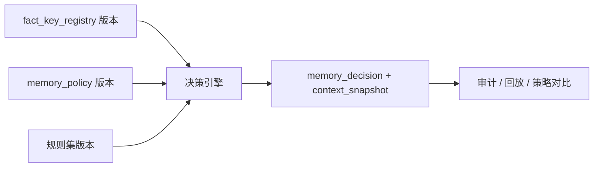
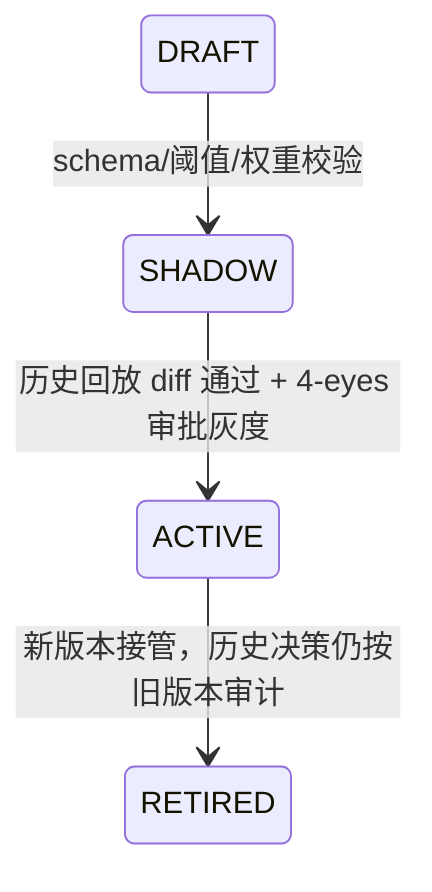

# 记忆写入决策

本章承接第 5 章（准入判定）：第 5 章回答"值不值得写"，本章回答"怎么写"——对规范化候选做出**唯一、可解释、可回放**的写入决策（新增 / 强化 / 替代 / 冲突 / 审核），并原子落库。

三条设计原则：

| 原则 | 含义 |
|---|---|
| 决策是纯函数 | 同一输入快照 + 同一版本（策略 / 注册表 / 规则集）必得同一结果 |
| 事务内只写库 | 所有外部 I/O 在事务前预取或提交后异步执行 |
| 精确优先 | 语义相似度只做候选发现，不作为替代依据 |

| 小节 | 内容 |
|---|---|
| 6.1 | 整体执行过程：5 个关键步骤、不变量、失败语义 |
| 6.2 | 关键步骤说明：S1 预检 → S2 加锁 → S3 事实匹配 → S4 规则决策 → S5 事务与索引 |
| 6.3 | 数据模型：核心表、写入集、策略与注册表版本化 |
| 6.4 / 6.5 | 输入数据 / 输出数据 |
| 6.6 | 持续观测设计 |
| 6.7 | 当前实现边界 |

## 6.1 整体执行过程（5 个关键步骤）



| 步骤 | 位置 | 做什么 | 失败出口 |
|---|---|---|---|
| **S1 预检与准备** | 事务外 | 入口校验；授权预检；加载策略/注册表；硬门归一化 + 评分；语义预取 | 入口失败 403/422；预检不通过 → 不调 provider；硬门 → 终态（S2 落库）；provider 不可用 → 降级仅精确匹配 |
| **S2 加锁与幂等** | 事务开始 | 屏障锁与校验；正式授权；事实槽锁；候选幂等落库 | 屏障/授权 → `REJECTED` 终态；重复候选 → 返回已有决策 |
| **S3 事实匹配**（6.2.3） | 事务内 | 精确定位 → 值比较 → 并存判断 → 消费语义候选 → 冻结 `RuleContext` | 无匹配 → `R070`/`R110` 分支 |
| **S4 规则决策与提交**（6.2.4/6.2.5） | 事务内 | GATE→FACT 首条命中；原子落库；提交前授权复核 | 零/多命中失败关闭；版本冲突回滚重决策 |
| **S5 异步索引**（6.2.5） | 提交后 | 生成向量与译文视图；对账 `READY` | 重试/死信/对账修复；不回滚业务记忆 |

### 6.1.1 顺序不变量

| # | 不变量 |
|---:|---|
| 1 | **授权先于外发**：未通过屏障/授权不得调用 embedding、翻译或外部模型；提交前复核授权 |
| 2 | **拒绝单调**：`REJECTED`/`DELETE_REQUESTED` 不能被更高分、更高相似度或审核翻案；审核只改变 `NEEDS_VERIFICATION`/`CONFLICT` 的处理路径 |
| 3 | **归一化先行，定位与比较分离**：评分/定位/比较都基于规范值；定位键不含 `object_hash`，否则值变化时 `SUPERSEDE` 退化成 `ADD` |
| 4 | **语义只做发现**：精确匹配优先；向量相似度不能证明"同一事实"，不能触发自动替代 |
| 5 | **规则纯函数**：只读冻结的 `RuleContext`，不查库、不调模型；事务与持久化在矩阵外 |
| 6 | **外部 I/O 不入事务，提交先于索引**：查询向量事务前预取，生成提交后异步；检索只读 `READY` 向量，索引失败不回滚业务记忆 |

### 6.1.2 失败语义

| 失败点 | 处理 | 重试 | 结果 |
|---|---|---|---|
| 语义预取/provider 不可用 | 降级仅精确匹配 | 否（本次） | 写路径继续 |
| 屏障/授权失败 | 记录终态 `REJECTED` | 否 | 不进 DLQ |
| Normalizer 硬门 | 记录终态决策，保留脱敏摘录 | 否 | 不写记忆 |
| 未知/停用 `fact_key`、注册表配置非法 | 候选级永久失败 | 否 | 修注册表后重放 |
| 规则零命中/多命中 | 规则集缺陷，异常回滚 | 否 | 修规则表并提升版本 |
| 版本冲突/并发修改 | 事务回滚 | 是 | 以新快照重新决策 |
| Embedding Job 失败 | 重试/死信/对账修复 | 是 | 记忆保留，标记索引未就绪 |
| Translation Job 失败 | 重试/死信 | 是 | 原文与规范视图仍可用 |

## 6.2 关键步骤说明

### 6.2.1 S1 预检与准备

| 项 | 口径 |
|---|---|
| 预检顺序 | 屏障 → `MEMORY_WRITE` → 中/高敏 `SENSITIVE_MEMORY` → `CROSS_BORDER_EMBEDDING`（3.3）；无副作用：不加锁、不落库、不产生终态，终态由 S2/S4 记录 |
| 预检的作用 | 未通过即不生成查询向量、不外发规范文本；预取必须晚于预检 |
| 预取内容 | 策略/注册表快照、归一化、查询向量与 top-20 语义候选（阈值 `semantic_match_threshold`） |
| 降级 | provider 失败 → 语义候选为空，写路径继续，只走精确匹配 |
| 跨境门禁 | 与 Embedding Worker、检索查询向量、决策重放、语义 canary 共用同一实现；关闭统一记 `mms_embedding_cross_border_blocked_total{stage}`；属策略关闭而非故障，不进 `degraded`（18.4） |

### 6.2.2 S2 加锁与幂等

| 项 | 口径 |
|---|---|
| 屏障 | 先取客户级 `pg_advisory_xact_lock`，再读主库 barrier 行，校验 `barrier_generation` 相等且 `carrier.created_at >= cutover_at`（8.2.5）；锁持有到提交 |
| 正式授权 | 事务内检查 `MEMORY_WRITE`，`MEDIUM/HIGH` 再查 `SENSITIVE_MEMORY`；敏感性只上调；提交前复核，覆盖"检查后被撤回"窗口 |
| 事实槽锁 | 锁定 `customer_id + fact_key + entity_type + entity_ref + value_slot` |
| 事务内重算 | 归一化与硬门在事务内重新执行（纯计算），保证决策输入与落库一致；预取只服务于语义候选与耗时 I/O |
| 幂等 | 以候选指纹写 `memory_candidate`，唯一键冲突 → 返回已有决策（4.2.5、14.4） |

### 6.2.3 S3 事实匹配

只做三件事：**定位同一事实实例、比较规范值、判断两个值能否并存**；语义召回只用于发现键不同但语义相近的候选。不比较原文，不靠相似度裁决。

**四个动作与三个指纹：**

| 动作 | 键/数据 | 回答的问题 | 禁止 |
|---|---|---|---|
| 定位 | `customer_id + fact_key + entity_type + entity_ref + value_slot` | 是不是同一事实实例 | 定位条件不含 `object_hash` |
| 比较 | `object_hash`（规范化 `object_json` 的 SHA-256） | 两个值是否相同 | 不比较 `content` 或译文 |
| 并存 | `valid_from/valid_to` + `cardinality` + `mutual_exclusion` | 不同值能否同时有效 | "文本相似"不是互斥 |
| 发现 | embedding 相似度 ≥ `semantic_match_threshold` | 有无语义相近的其他记忆 | 不能直接 `SUPERSEDE`，只进 `R110` |

| 指纹 | 构成 | 用途 |
|---|---|---|
| `object_hash` | 规范值的 SHA-256 | 判断值相同；不作定位条件 |
| `semantic_hash` | `fact_key/entity_type/entity_ref/value_slot/object_hash/有效期`，不含 `normalization_version` | 事实身份、去重与回放；不作定位键 |
| `content_hash` | 不可变原文 | 证据与视图失效锚点；不参与跨语言事实相等判断 |

跨语言同一事实：`fact_key/entity/value_slot/规范值/有效期` 相同即同一事实，`object_hash` 跨语言相同；新语言原文是新证据（`R060` 追加 `ORIGINAL` 视图），不是新事实。RENORMALIZE 可改变指纹但不触发版本决策（9.2）。

**定位与比较步骤：**

| 步骤 | 动作 | 要点 |
|---:|---|---|
| 1 | 精确定位 | `SINGLE_VALUE`：查 `customer_memory_current`，唯一索引保证最多一条；`MULTI_VALUE`/`TEMPORAL`：查 `customer_memory` 的 `current_flag=true` 行，附事实槽条件，状态限 `ACTIVE`/`CONFLICTED`，按 `object_hash` 是否相同、`updated_at` 倒序返回 0..n 条；输出 `exact_matches` 与已有 `ORIGINAL` 视图语言 `evidence_languages` |
| 2 | 选比较对象 `current` | 0 条 → 无当前事实；`TEMPORAL` 优先取区间重叠的第一条；其他基数优先取 `object_hash` 相同者；其余命中保留在 `matched_memory_ids` 供审计 |
| 3 | 比较值 | `object_hash` 相同 → 判断新证据（`R050`/`R060`）；不同 → 判断时间区间是否重叠 |
| 4 | 并存与覆盖 | 不重叠 → `R090`；重叠 → 按 `cardinality` 与 `mutual_exclusion` 判互斥（下表）；互斥成立 → `override_allowed` 决定 `R080`/`R100` |
| 5 | 语义发现 | 用 `semantic_text` 查 `READY` 向量，取 ≥ 阈值 top-20，按 `memory_id` 去重并排除精确命中；仅当 `exact_matches` 为空才交给 `R110`；provider 不可用 → 结果为空 |
| 6 | 权威解析与冻结 | `requires_authority=true` 时把 `SYSTEM_OF_RECORD` 候选解析为 `authoritative_fact`（只用于 `R080` 的 `sub_rule`；外部 CRM/订单查询是协议扩展点，首次写入权威硬门见 6.7）；全部输入写入 `RuleContext`，规则阶段不再查库 |

**派生条件（规则输入，按需计算不落列）：**

| 条件 | 定义 |
|---|---|
| `override_allowed` | 候选来源在 `allowed_source_kinds` 内，且（`requires_authority=false` 或候选来源等级严格高于现有记忆来源） |
| `has_new_evidence` | 候选 `source_event_id` 不在现有 `memory_evidence.source_event_id` 集合中 |
| `new_evidence_languages` | 候选原文语言减去现有 `ORIGINAL` 视图语言的差集 |

**互斥与覆盖判定口径：**

| 配置/条件 | 判定 | 结果 |
|---|---|---|
| `cardinality=MULTI_VALUE` | 恒可并存，`mutual_exclusion` 不参与 | 值不同且重叠 → `R075 ADD` |
| `cardinality=TEMPORAL` | 区间重叠本身即互斥依据 | 不重叠 → `R090`；重叠 → `R080`/`R100` |
| `cardinality=SINGLE_VALUE` | 查 `mutual_exclusion` 互斥组 | 互斥成立 → `R080`/`R100`；不成立 → `R076` 审核 |
| 同组不同值 | 两个规范值落在同一 group 的不同元素 | 互斥成立 |
| 含通配 `*` | 值域不受限 | 任意两个不同值互斥 |
| 互斥组为空/未覆盖 | 无法证明互斥（`SINGLE_VALUE` 空互斥组在注册表激活时即拒绝） | 运行期兜底 `R076` |

**算例：沟通语言从中文改为英文**

| 步骤 | 数据 | 结果 |
|---|---|---|
| 定位 | 客户 + `communication.language`，实体/值槽为空 | 命中当前记忆 `zh-CN` |
| 比较 | `object_hash(zh-CN)` ≠ `object_hash(en-US)` | 值不同 |
| 时间 | 两条 `valid_to` 均为空 | 区间重叠 |
| 互斥 | registry `language` 组同时含两个值 | 互斥成立 |
| 覆盖 | `USER_EXPLICIT` 在白名单内，`requires_authority=false` | `override_allowed=true` |
| 决策 | `R080` | `SUPERSEDE`：旧 `SUPERSEDED`，新 `ACTIVE` |

### 6.2.4 S4 规则决策

决策是一张**按阶段和优先级排序的规则表，首条命中即返回唯一结果**。`reason_code` 以本节规则表为唯一来源（治理口径见本节末）。

**规则分层：**

| 层 | 规则 | 作用 | 执行位置 |
|---|---|---|---|
| 前置 | `R001`–`R007` | 删除意图、硬门、授权缺失 | Normalizer/事务入口，矩阵外；保留 `rule_id` 供审计 |
| GATE | `R010`–`R041` | 敏感、来源、语言、价值阈值 | 矩阵内，不读已有事实，按优先级短路 |
| FACT | `R050`–`R110` | 重复、强化、新增、替代、冲突 | 矩阵内，读 6.2.3 匹配结果，条件互斥 |
| LIFECYCLE | `R120`、`R130` | 业务关闭、保留期到期 | 生命周期任务独立入口（状态机 §2/8.2.1），不在候选矩阵 |

**前置规则（矩阵外直接终态，`primary_rule_id` 即下表 rule_id）：**

| rule_id | 触发 | 结果 | reason_code |
|---|---|---|---|
| `R001` | 用户明确要求"不要记/忘掉/删除" | `DELETE_REQUESTED`，转 8.2.4 | `DELETE_REQUESTED` |
| `R002` | 注入/越权指令 | `REJECTED` | `POLICY_FORBIDDEN` |
| `R003` | 凭证/机密（密码、验证码、令牌、Key、完整卡号） | `REJECTED` | `SENSITIVE_DATA` |
| `R004` | `object_json` 未通过 validator/schema | `REJECTED` | `SCHEMA_VALIDATION_FAILED` |
| `R005` | `MEMORY_WRITE`/`SENSITIVE_MEMORY` 无有效授权 | `REJECTED` | `CONSENT_DENIED` / `CONSENT_WITHDRAWN` / `CONSENT_UNAVAILABLE` |
| `R006` | `KNOWLEDGE_RETRIEVED`/`ASSISTANT_GENERATED` 被当作客户事实 | `REJECTED` | `SOURCE_UNTRUSTED` |
| `R007` | 无可验证证据定位（`source_refs` 为空或缺定位符） | `REJECTED` | `MISSING_EVIDENCE` |

**GATE 规则（不读事实）：**

| rule_id | 优先级 | 条件 | outcome | reason_code |
|---|---:|---|---|---|
| `R010` | 10 | `sensitivity=HIGH` 且 `sensitive_policy.high_allowed=false` | `REJECTED` | `SENSITIVE_DATA` |
| `R020` | 20 | `source_kind` 不在 `allowed_source_kinds` 内 | `NEEDS_VERIFICATION` | `SOURCE_UNTRUSTED` |
| `R021` | 21 | `entity_ref` 非空、声明了 `authority_source`，且来源非 `SYSTEM_OF_RECORD`（`review_override` 跳过） | `NEEDS_VERIFICATION` | `IDENTITY_UNVERIFIED` |
| `R030` | 30 | `language_confidence < language_confidence_min`；`und` 由 Normalizer 同码拦截 | `NEEDS_VERIFICATION` | `LANGUAGE_UNSUPPORTED_LEXICAL` |
| `R040` | 40 | `value_score < ignore_threshold` | `IGNORE` | `LOW_MEMORY_VALUE` |
| `R041` | 41 | 分数在 `[ignore, auto_accept)`，或 registry/policy `auto_write=false`（`review_override` 跳过） | `NEEDS_VERIFICATION` | `BELOW_AUTO_ACCEPT_THRESHOLD` / `AUTO_WRITE_DISABLED` |

**FACT 规则（读 6.2.3 匹配结果，Embedding/视图动作见 6.5 统一表）：**

| rule_id | 条件 | outcome | reason_code |
|---|---|---|---|
| `R050` | 有当前事实，`object_hash` 相同，无新证据 | `NOOP` | `SAME_FACT_SAME_VALUE` |
| `R060` | 有当前事实，`object_hash` 相同，有新证据 | `REINFORCE` | `SAME_FACT_NEW_EVIDENCE` |
| `R070` | `exact_matches` 为空且无语义命中（或 `review_override`） | `ADD` | `NO_EXISTING_FACT` |
| `R075` | 值不同、重叠、互斥不成立，`MULTI_VALUE` | `ADD` | `MULTI_VALUE_COEXIST` |
| `R076` | 值不同、重叠、互斥不成立，`SINGLE_VALUE`（注册表未声明互斥组） | `NEEDS_VERIFICATION` | `REGISTRY_EXCLUSION_UNDECLARED` |
| `R080` | 值不同、重叠、互斥成立，`override_allowed=true`（或 `review_override`） | `SUPERSEDE` | `AUTHORITATIVE_SOURCE_CHANGED` / `EXPLICIT_NEWER_USER_CORRECTION` |
| `R090` | 值不同、区间不重叠 | `ADD_TEMPORAL_VERSION`（`SINGLE_VALUE` 时改 `CONFLICT`） | `TEMPORAL_NON_OVERLAP` |
| `R100` | 值不同、重叠、互斥成立，`override_allowed=false`（非 `review_override`） | `CONFLICT` | `CONFLICTING_VALUES` |
| `R110` | `exact_matches` 为空但有 ≥ 阈值语义候选（非 `review_override`） | 由 `semantic_match_policy` 定：`NEEDS_VERIFICATION` 或 `CONFLICT` | `SEMANTIC_MATCH_ONLY` |

**LIFECYCLE 规则（独立入口）：**

| rule_id | 触发 | outcome | reason_code |
|---|---|---|---|
| `R120` | 工单/问题完成或关闭 | `RESOLVE` / `EXPIRE` | `BUSINESS_EVENT_CLOSED` |
| `R130` | 保留期到期 | `EXPIRE` | `EXPIRED_BY_POLICY` |

**FACT 判定树：**



- `R080` 不以 `explicit_correction` 为前提——客户直接陈述新值也必须能替代；`explicit_correction` 与权威源变更只决定 `sub_rule` 和 `reason_code`。
- 同值文本修正属于 `R060` 新证据，不原地改写记忆。

**求值语义：**

| 项 | 规则 |
|---|---|
| 排序 | `GATE → FACT`；同阶段按 `priority` 再按 `rule_id`；首条命中即返回 |
| 互斥 | GATE 允许条件重叠按优先级确定；FACT 条件必须互斥，不允许双命中 |
| 输入 | `RuleContext` 冻结：`candidate`、`value_score`、`score_breakdown`、`exact_matches`、`has_new_evidence`、`new_evidence_languages`、`semantic_candidates`、`authoritative_fact`、`policy`、`registry`、`review_override` |
| 禁止 | 规则内不查库、不调 provider、不读全局状态；缺字段即启动断言失败 |
| 失败 | 零命中/多命中 = 规则集缺陷，失败关闭，不写库 |
| 版本 | 规则集版本写入 `engine_version`（当前 `2026-10-30.1`）；任何规则/优先级/`sub_rule` 变更必须提升版本并跑全量回放 diff |

**`sub_rule` 只允许以下取值（同一 `(rule_id, sub_rule)` 只能有一个 outcome）：**

| rule_id | sub_rule | 条件 | 效果 |
|---|---|---|---|
| `R060` | `new_evidence_language` | `new_evidence_languages` 非空 | `REINFORCE` + `UPSERT_VIEWS` |
| `R060` | `new_evidence_same_language` | 差集为空 | `REINFORCE` + `NOOP` |
| `R080` | `authoritative_changed` / `explicit_statement` | 权威值变化 / 其余 | 均 `SUPERSEDE`，原因码不同 |
| `R090` | `single_value_conflict` | `SINGLE_VALUE` 且区间不重叠（唯一索引不允许第二个 `ACTIVE`） | `CONFLICT`，开审核 |
| `R110` | `policy_verify` / `policy_ignore` | 由 `semantic_match_policy` 决定，缺省 `verify` | `NEEDS_VERIFICATION` / `CONFLICT` |

`rule_trace` 记录 `rule_id/priority/condition_hash/outcome/sub_rule`，不记录模型推理链；`condition_hash = SHA-256(canonical_json(condition_inputs))`，输入必须覆盖所有可能翻转分支的字段。

**审核覆盖 `review_override` 的边界：**

| 位置 | 影响 |
|---|---|
| GATE | 跳过 `R041`；`R010/R020/R030` 仍生效 |
| FACT | 强制 `R080`（忽略 `override_allowed`），绕过 `R100`/`R110`；无精确命中落 `R070` |
| 审核后仍不满足硬门 | 返回 `REVIEW_NOT_ACTIONABLE`（10.2.3） |

**原因码口径：** 原因码必须稳定、可枚举、可统计，不得只存自然语言解释；全集即上文各规则表的 `reason_code` 列，治理口径如下：

| 类别 | 口径 |
|---|---|
| 已废弃 | `DUPLICATE_EXACT` → 由 `SAME_FACT_SAME_VALUE` 取代；`SOURCE_NOT_AUTHORIZED_TO_OVERRIDE` → 由 `CONFLICTING_VALUES` 取代；均无生产者 |
| 非原因码 | `EMBEDDING_PENDING/FAILED/INVALID_VECTOR` 是指标名；`CONSENT_MISSING`、`CONSENT_VERSION_STALE` 无生产者 |
| 人工填写 | `MANUAL_APPROVAL_REQUIRED` 只能由审核人自由填写，无服务端生产者 |
| 异常路径 | `BARRIER_BLOCKED`/`STALE_GENERATION`：屏障命中发生在候选落库前，不产生决策行，只有 `mms_barrier_write_blocked_total` 与作业 `last_error_code` |
| 生命周期 | `BUSINESS_EVENT_CLOSED`/`EXPIRED_BY_POLICY` 由生命周期任务产生（`R120`/`R130`） |

**测试要求：**

| 测试 | 断言 |
|---|---|
| 单规则正/反例 | 命中时 `primary_rule_id`、`reason_code` 稳定 |
| 属性测试 | `exact_matches 空/同值/异值 × 新证据 × 时间重叠 × cardinality × 互斥 × requires_authority × 旧来源 × 语义候选 × review_override × 分数` 全组合恰好命中一条；"重叠且互斥不成立"不得命中 `R080/R100`；"不重叠且 `explicit_correction=true`"必须命中 `R090`；`MULTI_VALUE` 不得因声明互斥组变成 `SUPERSEDE` |
| 回放 | 同一 `RuleContext` + `rule_set_version` 重放 100 次结果一致；规则表变更跑全量回放 diff；零/多命中即 CI 失败 |

### 6.2.5 S4/S5 事务提交与异步索引

**事务模型：** 一次写入是一个 PostgreSQL 事务，**事务内做"决策 + 原子落库"，提交后做"索引投影"**。屏障锁与授权机制见 6.2.2；事务内写入集见 6.3.2。

**事务边界：**

| 区域 | 允许 | 禁止 |
|---|---|---|
| 事务前 | 读策略/注册表快照；归一化；查询向量；语义召回 | 持有 barrier/fact 锁；写记忆 |
| 事务内 | 屏障校验并持锁；授权与复核；fact 锁；硬门/评分；候选幂等；匹配与规则矩阵；写版本/证据/决策/指针/视图/Job/outbox | 调用 embedding/translation provider；同步外部权威查询（应预取） |
| 提交后 | Embedding/Translation Worker；对账；告警 | 改写已提交决策/版本（只能通过新决策、替代或删除修正） |

**视图入队规则（原文与事实值不通过原地 `UPDATE` 修改）：**

| 决策 | 入队动作 |
|---|---|
| `ADD` / `ADD_TEMPORAL_VERSION` | `ORIGINAL` + `CANONICAL` 视图入队 `memory_embedding_job` |
| `REINFORCE`（有新语言） | 只为新增语言 `ORIGINAL` 视图入队 |
| `DELETE` / `SUPERSEDE` | 同时失效旧版本全部视图 |
| `TRANSLATED` 视图 | 事务内按目标语言入队 `memory_translation_job`（`PENDING`、priority=120），Worker 异步生成（12.4），事务内不调翻译 provider |

**异步索引边界：**

| 边界 | 规则 |
|---|---|
| 检索可见性 | 只读 `memory_embedding.status='READY'`；embedding 完成前不能被语义召回，但仍可精确 `fact_key/entity_ref` 查询 |
| 失败处理 | 不回滚业务记忆；重试/死信/对账；对客返回标记 `semantic_index_pending=true`（内部诊断） |
| 删除/替代顺序 | 先失效旧向量，再生成新向量；不允许旧向量在新版本 `ACTIVE` 后继续被召回 |

## 6.3 数据模型

### 6.3.1 核心表关系

引擎涉及的表与关系如下；完整字段、外键与 DDL 以第 23 章为准。



### 6.3.2 事务内写入集

与决策同事务，原子提交：

| 表 | 写入步骤 | 内容 |
|---|---|---|
| `memory_candidate` | S2 | 候选指纹幂等、状态、原因码 |
| `customer_memory` | S4 | 新版本；`SUPERSEDE`/`TEMPORAL` 时关闭旧版本 |
| `memory_evidence` | S4 | 证据行；`REINFORCE` 追加 |
| `customer_memory_current` | S4 | `SINGLE_VALUE` 当前指针 |
| `memory_search_document` | S4 | `ORIGINAL`/`CANONICAL` 视图与词法投影 |
| `memory_decision` | S2/S4 | 所有决策（含终态/非写）：`rule_trace` + `context_snapshot`，append-only |
| `memory_conflict` / `memory_review_task` | S4 | `CONFLICT`/`NEEDS_VERIFICATION` 的人工处理入口 |
| `memory_embedding_job` | S4 | 视图级向量任务 |
| `memory_translation_job` | S4 | `TRANSLATED` 目标语言任务（`PENDING`、priority=120） |
| `memory_outbox_event` | S4 | 领域事件，供下游通知与对账 |

### 6.3.3 关键约束

- 事实槽定位键：`(customer_id, fact_key, entity_type, entity_ref, value_slot)`；`SINGLE_VALUE` 当前指针由 `ux_current_single_value` 保证唯一，`MULTI_VALUE` 唯一键含 `object_hash`，`TEMPORAL` 用区间排他约束。
- 版本号唯一：`UNIQUE NULLS NOT DISTINCT (customer_id, fact_key, entity_type, entity_ref, value_slot, version_no)`；冲突时重读重算，不盲目覆盖。
- 写入顺序：同一事务先关旧版本 `current_flag` 并更新指针，再插新版本，否则唯一/排他约束误判重复。
- `current_flag` 是读优化标记，权威指针是 `customer_memory_current`；同事务维护，定时对账，冲突以指针为准。
- 所有投影/指针/审计外键使用复合外键 `(id, customer_id)`；`memory_decision` append-only，人工覆盖写新行。

### 6.3.4 配置数据：策略与事实键注册表版本化

可回放的前提：**策略、注册表、规则集三者都版本化，每次决策留输入快照**；任一变化必须产生新版本，不能静默改写历史决策。

| 对象 | 管什么 | 版本标识 | 激活约束 | 决策记录 |
|---|---|---|---|---|
| `fact_key_registry` | 字段级：基数、来源白名单、敏感性、权威要求、validator、互斥组 | `(fact_key, version)` | 每个 `fact_key` 一个 `ACTIVE` | `fact_key_registry_version` |
| `memory_policy` | 类型级：阈值、评分权重、自动写、审核、保留、视图上限 | `name@version` + `config_hash` | 每个作用域一个 `ACTIVE`；4-eyes | `policy_version` + `config_hash` |
| 规则集 | 规则 ID、阶段、优先级、子规则 | `DECISION_RULE_SET_VERSION` | 任何变更必须提升 | `engine_version` |



**事实键注册表字段：**

| 字段 | 对决策的影响 |
|---|---|
| `fact_key` / `version` / `status` | 定位与加载唯一键；只有 `ACTIVE` 可加载，未知/停用键直接拒绝；版本写入每条记忆/决策 |
| `cardinality` | `SINGLE_VALUE`/`MULTI_VALUE`/`TEMPORAL`，决定定位查询与互斥分支 |
| `allowed_source_kinds` | `R020`；`override_allowed` 白名单 |
| `sensitivity` | 字段最低敏感级别，只上调；`HIGH` 触发 `R010` 与 `SENSITIVE_MEMORY` |
| `auto_write` | `R041`；与 policy 的 `auto_write` 同时为真才自动写 |
| `requires_authority` / `authority_source` | `override_allowed` 等级比较；`authoritative_fact` 解析与审计元数据 |
| `normalizer` / `validator` | 生成规范值与 `object_hash`；归一化后 JSON Schema 校验，失败 `REJECTED` |
| `semantic_template` / `normalization_version` | 生成 `semantic_text`；版本只驱动 RENORMALIZE，不触发版本决策（9.2） |
| `mutual_exclusion` | 仅 `SINGLE_VALUE` 的互斥判断（6.2.3） |
| `retention_days` | 生命周期/合规配置，不参与决策矩阵 |

**策略配置。** 查找顺序：`memory_type` 精确匹配优先，其次全局（`memory_type IS NULL`）；同一作用域只有一个 `ACTIVE`。决策直接读取的键：

| 键 | 默认 | 作用 |
|---|---|---|
| `ignore_threshold` / `auto_accept_threshold` | 50 / 70 | `R040`/`R041`；必须 `0 <= ignore < auto_accept <= 100` |
| `scoring_weights` | 见 5.4 | 价值评分权重；`risk_penalty` ≤ 0 |
| `semantic_match_threshold` | 0.82 | `R070`/`R110` 区分"无候选"与"仅语义近似" |
| `semantic_match_policy` | `verify` | `R110`：`verify` → `NEEDS_VERIFICATION`；`ignore` → `CONFLICT` |
| `auto_write` | true | 与 registry 同时为真才自动写 |
| `language_confidence_min` | 0.80 | `R030` |
| `sensitive_policy.high_allowed` | false | `R010`；`MEDIUM/HIGH` 一律要求 `SENSITIVE_MEMORY`（当前实现比开关更严） |
| `review_rules` | 见种子策略 | 审核规则结构；`high_impact_requires_authority` 当前未被读取（6.7） |

生命周期与视图键（不参与决策矩阵）：`retention_days=365`、`translatable=true`、`max_views_per_memory=6`、`customer_visible_types=["CUSTOMER_PROFILE"]`、`review_sla_days=30`、`conflict_max_age_days=90`。

**加载校验与发布：**

| 检查 | 失败后果 |
|---|---|
| policy 存在且阈值/权重合法（正向权重 ≥ 0、`risk_penalty` ≤ 0） | 加载失败，决策失败 |
| registry：`fact_key` + `ACTIVE` 最新版本 | 未知/停用 → 候选级永久失败，修后重放；不允许降级为自由文本 |
| `SINGLE_VALUE` 互斥组非空；`HIGH` 必须 `requires_authority=true` | 注册表配置错误，拒绝激活 |
| 激活 4-eyes：`approved_by <> created_by` 且 `approved_at` 非空；唯一 `ACTIVE` 索引 | DB CHECK / 403 / 唯一冲突 |



`SHADOW` 用历史决策做回放对比（outcome diff、误覆盖/漏写估计），不影响线上；当前尚未接入（6.7）。

### 6.3.5 决策快照 `context_snapshot`

| 类别 | 字段 |
|---|---|
| 候选 | `object_hash`、`semantic_hash`、`normalization_version` |
| 策略/注册表/规则 | `policy.version`、`policy.config_hash`、`registry_version`、`rule_set_version`、`condition_hash` |
| 匹配记忆 | `memory_id`、`version_no`、`content_hash`、`semantic_hash`、`object_hash`、`lifecycle_status`、`valid_from`、`valid_to` |
| 语义候选 | `memory_id`、`score` |
| 权威/审核 | `authoritative_fact`、`review_override` |

不存原始正文、模型推理链和与决策无关的 PII。决策行同时保存 `policy_version`、`fact_key_registry_version`、`engine_version`、`model_version`。

## 6.4 输入数据

每个候选至少包含下列字段。`customer_id` 等身份字段与 `source_refs` 由服务端构造/校验，不允许信任 LLM 输出。

```json
{
  "candidate_id": "cand_01J...",
  "customer_id": "cust_200",
  "memory_type": "CUSTOMER_PROFILE",
  "fact_key": "communication.language",
  "subject": "customer",
  "predicate": "prefers_language",
  "object": {"value": "zh-CN"},
  "content": "客户希望客服后续使用中文沟通。",
  "content_language": "zh-CN",
  "language": "zh-CN",
  "source_kind": "USER_EXPLICIT",
  "source_refs": [{"conversation_id": "conv_1001", "message_id": "msg_17"}],
  "observed_at": "2026-10-25T09:00:00Z",
  "valid_from": "2026-10-25T09:00:00Z",
  "valid_to": null,
  "confidence": 0.93,
  "sensitivity": "LOW",
  "explicit_correction": true,
  "policy_version": "memory-policy-default@1",
  "fact_key_registry_version": 1,
  "extractor_version": "extractor-2026-10-01"
}
```

| 字段 | 口径 |
|---|---|
| `fact_key` | 稳定属性键，只能来自 `fact_key_registry`；未知键直接拒绝，不用自然语言句子作键 |
| `object` / `content` / `content_language` | 语言无关 canonical 值（用于比较）/ 原文（用于展示与证据）/ 原文语言（不默认翻译） |
| `semantic_text` / `semantic_hash` / `normalization_version` | 由服务端 Normalizer 生成，不得信任 LLM 直接输出 |
| `observed_at` / `valid_from`、`valid_to` / `created_at`、`updated_at` | 系统观察时间 / 业务有效区间 / 记录维护时间，三者不混用 |
| `source_refs` | 只存证据定位符，不复制整段对话；原始消息另行制定保留与访问策略，长期记忆只保存业务必需的最小内容 |

## 6.5 输出数据

```json
{
  "decision_id": "dec_01J...",
  "candidate_id": "cand_01J...",
  "outcome": "SUPERSEDE",
  "target_memory_id": "mem_old_123",
  "new_memory_id": "mem_new_456",
  "reason_codes": ["EXPLICIT_NEWER_USER_CORRECTION"],
  "policy_version": "memory-policy-default@1",
  "fact_key_registry_version": 1,
  "engine_version": "2026-10-30.1",
  "semantic_hash": "9a7c...",
  "normalization_version": "norm-2026-10-01",
  "requires_review": false,
  "embedding_action": "UPSERT_NEW_AND_DELETE_OLD",
  "view_actions": [
    {"view_kind": "ORIGINAL", "view_language": "zh-CN", "action": "UPSERT"},
    {"view_kind": "CANONICAL", "view_language": "und", "action": "UPSERT"}
  ],
  "index_generation": 7
}
```

**outcome 是唯一的决策结果枚举**，生命周期结果、向量动作与视图入队由它唯一确定：

| outcome | 新建版本 | 生命周期结果 | embedding_action | 视图入队 |
|---|---|---|---|---|
| `ADD` | 是 | 新版本 `ACTIVE` | `UPSERT` | `ORIGINAL` + `CANONICAL` |
| `ADD_TEMPORAL_VERSION` | 是 | 新版本 `ACTIVE`；旧版本在其区间内保持 `ACTIVE` | `UPSERT` | `ORIGINAL` + `CANONICAL` |
| `REINFORCE` | 否 | 保持 `ACTIVE`，追加证据 | 有新语言 `UPSERT_VIEWS`，否则 `NOOP` | 仅新增语言的 `ORIGINAL`（增量，不覆盖主原文） |
| `SUPERSEDE` | 是 | 新版本 `ACTIVE`；旧版本 `SUPERSEDED` | `UPSERT_NEW_AND_DELETE_OLD` | 新版本全部视图入队；旧版本全部视图失效 |
| `NOOP` | 否 | 无变化 | `NOOP` | — |
| `CONFLICT` | 否 | 目标记忆 `CONFLICTED`；创建冲突与审核任务 | `NOOP` | — |
| `NEEDS_VERIFICATION` | 否 | 创建候选审核任务 | `NOOP` | — |
| `IGNORE` / `REJECTED` | 否 | 终态，不重试 | `NOOP` | — |
| `DELETE_REQUESTED` | 否 | 转 8.2.4 删除受理 | `DELETE` | 全部视图失效 |

- **决策 ≠ 生命周期状态**：`SUPERSEDE` 是决策，旧记忆的生命周期结果是 `SUPERSEDED`。
- `TRANSLATED` 视图不参与决策：事务内只按目标语言入队 `memory_translation_job`，由 Worker 异步生成（12.4）。
- `REBUILD`（模型/维度/视图升级重建）只由 Convergence 发起，不属于普通决策。
- 审计要求：每条决策保存 `outcome`、`reason_codes`、`rule_trace`、`context_snapshot` 与三个版本号，支撑回放（6.3.4、23.4）；人工覆盖写新决策行，不改旧行。

## 6.6 持续观测设计

按 5 个关键步骤布点；**策略性关闭与故障分开计数**（跨境关闭不进 `degraded`/`mms_retrieval_degraded_total`）；决策分布是核心健康信号。标注"新增"的指标为本章设计项，其余复用现有指标。

| 步骤 | 观测点 | 指标/载体 | 口径与告警 |
|---|---|---|---|
| S1 | 跨境通道关闭 | `mms_embedding_cross_border_blocked_total{stage=discovery}` | 不告警；用于解释语义召回覆盖下滑 |
| S1 | 语义预取降级 | `mms_decision_prefetch_degraded_total`（新增） | 持续 >0 排查 provider；与跨境关闭分开计数 |
| S1 | 授权预检结果 | `mms_consent_check_total{result}` | denied 突增告警 |
| S2 | 屏障拦截 | `mms_barrier_write_blocked_total{status}` | 趋势观测，含 `STALE_GENERATION` |
| S2 | 屏障校验失败 | `mms_barrier_write_check_failures_total` | 必须为 0，>0 即 page |
| S2 | 幂等命中 | `mms_candidate_duplicate_total`（新增） | 突增提示上游重复投递 |
| S3 | 匹配结果分布 | `mms_fact_match_total{result=none/exact_same/exact_diff/semantic_only}`（新增） | `semantic_only` 占比上升 → 注册表缺口或抽取漂移 |
| S4 | 决策分布 | `mms_decisions_total{outcome,rule_id,reason_code}` | `CONFLICT`/`NEEDS_VERIFICATION` 占比漂移进周报；规则覆盖率进 CI |
| S4 | 规则零/多命中 | `mms_rule_evaluation_errors_total`（新增） | >0 即 page；CI 失败关闭 |
| S4 | 事务重试与延迟 | `mms_decision_tx_retries_total`、`mms_decision_tx_duration_seconds`（新增） | 重试持续上升 → 热点事实槽；延迟 P99 纳入 SLO |
| S4 | 审核/冲突积压 | `memory_review_task` 账龄 > `review_sla_days`；`memory_conflict` 账龄 > `conflict_max_age_days` | 超 SLA 告警；冲突到期自动过期并计数 |
| S5 | 索引时效 | `mms_embedding_job_oldest_age_seconds{priority_band}`、`mms_embedding_ready_age_seconds` | 新记忆提交到 READY 的延迟；超阈值告警 |
| S5 | 死信与对账 | `DEAD_LETTER` 深度；`recon_run` 发现数/修复数 | 死信 >0 开工单；对账差异自动修复并留痕 |
| 发布 | 回放 diff | `SHADOW` 回放 outcome diff、误覆盖/漏写估计 | 策略/规则集发布门禁（6.3.4、20） |

## 6.7 当前实现边界（核对注记）

| 项 | 现状 |
|---|---|
| 授权预检与跨境门禁 | 已收敛（2026-10-30）：预取前无副作用预检，同一门禁覆盖检索、重放、canary（6.2.1） |
| `requires_authority` | 参与 `R080` 覆盖授权与权威解析；"首次写入必须有权威证据"的独立硬门尚未形成（5.6） |
| `review_rules.high_impact_requires_authority` | 当前未被规则读取（5.6） |
| `context_snapshot` | 已覆盖 6.3.5 核心字段；视图级 `view_text_hash` 与外部权威查询 hash 尚未写入 |
| 决策回放 | 当前重新读取当前事实与语义候选，事实未变化时可复现；严格"只读快照回放"待补 |
| 发布流程 | 管理面已实现 `DRAFT → ACTIVE` 4-eyes 激活；`SHADOW` 与自动影子回放尚未接入 |