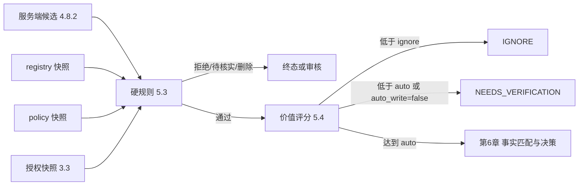
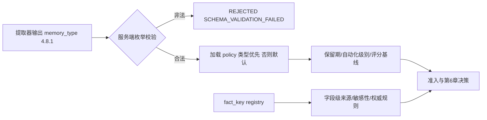

# 5. 记忆准入（硬规则+评分）

**结论：准入是确定性函数，不调用 LLM。** 它回答两件事：候选是否允许成为长期记忆（硬规则），以及它值多少分、走自动写入还是人工审核（价值评分）；它不回答“与已有记忆重复/冲突时怎么处理”，那是第 6 章。

- **输入：** 第 4 章产出的服务端候选（`CandidateInput`）+ 冻结的 `fact_key_registry`、`memory_policy` 快照 + 授权快照（第 3 章）。
- **输出：** `REJECTED` / `NEEDS_VERIFICATION` / `IGNORE` / 通过，附 `reason_codes`、`value_score` 与 `score_breakdown`。
- **不变量：** 无模型调用、无隐式查库、同输入同版本必得同结论，因此可回放（6.5/6.9）。



## 5.1 准入对象：输入契约

**结论：准入只吃“一条候选 + 三份快照”，不读已有记忆、不读向量、不查权威系统。** 事实匹配所需的 `exact_matches`、`semantic_candidates`、`authoritative_fact` 是第 6 章的输入，不是本章的输入。

```json
{
  "candidate_id": "7f1c2d3e-4a5b-4c6d-8e9f-0123456789ab",
  "customer_id": "cust_200",
  "source_system": "contact-center",
  "source_event_id": "evt_01J...",
  "memory_type": "CUSTOMER_PROFILE",
  "fact_key": "communication.language",
  "entity_type": "",
  "entity_ref": "",
  "value_slot": "",
  "object_json": {"value": "zh-CN"},
  "content": "以后都用中文",
  "content_language": "zh-CN",
  "language_confidence": 0.98,
  "source_kind": "USER_EXPLICIT",
  "source_refs": [{"ref_type": "message", "message_id": "msg_17", "span": [12, 19]}],
  "confidence": 0.92,
  "sensitivity": "LOW",
  "explicit_correction": false,
  "valid_from": "2026-10-25T09:00:00Z",
  "valid_to": null,
  "observed_at": "2026-10-25T09:00:00Z",
  "policy_version": "memory-policy-default@1"
}
```

完整契约见 4.8.2 与 `contracts/candidate.schema.json`。`object_hash`、`semantic_text`、`semantic_hash`、`candidate_fingerprint`、`value_score` 由服务端 Normalizer/评分子系统生成，不是提取器输入。

| 输入 | 内容 | 在准入中的作用 |
|---|---|---|
| 服务端候选 | 4.8.2 的 `CandidateInput`：主体、`fact_key`、规范值、原文、证据、`source_kind`、敏感度、时间 | 被判定对象；身份与时间字段已在 4.8.2 由服务端注入，不接受模型输出 |
| registry 快照 | `version`、`cardinality`、`authority_source`、`allowed_source_kinds`、`sensitivity`、`auto_write`、`requires_authority`、`validator`、`mutual_exclusion`、`retention_days` | 字段级硬门、敏感性上调、评分与自动写入开关 |
| policy 快照 | `ignore_threshold`、`auto_accept_threshold`、`scoring_weights`、`auto_write`、`language_confidence_min`、`sensitive_policy`、`retention_days` 等 | 阈值、权重、语言门槛、类型级保留策略 |
| 授权快照 | `MEMORY_WRITE`；`MEDIUM/HIGH` 另需 `SENSITIVE_MEMORY` | 一票否决；终态 `REJECTED`，不可用分数翻案 |
| 运行上下文 | `review_override`、`policy_config_hash`、`registry_version` | 审核覆盖与决策回放 |

**输入约束（不变量）：**

- `candidate_id/customer_id/source_system/source_event_id/observed_at/policy_version` 由服务端注入，提取器无权提交（4.8.2）。
- `policy_version` 与 `fact_key_registry_version` 在事务内锁定并写入候选/决策；同一候选 + 同一 `(policy_config_hash, registry_version)` 必须得到同一分数与同一结论。
- 语言与事实归一化先于评分（6.3）：分数必须基于 `object_hash` 对应的规范值，而不是未归一化的原文。
- 授权与主体校验不在本章重做；本章消费第 3 章的快照。写事务入口由 6.3 校验并持有删除屏障锁，提交前再复核 consent。

**输出语义：**

| 结论 | 触发 | 落点 |
|---|---|---|
| 通过 | 通过全部硬门且价值分达到自动阈值、`auto_write` 允许 | 进入第 6 章 FACT 规则；写/不写仍由第 6 章决定 |
| `IGNORE` | 价值分低于 `ignore_threshold` | 不进入长期记忆，写决策审计 |
| `NEEDS_VERIFICATION` | 来源/语言/身份/权威证据不足，或分数落在 `[ignore_threshold, auto_accept_threshold)` | 生成审核任务（10.4），不自动写 |
| `REJECTED` | 凭证、注入、不可信来源、授权、敏感策略或 schema 失败 | 终态，不重试（4.9） |
| `DELETE_REQUESTED` | 删除/遗忘意图 | 转 8.3，不落普通候选 |

**执行落点：** 硬门分两段执行——Normalizer 内的结构/凭证/注入/删除/不可信来源硬门，以及 6.5 的 GATE 规则 `R010–R041`（敏感、来源白名单、语言、价值阈值）。本章定义判定语义与顺序，规则 ID 与实现以 6.5 为准。

## 5.2 记忆类型：由提取器提出，服务端校验，不由本章再判定

**结论：`memory_type` 由第 4 章提取器（LLM 或规则）在候选里给出；本章不调用 LLM 重新分类，只做枚举校验、策略绑定和敏感性上调。** 类型是“政策/保留/评分”的粗分类，不是事实身份；事实身份由 `fact_key + entity_type + entity_ref + value_slot` 决定。



**为什么不在本章用 LLM 判定类型：**

- 准入必须可回放：同一候选与同一策略版本必须得到同一结论；再调一次 LLM 会引入不可复现的判定。
- 类型判断属于提取语义，已受 4.11 的类型分类评测约束；类型错了应修提取器与评测，而不是在准入层加第二个模型。
- 类型不能成为绕过字段级硬门的通道：registry 的 `allowed_source_kinds`、`sensitivity`、`requires_authority` 始终独立生效。

| 类型 | 示例 | 初始保留策略（需业务确认） | 默认自动化级别 |
|---|---|---|---|
| `CUSTOMER_PROFILE` | 语言偏好、沟通方式、产品使用偏好 | 直到被修改/撤回；定期复核 | 低风险且明确时可自动写入 |
| `SERVICE_HISTORY` | 已完成的故障排查、曾尝试的处理方法 | 30–90 天，按价值和合规策略配置 | 低/中风险可自动写入 |
| `ACTIVE_ISSUE` | 当前未解决问题、下一步排查、待补充资料 | 与工单/问题状态联动；关闭后转历史或过期 | 仅保留必要信息；优先关联工单 |
| `COMMITMENT` | 退款跟进、回访安排、客服承诺 | 按工单/承诺状态和业务保留政策决定 | 必须关联工单/订单等权威来源 |
| `EPHEMERAL_CONTEXT` | 本轮会话临时环境、短期约束 | 默认 1–7 天，通常不进入长期档案 | 仅在后续对话有用时写入 |
| `ACCOUNT_FACT`（可选） | 产品版本、客户确认的账户使用信息 | 依据账户政策；禁止复制不必要的敏感值 | 更严格的权限、字段白名单和来源校验 |

保留期限是**业务策略建议值**，不是默认行为。生产环境为每种类型配置版本化 policy，并明确数据保护/隐私要求。

**类型来源的边界：**

- 原始输出必填 `memory_type`（4.8.3）；LLM 提取器与规则提取器都必须给出，非法枚举按结构校验失败拒绝（入口 422 或 `SCHEMA_VALIDATION_FAILED`）。
- `memory_policy.memory_type` 为空表示默认策略；类型专属策略优先于默认策略（`load_policy` 的选择规则）。
- `enforce_registry_sensitivity` 只按 registry 上调敏感性、从不下调；类型不改变敏感性。
- 服务端不维护 `fact_key → memory_type` 映射，registry 也没有该列。类型只影响政策选择、保留与评分，不影响事实匹配；若类型标错，字段级 registry 规则仍然生效，但可能选中错误的阈值或保留策略，因此类型准确率属于 4.11 的提取评测范围。

## 5.3 硬规则：一票拒绝与拦截

**结论：硬规则先于评分，命中即终态；分数再高也不能翻案。** 执行顺序是“授权与主体 → 结构/安全 → GATE 规则（`R010` 敏感 → `R020` 来源 → `R030` 语言 → `R040/R041` 价值）”，前一步的拒绝不能被后面的高相似度或高分覆盖（6.3/6.5）。

| 规则 | 判定 | 结果与 reason_code | 执行点 |
|---|---|---|---|
| 删除/遗忘意图 | 用户要求不要记、忘掉、删除 | `DELETE_REQUESTED`；转 8.3 | 控制意图检测 + `R001` |
| 授权无效 | 快照缺失、`DENIED`、`WITHDRAWN`、version 落后 | `REJECTED`：`CONSENT_DENIED`/`CONSENT_WITHDRAWN`/`CONSENT_UNAVAILABLE` | 3.3、`R005` |
| 主体不可核实 | 跨客户数据混入、归属不符 | `NEEDS_VERIFICATION`：`IDENTITY_UNVERIFIED`；安全事件单独告警 | 4.2、6.3 |
| 凭证/机密 | 密码、验证码、令牌、API Key、私钥、完整支付卡号 | `REJECTED`：`SENSITIVE_DATA` | Normalizer 硬门，`R010` 兜底 |
| 注入/越权指令 | 试图改变系统提示、权限、审批或退款状态 | `REJECTED`：`POLICY_FORBIDDEN` | Normalizer 硬门 |
| 来源不可信 | `KNOWLEDGE_RETRIEVED`、`ASSISTANT_GENERATED` 被当作客户事实 | `REJECTED`：`SOURCE_UNTRUSTED` | Normalizer 硬门 |
| 无证据定位 | `source_refs` 为空，或没有任何可验证的定位符 | `REJECTED`：`MISSING_EVIDENCE` | Normalizer 硬门 `R007`（4.1 #3） |
| 主体不可核实 | 实体引用来自非权威来源，MMS 无法核验归属 | `NEEDS_VERIFICATION`：`IDENTITY_UNVERIFIED`（审核可放行）；跨客户混入另按安全事件告警 | `R021`、4.2、6.3 |
| 凭证/机密 | 密码、验证码、令牌、API Key、私钥、完整支付卡号 | `REJECTED`：`SENSITIVE_DATA` | Normalizer 硬门 `R003`；`R010` 仍是矩阵内的敏感兜底 |
| 注入/越权指令 | 试图改变系统提示、权限、审批或退款状态 | `REJECTED`：`POLICY_FORBIDDEN` | Normalizer 硬门 `R002` |
| 来源不可信 | `KNOWLEDGE_RETRIEVED`、`ASSISTANT_GENERATED` 被当作客户事实 | `REJECTED`：`SOURCE_UNTRUSTED` | Normalizer 硬门 `R006` |
| 来源不在字段白名单 | 不在该 `fact_key` 的 `allowed_source_kinds` 内 | `NEEDS_VERIFICATION`：`SOURCE_UNTRUSTED` | `R020` |
| 结构/注册表失败 | schema、枚举、时间区间、validator、未知/停用 `fact_key` | `REJECTED`：`SCHEMA_VALIDATION_FAILED`；未知键/registry 缺陷为候选级永久失败，作业终止 | Normalizer 硬门 `R004`；4.8.3、4.9 |
| 语言不可靠 | `und` 或语言置信度低于 `language_confidence_min` | `NEEDS_VERIFICATION`：`LANGUAGE_UNSUPPORTED_LEXICAL` | Normalizer、`R030` |
| 高风险敏感 | `HIGH` 敏感且策略未显式允许 | `REJECTED`：`SENSITIVE_DATA`；`MEDIUM/HIGH` 还要求 `SENSITIVE_MEMORY` 授权 | `R010`、3.3 |
| 高影响事实缺权威证据 | 退款成功、资金到账、账号封禁、赔付批准等无权威系统证据 | `NEEDS_VERIFICATION` 或 `REJECTED`；不得自动写（实现约束见 5.6） | registry `requires_authority`、第 6 章权威事实校验 |

判定语义必须严格区分：

- `REJECTED` 是“禁止保存”的终态，不重试；
- `NEEDS_VERIFICATION` 是“允许但证据不足”，进入审核，不自动写；
- `IGNORE` 是“低价值”，不是违规；
- `DELETE_REQUESTED` 是删除意图，转 8.3，不是普通候选拒绝。

补充约束：

- 硬门不受 `review_override` 影响：`R010/R020/R030` 仍生效；审核覆盖在 GATE 阶段只跳过价值阈值 `R041`，审核通过后若仍不满足硬门，服务端返回 `REVIEW_NOT_ACTIONABLE`（10.4）。进入 FACT 阶段后，人工审核可强制 `R080` 覆盖并绕过 `R110` 的语义冲突，这是审核裁决职责（10.4）。
- 默认策略未开启 `sensitive_policy.high_allowed`，因此 `HIGH` 默认被 `R010` 拒绝；开启前必须同时具备权威证据、授权与策略审批。
- 命中硬门时只保留脱敏摘录与原因码，不落未脱敏原文（4.8.4/6.2）。

## 5.4 价值评分：公式、乘数、阈值

**结论：价值分是 0–100 的整数，由五个正向维度加一个风险惩罚确定性计算；默认阈值 `ignore=50`、`auto_accept=70`。** 评分只用于低风险记忆的排序与门槛，不替代硬规则、来源白名单与权威来源要求。

```text
component_i = trunc(base_i × weight_i / default_weight_i)
raw         = P + E + F + S + A + R
score       = clamp(trunc(raw × (0.7 + 0.3 × confidence)), 0, 100)   # confidence 缺省时不乘
if len(content) < 3: score = min(score, 49)
```

| 维度 | 默认权重（上限） | 基线规则（未覆盖权重时） |
|---|---:|---|
| 持久性 P | 25 | `CUSTOMER_PROFILE`/`ACCOUNT_FACT`=25；`EPHEMERAL_CONTEXT`=5；其他=18 |
| 明确性 E | 20 | `USER_EXPLICIT`=20；否则 `explicit_correction=true`=15；否则=8 |
| 未来客服价值 F | 20 | `CUSTOMER_PROFILE`/`SERVICE_HISTORY`/`ACTIVE_ISSUE`=20；其他=12 |
| 来源可信度 S | 20 | `SYSTEM_OF_RECORD`=20、`USER_EXPLICIT`=18、`AGENT_CONFIRMED`=17、`USER_IMPLICIT`=10、`MODEL_INFERRED`=6、`KNOWLEDGE_RETRIEVED`/`ASSISTANT_GENERATED`=0 |
| 可行动性 A | 15 | `fact_key` 前缀为 `communication.`/`product.`/`issue.`=15；否则=8 |
| 风险惩罚 R | 0 至 -100 | `LOW`=0、`MEDIUM`=-20、`HIGH`=-100 |

**权重与缩放：**

- 默认 `scoring_weights`：`persistence=25`、`explicitness=20`、`future_service_value=20`、`source_trust=20`、`actionability=15`、`risk_penalty=-100`；默认值即恒等变换。
- 策略覆盖某个权重时，只缩放该维度族：`component = trunc(base × 覆盖值 / 默认满分)`；不改变基线内部的相对排序。
- 校验：正向权重必须 `>= 0`，`risk_penalty` 必须 `<= 0`；正数风险权重会奖励风险，启动即拒绝。
- 总分截断到整数并夹在 `[0,100]`；数据库 `value_score` 有同样的 0–100 约束。

**置信度乘数：**

- `confidence` 存在时乘以 `0.7 + 0.3 × confidence`：`confidence=1` 不衰减，`confidence=0` 保留 70%。
- `confidence` 缺省时不乘；模型自报置信度必须经过标注集校准（4.11），不能当作真实概率。
- 置信度是“降权”，不是“准入证书”：低置信度会拉低分数，但不会替代来源等级或硬规则。

**短文本上限：** `content` 少于 3 个字符时分数最多 49，保证默认策略下不会自动接纳。

**阈值与路由：**

| 条件 | 结论 | 规则 |
|---|---|---|
| `score < ignore_threshold`（默认 50） | `IGNORE`：`LOW_MEMORY_VALUE` | `R040` |
| `ignore_threshold <= score < auto_accept_threshold`（默认 50–69） | `NEEDS_VERIFICATION`：`BELOW_AUTO_ACCEPT_THRESHOLD` | `R041` |
| `score >= auto_accept_threshold` 且 policy/registry 的 `auto_write` 都为真 | 通过价值门，进入第 6 章 | 无 GATE 命中 |
| `score >= auto_accept_threshold` 但任一 `auto_write=false` | `NEEDS_VERIFICATION`：`AUTO_WRITE_DISABLED` | `R041` |
| 任意分数 + `HIGH` 敏感且策略未允许 | `REJECTED`：`SENSITIVE_DATA` | `R010` 先于评分门槛 |
| `review_override=true` | 跳过 `R041`；`R010/R020/R030` 仍生效 | 审核覆盖 |

- 阈值顺序必须满足 `0 <= ignore_threshold < auto_accept_threshold <= 100`；类型专属 policy 可覆盖，但覆盖后仍须满足该顺序。
- “达到自动阈值”不等于“一定自动写入”：还必须通过来源白名单、语言门槛、敏感规则，且 registry 与 policy 的 `auto_write` 同时为真。
- 高影响事实不受分数影响：权威证据、授权与人工确认优先于评分。

**算例（按默认权重，假设 `fact_key` 已注册、来源在白名单内且其他硬门通过）：**

| 场景 | 维度得分 | 乘数 | 最终分 | 路由 |
|---|---|---|---:|---|
| 用户明确语言偏好：`CUSTOMER_PROFILE`、`USER_EXPLICIT`、`communication.language`、`LOW`、`confidence=0.92` | 25+20+20+18+15=98 | 0.976 | 95 | ≥70，进入第 6 章 |
| 客服确认的服务历史：`SERVICE_HISTORY`、`AGENT_CONFIRMED`、`service.attempted`、`LOW`、`confidence=0.8` | 18+8+20+17+8=71 | 0.94 | 66 | 50–69，转审核 |
| 中敏感工单状态：`ACTIVE_ISSUE`、`AGENT_CONFIRMED`、`issue.status`、`MEDIUM`、`confidence=0.9` | 18+8+20+17+15-20=58 | 0.97 | 56 | 转审核；该键 `auto_write=false` |

评分结果写入决策审计的 `score_breakdown`（含各维度；有 `confidence` 时另含 `confidence_multiplier` 与 `pre_confidence_score`），与 `value_score` 一起支持回放与校准，不允许只存总分。

## 5.5 来源信任等级：含义与使用点

**结论：来源等级按字段定义，不是全局排序；它同时进入标注、硬门、字段白名单、评分和覆盖授权五个环节。** 一条 `SYSTEM_OF_RECORD` 只在它权威的字段上权威，不能因为“来源高”就写任意事实。

| 等级 | 含义 | 评分 | 典型来源 | 能否作为客户个人事实 |
|---|---|---:|---|---|
| `SYSTEM_OF_RECORD` | 该字段的权威业务系统 | 20 | 订单/退款/工单/CRM | 是，仅限其权威字段 |
| `USER_EXPLICIT` | 用户明确陈述或明确纠正 | 18 | 用户原话 | 是 |
| `AGENT_CONFIRMED` | 客服确认且有工单/业务证据 | 17 | 客服记录 | 是，按字段 |
| `USER_IMPLICIT` | 用户含糊、间接暗示 | 10 | 推断性表达 | 仅字段允许且需核实 |
| `MODEL_INFERRED` | 模型推断 | 6 | 提取模型猜测 | 默认否 |
| `KNOWLEDGE_RETRIEVED` | 知识库/RAG 片段 | 0 | 知识文章 | 否，硬拒绝 |
| `ASSISTANT_GENERATED` | 助手先前输出 | 0 | 历史回复 | 否，硬拒绝 |

**五个使用点：**

| 使用点 | 规则 | 结果 |
|---|---|---|
| 1. 来源标注 | `source_kind` 由服务端按消息角色/来源系统标注，不采信模型自报（4.7） | 防止提示注入伪造来源 |
| 2. 硬拒绝 | `KNOWLEDGE_RETRIEVED`/`ASSISTANT_GENERATED` 被当作用户事实 | `REJECTED`：`SOURCE_UNTRUSTED` |
| 3. 字段白名单 | `registry.allowed_source_kinds` 不包含候选来源 | `NEEDS_VERIFICATION`：`SOURCE_UNTRUSTED`（`R020`） |
| 4. 评分 | `SOURCE_SCORE` 作为“来源可信度”维度（0–20） | 影响 5.4 总分 |
| 5. 覆盖授权 | `override_allowed`：来源必须在白名单；`requires_authority=true` 时，候选来源等级必须严格高于现有记忆来源；否则 `R100 CONFLICT` | 防止低信任来源覆盖权威值 |

覆盖比较使用的等级序（只在 `requires_authority=true` 时有意义）：

`SYSTEM_OF_RECORD(5) > AGENT_CONFIRMED(4) > USER_EXPLICIT(3) > USER_IMPLICIT(2) > MODEL_INFERRED(1) > KNOWLEDGE_RETRIEVED(0) = ASSISTANT_GENERATED(0)`

**按字段定义权威性（以种子 registry 为例）：**

| fact_key | `allowed_source_kinds` | `auto_write` | `requires_authority` | 准入后果 |
|---|---|---:|---:|---|
| `communication.language` | `USER_EXPLICIT`、`AGENT_CONFIRMED` | true | false | 用户明确说即可；`MODEL_INFERRED` 走 `R020` 审核 |
| `product.client_version` | `SYSTEM_OF_RECORD`、`USER_EXPLICIT`、`AGENT_CONFIRMED` | true | false | 用户自报可写；模型推断需核实 |
| `issue.status` | `SYSTEM_OF_RECORD`、`AGENT_CONFIRMED` | false | true | 用户陈述走 `R020`；只有权威系统新值可覆盖，且始终人工审核 |

**权威系统字段：** `authority_source` 记录该字段的权威系统名；`requires_authority=true` 时，服务端把 `SYSTEM_OF_RECORD` 事件解析为 `authoritative_fact`（第 6 章），并在 `R080` 中用“权威源是否给出新值”决定 `sub_rule`。非权威来源即使分数更高，也不能覆盖权威值。

**等级不改变敏感性：** `HIGH` 敏感事实必须有权威证据并满足授权/策略，与来源评分无关；`source_kind` 高不等于可以保存高敏感值。

## 5.6 实现落点与已知缺口（2026-10-29）

- **评分实现：** `normalizer.score_candidate` 按 5.4 公式确定性计算；默认权重即基线，`policy.scoring_weights` 覆盖按族缩放；`score_breakdown` 写决策审计，数据库 `customer_memory.value_score` 有 0–100 约束。
- **类型：** 当前 `RuleBasedExtractor` 固定输出 `CUSTOMER_PROFILE`（4.12）；LLM 提取器尚未接入。服务端只做枚举校验与按类型加载策略，没有二次 LLM 分类。
- **信任：** 规则提取器只产出 `USER_EXPLICIT`；`KNOWLEDGE_RETRIEVED/ASSISTANT_GENERATED` 在 Normalizer 硬拒绝；不在白名单的来源走 `R020` 审核，不会自动写；`R080` 的等级比较仅在 `requires_authority=true` 的字段生效。
- **阈值与审核：** 默认策略 50/70；`review_override` 在 GATE 阶段只跳过 `R041`，不跳过 `R010/R020/R030`；在 FACT 阶段可强制 `R080` 覆盖、绕过 `R110`。`HIGH` 默认因 `high_allowed=false` 被 `R010` 拒绝；`MEDIUM/HIGH` 一律要求 `SENSITIVE_MEMORY` 授权（当前实现比 `sensitive_policy` 的布尔开关更严）。
- **已知缺口：** `review_rules.high_impact_requires_authority` 目前未被规则读取；`requires_authority` 只参与 `R080` 覆盖授权与 `authoritative_fact` 解析，对无既有事实的首次写入（`R070`）没有独立的“必须有权威证据”硬门。高影响保护目前由 `HIGH` 硬门、registry `auto_write=false` 与人工审核兜底。
