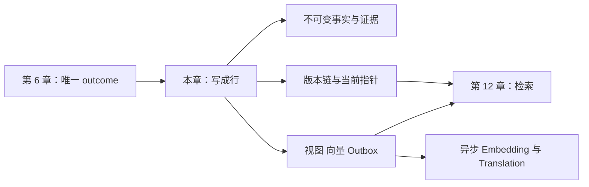
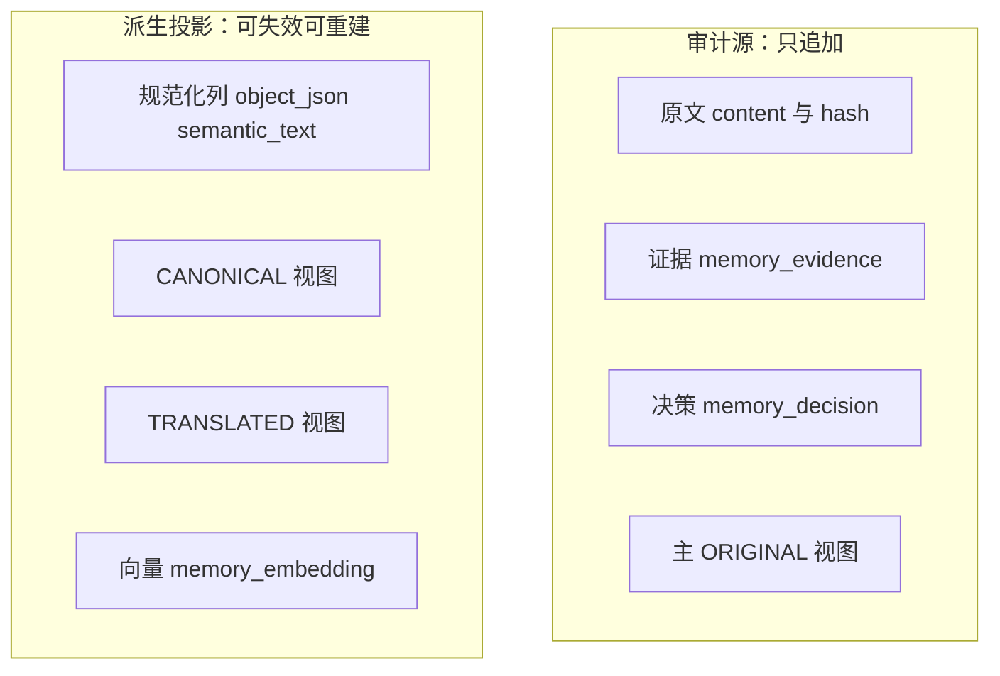
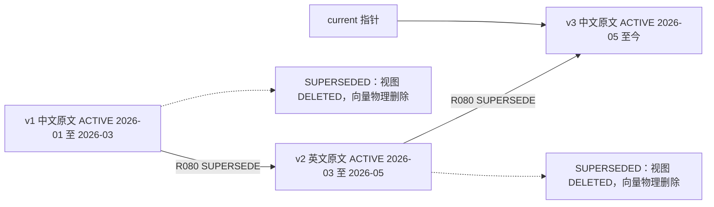
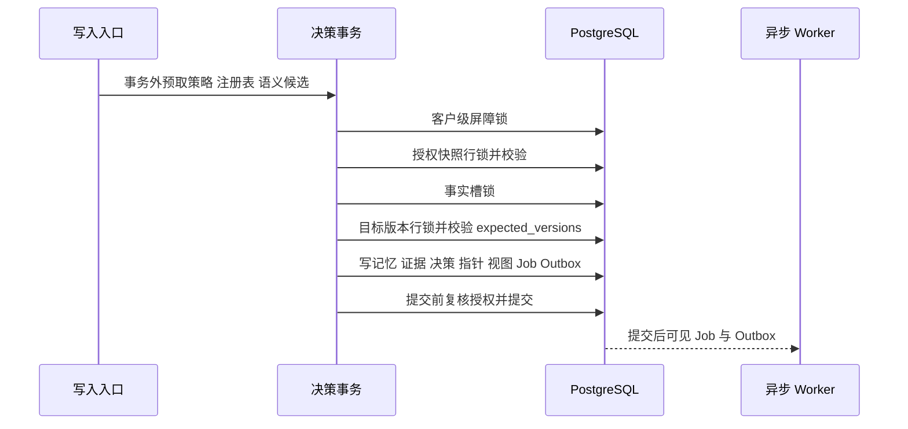
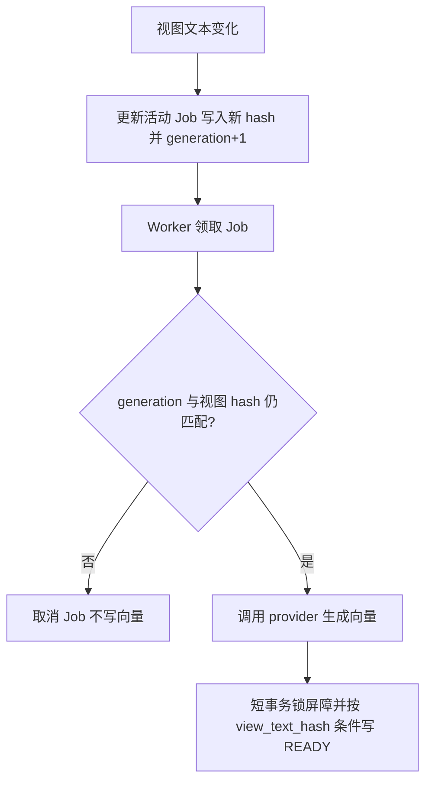
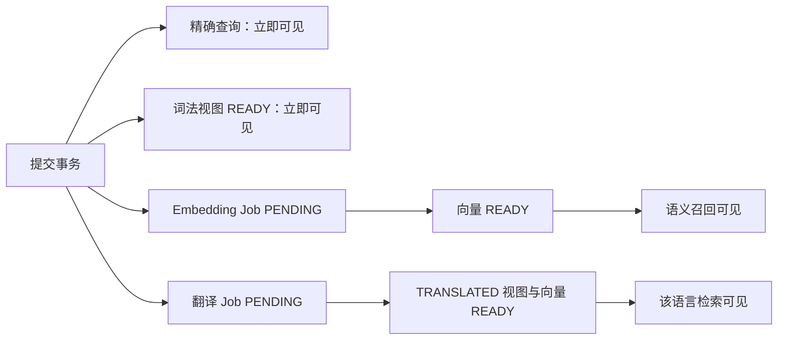

# 7. 记忆写入与更新

**结论：记忆没有“原地更新”。** 第 6 章给出唯一 `outcome`，本章把它落成三类行：不可变的事实与证据、可追溯的版本链、可失效的派生投影。原文、证据、决策只追加；值变化只能新版本替代旧版本；视图与向量永远可重建。

三条不可让的口径：

- **不提供 `UPDATE` outcome：** 值变化统一走 `SUPERSEDE`，同值新证据走 `REINFORCE`；
- **派生投影不得反写：** 译文、规范化文本、向量都不能覆盖原文或事实值；
- **提交先于索引：** 业务事实与 Job 同事务提交，向量/译文异步生成，索引失败不回滚事实。

| 小节 | 回答的问题 |
|---|---|
| 7.1 | 哪些变化对应哪种写入动作，哪些列永远不能改 |
| 7.2 | 重复事件、并发写同一事实、审核与删除交叉时如何不写坏 |
| 7.3 | 一次提交按什么顺序写哪些行，提交后哪些检索路径立即可见 |
| 7.4 | 版本号、当前指针、历史版本如何组织与读取 |
| 7.5 | 写失败、索引失败、并发冲突如何重试与收敛 |
| 7.6 | 实现落点与已知缺口 |

## 7.1 变更类型与不可变边界

### 7.1.1 哪些能改，哪些不能

**结论：事实只追加，投影可重建。** `customer_memory` 的原文三列、证据、决策是审计源；规范化列、视图、向量是派生投影，允许失效和重算。

| 对象 | 可变性 | 数据库保证 |
|---|---|---|
| `customer_memory.content`、`content_language`、`content_hash` | 不可变 | `trg_memory_original_immutable` 拒绝 UPDATE |
| `memory_evidence` | 只追加 | `trg_evidence_immutable`；仅放行外键置空与审计擦除连接的一次性脱敏 |
| `memory_decision` | 只追加 | `trg_memory_decision_append_only`；重试只增 `attempt_no` |
| 主 `ORIGINAL` 视图 | 文本不可变 | `trg_search_doc_invariant` 要求文本等于 `customer_memory.content` |
| `object_json`、`semantic_text`、`semantic_hash`、`normalization_version` | 可重算，不新建版本 | 仅 9.2 `RENORMALIZE` 原地更新 |
| `lifecycle_status`、`valid_to`、`current_flag`、`expires_at` | 可变 | 只由替代、生命周期、删除流程更新 |
| `CANONICAL`/`TRANSLATED` 视图、`memory_embedding` | 可失效、可重建 | 派生投影，不承载事实 |

### 7.1.2 变化与写入动作对照

第 6 章负责判定；本节只看每种结果落到哪些行。重复投递不进入决策，由 7.2.1 的幂等闸在更早层拦截。

| 变化 | 判定入口 | outcome | 新版本 | 旧版本与投影 |
|---|---|---|---|---|
| 同值且无新证据 | `R050` | `NOOP` | 否 | 无变化 |
| 同值新证据（错字、澄清、同事实换语言） | `R060` | `REINFORCE` | 否 | 追加证据；新语言追加 `ORIGINAL` 视图 |
| 无既有事实 | `R070` | `ADD` | 是 | — |
| 多值字段新值 | `R075` | `ADD` | 是 | 与既有值并存 |
| 时间区间不重叠 | `R090` | `ADD_TEMPORAL_VERSION` | 是 | 旧版本在其区间内保持 `ACTIVE` |
| 值改变且来源可覆盖 | `R080` | `SUPERSEDE` | 是 | 旧版本 `SUPERSEDED`，`valid_to` 关闭，视图与向量失效 |
| 值改变但来源不可覆盖 | `R100` | `CONFLICT` | 否 | 目标记忆 `CONFLICTED`，开审核 |
| 仅语义相近、分数不足、来源不可信 | `R110`/`R041`/`R020` | `NEEDS_VERIFICATION`；`R110` 依策略可落 `CONFLICT` | 否 | 候选挂起，不写记忆 |
| normalizer 版本升级 | 9.2 批任务 | `RENORMALIZE` | 否 | 重算规范化列，重建 `CANONICAL`/`TRANSLATED` |
| 工单关闭或到期 | `R120`/`R130` | `RESOLVE`/`EXPIRE` | 否 | 状态迁移；`RESOLVE` 保留向量，`EXPIRE` 失效投影 |

写入动作只有三种：**追加证据**、**新建版本**、**只改状态**。`NOOP`、`IGNORE`、`REJECTED` 不产生记忆写入，只留决策审计。

### 7.1.3 REINFORCE：同值只追加证据

**结论：同值的新信息只证明“这件事又被说过一次”，不产生新版本。** 判据是 `object_hash` 相同且 `has_new_evidence=true`（候选 `source_event_id` 不在该记忆既有证据中）。

| 场景 | 写什么 | 不写什么 |
|---|---|---|
| 同语言新证据（错字修正、表达澄清） | 追加一条 `memory_evidence`，保存脱敏摘录与来源事件 | 不改 `content`/`content_hash`，不新建视图，不新建版本 |
| 新语言重述同一事实 | 追加证据 + 该语言 `ORIGINAL` 视图，文本等于该证据脱敏摘录；入队该视图 Embedding Job | 不改主 `ORIGINAL`，不改 `semantic_text`，不新建版本 |
| 同一事件重放 | 唯一键 `(customer_id, source_system, source_event_id, evidence_hash)` 命中，不新增证据 | 不重复入队 Job、不重复发事件 |

`REINFORCE` 的 `current_flag`、当前指针、`version_no` 都不变；记忆行的 `updated_at` 不因追加证据而改变，事实变更时间看 `observed_at`/`valid_from`。

### 7.1.4 SUPERSEDE：值变化只能新版本

**结论：`SUPERSEDE` 是唯一的“更新”通道，产物是新版本 + 旧版本关闭 + 旧投影失效。** 触发条件是规范值确实变化（`object_hash` 不同），且来源允许覆盖（6.4/6.5）；`RENORMALIZE` 造成的 hash 漂移、翻译差异、同值重述都不构成替代。

| 顺序 | 动作 | 写入 |
|---:|---|---|
| 1 | 锁目标版本并校验 | `SELECT ... FOR UPDATE`；`expected_versions` 不匹配 → 409 |
| 2 | 关闭旧版本 | `lifecycle_status='SUPERSEDED'`、`current_flag=false`、`valid_to=COALESCE(候选 valid_from, now())` |
| 3 | 失效旧投影 | 物理删除旧向量、视图置 `DELETED`、活动 Job 置 `CANCELLED` |
| 4 | 插入新版本 | `version_no=旧版本+1`、`supersedes_memory_id=旧版本`、`ACTIVE` |
| 5 | 建新投影 | 新 `ORIGINAL`/`CANONICAL` 视图 `READY`、2 个 Embedding Job、按策略入队翻译 Job |
| 6 | 移动指针 | `SINGLE_VALUE` 更新 `customer_memory_current`，`generation=新 version_no` |
| 7 | 发事件 | Outbox `memory.superseded.v1`，携带新旧 `memory_id` 与 `aggregate_version` |

典型触发：预算从 5000 元改为 6000 元、客户端版本升级、地址或联系方式变更。反例：客户用另一种语言重述同一事实（`semantic_hash` 不变）→ `REINFORCE`；`RENORMALIZE` 造成的 hash 漂移 → 只重建投影。

版本链约束由 `trg_memory_supersedes` 保证：同客户、同事实槽，且 `prev.version_no < new.version_no`；`uq_memory_version` 保证同一事实槽版本号不重复。

### 7.1.5 不可反写

| 对象 | 规则 | 违反的后果 |
|---|---|---|
| `TRANSLATED` 视图 | 只能由 Translation Worker 从主 `ORIGINAL` 的 `source_view_hash` 生成；重译先将旧视图置 `STALE` 并保留版本审计，再以新 `view_text_hash` 重建；不得回写 `content`、`semantic_text`、`object_json` | 淘汰该视图，不影响记忆本体 |
| `CANONICAL` 视图 | 由 `semantic_text` 派生；只用于检索与重排，不作为展示原文 | `RENORMALIZE` 时整体重建 |
| 权威业务状态 | 退款、赔付、封禁等以业务系统为准；记忆只存关联事实摘要与来源引用 | 自然语言声明不得当权威值 |
| 决策结果 | `memory_decision` 只追加；常规 UPDATE/DELETE 被拒绝，仅审计擦除连接可脱敏；修正只能通过新候选、新版本或删除 | 触发器报错 |

旧版本 `valid_to` 关闭由替代事务完成；“事实仍有效”与“记录可检索”是两件事，后者见 7.4.3 与 12.6。

## 7.2 并发和重复提交

**结论：写入只承诺“每个稳定输入最多产生一次效果”，并发输赢由事实槽锁和数据库约束决定，不靠应用层“先查后写”。** 同一客户的同一事实键可能同时由会话事件、人工修改和 CRM 事件提交，重复与交错必须在数据库层收敛。

### 7.2.1 七道幂等闸

| 层 | 唯一键 | 重复或冲突时的行为 |
|---|---|---|
| 事件收件箱 | `(consumer_group, event_id)` | `COMPLETED` 直接返回；`PROCESSING` 租约内返回处理中 |
| 摄取任务 | `(customer_id, source_system, source_event_id)` | `COMPLETED` 不重跑；`RETRY`/`DEAD_LETTER`/`CANCELLED` 可复位重放 |
| 候选 | `(customer_id, source_system, source_event_id, candidate_fingerprint)` | 返回已有决策；指纹不含原文，同事实重述不产生新候选 |
| 证据 | `(customer_id, source_system, source_event_id, evidence_hash)` | 同证据只保留一行 |
| 决策审计 | `(candidate_id, attempt_no)` | 重试只追加 `attempt_no`，不覆盖旧审计 |
| Outbox | `idempotency_key` | 同事件只发布一次 |
| Embedding Job | 活动状态部分唯一键 `(memory_id, model, version, view_kind, view_language, operation)` | 同一视图只允许一个活动 Job；文本变化就地改写并 `generation+1` |

设计口径中的 `operation_id` 尚未落库（7.6）；当前幂等由上述数据库键承担。

### 7.2.2 锁序与版本护栏

**写入路径的锁序固定：屏障锁 → 授权行锁 → 事实槽锁 → 目标版本行锁 → 决策审计锁。** 审核入口先在审核任务行上加乐观锁，再按同一顺序进入；不同事实槽之间可以并行。

| 护栏 | 防的是什么 |
|---|---|
| 事实槽 advisory lock | 同一事实的并发写入串行化；避免两个事务同时把旧值当 current |
| 目标版本 `FOR UPDATE` + `expected_versions` | 防止基于过期快照覆盖新版本 |
| `ux_current_single_value` + `value_slot=''` | `SINGLE_VALUE` 只能有一个当前指针 |
| `uq_memory_version` | 同一事实槽版本号不重复 |
| `ux_memory_multi_value` | `MULTI_VALUE` 同值不重复并存 |
| `ex_memory_temporal_overlap` | `TEMPORAL` 当前版本时间区间不重叠 |

冲突处理口径：捕获版本冲突后**重读当前事实并重新决策**，只允许一次；不得用旧 `RuleContext` 重放写入，也不得盲目重试。

### 7.2.3 竞争场景

| 场景 | 收敛方式 | 最终结果 |
|---|---|---|
| 同一事件重复投递 | 收件箱 + 摄取任务去重 | 第二次返回已有结果，不重复写 |
| 两个 `SUPERSEDE` 同时提交 | 事实槽锁串行；后到者 `expected_versions` 不匹配 | 后到者 409，重读后对新版本重新决策 |
| 两个 `ADD` 同时提交（`SINGLE_VALUE`） | 事实槽锁 + 当前指针唯一键 | 后者定位到前者，转为 `REINFORCE` 或 `SUPERSEDE` |
| 审核通过与新候选并发 | 审核任务 `decision_version` 乐观锁；批准时在事实槽锁内重新决策 | 以最新事实为准，不恢复审核时的旧快照 |
| 删除与写入并发 | 屏障锁 + generation / `cutover_at` 校验（8.3.1） | 旧 generation 写入被拒；删除后无新 `ACTIVE` |
| 旧文本与新文本的 Embedding | 活动 Job 唯一键 + `generation` 围栏（7.2.4） | 只有最新文本的向量能写 `READY` |

### 7.2.4 Embedding Job 的文本竞态

- 活动唯一键**不含** `content_hash`/`view_text_hash`：否则同一视图的新旧两个 Job 会同时活动并互相覆盖；
- 文本变化用 `ON CONFLICT ... DO UPDATE` 就地改写活动 Job，并重置 `attempts`、`generation+1`；
- Worker 写库前校验 `generation`、`view_text_hash`、删除屏障与生命周期；任何一项不匹配即取消，不写旧向量；
- 同一记忆的不同语言视图是不同 Job，可以并行；Kafka 至少一次消费不等于 PG 与向量的全链路事务。

## 7.3 写入事务与提交顺序

**结论：一次写入是一个 PostgreSQL 事务；事务内只写库，不调用 provider。** 事务前预取策略、注册表与语义候选；事务后由 Worker 生成向量与译文（6.6）。

### 7.3.1 按 outcome 的写入集

| outcome | 记忆版本 | 证据 | current 指针 | 视图与 Job | Outbox | 其他 |
|---|---|---|---|---|---|---|
| `ADD` | 新版本 `ACTIVE` | 追加 | `SINGLE_VALUE` 更新 | `ORIGINAL`+`CANONICAL`，2 个 Job，按策略入队翻译 Job | `memory.created.v1` | 候选 `ACCEPTED` |
| `ADD_TEMPORAL_VERSION` | 新版本 `ACTIVE` | 追加 | 不更新 | 同上 | `memory.created.v1` | 候选 `ACCEPTED` |
| `SUPERSEDE` | 旧版本关闭 + 新版本 | 追加 | 更新 | 旧投影失效；新视图与 Job | `memory.superseded.v1` | 候选 `ACCEPTED` |
| `REINFORCE` | 不新建 | 追加 | 不变 | 仅新语言 `ORIGINAL` + Job | `memory.reinforced.v1` | 候选 `ACCEPTED` |
| `NOOP` | 不变 | 不变 | 不变 | 不变 | 无 | 候选 `PROCESSED` |
| `CONFLICT` | 目标转 `CONFLICTED` | 不变 | 不变 | 向量保留，检索按用途过滤 | 无 | 冲突项 + 审核任务；候选 `PENDING_REVIEW` |
| `NEEDS_VERIFICATION` | 不变 | 不变 | 不变 | 不变 | 无 | 审核任务；候选 `PENDING_REVIEW` |
| `IGNORE`/`REJECTED` | 不变 | 不变 | 不变 | 不变 | 无 | 决策审计；候选 `IGNORED`/`REJECTED` |
| `DELETE_REQUESTED` | 不变 | 不变 | 不变 | 后续按 8.3 失效 | `barrier.changed` | 删除请求 + 双人审核；候选 `PENDING_REVIEW` |

进入写入分支的 outcome 在落库前检查存储与 Embedding 配额；配额拒绝时整个事务回滚，不留下半条记忆。`CONFLICT` 只改目标状态，不改证据或版本；审核通过后重新走本章写入路径，不直接改行。

### 7.3.2 提交顺序与可见性

| 约束 | 含义 |
|---|---|
| 视图必须同事务创建 | `trg_memory_views_present` 在提交时要求 `CANONICAL` 与主 `ORIGINAL` 已存在 |
| 提交前复核授权 | `MEMORY_WRITE` 与 `SENSITIVE_MEMORY` 在提交前再查一次，覆盖检查后被撤回的窗口 |
| 索引不阻塞事实 | 向量/译文失败只影响对应视图，不回滚 `customer_memory` |
| 对外标记 | 语义索引未就绪时内部标记 `semantic_index_pending=true`，不直接暴露给用户 |

**事务边界：** 禁止在事务内调用 embedding/translation/rerank provider、同步查询权威业务系统或等待外部回调（6.6.2）。事务内只允许数据库读写与规则计算。

## 7.4 版本链、当前指针与历史

### 7.4.1 版本号的分配

| outcome | `version_no` | 说明 |
|---|---|---|
| `ADD`/`ADD_TEMPORAL_VERSION` | 同事实槽 `MAX(version_no)+1` | 跨 `SUPERSEDED`/`EXPIRED` 历史版本继续递增 |
| `SUPERSEDE` | 目标版本 `+1` | 目标为当前有效版本 |
| `REINFORCE`/`RENORMALIZE` | 不变 | 不产生新版本 |

`uq_memory_version` 对 `(customer_id, fact_key, entity_type, entity_ref, value_slot, version_no)` 做 `NULLS NOT DISTINCT` 唯一约束；`trg_memory_supersedes` 保证 `supersedes_memory_id` 指向同事实槽的更早版本。

### 7.4.2 当前指针

| 基数 | 当前性表示 | 唯一性保证 |
|---|---|---|
| `SINGLE_VALUE` | `customer_memory_current` 指针 | `ux_current_single_value`；`trg_current_flag_pointer` 校验 `current_flag` 与指针一致 |
| `MULTI_VALUE` | `current_flag=true` | `ux_memory_multi_value` 按 `object_hash` 防重复并存 |
| `TEMPORAL` | `current_flag=true` | `ex_memory_temporal_overlap` 防区间重叠 |

- 指针的 `generation` 等于所指向版本的 `version_no`；指针是派生状态，不是审计源，删除时直接删除；
- 写指针时必须显式带 `cardinality='SINGLE_VALUE'`；主键含 `value_slot`，不能单独证明 `SINGLE_VALUE` 唯一；
- 精确匹配：`SINGLE_VALUE` 走指针，`MULTI_VALUE`/`TEMPORAL` 走 `current_flag` + 事实槽条件（6.4.2）；
- 只有 `ADD` 与 `SUPERSEDE` 会在 `SINGLE_VALUE` 下移动指针；`REINFORCE`、`NOOP`、`CONFLICT` 不移动。

### 7.4.3 历史版本怎么读

| 状态 | 向量 | 默认检索 | 读取方式 |
|---|---|---|---|
| `ACTIVE` | `READY` | 可返回 | 常规检索 |
| `CONFLICTED` | 可保留 | 不作为确定事实 | 待核实通道，`context_only` |
| `RESOLVED` | 可保留 | 回答用途不返回 | `HISTORY_DEBUG`，`history_only` |
| `SUPERSEDED`/`EXPIRED` | 已删除 | 不返回 | `HISTORY_DEBUG` 的 `as_of` 精确/时间窗查询；审计 |

状态集与用途矩阵以 12.6/13.5 为唯一口径；本节只说明写入动作如何决定历史可见性：**替代即失效投影，状态迁移不等于删除正文**。

## 7.5 失败、重试与收敛

| 失败点 | 现象 | 处理 | 是否重试 |
|---|---|---|---|
| 屏障或授权入口检查失败 | `ConsentError`/`BarrierError` | 写终态拒绝或取消作业 | 否 |
| 提交前授权复核失败 | 同一事务内再查失败 | 整单回滚，不写记忆也不写成功审计 | 否 |
| 事实槽并发冲突 | 版本不匹配或 `23505` | 重读当前事实并重算 | 一次 |
| 配额不足 | 存储/Embedding 配额拒绝 | 整单回滚；异步入口按退避重试至上限 | API 否，Worker 是 |
| 规则零命中/多命中 | 规则集缺陷 | 回滚并告警，提升规则集版本后重放 | 否 |
| Embedding/Translation 失败 | 事实已提交，索引未就绪 | Job `RETRY`/`DEAD_LETTER`，对账修复 | 是，指数退避 |
| Outbox 发布失败 | 下游未收到事件 | 事实与检索不受影响，Outbox `RETRY` | 是 |
| Worker 未知结果 | 可能已写入 | 按 `memory_id + view hash` 回读确认 | 是，不重复调用 |

**收敛原则：**

- 已提交事实不回滚：索引失败只能修投影，事实修正只能靠新决策；
- 对账修复缺失视图、`READY` 向量与指针漂移（12.10）；`semantic_index_pending` 在修复后清除；
- 删除与替代后，旧向量物理删除，旧视图 `DELETED`，活动 Job 取消；任何 Worker 写库前都要复核屏障与 `generation`；
- 不进入重试的只有终态拒绝（屏障、入口授权、未知/停用 `fact_key`、注册表配置错误）；其余按退避重试，超限死信并告警。

## 7.6 实现落点与已知缺口（2026-10-29）

| 机制 | 实现 | 状态 |
|---|---|---|
| 原文/证据/决策不可变 | 三个数据库触发器 | 已实现 |
| 版本链与当前指针 | `uq_memory_version`、`customer_memory_current`、延迟约束触发器 | 已实现 |
| 幂等闸 | inbox、ingestion job、candidate、evidence、outbox、embedding job 唯一键 | 已实现；`operation_id` 未落地 |
| 并发控制 | 屏障锁、事实槽 advisory lock、目标版本 `FOR UPDATE`、`expected_versions` | 已实现；冲突重试由入口决定，未强制“只一次” |
| `SUPERSEDE` 投影失效 | 旧向量物理删除、视图 `DELETED`、活动 Job 取消 | 已实现 |
| `REINFORCE` 新语言视图 | 追加证据语言 `ORIGINAL`，文本等于证据脱敏摘录 | 已实现 |
| `RENORMALIZE` | 9.2 批任务设计 | 未实现 |
| 翻译 Job 登记位置 | 写事务内插入 `memory_translation_job` | 已对齐（2026-10-30）：6.6.3 原文「不在决策事务内入队」与 12.4/实现矛盾，已改为「事务内入队 Job、译文视图由 Worker 异步生成」；三处口径一致 |
| `TEMPORAL` 槽的 `SUPERSEDE` 版本号 | 取目标版本 `+1` | 待确认：同一槽另一条 current 版本可能占用同一版本号 |
| 未来 `valid_from` 的 `SUPERSEDE` | 旧版本立即 `SUPERSEDED` 并删向量 | 待确认：新值生效前旧值已不可检索 |
| 配额计量 | 进入写入分支统一记 1 个 `EMBEDDING`；`SUPERSEDE` 在关闭旧版本前查存储配额 | 待确认：`NOOP`/同语言 `REINFORCE` 也计数；满额时无法净零替代 |

实现落点：`MemoryService.process_candidate`、`_persist_decision`、`IngestionService.process_one`、`MemoryRepository.insert_memory`、`supersede_old`、`update_current`、`enqueue_embedding_job`、`ReviewService.decide`；约束与触发器见 23.13。
