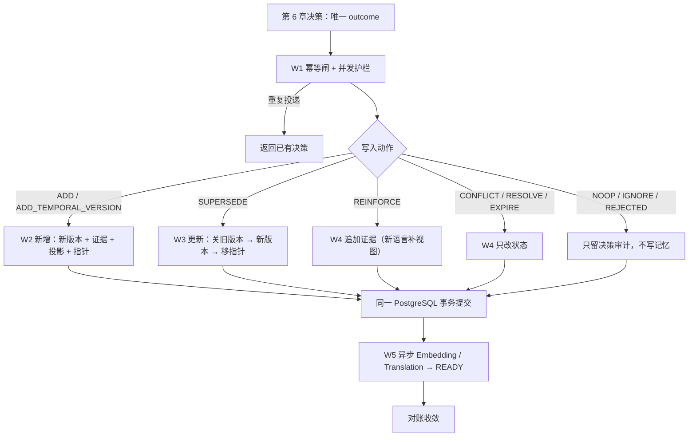
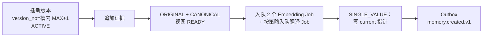
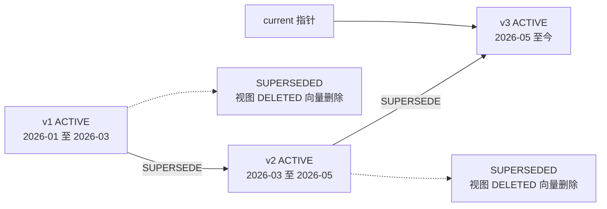
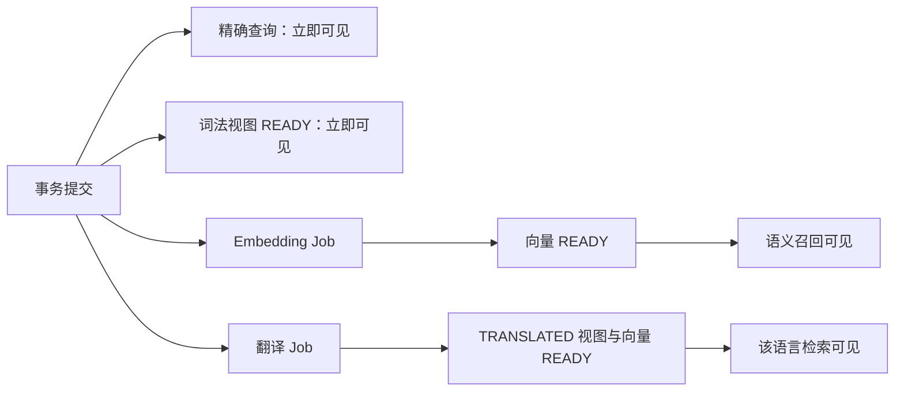
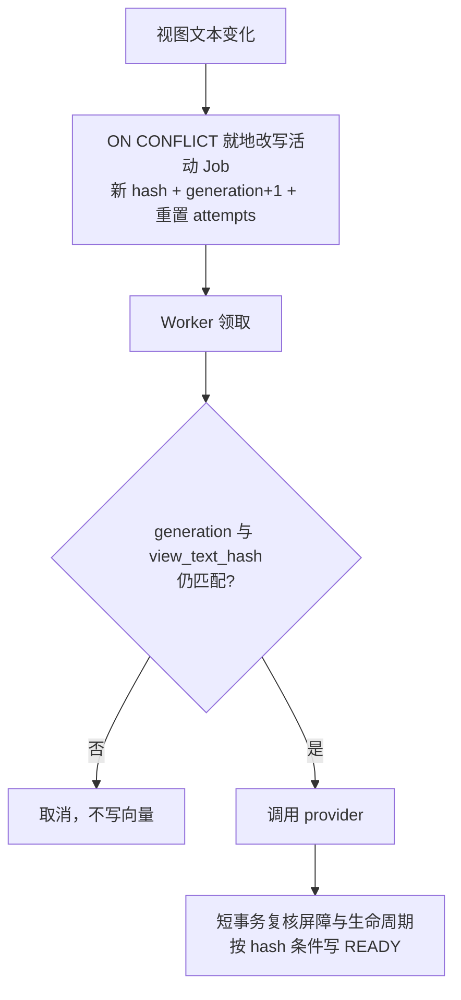
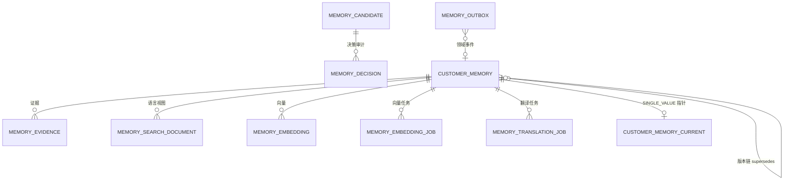

# 记忆写入与更新

第 6 章产出唯一 `outcome`，本章把它落成数据库行。**记忆没有“原地更新”**：写入动作只有三种——追加证据、新建版本、只改状态。

三条铁律：

- **值变化只走 `SUPERSEDE`**：新版本替代旧版本，不提供 `UPDATE`；同值新证据走 `REINFORCE`；
- **派生投影不得反写**：译文、规范化文本、向量不能覆盖原文或事实值；
- **提交先于索引**：事实与 Job 同事务提交，向量/译文异步生成，索引失败不回滚事实。

判定规则、锁序与事务边界以第 6 章为唯一口径（6.3/6.5/6.6），本章不重复，只描述写侧行为。

## 7.1 整体执行过程



| 步骤 | 位置 | 做什么 | 失败出口 |
|---|---|---|---|
| **W1 幂等与护栏** | 事务内 | 七道幂等闸拦截重复；事实槽锁 + `expected_versions` 防并发覆盖 | 重复 → 返回已有决策；版本冲突 → 重读重决策一次 |
| **W2 新增** | 事务内 | `ADD`/`ADD_TEMPORAL_VERSION`：新版本、证据、视图、Job、指针、Outbox | 配额拒绝 → 整单回滚 |
| **W3 更新** | 事务内 | `SUPERSEDE`：关闭旧版本并失效其投影，再写新版本 | 同上 |
| **W4 证据与状态** | 事务内 | `REINFORCE` 追加证据；`CONFLICT`/`RESOLVE`/`EXPIRE` 只改状态；非写 outcome 只留审计 | 同上 |
| **W5 异步投影** | 提交后 | Worker 生成向量与译文；对账修复缺失与漂移 | 重试/死信/对账，不回滚事实 |

**新增与更新的区别：**

| | 新增（W2） | 更新（W3） |
|---|---|---|
| 版本 | 新 `version_no = 槽内 MAX+1` | 旧版本 `SUPERSEDED` + 新版本 `目标+1` |
| 旧投影 | 无（`TEMPORAL` 旧版本保留） | 旧向量物理删除、视图 `DELETED`、活动 Job 取消 |
| 指针 | `SINGLE_VALUE` 建立指针 | `SINGLE_VALUE` 移动指针 |
| 事件 | `memory.created.v1` | `memory.superseded.v1` |

## 7.2 关键步骤说明

### 7.2.1 W1：幂等与并发护栏

重复与并发在数据库层收敛，不靠应用层“先查后写”。锁序（屏障锁 → 授权行锁 → 事实槽锁 → 目标版本行锁 → 决策审计锁）见 6.3.2；护栏约束清单见 7.3.3。

**七道幂等闸：**

| 层 | 唯一键 | 重复时行为 |
|---|---|---|
| 事件收件箱 | `(consumer_group, event_id)` | `COMPLETED` 直接返回；`PROCESSING` 租约内返回处理中 |
| 摄取任务 | `(customer_id, source_system, source_event_id)` | `COMPLETED` 不重跑；`RETRY`/`DEAD_LETTER`/`CANCELLED` 可复位重放 |
| 候选 | `(customer_id, source_system, source_event_id, candidate_fingerprint)` | 返回已有决策；指纹不含原文，同事实重述不产生新候选 |
| 证据 | `(customer_id, source_system, source_event_id, evidence_hash)` | 同证据只保留一行 |
| 决策审计 | `(candidate_id, attempt_no)` | 重试只追加 `attempt_no`，不覆盖旧审计 |
| Outbox | `idempotency_key` | 同事件只发布一次 |
| Embedding Job | 活动状态部分唯一键 `(memory_id, model, version, view_kind, view_language, operation)` | 同一视图只允许一个活动 Job；文本变化就地改写并 `generation+1` |

**竞争场景收敛：**

| 场景 | 收敛方式 | 结果 |
|---|---|---|
| 两个 `SUPERSEDE` 并发 | 事实槽锁串行；后到者 `expected_versions` 不匹配 | 后到者 409，重读后对新版本重新决策 |
| 两个 `ADD` 并发（`SINGLE_VALUE`） | 事实槽锁 + 指针唯一键 | 后者定位到前者，转 `REINFORCE` 或 `SUPERSEDE` |
| 审核通过与新候选并发 | 审核任务 `decision_version` 乐观锁；批准时在事实槽锁内重新决策 | 以最新事实为准，不恢复旧快照 |
| 删除与写入并发 | 屏障锁 + generation/`cutover_at` 校验（8.2.5） | 旧 generation 写入被拒；删除后无新 `ACTIVE` |
| 新旧文本 Embedding 竞态 | 活动 Job 唯一键 + `generation` 围栏（7.2.5） | 只有最新文本的向量能写 `READY` |

版本冲突后**重读当前事实并重新决策，只允许一次**；不得用旧 `RuleContext` 重放写入，不得盲目重试。

### 7.2.2 W2：新增（ADD / ADD_TEMPORAL_VERSION）



| 基数 | 差异 |
|---|---|
| `SINGLE_VALUE` | 建指针，`generation = version_no` |
| `MULTI_VALUE` | 与既有值并存，`current_flag=true`；同 `object_hash` 不重复并存 |
| `TEMPORAL`（`ADD_TEMPORAL_VERSION`） | 不动指针；旧版本在其区间内保持 `ACTIVE`，区间不重叠由排他约束保证 |

### 7.2.3 W3：更新（SUPERSEDE）

`SUPERSEDE` 是唯一的“更新”通道：**新版本 + 旧版本关闭 + 旧投影失效**。触发条件是规范值确实变化（`object_hash` 不同）且来源允许覆盖（6.4/6.5）。典型场景：预算 5000 → 6000 元、地址或联系方式变更。

| 顺序 | 动作 | 写入 |
|---:|---|---|
| 1 | 锁目标版本并校验 | `SELECT ... FOR UPDATE`；`expected_versions` 不匹配 → 409 |
| 2 | 关闭旧版本 | `SUPERSEDED`、`current_flag=false`、`valid_to=COALESCE(候选 valid_from, now())` |
| 3 | 失效旧投影 | 物理删除旧向量、视图置 `DELETED`、活动 Job 置 `CANCELLED` |
| 4 | 插入新版本 | `version_no=目标+1`、`supersedes_memory_id=旧版本`、`ACTIVE` |
| 5 | 建新投影 | 新 `ORIGINAL`/`CANONICAL` 视图 `READY`、2 个 Embedding Job、按策略入队翻译 Job |
| 6 | 移动指针 | `SINGLE_VALUE` 更新 `customer_memory_current`，`generation=新 version_no` |
| 7 | 发事件 | Outbox `memory.superseded.v1`，携带新旧 `memory_id` 与 `aggregate_version` |



不构成替代的情形：跨语言重述同一事实（`semantic_hash` 不变）→ `REINFORCE`；`RENORMALIZE` 造成的 hash 漂移 → 只重建投影（9.2.5）。

### 7.2.4 W4：追加证据与状态迁移

**REINFORCE：同值只追加证据，不产生新版本**（判据：`object_hash` 相同且 `has_new_evidence=true`，即候选 `source_event_id` 不在既有证据中）。

| 场景 | 写什么 | 不写什么 |
|---|---|---|
| 同语言新证据（错字修正、澄清） | 追加一条 `memory_evidence`（脱敏摘录 + 来源事件） | 不改原文、不新建视图/版本 |
| 新语言重述同一事实 | 追加证据 + 该语言 `ORIGINAL` 视图（文本=证据脱敏摘录）+ Embedding Job | 不改主 `ORIGINAL`、`semantic_text`，不新建版本 |
| 同一事件重放 | 证据唯一键命中，不新增 | 不重复入队 Job、不重复发事件 |

`REINFORCE` 不动 `current_flag`、指针、`version_no`；记忆行 `updated_at` 不因追加证据改变，事实变更时间看 `observed_at`/`valid_from`。

**只改状态与非写 outcome：**

| outcome | 写入 |
|---|---|
| `CONFLICT` | 目标记忆转 `CONFLICTED` + 冲突项 + 审核任务；向量保留，检索按用途过滤 |
| `NEEDS_VERIFICATION` | 仅审核任务；候选 `PENDING_REVIEW`，不写记忆 |
| `RESOLVE` / `EXPIRE` | 生命周期状态迁移（状态机 §2/8.2.2）；`RESOLVE` 保留向量，`EXPIRE` 失效投影 |
| `NOOP` / `IGNORE` / `REJECTED` | 不写记忆，只留决策审计 |
| `DELETE_REQUESTED` | 删除请求 + 双人审核，转 8.2.4；Outbox `barrier.changed` |

审核通过后重新走本章写入路径，不直接改行。

### 7.2.5 W5：异步投影与收敛

**提交后可见性：**



视图必须同事务创建（`trg_memory_views_present`）；语义索引未就绪时内部标记 `semantic_index_pending=true`，不暴露给用户。

**Embedding 文本竞态围栏**（完整骨架见《2-Embedding Job设计》）：



活动唯一键**不含**文本 hash（否则新旧 Job 同时活动互相覆盖）；同一记忆的不同语言视图是不同 Job，可并行。

**失败与收敛（写侧；决策侧失败见 6.3.4）：**

| 失败点 | 处理 | 重试 |
|---|---|---|
| 事实槽版本冲突 / `23505` | 重读当前事实重算 | 一次 |
| 存储/Embedding 配额拒绝 | 整单回滚，不留半条记忆 | API 否；Worker 退避重试至上限 |
| Embedding/Translation 失败 | Job `RETRY`/`DEAD_LETTER`，对账修复 | 指数退避 |
| Outbox 发布失败 | 事实与检索不受影响 | 是 |
| Worker 未知结果 | 按 `memory_id + view hash` 回读确认 | 是，不重复调用 |

收敛原则：已提交事实不回滚，索引失败只修投影，事实修正只能靠新决策；对账修复缺失视图、`READY` 向量与指针漂移（12.10），修复后清除 `semantic_index_pending`；终态拒绝（屏障、授权、注册表错误）不重试，其余超限死信并告警。

## 7.3 数据模型

完整字段与 DDL 以第 23 章为准；本章只列写入涉及的表、可变性边界与约束。



### 7.3.1 可变性边界

| 对象 | 可变性 | 数据库保证 |
|---|---|---|
| `customer_memory.content`、`content_language`、`content_hash` | 不可变 | `trg_memory_original_immutable` |
| `memory_evidence` | 只追加 | `trg_evidence_immutable`；仅审计擦除连接可一次性脱敏 |
| `memory_decision` | 只追加 | `trg_memory_decision_append_only`；重试只增 `attempt_no` |
| 主 `ORIGINAL` 视图 | 文本不可变 | `trg_search_doc_invariant`：文本必须等于 `customer_memory.content` |
| `object_json`、`semantic_text`、`semantic_hash`、`normalization_version` | 可重算，不新建版本 | 仅 9.2.5 `RENORMALIZE` 原地更新 |
| `lifecycle_status`、`valid_to`、`current_flag`、`expires_at` | 可变 | 只由替代、生命周期、删除流程更新 |
| `CANONICAL`/`TRANSLATED` 视图、`memory_embedding` | 可失效、可重建 | 派生投影，不承载事实 |

**不可反写：** `TRANSLATED` 只能由 Translation Worker 从主 `ORIGINAL` 的 `source_view_hash` 生成（重译先置旧视图 `STALE` 再以新 `view_text_hash` 重建），不得回写 `content`/`semantic_text`/`object_json`；`CANONICAL` 由 `semantic_text` 派生，只用于检索与重排；退款、封禁等权威状态以业务系统为准，自然语言声明不得当权威值。

### 7.3.2 按 outcome 的写入集（与决策同事务）

| outcome | 记忆版本 | 证据 | current 指针 | 视图与 Job | Outbox |
|---|---|---|---|---|---|
| `ADD` | 新版本 `ACTIVE` | 追加 | `SINGLE_VALUE` 建立 | `ORIGINAL`+`CANONICAL`，2 个 Job，按策略翻译 Job | `memory.created.v1` |
| `ADD_TEMPORAL_VERSION` | 新版本 `ACTIVE` | 追加 | 不动 | 同上 | `memory.created.v1` |
| `SUPERSEDE` | 旧关闭 + 新版本 | 追加 | 移动 | 旧投影失效；新视图与 Job | `memory.superseded.v1` |
| `REINFORCE` | 不新建 | 追加 | 不动 | 仅新语言 `ORIGINAL` + Job | `memory.reinforced.v1` |
| `CONFLICT` | 目标转 `CONFLICTED` | 不变 | 不动 | 向量保留 | 无 |
| `NEEDS_VERIFICATION` / `NOOP` / `IGNORE` / `REJECTED` | 不变 | 不变 | 不动 | 不变 | 无 |
| `DELETE_REQUESTED` | 不变 | 不变 | 不动 | 后续按 8.2 删除通道 | `barrier.changed` |

所有 outcome（含非写）都追加 `memory_decision`；`CONFLICT`/`NEEDS_VERIFICATION` 另写冲突项/审核任务。候选状态同步落库：写入类 `ACCEPTED`、`NOOP` `PROCESSED`、审核类 `PENDING_REVIEW`、`IGNORED`/`REJECTED` 终态。进入写入分支前检查存储与 Embedding 配额，拒绝则整单回滚。

### 7.3.3 版本链与当前指针

| 基数 | 当前性表示 | 唯一性保证 |
|---|---|---|
| `SINGLE_VALUE` | `customer_memory_current` 指针（权威）；`current_flag` 是读优化标记 | `ux_current_single_value` + `trg_current_flag_pointer` 一致性校验 |
| `MULTI_VALUE` | `current_flag=true` | `ux_memory_multi_value` 按 `object_hash` 防重复并存 |
| `TEMPORAL` | `current_flag=true` | `ex_memory_temporal_overlap` 防区间重叠 |

- `version_no`：`ADD` 系取槽内 `MAX+1`（跨 `SUPERSEDED`/`EXPIRED` 历史递增）；`SUPERSEDE` 取目标 `+1`；`REINFORCE`/`RENORMALIZE` 不变；
- 指针 `generation = version_no`，是派生状态不是审计源，删除时直接删除；写指针必须显式带 `cardinality='SINGLE_VALUE'`（主键含 `value_slot`，不能单独证明唯一）；
- 只有 `ADD` 与 `SUPERSEDE` 移动 `SINGLE_VALUE` 指针；指针与 `current_flag` 冲突时对账以指针为准。

**关键约束：**

| 约束 | 防的是什么 |
|---|---|
| `uq_memory_version`（事实槽 + `version_no`，`NULLS NOT DISTINCT`） | 同槽版本号重复 |
| `trg_memory_supersedes` | 版本链跨槽、倒挂（必须同客户同槽且 `prev.version_no < new.version_no`） |
| `ux_current_single_value` + `value_slot=''` | `SINGLE_VALUE` 出现第二个当前指针 |
| 事实槽 advisory lock + `FOR UPDATE` + `expected_versions` | 基于过期快照覆盖新版本 |

**历史可见性**（状态 × 用途矩阵以 12.6/13.5 为唯一口径）：`SUPERSEDED`/`EXPIRED` 向量已删，仅 `HISTORY_DEBUG` 的 `as_of`/时间窗查询与审计可读；`CONFLICTED` 走待核实通道（`context_only`）；`RESOLVED` 回答用途不返回。替代即失效投影，状态迁移不等于删除正文。

## 7.4 输入数据

输入 = 第 6 章决策输出（6.2）+ 候选（6.1）+ 冻结的策略/注册表快照。本章不重新判定，只消费 `outcome`。示例：

```json
{
  "decision_id": "dec_01J...",
  "candidate_id": "cand_01J...",
  "outcome": "SUPERSEDE",
  "target_memory_id": "mem_old_123",
  "expected_versions": {"mem_old_123": 3},
  "candidate": {
    "content": "预算提高到 6000 元。",
    "content_language": "zh-CN",
    "object_json": {"value": 6000, "currency": "CNY"},
    "object_hash": "…", "semantic_text": "…", "semantic_hash": "…",
    "valid_from": "2026-11-01T00:00:00Z", "valid_to": null,
    "source_refs": [{"conversation_id": "conv_1001", "message_id": "msg_42"}]
  },
  "policy_version": "memory-policy-default@1",
  "fact_key_registry_version": 1,
  "engine_version": "2026-10-30.1"
}
```

| 输入 | 写入用途 |
|---|---|
| `outcome` / `target_memory_id` | 选择写入分支（7.3.2） |
| `expected_versions` | 目标版本行锁校验，不匹配 → 409 |
| `content` / `content_language` / `content_hash` | 不可变原文三列 + 主 `ORIGINAL` 视图 |
| `object_json` / `object_hash` / `semantic_text` / `semantic_hash` | 规范值列 + `CANONICAL` 视图 |
| `valid_from` / `valid_to` | 有效区间；`SUPERSEDE` 时关闭旧版本 `valid_to` |
| `source_refs` + 脱敏摘录 | `memory_evidence` 行 |
| 三个版本号 | 写入记忆行与决策审计，支撑回放 |
| 策略快照 | 翻译目标语言、视图上限、配额 |
| 注册表快照 | `cardinality` 决定指针/并存分支 |
| 屏障与授权快照 | 事务内校验 + 提交前复核（6.3.2） |

## 7.5 输出数据

**同步返回（写入结果）：**

```json
{
  "decision_id": "dec_01J...",
  "outcome": "SUPERSEDE",
  "new_memory_id": "mem_new_456",
  "version_no": 4,
  "superseded_memory_id": "mem_old_123",
  "semantic_index_pending": true
}
```

**Outbox 领域事件（同事务写入，异步发布）：**

| 事件 | 触发 outcome | 关键载荷 |
|---|---|---|
| `memory.created.v1` | `ADD` / `ADD_TEMPORAL_VERSION` | `memory_id`、`version_no`、`aggregate_version` |
| `memory.superseded.v1` | `SUPERSEDE` | 新旧 `memory_id`、`aggregate_version` |
| `memory.reinforced.v1` | `REINFORCE` | `memory_id`、新证据定位 |
| `barrier.changed` | `DELETE_REQUESTED` | 见 8.2.4 |

**异步产物（W5）：** `memory_embedding` `READY` 向量、`TRANSLATED` 视图及其向量；就绪后清除 `semantic_index_pending`。

**审计：** 每次写入（含非写 outcome）追加一行 `memory_decision`（`rule_trace` + `context_snapshot` + 三个版本号）；人工覆盖写新行，不改旧行。

## 7.6 持续观测点设计

按 W1–W5 布点；决策侧观测（预检、匹配、规则命中）见 6.10，此处不重复。策略性关闭与故障分开计数。标注“新增”的为本章设计项，其余复用现有指标。

| 步骤 | 观测点 | 指标/载体 | 口径与告警 |
|---|---|---|---|
| W1 | 重复投递 | `mms_inbox_duplicate_total`、`mms_candidate_duplicate_total` | 突增提示上游重复投递 |
| W1 | 版本冲突重决策 | `mms_decision_tx_retries_total` | 持续上升 → 热点事实槽 |
| W1 | 屏障校验失败 | `mms_barrier_write_check_failures_total` | 必须为 0，>0 即 page |
| W2/W3 | 写入分布 | `mms_decisions_total{outcome}` | `SUPERSEDE`/`CONFLICT` 占比漂移进周报 |
| W2/W3 | 配额拒绝 | `mms_quota_rejected_total` | 突增 → 容量或计量缺陷（7.7） |
| W2/W3 | 事务延迟 | `mms_decision_tx_duration_seconds` | P99 纳入 SLO |
| W3 | 旧投影失效遗漏 | `mms_recon_mismatches_total`（新增标签） | >0 开工单；对账自动修复留痕 |
| W4 | 指针漂移 | `mms_recon_mismatches_total`（新增标签） | 同上，以指针为准修复 |
| W5 | 索引时效 | `mms_embedding_job_oldest_age_seconds{priority_band}`、`mms_embedding_ready_age_seconds` | 提交到 READY 延迟超阈值告警 |
| W5 | 陈旧文本 Job 取消 | `mms_embedding_job_stale_cancel_total`（新增） | 持续 >0 → 文本竞态频繁，排查上游改写 |
| W5 | 翻译失败与延迟 | `mms_translation_failures_total`、`mms_translation_latency_seconds` | 死信 >0 开工单 |
| W5 | Outbox 发布 | `mms_outbox_publish_total{result}` | 失败重试；死信告警 |
| W5 | 死信与对账 | `DEAD_LETTER` 深度；`recon_run` 发现数/修复数 | 死信 >0 开工单；差异自动修复 |

## 7.7 实现现状与已知缺口（2026-10-29）

已实现：不可变触发器、版本链与指针约束、七道幂等闸（数据库键承担）、并发锁与 `expected_versions`、`SUPERSEDE` 投影失效、`REINFORCE` 新语言视图；翻译 Job 已对齐为“事务内入队、Worker 异步生成”（2026-10-30，6.6.3/12.4 三处口径一致）。

| 缺口 | 现状 | 风险 |
|---|---|---|
| `operation_id` | 未落库，幂等由数据库键承担 | 跨层追踪能力弱 |
| 冲突重试“只一次” | 由入口决定，未强制 | 可能重复重决策 |
| `RENORMALIZE` | 9.2.5 批任务设计，未实现 | normalizer 升级无法重算投影 |
| `TEMPORAL` 槽 `SUPERSEDE` 版本号 | 取目标 `+1` | 同槽另一 current 版本可能占用同一版本号 |
| 未来 `valid_from` 的 `SUPERSEDE` | 旧版本立即关闭并删向量 | 新值生效前旧值已不可检索 |
| 配额计量 | 写入分支统一记 1 个 `EMBEDDING`；`SUPERSEDE` 关旧版本前查存储配额 | `NOOP`/同语言 `REINFORCE` 也计数；满额时无法净零替代 |

实现落点：`MemoryService.process_candidate`、`_persist_decision`、`IngestionService.process_one`、`MemoryRepository.insert_memory`、`supersede_old`、`update_current`、`enqueue_embedding_job`、`ReviewService.decide`；约束与触发器见 23.13。