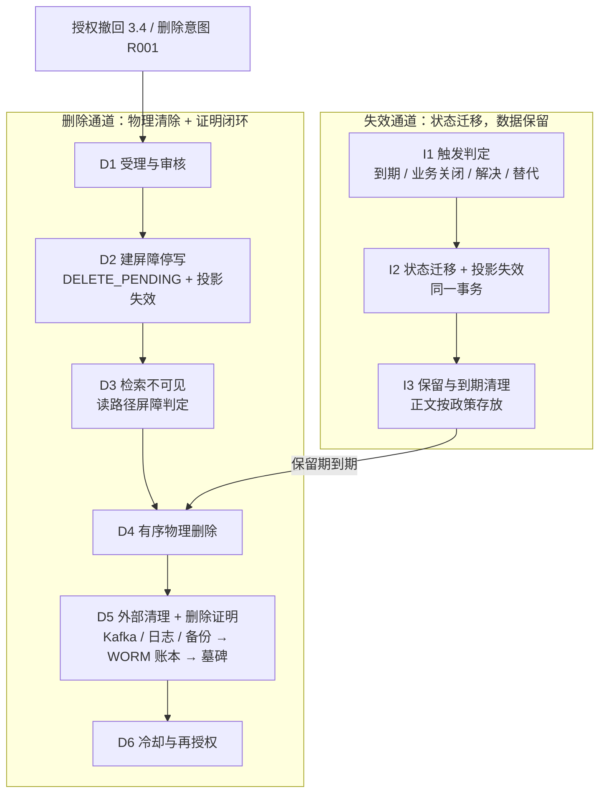
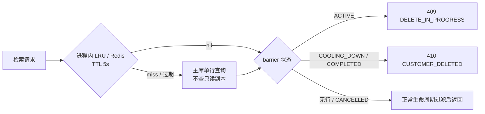
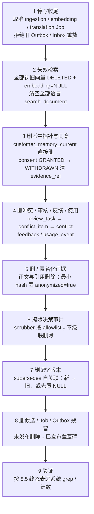
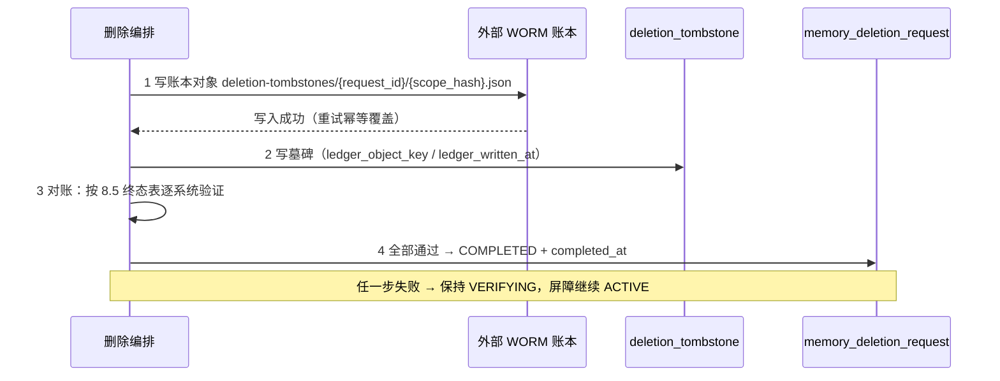
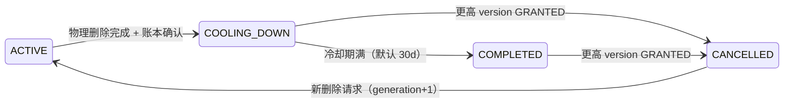
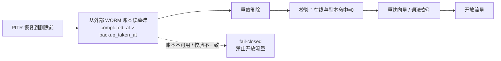
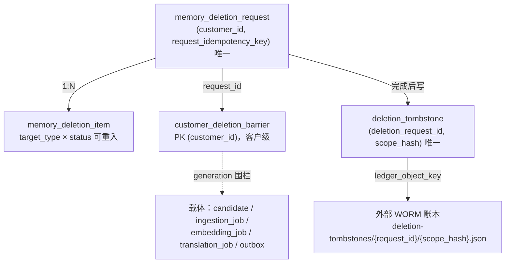
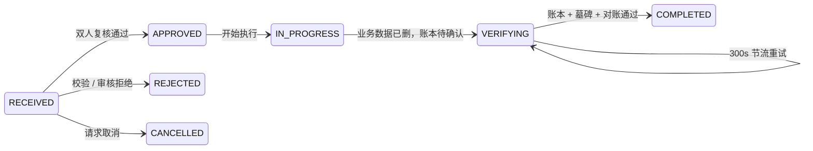

# 记忆删除与失效

**一句话：失效是"不再作为事实使用"，删除是"物理清除并留下证明"。** 失效只改状态与投影，正文按保留政策继续存放；删除立即停写、不可见，有序物理清除，最后以墓碑与外部账本闭环。两条通道共用同一套投影失效与物理清理机制。

| 小节 | 内容 |
|---|---|
| 8.1 | 整体执行过程：失效 3 步（I1–I3）+ 删除 6 步（D1–D6） |
| 8.2 | 关键步骤说明：I1–I3、D1–D6、备份恢复重放 |
| 8.3 | 数据模型：屏障、删除请求/明细、墓碑及合流表 |
| 8.4 / 8.5 | 输入数据 / 输出数据 |
| 8.6 | 持续观测点设计：指标、告警、SLO、竞态门禁 |

## 8.1 整体执行过程（关键步骤）

### 8.1.1 失效与删除的区分

| 维度 | 失效（I） | 删除（D） |
|---|---|---|
| 语义 | 事实不再有效 / 不再使用 | 数据主体行使删除权，或合法基础消失 |
| 触发 | 到期、业务关闭、事项解决、被替代（I1） | 用户/合规/管理员请求、授权撤回、删除意图（D1） |
| 数据去向 | 正文保留，按保留政策到期清理（I3） | 立即不可见，有序物理删除/匿名化（D4） |
| 检索 | `EXPIRED/SUPERSEDED` 不返回；`RESOLVED` 仅 `HISTORY_DEBUG` | 屏障拦截：409 / 410（D3） |
| 证明 | 决策审计 + 状态迁移 | 删除明细 + 墓碑 + 外部 WORM 账本（D5） |
| 可逆性 | 新版本可替代；到期清理不可逆 | 物理删除不可逆；再授权只允许新记忆（D6） |

### 8.1.2 总览



### 8.1.3 关键步骤

| 步骤 | 触发 / 位置 | 职责 | 失败出口 | 详见 |
|---|---|---|---|---|
| I1 触发判定 | 业务事件实时 + Convergence 定时扫描 | 四种失效原因 → 目标状态 | 无权威事件时靠 TTL 扫描兜底 | 8.2.1 |
| I2 迁移与失效 | 统一生命周期服务，单事务 | 状态 + 向量/视图/Job 同事务失效 | 事务回滚；漂移由对账修复 | 8.2.2 |
| I3 保留与清理 | 保留政策 + 到期扫描 | 正文按政策存放；到期进入 D4 | 清理失败留在队列重试 | 8.2.3 |
| D1 受理与审核 | API / 撤回 / 删除意图 | 校验主体与合规依据；高风险双人复核 | 拒绝 → `REJECTED`，不建屏障 | 8.2.4 |
| D2 建屏障停写 | 删除事务 | 客户级停写 + 全部投影失效 | 建屏障失败 → 请求不生效 | 8.2.5 |
| D3 检索不可见 | 每次检索返回前（持续守卫） | 屏障判定，拒绝返回 | 读不到屏障 → 放行 + 计 miss | 8.2.6 |
| D4 物理删除 | 删除编排（独立连接） | 按外键顺序删除/匿名化/擦除 | 单项失败 → item `FAILED` 重试 | 8.2.7 |
| D5 证明闭环 | 删除编排 + Convergence | 外部清理；WORM 账本 → 墓碑 → 对账 | 账本失败 → `VERIFYING` 重试 | 8.2.8 |
| D6 冷却与再授权 | Convergence 收尾 | 冷却期满 `COMPLETED`；再授权 `CANCELLED` | 冷却期内写入挂起 | 8.2.9 |

> 备份恢复重放（8.2.10）是删除的兜底闭环，不属于正常执行步骤，但每次恢复演练必须覆盖。

## 8.2 关键步骤说明

### 8.2.1 I1：失效触发判定

| 原因 | 判据 | 目标状态 | 触发源 |
|---|---|---|---|
| 时间型过期 | `now() >= expires_at` | `EXPIRED` | Convergence 扫描 |
| 事实不再有效 | 权威业务事件 / 新版本关闭 `valid_to` | `EXPIRED` / `SUPERSEDED` | 业务事件实时 |
| 事项已解决 | 工单/问题进入完成状态 | `ACTIVE_ISSUE` → `RESOLVED` | 业务事件实时 |
| 被替代 | 新事实取代旧事实（6.2.4 `R080`） | 旧版本 `SUPERSEDED` | 决策事务 |

- 规则由**统一生命周期服务**实现，业务事件实时触发与定时扫描复用同一实现；定时任务只负责扫描和触发；
- `COMMITMENT` / `ACTIVE_ISSUE` 优先监听权威业务事件，TTL 只作兜底；
- 状态机全图见状态机 §2；每个状态都有自动出口，禁止永久挂账。

### 8.2.2 I2：状态迁移与投影失效（同事务）

| 目标状态 | `lifecycle_status` | 向量 `memory_embedding` | 视图 / Job | 正文 |
|---|---|---|---|---|
| `EXPIRED` / `SUPERSEDED` | 迁移 | 所有视图 `status='DELETED'`、`embedding=NULL` | 视图置 `DELETED`；PENDING/RETRY Job 取消 | 保留至政策到期 |
| `RESOLVED` | 迁移 | **保留** | 保留 | 保留 |
| `DELETE_PENDING` | 迁移 | 同 `EXPIRED` | 同 `EXPIRED` | 进入 D4 |

- 状态变更与向量失效**同一事务**（同库）完成，不依赖后台同步；同事务写 Outbox 领域事件（`mms.memory.lifecycle.v1`，可选 Kafka）；
- `EXPIRED/SUPERSEDED/DELETE_PENDING/DELETED` 不得被在线检索返回；`RESOLVED` 向量只允许 `HISTORY_DEBUG` 用途返回，当前回答用途不返回（12.6）；
- 失效作用于**所有模型版本 × 所有语言视图**（ORIGINAL/CANONICAL/TRANSLATED），不能只删当前模型/当前语言（状态机 §10）。

### 8.2.3 I3：保留与到期清理

- 失效 ≠ 删除：正文/证据按 `fact_key_registry.retention_days` 与合规政策保留；
- 保留期到期 → 进入 D4 物理清理（同一套删除机制，`request_source=SYSTEM`）；
- 清理范围含日志、Kafka 保留数据、备份、导出文件、死信；
- 只保存最小化删除证明，不得为审计无限期保留已要求删除的正文。

### 8.2.4 D1：受理与审核

| 项 | 口径 |
|---|---|
| 入口 | 用户/合规/管理员 API；授权撤回（3.4，`request_source=CONSENT_WITHDRAWN`）；会话删除意图（`R001` → `DELETE_REQUESTED`） |
| 校验 | 请求主体、身份映射、权限、授权/合规依据；path `customer_id` 只是目标不是凭据（15.1） |
| 审核 | 高风险删除双人复核（`approved_by <> requested_by`，DB CHECK）；`APPROVED` 后才允许执行 |
| 幂等 | `(customer_id, request_idempotency_key)` 唯一；撤回入口 `consent-withdrawn:{customer_id}:{purpose}:{version}` |
| 范围 | `scope` 只决定删哪些数据（`memory_type`/`fact_key` 子集或全部）；**屏障是客户级**，子集请求也停该客户全部写入 |

### 8.2.5 D2：删除屏障（停写）

**屏障是删除可见性与停写的权威开关。** 本节是屏障判定的唯一口径：写路径（6.2.2、12.4、Outbox 发布、DLQ 重放）与读路径（8.2.6）都复用，不得另写变体。

- 主键 `(customer_id)`，`scope_type` 固定 `CUSTOMER`；`scope` 不缩小屏障；
- `requested_at` 之后的写入拒绝或挂起；删除枚举以 `cutover_at` 为一致快照边界；
- 每条候选 / Outbox / Embedding Job / Translation Job 携带 `barrier_generation`；
- 同意撤回（`CONSENT_WITHDRAWN`）复用同一屏障，判定口径见 3.4。

**创建与写入串行化**（首删时 barrier 行不存在，行锁锁不住，必须用 advisory lock）：

```sql
-- 两侧同一把锁：屏障创建/更新 与 一切写入（决策、Worker 写向量/译文、Outbox 发布、DLQ 重放）
SELECT pg_advisory_xact_lock(hashtextextended('mms_barrier:' || :customer_id, 0));

-- 写入侧：锁内读主库（无行 = 无屏障），按下方唯一算法判定
SELECT status, generation, cutover_at
  FROM customer_deletion_barrier WHERE customer_id = :customer_id;

-- 删除侧：锁内计算 new_generation = COALESCE(当前 generation, 0) + 1，不得锁外缓存复用
INSERT INTO customer_deletion_barrier
  (customer_id, request_id, status, requested_at, cutover_at, generation, scope_type)
VALUES (:customer_id, :request_id, 'ACTIVE', now(), now(), :new_generation, 'CUSTOMER')
ON CONFLICT (customer_id) DO UPDATE
   SET status='ACTIVE', request_id=EXCLUDED.request_id,
       requested_at=now(), cutover_at=now(), generation=:new_generation, updated_at=now();
```

**唯一放行算法**（`required_generation`：无行 = 0，有行 = `barrier.generation`）：

| # | 条件 | 结果 |
|---|---|---|
| ① | 有行且 `status IN ('ACTIVE','COOLING_DOWN','COMPLETED')` | 拒绝 `BARRIER_BLOCKED` |
| ② | 载体 `barrier_generation <> required_generation`（**相等**判定，不是大小比较） | 拒绝 `STALE_GENERATION` |
| ③ | 有行且 `carrier.created_at < barrier.cutover_at` | 拒绝 `STALE_GENERATION` |
| ④ | 其余（无行且携带 0；或 `CANCELLED` 且携带当前 generation） | 允许 |

- `carrier.created_at` 取 `memory_candidate` / `memory_ingestion_job` / `memory_embedding_job` / `memory_outbox_event` 的 `created_at`；③ 用于屏障行按保留期删除、新生命周期重新编号后，仍拒绝上一生命周期的旧载体；
- 锁持有时间 = 单个决策事务时长；持锁期间禁止调用外部 provider；
- `COOLING_DOWN` 期间写入进入延迟/人工队列（不丢弃）；`CANCELLED` 后 generation 递增，旧 generation 的事件永久拒绝。

**读写路径判定方式不同，不得混用：**

| 路径 | 判定方式 | 允许延迟 | 失败语义 |
|---|---|---|---|
| 写（候选接收 / 决策提交 / Worker / Outbox / DLQ 重放） | 同一事务内 advisory lock + 读**主库** barrier 行；唯一入口 `repository.verify_write_barrier`（6.2.2） | 0（无窗口） | 读失败 → fail-closed 回滚，记 `BARRIER_CHECK_FAILED`；禁止用缓存 |
| 读（检索返回前） | 进程内 LRU + 可选 Redis（TTL 5s）；miss/过期回主库单行查询 | ≤5s（SLO） | 读不到 → 视为无屏障，记 `mms_barrier_cache_miss_total` |

写路径用缓存会留下最长 5s 复活窗口（屏障已提交、缓存仍是旧值），违反"删除后不得出现新 `ACTIVE`"（8.6 / 20.1）。

**generation 生命周期：** 只在单个屏障生命周期内单调递增；屏障行按 `barrier_retention_days`（默认 180d）删除后，新生命周期从 1 重新编号，跨周期旧载体由 ③ 拒绝。180d 远大于 Kafka retention（24h）与 Job/Outbox 最大存活窗口，不存在可重放的跨周期载体；若要求全局单调（不依赖时间窗守卫），引入独立 sequence 属新 ADR。

### 8.2.6 D3：检索不可见



| 项 | 口径 |
|---|---|
| 权威开关 | `customer_deletion_barrier`；不得只依赖只读副本 `lifecycle_status`（副本延迟） |
| 缓存失效 | 屏障变更同事务写 Outbox `customer.deletion.barrier.changed.v1`；MMS 内部走 `pg_notify('mms_barrier_changed')` + 各副本 LISTEN 即时失效，TTL 5s 兜底 |
| 状态码 | 每个状态只有一个码（上图）；再授权 `CANCELLED` → 回到 200；禁止冷却期与 `COMPLETED` 用不同码 |
| SLO | 屏障事务提交 → 检索不可见 P95 ≤5s；事件链路故障最大 5s（TTL），不承诺跨副本"0ms 立即" |

### 8.2.7 D4：有序物理删除

**结论：按外键顺序执行，每步可重入、可验证；审计不级联删除。** 删除编排使用独立 `mms_deletion_worker` 连接；审计擦除使用独立 `mms_audit_scrubber` 连接（`MMS_SCRUBBER_DATABASE_URL`，15.3）。



- `memory_deletion_item` 保留到第 9 步验证完成后再按保留策略清理，避免丢失删除证明；
- 证据匿名化只保留 `customer_id / source_system / evidence_hash / observed_at`，不得保留正文或可反查链接；
- `customer_memory` 自关联 `supersedes_memory_id` 必须从新到旧删或先置 NULL，避免自外键阻塞。

**删除范围（按系统分组）：**

| 组 | 覆盖对象 | 动作 | 证明 |
|---|---|---|---|
| 业务数据 | `customer_memory` 全版本、`memory_evidence`、`memory_candidate`、`memory_conflict*`、`memory_review_task`、`memory_feedback`、`memory_usage_event` | 物理删除；证据可留最小 hash（`anonymized=true`） | 行数=0 或匿名化标记 |
| 派生投影 | `memory_embedding` 全模型×全语言视图、`memory_search_document` 全语言、`customer_memory_current`、`memory_embedding_job`、`memory_translation_job`、`memory_ingestion_job`、`memory_outbox_event`/`inbox` | 删除/取消；未发布 Outbox 删除，已发布置墓碑 | 视图向量行=0、Job=0 |
| 审计 | `memory_decision`、`memory_deletion_request/item`、`recon_run`、`admin_access_audit` | 不删除：scrubber 按 allowlist 擦 PII，保留最小证明 | 审计行 + `pii_scrubbed_at` |
| 身份与同意 | `customer_identity`、`customer_memory_consent` | 映射退役/删除；GRANTED 快照删除或置 WITHDRAWN | 映射=0 或 WITHDRAWN |
| 外部系统 | Kafka、日志/追踪、备份、导出、死信、Embedding Provider | tombstone + compaction；按保留期清理；受控过期 + 恢复重放；零保留/DPA | topic 无 raw id；抽样 grep=0 |
| 屏障与墓碑 | `customer_deletion_barrier`、`deletion_tombstone` | 屏障按 180d 保留后清理；墓碑保留至 `retain_until`（> 备份窗口） | 墓碑行含 barrier generation |

**审计保留/擦除 allowlist**（`mms_audit_scrubber` 执行，应用角色无 UPDATE 权限；权限基线 23.13.2）：

| 表 | 保留（不可变） | 擦除 / 置空 |
|---|---|---|
| `memory_decision` | `decision_id / outcome / reason_codes / primary_rule_id / policy_version / fact_key_registry_version / engine_version / created_at / attempt_no / customer_hash` | `customer_id→'scrubbed'`；候选/目标/匹配 ID、`context_snapshot`、`score_breakdown`、`expected_versions`、`rule_trace`；写 `pii_scrubbed_at` |
| `memory_deletion_request` | `id / status / scope_hash / completed_at / proof` 摘要 | `proof` 中正文与 customer/memory 明细 |
| `recon_run` | 批次计数 / 错误码 / 起止时间 | `scope/details` 中 customer_id / memory_id / 正文 |
| `admin_access_audit` | `audit_id / actor / customer_hash / action / reason_code / trace_id / created_at` | `reason_text_redacted` 中 PII；写 `pii_scrubbed_at` |
| `deletion_tombstone` | 全部字段（到期前） | 到期后删除整行（`trg_tombstone_purge_guard`） |

> 审计/决策表不用 `ON DELETE CASCADE`；向量/词法/Job 可以 cascade（非审计源）。

### 8.2.8 D5：外部清理与删除证明

**外部系统清理：**

| 系统 | 动作 | 关键约束 |
|---|---|---|
| Kafka | barrier 提交后 ≤5s 发布 tombstone（key=`customer_ref`，value=null，header `event_type=memory.deleted`） | `retention.ms≤24h`；`delete.retention.ms≥retention.ms`（否则 tombstone 先过期、compaction 重新暴露旧值）；`min.compaction.lag.ms=1h`；topic 配置详见 14.1 |
| 日志/追踪/缓存/死信/导出 | 按保留期清理；不记录正文 | 抽样 grep=0 |
| 备份 | 受控过期；恢复后重放墓碑（8.2.10） | 备份不可回改 |
| Embedding Provider | 零保留/DPA，确认不留存 | 合同/审计 |

- 所有事件 key 用 `customer_ref = HMAC-SHA256(kafka_ref_key_vN, customer_id)`，不回传 raw id；payload 只放引用；未知 ref 进 `mms.dlq.customer-ref-unknown.v1`，不猜测、不落业务表；
- **Kafka 只是加速器，不是权威**：消费停摆 > retention 会丢删除事件。权威依据永远是 DB 屏障 generation + `deletion_tombstone`（含外部 WORM 账本）。消费者 lag 超阈值触发 `kafka_deletion_replay`（`recon_run(kind='kafka_deletion_replay')`）从墓碑重放未完成项；每个事件携带 `barrier_generation`，消费者处理旧事件前再查屏障。

**证明闭环（顺序不可换）：**



- 账本在备份之外（`TOMBSTONE_LEDGER_URI`，保留默认 400d）；PITR 会连墓碑表一起回退，恢复必须从外部账本读 `completed_at > backup_taken_at` 的墓碑；
- **完成条件**：账本写入成功 + 墓碑落库 + 对账通过，才允许 `COMPLETED`；
- `VERIFYING` = 业务数据已删、账本未确认（不是"删除未开始"）；读路径仍按屏障拒绝，不会出现删除后仍可召回；
- 失败重试：Convergence 以 `deletion_retry_seconds=300` 节流，复用同一 `request_id`（墓碑 key 按 request+scope 幂等），无限重试、只告警不放弃；
- 高合规 profile：每客户 KMS key + crypto-shredding（`deletion_tombstone.kms_key_id` 记录待销毁 key）；向量/词法仍需物理删除，不能靠销毁 key 代替（15.3）。

> 实现落点：`src/mms/services/repository.py:MemoryRepository.delete_customer_data`（账本失败分支）、`src/mms/services/lifecycle.py:LifecycleService._retry_verifying_deletions`、`src/mms/config.py:Settings.deletion_retry_seconds`。

### 8.2.9 D6：冷却、再授权与收尾



| 项 | 口径 |
|---|---|
| 冷却期 | 默认 30d（`deletion_cooldown_days`）；期内读 410、写拒绝/挂起；新事件进延迟/人工队列，或按业务明确"删除后允许新记忆"再放行 |
| 再授权 | 物理删除完成 + 冷却期满 + 上游更高 version `GRANTED`（WRITE/RETENTION）→ `CANCELLED`、generation+1、发 `barrier.changed`；旧记忆不复活，新记忆从新 generation 开始 |
| 屏障收尾 | 删除完成且超过 `barrier_retention_days`（默认 180d）→ 置 `CANCELLED` → 删除行；generation 与 request_id 摘要转写进墓碑 |
| 墓碑到期清理 | `retain_until` 到期由 mms-lifecycle 触发，在独立 `mms_deletion_worker` 连接（`MMS_DELETION_DATABASE_URL`；未配置时回退 `SET LOCAL ROLE`，仅开发/测试）执行，且必须在扫描事务提交后单独执行——扫描以 `mms_worker` 运行，对本表无 DELETE 授权，放在扫描事务内会连带回滚全部过期动作；`trg_tombstone_purge_guard` 拒绝未到期删除 |

### 8.2.10 备份恢复重放



| 项 | 口径 |
|---|---|
| 备份 | PostgreSQL 持久化卷 + WAL/PITR；备份含向量表；墓碑账本必须在备份之外 |
| 恢复顺序 | PITR → 外部账本墓碑 → 重放删除 → 校验 → 重建索引 → 开放流量；避免已删除记忆的向量复活 |
| 演练 | 每次记录 `mms_deletion_tombstone_restore_replay_total{result}`；必须覆盖删除后恢复、墓碑重放、索引重建、Embedding Job 重放、跨客户校验 |
| 门禁 | 墓碑缺失/保留期不足按 P1 禁止上线；恢复演练证据见 20.1 |
| 模型一致 | 恢复后校验 `embedding_model_registry` 模型/维度一致 |

## 8.3 数据模型

DDL 以 23.13 为唯一来源，本节只列本通道涉及的表与关键字段，避免双源。



| 表 | 关键字段 | 本通道语义 |
|---|---|---|
| `customer_deletion_barrier` | `status / generation / cutover_at / scope_type='CUSTOMER'` | 停写与不可见的权威开关（8.2.5） |
| `memory_deletion_request` | `request_source / scope / scope_hash / status / approved_by / proof` | 一次删除请求；`scope_hash=SHA-256(canonical_json(scope))` |
| `memory_deletion_item` | `target_type / target_id / target_ref / status / attempts` | 逐对象删除明细，可重入可验证；`VERIFIED` 需 `verified_at` |
| `deletion_tombstone` | `customer_ref / scope_hash / reason_code / ledger_object_key / retain_until / kms_key_id` | 删除证明 + 恢复重放清单；`retain_until > completed_at` 且 > 备份窗口 |
| `customer_memory` | `lifecycle_status` | 失效/删除的状态载体（状态机 §2） |
| `memory_embedding` / `memory_search_document` | `status / embedding` | 投影失效对象；全模型×全语言视图 |
| 载体表 | `barrier_generation` | candidate / ingestion_job / embedding_job / translation_job / outbox 携带代际快照 |

**删除请求状态机：**



## 8.4 输入数据

**删除请求（D1）：**

```json
{
  "customer_id": "cust_200",
  "request_source": "USER",
  "requested_by": "user_token_sub",
  "legal_basis": "GDPR Art.17",
  "scope": {"all": true},
  "request_idempotency_key": "user-delete:cust_200:2026-11-14"
}
```

| 字段 | 口径 |
|---|---|
| `customer_id` | 网关注入 / 内部服务身份解析，不信任请求体（15.1） |
| `request_source` | `USER / COMPLIANCE / ADMIN / SYSTEM / CONSENT_WITHDRAWN / DELETE_REQUESTED` |
| `scope` | `{"all":true}` 或 `{"memory_type":[...],"fact_key":[...]}` 子集；只决定删除范围，不缩小屏障 |
| `legal_basis` | 合规依据；撤回入口记 consent version |
| `request_idempotency_key` | 幂等键；撤回为 `consent-withdrawn:{customer_id}:{purpose}:{version}` |

**失效与删除触发（I1 / D1）：**

| 输入 | 来源 | 判定 |
|---|---|---|
| 权威业务事件（工单关闭、新版本生效） | Kafka / 内部事件 | 实时触发状态迁移 |
| `expires_at` / `valid_to` 到期 | Convergence 扫描 | `now() >= expires_at` |
| `SUPERSEDE` 决策 | 6.2.4 `R080` | 旧版本同事务转 `SUPERSEDED` |
| 授权撤回 | 3.4 同步入口 / 兜底扫描 | 视同删除请求，`request_source=CONSENT_WITHDRAWN` |
| 删除意图 | `R001`（5.2.2 / 6.2.4） | `DELETE_REQUESTED` → D1 |

## 8.5 输出数据

**各系统终态（删除完成的验证口径）：**

| 系统 | 终态 | 证明 |
|---|---|---|
| 业务数据（记忆/证据/候选/冲突/反馈/使用） | 行数=0 或匿名化标记 | 删除明细 `DELETED / ANONYMIZED` |
| 派生投影（向量/视图/指针/Job） | 全模型×全语言视图行=0、Job=0 | 视图向量行=0 |
| 审计 | 最小证明保留，`customer_id='scrubbed'` | `pii_scrubbed_at` + 审计行 |
| 身份/同意 | 映射=0 或 RETIRED；WITHDRAWN | 墓碑含 ref |
| Kafka | 同 key 只剩 tombstone，24h 内过期 | tombstone lag ≤5s |
| 日志/备份 | 抽样 grep=0；恢复重放后命中=0 | 恢复演练记录 |
| 请求 | `COMPLETED` + `completed_at` | 墓碑 + 账本对象 |

**删除证明（`memory_deletion_request.proof` + `deletion_tombstone`）：**

```json
{
  "tombstone_id": "ts_01J...",
  "deletion_request_id": "del_01J...",
  "customer_ref": "hmac_sha256...",
  "scope_hash": "sha256(canonical_json(scope))",
  "reason_code": "USER_DELETE",
  "completed_at": "2026-11-14T10:00:00Z",
  "ledger_object_key": "deletion-tombstones/del_01J.../scope_hash.json",
  "ledger_written_at": "2026-11-14T09:59:58Z",
  "retain_until": "2027-12-19T00:00:00Z",
  "kms_key_id": null
}
```

- 证明只存最小化摘要（计数/时间/操作 ID/覆盖系统/验证结果），不得为审计无限期保留已要求删除的正文；
- `reason_code`：普通删除 `USER_DELETE`，撤回 `CONSENT_WITHDRAWN`。

**对外事件：**

| 事件 | 通道 | 时机 |
|---|---|---|
| `customer.deletion.barrier.changed.v1` | Outbox → Kafka | 屏障每次状态变更同事务写；MMS 内部缓存失效另走 `pg_notify` |
| `memory.deleted`（tombstone，value=null） | Kafka | barrier 提交后 ≤5s |
| `mms.memory.lifecycle.v1` | Outbox | I2 状态迁移同事务（过期/替代/解决） |

**检索响应（D3）：** 状态码见 8.2.6——`ACTIVE`→409、`COOLING_DOWN/COMPLETED`→410、`CANCELLED`→200。

## 8.6 持续观测点设计

### 8.6.1 指标

| 指标 | 类型 | 语义 | 告警 |
|---|---|---|---|
| `mms_barrier_write_blocked_total{status}` | Counter | 写路径屏障拦截（含 `STALE_GENERATION`） | 趋势 |
| `mms_barrier_write_check_failures_total` | Counter | 写路径屏障校验失败 | **必须=0，>0 即 page** |
| `mms_barrier_post_commit_writes_total` | Counter | 屏障升起后仍落库的写入（一致性异常，Outbox 对账产出） | >0 即 page |
| `mms_retrieval_blocked_by_barrier_total{status}` | Counter | 读路径屏障拦截 | 趋势 |
| `mms_barrier_cache_age_seconds` | Gauge | 读缓存年龄 | >10s 告警 |
| `mms_barrier_cache_miss_total` | Counter | 读缓存 miss / 回主库 | 趋势 |
| `mms_deletion_request_verifying` | Gauge | 卡在 `VERIFYING` 的请求数 | >0 持续 15m → page（`MMSDeletionVerifyingStuck`） |
| `mms_deletion_retry_total{result}` | Counter | `VERIFYING` 重试结果 `completed/failed` | failed 增长告警 |
| `mms_deletion_tombstone_restore_replay_total{result}` | Counter | 恢复演练墓碑重放结果 | 失败按 P1 |
| `mms_kafka_tombstone_lag_seconds` | Gauge | 屏障提交 → tombstone 发布延迟 | >5s 告警 |
| `mms_kafka_consumer_lag_seconds{topic,group}` | Gauge | 消费 lag | > `retention.ms` 50% 触发重放 |
| `mms_kafka_deletion_replay_total{result}` | Counter | 墓碑重放 Job 结果 | 失败告警 |
| `mms_kafka_ref_lookup_miss_total` | Counter | 未知 `customer_ref` | 增长告警 |
| `mms_kafka_topic_retention_seconds{topic}` | Gauge | topic 保留期配置 | 配置漂移 |

### 8.6.2 SLO 与告警

| SLO | 目标 |
|---|---|
| 屏障提交 → 检索不可见 | P95 ≤5s（缓存事件故障最大 5s TTL） |
| tombstone 发布 | barrier 提交后 ≤5s |
| Kafka tombstone 过期 | ≤24h |
| 删除请求 SLA | `memory_deletion_item.status != COMPLETED` 超 SLA 告警 |

补充告警：`DELETE_PENDING` 被检索返回 >0；barrier 事件消费延迟 >30s；`MMSDeletionVerifyingStuck`（>0 持续 15m，page，`deploy/prometheus/alerts.yml`）。

### 8.6.3 竞态与上线门禁（与 20.1 同源）

| 竞态 | 收敛机制 | 验收 |
|---|---|---|
| 删除 vs ADD/SUPERSEDE | 屏障锁 + generation | 删除后新 `ACTIVE`=0（100 轮，含首删"barrier 行不存在"） |
| 删除 vs Embedding/Translation Worker | 写前屏障/generation/hash 校验 | 失败丢弃，不写旧向量 |
| 删除 vs Outbox/DLQ 重放 | 发布前屏障闸（同 8.2.5 口径） | 旧 generation 拒绝 |
| 删除 vs 检索 | 主库提交即不可见；副本 ≤5s | 注入 30s 副本延迟仍 5s 内收敛 |
| 删除 vs 子集请求 | 屏障客户级 | 子集删除也停全部写入 |
| 删除 vs 备份恢复 | 外部账本重放 | PITR 到删除前，重放后命中=0 |
| 删除 vs Kafka 停摆 | 墓碑重放 Job | 停 30min 恢复后下游不复活 |
