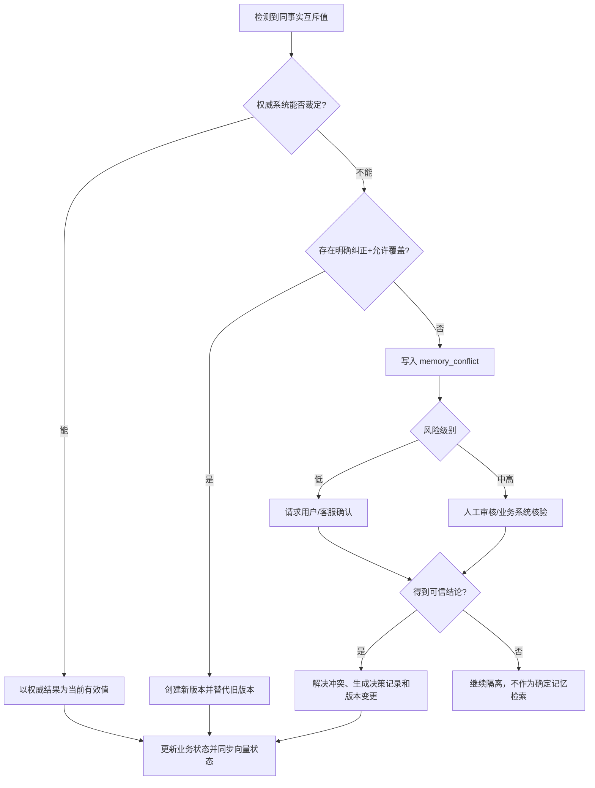

# 10. 冲突识别与裁决

## 10.1 冲突定义

冲突不是“向量相似度高但文本不一样”，而是：**同一主体、同一事实键/业务对象、重叠的有效时间内，存在互不兼容的事实值，且当前来源规则无法确定哪个有效。**

冲突检测至少比较：

- 同一客户和事实主体；
- `fact_key`、`entity_type/entity_ref`、`value_slot`；
- 规范化后的值及值域约束；
- `valid_from/valid_to` 是否重叠；
- 来源可信等级和字段的权威来源；
- 证据时间、事件顺序和用户是否明确纠正；
- 已有记录是否有效、过期、已被替代或处于删除中。

语义相似度只用于发现候选，不作为冲突成立的证据。

## 10.2 自动裁决规则

1. **先查字段权威来源。** 退款、订单、工单等字段回查权威系统；业务库正式状态优先于对话文字。
2. **区分当前值和时间历史。** 两个值处于不同有效区间时，按时间版本保存，不标冲突。
3. **明确的客户纠正可更新用户偏好。** 例如“我现在希望用中文”，若 `fact_key=communication.language`、身份明确且未违反政策，可 `SUPERSEDE` 旧偏好。
4. **同来源、同事实、重复值**：`NOOP` / `REINFORCE`。
5. **两个同等级来源存在矛盾**：无法只凭最后写入时间判定，进入 `CONFLICT`。
6. **模型推断和用户明确陈述矛盾**：优先用户明确陈述，但需先检查其是否能决定该字段；不允许覆盖系统权威字段。
7. **来源时间较新但可信等级更低**：不应只按更新时间覆盖；核验或审核。
8. **冲突未解决期间**：默认不把任何一方作为确定事实提供给客服 Agent；返回 `requires_confirmation=true` 或“信息待核实”。

## 10.3 冲突处理流程

## 10.4 审核队列最低要求

每个审核项必须包含：候选值、现有值、来源证据链接、冲突原因、字段权威规则、风险级别、建议动作、创建时间、SLA、审核人、审核结论、理由和审计时间。

- 人工审核动作仍然通过 MMS 的事务和 Embedding Job 执行；审核台不得直接改数据库或向量表。
- 高风险（删除、金额/身份/账户状态、批量覆盖）要求 4-eyes；审核人不能是提交人。
- 审核结论必须写 `reason_code` 和 `policy_version`；不能只写自由文本。
- 冲突未解决时，`customer_memory.lifecycle_status=CONFLICTED`，向量可以保留但检索必须过滤；如果业务要求完全不召回，可将向量置 `DELETED`，解决后重建。
