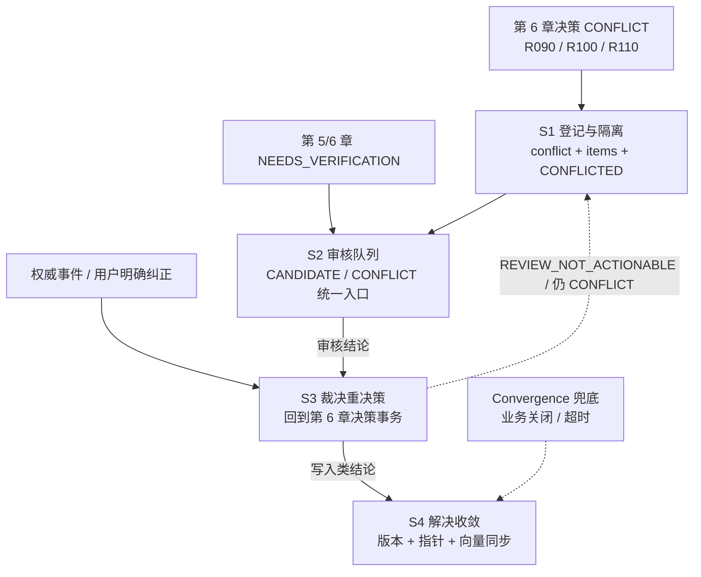
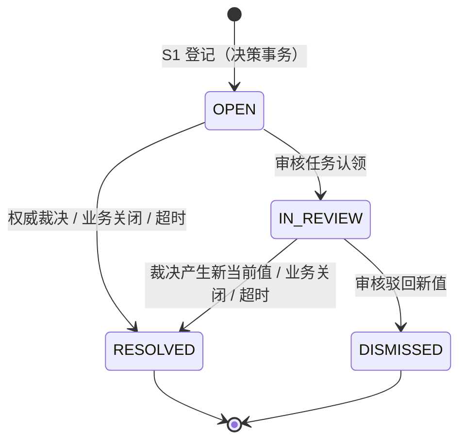
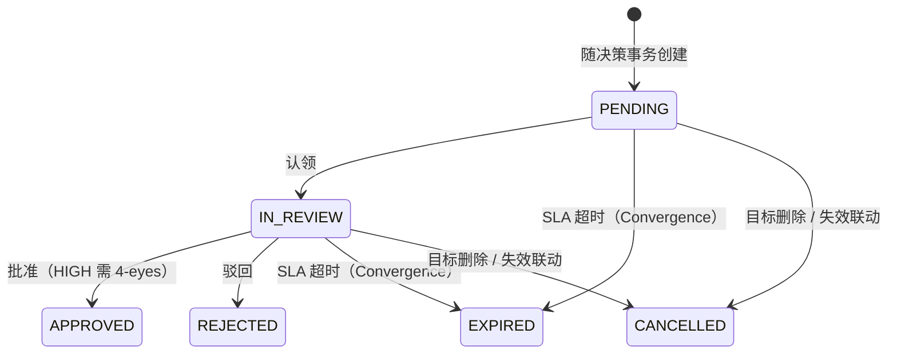
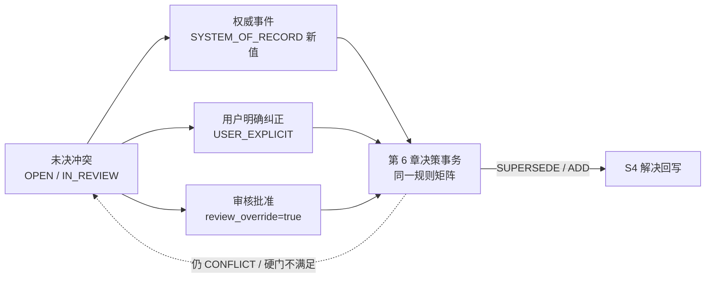
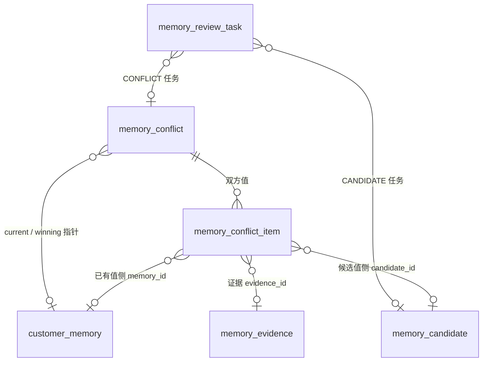
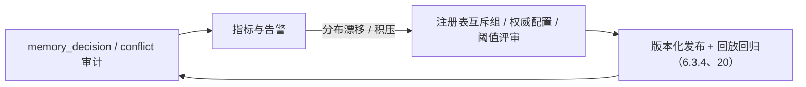

# 冲突识别与裁决

**一句话：第 6 章判"是不是冲突"，本章管"冲突怎么了结"。** 冲突由决策引擎 `R090/R100/R110` 检出（6.2.4）；本章负责登记隔离、审核裁决、解决收敛。**裁决不引入第二套规则引擎**——权威事件、用户纠正、审核结论都作为新输入回到第 6 章决策事务。

| 边界 | 归属 |
|---|---|
| 是不是冲突（同事实、区间重叠、互斥值、无法覆盖） | 第 6 章 `R090/R100/R110`，本章不重复判定 |
| 登记、隔离、审核、裁决、解决 | 本章 |
| 超时 / 业务关闭的兜底收敛 | Convergence（状态机 §5） |
| 检索隔离口径 | 12.6 待核实通道 |

**什么不是冲突**（第 6 章已排除，不进入本章）：

| 场景 | 引擎结论 |
|---|---|
| 同事实同规范值（含跨语言重述） | `R050/R060` NOOP / REINFORCE |
| 值不同但有效区间不重叠 | `R090` 时间版本（`SINGLE_VALUE` 除外） |
| `MULTI_VALUE` 不同值并存 | `R075` ADD |
| 仅向量相似度高，无精确互斥证据 | 相似度不构成冲突证据；`R110` 转审核 |

## 10.1 整体执行过程（4 个关键步骤）



| 步骤 | 位置 | 做什么 | 失败出口 |
|---|---|---|---|
| **S1 登记与隔离**（10.2.1） | CONFLICT 决策同事务 | 写冲突与双方值/证据；目标记忆 → `CONFLICTED`；建 CONFLICT 审核任务 | 唯一键撞车 → 并入已有冲突 |
| **S2 审核队列**（10.2.2） | 异步人工 | CANDIDATE / CONFLICT 任务统一处理；SLA、风险分级、4-eyes | SLA 超时 → `EXPIRED`（Convergence） |
| **S3 裁决重决策**（10.2.3） | 新决策事务 | 权威事件 / 明确纠正 / `review_override` 重跑第 6 章规则矩阵 | 硬门不满足 → `REVIEW_NOT_ACTIONABLE`，维持隔离 |
| **S4 解决收敛**（10.2.4） | 裁决决策同事务 + 定时收敛 | 冲突 `RESOLVED/DISMISSED`；生命周期与向量同步 | 收敛失败重试/对账；禁止永久挂账 |

**不变量：**

| # | 不变量 |
|---|---|
| 1 | **裁决不绕过引擎**：任何结论都产生新 `memory_decision` 行；审核台不得直接改数据库或向量表 |
| 2 | **同事实槽只有一个未决冲突**：`ux_conflict_open_fact` 部分唯一；新互斥值并入冲突项，不重复开冲突 |
| 3 | **未决期间隔离**：`CONFLICTED` 不进事实通道，只走待核实通道（≤3 条、`context_only`，12.6） |
| 4 | **拒绝单调**：审核不能翻案 `REJECTED` 硬门；批准后仍不满足硬门 → `REVIEW_NOT_ACTIONABLE` |
| 5 | **禁止永久挂账**：审核 SLA（默认 30 天）、冲突最长存活（默认 90 天）、业务事件联动三条自动出口，Convergence 兜底 |

## 10.2 关键步骤说明

### 10.2.1 S1 登记与隔离

与 CONFLICT 决策同事务原子完成（6.2.5），无独立写入路径：

| 表 | 写入内容 |
|---|---|
| `memory_conflict` | 事实槽键、`status='OPEN'`、`risk_level`、`detected_reason_codes`、`current_memory_id` |
| `memory_conflict_item` | 双方值：已有记忆侧（`memory_id`）与候选侧（`candidate_id`），各带 `value_hash/object_json/证据/source_kind/observed_at`；原文脱敏 |
| `memory_review_task` | `task_type='CONFLICT'`、`status='PENDING'`、`due_at`（SLA） |
| `customer_memory` | 目标记忆 `lifecycle_status='CONFLICTED'` |
| `memory_decision` | `outcome='CONFLICT'` 审计行（第 6 章写入） |

**幂等与合并：** 同事实槽已有未决冲突（部分唯一撞车）→ 不新建冲突，只追加 `memory_conflict_item`；同一候选重复投递由候选幂等拦截（6.2.2）。

**风险分级**（决定裁决通道与审批强度）：

| risk_level | 典型场景 | 裁决通道 |
|---|---|---|
| `LOW` | 一般偏好类字段 | 可请求用户/客服确认 |
| `MEDIUM` | 服务历史、一般账户信息 | 人工审核 / 业务系统核验 |
| `HIGH` | 金额 / 身份 / 账户状态、批量覆盖、删除相关 | 人工审核 + 4-eyes |

**隔离口径：**

| 项 | 口径 |
|---|---|
| 事实通道 | `CONFLICTED` 不占事实名额、不进事实断言（12.6，P0-8） |
| 待核实通道 | `CURRENT_ANSWER`/`HISTORY_DEBUG` 返回 ≤3 条 `use_policy=context_only`，标记"信息待核实" / `requires_confirmation=true`；`CUSTOMER_SELF_SERVICE` 不启用 |
| 向量 | 默认保留、检索过滤；业务要求完全不召回时置 `DELETED`，解决后重建（12.10） |
| 决策内部 | `CANDIDATE_DISCOVERY` 仍可读 `CONFLICTED` 做候选发现，不对客暴露 |

**冲突状态机：**



### 10.2.2 S2 审核队列

**一个队列、两类入口**（`DELETION` 任务属第 8 章，不在本章展开）：

| task_type | 来源 | 审核对象 |
|---|---|---|
| `CANDIDATE` | 第 5/6 章 `NEEDS_VERIFICATION` | 单个候选：是否允许写入 |
| `CONFLICT` | S1 | 未决冲突双方值：哪个是当前值 |

**审核项最低字段集**（缺项不得入队）：

| 类别 | 字段 |
|---|---|
| 双方值 | 候选值、现有值（规范值 + 脱敏摘录） |
| 证据 | `source_refs` 证据链接、`source_kind`、`observed_at` |
| 判定依据 | 冲突原因码、字段权威规则（`authority_source`/`requires_authority`）、`risk_level`、建议动作 |
| 流程 | 创建时间、`due_at`（SLA）、`assigned_to`、`decision_version` |
| 结论 | `resolution_reason_code`、审核人、4-eyes 复核人、审计时间 |

**流程规则：**

| 规则 | 口径 |
|---|---|
| 唯一待办 | 部分唯一索引：同候选/同冲突只有一个未结任务；结论后重审产生新 `decision_version` |
| 4-eyes | `HIGH` 批准必须 `co_reviewer_id`；`reviewed_by <> created_by`、`co_reviewer_id <> reviewed_by`（DB CHECK，23） |
| 结论可枚举 | 必须写 `resolution_reason_code` 与 `policy_version`，不能只写自由文本；备注只存脱敏摘录 |
| 唯一写路径 | 审核台只调 `POST /review-queue/{review_id}/decision`（13）；执行仍走 MMS 决策事务与 Embedding Job |
| SLA | `review_sla_days` 默认 30 天；超时 → 任务 `EXPIRED`（CANDIDATE 任务的候选同步 `EXPIRED` 并告警，状态机 §1） |
| 审计 | 审核人身份服务端注入；决策行记 `operator_id`；管理员操作另记 `admin_access_audit`（15） |



### 10.2.3 S3 裁决重决策

**裁决 = 给同一个决策引擎供给新输入，不是第二套规则。** 三条路径都回到第 6 章规则矩阵与事务（锁序、授权复核、幂等完全一致）：



| 路径 | 触发 | 引擎行为 | 结果 |
|---|---|---|---|
| 权威裁决 | `authority_source` 字段的权威系统事件到达 | 普通候选，`R080 authoritative_changed` | 新版本替代，冲突解决 |
| 明确纠正 | 用户明确陈述/纠正 | 普通候选，`R080 explicit_statement`；须满足 `override_allowed` | 同上；不能覆盖系统权威字段 |
| 审核批准 | `APPROVED` 结论 | `review_override=true` 重决策：GATE 跳过 `R021/R041`，FACT 强制 `R080`、绕过 `R100/R110`（6.2.4） | 写入类结论 → S4 |
| 审核驳回 | `REJECTED` 结论 | 不重决策 | 冲突 `DISMISSED`，维持当前值 |

**裁决口径速查**（全部由第 6 章规则实现，此表仅供审核参照，不是新规则）：

| 场景 | 口径 | 规则 |
|---|---|---|
| 权威系统 vs 对话文字 | 业务库正式状态优先 | `R080` + `requires_authority` |
| 用户明确陈述 vs 模型推断 | 用户优先，但先检查其能否决定该字段 | `override_allowed` |
| 同等级来源矛盾 | 不能凭最后写入时间判定 | `R100 CONFLICT` |
| 时间较新但可信等级更低 | 不按更新时间覆盖 | `R100` / 核验 |
| 不同有效区间 | 时间版本，不是冲突 | `R090` |
| 同事实重复值 | 不是冲突 | `R050/R060` |

**失败出口：** 审核批准后仍不满足硬门（授权已撤回、敏感策略等）→ `REVIEW_NOT_ACTIONABLE`，不写入，维持隔离退回队列；`REJECTED` 硬门终态不可被审核翻案（不变量 4）。

### 10.2.4 S4 解决收敛

**解决回写**（与裁决决策同事务）：

| 解决路径 | conflict.status | resolution_reason_code | 生命周期与向量 |
|---|---|---|---|
| 裁决产生新当前值 | `RESOLVED` | 裁决原因码（可枚举；人工审核取审核结论原因码） | 胜者 `ACTIVE` + `winning_memory_id`；败者 `SUPERSEDED`；旧向量失效、新视图入队（6.2.5） |
| 审核驳回新值 | `DISMISSED` | 审核结论原因码 | 当前值恢复 `ACTIVE`；候选 `REJECTED` |
| 业务事件关闭 | `RESOLVED` | `RESOLVED_BY_EVENT` | 目标记忆 `RESOLVED` 联动（Convergence 项 5） |
| 超时兜底 | `RESOLVED` | `CONFLICT_TIMEOUT_EXPIRED` | 超 `conflict_max_age_days`（默认 90 天）；被放弃方按 `SUPERSEDED/EXPIRED` 收敛，向量按 12.10 失效 |

**Convergence 兜底**（定时扫描，不依赖人工点击）：

| 项 | 动作 |
|---|---|
| 冲突超时 | 未决超 `conflict_max_age_days` → 强制 `RESOLVED`、记忆 `EXPIRED`，禁止永久 `CONFLICTED` |
| 业务联动 | 目标记忆已 `RESOLVED` → 冲突联动关闭 |
| 任务联动 | 冲突已 `RESOLVED/DISMISSED` → 关联审核任务 `EXPIRED` |
| 向量同步 | 解决/过期必须作用于所有模型、所有语言视图（状态机 §10、12.10） |

## 10.3 数据模型

本章读写三张工作流表及关联的记忆/候选/证据；完整字段与 DDL 以第 23 章为准。



**关键约束：**

| 约束 | 实现 | 目的 |
|---|---|---|
| 同事实槽仅一个未决冲突 | `ux_conflict_open_fact` 部分唯一（`OPEN/IN_REVIEW`） | 合并而非重复开冲突 |
| 冲突项独立主键 | `memory_conflict_item.id`；`memory_id`/`candidate_id` 至少一个 | 不以 `(conflict_id, value_hash)` 丢证据 |
| 同对象仅一个未结任务 | `ux_review_open_candidate/conflict` 部分唯一 | 防重复待办 |
| 重审版本化 | `ux_review_decision_version` | 结论追加新版本，不覆盖 |
| 4-eyes | DB CHECK：`reviewed_by<>created_by`；`HIGH` 批准必须 `co_reviewer_id` | 高风险双复核 |
| 结论完整性 | CHECK：`RESOLVED/DISMISSED` 必须 `resolved_at` | 防止无结论状态 |

**状态枚举：** `memory_conflict.status` = `OPEN/IN_REVIEW/RESOLVED/DISMISSED`；`memory_review_task.status` = `PENDING/IN_REVIEW/APPROVED/REJECTED/EXPIRED/CANCELLED`；`risk_level` = `LOW/MEDIUM/HIGH`。状态分离（状态机总览）：冲突/审核状态不与 `lifecycle_status`、`embedding_status` 混用。

## 10.4 输入数据

| 输入 | 来源 | 内容 |
|---|---|---|
| CONFLICT 决策 | 第 6 章 S4（同事务） | `outcome/reason_codes/primary_rule_id`（`R090/R100/R110`）、`target_memory_id`、事实槽键、双方规范值与证据 |
| NEEDS_VERIFICATION 决策 | 第 5/6 章 | 候选与原因码、`risk_level`、`decision_version` |
| 审核结论 | `POST /review-queue/{review_id}/decision`（13） | 结论、原因码、复核人（HIGH）、`decision_version`、`Idempotency-Key` |
| 权威 / 业务事件 | Kafka / 权威系统回调（14） | `SYSTEM_OF_RECORD` 新值、工单关闭事件 |

S1 登记上下文示例（决策事务内构造，不接受外部直接输入）：

```json
{
  "customer_id": "cust_200",
  "fact_key": "issue.status",
  "entity_type": "ticket",
  "entity_ref": "T-9001",
  "value_slot": "",
  "detected_reason_codes": ["CONFLICTING_VALUES"],
  "primary_rule_id": "R100",
  "risk_level": "MEDIUM",
  "current_memory_id": "mem_old_123",
  "items": [
    {"memory_id": "mem_old_123", "value_hash": "3f2a...", "source_kind": "AGENT_CONFIRMED", "observed_at": "2026-10-20T08:00:00Z"},
    {"candidate_id": "cand_01J...", "value_hash": "9b41...", "source_kind": "USER_EXPLICIT", "observed_at": "2026-10-25T09:00:00Z"}
  ]
}
```

口径：身份字段与证据引用由服务端注入/校验；`value_hash` 是规范值指纹（`object_hash`），不比较原文；审核人身份服务端注入，`reason_code` 必须可枚举。

## 10.5 输出数据

| 输出 | 载体 | 口径 |
|---|---|---|
| 裁决决策 | `memory_decision` 新行 | 所有写入类路径都产生新决策行；审核路径记 `operator_id`、`review_override` 与版本三元组 |
| 冲突结论 | `memory_conflict` | `status/resolved_at/resolution_reason_code/winning_memory_id` |
| 审核结论 | `memory_review_task` | `status/reviewed_by/co_reviewer_id/resolution_reason_code/resolution_note_redacted` |
| 生命周期变更 | `customer_memory` | 胜者 `ACTIVE`、败者 `SUPERSEDED/EXPIRED`；驳回恢复当前值 `ACTIVE` |
| 投影同步 | `memory_embedding` / Job | 旧向量失效、新视图入队；不绕过 Embedding Job |
| 领域事件 | `memory_outbox_event` | 仅写入类结论（`SUPERSEDE` 等）按 6.5 外发；冲突登记/驳回本身不外发事件 |

解决记录示例（超时兜底路径）：

```json
{
  "conflict_id": "cf_01J...",
  "status": "RESOLVED",
  "resolution_reason_code": "CONFLICT_TIMEOUT_EXPIRED",
  "winning_memory_id": null,
  "resolved_at": "2027-01-23T09:00:00Z",
  "linked_review_task_status": "EXPIRED"
}
```

## 10.6 持续观测点设计

**观测三问：冲突多不多、裁决快不快、隔离漏不漏。** 按 4 个关键步骤布点；标注"新增"的为本章设计项，其余复用现有指标。

| 步骤 | 观测点 | 指标/载体 | 口径与告警 |
|---|---|---|---|
| S1 | 冲突发生率 | `mms_decisions_total{outcome=CONFLICT,rule_id}`（复用 6.6） | 占比漂移进周报；突增 → 注册表缺口或抽取漂移 |
| S1 | 冲突登记分布 | `mms_conflict_opened_total{rule_id,risk_level}`（新增） | `HIGH` 占比突增 → 安全审查 |
| S2 | 审核积压 | `memory_review_task` 账龄 > `review_sla_days`（复用 6.6） | 超 SLA 告警队列 owner |
| S2 | SLA 过期 | `mms_candidate_expired_by_sla_total`（状态机 §1）；冲突审核过期计数（新增） | 持续 >0 → 审核处理能力不足 |
| S3 | 审核重决策分布 | `memory_decision` 审计（`operator_id` 非空切片） | 观察审核是否集中强制 `R080`，回流规则评审 |
| S3 | 审核后不可执行 | `mms_review_not_actionable_total`（新增） | 持续 >0 → 授权/策略配置问题 |
| S3 | 4-eyes 违规 | DB CHECK 拒绝计数（新增） | 必须为 0，>0 即 page |
| S4 | 解决分布 | `mms_conflict_resolved_total{resolution_reason_code}`（新增） | `CONFLICT_TIMEOUT_EXPIRED` 占比上升 → 裁决通道失效 |
| S4 | 解决时效 | `mms_conflict_resolution_duration_seconds`（新增） | P95 超 SLA 告警 |
| S4 | 未决存量 | `CURRENT_CONFLICTS` gauge（Convergence 对账）；账龄 > `conflict_max_age_days` | 禁止永久挂账；到期自动过期并计数 |
| 隔离 | 事实通道泄漏 | 检索审计 / canary：`CONFLICTED` 出现在事实通道（12.10，P0-8） | 必须为 0，>0 即 page |

