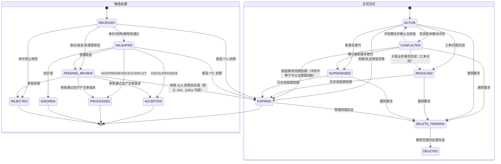

# 11. 记忆的生命周期与状态机

## 11.1 分离四类状态

不要用一个 `status` 字段同时表达“事实是否有效”“向量是否可检索”和“审核进行到哪一步”。建议分为：

- `candidate_status`（仅在 `memory_candidate`）：候选处理状态；
- `lifecycle_status`（仅在 `customer_memory`）：已接纳事实的业务生命周期；
- `embedding_status`（`memory_embedding` / `memory_embedding_job`）：向量生成/同步状态；
- `review_status`（`memory_review_task` / `memory_conflict`）：审核工作流状态。

**只有决策引擎接纳的候选才创建 `customer_memory` 正式记忆记录。** 预审候选不可直接被在线检索使用；命中敏感数据硬规则的内容不得以未脱敏原文长期落库。需要人工审核时，只保存经过脱敏的最小候选摘要和受控证据引用，并设置短保留期。

## 11.2 生命周期状态

**候选处理状态（`memory_candidate.candidate_status`）：**

`RECEIVED`、`VALIDATED`、`PENDING_REVIEW`、`PROCESSED`、`ACCEPTED`、`REJECTED`、`IGNORED`、`EXPIRED`。

- `ACCEPTED`：产生了新的 `customer_memory` 版本（ADD/SUPERSEDE/ADD_TEMPORAL_VERSION）；
- `PROCESSED`：决策为 NOOP/REINFORCE/CONFLICT/RESOLVE/EXPIRE，不产生新版本；
- `RECEIVED → PENDING_REVIEW` 允许（身份/语言/来源需核验）；
- 安全/隐私硬拦截的候选只保存最小化哈希和原因码，不保留未脱敏正文。

**正式记忆生命周期（`customer_memory.lifecycle_status`）：**

- `ACTIVE`：当前有效、允许进入候选检索结果集；
- `CONFLICTED`：存在未解决冲突，不作为确定事实提供；
- `RESOLVED`：活动事项已解决，但可能仍有历史参考价值；
- `SUPERSEDED`：被后续版本替代；
- `EXPIRED`：超过保留期限或有效期；
- `DELETE_PENDING`：已接到删除要求，立即停止向调用方暴露；
- `DELETED`：完成应有范围内的物理删除并完成审计。

`REJECTED`、`IGNORED` 是候选决策结果，不是正式记忆状态；通常不创建 `customer_memory`。审核状态独立存在于审核任务中，避免一个状态字段混合事实有效性与待办状态。

**状态自动出口（每条状态都必须有出口，由 Convergence 兜底，不得依赖人工点击）：**

- `RECEIVED`/`VALIDATED`/`PENDING_REVIEW` 超过 `memory_policy.review_sla_days`（默认 30 天）未处理 → `EXPIRED`，只保留决策审计与 `candidate_fingerprint`，正文按保留策略脱敏；同时 `mms_candidate_expired_by_sla_total` +1 并告警给审核队列 owner；
- `CONFLICTED` 有两条强制出口：`expires_at` 到期 → `EXPIRED`；关联工单/事项关闭 → `RESOLVED`；两者都没有到期时间的冲突超过 `conflict_max_age_days`（默认 90 天）由 Convergence 自动 `EXPIRED` 并记 `CONFLICT_TIMEOUT_EXPIRED`，禁止“永久 CONFLICTED”；
- 冲突过期/解决时，参与方 `memory_conflict.status='RESOLVED'` 且 `resolution_reason_code='RESOLVED_BY_EVENT'|'CONFLICT_TIMEOUT_EXPIRED'`，被放弃的一方按 `SUPERSEDED` 或 `EXPIRED` 收敛，向量按 12.10 同步失效；
- `DELETE_PENDING` → `DELETED` 只描述业务行的物理清除进度；行被删除后该状态不再有载体，删除完成事实由 `memory_deletion_item.status` + `deletion_tombstone` 承载（见 8.3.5），检索层的“已删除不可见”依赖 barrier/tombstone，而不是依赖 `DELETED` 行仍存在。

**Embedding 状态（`memory_embedding.status`）：**

`READY`、`STALE`、`DELETED`。没有向量行，或 Job 处于 `PENDING/RUNNING/RETRY`，表示“尚未就绪”；`NOT_REQUIRED` 只用于不需要向量的记忆类型（由 registry 决定，不落 `memory_embedding` 行）。

**Embedding Job 状态（`memory_embedding_job.status`）：**

`PENDING`、`RUNNING`、`READY`、`RETRY`、`DEAD_LETTER`、`CANCELLED`。

## 11.3 状态机

`IGNORED`、`REJECTED` 通常只留下最小化的决策审计，不创建向量记忆。删除执行中必须立即阻止检索，即使后台清理尚未完成。

## 11.4 时间字段的严格语义

| 字段 | 说明 |
|---|---|
| `created_at` | MMS 记录首次创建时间 |
| `updated_at` | MMS 记录最后修改时间 |
| `observed_at` | 服务观察到证据的时间 |
| `valid_from` / `valid_to` | 事实在业务世界中有效的起止时间 |
| `expires_at` | MMS 内部的精确到时间戳的保留截止时间 |
| `generated_at` | 向量生成完成时间（`memory_embedding.generated_at`） |
| `embedding_model` / `embedding_version` | 向量模型与版本，用于重建/升级 |

**在线召回必须由 MMS 校验 `lifecycle_status`、`expires_at`、`valid_from/valid_to`、客户归属和 Embedding 状态。** 业务需要精确时分秒过期时，以 MMS `expires_at` 为准；不存在 Mem0 `expiration_date` 这一层。所有时间统一 UTC 存储，展示层按客户时区转换。

## 11.5 模型/维度升级对生命周期的影响

- 新模型/新维度 → 新 `embedding_model_registry` 版本 + 新 `memory_embedding_<dim>` 表（或新列）；
- 双写/回填期间，检索只读当前 active 模型；
- 旧向量在切换完成后置 `DELETED`/删除；
- 删除/过期/替代必须同时作用于所有模型版本和所有语言视图（ORIGINAL/CANONICAL/TRANSLATED），不能只删当前模型/当前语言；
- 升级失败可回滚到旧模型；旧模型在回滚窗口内保留。
