# 状态机

本文是记忆系统全部状态机的唯一汇总：每个状态机一章，含流转图与状态定义。枚举以[数据模型与表设计](../3-数据表设计/1-数据模型与表设计.md)的 DDL 为准；Job 类状态机的完整边缘路径以[核心流程](../1-核心流程/1-Ingestion%20Job设计.md)各文档为准，本文只收录主干。

## 总览

| 章 | 状态机载体 | 回答的问题 |
|---|---|---|
| §1 | `memory_candidate.candidate_status` | 候选处理到哪一步 |
| §2 | `customer_memory.lifecycle_status` | 已接纳事实是否有效 |
| §3 | `memory_embedding.status` | 向量是否可检索 |
| §4 | `memory_review_task.status` | 审核任务进行到哪一步 |
| §5 | `memory_conflict.status` | 冲突裁决进行到哪一步 |
| §6 | `memory_deletion_request.status` | 删除请求执行到哪一步 |
| §7 | `memory_deletion_item.status` | 单个删除目标处理结果 |
| §8 | `customer_deletion_barrier.status` | 客户级删除屏障是否放行 |
| §9 | `memory_policy.status` | 策略版本是否生效 |
| §10 | `embedding_model_registry.status` | 向量模型版本是否在用 |
| §11 | `memory_ingestion_job.status` | 受理任务执行到哪一步 |
| §12 | `memory_inbox_event.status` | 入站事件是否已应用 |
| §13 | `memory_embedding_job.status` | 向量生成任务执行到哪一步 |
| §14 | `memory_translation_job.status` | 翻译任务执行到哪一步 |
| §15 | `memory_outbox_event.status` | 出站消息是否已投递 |

**端到端主干：**

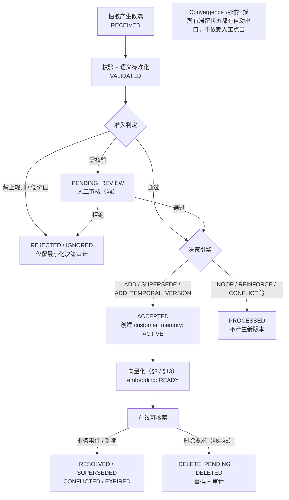

**三条硬约束：**

1. 只有决策引擎接纳的候选才创建 `customer_memory`；预审候选不可被在线检索使用。
2. 命中敏感数据硬规则的内容不得以未脱敏原文长期落库；需人工审核时只保存脱敏的最小候选摘要 + 受控证据引用，设短保留期。
3. 删除执行中必须立即阻止检索，即使后台物理清理尚未完成。

## 1. 候选状态机（`memory_candidate.candidate_status`）

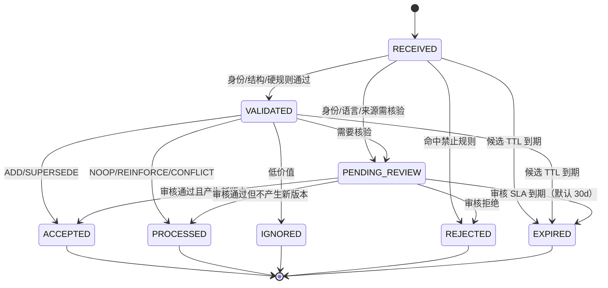

| 状态 | 定义 |
|---|---|
| `RECEIVED` | 候选已登记，待校验 |
| `VALIDATED` | 身份 / 结构 / 硬规则通过 |
| `PENDING_REVIEW` | 需核验，转人工审核（§4） |
| `ACCEPTED` | 决策产生新 `customer_memory` 版本（ADD / SUPERSEDE / ADD_TEMPORAL_VERSION） |
| `PROCESSED` | 决策为 NOOP / REINFORCE / CONFLICT / RESOLVE / EXPIRE，不产生新版本 |
| `REJECTED` | 命中禁止规则，或审核拒绝 |
| `IGNORED` | 低价值，不接纳 |
| `EXPIRED` | 候选 TTL（缺省 `observed_at + 365 天`）或审核 SLA（`review_sla_days`，默认 30 天）到期 |

**关键规则：** 所有未接纳终态不创建正式记忆与向量，只留最小化决策审计；硬拦截候选仅保留哈希 + 原因码。SLA 过期由 Convergence 兜底置 `EXPIRED`，`mms_candidate_expired_by_sla_total` +1 并告警审核队列 owner。

## 2. 正式记忆生命周期（`customer_memory.lifecycle_status`）

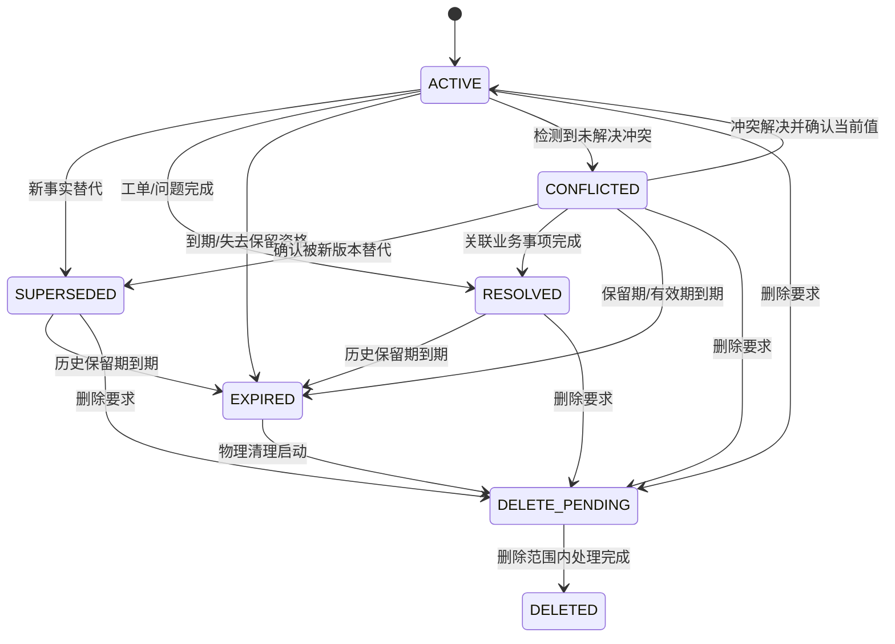

| 状态 | 定义 | 检索暴露 |
|---|---|---|
| `ACTIVE` | 当前有效 | 允许进入检索结果集 |
| `CONFLICTED` | 存在未解决冲突（§5） | 不作为确定事实提供 |
| `RESOLVED` | 活动事项已解决，仍有历史参考价值 | 否 |
| `SUPERSEDED` | 被后续版本替代 | 否 |
| `EXPIRED` | 超过保留期限或有效期 | 否 |
| `DELETE_PENDING` | 已接到删除要求 | 立即停止暴露 |
| `DELETED` | 物理删除完成并审计 | 否 |

**关键规则：**

- `CONFLICTED` 禁止永久挂账：工单关闭 → `RESOLVED`（`RESOLVED_BY_EVENT`）；`expires_at` 到期或无到期时间超 `conflict_max_age_days`（默认 90 天）→ `EXPIRED`（`CONFLICT_TIMEOUT_EXPIRED`），均由 Convergence 兜底。
- 冲突过期 / 解决、替代、过期时，向量按 12.10 同步失效，作用于所有模型 × 所有语言视图（§10）。
- `DELETE_PENDING → DELETED` 只描述业务行清除进度；删除完成事实由 `memory_deletion_item.status`（§7）+ `deletion_tombstone` 承载（见 8.2.7）。检索层"已删除不可见"依赖屏障 / 墓碑（§8），不依赖 `DELETED` 行仍存在。

## 3. 向量状态机（`memory_embedding.status`）

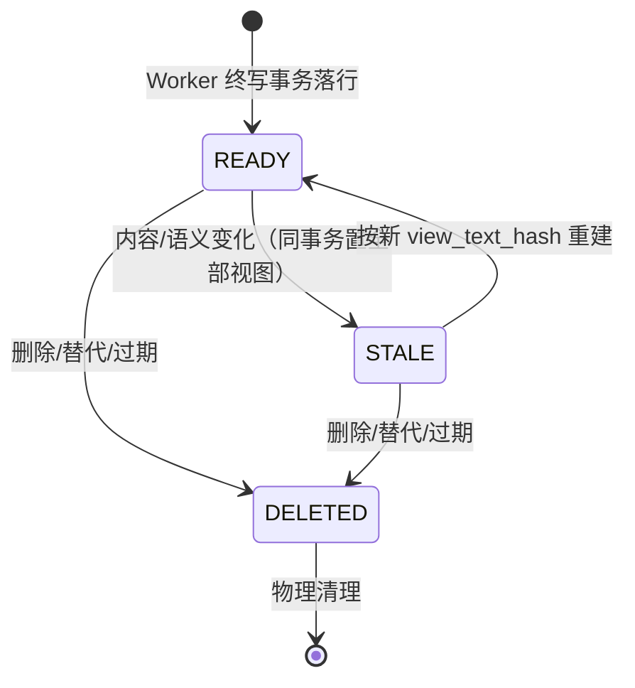

| 状态 | 定义 |
|---|---|
| `READY` | 向量可用，允许进入语义召回 |
| `STALE` | 源文本已变化，向量待重建，不可召回 |
| `DELETED` | 已失效，等待物理清理 |

**关键规则：** 无向量行或 Job 处于 `PENDING/RUNNING/RETRY` 即"尚未就绪"；`NOT_REQUIRED` 由 registry 决定，不落行。RENORMALIZE 只置 CANONICAL / TRANSLATED 为 `STALE`（ORIGINAL 不动）；运行期失效实际一律物理 DELETE，`DELETED` 是逻辑标记。

## 4. 审核任务状态机（`memory_review_task.status`）

任务类型 `task_type`：`CANDIDATE` / `CONFLICT` / `DELETION`。

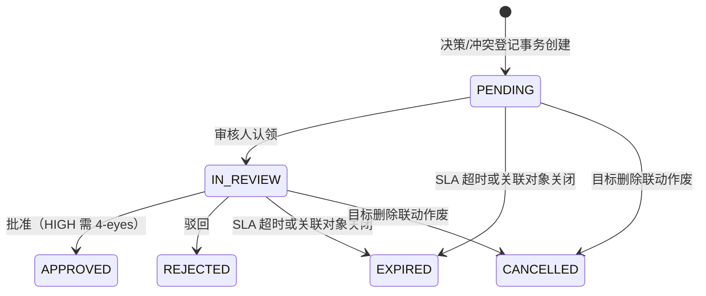

| 状态 | 定义 |
|---|---|
| `PENDING` | 待认领，`due_at` 为 SLA 截止 |
| `IN_REVIEW` | 已认领处理中 |
| `APPROVED` | 批准，驱动候选 ACCEPTED / 冲突 RESOLVED / 删除 APPROVED |
| `REJECTED` | 驳回，驱动候选 REJECTED / 冲突 DISMISSED |
| `EXPIRED` | SLA 超时（Convergence 置），或候选已 EXPIRED、冲突已解决连带过期 |
| `CANCELLED` | 目标被删除 / 失效，任务作废 |

**关键规则：** HIGH 风险批准必须 4-eyes（`co_reviewer_id`，且审核人 ≠ 创建人、复核人 ≠ 审核人，DB CHECK 强制）；唯一写路径 `POST /review-queue/{id}/decision`。

## 5. 冲突状态机（`memory_conflict.status`）

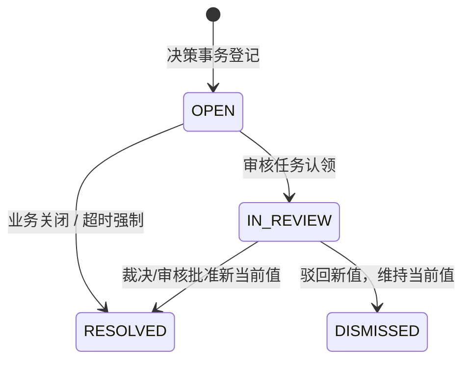

| 状态 | 定义 |
|---|---|
| `OPEN` | 未决冲突，参与记忆置 `CONFLICTED` 隔离 |
| `IN_REVIEW` | 裁决审核中 |
| `RESOLVED` | 已解决，必须记 `resolved_at` + `resolution_reason_code` |
| `DISMISSED` | 驳回新值：当前值恢复 `ACTIVE`，新候选 `REJECTED` |

**关键规则：** 同一事实槽同时只允许一个未决冲突（部分唯一索引）。强制出口：业务关闭 → `RESOLVED_BY_EVENT`；超 `conflict_max_age_days`（90 天）→ `CONFLICT_TIMEOUT_EXPIRED`，被放弃方按 `SUPERSEDED` / `EXPIRED` 收敛（§2）。

## 6. 删除请求状态机（`memory_deletion_request.status`）

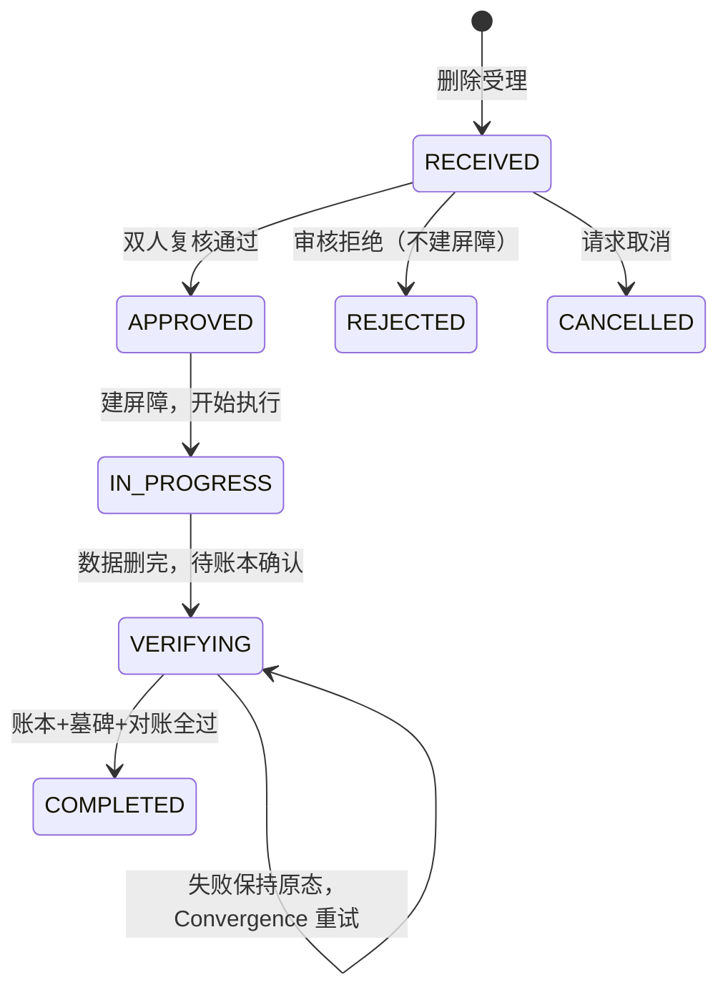

| 状态 | 定义 |
|---|---|
| `RECEIVED` | 已受理待审 |
| `APPROVED` | 复核通过（`approved_by ≠ requested_by`，DB CHECK 强制） |
| `IN_PROGRESS` | 物理删除执行中（D2–D4） |
| `VERIFYING` | 业务数据已删、WORM 账本未确认 |
| `COMPLETED` | 账本 + 墓碑 + 对账闭环 |
| `REJECTED` | 拒绝，不建屏障 |
| `CANCELLED` | 取消 |

**关键规则：** VERIFYING 失败不降级，Convergence 300s 节流无限重试、只告警；期间屏障保持 `ACTIVE`；卡 >15m page（附录 B）。

## 7. 删除项状态机（`memory_deletion_item.status`）

每个删除目标（`target_type` 共 20 种）一行，按外键序执行（8.2.7）。

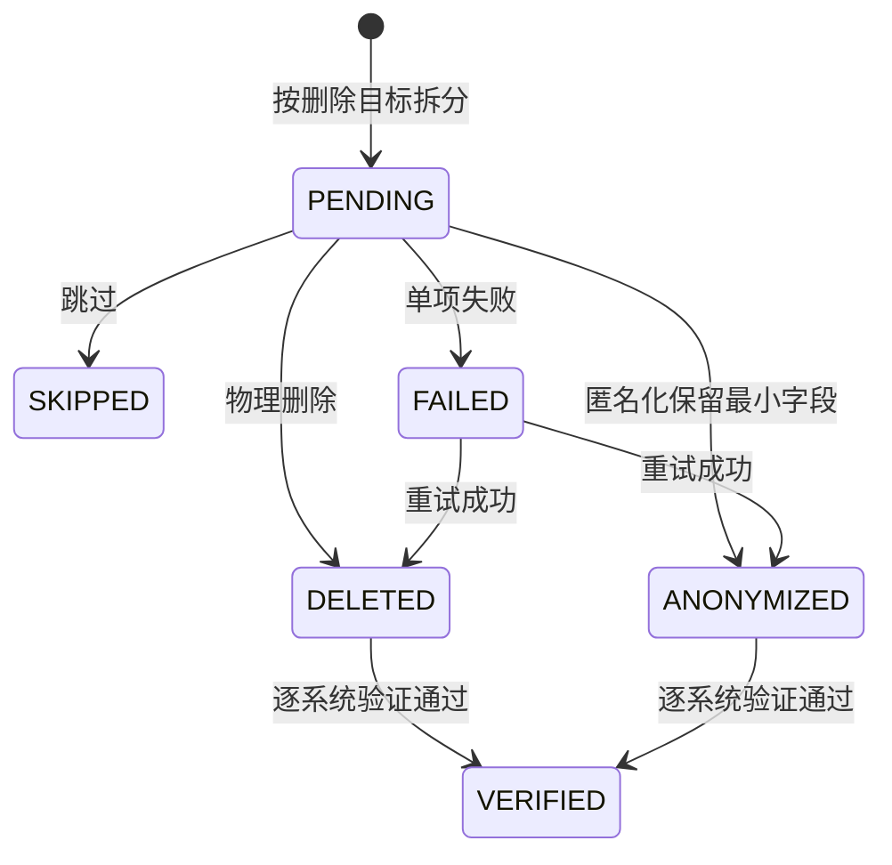

| 状态 | 定义 |
|---|---|
| `PENDING` | 待处理 |
| `DELETED` | 物理删除，目标行数 = 0 |
| `ANONYMIZED` | 匿名化：证据留 hash + `anonymized=true`，审计经 scrubber 擦除 |
| `SKIPPED` | 跳过，无需删除 |
| `FAILED` | 单项失败，可重入重试（`attempts`） |
| `VERIFIED` | D4 第 9 步逐系统验证通过，必须记 `verified_at` |

## 8. 删除屏障状态机（`customer_deletion_barrier.status`）

客户级停写 + 检索不可见的权威闸门，载体按 `generation` **相等**比对。

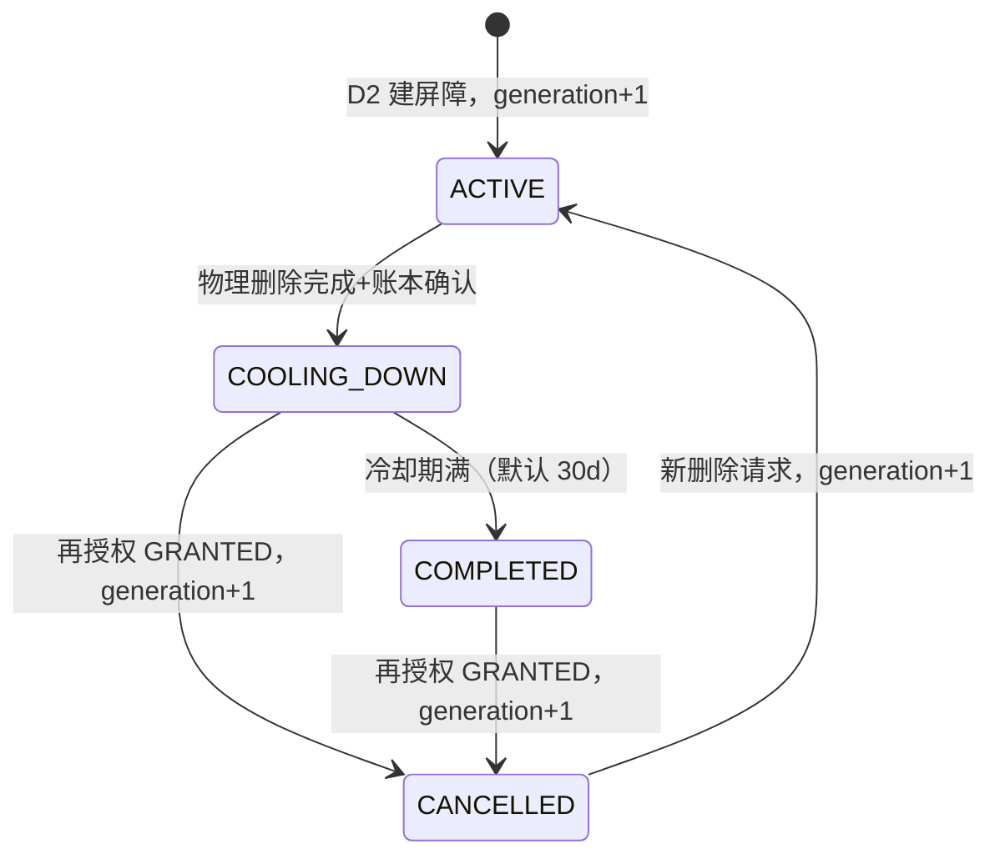

| 状态 | 定义 | 写入响应 |
|---|---|---|
| `ACTIVE` | 停写 + 检索不可见 | 409 |
| `COOLING_DOWN` | 冷却期，写入挂起不丢 | 410 |
| `COMPLETED` | 冷却期满 | 410 |
| `CANCELLED` | 再授权放行 | 200 |

**关键规则：** `generation` 单生命周期内单调递增；COMPLETED 超 `barrier_retention_days`（180 天）置 CANCELLED 后删行；屏障行删除后新周期从 1 重编号，旧载体靠 `created_at < cutover_at` 拒绝。

## 9. 策略版本状态机（`memory_policy.status`）

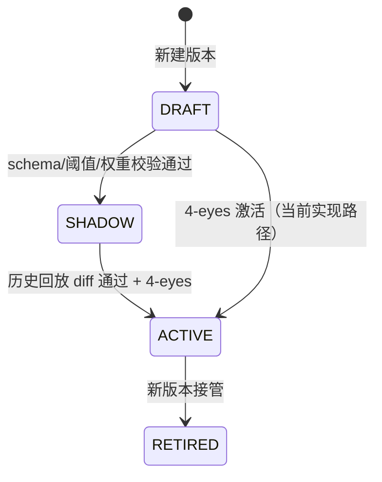

| 状态 | 定义 |
|---|---|
| `DRAFT` | 草稿 |
| `SHADOW` | 影子回放，未接入生产 |
| `ACTIVE` | 生效，同作用域唯一（部分唯一索引） |
| `RETIRED` | 退役，仍可审计 |

**关键规则：** ACTIVE 必须双人审批（`approved_by ≠ created_by`，DB CHECK 强制）。生命周期出口参数存于 `config`：`review_sla_days=30`、`conflict_max_age_days=90`、`retention_days=365`。

## 10. 模型注册表状态机（`embedding_model_registry.status`）

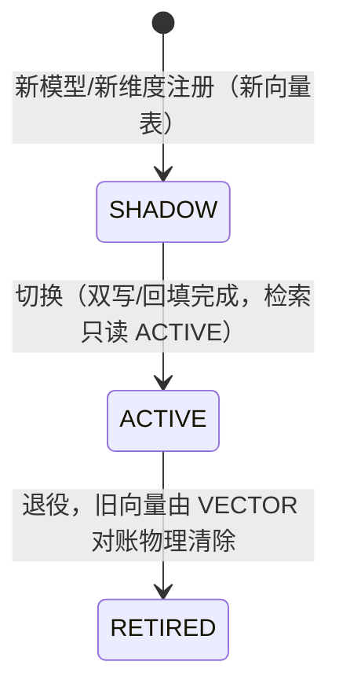

| 状态 | 定义 |
|---|---|
| `SHADOW` | 影子双写 / 回填，不参与回答，对比 Recall@K |
| `ACTIVE` | 生产在用，全局至多一个（部分唯一索引） |
| `RETIRED` | 退役 |

**关键规则：** 升级失败回滚旧模型，旧模型在回滚窗口内保留，切换 / 回滚均有审计。**不变量：** 删除 / 过期 / 替代必须同时作用于所有模型版本和所有语言视图（ORIGINAL / CANONICAL / TRANSLATED），不能只删当前模型 / 当前语言。

## 11. 受理 Job 状态机（`memory_ingestion_job.status`）

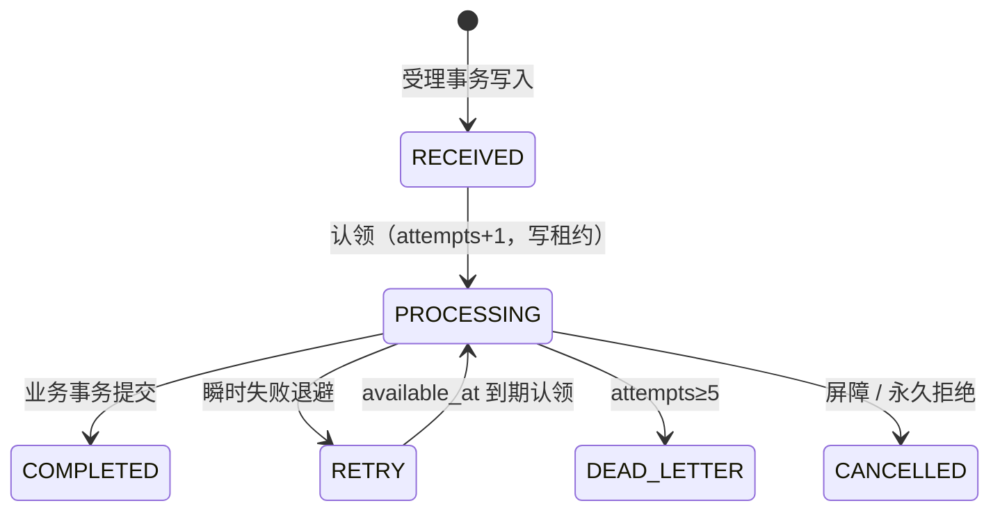

| 状态 | 定义 |
|---|---|
| `RECEIVED` | 已登记待认领 |
| `PROCESSING` | 执行中（持租约） |
| `RETRY` | 瞬时失败，退避待重试 |
| `COMPLETED` | 完成（含业务拒绝） |
| `CANCELLED` | 屏障 / 永久拒绝 / 删除联动作废 |
| `DEAD_LETTER` | 试满 5 次，待人工重放 |

**特殊路径：** 事件重投可把 RECEIVED / RETRY / DEAD_LETTER / CANCELLED 打回 `RECEIVED`（attempts 保留）；管理员 replay 置 `RECEIVED` 且 attempts=0；超租约由 Worker 换主重认领，或 Convergence 对账打回 `RETRY`。详见 [Ingestion Job 设计](../1-核心流程/1-Ingestion%20Job设计.md)第十三章。

## 12. 入站事件状态机（`memory_inbox_event.status`）

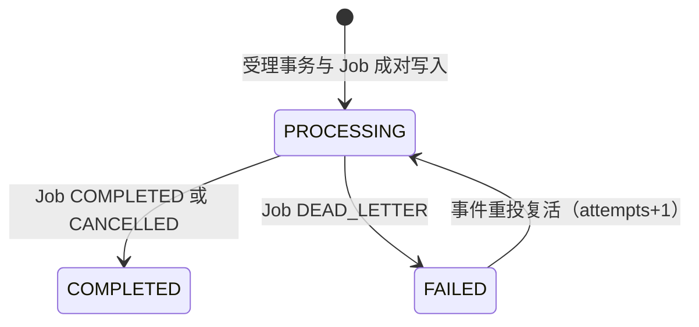

| 状态 | 定义 |
|---|---|
| `PROCESSING` | 事件应用中（Job RETRY 期间保持） |
| `COMPLETED` | 已应用（拒绝也算已应用） |
| `FAILED` | Job 进死信，待重投 |

## 13. 向量化 Job 状态机（`memory_embedding_job.status`）

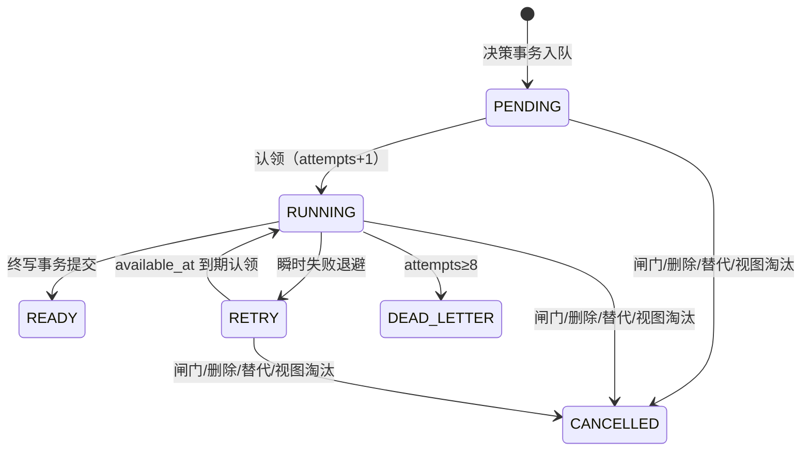

| 状态 | 定义 |
|---|---|
| `PENDING` | 待认领 |
| `RUNNING` | 执行中（持租约） |
| `RETRY` | 瞬时失败，退避待重试 |
| `READY` | 产物已落库 |
| `CANCELLED` | 同意 / 屏障 / 代际闸门不过，或删除 / SUPERSEDE / 生命周期关闭 / 视图淘汰 |
| `DEAD_LETTER` | 试满 8 次，待人工重放 |

**特殊路径：** 新事件可把活动态就地改写回 `PENDING`（generation+1、attempts=0）；对账发现缺 READY 向量可把 `READY` 打回 `PENDING`；replay 仅限 `DEAD_LETTER → PENDING`（attempts=0）；超租约换主或对账打回 `RETRY`。详见 [Embedding Job 设计](../1-核心流程/2-Embedding%20Job设计.md)第九节。

## 14. 翻译 Job 状态机（`memory_translation_job.status`）

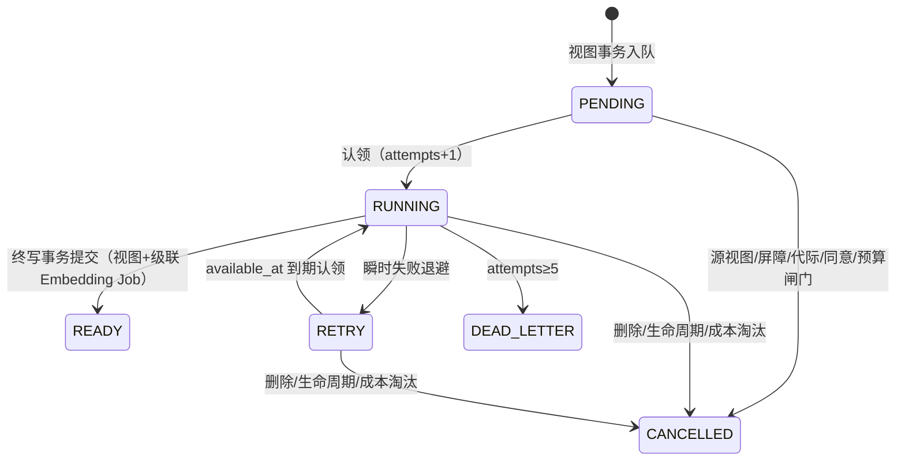

状态定义同 §13。**与向量化 Job 的差异：** 无就地改写、无 READY 打回；幂等键全表唯一，同键终身至多一行，`CANCELLED` / `READY` 永久占位、不自动重入队。详见 [Translation Job 设计](../1-核心流程/3-Translation%20Job设计.md)第九章。

## 15. 出站消息状态机（`memory_outbox_event.status`）

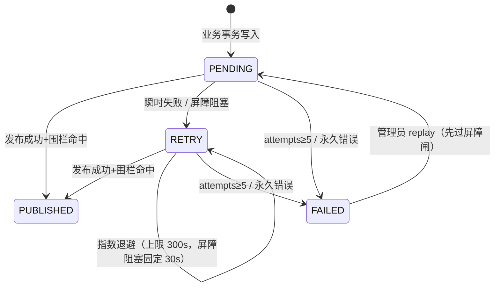

| 状态 | 定义 |
|---|---|
| `PENDING` | 待发布 |
| `PUBLISHED` | 已投递，不可重放 |
| `RETRY` | 瞬时失败 / 屏障阻塞，退避待重试 |
| `FAILED` | 试满 5 次或永久错误（STALE_GENERATION / CUSTOMER_REF_UNKNOWN），待人工重放 |

**关键规则：** 认领不改状态，只写锁 + attempts+1；删除时未发布的记忆域行物理 DELETE（非状态迁移）。详见 [OutboxEvent机制设计](../1-核心流程/4-OutboxEvent机制设计.md)第 3 章。

## 附录 A. 时间字段的严格语义

| 字段 | 说明 |
|---|---|
| `created_at` | MMS 记录首次创建时间 |
| `updated_at` | MMS 记录最后修改时间 |
| `observed_at` | 服务观察到证据的时间 |
| `valid_from` / `valid_to` | 事实在业务世界中有效的起止时间 |
| `expires_at` | MMS 内部精确到时间戳的保留截止时间 |
| `generated_at` | 向量生成完成时间（`memory_embedding.generated_at`） |
| `embedding_model` / `embedding_version` | 向量模型与版本，用于重建/升级 |

**在线召回必须由 MMS 校验 `lifecycle_status`、`expires_at`、`valid_from/valid_to`、客户归属和 Embedding 状态。** 业务需要精确时分秒过期时，以 MMS `expires_at` 为准；不存在 Mem0 `expiration_date` 这一层。所有时间统一 UTC 存储，展示层按客户时区转换。

## 附录 B. 持续观测点

采集与告警方法论见[线上持续观测](../6-线上持续观测/1-代码持续观测体系.md)。

| 观测面 | 指标 | 含义 | 阈值 / 告警 |
|---|---|---|---|
| 候选积压 | `mms_candidate_expired_by_sla_total` | 超审核 SLA 被置 EXPIRED 的候选数 | 持续 >0 → 告警审核队列 owner（审核能力不足） |
| 冲突 | `mms_conflict_opened_total{rule_id,risk_level}` | 冲突登记分布 | HIGH 占比突增 → 安全审查 |
| 冲突 | `mms_conflict_resolved_total{resolution_reason_code}` | 冲突解决分布 | `CONFLICT_TIMEOUT_EXPIRED` 占比上升 → 裁决通道失效 |
| 冲突 | `mms_conflict_resolution_duration_seconds` | 冲突解决时效 | P95 超 SLA 告警 |
| 冲突 | `CURRENT_CONFLICTS`（Gauge） | 未决冲突存量 | 账龄超 `conflict_max_age_days` 自动过期 |
| 向量 | `mms_embedding_ready_age_seconds` | 记忆创建 → 向量就绪时长 | ORIGINAL/CANONICAL P95≤30s、P99≤2min；TRANSLATED P95≤2min；超 10m critical |
| 向量 | `mms_embedding_job_oldest_age_seconds{priority_band}` | 最老 PENDING/RETRY 任务年龄 | >300s 持续 5m critical |
| 向量 | `mms_embedding_job_lease_expired_total` | 超租约 RUNNING 行回收次数 | increase[15m] >0 warning |
| 向量 | `mms_embedding_invalid_vector_total{reason}` | 非法向量 | increase[5m] >0 critical |
| 向量 | `dead_letter_stock`（JOB 对账） | 三张 Job 表 DEAD_LETTER + Outbox FAILED 存量 | 作运维队列配告警 |
| 删除 | `mms_barrier_write_check_failures_total` / `mms_barrier_post_commit_writes_total` | 屏障校验失败 / 屏障后写入 | 必须 =0，>0 即 page |
| 删除 | `mms_deletion_request_verifying`（Gauge） | 卡在 VERIFYING 的删除请求数 | >0 持续 15m → page |
| 删除 | `mms_kafka_tombstone_lag_seconds`（Gauge） | 屏障提交 → tombstone 发布延迟 | >5s 告警 |
| 删除 | `mms_deletion_tombstone_restore_replay_total{result}` | 恢复演练墓碑重放结果 | 失败按 P1 |
