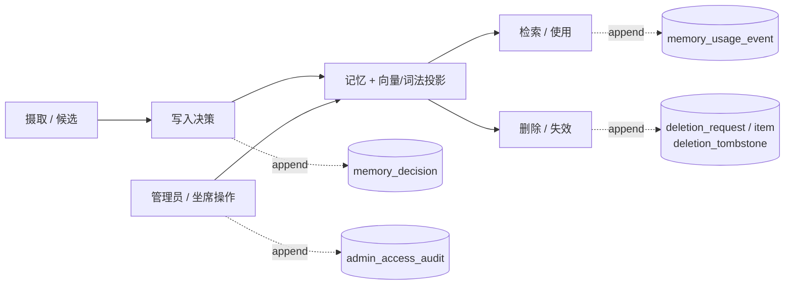
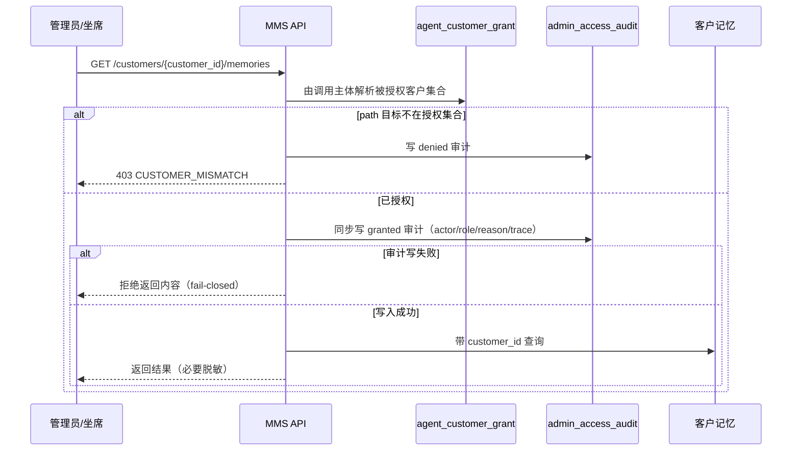
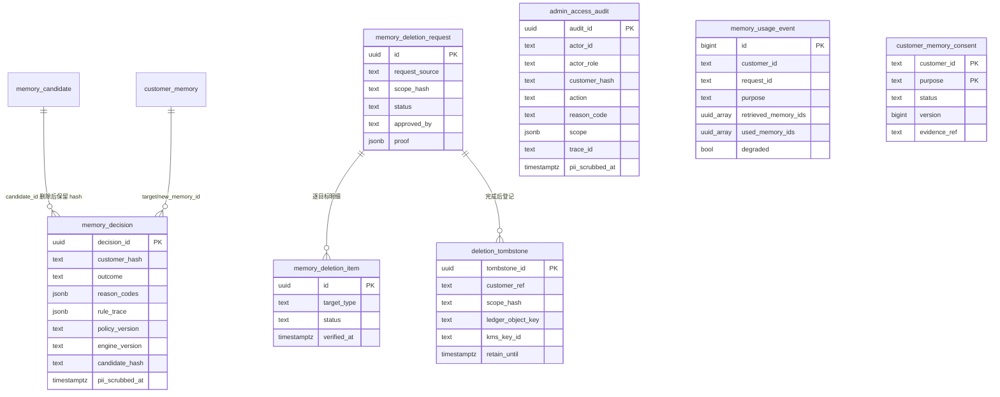
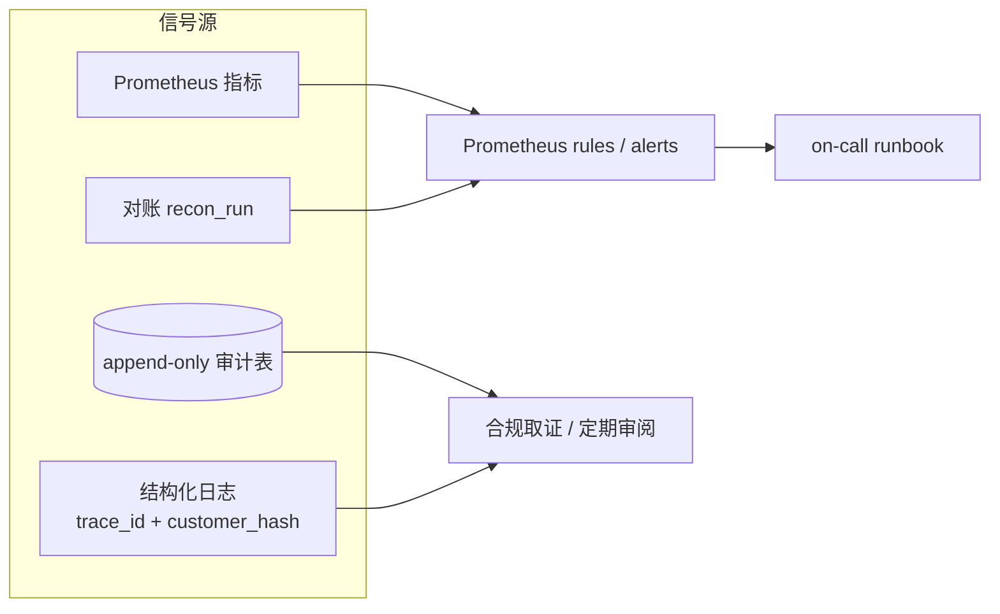
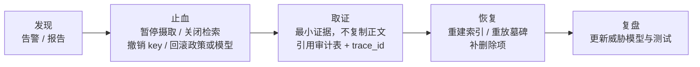

# 安全与审计

> 本文定义 MMS 的审计体系：审计什么、为什么审计、每个环节记什么、数据落在哪、以及如何持续观测。
> 表结构以 `schema/schema.sql` 为准；安全基线与实现差距见文末两节。

## 1. 什么是审计

审计 = 对「**谁**、以**什么理由**、对**哪个客户**的记忆、做了**什么**、结果**如何**」的 append-only 证据链。

MMS 只有四条审计线，没有第二套审计通道：

| 审计线 | 回答的问题 | 落表 |
|---|---|---|
| 决策审计 | 这条记忆为什么被写入/拒绝/ supersede？ | `memory_decision` |
| 管理访问审计 | 哪个管理员/坐席读了谁的数据，理由是什么？ | `admin_access_audit` |
| 使用事件 | 检索返回了什么、实际采用了什么？ | `memory_usage_event` |
| 删除证据链 | 删除是否完整、可验证、不可复活？ | `memory_deletion_request` / `memory_deletion_item` / `deletion_tombstone` |

审计线在记忆生命周期中的位置：

三条贯穿性原则：

| 原则 | 含义 |
|---|---|
| Append-only | 应用/Worker 角色对审计表无 `UPDATE/DELETE`，触发器二次拦截；擦除只走独立 scrubber |
| Fail-closed | 审计写失败 = 操作失败。管理员读取前同步写审计，写不进去就读不到内容 |
| 假名化 | 日志/审计不落 raw `customer_id` 与正文；统一 `customer_hash = HMAC-SHA256(customer_pepper, customer_id)`，pepper 存 KMS；Kafka 只用 `customer_ref` |

## 2. 为什么要审计

每一类威胁都对应一条明确的审计/控制要求，而不是泛泛的"记日志"：

| 威胁 | 后果 | 对应审计与控制 |
|---|---|---|
| 越权读取 / IDOR / 客户 ID 混淆 | 跨客户数据泄漏 | path `customer_id` 只是请求目标，不是授权凭据；grant 交叉校验 + denied 也写审计 + `mms_cross_customer_hits_total` 告警 |
| 管理员密钥滥用 / 绕过理由读取 | 隐私违规、无法追责 | 读取前同步审计（fail-closed）+ 角色分级 + 删除/政策变更 4-eyes |
| 应用/Worker 篡改审计表 | 证据失效 | REVOKE + 触发器 + 独立 `mms_audit_scrubber` 角色 |
| 删除不完整 / 备份恢复带回 / Kafka 重放复活 | 违反删除权承诺 | 逐项删除明细 + 回读验证 + 墓碑保留期覆盖备份窗口 + WORM 账本 |
| 决策不可解释（幻觉、投毒、误拒） | 客诉无法回溯、策略无法改进 | 决策审计带 `policy_version/rule_trace/reason_codes`，支持决策重放对账 |
| 跨境 provider 留存 / 凭证泄漏 | 合规违规 | consent 快照按 purpose 判定 + 阻断指标 + 出站强制 TLS |
| Kafka 保留期内泄漏 / `customer_ref` 反推 | 假名化失效 | payload 只放引用，topic 保留 ≤24h + compaction/tombstone |

合规侧的直接产出：删除权证明（证据链 + WORM 账本）、DPIA 输入（保留期与法律依据）、跨境同意凭证（consent 快照）、管理操作追责（actor + reason + trace）。

## 3. 审计清单

### 3.1 决策与政策

| 事件 | 必记内容 | 失败行为 |
|---|---|---|
| 每次准入决策 | `outcome/reason_codes/rule_trace/primary_rule_id`、`policy_version/engine_version/model_version`、`candidate_hash/semantic_hash`（候选删除后仍可追溯） | 决策与审计同事务，写入失败则决策不落库 |
| 政策变更 | `admin_access_audit: POLICY_CHANGE` + 理由 + 4-eyes | 审计写失败则变更不生效 |
| DLQ 重放 | `admin_access_audit: REPLAY`，`scope={plane,job_type,job_id}`，`customer_hash` 由 job 反查 | 审计写失败则重放不生效 |

### 3.2 管理员 / 坐席访问

角色：`ADMIN/POLICY/PRIVACY/OPERATOR/READONLY`（策略端点仅 `ADMIN/POLICY`）+ 坐席 `AGENT`。
动作枚举：`READ_MEMORY / SEARCH / EXPORT / DELETE / REPLAY / POLICY_CHANGE / REBUILD`。

读取路径的 fail-closed 时序（`src/mms/api/main.py:list_customer_memories`）：

补充规则：

- 客户自助接口不接受任何 `customer_id` 参数，主体只能来自 token 映射；请求体与网关 header 不一致 → `403 CUSTOMER_MISMATCH`；
- 客户自助访问记 `memory_usage_event`（`purpose=CUSTOMER_SELF_SERVICE`），不记管理审计；
- 审计查询本身也要权限与脱敏。

### 3.3 删除与墓碑

| 阶段 | 必记内容 | 约束 |
|---|---|---|
| 请求 | `request_source/requested_by/legal_basis/scope_hash` | 幂等键唯一 |
| 审批 | `approved_by/approved_at` | `approved_by ≠ requested_by`（4-eyes） |
| 执行 | `memory_deletion_item` 逐目标状态（表/向量/词法/账本/审计擦除等） | 可重入；删除同事务失效投影 |
| 验证 | item `VERIFIED` + `verified_at`，回读确认不可召回 | 未验证不得 COMPLETED |
| 墓碑 | `deletion_tombstone`：`scope_hash/backup_generation/ledger_object_key/retain_until/kms_key_id` | `retain_until` > 备份窗口；WORM 账本先写；到期前删除被触发器拒绝 |
| 审计擦除 | 仅 `mms_audit_scrubber` 按 allowlist 执行，落 `pii_scrubbed_at` | 必须显式配置 `MMS_SCRUBBER_DATABASE_URL`，缺失即报错 |
| 备份恢复 | 按墓碑重放删除 | 防止已删数据复活 |

### 3.4 同意与跨境

consent 快照（`customer_memory_consent`，权威源在身份/授权服务）按 purpose 判定：

| purpose | 未授权时行为 |
|---|---|
| `MEMORY_WRITE / MEMORY_READ / MEMORY_RETENTION / SENSITIVE_MEMORY` | 拒绝相应操作 |
| `CROSS_BORDER_EMBEDDING` | 阻断外部 embedding，计数 `mms_embedding_cross_border_blocked_total` |
| `CROSS_BORDER_TRANSLATION` | 默认自托管翻译；外部 provider 需零保留/DPA + 本同意；译文只存检索视图，不覆盖原文 |
| `CROSS_BORDER_RERANK` | 跳过外部 rerank，保留 RRF 顺序（`service.py:_rerank_consent_block`）；送出的只是命中视图文本，不落库 |

## 4. 数据模型

### 4.1 实体关系

字段级完整定义见 `schema/schema.sql`。关键约定：

| 约定 | 说明 |
|---|---|
| `customer_hash` | `admin_access_audit` 只落 hash；决策表保留 `customer_id` 供业务对账，擦除后置为 `scrubbed` |
| `pii_scrubbed_at` | 擦除标记；带 CHECK 约束保证擦除后不残留可识别字段 |
| `candidate_hash` | 候选物理删除后决策仍可追溯（FK `ON DELETE SET NULL`） |
| `retain_until` | 墓碑保留期独立于业务数据，`CHECK (retain_until > completed_at)`，到期清理有守卫触发器 |

### 4.2 写权限矩阵

| 角色 | 业务表 | 向量表 | 决策/管理审计 | 墓碑 | 审计擦除 |
|---|---|---|---|---|---|
| `mms_app`（API） | 读写 | 只读 | 仅 INSERT | 仅 INSERT | 无 |
| `mms_worker` | 读写 | 读写 | 仅 INSERT | 仅 INSERT | 无 |
| `mms_readonly` | 只读 | 只读 | 只读 | 只读 | 无 |
| `mms_deletion_worker` | 按删除范围 | 删除 | 仅 INSERT | INSERT + 到期清理 | 无 |
| `mms_audit_scrubber` | 无 | 无 | allowlist 字段 UPDATE | 无 | 唯一入口 |

防篡改三层：角色 `REVOKE UPDATE/DELETE` → 触发器二次拦截（含证据不可变、墓碑到期守卫）→ DDL guard（`mms_ddl_guard_rejected_total`）。
角色由 `scripts/init_db.py:provision_login_roles` 显式 provisioning，schema 默认 `NOLOGIN`。

## 5. 持续观测点设计

### 5.1 信号流

结构化日志统一字段：`trace_id/request_id/customer_hash/candidate_id/memory_id/decision_id/outcome/reason_codes/policy_version/engine_version/degraded`；不记正文/PII，错误栈脱敏。

### 5.2 安全与审计告警（`deploy/prometheus/alerts.yml`）

| 观测面 | 指标 | 告警 / 阈值 |
|---|---|---|
| 审计防篡改 | `mms_audit_append_only_violation_total`、`mms_admin_audit_write_failures_total` | `MMSAuditGuardFailure`：1m 内 >0 |
| DDL 防护 | `mms_ddl_guard_rejected_total` | `MMSDDLGuardRejected`：1m 内 >0 |
| 客户隔离 | `mms_cross_customer_hits_total` | `MMSCrossCustomerHit`：1m 内 >0，最高优先级 |
| 删除屏障 | `mms_barrier_write_check_failures_total`、`mms_barrier_post_commit_writes_total`、`mms_barrier_cache_age_seconds` | 校验失败/提交后写入 >0；缓存 >10s |
| 墓碑账本 | `mms_deletion_tombstone_ledger_write_failures_total`、`..._ledger_lag_seconds` | `MMSTombstoneLedgerFailure`：写失败 >0 或 lag >300s |
| 删除卡滞 | `mms_deletion_request_verifying` | `MMSDeletionVerifyingStuck`：>0 |
| 同意 | `mms_consent_version_stale_total`、`mms_consent_check_total{result="unavailable"}` | 5m 内 >0 |
| 决策可解释 | `mms_decision_replay_mismatch_total`、`mms_decision_rule_uncovered_total` | `MMSDecisionReplayMismatch`：1m 内 >0 |
| 配额滥用 | `mms_quota_rejected_total{bucket}` | `MMSQuotaRejections`：5m 内 >20 |
| 跨境阻断 | `mms_embedding_cross_border_blocked_total` | 趋势审阅（阻断本身是预期行为，激增需排查 consent 同步） |

### 5.3 周期对账（`recon_run`）

| recon_type | 检查内容 |
|---|---|
| `JOB` | ingestion/embedding job 与 outbox/inbox 状态一致性 |
| `VECTOR` | 向量/词法投影与主表同步；已删记忆不可召回 |
| `RECALL` | 检索召回基线（配合 `mms_retrieval_recall_at_10`） |
| `BUSINESS` | 决策重放一致性、current 指针唯一性、跨客户引用约束 |

不一致计入 `mms_recon_mismatches_total` 并落 `recon_run.details`；备份恢复演练必须包含墓碑重放验证。

## 6. 安全基线

审计之外的最小安全要求：

| 域 | 要求 |
|---|---|
| 客户隔离 | 所有客户表带 `customer_id`，Repository 强制注入，禁止裸 SQL 绕过；`memory_embedding/memory_search_document` 按客户 HASH 分区，查询必须触发分区裁剪；`customer_id` 只由网关 JWT/服务身份/可信映射注入 |
| 数据最小化 | 只存原子事实；不复制完整会话/证件/卡号/密码/token；敏感字段优先标记/掩码/hash；Kafka payload 只放引用（`customer_ref`），保留 ≤24h + compaction/tombstone |
| 传输 | 出站统一 `require_secure_endpoint()`：embedding/reranker/translation/outbox/ledger 必须 https（仅 development 允许 loopback http）；`MMS_OUTBOUND_TOKEN` 走 Bearer，不落日志 |
| 存储加密 | 卷加密/TDE、备份加密、KMS 轮换；向量检索需明文，列加密只用于非向量字段；高合规 profile 每客户 DEK + crypto-shredding（见 §8 差距） |
| 账号 | 五角色分离（§4.2），最小权限；密钥不入 Git/镜像/日志 |
| 管理面 | SSO/OIDC + RBAC + 4-eyes；删除/批量/政策变更需理由 |
| 配额 | `customer_quota_usage` 原子记账：WRITE/EXTRACTION 2000/天、EMBEDDING 20000/天、ACTIVE_MEMORIES 5000；超限 429 + 告警；客户删除时清配额行 |
| 供应链与驻留 | 固定 Postgres/pgvector/模型版本；SBOM、镜像签名、CVE 扫描；DB/备份/provider 区域明确，跨境需评估 |

## 7. 事件响应

删除泄漏、跨客户召回、凭证泄漏三类事件必须有 runbook；止血动作全部预置为开关，不依赖临时改代码。

## 8. 实现状态与差距

| 项 | 状态 |
|---|---|
| path 交叉校验 + fail-closed 审计 | 已实现（`main.py:list_customer_memories`、`repository.py:has_agent_customer_grant`、`admin.py:AdminService.audit`） |
| 出站 TLS 强制、角色 provisioning、scrubber 独立连接 | 已实现（`outbound.py:require_secure_endpoint`、`init_db.py`、`db.py:scrubber_transaction`） |
| 配额记账与告警 | 已实现（`quota.py:QuotaService`） |
| 每客户 DEK / KMS envelope / crypto-shredding | **未实现**；墓碑仅登记 `kms_key_id` 引用，物理删除依赖表/向量/账本三处清理 |
| 坐席 SSO/OIDC 主体 | **未实现**；当前为服务令牌 + `agent_customer_grant` 表 |
| `agent_customer_grant` 管理 API | **未实现**；仅运维 SQL 写入口 |