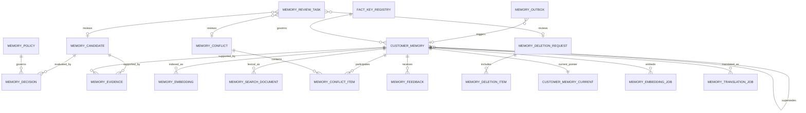

# 23. 数据模型与表设计

以下为逻辑模型及可实施字段建议，需结合目标 PostgreSQL 版本和数据量调整。MMS 表只维护业务权威数据；向量表是 MMS 的内部投影。

## 23.1 核心表关系



`customer_memory` 的多行表示同一事实的不同正式版本，通过 `supersedes_memory_id` 自关联形成版本链；`customer_memory_current` 只保存 SINGLE_VALUE 事实的当前指针。`customer_identity` 维护 `customer_id ↔ customer_ref`（Kafka 假名）；`deletion_tombstone` 是删除证明/备份恢复清单；`admin_access_audit` 是管理员访问审计。`memory_embedding`/`memory_search_document` 按**语言视图**存储：同一 `memory_id` 可有 `ORIGINAL`、`CANONICAL`（`und`）和多个 `TRANSLATED` 行，主键均含 `view_kind + view_language`。`memory_translation_job` 是 `TRANSLATED` 视图的异步翻译队列，与 `memory_embedding_job` 同构（租约、重试、优先级、`barrier_generation`）。

ER 图表达主关系；`memory_ingestion_job`、`memory_usage_event`、`recon_run` 等通过 `source_event_id`/`request_id`/对账范围逻辑关联，**完整外键、唯一键和索引以 23.13 DDL 为准**。

## 23.2 `customer_memory`（业务记忆/版本表）

| 字段 | 类型建议 | 说明 |
|---|---|---|
| `id` | UUID | MMS 内部记忆版本 ID |
| `customer_id` | text | 经过身份服务校验的稳定客户 ID；所有查询的作用域键 |
| `memory_type` | varchar | 记忆类型 |
| `fact_key` | varchar | 稳定事实键，来自 registry |
| `subject` / `predicate` | varchar | 事实主体和谓词（可选但推荐） |
| `cardinality` | varchar | SINGLE_VALUE/MULTI_VALUE/TEMPORAL，来自 registry 并参与约束 |
| `entity_type` / `entity_ref` | varchar/text | 关联实体，例如工单/订单 |
| `value_slot` | varchar | 多值/集合属性的槽位，默认空串 |
| `object_json` | jsonb | 规范化结构值，用于精确比较 |
| `object_hash` | char(64) | 规范化 `object_json` 的 hash，用于 MULTI_VALUE 唯一约束 |
| `content` | text | 面向语义检索的精简原文 |
| `content_language` | varchar | 原文语言（BCP-47） |
| `language` | varchar | 规范检索语言（即 `normalized_language`） |
| `language_confidence` | real | 语言识别置信度；低置信度不自动写入 |
| `script` | varchar | Latin/Cyrillic/Arabic/Han/Kana/Hangul 等 |
| `content_hash` | char(64) | 原文/视图失效锚点，用于幂等和 embedding 新鲜度；**不是事实身份** |
| `semantic_text` | text | 语言无关规范句，来自 registry `semantic_template`；CANONICAL 视图文本 |
| `semantic_hash` | char(64) | `fact_key/entity/value_slot/object_hash/有效期` 的规范 hash，事实身份/回放指纹；**不含 `normalization_version`** |
| `normalization_version` | varchar | normalizer/模板版本，独立存储，只驱动重标准化（9.2），不参与 `semantic_hash` |
| `source_kind` | varchar | 来源类型 |
| `confidence` | real | 模型/抽取置信字段，不能单独决定写入 |
| `value_score` | smallint | 准入评分 |
| `sensitivity` | varchar | 数据敏感级别 |
| `valid_from` / `valid_to` | timestamptz | 事实有效区间 |
| `observed_at` | timestamptz | 证据观察时间 |
| `expires_at` | timestamptz | 内部精确过期时间 |
| `lifecycle_status` | varchar | 业务生命周期状态 |
| `version_no` | integer | 同 fact_key 版本号 |
| `supersedes_memory_id` | UUID | 此版本替代的上一版本 |
| `current_flag` | boolean | 当前版本辅助标识，由 current 指针/约束维护 |
| `policy_version` | varchar | 命中的记忆政策版本 |
| `fact_key_registry_version` | integer | 事实键字典版本 |
| `extractor_version` | varchar | 提取器/模型版本 |
| `created_at` / `updated_at` | timestamptz | 数据库维护时间 |

建议索引：

- `(customer_id, lifecycle_status)`；
- `(customer_id, fact_key, current_flag)`；
- `(customer_id, entity_type, entity_ref)`；
- `(customer_id, expires_at)`（客户内过期查询）与 `(expires_at)`（全局过期扫描）where `lifecycle_status='ACTIVE'`；
- `(source_kind, observed_at)`；
- `(customer_id, content_hash)`；
- `(customer_id, semantic_hash)`（跨语言精确匹配/去重）；
- `(customer_id, valid_from, valid_to)`。

> `current_flag` 是读优化用的 denormalized 标记；SINGLE_VALUE 的权威当前指针是 `customer_memory_current`。两者必须在同一事务维护，定时对账检测漂移；冲突时以 `customer_memory_current` 为准。

**当前版本唯一性**：`customer_memory_current` 只存 SINGLE_VALUE 指针；虽然主键含 `value_slot`，但唯一性由 `ux_current_single_value (customer_id, fact_key, entity_type, entity_ref) WHERE cardinality='SINGLE_VALUE'` 加 `CHECK (cardinality='SINGLE_VALUE' AND value_slot='')` 保证。MULTI_VALUE 在唯一键中加入归一化 value hash；TEMPORAL 使用 `tstzrange` 排他约束（`EXCLUDE USING gist`）。不要对 `(customer_id, fact_key)` 建全局唯一。

**版本号唯一性**：`customer_memory` 增加 `UNIQUE NULLS NOT DISTINCT (customer_id, fact_key, entity_type, entity_ref, value_slot, version_no)`；并发/手工写入产生重复版本号时由数据库拒绝，调用方重读当前版本后重算，不做盲目覆盖。

**多语言事实身份**：`object_hash`/`semantic_hash` 是事实身份，`content_hash` 只是原文/视图失效锚点。同一有效 registry/normalizer 版本下，不同语言、不同措辞但 canonical 事实相同，必须落在同一 `semantic_hash`，由决策引擎判定 NOOP/REINFORCE，而不是因原文 hash 不同新建记忆；跨版本 hash 可漂移，按 9.1/9.2 的规范值等价与回放规则处理。

**写入顺序**：同一事务中先关闭旧版本的 `current_flag` 并更新 `customer_memory_current`，再插入新版本；否则 `ux_memory_multi_value`/`ex_memory_temporal_overlap` 会把新版本误判为重复。

## 23.3 `memory_evidence`（来源证据）

保存：`id`、`memory_id`（可空）、`candidate_id`（可空）、`anonymized`、`customer_id`、`source_kind`、`source_system`、`source_event_id`（匿名化后可空）、`content_language`、`conversation_id`、`message_id`、`ticket_id`、`evidence_hash`、`observed_at`、`evidence_excerpt_redacted`（可选、最小化）、`created_at`。

约束：

- `CHECK (memory_id IS NOT NULL OR candidate_id IS NOT NULL OR anonymized)`；
- `CHECK (anonymized OR source_event_id IS NOT NULL)`；
- 幂等唯一：`UNIQUE (customer_id, source_system, source_event_id, evidence_hash)`；
- `memory_id`/`candidate_id` 外键使用 `ON DELETE SET NULL`；删除时先把证据匿名化为 `anonymized=true`（清空正文和引用），或直接删除证据行；`CHECK` 保证未匿名化时至少关联记忆或候选；
- 证据表只保存满足审计和解释所必需的信息；全文对话留在会话存储中，根据权限引用。

## 23.4 `memory_decision`（决策审计）

保存：`decision_id`、`candidate_id`（UUID，可空；候选删除后置空）、`customer_id`、`customer_hash`（`HMAC-SHA256(customer_pepper, customer_id)`，用于删除擦除后的审计关联）、`outcome`、`reason_codes`（jsonb）、`rule_trace`（已命中规则 ID/优先级/输入 hash）、`primary_rule_id`、`candidate_hash`、`semantic_hash`、`normalization_version`、`target_memory_id`/`new_memory_id`（可空）、`matched_memory_ids`、`expected_versions`、`policy_version`、`fact_key_registry_version`、`engine_version`、`model_version`、`score_breakdown`、`context_snapshot`（决策输入快照，见 6.8）、`requires_review`、`attempt_no`、`operator_id`、`pii_scrubbed_at`、`created_at`。

- 只记录可解释的业务理由和规则结果，不记录模型私有推理链；
- `UNIQUE (candidate_id, attempt_no)`；append-only 由 23.13.2 触发器保证；
- `candidate_id` 外键 `ON DELETE SET NULL`，候选正文清除后仍保留 `candidate_hash` 作为审计锚点；
- `context_snapshot` 是回放依据，不是模型推理链；只存匹配记忆的版本/hash/状态和 policy/registry 摘要，按审计保留期清理；
- 决策记录 append-only：`mms_app`/`mms_worker` 只有 `SELECT/INSERT`，`REVOKE UPDATE, DELETE`；触发器拒绝 UPDATE/DELETE。人工覆盖写新记录，不更新旧记录；
- 删除擦除只能由 `mms_audit_scrubber` 按 8.3.3 的 allowlist 执行（`customer_id→'scrubbed'`、保留 `customer_hash`、候选/目标/匹配 ID、`context_snapshot`、`score_breakdown`、`expected_versions` 置空），并写 `pii_scrubbed_at`；审计锚点 `decision_id/outcome/reason_codes/primary_rule_id/policy_version/engine_version/created_at` 永久保留；
- `memory_decision` 归档表使用 WORM/对象锁，审计保留期独立于客户删除请求。

## 23.5 `memory_embedding`（向量投影）

| 字段 | 类型建议 | 说明 |
|---|---|---|
| `memory_id` | UUID | 关联 `customer_memory(id)`，`ON DELETE CASCADE` |
| `customer_id` | text | 分区键 / 精确过滤 |
| `embedding_model` | text | 模型 ID，对应 `embedding_model_registry.model_id` |
| `embedding_version` | integer | 模型版本，对应 `embedding_model_registry.version` |
| `embedding_dim` | integer | 维度 |
| `content_hash` | char(64) | 源记忆原文 hash，用于与 `customer_memory` join/失效 |
| `view_kind` | text | `ORIGINAL`/`CANONICAL`/`TRANSLATED` |
| `view_language` | text | 视图语言；canonical 固定 `und` |
| `view_text_hash` | char(64) | 视图文本 hash；翻译/重写后用于重建 |
| `embedding` | vector(1024) | 以默认模型为准；换维度建新表 |
| `status` | text | READY/STALE/DELETED |
| `generated_at` | timestamptz | 生成时间 |
| `created_at` / `updated_at` | timestamptz | 维护时间 |

约束/索引：

- 主键 `(customer_id, memory_id, embedding_model, embedding_version, view_kind, view_language)`；分区表主键必须包含分区键 `customer_id`；同一记忆可有 ORIGINAL/CANONICAL/多语言 TRANSLATED 多个向量；
- `(embedding_model, embedding_version)` 外键到 `embedding_model_registry`；`embedding_dim` 必须等于 registry 的 `dimension`，由触发器再校验一次；未注册模型/维度不匹配直接拒绝写入；
- `content_hash` 是源记忆原文 hash，`view_text_hash` 是实际被 embed 的视图文本 hash；两者必须同时与当前记忆/视图一致才可 READY；
- Worker 写入前校验向量：长度等于 registry 维度、所有分量 finite、L2 norm 落在 registry `config` 的 `norm_l2_range`（默认 `[0.99, 1.01]`，`config.normalize=false` 时跳过该项并只校验 finite）；失败记 `EMBEDDING_INVALID_VECTOR`，不写 READY；READY 行必须 `embedding IS NOT NULL AND generated_at IS NOT NULL`；归一化阈值属于模型契约，不得在代码里硬编码；
- 同一 `memory_id` 的每个模型/版本/语言视图一行；`content_hash`/`semantic_text` 变化时，业务事务必须同事务把该记忆**所有视图**的旧行置 `STALE`/`embedding=NULL`，由 Worker 按新 `view_text_hash` 重建；删除/替代时把所有视图置 `status='DELETED'`、`embedding=NULL`，由清理任务物理删除；
- **精确检索路径**：B-tree `(customer_id, status, embedding_model, embedding_version, view_kind, view_language)`，查询只扫描该客户、该模型版本的 READY 视图；**v2 不建 HNSW**；
- 按 `customer_id` HASH 分区（建议 64/256 个分区），查询必须带 `customer_id` 以触发分区裁剪；
- 视图上限 `MAX_VIEWS_PER_MEMORY`；`CANONICAL` 必有，`ORIGINAL` 按证据语言（至少主原文一条）必有，`TRANSLATED` 按目标语言/预算异步补；视图过多会线性放大 exact 扫描成本；
- 超大历史客户的 ANN 是可选扩展，必须另行 ADR，不影响默认 exact 路径。

**维度策略**：pgvector 的 `vector(N)` 维度固定。同维度换模型版本时使用新的 `embedding_version` 行；换维度时新建 `memory_embedding_<dim>` 表，双写/回填/切换；不要在同一列混维度。

## 23.6 `memory_embedding_job`（异步 Embedding 任务）

字段：`id`、`memory_id`、`customer_id`、`operation`（`UPSERT`/`DELETE`/`REBUILD`）、`embedding_model`、`embedding_version`、`content_hash`（源记忆）、`view_kind`、`view_language`、`view_text_hash`、`generation`（视图 generation）、`barrier_generation`（删除屏障 generation）、`status`、`priority`、`attempts`、`available_at`、`locked_by`、`locked_at`、`lease_expires_at`、`last_error_code`、`created_at`、`updated_at`。

- 唯一键：活动状态上的部分唯一索引 `(memory_id, embedding_model, embedding_version, view_kind, view_language, operation) WHERE status IN ('PENDING','RUNNING','RETRY')`（不含内容/视图 hash，见 7.2 的竞态说明）；同一记忆的不同语言视图是不同 Job，可并行；历史 `READY/DEAD_LETTER/CANCELLED` 不阻塞同内容重嵌入（P0-6）；
- 插入 Job 使用 `INSERT ... ON CONFLICT (memory_id, embedding_model, embedding_version, view_kind, view_language, operation) WHERE status IN ('PENDING','RUNNING','RETRY') DO UPDATE SET content_hash = EXCLUDED.content_hash, view_text_hash = EXCLUDED.view_text_hash, generation = EXCLUDED.generation, barrier_generation = EXCLUDED.barrier_generation, priority = LEAST(memory_embedding_job.priority, EXCLUDED.priority), status = 'PENDING', attempts = 0, available_at = now(), updated_at = now()`；冲突目标是上面的部分唯一索引；
- 队列：Worker 按 `priority, available_at` 使用 `FOR UPDATE SKIP LOCKED` 领取，写入 `lease_expires_at`；`RUNNING` 超租约自动回 `RETRY`；每个 Job 在权威写事务内从候选/事件快照复制 `barrier_generation`；活动 Job 冲突更新时同步更新该字段，不能使用 DDL 默认值代替。视图 `generation` 只防旧文本覆盖新文本，不得代替删除屏障 generation；
- 优先级：删除/用户纠正=10；ORIGINAL/CANONICAL UPSERT=100；TRANSLATED 视图=120；REBUILD/回填=500；回填不得饿死新记忆（P0-6）；
- 删除/替代时取消旧 Job；Worker 写向量前检查 barrier/生命周期/generation/`content_hash`/`view_text_hash`，失败则 `CANCELLED`；
- 失败指数退避，超过上限进 `DEAD_LETTER`，由对账/人工重放。

## 23.7 `embedding_model_registry`

字段：`model_id`、`version`、`provider`、`dimension`、`distance_metric`、`languages`（text[]）、`max_tokens`、`status`（`ACTIVE`/`SHADOW`/`RETIRED`）、`config`（jsonb）、`created_at`、`activated_at`；`(model_id, version)` 唯一。

- 检索只使用一个 `ACTIVE` 模型版本（部分唯一索引保证）；
- 新模型版本先 `SHADOW`：双写/回填但不参与回答，比较 Recall@K；
- 切换/回滚有审计；维度变更走新表。

## 23.8 `memory_search_document`（可选词法投影）

字段：`memory_id`、`customer_id`、`view_kind`、`view_language`、`content`（视图文本）、`source_evidence_id`（ORIGINAL 来源证据；其他视图为空）、`content_hash`（源记忆 hash）、`view_text_hash`、`translation_model`、`translation_version`、`translation_quality`、`source_view_hash`、`search_vector tsvector`、`analyzer_version`、`status`、`updated_at`。

- 同一记忆可有 `ORIGINAL`/`CANONICAL`/多个 `TRANSLATED` 视图；`CANONICAL` 的 `view_language='und'`，只用于语义/重排，不参与词法；
- `search_vector` 由应用按 `view_language` 配置生成（`to_tsvector(config, content)`）；中文需 `zhparser`/`pg_jieba`；CJK 无分词时可用 `pg_trgm` 作为退路；
- GIN 索引：`USING gin(search_vector)`；可选 `USING gin(content gin_trgm_ops)`；
- 只在 `lexical_enabled(view_language)` 且 `status='READY'` 时参与检索；翻译视图必须带 `translation_model/version` 审计。
- 与 `customer_memory` 同事务维护；删除级联。

## 23.9 策略、事实键、当前指针、幂等、删除屏障、反馈

- `fact_key_registry`：见 6.8；版本化；`status`；
- `memory_policy`：见 6.8；版本化；`DRAFT/SHADOW/ACTIVE/RETIRED`；增加 `memory_type` 作用域（NULL=全局）、`config_hash`；同一作用域仅一个 `ACTIVE`；
- `customer_memory_current`：SINGLE_VALUE 当前指针，主键 `(customer_id, fact_key, entity_type, entity_ref, value_slot)`；`cardinality='SINGLE_VALUE'`、`value_slot=''`；唯一性由 `ux_current_single_value` 保证，主键本身不单独证明；`memory_id`、`generation`；
- `customer_memory_consent`：见 3.2；`(customer_id,purpose)` 主键，`version` 单调递增；写入/检索/Embedding 前校验；
- `customer_identity`：`customer_id ↔ customer_ref`（Kafka 假名）映射；`ref_key_version` 支持轮换；Kafka 事件只带 ref；
- `deletion_tombstone`：删除证明/备份恢复清单；保留期独立于业务数据，必须覆盖备份窗口；
- `admin_access_audit`：管理员读取/导出/回放审计；只存 `customer_hash`，append-only；
- `memory_deletion_request`/`memory_deletion_item`：`scope` 只决定删除哪些数据；`barrier_scope` 固定 `CUSTOMER`；`scope_hash = SHA-256(canonical_json(scope))`（UTF-8、key 排序、无多余空白），随 `deletion_tombstone` 保存；
- `memory_ingestion_job`：摄取事件处理队列，`(customer_id, source_system, source_event_id)` 幂等；`lease_expires_at` 租约列支持 `PROCESSING` 超时回收；
- `memory_inbox_event`：`(consumer_group, event_id)` 主键，记录 topic/partition/offset；增加 `status/attempts/last_error`，只有 `COMPLETED` 才跳过；
- `memory_translation_job`：`TRANSLATED` 视图的异步翻译队列；`(customer_id, memory_id, target_language, source_view_hash, translation_model, translation_version)` 幂等；优先级 120；租约/重试/`barrier_generation` 与 `memory_embedding_job` 同构；见 12.4/23.13.5；
- `memory_decision.context_snapshot`：决策输入快照，见 6.8/23.4；
- `customer_deletion_barrier`：见 8.3；
- `memory_feedback` / `memory_usage_event`：记录“哪些记忆被实际使用/被纠错”，不自动提升可信度；`memory_usage_event` 按 `(customer_id, request_id)` 唯一（一次检索一行），`matched_views` 记录命中视图的 `rank/view_kind/view_language`；
- `recon_run`：对账批次、范围、发现数、修复数、错误；
- `memory_outbox`：见 23.10。

## 23.10 `memory_outbox`（事务 Outbox）

字段：`id`、`aggregate_id`、`event_type`、`payload_json`、`idempotency_key`、`event_id`、`partition_key`、`aggregate_version`、`barrier_generation`、`status`、`available_at`、`locked_by`、`locked_at`、`created_at`、`published_at`、`publish_attempts`、`last_error`。

- 同一事务中写业务记忆、决策日志、current 指针、Embedding Job 和 Outbox；`partition_key` 写 `customer_ref`，不写 raw `customer_id`；`payload_json` 只放引用；
- Publisher 使用 `FOR UPDATE SKIP LOCKED`，Kafka ack 后写 `published_at`；
- `status IN ('PENDING','RETRY')` 的部分索引；
- 已发布 Outbox 定期归档/清理。

## 23.11 删除 `mem0_index_map`

v2 不保留 `mem0_index_map`。向量与业务记忆通过 `memory_embedding.memory_id` 直接关联，删除/重建不再需要第二套 ID 映射。

## 23.12 数据约束与分区

- 所有枚举列加 `CHECK`；
- 所有 `*_id`（`decision_id`/`candidate_id`/`memory_id`/`event_id`/`request_id` 等）统一为 PostgreSQL `uuid` 列，运行时使用 UUID v7（时间有序，利于索引局部性）；文档示例中的 `cand_01J...`/`evt_01J...`/`mms_mem_456` 是可读占位符，不是存储格式，也不接受 ULID 字符串直接入库；
- `memory_conflict_item` 用独立 `id` 主键，避免 `(conflict_id, value_hash)` 丢证据；
- `memory_review_task` 对 candidate/conflict 建部分唯一；
- `memory_deletion_request` 加 `(customer_id, request_idempotency_key)` 唯一；
- `memory_deletion_item` 的可空唯一键用 `COALESCE` 表达式索引或 NOT NULL 哨兵；
- `memory_embedding`/`memory_search_document` 按客户 HASH 分区；查询必须带 `customer_id`；两表 PK 都包含 `view_kind/view_language`，同一记忆的多个语言视图是不同投影行；
- `memory_embedding_job`/`memory_translation_job` 的 `READY`/`CANCELLED`/`DEAD_LETTER` 历史按保留期清理，在线表只保留活动任务；
- `memory_decision`/`memory_evidence`/`memory_outbox` 按月归档到对应的 `*_archive` 表；在线表不按时间分区，避免破坏现有幂等唯一键。单表达到归档阈值后再评估原生分区，并把 `created_at` 纳入唯一键；
- 所有带 `customer_id` 的投影/指针/审计外键使用复合外键 `(id, customer_id)`；见 23.13.1；
- `fact_key_registry`/`memory_policy` 每个作用域只能有一个 `ACTIVE`；见 23.13.1；
- `memory_inbox_event` 必须有状态，不允许只靠 `processed_at` 做幂等；见 14.3.1；
- `customer_memory_current` 的 `ux_current_single_value` 与 `customer_memory` 的 `uq_memory_version` 是 v2.4 的一致性约束，
- 审计表 append-only 与擦除权限见 23.13.2；`deletion_tombstone` 保留期必须大于备份保留期；
- 单部署、C 端不使用 RLS；客户隔离由网关认证注入 `customer_id`、Repository 强制过滤和 API 授权保证；
- `*_archive` 归档表由运维归档脚本创建，结构与在线表一致但去掉外键，只授予只读角色；不属于在线 schema；
- 外键明确 `ON DELETE`：向量/词法/Job 可 cascade；审计/决策不 cascade，先删除/匿名化。

## 23.13 PostgreSQL 完整 DDL（v2.11 实现契约基线）

以下 DDL 是 v2.11 的 schema 基线（28 张表，v2.10→v2.11 的勘误与实现增量收编见 ADR-013），不依赖 v1 或 Mem0 的表结构；包含多语言视图维度、明确的内容不可变约束、ORIGINAL 视图证据外键、任务删除屏障 generation、墓碑到期清理守卫和 50/70 默认阈值。实现可增加非语义性索引，但不得改变列语义、决策阈值、授权检查点或状态转移；语义变更必须新增 ADR 并更新本基线。部署基线 PostgreSQL 16；pgvector/词法扩展版本须在 Phase 0 固定并做兼容性验证。核心表在前，候选/摄取/证据/决策/冲突/审核/删除/反馈/对账表在后。

表清单：`fact_key_registry`、`memory_policy`、`customer_memory`、`customer_memory_current`、`customer_memory_consent`、`customer_identity`、`memory_embedding`、`memory_embedding_job`、`memory_translation_job`、`embedding_model_registry`、`memory_search_document`、`memory_inbox_event`、`customer_deletion_barrier`、`memory_outbox`、`memory_candidate`、`memory_ingestion_job`、`memory_evidence`、`memory_decision`、`memory_conflict`、`memory_conflict_item`、`memory_review_task`、`memory_deletion_request`、`memory_deletion_item`、`deletion_tombstone`、`memory_feedback`、`memory_usage_event`、`recon_run`、`admin_access_audit`（共 28 张，不含分区子表）。

```sql

CREATE EXTENSION IF NOT EXISTS vector;
CREATE EXTENSION IF NOT EXISTS pg_trgm;
CREATE EXTENSION IF NOT EXISTS btree_gist;

-- 事实键注册表
CREATE TABLE fact_key_registry (
  fact_key text NOT NULL,
  version integer NOT NULL,
  cardinality text NOT NULL CHECK (cardinality IN ('SINGLE_VALUE','MULTI_VALUE','TEMPORAL')),
  authority_source text,
  allowed_source_kinds text[] NOT NULL,
  sensitivity text NOT NULL CHECK (sensitivity IN ('LOW','MEDIUM','HIGH')),
  retention_days integer CHECK (retention_days IS NULL OR retention_days > 0),
  auto_write boolean NOT NULL DEFAULT false,
  requires_authority boolean NOT NULL DEFAULT false,
  normalizer text,
  validator jsonb NOT NULL DEFAULT '{}'::jsonb,
  mutual_exclusion jsonb NOT NULL DEFAULT '[]'::jsonb,
  semantic_template text,
  normalization_version text NOT NULL,
  status text NOT NULL CHECK (status IN ('DRAFT','ACTIVE','RETIRED')),
  effective_from timestamptz NOT NULL,
  PRIMARY KEY (fact_key, version),
  UNIQUE (fact_key, version, cardinality)
);

-- 政策版本
CREATE TABLE memory_policy (
  id uuid PRIMARY KEY,
  name text NOT NULL,
  version text NOT NULL,
  memory_type text CHECK (memory_type IN
    ('CUSTOMER_PROFILE','SERVICE_HISTORY','ACTIVE_ISSUE','COMMITMENT','EPHEMERAL_CONTEXT','ACCOUNT_FACT')),
  status text NOT NULL CHECK (status IN ('DRAFT','SHADOW','ACTIVE','RETIRED')),
  config jsonb NOT NULL,
  config_hash char(64) NOT NULL,
  effective_from timestamptz NOT NULL,
  created_by text NOT NULL,
  approved_by text,
  approved_at timestamptz,
  created_at timestamptz NOT NULL DEFAULT now(),
  UNIQUE (name, version),
  CHECK (approved_by IS NULL OR approved_by <> created_by),
  CHECK (status <> 'ACTIVE' OR (approved_by IS NOT NULL AND approved_at IS NOT NULL))
);

-- 业务记忆
CREATE TABLE customer_memory (
  id uuid PRIMARY KEY,
  customer_id text NOT NULL,
  memory_type text NOT NULL CHECK (memory_type IN
    ('CUSTOMER_PROFILE','SERVICE_HISTORY','ACTIVE_ISSUE','COMMITMENT','EPHEMERAL_CONTEXT','ACCOUNT_FACT')),
  fact_key text NOT NULL,
  subject text,
  predicate text,
  cardinality text NOT NULL CHECK (cardinality IN ('SINGLE_VALUE','MULTI_VALUE','TEMPORAL')),
  entity_type text NOT NULL DEFAULT '',
  entity_ref text NOT NULL DEFAULT '',
  value_slot text NOT NULL DEFAULT '',
  object_json jsonb NOT NULL DEFAULT '{}'::jsonb,
  object_hash char(64) NOT NULL,
  content text NOT NULL,
  content_language text NOT NULL,
  language text NOT NULL,
  script text,
  content_hash char(64) NOT NULL,
  semantic_text text NOT NULL,
  semantic_hash char(64) NOT NULL,
  normalization_version text NOT NULL,
  language_confidence real CHECK (language_confidence IS NULL OR language_confidence BETWEEN 0 AND 1),
  source_kind text NOT NULL CHECK (source_kind IN
    ('SYSTEM_OF_RECORD','USER_EXPLICIT','AGENT_CONFIRMED','USER_IMPLICIT','MODEL_INFERRED','KNOWLEDGE_RETRIEVED','ASSISTANT_GENERATED')),
  confidence real CHECK (confidence IS NULL OR confidence BETWEEN 0 AND 1),
  value_score smallint,
  sensitivity text NOT NULL DEFAULT 'LOW' CHECK (sensitivity IN ('LOW','MEDIUM','HIGH')),
  valid_from timestamptz,
  valid_to timestamptz,
  observed_at timestamptz NOT NULL,
  expires_at timestamptz,
  lifecycle_status text NOT NULL CHECK (lifecycle_status IN
    ('ACTIVE','CONFLICTED','RESOLVED','SUPERSEDED','EXPIRED','DELETE_PENDING','DELETED')),
  version_no integer NOT NULL DEFAULT 1 CHECK (version_no > 0),
  supersedes_memory_id uuid REFERENCES customer_memory(id),
  current_flag boolean NOT NULL DEFAULT true,
  policy_version text NOT NULL,
  fact_key_registry_version integer NOT NULL,
  extractor_version text,
  created_at timestamptz NOT NULL DEFAULT now(),
  updated_at timestamptz NOT NULL DEFAULT now(),
  CHECK (valid_to IS NULL OR valid_from IS NULL OR valid_to > valid_from),
  CHECK (value_score IS NULL OR value_score BETWEEN 0 AND 100),
  CHECK (cardinality <> 'TEMPORAL' OR valid_from IS NOT NULL),
  FOREIGN KEY (fact_key, fact_key_registry_version, cardinality)
    REFERENCES fact_key_registry (fact_key, version, cardinality),
  CHECK (cardinality <> 'SINGLE_VALUE' OR value_slot = ''),
  CONSTRAINT uq_memory_version UNIQUE NULLS NOT DISTINCT
    (customer_id, fact_key, entity_type, entity_ref, value_slot, version_no)
);

CREATE INDEX ix_memory_owner_status ON customer_memory (customer_id, lifecycle_status);
CREATE INDEX ix_memory_fact_lookup ON customer_memory (customer_id, fact_key, current_flag);
CREATE INDEX ix_memory_entity ON customer_memory (customer_id, entity_type, entity_ref);
-- 过期/保留扫描覆盖 ACTIVE、CONFLICTED、RESOLVED、SUPERSEDED（后三类仍需 EXPIRE 收敛）
CREATE INDEX ix_memory_expiry ON customer_memory (expires_at)
  WHERE lifecycle_status IN ('ACTIVE','CONFLICTED','RESOLVED','SUPERSEDED')
    AND expires_at IS NOT NULL;
CREATE INDEX ix_memory_expiry_owner ON customer_memory (customer_id, expires_at)
  WHERE lifecycle_status IN ('ACTIVE','CONFLICTED','RESOLVED','SUPERSEDED')
    AND expires_at IS NOT NULL;
CREATE INDEX ix_memory_content_hash ON customer_memory (customer_id, content_hash);
CREATE INDEX ix_memory_semantic_hash ON customer_memory (customer_id, semantic_hash);
CREATE INDEX ix_memory_source ON customer_memory (source_kind, observed_at);
CREATE INDEX ix_memory_validity ON customer_memory (customer_id, valid_from, valid_to);

CREATE UNIQUE INDEX ux_memory_multi_value ON customer_memory
  (customer_id, fact_key, entity_type, entity_ref, value_slot, object_hash)
  WHERE current_flag AND cardinality = 'MULTI_VALUE'
    AND lifecycle_status IN ('ACTIVE','CONFLICTED');

CREATE UNIQUE INDEX ux_memory_single_value_active ON customer_memory
  (customer_id, fact_key, entity_type, entity_ref)
  WHERE current_flag AND cardinality = 'SINGLE_VALUE'
    AND lifecycle_status IN ('ACTIVE','CONFLICTED');

ALTER TABLE customer_memory ADD CONSTRAINT ex_memory_temporal_overlap
  EXCLUDE USING gist (
    customer_id WITH =,
    fact_key WITH =,
    entity_type WITH =,
    entity_ref WITH =,
    value_slot WITH =,
    tstzrange(valid_from, valid_to, '[)') WITH &&
  ) WHERE (current_flag AND cardinality = 'TEMPORAL'
    AND lifecycle_status IN ('ACTIVE','CONFLICTED'));

-- SINGLE_VALUE 当前版本指针
-- 注意：主键包含 value_slot，不能单独证明 SINGLE_VALUE 唯一；
-- 唯一性由 ux_current_single_value + value_slot='' 的 CHECK 保证。
CREATE TABLE customer_memory_current (
  customer_id text NOT NULL,
  fact_key text NOT NULL,
  entity_type text NOT NULL DEFAULT '',
  entity_ref text NOT NULL DEFAULT '',
  cardinality text NOT NULL DEFAULT 'SINGLE_VALUE' CHECK (cardinality = 'SINGLE_VALUE'),
  value_slot text NOT NULL DEFAULT '' CHECK (value_slot = ''),
  memory_id uuid NOT NULL REFERENCES customer_memory(id) ON DELETE CASCADE,
  generation bigint NOT NULL,
  updated_at timestamptz NOT NULL DEFAULT now(),
  PRIMARY KEY (customer_id, fact_key, entity_type, entity_ref, value_slot),
  CHECK (cardinality <> 'SINGLE_VALUE' OR value_slot = '')
);
CREATE UNIQUE INDEX ux_current_single_value ON customer_memory_current
  (customer_id, fact_key, entity_type, entity_ref)
  WHERE cardinality = 'SINGLE_VALUE';

-- 授权/同意快照（P0-1；权威源在身份/授权服务）
CREATE TABLE customer_memory_consent (
  customer_id text NOT NULL,
  purpose text NOT NULL CHECK (purpose IN
    ('MEMORY_WRITE','MEMORY_READ','MEMORY_RETENTION','SENSITIVE_MEMORY',
     'CROSS_BORDER_EMBEDDING','CROSS_BORDER_TRANSLATION','CROSS_BORDER_RERANK')),
  status text NOT NULL CHECK (status IN ('GRANTED','DENIED','WITHDRAWN')),
  version bigint NOT NULL CHECK (version > 0),
  effective_at timestamptz NOT NULL,
  expires_at timestamptz,
  source text NOT NULL,
  evidence_ref text,
  created_at timestamptz NOT NULL DEFAULT now(),
  updated_at timestamptz NOT NULL DEFAULT now(),
  PRIMARY KEY (customer_id, purpose)
);
CREATE INDEX ix_consent_status ON customer_memory_consent (status, updated_at);

-- 客户假名映射：Kafka 事件只携带 customer_ref，不携带 raw customer_id
CREATE TABLE customer_identity (
  customer_id text NOT NULL,
  customer_ref char(64) NOT NULL,
  ref_key_version integer NOT NULL CHECK (ref_key_version > 0),
  status text NOT NULL CHECK (status IN ('ACTIVE','RETIRED')),
  is_current boolean NOT NULL DEFAULT false,
  created_at timestamptz NOT NULL DEFAULT now(),
  retired_at timestamptz,
  PRIMARY KEY (customer_id, ref_key_version),
  UNIQUE (customer_ref),
  CHECK (status <> 'RETIRED' OR retired_at IS NOT NULL),
  CHECK (is_current = false OR status = 'ACTIVE')
);
-- 轮换期允许多行 ACTIVE（旧 ref 在验证窗口内仍可解析），但生产者只能有一个当前 ref
CREATE UNIQUE INDEX ux_identity_current ON customer_identity (customer_id) WHERE is_current;

-- 语言视图向量投影（按客户 HASH 分区；精确检索，不建 HNSW）
CREATE TABLE memory_embedding (
  memory_id uuid NOT NULL REFERENCES customer_memory(id) ON DELETE CASCADE,
  customer_id text NOT NULL,
  embedding_model text NOT NULL,
  embedding_version integer NOT NULL,
  embedding_dim integer NOT NULL,
  -- content_hash 是所属 customer_memory.content_hash（所有视图共享）；view_text_hash 才是本视图文本的 hash
  content_hash char(64) NOT NULL,
  view_kind text NOT NULL CHECK (view_kind IN ('ORIGINAL','CANONICAL','TRANSLATED')),
  view_language text NOT NULL,
  view_text_hash char(64) NOT NULL,
  embedding vector(1024),
  status text NOT NULL CHECK (status IN ('READY','STALE','DELETED')),
  generated_at timestamptz,
  created_at timestamptz NOT NULL DEFAULT now(),
  updated_at timestamptz NOT NULL DEFAULT now(),
  PRIMARY KEY (customer_id, memory_id, embedding_model, embedding_version, view_kind, view_language),
  CHECK (embedding_dim = 1024),
  CHECK (view_kind <> 'CANONICAL' OR view_language = 'und'),
  CHECK (view_kind <> 'ORIGINAL' OR view_language <> 'und'),
  CHECK (view_kind <> 'TRANSLATED' OR (view_language <> 'und' AND view_language <> '')),
  CHECK (status <> 'READY' OR embedding IS NOT NULL),
  CHECK (status <> 'READY' OR generated_at IS NOT NULL)
) PARTITION BY HASH (customer_id);

-- 示例分区；生产按选定分区数（64/256）循环生成
CREATE TABLE memory_embedding_p0 PARTITION OF memory_embedding
  FOR VALUES WITH (MODULUS 64, REMAINDER 0);
-- ... p1 ... p63

-- 精确检索：按 customer_id 走 B-tree，再只对该客户的向量行计算距离；不建 HNSW
CREATE INDEX ix_embedding_customer ON memory_embedding
  (customer_id, status, embedding_model, embedding_version, view_kind, view_language);
CREATE INDEX ix_embedding_memory ON memory_embedding (memory_id);
-- 分区表上的索引会传播到子分区；在线创建/重建时逐个子分区 CONCURRENTLY 执行

-- Embedding 任务
CREATE TABLE memory_embedding_job (
  id uuid PRIMARY KEY,
  memory_id uuid NOT NULL REFERENCES customer_memory(id) ON DELETE CASCADE,
  customer_id text NOT NULL,
  operation text NOT NULL CHECK (operation IN ('UPSERT','DELETE','REBUILD')),
  embedding_model text NOT NULL,
  embedding_version integer NOT NULL,
  content_hash char(64) NOT NULL,
  view_kind text NOT NULL CHECK (view_kind IN ('ORIGINAL','CANONICAL','TRANSLATED')),
  view_language text NOT NULL,
  view_text_hash char(64) NOT NULL,
  generation bigint NOT NULL,
  barrier_generation bigint NOT NULL DEFAULT 0,
  status text NOT NULL CHECK (status IN ('PENDING','RUNNING','READY','RETRY','DEAD_LETTER','CANCELLED')),
  priority smallint NOT NULL DEFAULT 100 CHECK (priority >= 0),
  attempts integer NOT NULL DEFAULT 0,
  available_at timestamptz NOT NULL DEFAULT now(),
  locked_by text,
  locked_at timestamptz,
  lease_expires_at timestamptz,
  last_error_code text,
  created_at timestamptz NOT NULL DEFAULT now(),
  updated_at timestamptz NOT NULL DEFAULT now()
);

-- 活动唯一键**不含 view_text_hash**：同一视图同时只允许一个活动 Job，
-- 否则新旧文本的两个 Job 会并发写同一 PK，后写者覆盖先写者（旧向量胜出的竞态）。
-- 文本变化用 generation 围栏：新 Job 递增 generation，Worker 写入前必须匹配视图当前 generation。
CREATE UNIQUE INDEX ux_embedding_job_active
  ON memory_embedding_job
     (memory_id, embedding_model, embedding_version, view_kind, view_language, operation)
  WHERE status IN ('PENDING', 'RUNNING', 'RETRY');
CREATE INDEX ix_embedding_job_lease ON memory_embedding_job (lease_expires_at)
  WHERE status = 'RUNNING';
CREATE INDEX ix_embedding_job_view ON memory_embedding_job
  (memory_id, view_kind, view_language)
  WHERE status IN ('PENDING','RUNNING','RETRY');
CREATE INDEX ix_embedding_job_ready ON memory_embedding_job (available_at, created_at)
  WHERE status IN ('PENDING','RETRY');
CREATE INDEX ix_embedding_job_claim ON memory_embedding_job (priority, available_at)
  WHERE status IN ('PENDING','RETRY');

-- 模型注册表
CREATE TABLE embedding_model_registry (
  model_id text NOT NULL,
  version integer NOT NULL CHECK (version > 0),
  provider text NOT NULL,
  dimension integer NOT NULL,
  distance_metric text NOT NULL DEFAULT 'cosine',
  languages text[] NOT NULL DEFAULT '{}',
  max_tokens integer,
  status text NOT NULL CHECK (status IN ('ACTIVE','SHADOW','RETIRED')),
  config jsonb NOT NULL DEFAULT '{}'::jsonb,
  created_at timestamptz NOT NULL DEFAULT now(),
  activated_at timestamptz,
  PRIMARY KEY (model_id, version)
);

CREATE UNIQUE INDEX ux_embedding_model_single_active ON embedding_model_registry (status)
  WHERE status = 'ACTIVE';

-- 语言视图 + 词法投影；同一记忆可有 ORIGINAL/CANONICAL/多个 TRANSLATED 视图
CREATE TABLE memory_search_document (
  memory_id uuid NOT NULL REFERENCES customer_memory(id) ON DELETE CASCADE,
  customer_id text NOT NULL,
  view_kind text NOT NULL CHECK (view_kind IN ('ORIGINAL','CANONICAL','TRANSLATED')),
  view_language text NOT NULL,
  content text NOT NULL,
  source_evidence_id uuid,
  -- content_hash 是所属 customer_memory.content_hash；view_text_hash 是本视图 content 的 hash
  content_hash char(64) NOT NULL,
  view_text_hash char(64) NOT NULL,
  translation_model text,
  translation_version text,
  translation_quality real CHECK (translation_quality IS NULL OR translation_quality BETWEEN 0 AND 1),
  source_view_hash char(64),
  search_vector tsvector,
  analyzer_version text NOT NULL,
  status text NOT NULL DEFAULT 'READY' CHECK (status IN ('READY','STALE','DELETED')),
  created_at timestamptz NOT NULL DEFAULT now(),
  updated_at timestamptz NOT NULL DEFAULT now(),
  PRIMARY KEY (customer_id, memory_id, view_kind, view_language),
  CHECK (view_kind <> 'CANONICAL' OR view_language = 'und'),
  CHECK (view_kind <> 'ORIGINAL' OR view_language <> 'und'),
  CHECK (view_kind <> 'TRANSLATED' OR (view_language <> 'und' AND view_language <> '')),
  CHECK (view_kind <> 'TRANSLATED' OR (translation_model IS NOT NULL AND translation_version IS NOT NULL)),
  CHECK (view_kind <> 'TRANSLATED' OR source_view_hash IS NOT NULL),
  CHECK ((view_kind = 'ORIGINAL' AND source_evidence_id IS NOT NULL)
      OR (view_kind <> 'ORIGINAL' AND source_evidence_id IS NULL))
) PARTITION BY HASH (customer_id);

CREATE TABLE memory_search_document_p0 PARTITION OF memory_search_document
  FOR VALUES WITH (MODULUS 64, REMAINDER 0);
CREATE INDEX ix_search_doc_customer ON memory_search_document (customer_id, view_language, status);
CREATE INDEX ix_search_doc_p0_tsv ON memory_search_document_p0 USING gin (search_vector);
CREATE INDEX ix_search_doc_p0_trgm ON memory_search_document_p0 USING gin (content gin_trgm_ops);
-- p1..p63 必须逐个分区建同样的 GIN/trgm 索引：在分区父表上 CREATE INDEX ... CONCURRENTLY
-- 不被支持，只能逐子分区建好后由父表索引聚合；缺任一子分区索引都会退化成全分区顺序扫描。
-- 上线校验：pg_indexes 中每个子分区都必须存在 _tsv 与 _trgm 两条记录（见 20.1 门禁）。

-- 消费幂等
CREATE TABLE memory_inbox_event (
  consumer_group text NOT NULL,
  event_id uuid NOT NULL,
  topic text NOT NULL,
  partition integer NOT NULL,
  "offset" bigint NOT NULL,
  status text NOT NULL DEFAULT 'PROCESSING'
    CHECK (status IN ('PROCESSING','COMPLETED','FAILED')),
  attempts integer NOT NULL DEFAULT 0,
  last_error_code text,
  processed_at timestamptz,
  updated_at timestamptz NOT NULL DEFAULT now(),
  PRIMARY KEY (consumer_group, event_id),
  CHECK (status <> 'COMPLETED' OR processed_at IS NOT NULL)
);
CREATE INDEX ix_inbox_stale ON memory_inbox_event (status, updated_at)
  WHERE status = 'PROCESSING';

-- 删除屏障
CREATE TABLE customer_deletion_barrier (
  customer_id text NOT NULL,
  request_id uuid NOT NULL,
  status text NOT NULL CHECK (status IN ('ACTIVE','COOLING_DOWN','COMPLETED','CANCELLED')),
  requested_at timestamptz NOT NULL,
  cutover_at timestamptz NOT NULL,
  completed_at timestamptz,
  generation bigint NOT NULL,
  scope_type text NOT NULL DEFAULT 'CUSTOMER' CHECK (scope_type = 'CUSTOMER'),
  updated_at timestamptz NOT NULL DEFAULT now(),
  PRIMARY KEY (customer_id)
);

-- 事务 Outbox
CREATE TABLE memory_outbox (
  id uuid PRIMARY KEY,
  aggregate_id uuid NOT NULL,
  event_type text NOT NULL,
  payload_json jsonb NOT NULL,
  idempotency_key text NOT NULL UNIQUE,
  event_id uuid NOT NULL,
  partition_key text NOT NULL DEFAULT '',
  aggregate_version bigint NOT NULL DEFAULT 0,
  barrier_generation bigint NOT NULL DEFAULT 0,
  status text NOT NULL CHECK (status IN ('PENDING','PUBLISHED','RETRY','FAILED')),
  available_at timestamptz NOT NULL DEFAULT now(),
  locked_by text,
  locked_at timestamptz,
  created_at timestamptz NOT NULL DEFAULT now(),
  published_at timestamptz,
  publish_attempts integer NOT NULL DEFAULT 0,
  last_error text
);

CREATE INDEX ix_outbox_ready ON memory_outbox (available_at, created_at)
  WHERE status IN ('PENDING','RETRY');
CREATE INDEX ix_outbox_lease ON memory_outbox (locked_at)
  WHERE status IN ('PENDING','RETRY');

-- 候选：原始正文不进入长期库；只保留脱敏最小内容/hash
CREATE TABLE memory_candidate (
  candidate_id uuid PRIMARY KEY,
  customer_id text NOT NULL,
  source_system text NOT NULL,
  source_event_id text NOT NULL,
  candidate_fingerprint char(64) NOT NULL,
  memory_type text NOT NULL CHECK (memory_type IN
    ('CUSTOMER_PROFILE','SERVICE_HISTORY','ACTIVE_ISSUE','COMMITMENT','EPHEMERAL_CONTEXT','ACCOUNT_FACT')),
  fact_key text NOT NULL,
  fact_key_registry_version integer,
  cardinality text CHECK (cardinality IN ('SINGLE_VALUE','MULTI_VALUE','TEMPORAL')),
  subject text,
  predicate text,
  entity_type text NOT NULL DEFAULT '',
  entity_ref text NOT NULL DEFAULT '',
  value_slot text NOT NULL DEFAULT '',
  object_json jsonb NOT NULL DEFAULT '{}'::jsonb,
  object_hash char(64) NOT NULL,
  content_redacted text,
  content_language text,
  language text,
  script text,
  content_hash char(64),
  semantic_text text,
  semantic_hash char(64),
  normalization_version text,
  language_confidence real CHECK (language_confidence IS NULL OR language_confidence BETWEEN 0 AND 1),
  source_kind text NOT NULL CHECK (source_kind IN
    ('SYSTEM_OF_RECORD','USER_EXPLICIT','AGENT_CONFIRMED','USER_IMPLICIT','MODEL_INFERRED','KNOWLEDGE_RETRIEVED','ASSISTANT_GENERATED')),
  source_refs jsonb NOT NULL DEFAULT '[]'::jsonb,
  confidence real CHECK (confidence IS NULL OR confidence BETWEEN 0 AND 1),
  value_score smallint CHECK (value_score IS NULL OR value_score BETWEEN 0 AND 100),
  sensitivity text NOT NULL DEFAULT 'LOW' CHECK (sensitivity IN ('LOW','MEDIUM','HIGH')),
  explicit_correction boolean NOT NULL DEFAULT false,
  valid_from timestamptz,
  valid_to timestamptz,
  observed_at timestamptz NOT NULL,
  expires_at timestamptz NOT NULL,
  candidate_status text NOT NULL CHECK (candidate_status IN
    ('RECEIVED','VALIDATED','PENDING_REVIEW','PROCESSED','ACCEPTED','REJECTED','IGNORED','EXPIRED')),
  last_reason_codes jsonb NOT NULL DEFAULT '[]'::jsonb,
  policy_version text NOT NULL,
  extractor_version text NOT NULL,
  barrier_generation bigint NOT NULL DEFAULT 0,
  created_at timestamptz NOT NULL DEFAULT now(),
  updated_at timestamptz NOT NULL DEFAULT now(),
  CHECK (valid_to IS NULL OR valid_from IS NULL OR valid_to > valid_from),
  CHECK (candidate_status <> 'ACCEPTED' OR fact_key_registry_version IS NOT NULL),
  CHECK (candidate_status <> 'ACCEPTED' OR cardinality IS NOT NULL),
  CHECK (candidate_status <> 'ACCEPTED' OR content_hash IS NOT NULL),
  CHECK (candidate_status <> 'ACCEPTED' OR semantic_hash IS NOT NULL),
  CHECK (candidate_status <> 'ACCEPTED' OR semantic_text IS NOT NULL),
  CHECK (candidate_status <> 'ACCEPTED' OR normalization_version IS NOT NULL),
  UNIQUE (customer_id, source_system, source_event_id, candidate_fingerprint),
  FOREIGN KEY (fact_key, fact_key_registry_version, cardinality)
    REFERENCES fact_key_registry (fact_key, version, cardinality)
);

CREATE INDEX ix_candidate_customer ON memory_candidate (customer_id, created_at DESC);
CREATE INDEX ix_candidate_review ON memory_candidate (candidate_status, created_at)
  WHERE candidate_status IN ('RECEIVED','VALIDATED','PENDING_REVIEW');
CREATE INDEX ix_candidate_expiry ON memory_candidate (expires_at)
  WHERE candidate_status IN ('RECEIVED','VALIDATED','PENDING_REVIEW');

-- 摄取事件处理队列（Kafka/HTTP 去重后的异步入口）
CREATE TABLE memory_ingestion_job (
  id uuid PRIMARY KEY,
  customer_id text NOT NULL,
  source_system text NOT NULL,
  source_event_id text NOT NULL,
  event_type text NOT NULL,
  payload_ref jsonb NOT NULL DEFAULT '{}'::jsonb,
  status text NOT NULL CHECK (status IN
    ('RECEIVED','PROCESSING','COMPLETED','RETRY','DEAD_LETTER','CANCELLED')),
  attempts integer NOT NULL DEFAULT 0,
  available_at timestamptz NOT NULL DEFAULT now(),
  locked_by text,
  locked_at timestamptz,
  lease_expires_at timestamptz,
  last_error_code text,
  barrier_generation bigint NOT NULL DEFAULT 0,
  created_at timestamptz NOT NULL DEFAULT now(),
  updated_at timestamptz NOT NULL DEFAULT now(),
  UNIQUE (customer_id, source_system, source_event_id)
);

CREATE INDEX ix_ingestion_job_ready ON memory_ingestion_job (available_at, created_at)
  WHERE status IN ('RECEIVED','RETRY');
CREATE INDEX ix_ingestion_job_customer ON memory_ingestion_job (customer_id, created_at DESC);
CREATE INDEX ix_ingestion_job_lease ON memory_ingestion_job (lease_expires_at)
  WHERE status = 'PROCESSING';

-- 证据：memory_id / candidate_id 至少一个；删除时先匿名化或删除证据
CREATE TABLE memory_evidence (
  id uuid PRIMARY KEY,
  customer_id text NOT NULL,
  memory_id uuid REFERENCES customer_memory(id) ON DELETE SET NULL,
  candidate_id uuid REFERENCES memory_candidate(candidate_id) ON DELETE SET NULL,
  anonymized boolean NOT NULL DEFAULT false,
  source_kind text NOT NULL CHECK (source_kind IN
    ('SYSTEM_OF_RECORD','USER_EXPLICIT','AGENT_CONFIRMED','USER_IMPLICIT','MODEL_INFERRED','KNOWLEDGE_RETRIEVED','ASSISTANT_GENERATED')),
  source_system text NOT NULL,
  source_event_id text,
  content_language text,
  conversation_id text,
  message_id text,
  ticket_id text,
  evidence_excerpt_redacted text,
  evidence_hash char(64) NOT NULL,
  observed_at timestamptz NOT NULL,
  created_at timestamptz NOT NULL DEFAULT now(),
  CHECK (memory_id IS NOT NULL OR candidate_id IS NOT NULL OR anonymized),
  CHECK (anonymized OR source_event_id IS NOT NULL),
  UNIQUE (customer_id, source_system, source_event_id, evidence_hash)
);

CREATE INDEX ix_evidence_memory ON memory_evidence (memory_id);
CREATE INDEX ix_evidence_candidate ON memory_evidence (candidate_id);

-- 证据追加后不可改写；仅审计擦除角色可执行一次性脱敏，其他字段必须原样保留
CREATE OR REPLACE FUNCTION assert_evidence_immutable() RETURNS trigger AS $$
BEGIN
  -- FK 的 ON DELETE SET NULL 只能解除父行引用，不得改证据内容。
  IF (to_jsonb(NEW) - ARRAY['memory_id','candidate_id'])
       = (to_jsonb(OLD) - ARRAY['memory_id','candidate_id'])
     AND (NEW.memory_id IS NOT DISTINCT FROM OLD.memory_id OR NEW.memory_id IS NULL)
     AND (NEW.candidate_id IS NOT DISTINCT FROM OLD.candidate_id OR NEW.candidate_id IS NULL) THEN
    RETURN NEW;
  END IF;
  IF current_user = 'mms_audit_scrubber'
     AND OLD.anonymized = false AND NEW.anonymized = true
     AND NEW.memory_id IS NULL AND NEW.candidate_id IS NULL
     AND NEW.source_event_id IS NULL AND NEW.conversation_id IS NULL
     AND NEW.message_id IS NULL AND NEW.ticket_id IS NULL
     AND NEW.evidence_excerpt_redacted IS NULL
     AND (to_jsonb(NEW) - ARRAY['anonymized','memory_id','candidate_id',
           'source_event_id','conversation_id','message_id','ticket_id',
           'evidence_excerpt_redacted'])
         = (to_jsonb(OLD) - ARRAY['anonymized','memory_id','candidate_id',
           'source_event_id','conversation_id','message_id','ticket_id',
           'evidence_excerpt_redacted']) THEN
    RETURN NEW;
  END IF;
  RAISE exception 'EVIDENCE_IMMUTABLE: evidence_id=%', OLD.id;
END $$ LANGUAGE plpgsql;

CREATE TRIGGER trg_evidence_immutable
  BEFORE UPDATE ON memory_evidence
  FOR EACH ROW EXECUTE FUNCTION assert_evidence_immutable();

-- 决策审计：append-only；候选删除后保留 candidate_hash
CREATE TABLE memory_decision (
  decision_id uuid PRIMARY KEY,
  candidate_id uuid REFERENCES memory_candidate(candidate_id) ON DELETE SET NULL,
  customer_id text NOT NULL,
  customer_hash char(64) NOT NULL,
  outcome text NOT NULL CHECK (outcome IN
    ('ADD','SUPERSEDE','ADD_TEMPORAL_VERSION','NOOP','REINFORCE','CONFLICT','RESOLVE','EXPIRE','IGNORE','REJECTED','NEEDS_VERIFICATION','DELETE_REQUESTED')),
  reason_codes jsonb NOT NULL DEFAULT '[]'::jsonb,
  rule_trace jsonb NOT NULL DEFAULT '[]'::jsonb,
  primary_rule_id text NOT NULL,
  candidate_hash char(64) NOT NULL,
  semantic_hash char(64) NOT NULL,
  normalization_version text NOT NULL,
  target_memory_id uuid REFERENCES customer_memory(id) ON DELETE SET NULL,
  new_memory_id uuid REFERENCES customer_memory(id) ON DELETE SET NULL,
  matched_memory_ids uuid[] NOT NULL DEFAULT '{}'::uuid[],
  expected_versions jsonb NOT NULL DEFAULT '{}'::jsonb,
  policy_version text NOT NULL,
  fact_key_registry_version integer,
  engine_version text NOT NULL,
  model_version text,
  score_breakdown jsonb NOT NULL DEFAULT '{}'::jsonb,
  context_snapshot jsonb NOT NULL DEFAULT '{}'::jsonb,
  requires_review boolean NOT NULL DEFAULT false,
  attempt_no integer NOT NULL CHECK (attempt_no > 0),
  operator_id text,
  pii_scrubbed_at timestamptz,
  created_at timestamptz NOT NULL DEFAULT now(),
  UNIQUE (candidate_id, attempt_no),
  CHECK (pii_scrubbed_at IS NULL OR customer_id = 'scrubbed')
);

CREATE INDEX ix_decision_customer ON memory_decision (customer_id, created_at DESC);
CREATE INDEX ix_decision_outcome ON memory_decision (outcome, created_at DESC);
CREATE INDEX ix_decision_rule ON memory_decision (primary_rule_id, created_at DESC);
CREATE INDEX ix_decision_semantic ON memory_decision (customer_id, semantic_hash);

-- 冲突：同一事实同一时间只允许一个未解决冲突
CREATE TABLE memory_conflict (
  id uuid PRIMARY KEY,
  customer_id text NOT NULL,
  fact_key text NOT NULL,
  entity_type text NOT NULL DEFAULT '',
  entity_ref text NOT NULL DEFAULT '',
  value_slot text NOT NULL DEFAULT '',
  status text NOT NULL CHECK (status IN ('OPEN','IN_REVIEW','RESOLVED','DISMISSED')),
  risk_level text NOT NULL CHECK (risk_level IN ('LOW','MEDIUM','HIGH')),
  detected_reason_codes jsonb NOT NULL DEFAULT '[]'::jsonb,
  current_memory_id uuid REFERENCES customer_memory(id) ON DELETE SET NULL,
  winning_memory_id uuid REFERENCES customer_memory(id) ON DELETE SET NULL,
  opened_at timestamptz NOT NULL DEFAULT now(),
  resolved_at timestamptz,
  resolution_reason_code text,
  created_at timestamptz NOT NULL DEFAULT now(),
  updated_at timestamptz NOT NULL DEFAULT now(),
  CHECK (status NOT IN ('RESOLVED','DISMISSED') OR resolved_at IS NOT NULL)
);

CREATE UNIQUE INDEX ux_conflict_open_fact ON memory_conflict
  (customer_id, fact_key, entity_type, entity_ref, value_slot)
  WHERE status IN ('OPEN','IN_REVIEW');
CREATE INDEX ix_conflict_queue ON memory_conflict (status, risk_level, opened_at);

CREATE TABLE memory_conflict_item (
  id uuid PRIMARY KEY,
  conflict_id uuid NOT NULL REFERENCES memory_conflict(id) ON DELETE CASCADE,
  memory_id uuid REFERENCES customer_memory(id) ON DELETE RESTRICT,
  candidate_id uuid REFERENCES memory_candidate(candidate_id) ON DELETE RESTRICT,
  evidence_id uuid REFERENCES memory_evidence(id) ON DELETE RESTRICT,
  value_hash char(64) NOT NULL,
  object_json jsonb NOT NULL DEFAULT '{}'::jsonb,
  content_redacted text,
  source_kind text NOT NULL CHECK (source_kind IN
    ('SYSTEM_OF_RECORD','USER_EXPLICIT','AGENT_CONFIRMED','USER_IMPLICIT','MODEL_INFERRED','KNOWLEDGE_RETRIEVED','ASSISTANT_GENERATED')),
  observed_at timestamptz NOT NULL,
  created_at timestamptz NOT NULL DEFAULT now(),
  CHECK (memory_id IS NOT NULL OR candidate_id IS NOT NULL)
);

CREATE INDEX ix_conflict_item_conflict ON memory_conflict_item (conflict_id);
CREATE INDEX ix_conflict_item_memory ON memory_conflict_item (memory_id);

-- 删除请求：幂等键唯一；高风险删除 4-eyes
CREATE TABLE memory_deletion_request (
  id uuid PRIMARY KEY,
  customer_id text NOT NULL,
  request_idempotency_key text NOT NULL,
  request_source text NOT NULL CHECK (request_source IN ('USER','COMPLIANCE','ADMIN','SYSTEM','CONSENT_WITHDRAWN','DELETE_REQUESTED')),
  requested_by text NOT NULL,
  legal_basis text,
  scope jsonb NOT NULL DEFAULT '{"all":true}'::jsonb,
  scope_hash char(64) NOT NULL,
  barrier_scope text NOT NULL DEFAULT 'CUSTOMER' CHECK (barrier_scope = 'CUSTOMER'),
  status text NOT NULL CHECK (status IN
    ('RECEIVED','APPROVED','IN_PROGRESS','VERIFYING','COMPLETED','REJECTED','CANCELLED')),
  approved_by text,
  approved_at timestamptz,
  cutover_at timestamptz NOT NULL,
  completed_at timestamptz,
  proof jsonb,
  created_at timestamptz NOT NULL DEFAULT now(),
  updated_at timestamptz NOT NULL DEFAULT now(),
  UNIQUE (customer_id, request_idempotency_key),
  CHECK (approved_by IS NULL OR approved_by <> requested_by),
  CHECK (status IN ('RECEIVED','REJECTED','CANCELLED') OR approved_by IS NOT NULL),
  CHECK (status <> 'COMPLETED' OR completed_at IS NOT NULL)
);

CREATE INDEX ix_deletion_request_status ON memory_deletion_request (status, created_at);

-- 删除明细：可重入、可验证；target_id/target_ref 至少一个
CREATE TABLE memory_deletion_item (
  id uuid PRIMARY KEY,
  deletion_request_id uuid NOT NULL REFERENCES memory_deletion_request(id) ON DELETE CASCADE,
  customer_id text NOT NULL,
  target_type text NOT NULL CHECK (target_type IN
    ('CUSTOMER_MEMORY','CUSTOMER_MEMORY_CURRENT','CONSENT','CUSTOMER_IDENTITY','AUDIT_SCRUB','EVIDENCE','DECISION','EMBEDDING','SEARCH_DOCUMENT','CANDIDATE','INGESTION_JOB','EMBEDDING_JOB','OUTBOX','INBOX','FEEDBACK','USAGE_EVENT','CONFLICT','REVIEW_TASK','KAFKA_TOMBSTONE','BACKUP_TOMBSTONE')),
  target_id uuid,
  target_ref text,
  status text NOT NULL CHECK (status IN
    ('PENDING','DELETED','ANONYMIZED','SKIPPED','FAILED','VERIFIED')),
  attempts integer NOT NULL DEFAULT 0,
  last_error_code text,
  verified_at timestamptz,
  created_at timestamptz NOT NULL DEFAULT now(),
  updated_at timestamptz NOT NULL DEFAULT now(),
  CHECK (target_id IS NOT NULL OR target_ref IS NOT NULL),
  CHECK (status <> 'VERIFIED' OR verified_at IS NOT NULL)
);

CREATE UNIQUE INDEX ux_deletion_item_target ON memory_deletion_item
  (deletion_request_id, target_type,
   COALESCE(target_id, '00000000-0000-0000-0000-000000000000'::uuid),
   COALESCE(target_ref, ''));
CREATE INDEX ix_deletion_item_status ON memory_deletion_item (status, created_at);

-- 删除墓碑：比备份保留更久；备份恢复后据此重放删除，防止复活
CREATE TABLE deletion_tombstone (
  tombstone_id uuid PRIMARY KEY,
  deletion_request_id uuid NOT NULL,
  customer_id text NOT NULL,
  customer_ref char(64) NOT NULL,
  scope_hash char(64) NOT NULL,
  scope jsonb NOT NULL,
  reason_code text NOT NULL,
  completed_at timestamptz NOT NULL,
  backup_generation text NOT NULL,
  kms_key_id text,
  ledger_object_key text NOT NULL,
  ledger_written_at timestamptz NOT NULL,
  retain_until timestamptz NOT NULL,
  created_at timestamptz NOT NULL DEFAULT now(),
  UNIQUE (deletion_request_id, scope_hash),
  CHECK (retain_until > completed_at),
  CHECK (ledger_written_at <= completed_at)
);
CREATE INDEX ix_tombstone_customer ON deletion_tombstone (customer_id, completed_at DESC);
CREATE INDEX ix_tombstone_retain ON deletion_tombstone (retain_until);

-- 墓碑到期清理守卫：本表对运行期角色 append-only，唯一例外是保留期清理；
-- 只允许删除 retain_until 已过的行，未到期删除一律拒绝。外部 WORM 账本是权威，不随本表清理。
CREATE OR REPLACE FUNCTION guard_tombstone_purge() RETURNS trigger AS $$
BEGIN
  IF OLD.retain_until > now() THEN
    RAISE exception 'TOMBSTONE_RETENTION_NOT_EXPIRED: tombstone=% retain_until=%',
      OLD.tombstone_id, OLD.retain_until;
  END IF;
  RETURN OLD;
END $$ LANGUAGE plpgsql;

CREATE TRIGGER trg_tombstone_purge_guard
  BEFORE DELETE ON deletion_tombstone
  FOR EACH ROW EXECUTE FUNCTION guard_tombstone_purge();

-- 审核任务：candidate/conflict/deletion 三选一；部分唯一防止重复待办
CREATE TABLE memory_review_task (
  id uuid PRIMARY KEY,
  customer_id text NOT NULL,
  task_type text NOT NULL CHECK (task_type IN ('CANDIDATE','CONFLICT','DELETION')),
  candidate_id uuid REFERENCES memory_candidate(candidate_id) ON DELETE RESTRICT,
  conflict_id uuid REFERENCES memory_conflict(id) ON DELETE RESTRICT,
  deletion_request_id uuid REFERENCES memory_deletion_request(id) ON DELETE RESTRICT,
  status text NOT NULL CHECK (status IN
    ('PENDING','IN_REVIEW','APPROVED','REJECTED','EXPIRED','CANCELLED')),
  risk_level text NOT NULL CHECK (risk_level IN ('LOW','MEDIUM','HIGH')),
  priority smallint NOT NULL DEFAULT 100,
  due_at timestamptz,
  assigned_to text,
  suggested_action text,
  decision_version integer NOT NULL DEFAULT 1 CHECK (decision_version > 0),
  resolution_reason_code text,
  resolution_note_redacted text,
  created_by text NOT NULL,
  reviewed_by text,
  co_reviewer_id text,
  created_at timestamptz NOT NULL DEFAULT now(),
  updated_at timestamptz NOT NULL DEFAULT now(),
  resolved_at timestamptz,
  CHECK (
    (task_type = 'CANDIDATE' AND candidate_id IS NOT NULL AND conflict_id IS NULL AND deletion_request_id IS NULL) OR
    (task_type = 'CONFLICT' AND conflict_id IS NOT NULL AND candidate_id IS NULL AND deletion_request_id IS NULL) OR
    (task_type = 'DELETION' AND deletion_request_id IS NOT NULL AND candidate_id IS NULL AND conflict_id IS NULL)
  ),
  CHECK (reviewed_by IS NULL OR reviewed_by <> created_by),
  CHECK (co_reviewer_id IS NULL OR co_reviewer_id <> reviewed_by),
  CHECK (status NOT IN ('APPROVED','REJECTED') OR reviewed_by IS NOT NULL),
  -- 10.4：高风险审批要求 4-eyes；客户级删除由 memory_deletion_request.approved_by 自身约束
  CHECK (status <> 'APPROVED' OR risk_level <> 'HIGH' OR task_type = 'DELETION' OR co_reviewer_id IS NOT NULL)
);

CREATE UNIQUE INDEX ux_review_open_candidate ON memory_review_task (candidate_id)
  WHERE candidate_id IS NOT NULL AND status IN ('PENDING','IN_REVIEW');
CREATE UNIQUE INDEX ux_review_open_conflict ON memory_review_task (conflict_id)
  WHERE conflict_id IS NOT NULL AND status IN ('PENDING','IN_REVIEW');
CREATE UNIQUE INDEX ux_review_open_deletion ON memory_review_task (deletion_request_id)
  WHERE deletion_request_id IS NOT NULL AND status IN ('PENDING','IN_REVIEW');
CREATE UNIQUE INDEX ux_review_decision_version ON memory_review_task
  (task_type, COALESCE(candidate_id, conflict_id, deletion_request_id), decision_version);
CREATE INDEX ix_review_queue ON memory_review_task (status, due_at, priority);

-- 反馈：不自动提升可信度；错误反馈进入 correction 候选
CREATE TABLE memory_feedback (
  id uuid PRIMARY KEY,
  customer_id text NOT NULL,
  idempotency_key text NOT NULL,
  request_id text,
  memory_id uuid REFERENCES customer_memory(id) ON DELETE SET NULL,
  feedback_type text NOT NULL CHECK (feedback_type IN
    ('INCORRECT','OUTDATED','IRRELEVANT','HELPFUL','PRIVACY','OTHER')),
  reason_code text,
  actor_type text NOT NULL CHECK (actor_type IN ('CUSTOMER','AGENT','SYSTEM','REVIEWER')),
  actor_id text NOT NULL,
  comment_redacted text,
  created_at timestamptz NOT NULL DEFAULT now(),
  UNIQUE (customer_id, idempotency_key)
);

CREATE INDEX ix_feedback_memory ON memory_feedback (memory_id, created_at DESC);
CREATE INDEX ix_feedback_customer_created ON memory_feedback (customer_id, created_at DESC);

-- 使用事件：检索返回与实际采用；高写入量，按保留期清理/归档
CREATE TABLE memory_usage_event (
  id bigint GENERATED ALWAYS AS IDENTITY PRIMARY KEY,
  customer_id text NOT NULL,
  request_id text NOT NULL,
  purpose text NOT NULL CHECK (purpose IN
    ('CURRENT_ANSWER','HISTORY_DEBUG','CUSTOMER_SELF_SERVICE','AUDIT','CANDIDATE_DISCOVERY')),
  retrieved_memory_ids uuid[] NOT NULL DEFAULT '{}'::uuid[],
  used_memory_ids uuid[] NOT NULL DEFAULT '{}'::uuid[],
  rank_map jsonb NOT NULL DEFAULT '{}'::jsonb,
  matched_views jsonb NOT NULL DEFAULT '{}'::jsonb,
  answer_hash char(64),
  model_version text,
  used boolean NOT NULL DEFAULT false,
  degraded boolean NOT NULL DEFAULT false,
  created_at timestamptz NOT NULL DEFAULT now(),
  CHECK (used = (cardinality(used_memory_ids) > 0))
);

CREATE INDEX ix_usage_customer ON memory_usage_event (customer_id, created_at DESC);
CREATE INDEX ix_usage_request ON memory_usage_event (request_id);
CREATE UNIQUE INDEX ux_usage_customer_request ON memory_usage_event (customer_id, request_id);

-- 对账批次（全局）
CREATE TABLE recon_run (
  id uuid PRIMARY KEY,
  recon_type text NOT NULL CHECK (recon_type IN ('JOB','VECTOR','RECALL','BUSINESS')),
  status text NOT NULL CHECK (status IN ('RUNNING','COMPLETED','FAILED','PARTIAL')),
  scope jsonb NOT NULL DEFAULT '{}'::jsonb,
  started_at timestamptz NOT NULL,
  completed_at timestamptz,
  scanned_count bigint NOT NULL DEFAULT 0,
  mismatch_count bigint NOT NULL DEFAULT 0,
  fixed_count bigint NOT NULL DEFAULT 0,
  error_count bigint NOT NULL DEFAULT 0,
  details jsonb NOT NULL DEFAULT '{}'::jsonb,
  error_code text,
  triggered_by text,
  created_at timestamptz NOT NULL DEFAULT now(),
  CHECK (completed_at IS NULL OR completed_at >= started_at)
);

CREATE INDEX ix_recon_run ON recon_run (recon_type, started_at DESC);

-- 管理员读取审计：只落 customer_hash，不落 raw customer_id/正文；append-only
CREATE TABLE admin_access_audit (
  audit_id uuid PRIMARY KEY,
  actor_id text NOT NULL,
  actor_role text NOT NULL,
  customer_hash char(64) NOT NULL,
  action text NOT NULL CHECK (action IN ('READ_MEMORY','SEARCH','EXPORT','DELETE','REPLAY','POLICY_CHANGE')),
  reason_code text NOT NULL,
  reason_text_redacted text,
  scope jsonb NOT NULL DEFAULT '{}'::jsonb,
  trace_id text NOT NULL,
  request_id text,
  pii_scrubbed_at timestamptz,
  created_at timestamptz NOT NULL DEFAULT now(),
  CHECK (pii_scrubbed_at IS NULL OR reason_text_redacted IS NULL)
);
CREATE INDEX ix_admin_audit_customer ON admin_access_audit (customer_hash, created_at DESC);
CREATE INDEX ix_admin_audit_actor ON admin_access_audit (actor_id, created_at DESC);
```

### 23.13.1 客户一致性复合外键（P0-3）

23.13.1 将 21 个单列外键替换为 `(id, customer_id)` 复合外键；约束名按 PostgreSQL 默认命名。基线 PostgreSQL 16 支持 `ON DELETE SET NULL (column_list)`。

```sql
-- ---------------------------------------------------------------------------
-- 23.13.1 P0-3 客户一致性约束（v2.4）
-- 目标：任何带 customer_id 的投影/指针/审计行都不能指向另一个客户的记忆。
-- 约束名按 PostgreSQL 默认命名。
-- 基线 PostgreSQL 16：支持 ON DELETE SET NULL (column_list)。
-- ---------------------------------------------------------------------------

ALTER TABLE customer_memory
  ADD CONSTRAINT uq_memory_id_customer UNIQUE (id, customer_id);
ALTER TABLE memory_candidate
  ADD CONSTRAINT uq_candidate_id_customer UNIQUE (candidate_id, customer_id);
ALTER TABLE memory_conflict
  ADD CONSTRAINT uq_conflict_id_customer UNIQUE (id, customer_id);
ALTER TABLE memory_deletion_request
  ADD CONSTRAINT uq_deletion_request_id_customer UNIQUE (id, customer_id);
ALTER TABLE memory_evidence
  ADD CONSTRAINT uq_evidence_id_customer UNIQUE (id, customer_id);

CREATE UNIQUE INDEX ux_fact_key_single_active ON fact_key_registry (fact_key)
  WHERE status = 'ACTIVE';
CREATE UNIQUE INDEX ux_policy_single_active_scope
  ON memory_policy (COALESCE(memory_type, '*')) WHERE status = 'ACTIVE';

ALTER TABLE customer_memory_current
  DROP CONSTRAINT customer_memory_current_memory_id_fkey;
ALTER TABLE customer_memory_current
  ADD CONSTRAINT fk_current_memory_customer
  FOREIGN KEY (memory_id, customer_id)
  REFERENCES customer_memory (id, customer_id) ON DELETE CASCADE;

ALTER TABLE memory_embedding
  DROP CONSTRAINT memory_embedding_memory_id_fkey;
ALTER TABLE memory_embedding
  ADD CONSTRAINT fk_embedding_memory_customer
  FOREIGN KEY (memory_id, customer_id)
  REFERENCES customer_memory (id, customer_id) ON DELETE CASCADE;

ALTER TABLE memory_search_document
  DROP CONSTRAINT memory_search_document_memory_id_fkey;
ALTER TABLE memory_search_document
  ADD CONSTRAINT fk_search_doc_memory_customer
  FOREIGN KEY (memory_id, customer_id)
  REFERENCES customer_memory (id, customer_id) ON DELETE CASCADE;

ALTER TABLE memory_search_document
  ADD CONSTRAINT fk_search_doc_evidence_customer
  FOREIGN KEY (source_evidence_id, customer_id)
  REFERENCES memory_evidence (id, customer_id) ON DELETE RESTRICT;

ALTER TABLE memory_embedding_job
  DROP CONSTRAINT memory_embedding_job_memory_id_fkey;
ALTER TABLE memory_embedding_job
  ADD CONSTRAINT fk_embedding_job_memory_customer
  FOREIGN KEY (memory_id, customer_id)
  REFERENCES customer_memory (id, customer_id) ON DELETE CASCADE;

ALTER TABLE memory_evidence
  DROP CONSTRAINT memory_evidence_memory_id_fkey;
ALTER TABLE memory_evidence
  ADD CONSTRAINT fk_evidence_memory_customer
  FOREIGN KEY (memory_id, customer_id)
  REFERENCES customer_memory (id, customer_id)
  ON DELETE SET NULL (memory_id);

ALTER TABLE memory_evidence
  DROP CONSTRAINT memory_evidence_candidate_id_fkey;
ALTER TABLE memory_evidence
  ADD CONSTRAINT fk_evidence_candidate_customer
  FOREIGN KEY (candidate_id, customer_id)
  REFERENCES memory_candidate (candidate_id, customer_id)
  ON DELETE SET NULL (candidate_id);

ALTER TABLE memory_decision
  DROP CONSTRAINT memory_decision_candidate_id_fkey;
ALTER TABLE memory_decision
  ADD CONSTRAINT fk_decision_candidate_customer
  FOREIGN KEY (candidate_id, customer_id)
  REFERENCES memory_candidate (candidate_id, customer_id)
  ON DELETE SET NULL (candidate_id);

ALTER TABLE memory_decision
  DROP CONSTRAINT memory_decision_target_memory_id_fkey;
ALTER TABLE memory_decision
  ADD CONSTRAINT fk_decision_target_customer
  FOREIGN KEY (target_memory_id, customer_id)
  REFERENCES customer_memory (id, customer_id)
  ON DELETE SET NULL (target_memory_id);

ALTER TABLE memory_decision
  DROP CONSTRAINT memory_decision_new_memory_id_fkey;
ALTER TABLE memory_decision
  ADD CONSTRAINT fk_decision_new_customer
  FOREIGN KEY (new_memory_id, customer_id)
  REFERENCES customer_memory (id, customer_id)
  ON DELETE SET NULL (new_memory_id);

ALTER TABLE memory_conflict
  DROP CONSTRAINT memory_conflict_current_memory_id_fkey;
ALTER TABLE memory_conflict
  ADD CONSTRAINT fk_conflict_current_customer
  FOREIGN KEY (current_memory_id, customer_id)
  REFERENCES customer_memory (id, customer_id)
  ON DELETE SET NULL (current_memory_id);

ALTER TABLE memory_conflict
  DROP CONSTRAINT memory_conflict_winning_memory_id_fkey;
ALTER TABLE memory_conflict
  ADD CONSTRAINT fk_conflict_winning_customer
  FOREIGN KEY (winning_memory_id, customer_id)
  REFERENCES customer_memory (id, customer_id)
  ON DELETE SET NULL (winning_memory_id);

ALTER TABLE memory_conflict_item
  DROP CONSTRAINT memory_conflict_item_memory_id_fkey;
ALTER TABLE memory_conflict_item
  ADD CONSTRAINT fk_conflict_item_memory_customer
  FOREIGN KEY (memory_id, customer_id)
  REFERENCES customer_memory (id, customer_id) ON DELETE RESTRICT;

ALTER TABLE memory_conflict_item
  DROP CONSTRAINT memory_conflict_item_candidate_id_fkey;
ALTER TABLE memory_conflict_item
  ADD CONSTRAINT fk_conflict_item_candidate_customer
  FOREIGN KEY (candidate_id, customer_id)
  REFERENCES memory_candidate (candidate_id, customer_id) ON DELETE RESTRICT;

ALTER TABLE memory_conflict_item
  DROP CONSTRAINT memory_conflict_item_evidence_id_fkey;
ALTER TABLE memory_conflict_item
  ADD CONSTRAINT fk_conflict_item_evidence_customer
  FOREIGN KEY (evidence_id, customer_id)
  REFERENCES memory_evidence (id, customer_id) ON DELETE RESTRICT;

ALTER TABLE memory_conflict_item
  DROP CONSTRAINT memory_conflict_item_conflict_id_fkey;
ALTER TABLE memory_conflict_item
  ADD CONSTRAINT fk_conflict_item_conflict_customer
  FOREIGN KEY (conflict_id, customer_id)
  REFERENCES memory_conflict (id, customer_id) ON DELETE CASCADE;

ALTER TABLE memory_review_task
  DROP CONSTRAINT memory_review_task_candidate_id_fkey;
ALTER TABLE memory_review_task
  ADD CONSTRAINT fk_review_candidate_customer
  FOREIGN KEY (candidate_id, customer_id)
  REFERENCES memory_candidate (candidate_id, customer_id) ON DELETE RESTRICT;

ALTER TABLE memory_review_task
  DROP CONSTRAINT memory_review_task_conflict_id_fkey;
ALTER TABLE memory_review_task
  ADD CONSTRAINT fk_review_conflict_customer
  FOREIGN KEY (conflict_id, customer_id)
  REFERENCES memory_conflict (id, customer_id) ON DELETE RESTRICT;

ALTER TABLE memory_review_task
  DROP CONSTRAINT memory_review_task_deletion_request_id_fkey;
ALTER TABLE memory_review_task
  ADD CONSTRAINT fk_review_deletion_customer
  FOREIGN KEY (deletion_request_id, customer_id)
  REFERENCES memory_deletion_request (id, customer_id) ON DELETE RESTRICT;

ALTER TABLE memory_feedback
  DROP CONSTRAINT memory_feedback_memory_id_fkey;
ALTER TABLE memory_feedback
  ADD CONSTRAINT fk_feedback_memory_customer
  FOREIGN KEY (memory_id, customer_id)
  REFERENCES customer_memory (id, customer_id)
  ON DELETE SET NULL (memory_id);

ALTER TABLE customer_memory
  DROP CONSTRAINT customer_memory_supersedes_memory_id_fkey;
ALTER TABLE customer_memory
  ADD CONSTRAINT fk_memory_supersedes_customer
  FOREIGN KEY (supersedes_memory_id, customer_id)
  REFERENCES customer_memory (id, customer_id);

ALTER TABLE memory_deletion_item
  DROP CONSTRAINT memory_deletion_item_deletion_request_id_fkey;
ALTER TABLE memory_deletion_item
  ADD CONSTRAINT fk_deletion_item_request_customer
  FOREIGN KEY (deletion_request_id, customer_id)
  REFERENCES memory_deletion_request (id, customer_id) ON DELETE CASCADE;
```

### 23.13.2 审计 append-only、擦除与运行期角色（v2.4）

审计表必须由数据库强制 append-only，不能只靠代码约定。删除擦除使用独立的 `mms_audit_scrubber` 角色，只允许改 allowlist 列；应用/Worker 角色无 `UPDATE/DELETE` 权限。

```sql
-- 运行期角色由 schema 初始化创建（NOLOGIN），此处只声明权限基线：
-- mms_app（API）、mms_worker（决策/Embedding）、mms_deletion_worker（删除编排）、
-- mms_audit_scrubber（审计擦除）、mms_readonly（只读）

CREATE OR REPLACE FUNCTION enforce_memory_decision_append_only()
RETURNS trigger LANGUAGE plpgsql AS $$
DECLARE
  scrub_keys text[] := ARRAY['customer_id','candidate_id','target_memory_id','new_memory_id',
    'matched_memory_ids','context_snapshot','score_breakdown','expected_versions','rule_trace','pii_scrubbed_at'];
  fk_keys text[] := ARRAY['candidate_id','target_memory_id','new_memory_id'];
BEGIN
  IF TG_OP = 'DELETE' THEN
    RAISE EXCEPTION 'MEMORY_DECISION_APPEND_ONLY';
  END IF;

  -- 复合外键 ON DELETE SET NULL 只允许把引用列置空
  IF (to_jsonb(NEW) - fk_keys) = (to_jsonb(OLD) - fk_keys)
     AND (NEW.candidate_id IS NULL OR NEW.candidate_id = OLD.candidate_id)
     AND (NEW.target_memory_id IS NULL OR NEW.target_memory_id = OLD.target_memory_id)
     AND (NEW.new_memory_id IS NULL OR NEW.new_memory_id = OLD.new_memory_id)
  THEN
    RETURN NEW;
  END IF;

  -- 删除擦除：仅 mms_audit_scrubber，且只改 allowlist 列
  IF current_user = 'mms_audit_scrubber'
     AND NEW.pii_scrubbed_at IS NOT NULL
     AND (to_jsonb(NEW) - scrub_keys) = (to_jsonb(OLD) - scrub_keys)
  THEN
    RETURN NEW;
  END IF;

  RAISE EXCEPTION 'MEMORY_DECISION_APPEND_ONLY';
END $$;

CREATE TRIGGER trg_memory_decision_append_only
  BEFORE UPDATE OR DELETE ON memory_decision
  FOR EACH ROW EXECUTE FUNCTION enforce_memory_decision_append_only();

CREATE OR REPLACE FUNCTION enforce_admin_audit_append_only()
RETURNS trigger LANGUAGE plpgsql AS $$
DECLARE scrub_keys text[] := ARRAY['reason_text_redacted','pii_scrubbed_at'];
BEGIN
  IF TG_OP = 'DELETE' THEN
    RAISE EXCEPTION 'ADMIN_AUDIT_APPEND_ONLY';
  END IF;
  IF current_user = 'mms_audit_scrubber'
     AND NEW.pii_scrubbed_at IS NOT NULL
     AND (to_jsonb(NEW) - scrub_keys) = (to_jsonb(OLD) - scrub_keys)
  THEN
    RETURN NEW;
  END IF;
  RAISE EXCEPTION 'ADMIN_AUDIT_APPEND_ONLY';
END $$;

CREATE TRIGGER trg_admin_audit_append_only
  BEFORE UPDATE OR DELETE ON admin_access_audit
  FOR EACH ROW EXECUTE FUNCTION enforce_admin_audit_append_only();

REVOKE UPDATE, DELETE ON memory_decision FROM PUBLIC;
REVOKE UPDATE, DELETE ON admin_access_audit FROM PUBLIC;
REVOKE UPDATE, DELETE ON memory_decision FROM mms_app, mms_worker, mms_deletion_worker, mms_readonly;
REVOKE UPDATE, DELETE ON admin_access_audit FROM mms_app, mms_worker, mms_deletion_worker, mms_readonly;
REVOKE UPDATE ON deletion_tombstone FROM mms_app, mms_worker, mms_deletion_worker, mms_readonly;
REVOKE DELETE ON deletion_tombstone FROM mms_app, mms_worker, mms_readonly;
GRANT SELECT, INSERT ON memory_decision TO mms_app, mms_worker;
GRANT SELECT, INSERT ON admin_access_audit TO mms_app;
GRANT SELECT, INSERT, UPDATE ON customer_identity TO mms_app, mms_worker;
GRANT UPDATE (anonymized, memory_id, candidate_id, source_event_id, conversation_id,
  message_id, ticket_id, evidence_excerpt_redacted) ON memory_evidence TO mms_audit_scrubber;
GRANT SELECT, INSERT, DELETE ON deletion_tombstone TO mms_deletion_worker;  -- DELETE 仅用于到期清理，未到期由 trg_tombstone_purge_guard 拒绝
GRANT SELECT ON memory_decision, admin_access_audit, deletion_tombstone TO mms_readonly;
GRANT SELECT ON memory_decision, admin_access_audit TO mms_audit_scrubber;
GRANT UPDATE (customer_id, candidate_id, target_memory_id, new_memory_id,
  matched_memory_ids, context_snapshot, score_breakdown, expected_versions, rule_trace, pii_scrubbed_at)
  ON memory_decision TO mms_audit_scrubber;
GRANT UPDATE (reason_text_redacted, pii_scrubbed_at)
  ON admin_access_audit TO mms_audit_scrubber;
GRANT SELECT, UPDATE (scope, details) ON recon_run TO mms_audit_scrubber;
GRANT SELECT, UPDATE (proof) ON memory_deletion_request TO mms_audit_scrubber;
```

### 23.13.3 Embedding 注册表约束与种子（v2.4）

```sql
ALTER TABLE memory_embedding
  ADD CONSTRAINT fk_embedding_model_registry
  FOREIGN KEY (embedding_model, embedding_version)
  REFERENCES embedding_model_registry (model_id, version);

ALTER TABLE memory_embedding_job
  ADD CONSTRAINT fk_embedding_job_model_registry
  FOREIGN KEY (embedding_model, embedding_version)
  REFERENCES embedding_model_registry (model_id, version);

CREATE OR REPLACE FUNCTION assert_embedding_model_registered()
RETURNS trigger LANGUAGE plpgsql AS $$
BEGIN
  PERFORM 1 FROM embedding_model_registry
   WHERE model_id = NEW.embedding_model AND version = NEW.embedding_version;
  IF NOT FOUND THEN
    RAISE EXCEPTION 'EMBEDDING_MODEL_NOT_REGISTERED: %/%',
      NEW.embedding_model, NEW.embedding_version;
  END IF;
  RETURN NEW;
END $$;

CREATE OR REPLACE FUNCTION assert_embedding_dim_matches_registry()
RETURNS trigger LANGUAGE plpgsql AS $$
DECLARE registered_dim integer;
BEGIN
  SELECT dimension INTO registered_dim
    FROM embedding_model_registry
   WHERE model_id = NEW.embedding_model AND version = NEW.embedding_version;
  IF registered_dim IS NULL THEN
    RAISE EXCEPTION 'EMBEDDING_MODEL_NOT_REGISTERED: %/%',
      NEW.embedding_model, NEW.embedding_version;
  END IF;
  IF NEW.embedding_dim <> registered_dim THEN
    RAISE EXCEPTION 'EMBEDDING_DIM_MISMATCH: expected %, got %',
      registered_dim, NEW.embedding_dim;
  END IF;
  RETURN NEW;
END $$;

CREATE TRIGGER trg_embedding_registry
  BEFORE INSERT OR UPDATE ON memory_embedding
  FOR EACH ROW EXECUTE FUNCTION assert_embedding_model_registered();

CREATE TRIGGER trg_embedding_dim_registry
  BEFORE INSERT OR UPDATE ON memory_embedding
  FOR EACH ROW EXECUTE FUNCTION assert_embedding_dim_matches_registry();

CREATE TRIGGER trg_embedding_job_registry
  BEFORE INSERT OR UPDATE ON memory_embedding_job
  FOR EACH ROW EXECUTE FUNCTION assert_embedding_model_registered();

-- 种子：默认 BGE-M3 dense 1024；初始化时必须按实际权重 hash 补齐 config
-- 若已有其他 ACTIVE 模型，先降级/退役；不要直接插入第二个 ACTIVE
INSERT INTO embedding_model_registry
  (model_id, version, provider, dimension, distance_metric, languages,
   max_tokens, status, config, activated_at)
VALUES
  ('BAAI/bge-m3', 1, 'self-hosted', 1024, 'cosine',
   ARRAY['zh','en','es','fr','de','ja','ko'], 8192, 'ACTIVE',
   '{"normalize":true,"query_prefix":""}'::jsonb, now())
ON CONFLICT (model_id, version) DO NOTHING;
```

> 向量维度是物理约束，注册表维度是逻辑约束，两者必须一致；换 3072 维模型必须新建 `memory_embedding_3072` 表，不能只改 registry。

以上 28 张表构成本方案的全部 schema，`v2` 不依赖 `v1` 或 Mem0 的任何表结构。DDL 以 PostgreSQL 16+、pgvector 0.8+ 为基线；pgvector 只需向量类型与距离算子，exact 检索不需要 ANN 索引，也不依赖 `hnsw.*` 参数。

表间删除顺序、外键 `ON DELETE` 策略和客户隔离已在 8.3.5、23.12、23.14 对齐；schema 以本文件为准。

> 23.13.1 对应 P0-3：所有带 `customer_id` 的投影/指针/审计外键改为复合外键；DB 层拒绝跨客户错挂。

### 23.13.4 多语言视图与版本链不变量触发器（v2.8）

视图列的“自洽 CHECK”只保证 `view_kind ↔ view_language` 的取值合法，**保证不了跨表不变量**（视图语言必须是该记忆的证据语言、子表 hash 必须等于母表、`current_flag` 与指针一致、不得引用 `DRAFT` registry 版本）。这些必须由触发器兜底，否则手工写入/脚本回填会造出检索召不回、对账修不完的孤儿视图：

```sql
-- 1) 视图语言与 hash 必须与母表/证据一致（向量表）
CREATE OR REPLACE FUNCTION assert_embedding_view_invariant() RETURNS trigger AS $$
DECLARE
  m customer_memory%ROWTYPE;
BEGIN
  SELECT * INTO STRICT m FROM customer_memory
   WHERE id = NEW.memory_id AND customer_id = NEW.customer_id;

  IF NEW.content_hash <> m.content_hash THEN
    RAISE exception 'EMBEDDING_HASH_MISMATCH: memory=% view_hash=% memory_hash=%',
      NEW.memory_id, NEW.content_hash, m.content_hash;
  END IF;

  IF NEW.view_kind = 'ORIGINAL' THEN
    IF NEW.view_language <> m.content_language AND NOT EXISTS (
      SELECT 1 FROM memory_evidence e
       WHERE e.memory_id = m.id AND e.customer_id = m.customer_id
         AND e.content_language = NEW.view_language) THEN
      RAISE exception 'EMBEDDING_VIEW_LANGUAGE_UNEVIDENCED: memory=% language=%',
        NEW.memory_id, NEW.view_language;
    END IF;
  END IF;

  IF NEW.view_kind = 'TRANSLATED' THEN
    -- 译文视图必须存在同 hash 的检索文档，且 provenance 齐全
    IF NOT EXISTS (
      SELECT 1 FROM memory_search_document d
       WHERE d.customer_id = NEW.customer_id AND d.memory_id = NEW.memory_id
         AND d.view_kind = 'TRANSLATED' AND d.view_language = NEW.view_language
         AND d.view_text_hash = NEW.view_text_hash AND d.status = 'READY') THEN
      RAISE exception 'TRANSLATED_VIEW_DOCUMENT_MISSING: memory=% language=%',
        NEW.memory_id, NEW.view_language;
    END IF;
  END IF;

  -- READY 只允许在记忆处于已索引状态时存在（12.6 状态集口径）
  IF NEW.status = 'READY'
     AND m.lifecycle_status NOT IN ('ACTIVE','RESOLVED','CONFLICTED') THEN
    RAISE exception 'EMBEDDING_READY_ON_UNINDEXABLE_STATE: memory=% state=%',
      NEW.memory_id, m.lifecycle_status;
  END IF;
  RETURN NEW;
END $$ LANGUAGE plpgsql;

-- memory_embedding 是分区表：PG 不支持在分区表上建约束触发器/语句级触发器，
-- 因此用普通 BEFORE ROW 触发器（会自动传播到所有子分区），提交时兜底交给 12.10 对账
CREATE TRIGGER trg_embedding_view_invariant
  BEFORE INSERT OR UPDATE ON memory_embedding
  FOR EACH ROW EXECUTE FUNCTION assert_embedding_view_invariant();

-- 2) 检索文档同样校验（语言来源 + 原文 hash）
CREATE OR REPLACE FUNCTION assert_search_document_invariant() RETURNS trigger AS $$
DECLARE
  m customer_memory%ROWTYPE;
BEGIN
  SELECT * INTO STRICT m FROM customer_memory
   WHERE id = NEW.memory_id AND customer_id = NEW.customer_id;
  IF NEW.content_hash <> m.content_hash THEN
    RAISE exception 'SEARCH_DOC_HASH_MISMATCH: memory=%', NEW.memory_id;
  END IF;
  IF NEW.view_kind = 'ORIGINAL'
     AND NEW.view_language = m.content_language
     AND NEW.content IS DISTINCT FROM m.content THEN
    RAISE exception 'SEARCH_DOC_PRIMARY_ORIGINAL_MISMATCH: memory=%', NEW.memory_id;
  END IF;
  IF NEW.view_kind = 'ORIGINAL'
     AND NEW.view_language <> m.content_language
     AND NOT EXISTS (SELECT 1 FROM memory_evidence e
                      WHERE e.memory_id = m.id AND e.customer_id = m.customer_id
                        AND e.content_language = NEW.view_language) THEN
    RAISE exception 'SEARCH_DOC_LANGUAGE_UNEVIDENCED: memory=% language=%',
      NEW.memory_id, NEW.view_language;
  END IF;
  -- 主 ORIGINAL：证据只需归属同一记忆且语言一致；脱敏摘录允许短于原文，不要求等于 content
  IF NEW.view_kind = 'ORIGINAL'
     AND NEW.view_language = m.content_language
     AND NOT EXISTS (SELECT 1 FROM memory_evidence e
                      WHERE e.id = NEW.source_evidence_id
                        AND e.memory_id = m.id
                        AND e.customer_id = m.customer_id
                        AND e.content_language = NEW.view_language) THEN
    RAISE exception 'SEARCH_DOC_PRIMARY_EVIDENCE_MISMATCH: memory=% evidence=%',
      NEW.memory_id, NEW.source_evidence_id;
  END IF;
  -- 其他证据语言的 ORIGINAL：文本必须逐字节等于对应证据的脱敏摘录
  IF NEW.view_kind = 'ORIGINAL'
     AND NEW.view_language <> m.content_language
     AND NOT EXISTS (SELECT 1 FROM memory_evidence e
                      WHERE e.id = NEW.source_evidence_id
                        AND e.memory_id = m.id
                        AND e.customer_id = m.customer_id
                        AND e.content_language = NEW.view_language
                        AND e.evidence_excerpt_redacted IS NOT DISTINCT FROM NEW.content) THEN
    RAISE exception 'SEARCH_DOC_SECONDARY_ORIGINAL_MISMATCH: memory=% evidence=%',
      NEW.memory_id, NEW.source_evidence_id;
  END IF;
  RETURN NEW;
END $$ LANGUAGE plpgsql;

CREATE TRIGGER trg_search_doc_invariant
  BEFORE INSERT OR UPDATE ON memory_search_document
  FOR EACH ROW EXECUTE FUNCTION assert_search_document_invariant();

-- 3) 新记忆提交时必须已有 CANONICAL + 主原文 ORIGINAL 两条文档
CREATE OR REPLACE FUNCTION assert_memory_views_present() RETURNS trigger AS $$
BEGIN
  IF NOT EXISTS (SELECT 1 FROM memory_search_document d
                  WHERE d.memory_id = NEW.id AND d.customer_id = NEW.customer_id
                    AND d.view_kind = 'CANONICAL' AND d.view_language = 'und')
     OR NOT EXISTS (SELECT 1 FROM memory_search_document d
                  WHERE d.memory_id = NEW.id AND d.customer_id = NEW.customer_id
                    AND d.view_kind = 'ORIGINAL'
                    AND d.view_language = NEW.content_language) THEN
    RAISE exception 'MEMORY_VIEWS_INCOMPLETE: memory=%', NEW.id;
  END IF;
  RETURN NEW;
END $$ LANGUAGE plpgsql;

-- customer_memory 是普通表，可以用约束触发器把“同事务内建视图”的检查推迟到提交时
CREATE CONSTRAINT TRIGGER trg_memory_views_present
  AFTER INSERT OR UPDATE ON customer_memory
  FOR EACH ROW DEFERRABLE INITIALLY DEFERRED EXECUTE FUNCTION assert_memory_views_present();

-- 4) current_flag 与 SINGLE_VALUE 指针必须一致（延迟到提交后校验）
CREATE OR REPLACE FUNCTION assert_current_flag_pointer() RETURNS trigger AS $$
DECLARE
  m customer_memory%ROWTYPE;
BEGIN
  SELECT * INTO STRICT m FROM customer_memory WHERE id = NEW.memory_id;
  IF m.cardinality = 'SINGLE_VALUE'
     AND (m.current_flag IS DISTINCT FROM (SELECT memory_id = NEW.memory_id
              FROM customer_memory_current
             WHERE customer_id = NEW.customer_id AND fact_key = NEW.fact_key
               AND entity_type = NEW.entity_type AND entity_ref = NEW.entity_ref)) THEN
    RAISE exception 'CURRENT_FLAG_POINTER_DRIFT: memory=%', NEW.memory_id;
  END IF;
  RETURN NULL;
END $$ LANGUAGE plpgsql;

CREATE CONSTRAINT TRIGGER trg_current_flag_pointer
  AFTER INSERT OR UPDATE ON customer_memory_current
  FOR EACH ROW DEFERRABLE INITIALLY DEFERRED EXECUTE FUNCTION assert_current_flag_pointer();
-- 同客户同事实键的 current_flag 由对账兜底（指针删除侧不会触发本触发器，见 12.10）

-- 5) 禁止引用 DRAFT 或不存在的 registry 版本；RETIRED 必须放行
--    每个 fact_key 只有一个 ACTIVE 版本（ux_fact_key_single_active），新版本激活后旧版本
--    必然 RETIRED，而已有记忆行仍引用旧版本；生命周期状态变更、过期、RENORMALIZE 等 UPDATE
--    不得因此被拒。触发器只在引用列变化时求值，ORM 全列 UPDATE 也不会误触发。
CREATE OR REPLACE FUNCTION assert_registry_active() RETURNS trigger AS $$
BEGIN
  IF TG_OP = 'UPDATE'
     AND NEW.fact_key IS NOT DISTINCT FROM OLD.fact_key
     AND NEW.fact_key_registry_version IS NOT DISTINCT FROM OLD.fact_key_registry_version THEN
    RETURN NEW;
  END IF;
  IF NEW.fact_key_registry_version IS NOT NULL AND NOT EXISTS (
    SELECT 1 FROM fact_key_registry r
     WHERE r.fact_key = NEW.fact_key AND r.version = NEW.fact_key_registry_version
       AND r.status IN ('ACTIVE','RETIRED')) THEN
    RAISE exception 'REGISTRY_VERSION_NOT_ACTIVE: fact_key=% version=% status_not_active',
      NEW.fact_key, NEW.fact_key_registry_version;
  END IF;
  RETURN NEW;
END $$ LANGUAGE plpgsql;

CREATE TRIGGER trg_memory_registry_active
  BEFORE INSERT OR UPDATE OF fact_key, fact_key_registry_version ON customer_memory
  FOR EACH ROW EXECUTE FUNCTION assert_registry_active();

-- 6) 版本链必须同事实键、版本号单调递增，且不得跨客户
CREATE OR REPLACE FUNCTION assert_supersedes_chain() RETURNS trigger AS $$
DECLARE
  prev customer_memory%ROWTYPE;
BEGIN
  IF NEW.supersedes_memory_id IS NULL THEN
    RETURN NEW;
  END IF;
  SELECT * INTO STRICT prev FROM customer_memory WHERE id = NEW.supersedes_memory_id;
  IF prev.customer_id <> NEW.customer_id
     OR prev.fact_key <> NEW.fact_key
     OR prev.entity_type <> NEW.entity_type
     OR prev.entity_ref <> NEW.entity_ref
     OR prev.value_slot <> NEW.value_slot
     OR prev.version_no >= NEW.version_no THEN
    RAISE exception 'SUPERSEDES_CHAIN_INVALID: new=% prev=%', NEW.id, prev.id;
  END IF;
  RETURN NEW;
END $$ LANGUAGE plpgsql;

CREATE TRIGGER trg_memory_supersedes
  BEFORE INSERT OR UPDATE OF supersedes_memory_id, version_no ON customer_memory
  FOR EACH ROW EXECUTE FUNCTION assert_supersedes_chain();

-- 7) 接纳后的原文证据不可变；生命周期与规范字段仍按各自规则更新
CREATE OR REPLACE FUNCTION assert_memory_original_immutable() RETURNS trigger AS $$
BEGIN
  IF NEW.content IS DISTINCT FROM OLD.content
     OR NEW.content_language IS DISTINCT FROM OLD.content_language
     OR NEW.content_hash IS DISTINCT FROM OLD.content_hash THEN
    RAISE exception 'MEMORY_ORIGINAL_IMMUTABLE: memory_id=%', OLD.id;
  END IF;
  RETURN NEW;
END $$ LANGUAGE plpgsql;

CREATE TRIGGER trg_memory_original_immutable
  BEFORE UPDATE OF content, content_language, content_hash ON customer_memory
  FOR EACH ROW EXECUTE FUNCTION assert_memory_original_immutable();

-- hash 列格式可选加固（防止截断/大写/base64 混用）
CREATE DOMAIN sha256_hex AS char(64) CHECK (VALUE ~ '^[0-9a-f]{64}$');
-- 新建表直接使用 sha256_hex。
```

**约束边界（必须知道触发器做不到什么）：**

- PostgreSQL 16 限制（按官方文档核对，不要凭直觉写 DDL）：**约束触发器只能是 plain table 上的 `AFTER ROW` 触发器**，因此分区表 `memory_embedding`/`memory_search_document` 不能用约束触发器，只能用 `BEFORE ... FOR EACH ROW`——分区父表上建的行级触发器会自动“克隆”到每个现有及后加的分区，`detached` 分区时克隆被移除；“提交时才成立”的不变量只能建在非分区表（`customer_memory`/`customer_memory_current`）上，用 `CONSTRAINT TRIGGER ... DEFERRABLE INITIALLY DEFERRED`；分区表上的语句级触发器只在显式命名的父表上触发、不会在分区上触发，因此本方案不使用它；其余口径由 12.10 对账兜底；
- 触发器不校验异步链路：`READY` 向量的实时写入仍要靠 12.4 第 7 步的条件写入 + `view_text_hash` 比对，触发器负责兜住“写入瞬间已经不一致”的路径，两者互补，不能只留一个；
- `trg_memory_views_present` 要求决策事务在**同一事务内**写完 `CANONICAL`+`ORIGINAL` 文档（12.4 第 1 步），否则提交时报 `MEMORY_VIEWS_INCOMPLETE`；先插记忆后插文档的顺序是允许的（延迟到提交时校验）；
- 触发器内不得调用外部 provider，也不得写回 `customer_memory`（避免递归）；
- `assert_current_flag_pointer` 只覆盖 SINGLE_VALUE；MULTI_VALUE/TEMPORAL 的当前性由 `ux_memory_multi_value`/`ex_memory_temporal_overlap` 保证；
- 23.13.4 的视图/版本链触发器及 `memory_evidence` 不可变触发器均进入 20.1 门禁：每个都要有“故意写坏 → 被 DB 拒绝”的负向用例；证据擦除仅允许 `mms_audit_scrubber` 一次性置 `anonymized=true` 并清空限定 PII 字段，触发器校验其余字段不变。

### 23.13.5 翻译任务表（ADR-013）

`memory_translation_job` 的复合外键依赖 23.13.1 的 `uq_memory_id_customer`，因此放在客户一致性约束之后建表；`../../schema/schema.sql` 与本节一致。

```sql
-- 翻译任务：TRANSLATED 视图的异步翻译队列（与 memory_embedding_job 同构；ADR-013）
CREATE TABLE memory_translation_job (
  id uuid PRIMARY KEY,
  memory_id uuid NOT NULL,
  customer_id text NOT NULL,
  source_language text NOT NULL,
  target_language text NOT NULL,
  source_view_hash char(64) NOT NULL,
  content_hash char(64) NOT NULL,
  translation_model text NOT NULL,
  translation_version text NOT NULL,
  barrier_generation bigint NOT NULL DEFAULT 0,
  status text NOT NULL CHECK (status IN ('PENDING','RUNNING','READY','RETRY','DEAD_LETTER','CANCELLED')),
  priority smallint NOT NULL DEFAULT 120 CHECK (priority >= 0),
  attempts integer NOT NULL DEFAULT 0,
  available_at timestamptz NOT NULL DEFAULT now(),
  locked_by text,
  locked_at timestamptz,
  lease_expires_at timestamptz,
  last_error_code text,
  created_at timestamptz NOT NULL DEFAULT now(),
  updated_at timestamptz NOT NULL DEFAULT now(),
  UNIQUE (customer_id, memory_id, target_language, source_view_hash, translation_model, translation_version),
  FOREIGN KEY (memory_id, customer_id) REFERENCES customer_memory (id, customer_id) ON DELETE CASCADE
);
CREATE INDEX ix_translation_job_claim ON memory_translation_job (priority, available_at, created_at)
  WHERE status IN ('PENDING','RETRY');
CREATE INDEX ix_translation_job_lease ON memory_translation_job (lease_expires_at)
  WHERE status = 'RUNNING';
CREATE INDEX ix_translation_job_customer ON memory_translation_job (customer_id, target_language, status);
```

- 队列不变量与 `memory_embedding_job` 一致：`FOR UPDATE SKIP LOCKED` 按 `priority, available_at` 领取并写 `lease_expires_at`，`RUNNING` 超租约回 `RETRY`（12.10）；`barrier_generation` 从权威写事务复制，Worker 在写译文前按 8.3.1 的同一算法校验；
- 幂等键包含 `source_view_hash/translation_model/translation_version`：同一源视图、同一翻译模型版本只允许一条任务；源视图文本或模型版本变化视为新任务；
- 翻译失败只降级该目标语言视图（不阻塞事实与其他语言检索）；删除/替代/视图淘汰时取消活动任务（8.3.3）；
- `priority` 固定 120（低于 ORIGINAL/CANONICAL UPSERT=100，高于 REBUILD/回填=500），删除/用户纠正仍按 10 优先。

### 23.13.6 配额用量表（ADR-014）

`customer_quota_usage` 是 15.6 每客户配额的记账表，作为第 29 张基线表；`schema/schema.sql:customer_quota_usage` 与本节一致。它只存计数，不含正文，客户删除时随业务数据一并物理删除。

```sql
-- 每客户配额计数（docs 15.6）：跨副本共享，所以记账在库里而不是进程内令牌桶
CREATE TABLE customer_quota_usage (
  customer_id text NOT NULL,
  bucket text NOT NULL CHECK (bucket IN ('WRITE','EXTRACTION','EMBEDDING')),
  day date NOT NULL,
  used integer NOT NULL DEFAULT 0 CHECK (used >= 0),
  updated_at timestamptz NOT NULL DEFAULT now(),
  PRIMARY KEY (customer_id, bucket, day)
);
CREATE INDEX ix_quota_usage_day ON customer_quota_usage (bucket, day);
```

- 按天累计的桶是 `WRITE`/`EXTRACTION`/`EMBEDDING`；存量桶 `ACTIVE_MEMORIES` 不落表，判定时按 `ACTIVE/RESOLVED/CONFLICTED` 现算（`src/mms/services/quota.py:QuotaService.check_storage`），避免与生命周期状态机双写；
- 自增用单条 `INSERT ... ON CONFLICT ... DO UPDATE ... RETURNING used`（`quota.py:QuotaService.consume`），并发请求不需要额外加锁；
- 不建指向 `customer_memory` 的外键：本表没有业务引用，加了只会让客户删除多一个阻塞点；
- 计入本表后基线表总数为 29；23.13 开头的“28 张”描述的是 v2.11 基线，本小节是 ADR-014 的增量。

## 23.14 访问控制与客户隔离（无 RLS）

单部署、C 端场景不使用数据库 RLS：百万级 `customer_id` 的 RLS 策略会带来规划/维护成本，也不能替代应用层授权。隔离靠以下边界：

- 网关/身份服务认证用户，注入不可伪造的 `customer_id`；请求体不能决定查询哪个客户；
- 所有客户数据查询和写入强制带 `customer_id`，客户数据 Repository 禁止无条件 `SELECT`；
- 所有带 `customer_id` 的投影/指针/审计外键使用复合外键 `(id, customer_id)`（见 23.13.1），DB 层拒绝跨客户错挂；
- API/Worker 数据库角色分离：`mms_app`、`mms_worker`、`mms_deletion_worker`、`mms_audit_scrubber`、`mms_readonly`；在线账号只授予所需表的 SELECT/INSERT/UPDATE/DELETE，不授予 DDL；
- 审计表（`memory_decision`/`admin_access_audit`）对应用/Worker 只授 SELECT/INSERT，`UPDATE/DELETE` 仅 `mms_audit_scrubber` 按列 allowlist；见 23.13.2；
- 管理/审核/删除接口使用独立 scope + 4-eyes + 审计；管理员跨客户查询必须记录原因；
- 读副本只读；删除/写入走主库；所有参数化查询，禁止拼接 `customer_id`/query；
- `memory_embedding`/`memory_search_document` 按 `customer_id` HASH 分区，查询必须带 `customer_id` 才能裁剪到单个分区；
- 定期做 IDOR/越权/跨客户查询测试；日志只记录 `customer_hash`，不记录原文。
