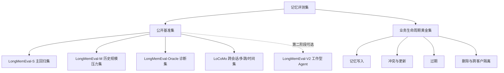

本文以 LongMemEval + LoCoMo 作为公开评测基准,再为记忆写入、冲突、过期、删除和跨客户隔离建立业务专属评测集。

# 一、整体思路与范围边界

## 1. 本文负责什么、不负责什么

评测框架(运行器、评分执行、报表、CI)已经在当前工程的 `evals/` 模块内实现,不建立独立评测工程或评测服务。被测系统是本项目自研的记忆管理服务(MMS),独立部署、通过 HTTP 接口调用;

本文只负责一件事:定义评测集本身怎样构建。具体覆盖三类内容:

- 公开基准(LongMemEval、LoCoMo)的数据集选用、样本转换方式和构建约束;
- 业务专属生命周期评测集的用例格式、标注维度和预期行为;
- 评测集的元数据、分层标签与版本管理要求。

| 本文负责 | 本文不负责(归评测框架与其他文档) |
|---|---|
| 每个评测集放哪些数据、按什么 schema 组织 | 运行器、适配器、HTTP 调用实现 |
| 每条用例标注哪些字段、预期结果怎样定义 | DeepEval / pytest 的执行编排与代码 |
| 用例进入评测前必须满足的约束(防泄漏、时间序、隔离) | Langfuse/报表埋点、CI 分级调度 |
| 评测集的版本、哈希、分层标签与失败案例回流 | 具体评分器实现 |

## 2. 评测集总体构成



三者边界必须清楚:LongMemEval 和 LoCoMo 是评测基准,业务黄金集是自定义基准,MMS 是被测系统;评测框架(DeepEval 等执行工具)如何运行它们不在本文范围。

## 3. 基准版本现状(截至 2026 年 10 月)

**LongMemEval(ICLR 2025)**:面向长期对话记忆,500 个问题,覆盖信息提取、多会话推理、知识更新、时间推理和拒答,适合作为通用对话记忆系统的基础基准。

**LongMemEval-V2(2026)**:面向 Agent 的长期工作记忆,451 个问题、Web 和企业两个领域,考察环境状态、状态变化、工作流知识、环境陷阱及错误前提识别。MMS 当前定位是客服长期记忆,第一阶段不采用;若后续 Agent 需要积累工具使用经验与环境状态,再列入第二阶段。

**LoCoMo(ACL 2024)**:10 段超长对话及对应问答、证据位置和事件摘要标注,适合测试跨会话、多跳、时间和事件相关的记忆能力。

因此第一阶段构建 LongMemEval + LoCoMo + 业务生命周期黄金集三类评测集。

官方入口:

- [LongMemEval 原始基准](https://github.com/xiaowu0162/LongMemEval)
- [LoCoMo 基准](https://github.com/snap-research/LoCoMo)
- [LongMemEval-V2](https://github.com/xiaowu0162/LongMemEval-V2)

# 二、公开基准评测集的构建:LongMemEval

原始 LongMemEval 的每个测试样本包含问题、标准答案、历史会话、时间戳以及证据会话等信息;官方提供 cleaned 数据集和答案评分脚本。

## 1. 数据集文件选用

第一阶段构建:

- `longmemeval_s_cleaned.json`:主回归集;
- `longmemeval_m_cleaned.json`:扩大历史规模的压力测试集;
- `longmemeval_oracle.json`:仅作诊断,回答“已知证据可用时系统能达到什么水平”。

官方说明中,S 数据集的历史约对应 11.5 万 Token,M 数据集每题约 500 个会话,Oracle 变体只提供相关证据会话。不要把 Oracle 分数当作完整历史场景的生产能力,它回答的是不同难度的问题。

## 2. 从原始样本到评测用例的转换

每道题转换为一个独立评测用例,保留以下字段:

| 字段 | 来源 | 用途 |
|---|---|---|
| `question_id` | 原始样本 | 用例主键与结果对齐 |
| `question_type` | 原始样本 | 分类别汇总(分层标签) |
| `question` / `question_date` | 原始样本 | 检索输入与时间锚点 |
| `answer` | 原始样本 | 仅评分时使用 |
| `haystack_sessions` | 原始样本 | 待重放的历史会话 |
| `haystack_session_ids` / `haystack_dates` | 原始样本 | 会话标识与时间序依据 |
| `evidence_session_ids` / 含答案轮次标注 | 原始样本 | 证据召回诊断,禁止进入被测输入 |

## 3. 用例构建的四条规则

规则一:历史必须设计为经过真正的写入流程。评测用例的输入是“逐会话写入 + 按问题检索”,不能把原始历史拼成一个大文本直接放入答案模型上下文;那样测到的是长上下文模型能力,而不是 MMS 的提取、索引和检索能力。

规则二:不允许答案泄漏。测试时可以使用 `question`,但 `answer`、`answer_session_ids`、`has_answer` 这些评测标签只能存在于用例侧车字段,供最后计算指标,绝不能作为被测输入。

规则三:保留时间信息。每个会话的时间戳必须随用例一起提供,由 MMS 写入管道学习事实的时间属性(occurred_at / expires_at 语义);所有对比实验使用相同的输入格式。

规则四:答案模型与评判模型在用例集层面固化。评测集元数据中记录 reader 模型、Judge 模型、Prompt 版本与 Token 预算的指纹;若这些随记忆系统改动同时变化,性能变化将无法归因。

隔离要求:每道题拥有独立的逻辑记忆空间,避免用例互相污染。MMS 的隔离主键是 `customer_id`(C 端无租户),因此每条用例应映射一个专用测试客户标识,例如:

```
eval-{run_id}-longmemeval-{question_id}
```

好处:一题的历史不污染另一题;每次实验可重放完全相同的历史;失败后可定位、清理和重跑单个用例。另外,MMS 的提取与索引存在异步路径,用例定义中应包含“写入可见性等待”的预期约束(声明就绪判定条件与超时上限),避免把异步延迟误判成记忆丢失。

## 4. 结果输出与评分要求

每道题产出一个结果对象,保存 `question_id`、`question_type`、`question`、`gold_answer`、`hypothesis` 和检索到的记忆列表。全部结果写成官方评分脚本要求的 JSONL(保留 `question_id` 与 `hypothesis` 字段),由原始仓库的 `evaluate_qa.py` 和 `print_qa_metrics.py` 完成评分与按类别汇总。

两类分数必须分开保存:官方评分器的结果用于与公开基准可比;补充指标(LLM Judge 类)用于诊断具体失败类型。不能把不同 Judge、不同标准下的结果混合为一个统一准确率。

# 三、公开基准评测集的构建:LoCoMo

LoCoMo 数据文件 `locomo10.json` 中,每个样本对应一段两人对话,包含多次会话、会话时间、说话人信息,以及带标准答案、类别和证据对话 ID 的 QA 标注。

## 1. 与 LongMemEval 的主要区别

| 项目 | LongMemEval | LoCoMo |
|---|---|---|
| 历史组织 | 每道题对应自己的历史集合 | 一段对话对应多个问题 |
| 记忆写入 | 每道题创建独立的评测空间 | 同一对话的多个 QA 复用一个已构建的评测空间 |
| 重要考点 | 知识更新、拒答、多会话、时间推理 | 超长对话、多跳关联、跨会话事件推理 |
| 证据标注 | 证据会话、含答案的对话轮次 | 支持答案的对话 ID(`dia_id`) |
| 主要评估 | 答案准确率与分类汇总 | 答案准确率、证据覆盖及类别表现 |

## 2. 对话数据的构建要点

按 `session_1`、`session_2` 等会话数字顺序读取,同时保留对应时间戳。

LoCoMo 是两个人之间的对话,不能不加区分地把 `speaker_a` 映射成 `user`、`speaker_b` 映射成 `assistant`,否则错误改变说话人语义。每条写入消息应保留规范化表示:

```
speaker = Alice
session_id = session_3
occurred_at = 2024-...
dialog_id = dia_17
text = 原始对话内容
```

上述字段是评测用例的规范化表示,不声称原始数据文件采用完全相同的 JSON 结构。MMS 支持写入元数据,因此会话、时间和来源 ID 应作为元数据随用例传递。

模态限制:原始 LoCoMo 仓库不包含实际图片文件,只提供图片 URL、描述和相关信息。若当前评测的是纯文本记忆,必须在评测集元数据中明确记录该限制,不能把纯文本成绩解释为多模态记忆成绩。

## 3. 证据标注与 EvidenceRecall@K

QA 的 `evidence` 标签只由评测器读取,不进入被测输入。写入日志或侧车索引中应保留 `dia_id` 对应关系;MMS 的证据链(`memory_evidence` 关联原始消息)使来源映射可追溯,这是构建该评测集时的硬性标注要求。

检索质量拆成两层评估:

第一层,答案正确性:使用标准答案和基准评分方式,统计总体与各题型准确率。

第二层,证据召回质量:对被检索的记忆能保留原始对话来源 ID 的结果,计算

\[ \operatorname{EvidenceRecall@K} = \frac{\left|E \cap R_K\right|}{\left|E\right|} \]

其中 \(E\) 是标准答案对应的证据对话 ID 集合,\(R_K\) 是 Top-K 检索结果覆盖的来源 ID 集合。

该公式只适用于有明确来源映射的检索结果。若记忆被压缩合并而未保留来源,不能把记忆条目 ID 当作对话 ID 计算;应改为标注“检索内容是否足以支持答案”,由人工或 Judge 判定并作为独立指标。保留 `source_ids` 的价值在于把“答错了”进一步拆成“没有提取、没有检索到、检索到但没有正确使用”三种故障。

# 四、业务专属评测集:统一用例格式

公开基准检验长期记忆问答与推理能力,不能替代对 MMS 数据生命周期、状态转移及 API 行为的评测。业务评测集以 JSONL 保存、逐条版本管理,每个用例至少包含:

```
{
  "case_id": "memory-update-current-city-001",
  "category": "memory_update",
  "policy_id": "latest_explicit_current_fact_wins",
  "setup_events": [
    {
      "event_id": "e1",
      "text": "我目前住在苏州。"
    }
  ],
  "actions": [
    {
      "type": "ingest",
      "event_id": "e2",
      "text": "我已经搬到新加坡。"
    }
  ],
  "assertions": [
    {
      "type": "current_fact",
      "query": "我现在住在哪里？",
      "expected_answer": "新加坡"
    },
    {
      "type": "historical_fact",
      "query": "我搬家之前住在哪里？",
      "expected_answer": "苏州"
    }
  ]
}
```

要点:

- 该示例刻意同时检查当前事实与历史事实,不是要求所有记忆一律“新事实覆盖旧事实”,而是把明确的冲突处理策略(`policy_id`)作为用例输入,使结果可解释、可复现。
- 每个用例还要支持 `occurred_at`、来源可信度、事实类型、TTL、预期决策类型、分层标签(类别/难度/是否硬门禁)等字段,供抽样与分类汇总使用。
- 每条断言标注判定方式:确定性的状态、时间、ID、TTL 类断言直接比较;仅当涉及语义等价、事实保留时才使用 Judge 判定。不要为统一技术栈把本可确定性校验的断言交给 LLM Judge。

# 五、业务专属评测集:四类生命周期

## 1. 记忆写入集:是否把正确的事实记进去了

写入评测区分两种情况:提取与存储正确性(抽取了哪些事实、哪些真正保存)和行为层面的记忆可用性(之后查询能否答对)。

假设输入:

> 我在苏州工作,喜欢喝咖啡。刚才吃了一份午饭,味道不错。

预期记忆可能包括工作地点及长期偏好,但不一定应把每句临时对话永久保存。

黄金用例必须标注:

| 维度 | 示例 |
|---|---|
| 输入对话 | 原始对话内容 |
| 预期事实 | 工作地点、长期偏好等 |
| 不应记忆的内容 | 与长期个性化无关的临时陈述 |
| 事实类别 | 用户属性、偏好、事件、任务状态等 |
| 预期结果 | 新增、更新、忽略、拒绝等 |

MMS 可直接读取提取后的记忆列表,因此写入集可同时评提取精度与端到端可用性。指标:

\[ \text{Precision} = \frac{TP}{TP+FP} \qquad \text{Recall} = \frac{TP}{TP+FN} \qquad F1 = \frac{2PR}{P+R} \]

TP、FP、FN 通过标准事实与实际记忆的语义匹配确定,而不是简单比较文本;实体、时间、否定词及事实归属都需纳入匹配规则并写入用例标注。

## 2. 冲突与更新集:新旧事实应该怎样处理

至少建立四类测试:

| 冲突类型 | 输入案例 | 预期验证 |
|---|---|---|
| 可变属性更新 | “现在住苏州” → “已搬到新加坡” | 当前查询返回新加坡 |
| 历史事实保留 | 更新居住地之后询问搬家前的位置 | 仍能回答苏州 |
| 明确自我纠正 | “我说错了,订单号应该是 A123,不是 A132” | 采用已明确纠正的值 |
| 无法判定的冲突 | 不同来源给出不一致事实,且没有明确的可信度或时序规则 | 按策略标记冲突、请求澄清或进入审核,而不是随意覆盖 |

每个用例在 `policy_id` 中指定预期策略,否则系统选择“待审核”而评测期待“直接更新”时,测试标准和系统设计相互矛盾。

MMS 决策引擎输出 `ADD`、`UPDATE`、`CONFLICT`、`REJECT`、`IGNORE`、`PENDING_REVIEW` 等决策类型;用例应直接验证实际执行的决策(决策日志)、更新后的状态和对外查询结果三层,不能只评估 LLM 对决策的文字解释。

分类统计指标:记忆决策类型准确率、当前事实更新正确率、历史事实保留率、冲突检测召回率、错误覆盖率、同一事实多次更新后的一致性。

## 3. 过期集:什么时候失效、失效到什么程度

每个过期用例先声明业务语义(MMS 以 `lifecycle_status` 与 `expires_at` 为准,所有时间统一 UTC):

- 逻辑失效:已过期记忆不能参与有效答案的检索;
- 物理删除:过期数据是否必须从持久存储清除;
- 历史保留:某些事件过期后仍允许在历史查询或审计场景读取;
- 失效传播 SLA:过期之后,缓存、向量索引及其他检索路径允许延迟多久全部生效。

不能在没有定义这些规则的情况下,简单地以“查不到数据”判定过期系统合格。

建议的标准测试序列:

```
T0:写入一条 TTL = 60 秒的短期记忆
T1:在过期时间之前检索,预期能够命中
T2:刚好达到过期时间,检查边界行为
T3:超过过期时间及允许的传播 SLA,再次检索
T4:检查各检索入口、缓存或索引是否仍返回有效结果
```

用例构造使用可控时钟或短 TTL,而不是在测试进程中真实等待几天;测量传播延迟时在元数据中记录时钟注入方式。

指标:过期前可用率、过期后不可用率、过期生效延迟 P95、已过期记忆泄露率、过期后重新写入同一事实的恢复正确率。

## 4. 删除与跨客户隔离集:不仅删除记录,还要验证不可再召回

删除用例覆盖四个层次:

**单条记忆删除**:删除指定事实后,用原始表达、同义表达和相关问题查询,确认它不再作为有效记忆返回。

**客户级全部记忆删除**:删除指定客户的全部记忆,验证搜索接口、可读取记录和下游个性化行为均不再使用已删除信息。

**索引与关联数据删除**:检查向量索引、图关联、关键词索引、缓存或副本是否仍保留能导致记忆泄露的数据。

**跨客户隔离**:MMS 面向 C 端海量用户,不存在租户维度;隔离用例按 `customer_id` 构造——用另一测试客户查询相同信息,确认删除行为不误伤其他客户,且任何客户都不能检索到其他客户被删除或存量的记忆。

删除类用例必须包含强断言(在删除语义上):不能只断言原 `memory_id` 不存在,因为残留内容可能被重新抽取、合并成其他记忆或保留在缓存中;必须同时验证对相关问题的语义召回结果,即断言“删除后达到传播 SLA 时,命中集合中不存在与被删事实语义等价的内容”。

定义删除泄露率:

\[ \text{LeakRate} = \frac{\text{删除后仍返回已删除事实的查询数}}{\text{删除后的相关查询总数}} \]

删除泄露与跨客户泄露属于硬性用例类别:这两类必须标记为硬门禁样本,在任何抽样执行策略中都不得被裁掉;不能因为整体记忆准确率较高就容忍泄露。

# 六、评测集的元数据、分层与版本管理

每个评测集(及其每个版本)必须固化以下元数据,随数据集一起版本管理:

```
dataset_name
dataset_version
dataset_hash
benchmark_name
benchmark_version
source_commit_or_release
reader_model_fingerprint
judge_model_fingerprint
extractor_model_version(MMS 侧配置指纹)
embedding_model_version(BGE-M3 dense 1024,ADR-002)
policy_defaults
language_coverage
modality_limitations
```

分层标签要求:每条用例带 `category`(如 longmemeval 的五类问题、LoCoMo 的 QA 类别、业务的写入/冲突/过期/删除/隔离)与 `priority`(硬门禁/常规/压力)。评测框架按分层做快速回归抽样时,只依赖这些标签,不需要额外改造数据集——这是本文与框架的职责交接点。

维护闭环:线上抽样发现的记忆更新失败、删除异常、事实冲突和任务失败案例,经脱敏与审核后加入业务黄金集,进入下一轮回归。黄金集的新增须走标注评审,保证 `policy_id`、预期结果和判定方式与当前 ADR 一致。

# 七、收尾:两个容易踩的坑

第一,不要把公开基准上的高分直接等价于生产记忆系统可靠。公开基准检验长期记忆问答能力,但针对 MMS 实际采用的事实模型、冲突决策策略、数据删除承诺和跨客户隔离,必须依赖第五、六章定义的业务黄金集。

第二,不要把公开基准全部交给通用 LLM Judge 重新打分后就认为复现了官方结果。官方评分器与补充指标应分别留存;评测模型、Prompt、数据版本与阈值都必须纳入版本管理(见第六章元数据要求)。

公开基准负责衡量长期记忆能力,业务黄金集负责验证记忆生命周期的正确性;两者的构建约束、标注 schema 和版本要求由本文定义,执行与报表由工程内 `evals/` 模块承担。适配与运行代码只依赖 MMS 公开 API 契约,评测用例数据不绑定任何单一引擎的实现细节,后续 MMS 接口演进时优先通过用例转换脚本迁移,而不是改写标注语义。
