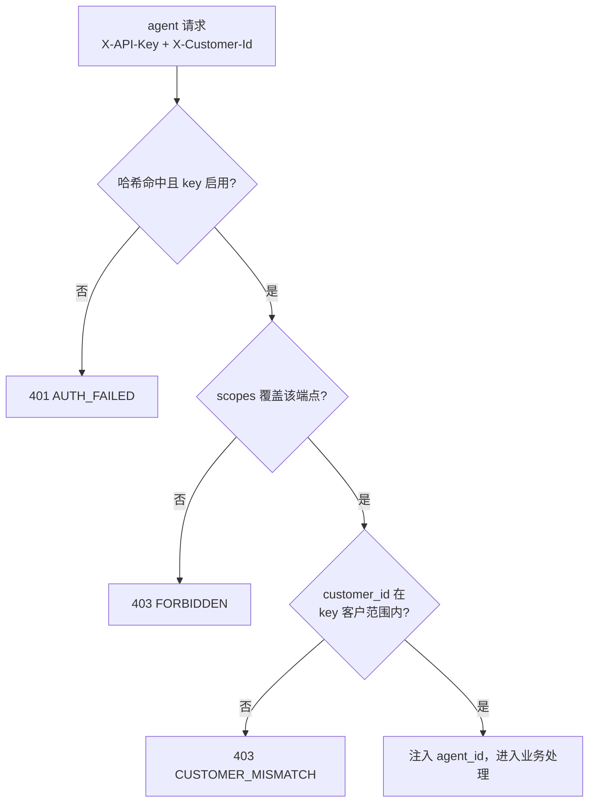
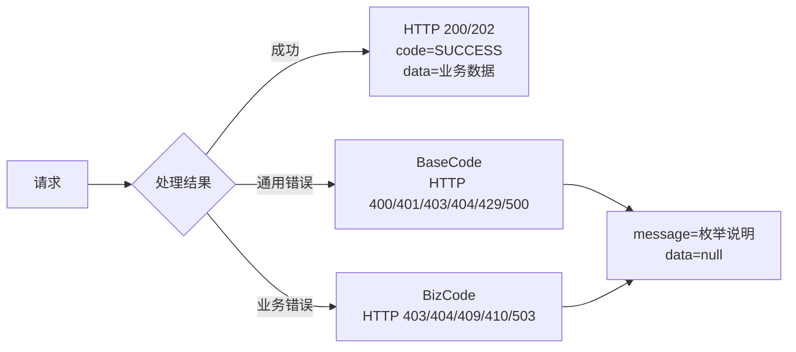

# 用户面接口鉴权与响应

> 用户面面向 **agent 主服务**（支持多 agent 接入），鉴权实质是 **agent 服务身份鉴权**，凭据为 **API key**。本文只阐述用户面**通用设计**；具体接口契约见[《1.2-用户面-接口清单》](1.2-用户面-接口清单.md)。

## 1. 鉴权模型：API key → agent 身份

| 要素 | 约定 |
|---|---|
| 凭据 | 请求头 `X-API-Key: <key>` |
| 身份 | 一个 key 只归属一个 agent（`agent_id`）；一个 agent 可持多个 key 用于轮换 |
| 权限 | key 绑定 scopes（见下表） |
| 客户范围 | key 绑定可访问的客户范围；`X-Customer-Id` 必须落在范围内 |
| 存储 | 库中只存 SHA-256 哈希，明文仅在创建时展示一次 |
| 动态配置 | 在线创建/禁用/轮换，即时生效（本地缓存 TTL ≤ 60s），无需重启 |

| scope | 能力 |
|---|---|
| `memory:read` | 读取类能力 |
| `memory:write` | 写入类能力 |
| `memory:review` | 审核类能力 |
| `memory:delete` | 删除类能力 |
| `memory:feedback` | 反馈类能力 |



- 终端用户身份不透传 MMS：终端鉴权在 agent 服务内完成，MMS 只信任已认证的 agent 及其客户范围声明。
- 限流、配额、审计按 `agent_id` 隔离。

## 2. 响应结构（用户面）

用户面接口统一返回 `BaseResp<T>`，与[管理面](2.1-管理面-接口鉴权与响应.md)**各自独立定义（不同包），不共用**。`trace_id` 只走响应头 `X-Trace-Id`，不进响应体。

```java
public class BaseResp<T> {
    private String code;     // BaseCode / BizCode 枚举名
    private String message;  // 枚举响应说明
    private T data;          // 业务数据；失败时为 null
}
```



### 基础响应码 `BaseCode`（用户面枚举）

```java
public enum BaseCode {
    SUCCESS("成功"),                  // 200 / 202
    AUTH_FAILED("认证失败"),          // 401
    FORBIDDEN("无权限"),              // 403
    VALIDATION_FAILED("参数校验失败"), // 400
    NOT_FOUND("资源不存在"),          // 404
    RATE_LIMITED("请求过于频繁"),     // 429 + Retry-After
    INTERNAL("系统内部错误");         // 500
}
```

### 业务响应码 `BizCode`（用户面枚举）

```java
public enum BizCode {
    CUSTOMER_MISMATCH("客户不在授权范围"),    // 403
    CONSENT_REQUIRED("需要客户同意"),         // 403
    CONSENT_WITHDRAWN("客户已撤回同意"),      // 403
    CONSENT_UNAVAILABLE("同意快照不可用"),    // 503
    CONFLICT_PENDING("冲突待裁决"),           // 409
    DELETE_IN_PROGRESS("删除进行中"),         // 409
    CUSTOMER_DELETED("客户已删除"),           // 410
    EMBEDDING_UNAVAILABLE("向量服务不可用"),  // 503
    CUSTOMER_REF_UNKNOWN("客户假名未注册");   // 404
}
```

### 其他约定

- 列表接口 cursor 分页：`limit`（默认 20，最大 100）+ `cursor`，无 offset 深分页；
- 写接口 `Idempotency-Key`：保存 key + 请求 hash + 响应摘要 24h，重复请求返回原结果；
- 请求大小限制（如 256KB）、超时；响应头带 `X-Trace-Id`，日志与 trace 关联。
