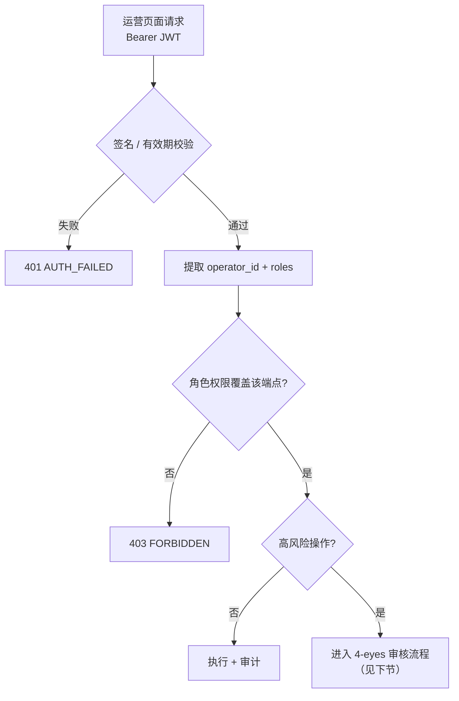
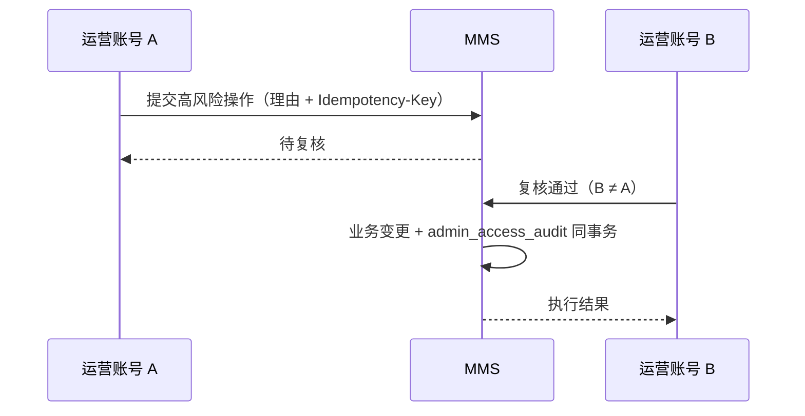
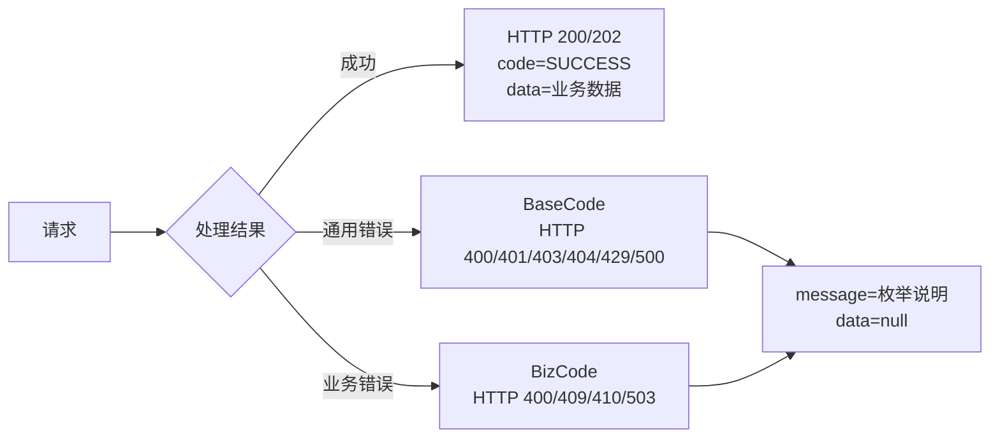

# 管理面接口鉴权与响应

> 管理面直接面向 **C 端运营页面**，鉴权使用 **JWT**，实质是从 JWT 识别**运营账号身份**。本文只阐述管理面**通用设计**；具体接口契约见[《2.2-管理面-接口清单》](2.2-管理面-接口清单.md)。

## 1. 鉴权模型：JWT → 运营账号

- 凭据：`Authorization: Bearer <JWT>`；MMS 校验签名与有效期，提取 `operator_id` + `roles`，按角色映射权限（`memory:admin` 等）。
- JWT 由统一登录服务签发；MMS 不管账号、密码、会话。
- 管理面 JWT 与用户面 API key 是两套独立凭据，互不通用。
- `/internal/*` 不走 JWT（服务身份/mTLS）；`/health/*`、`/metrics` 仅内网。



## 2. 高风险操作：理由 + 4-eyes + 审计

| 约束 | 规则 | 失败响应 |
|---|---|---|
| 操作理由 | 必带 `X-Admin-Reason-Code` + `X-Admin-Ticket` | `ADMIN_REASON_REQUIRED`（400） |
| 4-eyes | 删除 / 批量覆盖 / 政策激活需第二人复核，审核人 ≠ 提交人 | `FORBIDDEN`（403） |
| 幂等 | `Idempotency-Key`（保存 key + 请求 hash + 响应摘要 24h） | 重复请求返回原结果 |
| 审计 | `admin_access_audit`：读取前同步写；写操作与业务变更同事务；只落 `customer_hash` / scope / trace，不落正文 | `AUDIT_WRITE_FAILED`（503），fail-closed 拒绝读取 |



## 3. 响应结构（管理面）

管理面接口统一返回 `BaseResp<T>`，与[用户面](1.1-用户面-接口鉴权与响应.md)**各自独立定义（不同包），不共用**。`trace_id` 只走响应头 `X-Trace-Id`，不进响应体。

```java
public class BaseResp<T> {
    private String code;     // BaseCode / BizCode 枚举名
    private String message;  // 枚举响应说明
    private T data;          // 业务数据；失败时为 null
}
```



### 基础响应码 `BaseCode`（管理面枚举）

```java
public enum BaseCode {
    SUCCESS("成功"),                  // 200 / 202
    AUTH_FAILED("认证失败"),          // 401
    FORBIDDEN("无权限"),              // 403
    VALIDATION_FAILED("参数校验失败"), // 400
    NOT_FOUND("资源不存在"),          // 404
    RATE_LIMITED("请求过于频繁"),     // 429 + Retry-After
    INTERNAL("系统内部错误");         // 500
}
```

### 业务响应码 `BizCode`（管理面枚举）

```java
public enum BizCode {
    ADMIN_REASON_REQUIRED("缺少操作理由"),  // 400
    AUDIT_WRITE_FAILED("审计写入失败"),     // 503，fail-closed
    DELETE_IN_PROGRESS("删除进行中"),       // 409，写入屏障拒绝
    CUSTOMER_DELETED("客户已删除");         // 410，写入屏障拒绝
}
```

### 其他约定

- 列表接口 cursor 分页：`limit`（默认 20，最大 100）+ `cursor`，无 offset 深分页；
- 写接口 `Idempotency-Key`：保存 key + 请求 hash + 响应摘要 24h，重复请求返回原结果；
- 请求大小限制（如 256KB）、超时；响应头带 `X-Trace-Id`，日志与 trace 关联。
