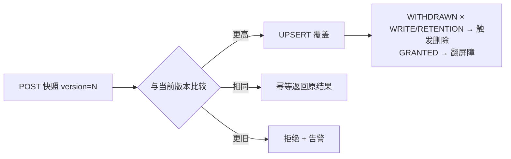
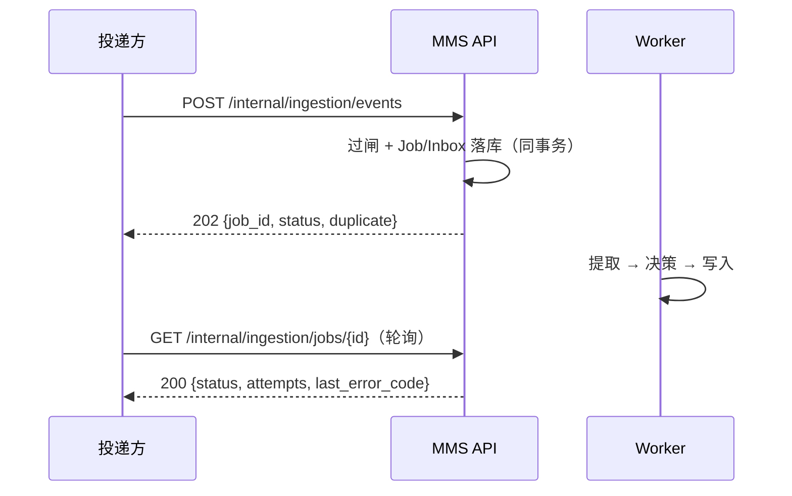

# 管理面接口总览

> 管理面面向 C 端运营页面（JWT 鉴权）。所有响应统一包裹 `BaseResp<T>`（`code/message/data`，见[《2.1-管理面-接口鉴权与响应》](2.1-管理面-接口鉴权与响应.md)），下文响应体均指 `data` 结构。高风险操作必带 `X-Admin-Reason-Code` + `X-Admin-Ticket` + `Idempotency-Key`，4-eyes 约束见 2.1。`/internal/*` 走服务身份/mTLS，不走 JWT。标注 **【新定义】** 的字段为本文首次约定，源文档未定义。

| 方法 | 路径 | 用途 | 鉴权 |
|---|---|---|---|
| `POST` | `/admin/decisions/replay` | 决策回放 | `memory:admin` |
| `GET` | `/admin/policies` | 政策列表/版本 | `memory:admin` |
| `POST` | `/admin/policies` | 创建/激活/回滚政策 | `memory:admin` |
| `GET` | `/admin/fact-keys` | 事实键注册表 | `memory:admin` |
| `POST` | `/admin/embeddings/rebuild` | 重建/回填向量 | `memory:admin` |
| `POST` | `/admin/dlq/replay` | 重放死信 | `memory:admin` |
| `GET` | `/admin/recon/runs` | 对账批次/结果 | `memory:admin` |
| `GET` | `/admin/memories/{memory_id}/lineage` | 记忆 lineage | `memory:admin` |
| `GET` | `/admin/deletion-requests/{id}/proof` | 删除证明 | `memory:admin` |
| `GET/POST` | `/internal/customers/{customer_id}/memory-consent` | 同意快照读取/同步 | 服务身份/mTLS |
| `GET/POST` | `/internal/customers/{customer_id}/identity-ref` | Kafka 假名读取/预置 | 服务身份/mTLS |
| `POST` | `/internal/ingestion/events` | 异步受理摄取事件 | 服务身份/mTLS |
| `GET` | `/internal/ingestion/jobs/{id}` | 摄取 Job 状态 | 服务身份/mTLS |
| `GET` | `/health/live`、`/health/ready`、`/health/deps` | 健康检查 | 内网 |
| `GET` | `/metrics` | Prometheus 指标 | 内网 |

# POST /admin/decisions/replay

按 `context_snapshot` 回放决策，钉住 policy/registry 版本重放规则矩阵；不重调提取模型。读前审计。

## 请求体【新定义】

| 字段 | 类型 | 必填 | 含义与取值 |
|---|---|---|---|
| `context_snapshot` | object | 是 | 决策上下文快照，字段见下表（《07-记忆写入决策》） |
| `policy_version` / `registry_version` | string | 否 | 钉住版本；缺省用快照内版本 |

`context_snapshot` 字段：

| 字段 | 含义 |
|---|---|
| `candidate` | `object_hash` / `semantic_hash` / `normalization_version` |
| `versions` | `policy.version` / `policy.config_hash` / `registry_version` / `rule_set_version` / `condition_hash` |
| `matched_memories[]` | `memory_id` / `version_no` / `content_hash` / `semantic_hash` / `object_hash` / `lifecycle_status` / `valid_from` / `valid_to` |
| `semantic_candidates[]` | `memory_id` / `score` |
| `authoritative_fact` / `review_override` | 权威事实回源结果 / 审核覆盖 |

## 响应体（HTTP 200）

决策结果（结构同用户面 `/memories/candidates` 响应：`outcome/reason_codes/三版本号/requires_review` 等），另含：

| 字段 | 类型 | 含义与取值 |
|---|---|---|
| `replay` | bool | 恒 `true`，标识回放不落业务写入【新定义】 |
| `drift` | object | 回放结果与当前事实的差异说明（现状重读当前事实，严格快照回放待补，《07》）【新定义】 |

# GET /admin/policies

政策列表/版本。

## 请求参数（query）【新定义】

| 字段 | 类型 | 必填 | 含义与取值 |
|---|---|---|---|
| `memory_type` | enum | 否 | 6 值记忆类型过滤 |
| `status` | enum | 否 | `DRAFT` / `SHADOW` / `ACTIVE` / `RETIRED` |
| `limit` / `cursor` | int / string | 否 | cursor 分页，默认 20 最大 100 |

## 响应体（HTTP 200）

`items[]` 为政策对象（`memory_policy` 表）：

| 字段 | 类型 | 含义与取值 |
|---|---|---|
| `id` | UUID | 政策 ID |
| `name` / `version` | string | 名称与版本 |
| `memory_type` | enum | 作用域记忆类型 |
| `status` | enum | `DRAFT` → `SHADOW` → `ACTIVE` → `RETIRED`；每作用域单 ACTIVE |
| `config` / `config_hash` | object / string | 规则配置（jsonb）与 SHA-256 指纹 |
| `effective_from` | datetime | 生效时间 |
| `created_by` / `approved_by` / `approved_at` | string / datetime | 创建与审批（`approved_by ≠ created_by`，ACTIVE 必须有审批） |

`next_cursor`：下一页游标。

# POST /admin/policies

创建/激活/回滚政策。高风险：理由头 + 幂等键 + 4-eyes；审计 `action=POLICY_CHANGE` 与业务变更同事务。

## 请求体【新定义】

| 字段 | 类型 | 必填 | 含义与取值 |
|---|---|---|---|
| `action` | enum | 是 | `CREATE` / `ACTIVATE` / `ROLLBACK` |
| `policy_id` | UUID | `ACTIVATE`/`ROLLBACK` 必填 | 目标政策 |
| `name` / `memory_type` / `config` | string / enum / object | `CREATE` 必填 | 新政策内容 |
| `target_version` | string | `ROLLBACK` 必填 | 回滚到的历史版本 |
| `approved_by` | string | `ACTIVATE` 必填 | 审批人，≠ 创建人（4-eyes） |

## 响应体（HTTP 200）

政策对象（字段同 `GET /admin/policies` 的 `items[]`）；激活后原 ACTIVE 政策置 `RETIRED`。

# GET /admin/fact-keys

事实键注册表（只读）。

## 请求参数（query）【新定义】

`status`（`DRAFT`/`ACTIVE`/`RETIRED`）、`fact_key` 前缀过滤、`limit`/`cursor`。

## 响应体（HTTP 200）

`items[]` 为注册表条目（`fact_key_registry` 表，每 fact_key 单 ACTIVE）：

| 字段 | 类型 | 含义与取值 |
|---|---|---|
| `fact_key` / `version` | string / int | 事实键与版本（联合主键） |
| `cardinality` | enum | `SINGLE_VALUE` / `MULTI_VALUE` / `TEMPORAL` |
| `authority_source` | string | 权威来源系统 |
| `allowed_source_kinds` | string[] | 允许的 source_kind 子集（7 值见用户面候选契约） |
| `sensitivity` | enum | `LOW` / `MEDIUM` / `HIGH` |
| `retention_days` | int | 保留天数 |
| `auto_write` / `requires_authority` | bool | 是否允许自动写入 / 必须回源权威 |
| `normalizer` / `validator` / `mutual_exclusion` | object | 归一化/校验/互斥规则（jsonb） |
| `semantic_template` / `normalization_version` | string | 语义模板与归一化版本 |
| `status` / `effective_from` | enum / datetime | `DRAFT`/`ACTIVE`/`RETIRED` 与生效时间 |

# POST /admin/embeddings/rebuild

重建/回填向量。高风险：必须限定客户或记忆；只登记 Job，Worker 执行；审计 `action=REBUILD` 与入队同事务。

## 请求体

| 字段 | 类型 | 必填 | 含义与取值 |
|---|---|---|---|
| `customer_id` | string | 二选一 | 按客户重建 |
| `memory_id` | string | 二选一 | 按单条记忆重建 |

## 响应体（HTTP 202）

| 字段 | 类型 | 含义与取值 |
|---|---|---|
| `enqueued` | int | 入队 Job 数【新定义字段名】 |

# POST /admin/dlq/replay

四类队列死信统一重放。高风险：审计 `action=REPLAY` 与重入队同事务，写失败重放不生效。

## 请求体

| 字段 | 类型 | 必填 | 含义与取值 |
|---|---|---|---|
| `job_type` | enum | 是 | `INGESTION` / `EMBEDDING` / `TRANSLATION` / `OUTBOX` |
| `job_ids` | string[] | 是 | 目标 Job ID 列表【新定义字段名】 |

## 分队列语义

| job_type | 可重放状态 | 特殊规则 |
|---|---|---|
| `INGESTION` | 不限当前状态 | 重放后 `attempts=0` |
| `EMBEDDING` | 仅 `DEAD_LETTER` | 未命中 404 |
| `TRANSLATION` | 仅 `DEAD_LETTER` | 未命中 404 |
| `OUTBOX` | 仅 `FAILED` / `RETRY` | 先过屏障闸：`STALE_GENERATION` → 410，其余拒绝 → 409；标记 `__dlq_outbox__` |

## 响应体（HTTP 200）【新定义】

| 字段 | 类型 | 含义与取值 |
|---|---|---|
| `replayed` | string[] | 成功重入队的 Job ID |
| `skipped` | object[] | `{job_id, reason}`（状态不符/屏障拒绝等） |

# GET /admin/recon/runs

对账批次/结果（Convergence）。

## 请求参数（query）【新定义】

`recon_type`、`status`、`limit`/`cursor`。

## 响应体（HTTP 200）

`items[]` 为对账批次（`recon_run` 表）：

| 字段 | 类型 | 含义与取值 |
|---|---|---|
| `id` | UUID | 批次 ID |
| `recon_type` | enum | `JOB` / `VECTOR` / `RECALL` / `BUSINESS` |
| `status` | enum | `RUNNING` / `COMPLETED` / `FAILED` / `PARTIAL`（mismatch==fixed 判 COMPLETED，否则 PARTIAL） |
| `scope` | object | 对账范围（jsonb） |
| `started_at` / `completed_at` | datetime | 起止时间 |
| `scanned_count` / `mismatch_count` / `fixed_count` / `error_count` | int | 扫描/不一致/修复/错误计数 |
| `details` | object | VECTOR：`repaired_views`/`enqueued_missing_vectors`；RECALL：`semantic_canary{model, version, per_language{scanned, misses}, scanned_total, skipped_cross_border_customers}` |
| `error_code` / `triggered_by` | string | 失败码；`scheduler` / `manual` |

# GET /admin/memories/{memory_id}/lineage

证据→决策→版本→向量→使用 全链路。读前审计（fail-closed）。无请求体。

## 响应体（HTTP 200）【新定义】

| 段 | 字段来源 | 内容 |
|---|---|---|
| `evidence[]` | `memory_evidence` | 证据定位符、source_kind、source_event_id |
| `decisions[]` | `memory_decision` | decision_id、outcome、reason_codes、三版本号、created_at |
| `versions[]` | `customer_memory` 版本链 | memory_id、version_no、supersedes_memory_id、lifecycle_status、valid_from/valid_to |
| `embeddings[]` | `memory_embedding` | 视图类型、语言、模型版本、index_generation、状态 |
| `usage[]` | `memory_usage_event` | purpose、retrieved/used_memory_ids、rank_map、answer_hash、model_version |

# GET /admin/deletion-requests/{id}/proof

删除证明（只读最小化：计数/时间/覆盖系统/验证结果，不含正文）。无请求体。

## 响应体（HTTP 200）

| 字段 | 类型 | 含义与取值 |
|---|---|---|
| `tombstone_id` | string | 墓碑 ID |
| `deletion_request_id` | string | 删除请求 ID |
| `customer_ref` | string | 客户 HMAC 假名（不落原始 ID） |
| `scope_hash` | string | 删除范围指纹 |
| `reason_code` | enum | `USER_DELETE` / `CONSENT_WITHDRAWN` |
| `completed_at` | datetime | 完成时间 |
| `ledger_object_key` / `ledger_written_at` | string / datetime | 证明台账对象与写入时间 |
| `retain_until` | string | 证明保留期限 |
| `kms_key_id` | string | 签名密钥 ID |
| `counts` | object | 各表清除数量 |

请求状态枚举：`RECEIVED`/`APPROVED`/`IN_PROGRESS`/`VERIFYING`/`COMPLETED`/`REJECTED`/`CANCELLED`；仅 `COMPLETED` 返回完整 proof。

# GET/POST /internal/customers/{customer_id}/memory-consent

同意快照读取/同步（服务身份/mTLS）。

## GET 响应体（HTTP 200）

返回该客户全部 purpose 的快照数组：

| 字段 | 类型 | 含义与取值 |
|---|---|---|
| `purpose` | enum | `MEMORY_READ` / `SENSITIVE_MEMORY` 等，全集见《03-记忆授权》 |
| `status` | enum | `GRANTED` / `DENIED` / `WITHDRAWN` |
| `version` | int | 快照版本，>0 |
| `effective_at` / `expires_at` | datetime | 生效 / 过期时间 |
| `source` / `evidence_ref` | string | 同意来源与凭证引用 |

## POST 请求体

字段白名单（禁未知字段）：`purpose` / `status` / `version` / `effective_at` / `expires_at` / `source` / `evidence_ref`，同上表。

版本分流（幂等键 `(customer_id, purpose, version)`）：

## POST 响应体（HTTP 200）【新定义】

`{purpose, version, applied: bool}`；`applied=false` 表示幂等命中或更旧拒绝（更旧拒绝返回 409）。

# GET/POST /internal/customers/{customer_id}/identity-ref

Kafka 假名 `customer_ref` 读取/预置（服务身份/mTLS，幂等）。

## GET 响应体（HTTP 200）

| 字段 | 类型 | 含义与取值 |
|---|---|---|
| `customer_ref` | string | `HMAC-SHA256(kafka_ref_key_vN, customer_id)`，char64 |
| `ref_key_version` | int | HMAC 密钥版本 |
| `status` | enum | `ACTIVE` / `RETIRED` |
| `is_current` | bool | 每客户单 current |

未预置 → 404 `CUSTOMER_REF_UNKNOWN`。

## POST 请求体【新定义】

无业务字段（空体或 `{}`）；ensure_identity upsert 幂等，重复预置返回同一 `customer_ref`。响应体同 GET。

# POST /internal/ingestion/events

异步受理摄取事件：过闸 + Job/Inbox 双账本落库（同事务）即返回，Worker 后台处理。

## 请求体（禁未知字段）

| 字段 | 类型 | 必填 | 含义与取值 |
|---|---|---|---|
| `consumer_group` | string | 否 | 默认 `mms-ingestion`，1–128 字符 |
| `event_id` | UUID | 是 | 事件 ID，Inbox 幂等去重 |
| `event_type` | enum | 是 | `memory.candidate.v1`（已提取候选）/ `memory.extraction.requested.v1`（请求提取） |
| `topic` | string | 否 | Kafka 元数据，白名单，默认 `memory-candidates` |
| `partition` / `offset` | int | 否 | Kafka 元数据，≥0 |
| `candidate` | object | `memory.candidate.v1` 必填 | CandidateInput，字段同用户面 `/memories/candidates`；`observed_at` 必填 |

## 响应体（HTTP 202）

| 字段 | 类型 | 含义与取值 |
|---|---|---|
| `job_id` | string | Job ID |
| `status` | enum | `RECEIVED`；重复投递返回原状态 |
| `duplicate` | bool | 已应用/处理中的重复投递 `true`（亦 202） |

# GET /internal/ingestion/jobs/{id}

查询摄取 Job 处理状态。无请求体。

## 响应体（HTTP 200）

| 字段 | 类型 | 含义与取值 |
|---|---|---|
| `status` | enum | `RECEIVED` / `PROCESSING` / `RETRY` / `COMPLETED` / `CANCELLED` / `DEAD_LETTER`（attempts 满 5 进死信） |
| `attempts` | int | 已尝试次数 |
| `last_error_code` | string | 最近失败码，无则 `null` |
| `available_at` | datetime | 下次可执行时间（退避中） |

# GET /health/live

存活检查，不查任何依赖。无请求体。

## 响应体（HTTP 200）【新定义】

`{status: "ok"}`；进程存活即 200。

# GET /health/ready

就绪检查，只查硬依赖：主库可写 + pgvector + schema 初始化；任一缺失 503。无请求体。

## 响应体（HTTP 200/503）【新定义】

| 字段 | 类型 | 含义与取值 |
|---|---|---|
| `status` | enum | `ok` / `unavailable` |
| `checks` | object | `{db_writable, pgvector, schema}` 各项 bool |

# GET /health/deps

软依赖状态，不参与 Pod readiness。无请求体。

## 响应体（HTTP 200）【新定义】

| 字段 | 类型 | 含义与取值 |
|---|---|---|
| `deps` | object | `{embedding, translation, reranker, kafka, replica}` 各项 `{status: up/down/degraded, latency_ms}` |

# GET /metrics

Prometheus 指标（多进程聚合），与业务同端口；Worker 独立 metrics 端口。无请求体。

## 响应体（HTTP 200）

Prometheus 文本格式（`text/plain; version=0.0.4`），非 `BaseResp` 包裹。
