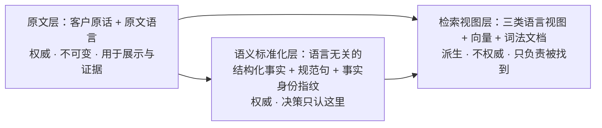

# 记忆管理服务（MMS）技术方案总结

> 归纳对象：《记忆管理-技术方案-v2.md》v2.8（2026-10-26）。
> 口径：只保留总体架构、关键流程与设计思路；不含表结构、DDL、伪代码与字段级细节。
> 技术挑战主题：**多语言的处理**，按「场景 → 问题 → 行动 → 结果」展开。

---

## 一、项目亮点

| 亮点 | 一句话说明 | 为什么算亮点 |
|---|---|---|
| **一个库、一条删除路径** | PostgreSQL 是记忆的权威状态；向量只是库内的一个投影，不是第二套记忆 | 删除/授权/一致性只有一个边界，一条 trace 能走完提取→决策→落库→索引→召回→失效 |
| **exact-first 的单客户检索** | 默认在「该客户的就绪向量集合」内做精确 top-K，v2 不建全局 ANN 索引 | 用选择率算例否掉了「全局 HNSW + 客户过滤」这一常见反模式：百万客户 × 百条记忆时，取 40 个候选命中指定客户的期望约 0.00004 条 |
| **先决策、再建索引** | 原始对话不得无治理地进向量表；embedding 是异步投影，检索只读就绪态 | 把「写不写、写什么、什么状态」与「怎么被找到」彻底解耦，写入不被 provider 拖住 |
| **决策引擎是规则表，不是散落的 if/else，也不是 LLM 自由裁定** | 有序规则、首条命中、原因码、决策快照可回放 | 高风险事实由代码 + 权威来源裁决；同一快照回放结果必须一致，策略可 diff、可回滚 |
| **授权与删除是一等公民** | 同意快照 + purpose 与判断点一一对应；撤回授权复用删除屏障；墓碑账本覆盖备份窗口 | 合规语义可测试：撤回到检索不可见有 SLO，「删完又被备份/重放复活」是被门禁证伪的对象 |
| **记忆是证据，不是指令** | 记忆内容作为不可信数据传给回答侧，不进入指令位；红队覆盖多语言注入 | 把记忆投毒/提示注入当作架构威胁建模的固定条目，而不是事后补丁 |
| **状态四分离 + 每个状态都有自动出口** | 候选处理 / 业务生命周期 / 索引就绪 / 审核待办各自独立；冲突与待审都有兜底到期 | 不会出现「永久 CONFLICTED」「无人点就永不结束」的挂账状态 |
| **决策以 ADR 固化，且每条 ADR 带重审触发条件** | 移除 Mem0、embedding 模型与维度、exact-first、词法范围、多语言三层、P0/P1 基线 | 方案不腐化：选型不被配置文件静默覆盖，改变必须走新 ADR + 影子评测 + 回滚 |

---

## 二、技术挑战：多语言的处理

### 1 场景

全球多语言 C 端客服。同一个客户会在中文、英文、西语之间来回切换；同一条事实会被反复用不同语言重述；查询语言和记忆原文语言经常不一致；记忆里含 PII，原文不能默认出境；业务还要求「客户说过什么，客服看到的就是他说的话」，不能是机器翻译的产物。

### 2 问题

方案 v2.4 的隐含假设是**原文既是事实的载体，也是被检索的载体**。这个假设在多语言下同时踩三个坑，且三个坑的修复方向互相冲突：

- **同义重述被误判。** 中/英两种表达写同一条「沟通语言偏好」，直接比较文本会得到「要么判重复、要么判冲突」，事实版本链被语言差异污染。
- **翻译一旦成为比较基准，事实就不可审计。** 译文进入事实判断，等于把机器翻译变成权威源：失真会被放大、无法解释、也无法在 provider 更换后复现。
- **只用原文做语义检索，跨语言召回不足。** 而词法（订单号、错误码、专有名词）根本不具备跨语言性质；CJK 还需要专用分词。
- **反直觉的第四坑（复审定为 P0）。** 即使承认「跨语言重述是同一事实、不新建版本」，如果决策动作里没有**视图出口**，新出现的那门语言的原文就永远不会进入索引——英文提问只能靠跨语言语义勉强命中，英文关键词检索对这条记忆永久失效。

一句话：**「要不要翻译」不是这道题的答案；真正的问题是「文本、事实、可发现性」必须各自有归属。**

### 3 行动

**① 把一层拆成三层，各层权威性质不同。**

**② 事实身份与「如何被找到」彻底分家。** 决策引擎只做两件事：按事实键 + 实体 + 值槽 + 有效期**定位**当前事实，再比较**标准化后的值指纹**——不比较不同语言的原文，更不看译文。原文摘要只用于视图失效锚点，不参与跨语言相等判断。

**③ 关键取舍：`semantic_hash` 不含标准化版本号。** 它是当前规范表示的指纹，RENORMALIZE 后允许漂移，但漂移本身不代表事实变化，也不能触发替代决策。候选幂等键基于稳定源事件和证据引用，不依赖规范化输出。重标准化走独立批任务：不新建版本、不改生命周期状态、撞键转人工冲突，并以「行数/版本分布/回放结果不变」作门禁。

**④ 视图模型承载多语言的可发现性。** 每条记忆至少有一个原文视图（按**证据语言**一对多，客户用过的语言不可被译文挤掉）、一个恒定的规范语义视图（语言无关，跨语言语义的稳定锚点）、按需的翻译视图（异步生成，记录翻译模型/版本/质量与来源视图指纹）。视图数与翻译目标语言数都有预算上限，名额优先给证据语言原文。

**⑤ 补上那个 P0 出口。** 「同一事实出现新证据语言」被定为独立决策分支：强化事实但不新建版本，同时**追加该语言的原文视图并入队重建索引**——跨语言重述既不产生重复记忆，也不让新语言的原文失去检索入口。

**⑥ 检索侧按「并行召回 → 按记忆去重 → 融合 → 重排」固定顺序。** 语义通道同时扫原文/规范/查询语言的翻译视图，先按记忆聚合再参与融合，避免多语言视图把 top-K 占满；距离并列时代表视图优先级固定为原文 > 规范 > 译文，**译文不得成为最佳命中**。词法只在已配置语言、且只查同语言视图；规范视图不参与词法；无 BM25、不引入外部搜索引擎。返回时给原文 + 原文语言 + 命中了哪个视图，审计和纠错都有落点。

**⑦ 把翻译纳入合规与降级预算。** 翻译可能把原文送出边界：默认自托管，外部/跨境需要专门的同意项，敏感级别默认不翻译。翻译失败/超时/质量低只降级该语言视图，不阻塞写入、不影响原语言与规范视图的检索、更不影响事实生效。回答语言由客服 Agent 决定，记忆内容不强行翻译覆盖。

### 4 结果

- **同一事实跨语言表达的判定收敛**：中/英/西三语重述映射到同一事实身份，决策落在「重复/强化」而非「新建/冲突」；同一 registry/normalizer 版本内同事实指纹一致率 100%，升级后允许指纹漂移但不得改变决策或生命周期，强化不新增版本号。
- **新证据语言可被检索**：该语言原文视图就绪率 ≥99%，且该语言的词法通道能命中这条记忆——这是复审 P0 真正被闭合的证据。
- **承诺边界变得可解释**：跨语言只承诺语义召回；词法只承诺已配置语言的同语言检索；译文永远是检索信号不是事实。不承诺的部分被写进非目标与已知限制，而不是留给运行时猜测。
- **多语言能力可降级、可观测**：翻译熔断、视图缺失、视图预算耗尽、语言不匹配重排都各有指标；原语言与规范视图构成保底路径。
- **代价被显式承认**：索引与扫描成本从「记忆数 × 维度」变成「记忆数 × 视图数 × 维度」，容量评审必须按视图行数计；默认档延迟预算里为视图放大预留了显式因子。
- **仍未闭合的口子**（属于设计上的自觉限制）：形态丰富语言的词法覆盖、翻译失真在端到端回答质量上的影响，仍靠逐语言评测与重排缓解，而不是靠承诺消除。

---

## 三、思考过程

整份方案的推理主线，是围绕**「一个服务到底该有几个权威源、几个边界」**反复收敛：

**1）先问依赖的真实成本，再问功能。** 移除 Mem0 不是因为效果不好，而是它在推理关闭时只剩 embedding + 向量 CRUD，底层本来就是 pgvector：多一个服务就多一套配置、鉴权、升级、备份和**删除面**，而它的 history 保留原文，端到端删除直接不成立。结论：能力可以自建，删除边界不能外借。

**2）从业务事实推导技术路线，不从技术流行度出发。** 明确「C 端广大用户群、无租户、无大租户」之后，一系列结论自动成立：不需要租户字段和行级安全；查询天然带单一客户身份；向量检索的正确形态是「在该客户集合内精确 top-K」而不是全局近似索引 + 后过滤。**规模问题被重述成一个可观测问题（每客户向量数分布），而不是一个索引选型问题。**

**3）区分「事实」与「事实的表达」。** 这是多语言那部分的根，也是决策引擎的根：语义标准化层处理事实的含义，检索视图层处理事实如何被找到。只要这两件事在一层里，语言差异、normalizer 升级、翻译失真就都会串改事实链。

**4）把 LLM 关进笼子。** LLM 只做提取，输出必须经过解析、策略、权限、来源可信、冲突、幂等等一系列代码校验；模型自报的置信度不与真实概率混用，必须用标注集校准并单独保存。高风险事实不靠模型裁定，靠权威业务源或人工。

**5）合规走热路径的反面。** 在线检索不逐次调用授权服务（延迟与可用性不可控），改为持有版本化的本地同意快照 + 事件收敛；写路径则在事务内以锁 + 主库读校验删除屏障，不允许用缓存判定。读可以最终一致，写必须零窗口。

**6）能力上限换成可兑现的承诺。** 不接 BM25、不上专用向量库、不做图记忆与模糊实体、不建全局 HNSW、不做多模型双写——每一个「不做」都写了备选、否决理由和重审触发条件。方案的质量不在它覆盖了多少能力，而在它承诺的东西都能被测试证明。

**7）预算必须自洽。** 延迟预算曾经把七个阶段相加 410ms 却承诺 300ms；修正方式是拆成默认档/扩展档、标注串行与并行、显式求和并预留视图放大，最后指定唯一的数据源指标。**架构文档里不能存在做不到的算术。**

---

## 四、方案落地

**交付形态。** 单一代码库、多进程部署：无状态可水平扩的在线 API，消费事件与任务池的 Worker（提取、决策、标准化、视图生成、embedding、翻译调度），以及做生命周期扫描、重试、对账、模型升级的 Convergence。数据面是一个 PostgreSQL（业务状态 + 向量 + 词法投影 + 任务队列），主库写与删除、只读副本供检索。embedding 与翻译默认自托管，Kafka 是可选解耦项，第一版可以只靠事务 Outbox + 库内任务队列。

**必须先跑通的核心闭环（顺序即设计）：**

> 候选提取（带原文语言）→ 硬规则准入 → 语义标准化 → 价值评分 → 按事实键定位 + 规范值比较（不比原文）→ 单一决策结果（新增/重复/强化含视图追加/替代/冲突/忽略/拒绝/删除请求）→ 同事务落库（事实 + 不可变证据 + 决策快照 + 当前指针 + 语言视图 + 视图级索引任务 + Outbox，提交前校验删除屏障与同意版本）→ Embedding Worker 最终写入事务持锁校验屏障 generation → 异步生成翻译视图 → 就绪后按用途与同意选择状态集和视图集合做双通道检索（语义 + 可选词法 + 融合 + 可选重排，按记忆去重）→ 过期与删除覆盖全部视图 → 对账与重标准化 → 评测反馈回流。

**v2.8 冻结契约。** 自动接纳默认阈值为 70，低于 50 忽略、50–69 审核；已接纳 `customer_memory.content`、证据和 ORIGINAL 原文视图不可原地覆盖，同值新证据走 `REINFORCE`，值变化走 `SUPERSEDE`；敏感记忆正文在每个返回路径检查 `SENSITIVE_MEMORY` consent；Embedding Worker 最终写入事务持客户级删除屏障 advisory lock 并校验 `barrier_generation`；`semantic_hash` 不含标准化版本号，RENORMALIZE 可漂移但不能改变事实生命周期；完整 schema 以主方案 7.13 为准；契约变更须新增 ADR，并附兼容变更与回滚方案。

**分阶段推进（各阶段都有出口判据，不是「做完模块就算做完」）：**

- **阶段 0** 冻结契约与 ADR、建策略/事实键注册表/同意快照/屏障/任务队列骨架与可观测基线；
- **阶段 1** 单实例最小闭环（提取 + 硬规则 + 精确匹配 + 标准化 + 原文/规范视图 + 删除同库失效 + 精确与多视图语义检索）；
- **阶段 2** 异步与治理（事件、重试死信、对账、冲突与人工审核四眼、翻译视图与质量降级、按已配置语言的词法与融合）；
- **阶段 3** 在线质量与多语言规模（排序与预算、反馈与使用事件、分区与超大客户容量结论、逐语言评测与分析器扩展）；
- **阶段 4** 生产化（压测、容灾、备份恢复演练、模型升级、灰度回滚、成本）。

**验收方式：门禁四要素 + 执行矩阵。** 每条门禁必须有执行角色、环境、数值判据、归档证据，「不低于基线」必须引用冻结的基线 ID。矩阵里与设计自洽直接相关的几行是：写屏障零窗口（并发 100 轮且必须包含「该客户首次删除、屏障行尚不存在」的用例）、决策规则覆盖（未命中=0、多命中=0、回放一致）、检索状态集（非就绪状态不得占用事实名额）、多语言事实身份与视图、延迟预算闭合（用执行计划证明分区裁剪与并行召回）、合规与数据边界（未授权时对外调用为 0）。

**评测分层。** 提取离线评测 / 决策单元与属性测试 / 生命周期与一致性 / 在线检索 / 混合检索对照 / 端到端客服回答 / 生产反馈回流——**所有质量指标按语言切片，平均分不能替代单语言门禁**；测试集必须显式覆盖跨语言查询、代码混合、CJK 分词、同一事实多语言表达、视图缺失与翻译失败、视图去重与上限、删除覆盖所有语言视图。

**上线与回滚。** 先影子读（新检索结果不与用户见面，只与旧链路对比）→ 小流量 canary 客户（写入/检索/删除全链路）→ 按客户逐步放量，每一步看延迟、召回、删除与成本。模型、策略、索引版本可独立回滚；回滚本身也要跑 canary；不删除新数据来「回滚」。

**风险边界（都配了重审触发条件，不靠乐观假设兜底）：** 单库是单一故障域，必须 HA/PITR/备份演练且分析负载不压主库；exact 成本随单客户视图行数增长，超限先做归档与候选预算，再谈独立近似索引路径，且必须走新 ADR + 影子评测 + 回滚；provider 依赖通过异步任务、缓存、熔断与「语义不可用退化为词法/精确」消化，删除不依赖 provider；机器翻译只作检索信号；PG 词法对 CJK 与形态丰富语言覆盖有限，宁可不启用也不伪造命中。
